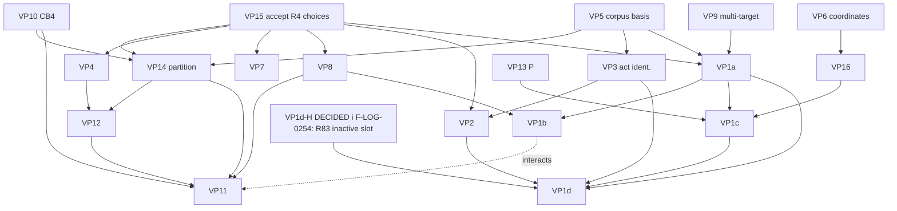

# R7 · Variation-point decision register (draft r1.5)

**Status:** decision-support artifact for the human review of the R7 candidate model (F-LOG-0250, corrected by F-LOG-0251), 2026-10-11. Draft r1.4 (r0 + the §5a decision-timing analysis, the VP1d alignment with T3 (now r1.4), the separate decision item VP1d-H and the prioritized order; change list in §7). **Not yet independently reviewed. It decides nothing and recommends no value.** The "recommended action" in §5a is a recommendation about **when** a decision is taken (DECIDE NOW / DEFER / AUTHORIZE TARGETED RESEARCH), never about **which** option. It sets out each of the 19 variation points in `R7/T3-CANDIDATE-MODEL.md` r1.4 §4 (VP1a–d, VP2–VP16), plus the decision item VP1d-H that T3 r1.4 VP1d names as a human alternative, so that a human can see what each decision would commit to. Companion: `R7/ARB-DECISION-PACKAGE.md`. **[r1.5] Amendment under human ruling, post-closure (F-LOG-0254; R7 closed by F-LOG-0253):** VP1d-H is **DECIDED (i)**; VP1d's option set includes T2 R83 (inactive slot). No other VP is decided; nothing is adopted.

**Inputs:**
- `R7/T3-CANDIDATE-MODEL.md` r1.5 (**[r1.5 sync]** amended under F-LOG-0254; r1.4 was commit 1a63f3a14): §1a partitions P-a to P-d, §3a exclusions, §3b extensions, §3c evidence needs, §4 VPs (r1.1 was the r0 input);
- `R7/T1-CONCEPT-CANDIDATES.md` r1.6 and `R7/T2-RULE-CANDIDATES.md` r1.4 (R1–R83), for ids (T2 row ids R1–R83 are T2-local, T2 §0);
- `R7/REVIEW-T1.md`, `REVIEW-T2.md`, `REVIEW-T3.md`, `REVIEW-CROSS-ARTIFACT.md`;
- `R7-AUTHORIZATION-BRIEF.md` r3: K1–K9, Λ1–Λ7, N1–N8, §4;
- `docs/knowledgeos/chronological_knowelgeos_ablation_theory/F-GOVERNANCE-LOG.md`, F-LOG-0245 to 0251.

**Verification state [r1.1]:** cross-artifact audit PASS_WITH_LIMITATIONS; fix round 1 verified with residuals; fix round 2 (T1 r1.5, T2 r1.3, T3 r1.4) **confirmed PASS_WITH_LIMITATIONS, no material defect remaining** (`R7/REVIEW-CROSS-ARTIFACT.md`). Register rows citing X7, C7, R20 and R41 were re-checked against r1.5 / r1.3 / r1.4 (§7, r1.1 row).

**Boundary:**
- Every option is a candidate **[E]**. None is preferred.
- "Leave open" is listed for every VP, and it is what T3 currently holds.
- Where an option is H-D-side, its H-B-side counterpart sits in the same cell, in the same order.
- No architecture, persistence, API, technology or canonical-term decision is made here (R8 is unauthorized, F-LOG-0248).

**Standing qualifier (applies to every row):** "one corpus; finite universes; within-family evidence; cross-family waived; H-D vs H-B non-identifiable"

## 0. Keys

| key | meaning |
|---|---|
| **A** | changes theoretical assumptions (an R4 modelling choice, an Asm, a hypothesis, or a step beyond R4, §3b) |
| **B** | affects H-D / H-B neutrality (path A, F-LOG-0247; N1) |
| **C** | affects candidate boundaries or groupings (CB*, CG*, §1a, §1b) |
| **D** | requires evidence that is not in the authorized corpus |
| **E** | can safely remain open for objectives O1 and O2 (see §3; the reason is given in §4) |
| **O1** | accept R7 as a candidate deliverable (the F-LOG-0250 human review) |
| **O2** | adopt a bounded candidate model ([E], one corpus, still pre-architecture) |
| **O3** | prepare an architecture authorization proposal (architecture itself is unauthorized, F-LOG-0248). **[r1.2]** O3 is the *preparation* of the proposal that asks for the bounded-architecture-derivation gate (ARB package §E3); the derivation itself is E3 and needs its own human act. Both need the same minimal VP set |
| **Rev.** | reversibility: high (additive, or the change is local to labelled slots), medium (re-derivation of some T3 rows), or low (re-derivation of T1–T3 or of the frame) |
| **Evidence-route status** | V2, V5, V6, E-A5 / Protocol C and any new evidence are all **not authorized** (F-LOG-0247, F-LOG-0248). V5 is also not offered (brief §7) |

## 1. Register

### 1a. The H-D / H-B policy slots (VP1a–d)

The options are listed exactly as in T3 §4. **The H-D side and the H-B side are given the same treatment.** "Both" and "neither" are listed alongside them.

| id | question | options | cat. | depends on / constrains | consequences per option | assumptions introduced | Rev. | required authority | needed for |
|---|---|---|---|---|---|---|---|---|---|
| VP1a | Norm-change regime: which Chg-constraint, if any, fills the CE4 slot? (T-B R25, R26, R38 on the H-D side; R30, R31, R37 on the H-B side, temporal precedence only; T-D R71) | (i) an H-D clause; (ii) an H-B clause; (iii) both; (iv) neither; each under a stated reading of Table 9.4; (v) leave open | A, B, C, D, E | **after:** VP15, VP5; VP9 (R31 is multi-target); co-decide the reading with VP1b–d. **Constrains:** VP1b, VP1c, VP1d coherence. Under P-a, VP14 makes H-D clauses internal and H-B clauses crossing | (i) the model carries N1's H-D statement as normative policy, and P-a's cut becomes congenial to it. (ii) the model carries N1's H-B statement as normative policy, and its clauses cross CB2↔CB3 under P-a and stay partly crossing under P-b. (iii) both families are constrained jointly; Table 9.4 joint-satisfiability per reading must be checked. (iv) and (v) change points constrained only by R20 (definition), as now | (i) and (ii): a normative stance, not an observation (R82; bK2, bK6); reading-relative (Λ4); (iii) joint readings; (iv) and (v): none | medium: reversible while the slot stays labelled "optional policy" and pre-architecture; it becomes costly once grouping or architecture is built on one side | **human act labelled normative** (path A). Evidence route: a σ/f channel (Cor 4.3; R66–R68) = **E-A5 / Protocol C, not authorized** (F-LOG-0247, 0248) | none for O1, O2, O3 (leave open is admissible for all) |
| VP1b | H-D-side status → force: does adoption gate entry into force? (R27 D-st, R28 D-st⁺ / R-d) | (i) D-st; (ii) D-st⁺; (iii) neither; (iv) leave open | A, B, E | **after:** VP1a (same family), VP15, VP8 (act kinds). **Constrains:** the meaning of CG3 (VP11) and the SC1/SC2 premises (brief §4) | (i) and (ii) add an H-D-side policy with no H-B-side counterpart in this slot; the counterpart symmetry is VP1c. (ii) leaves Lem 4.2's scope (Rem 4.2s) and needs SC1/SC2, and under R-d, Cap unobserved (Rem 9.7). (iii) and (iv) Adopted stays derived only (R19) | (i): adoption–force link; (ii): plus SC1, SC2; (iii) and (iv): none | medium: same as VP1a | **human act**; no evidence route in the corpus (records cannot decide, Cor 4.3) | none |
| VP1c | H-B-side work conformance: must work conform to σ? (R32, R33 universal; R34 R-b) | (i) universal; (ii) weak; (iii) none; (iv) leave open | A, B, E | **after:** VP1a (same family), VP13 (P), VP16 (work start t(w)), VP15. **Constrains:** CV6 meaning; CG5 | (i) and (ii) add an H-B-side policy with no H-D-side counterpart in this slot; the counterpart symmetry is VP1b. They are not checkable from records (Rem 4.10). (iii) and (iv) violation stays a definition only (R18) | (i): Rem 3.1a universal reading; (ii): weak reading; (iii) and (iv): none | medium: same as VP1a | **human act**; no evidence route in the corpus (Rem 4.10; an E-A5-type channel is not authorized) | none |
| VP1d **[r1: aligned with T3; r1.1: T3 r1.4]** | **Record clauses and their reading variants:** which, if any, fill the slot? R29 (D-rec: existential record clause, shared by H-D and H-B); R35 (B-recW: existential record clause, H-B); R36 (B-rec: conjunction of existential record clauses, H-B; weaker R-c / R-f variant); **R79** (R-i: the B-side record clause **replaced by an act-existence clause "E ≠ ∅"**, which references no record); **R80** (R-i′: **no B-side record clause at all**); **[r1.5] R83** (R-h: the universal record clause as an optional policy; **inactive slot**, activation needs its own human act; the non-occurrence inference never applied to the observed capture; F-LOG-0254). R79, R80 and R83 are **not** existential record clauses | (i) adopt any subset, each under its stated reading (R83 only by its own activating human act); (ii) none; (iii) leave open. The universal form (R-h; X25, R41) is excluded on the **H11 / A7 ground** (as an invariant it would license inferring non-occurrence from absence: T1 X18, T2 R49), not because it is universal. **[r1.1]** Precision: it contradicts **A7 directly** and **H11 conditionally on capture completeness**, which O1, F11 and G01 deny. The existential clauses avoid the inference. Whether to admit its T-B form with the inference not applied to the observed capture is the **separate** item VP1d-H, **[r1.5] decided (i) by F-LOG-0254: admitted as R83** | A, B, C, E | **after:** VP1d-H (it fixes VP1d's option set), VP2 (record mode), VP3 (act identifiability), VP1a / VP1c family coherence. **Affects** which clauses cross into CB1 under each partition; this is a disclosure only, and VP14 is not decided by reference to VP1d (N1) | (i) R29 encodes both families; R35 and R36 are H-B under 𝐑₀; R79 and R80 are H-B under R-i and R-i′. Choosing a subset fixes a reading (Λ4). R79 and R80 break R13's B-rec ⇒ D-rec (RB2 fails), and under R80 Lem 3.6 fails for H-B (R12). Under P-c and P-d the existential record clauses cross **symmetrically under 𝐑₀ only**; under R-i and R-i′ the H-B side has no record-crossing clause, so the crossing is **asymmetric** (T3 §1a, r1.3 onward). **[r1.5 sync]** Under R-h with R83 active, both sides' record clauses cross, but the H-B crossing is universal (stronger); disclosed (F-LOG-0254 sync). (ii) and (iii) no completeness (R16), as now | (i): a reading of Table 9.4; for R79, act existence; (ii) and (iii): none | medium | **human act** | none |
| **VP1d-H [r1, new decision item; not a 20th T3 VP] [r1.5] DECIDED (i), F-LOG-0254** | **[r1.5] Status: DECIDED (i), F-LOG-0254** (inactive T-B slot T2 R83; the invariant form X25 / R41 stays NOT admissible; VP1d's option set now includes R83). Human alternative named in T3 r1.4 VP1d (and T1 X25 r1.5, T2 R41 r1.3): admit a **T-B optional-policy form of R-h's universal record clause, with the non-occurrence inference (X18, R49) not applied to the observed capture** (inside the model R-h entails the inference, so it cannot be "disallowed"; a policy can only forbid applying it to the incomplete capture)? **[r1.1]** Current exclusion ground: universal completeness as an invariant contradicts **A7 directly** and **H11 conditionally on capture completeness**, which O1, F11 and G01 deny | (i) admit it as an inactive T-B slot (VP1d's option set then includes it); (ii) confirm the analyst decision (R41 stays T-C; the asymmetry stays disclosed); (iii) leave open (the analyst decision stands provisionally, unratified) | A, B, C | **after:** none. **Constrains:** VP1d's option set only | (i) restores R-h as an H-B option slot and removes the disclosed asymmetry, but the slot carries a universal completeness clause that is safe only while the policy's ban on applying the inference to the observed capture holds; R-h is M but not T, and Prop 4.1(iii)'s literal wording fails under it (Table 9.4). (ii) keeps a one-sided H-B loss, justified by the A7 conflict (direct) and the H11 conflict (conditional on capture completeness). (iii) as (ii), with the analyst decision unratified | (i): that a universal completeness policy can be held while **never applying** the non-occurrence inference to the observed capture (a separability assumption, [E]; inside the model R-h still entails it); (ii): that the H11 / A7 conflict justifies a one-sided exclusion; (iii): none | high: it changes the admissibility of one inactive slot; no T-A row is touched | **human act** (the current exclusion is an analyst decision, disclosed) | none strictly (it can travel as a specified limitation of O1); see §5a |

### 1b. Evidence-bound and extension VPs (VP2–VP10, VP13, VP16)

| id | question | options | cat. | depends on / constrains | consequences per option | assumptions introduced | Rev. | required authority | needed for |
|---|---|---|---|---|---|---|---|---|---|
| VP2 | Constitution (OQ2): is a record the act or a report of it? (R39; T-D R78) | (i) a labelled mode-fixing convention for a class of records; (ii) keep the mode unknown-capable (CV4); (iii) leave open | A, B, C, D, E | **after:** VP15 (F2 is an Asm), VP3. **Constrains:** VP1d; the CB1↔CB2 interface | (i) gives the pairs a fixed mode by convention, not by fact (N2; X23 bars it as an observation). Lem 4.2 says perfect mode coding still does not separate for the Def 3.1 readings and M-readings, but this **fails generically** under R-c, R-d, R-g, R-g⁺, R-i, R-i′ and R-j, so a convention can touch neutrality under those readings. (ii) and (iii) every pair ambiguous (R24), as now | (i): convention scope and class definition; (ii) and (iii): none | medium: the convention is labelled; rows that depend on it must be re-checked if it is withdrawn | **human act** (convention). The fact is not decidable (bK7, bK8). Evidence route: V5, which is **not offered and not authorized** | none |
| VP3 | Act identifiability (OQ11): can acts be identified in records? (R77) | (i) treat acts as identifiable; (ii) treat them as not identifiable; (iii) leave open (held unobserved) | A, D, E | **after:** VP5 (V6 route). **Constrains:** VP2, VP1d; the checkability of R4, R5, R19, R25–R29 | (i) contradicts K7 (act/norm layer not reliably codable, within family) unless evidence is added. It makes rules over acts nominally checkable. (ii) and (iii) acts are unobserved, and rules over acts are uncheckable, as now | (i): a codability assumption with no ground truth (F-LOG-0217); (ii) and (iii): none | medium | evidence route: a **non-Claude coder or V6, not authorized**; otherwise a human act that labels (i) as an assumption | none |
| VP4 | Roles / offices (OQ10; R76; R63 excluded) | (i) add a role concept (extension, §3b); (ii) keep Cap only; (iii) leave open | A, C, E | **after:** VP15 (Cap constancy, Def 1.2). **Constrains:** VP12, VP11 (CG1) | (i) is a step beyond R4; R63-type rules would become formable and need new justification ([E]; N5, N8). (ii) and (iii) Cap stays constant and unobserved | (i): role ontology (A05, A06 as motivation only); (ii) and (iii): none | high: additive | **human design decision** | none (O3 may list it as "not supported") |
| VP5 | Corpus specificity and adequacy (OQ8, OQ9; R75) | (i) accept the one-corpus primitives as the bounded model basis; (ii) defer to V6; (iii) leave open | A, D | **foundational** (parallel to VP15). **Constrains:** every element | (i) adopts with an explicit one-corpus scope (Λ3, Λ6); no generality may be claimed. (ii) no adoption until V6. (iii) the model stays a candidate only | (i): satisfiability treated as a sufficient basis for a *bounded* model; adequacy stays [E]/[I] (bK1); (ii) and (iii): none | medium: an adoption can be withdrawn, but downstream work inherits its scope | **human act**; evidence route **V6, not authorized** | **O2, O3** |
| VP6 | Population of unobserved coordinates (OQ5; R72) | (i) name a source; (ii) leave unpopulated; (iii) leave open | D, E | **after:** new evidence. **Constrains:** the checkability of R2–R6, R8–R13, R18–R20; VP16 (t(w)); VP3 | (i) needs a source not in the corpus. None may be filled from r or c (N3). (ii) and (iii) the model is satisfiable but not checkable, as now | (i): the source's validity; (ii) and (iii): none | high | **new evidence, not authorized** (F-LOG-0248); a human act to authorize any source | none |
| VP7 | Norm content (OQ3; R64) | (i) extend beyond target ↦ value (provisos, conditions, scope, rationale); (ii) keep target ↦ value; (iii) leave open | A, E | **after:** VP15 (σ primitive). **Interacts with:** VP9 (CV2) | (i) is a step beyond R4 (Rem 0.1; X3); none of R4's results cover it. (ii) and (iii) target ↦ value, as now | (i): a content ontology; (ii) and (iii): none | high: additive | **human design decision** | none |
| VP8 | Act kinds (OQ4; R65) | (i) distinct kinds (hold, withdraw, supersede, annotate); (ii) R4's mapping; (iii) leave open | A, C, E | **after:** VP15. **Constrains:** VP11 (CG3), VP1b | (i) is a step beyond R4 (X12) and reshapes CG3. (ii) and (iii) issue acts plus the absence of adoption, as now | (i): a kind taxonomy; (ii) and (iii): R4's mapping | medium: CG3 rows would need re-derivation | **human design decision** | none |
| VP9 | Multi-target (OQ6; R73) | (i) keep R4's finite 𝒯 (allowed by Def 1.1, untested under R-a); (ii) restrict to one target (a **restriction of R4**); (iii) leave open | A, B, D, E | **after:** V2 if tested. **Constrains:** VP1a (R31 is an H-B-side multi-target clause) | (i) keeps a scope that is untested (Λ5). (ii) is not a neutral default: it bears on R31, an H-B-side clause, and removes the domain in which R-a could be tested. (iii) R4's 𝒯, as now | (i): none beyond R4; (ii): one-target domain restriction; (iii): none | medium for (ii); high otherwise | (i) and (iii): none. (ii): **human design decision**. Testing: **V2, not authorized** | none |
| VP10 | Evidential-limitation side (OQ7; R74) | (i) include CB4 (CV8, CV9, CS1); (ii) drop it; (iii) leave open as a slot | A, C, E | independent. **Constrains:** VP14 (the boundary set), VP11 | (i) carries epistemic information in the model, which is a step beyond R4 (X19, §3b); CB4 has no T-A row. (ii) removes the slot; its limitations stay in the qualifier only. (iii) open slot, as now | (i): an epistemic-status representation; (ii) and (iii): none | high | **human design decision** | O3 (whether the proposal includes CB4) |
| VP13 | Permitting subset (A6) | (i) P ≠ V; (ii) P = V; (iii) leave unset | A, B, E | independent. **Constrains:** VP1c; Prop 4.1(ii) applicability | (i) is the A6 hypothesis of Prop 4.1(ii). (ii) makes every work event conform trivially, so VP1c's H-B-side clauses become vacuous and Prop 4.1(ii) does not apply: an asymmetric effect. (iii) the parameter stays unset (N5) | (i): A6; (ii): a degenerate value set; (iii): none | high: it is a parameter | **human design decision** (N5) | none |
| VP16 | Trace-to-work link (CG6 ↔ CG5; O8) | (i) add a link (needs t(w) or a mapping, not recording order: N3, H12); (ii) leave none | A, C, D, E | **after:** VP6 (t(w)). **Constrains:** VP1c checkability; VP11 (CG5/CG6) | (i) needs a mapping that the corpus does not supply. Lem 4.7 says a mapping is necessary but not sufficient for separation; the link alone does not touch Cor 4.3, which needs σ or f. (ii) no link, as now | (i): a mapping assumption; (ii): none | high | **new evidence (not authorized) or a human design decision** | none |

### 1c. Structural VPs (VP11, VP12, VP14, VP15)

| id | question | options | cat. | depends on / constrains | consequences per option | assumptions introduced | Rev. | required authority | needed for |
|---|---|---|---|---|---|---|---|---|---|
| VP11 | Grouping granularity (CG1–CG6) | (i) merge groupings (e.g. CG2+CG3); (ii) keep them separate with cross-grouping constraints; (iii) leave provisional (as now) | A, B, C, E | **after:** VP14, VP12, VP8, VP4, VP10. **Interacts with:** VP1b, since CG3 is meaningful mainly under the H-D-side D-st / D-st⁺ | (i) and (ii) need a consistency notion that R4 lacks (§3b), and no grouping is enforceable from records (R23). Ten T-A rows cross groupings (R1, R2, R3, R5, R6, R8, R9, R18, R19, R22). A CG3-centred choice leans toward H-D-side clauses; a grouping justified only by H-B-side clauses would lean the other way. (iii) groupings stay conceptual | (i) and (ii): a consistency / transaction notion (extension); (iii): none | high while provisional | **human design decision** | **O3** |
| VP12 | Participant: one shared concept or boundary-local roles | (i) one shared participant (R4's 𝒜); (ii) boundary-local concepts (norm-maker / executor / keeper); (iii) leave open | A, C, E | **after:** VP15 (Def 1.2), VP4, VP14. **Constrains:** VP11 (CG1) | (i) follows Def 1.2. (ii) splits one actor set across boundaries, and the identity link (R22) becomes a crossing constraint. R70 independence reads the roles relative to τ, not as concepts. (iii) one actor set held, as now | (i): none beyond R4; (ii): a role-separation assumption (overlaps VP4); (iii): none | medium | **human design decision** | **O3** |
| VP14 | Boundary partition (§1a) | P-a / P-b / P-c / P-d; none preferred; or leave open (carry the model with **no** boundary layer) | B, C | **after:** VP15, VP10. **Must be decided without reference to** VP1a–d outcomes (N1). **Constrains:** VP12, VP11 | **P-a:** H-D clauses internal, H-B clauses crossing; H-D-congenial. **P-b:** conformance and the work disjuncts internal, but the change clauses still cross acts↔σ; only partially H-B-congenial. **P-c:** the change and conformance clauses of both families internal; the existential record clauses cross symmetrically **under 𝐑₀; asymmetrically under R-i and R-i′** (R79, R80; T3 §1a, r1.3 onward); neutral under 𝐑₀. **P-d:** split by observability; the change and conformance clauses internal to the unobserved side; the existential record clauses cross symmetrically **under 𝐑₀; asymmetrically under R-i and R-i′**; it splits concepts by attribute (C13); neutral under 𝐑₀, follows R23. **[r1.5 sync] P-c, P-d:** Under R-h with R83 active, both sides' record clauses cross, but the H-B crossing is universal (stronger); disclosed (F-LOG-0254 sync). **Leave open:** T3's P-a layout must not be carried into an adopted model, since that would adopt an H-D-congenial cut by implication | P-a / P-b: a tilt toward one family is disclosed; P-c / P-d: none beyond the cut; leave open: none | medium: re-layout re-derives the §1a crossings and VP11/VP12 | **human design decision**; must not encode H-D or H-B (N1) | **O2** (decide, or explicitly adopt without a boundary layer), **O3** |
| VP15 **[DECIDED (i), F-LOG-0255]** | Accept R4's modelling choices (N5): σ as a primitive (R11), Cap constancy (R10), A5 / Rem 1.11a (R21), O as the base observation (R23), F2 as an Asm (R2, R3) | (i) accept each, labelled as a modelling choice; (ii) replace one or more (an extension beyond R4); (iii) leave open | A (D for adequacy) | **foundational.** **Constrains:** VP1a–d, VP2, VP4, VP6, VP7, VP8, VP12, VP14 | (i) the model rests on R4 r3.1 as sealed (F-LOG-0240), and K1–K9 apply under their scopes. (ii) a replaced choice voids the R4 results that use it (e.g. D1 needs A5; Lem 4.2's scope), and T1–T3 must be re-derived. (iii) the model stays a candidate only | (i): the five choices, never as corpus facts (N5); adequacy [E]/[I] (bK1); (ii): the replacement's justification; (iii): none | low: everything downstream rests on it | **human design decision**; adequacy testing would need **V6 (not authorized)** | **O2, O3** |

## 2. Dependency graph and decision order

**Edge rules.**
- **A → B** means that A should be decided, or explicitly left open, before B.
- **VP14 has no incoming edge from VP1a–d.** This is deliberate: N1 requires the partition to be chosen without encoding either family.
- **The graph is acyclic.**

| tier | VPs | role | gated by |
|---|---|---|---|
| 0: foundational | **VP15**, **VP5** | the frame and the corpus basis; everything else rests on them | human act (VP5 also V6, unauthorized) |
| 1: structural | **VP10**, then **VP14**; also VP4, VP7, VP8, VP9 | the boundary set and the partition; extensions and restrictions of R4 | human design decision (VP9 testing: V2, unauthorized) |
| 2: structural, downstream | VP12, then VP11 | participant placement, then the groupings | human design decision |
| 3: normative policy slots | VP13; VP1a, then VP1b and VP1c; VP2; VP1d-H (independent; it fixes VP1d's option set; **[r1.5] decided (i), F-LOG-0254**); VP1d last | H-D / H-B-sensitive; under path A, leaving them open is admissible | human act labelled normative; evidence routes E-A5 / V5 not authorized |
| evidence-gated | VP3, VP6, VP16 (and VP9 test, VP5 adequacy) | cannot be decided as fact from the corpus | non-Claude coder, V2, V6, new evidence: all unauthorized |

## 3. Minimal decision set per objective

| objective | minimal VPs to decide | may stay open | note |
|---|---|---|---|
| **O1** accept R7 as a candidate deliverable | **none** | all 19, and VP1d-H | F-LOG-0250 stop condition: a candidate plus traceability. T3 §4 already holds every VP as "not resolved; default empty". Acceptance is a human act on the artifact, not on any VP. **[r1]** VP1d-H may stay open, but then the X25 / R41 exclusion travels as an **unratified analyst decision** with a disclosed H-B-side asymmetry (§5a) |
| **O2** adopt a bounded candidate model | **VP15, VP5, VP14**, plus an explicit "left open" (or decided) record for **VP10** (edge VP10 → VP14). **[r1.2] Disclosed constraint:** O2 requires **VP5 = option (i)**; option (ii) (defer to V6) and (iii) (leave open) block O2 by definition. This states what O2 presupposes; it does not recommend O2 or option (i) | the other 16. VP11 and VP12 are carried as provisional; VP1a–d, VP2 and VP13 as inactive slots (**[r1.3] analyst resolution, disclosed:** if the human decided a VP1a–d value under E2, E2b adopts it as an **active optional policy, explicitly labelled "human-decided policy, not derived from research phases R1–R6"**, keeping its H-D / H-B encoding label; VP1a–d values not decided stay inactive slots; **[r1.4]** an evidence-gated VP value (VP3, VP6, VP16, and VP9 where it relies on multi-target norms) decided under E2 enters E2b **only if** (a) its evidence route was authorized and completed (VP3: a non-Claude coder; VP6 and VP16: a named new source, for σ / f via E-A5; VP9: a V2 slice), or (b) it is labelled **"assumption, not evidence"** and listed explicitly as an added limitation in the package §B; see ARB package §E2b); VP3, VP6, VP16 and VP9 as evidence needs; VP4, VP7 and VP8 as unsupported extensions (VP10 as an explicit open slot) | VP14 may be decided as "no boundary layer", but it must be decided explicitly, because adopting T3 as laid out would adopt P-a (H-D-congenial) by implication. Adoption stays [E] and carries the standing qualifier |
| **O3** prepare an architecture authorization proposal | **VP15, VP5, VP14, VP10, VP12, VP11** | VP1a–d, VP2, VP13 (as configurable / inactive policy, not invariants: N1, N2, N5); VP3, VP6, VP16, VP9 (stated as evidence gaps); VP4, VP7, VP8 (stated as unsupported) | Boundaries, participant placement and groupings are what an architecture proposal would map onto. **Preparing such a proposal needs its own human act; architecture and R8 are not authorized** (F-LOG-0248). R4 offers no consistency notion for VP11 (§3b), so VP11 needs a design decision, not a derivation |

## 4. Safe to leave open

"Safe" means that leaving the VP open preserves H-D / H-B neutrality and traceability for O1 and O2. It does not mean that the VP is unimportant.

| VP | reason it can stay open |
|---|---|
| VP1a | path A (F-LOG-0247): non-identifiable on this corpus. "Open" is the only option that adds no normative stance (N1) |
| VP1b | an H-D-side slot. Open keeps symmetry with VP1c; Adopted stays derived only (R19) |
| VP1c | an H-B-side slot. Open keeps symmetry with VP1b; violation stays a definition only (R18) |
| VP1d | open means no completeness (R16), which matches the observation; X25 remains excluded either way |
| VP1d-H [r1] | safe for traceability (the exclusion and its asymmetry are disclosed in T1 X25, T2 R41, T3 VP1d). **Open does not restore neutrality:** while open, one H-B option (R-h) stays excluded with no matching H-D loss. **[r1.5] No longer open: DECIDED (i), F-LOG-0254** (asymmetry resolved for the policy layer, **with a residual disclosed condition**: R83 alone carries the separability assumption [E] (the inference is not applied to the observed capture), which has no H-D counterpart) |
| VP2 | the unknown-capable mode (CV4) represents the evidence faithfully (R24; bK7, bK8) |
| VP3 | acts held as unobserved matches K7. Deciding needs unauthorized evidence |
| VP4 | an extension (§3b). Absence is R4's state, and adding it later is additive |
| VP6 | the coordinates exist in R4; they are simply unpopulated. New evidence is unauthorized |
| VP7 | an extension. Target ↦ value is R4's choice, and extending later is additive |
| VP8 | R4's mapping is held. Distinct kinds would be an extension |
| VP9 | R4's finite 𝒯 is held as is. Restriction is not neutral (it bears on R31); testing needs V2 |
| VP10 | CB4 carries no T-A row, so an open slot constrains nothing |
| VP11 | O2 only: the groupings are conceptual and provisional, and no enforcement unit exists (R23). **Not open for O3** |
| VP12 | O2 only: R4's single actor set is held. **Not open for O3** |
| VP13 | a parameter. Unset keeps both Prop 4.1(ii) applicability and VP1c meaningful |
| VP16 | no link matches O8. Adding one needs evidence or a mapping |
| **not safe for O2:** VP5, VP14, VP15 | VP15 and VP5 define what is adopted and its scope. VP14 left implicit would carry P-a's H-D-congenial cut |

## 5. Standing qualifier

"one corpus; finite universes; within-family evidence; cross-family waived; H-D vs H-B non-identifiable"

## 5a. [r1] Decision timing per VP

**Reading this table.**
- "Next deliverable" is the **R7 closure decision (O1)**. Where a VP is also needed for O2 (adopt a bounded candidate model) or O3 (prepare an architecture authorization proposal), this is said.
- "Research" means V2, V6, E-A5 / Protocol C or a non-Claude run. **None is authorized** (F-LOG-0247, F-LOG-0248). Saying a route *could materially change* a VP is not a claim about what it would find.
- **Recommended action** is a recommendation about the **timing** of a decision only. DECIDE NOW means "put this decision to the human now"; whichever option the human picks, including "leave open", is the human's. DEFER means "do not put it to the human until the stated trigger". AUTHORIZE TARGETED RESEARCH means "the information the decision lacks has a named route; the human may wish to authorize it before deciding". **No row recommends an option.**
- Each row is an independent decision. **No two rows are to be decided as one act.**

| id | evidence-supported conclusions (ids) | undecidable from the authorized evidence | decision required for the next deliverable? | decide now vs defer | reversibility; cost of a later change | could research materially change it? | **recommended action** |
|---|---|---|---|---|---|---|---|
| VP15 **[DECIDED (i), F-LOG-0255]** | K1: R4's primitives jointly satisfiable in U / U_P2 ([F]+[T]); Lem 4.0a: (O, 𝓗) satisfies A1–A5, A7–A9; N5: the five choices are modelling choices, never corpus facts | the **adequacy** of σ-as-primitive, Cap constancy, A5, O-as-base, F2-as-Asm to the domain ([E]/[I], bK1) | O1: no. **O2, O3: yes** | now: fixes the frame that every later decision rests on, labelled as modelling choices. Defer: O2 and O3 stay blocked; the candidate stays a candidate | **low:** replacing a choice voids the R4 results that use it and forces re-derivation of T1–T3 | **V6** could show a second corpus needs different primitives (adequacy). E-A5, V2 and a non-Claude run would not touch the choices themselves | **DECIDE NOW** (only if the human intends to go beyond O1; otherwise DEFER with O1) |
| VP5 | K1 (satisfiability only); Λ3, Λ6 (one corpus, finite U / U_P2); bK1 adequacy [E]/[I]; T3 §3c (generality is an evidence need) | whether the primitives, K6 and K7 are corpus-specific | O1: no. **O2, O3: yes; O2 presupposes option (i)** (r1.2 disclosure: (ii) and (iii) block O2) | now: either a one-corpus-scoped basis for O2, or an explicit "defer to V6" (option (ii) is itself a timing choice, and it blocks O2). Defer: O2 blocked | medium: an adoption can be withdrawn, but downstream work inherits its one-corpus scope | **V6: yes, directly.** It may be uninformative if K7's coding failure recurs (brief §5) | **DECIDE NOW** (the human's choice between options (i) and (ii) is the timing decision) |
| VP14 | T3 r1.4 §1a: P-a is H-D-congenial; P-b only partially H-B-congenial; P-c, P-d neutral under 𝐑₀, asymmetric under R-i / R-i′; P-d splits concepts by attribute (C13); T3 §6 item 8: T1 / T2 give no criterion for the cut | which cut is adequate to the domain; no evidence route exists (a design choice under N1) | O1: no. **O2: yes** (decide, or explicitly adopt with no boundary layer). **O3: yes** | now: removes the risk that T3's P-a layout is adopted by implication. Defer: O2 blocked, or P-a is carried silently | medium: re-layout re-derives the §1a crossings and VP11 / VP12 | no route decides it. An E-A5 channel or a VP3 change would move P-d's observed / unobserved line ([I]); V2 and V6 bear on all options alike | **DECIDE NOW** (with VP10 explicitly left open or decided first; see ARB package §C1) |
| VP10 | CB4 carries no T-A row (T3 §1a); K5: two independent limitations (D16, F17) | whether the model should carry epistemic information (X19 is a Rem 0.1 exclusion; extension, §3b) | O1: no. **O2: an explicit "left open" record is required** (edge VP10 → VP14; r1.2). **O3: yes** | now: fixes the boundary set before VP14. Defer: VP14 must then treat CB4 as an explicit open slot | high: additive either way | no: a design question; no route bears on it | **DEFER** to the O3 gate; record "left open" before VP14 is decided |
| VP12 | Def 1.2 (one actor set 𝒜); R22 (actor identity by identifier, unobserved); R70 reads roles relative to τ, not as concepts | whether boundary-local participant concepts fit the domain | O1, O2: no. **O3: yes** | now: premature while VP14 is open. Defer: R4's single actor set is held | medium | V6 could reveal role structure in another corpus ([I]); otherwise no | **DEFER** to the O3 gate, after VP14 and VP4 |
| VP11 | T3 §1b: ten T-A rows cross groupings (R1, R2, R3, R5, R6, R8, R9, R18, R19, R22); R4 has no consistency, transaction or lifecycle notion; R23: no grouping is an enforcement unit | any consistency notion (not in R4; §3b) | O1, O2: no. **O3: yes** | now: would have to supply a consistency notion R4 lacks. Defer: groupings stay conceptual and provisional | high while provisional | no: the gap is a missing notion, not missing data | **DEFER** to the O3 gate, last among the structural VPs |
| VP4 | A05, A06: role names occur in texts only; G07, H19: host access is not capability; R63 excluded (T-C) | whether roles / offices are needed | no (O3 may list it as "not supported") | now: an extension beyond R4 with [E] justification only. Defer: Cap only, as R4 | high: additive | V6 could show a need ([I]); otherwise no | **DEFER** |
| VP7 | Rem 0.1 (norm content beyond target ↦ value not modelled); X3, R54 (T-C) | whether provisos, conditions, scope or rationale are needed | no | now: an extension no R4 result covers. Defer: target ↦ value, as R4 | high: additive | V6 could show a need ([I]) | **DEFER** |
| VP8 | Rem 0.1 act mapping (supersede and withdraw are issue acts; hold is the absence of adoption); X12, R55 (T-C); A08, A09 | whether distinct act kinds are needed | no | now: reshapes CG3 before any grouping decision. Defer: R4's mapping held | medium: CG3 rows would need re-derivation | V6 or a non-Claude coding of act kinds could inform it ([I]); K7 limits coding | **DEFER** |
| VP9 | Def 1.1 allows a finite 𝒯; Rem 9.8: R-a needs ≥ 2 targets, U is one-target; Λ5: R-a untested | whether D1 and its weak form survive multi-target norms (R-a) | no | now: option (ii) restricts R4 and bears on R31 (H-B side). Defer: R4's finite 𝒯 held, untested | high for (i) / (iii); medium for (ii) | **V2: yes, directly** (a targeted slice; full scale ≈ 4 × 10¹¹ is infeasible, brief §5) | **DEFER**; becomes **AUTHORIZE TARGETED RESEARCH** (V2 slice) if any later gate is to rely on multi-target norm concepts |
| VP3 | K7: act / norm layer not reliably codable (F17, B11; R2 negative result), within family; F-LOG-0217: no ground truth | whether acts are identifiable in records at all | no | now: option (i) would contradict K7 without evidence. Defer: acts held unobserved; rules over acts uncheckable | medium | **a non-Claude coder: yes** (K7 is within-family, Λ7). V6 too, but it may hit the same failure | **AUTHORIZE TARGETED RESEARCH** (a non-Claude coding check), not as a prerequisite of O1 or O2 |
| VP6 | Lem 1.12: O does not depend on σ, f, d, Cap, k, t(w), con, Ref, α / α_W; D04 NOT_DETERMINABLE; B07 no σ channel locally | any source for these coordinates | no | now: no source exists to name. Defer: satisfiable but not checkable, as now | high | only **new evidence** (not authorized); E-A5 for σ / f specifically | **DEFER** until a source is proposed |
| VP16 | Obs O8; H12 (recording order is not start time); Lem 4.7: a mapping is necessary, not sufficient, for separation | a trace-to-work mapping | no | now: needs a mapping the corpus does not supply. Defer: no link, as now | high | new evidence (via VP6), not otherwise | **DEFER** (after VP6) |
| VP13 | A6 is a parameter, not a property of 𝓗 (brief §4); Prop 4.1(ii) needs A6; P = V makes VP1c vacuous | none: a parameter choice | no | now: fixing P = V would have an asymmetric effect on H-B-side clauses. Defer: unset keeps both meaningful | high: a parameter | no | **DEFER** (to configuration, after VP1c) |
| VP1a | K6 / path A: H-D vs H-B non-identifiable on this corpus (F-LOG-0247); R82; Cor 4.3 (R66): separation needs a σ- or f-dependent observable; R20 definition only | which change regime, if any, holds | no (open is admissible for O1–O3) | now: adds a normative stance labelled as such (N1). Defer: only R20 constrains change points, as now | medium while labelled and pre-architecture; costly once grouping or architecture rests on one side | **E-A5 / Protocol C: yes** (the only route in Cor 4.3's sense; sealed, not authorized; H1 not reopened). V2 bears on R-a only | **DEFER** |
| VP1b | R19: Adopted is derived; Lem 3.7: D-st⁺ needs SC1, SC2; Rem 4.2s: R28 leaves Lem 4.2's scope; Rem 9.7 | whether status gates force in the domain | no | now: an H-D-side policy with no H-B counterpart in this slot. Defer: symmetric with VP1c | medium | E-A5 (σ / f channel) only ([I]) | **DEFER** (symmetric with VP1c) |
| VP1c | R18: violation is a definition; Rem 4.10: not checkable from records; E01 at recorded bearing only (n = 1, confounded) | whether work conforms to σ in the domain | no | now: an H-B-side policy with no H-D counterpart in this slot. Defer: symmetric with VP1b | medium | E-A5 (σ / f channel) only ([I]) | **DEFER** (symmetric with VP1b) |
| VP2 | R24 / Lem 5.2: every referenced pair mode-ambiguous (robust for 𝒞 = 𝓗′); Cor 5.3: a mode-fixing rule is a convention, not an observation; K7, K8 | whether records are acts (the fact) | no | now: a labelled convention; under R-c, R-d, R-g, R-g⁺, R-i, R-i′, R-j it can touch neutrality. Defer: unknown-capable mode, as now | medium | a non-Claude coder ([I]); V5 not offered (circular without new blind data) | **DEFER** |
| VP1d | R16: no completeness; O1, F11, G01: capture completeness not shown; A7 (direct) and H11 (conditional on capture completeness): absence is not non-occurrence; R13's B-rec ⇒ D-rec fails under R-i / R-i′ | which reading, if any, of the record clauses holds | no | now: fixes a reading (Λ4). Defer: no completeness, as now | medium | E-A5 ([I]); no other route | **DEFER** (after VP1d-H) |
| VP1d-H | T1 X25 r1.5, T2 R41 r1.3: universal completeness as an invariant contradicts **A7 directly** and **H11 conditionally on capture completeness**, which O1, F11 and G01 deny (the X18 inference); R-h is an H-B reading (Table 9.4); the asymmetry is disclosed | whether a universal completeness **policy** can be held with the non-occurrence inference **not applied to the observed capture** (a design question; inside the model R-h entails it) | **not strictly** (it can travel as a limitation of O1); it removes an **unratified analyst decision** from the R7 record | now: either ratifies the exclusion or restores the H-B option slot; the R7 record then carries a human ruling, not an analyst decision. Defer: the asymmetry travels as a specified limitation | high: one inactive slot | no: H11 and A7 are FROZEN or modelling items; no route bears on the separability question | **DECIDE NOW** (as its own item, never bundled with R7 closure). **[r1.5] Decided (i), F-LOG-0254** |

## 5b. [r1] Prioritized order (timing only; no value implied)

| priority | item | why at this position |
|---|---|---|
| 1 | **VP1d-H** **[r1.5] DECIDED (i), F-LOG-0254** | the only decision item that touches neutrality of the R7 deliverable itself; independent of every other VP; high reversibility |
| 2 | **VP15** | foundational for O2 / O3; lowest reversibility, so decided deliberately and first (graph: tier 0) |
| 3 | **VP5** | foundational for O2 / O3; option (ii) "defer to V6" is a legitimate outcome |
| 4 | **VP10** (record "left open") | precedes VP14 in the graph; DEFER means an explicit open record, not silence |
| 5 | **VP14** | required for O2; prevents P-a being adopted by implication; must not reference VP1a–d (N1) |
| 6 | **VP3** (research authorization, optional, parallel) | the only VP where a modest, targeted non-Claude check could materially change the evidence base (K7) |
| 7 | VP4, VP12, then VP11 | O3 gate only; in graph order |
| 8 | VP9 (V2 if relied on), VP8, VP7 | extensions or untested scope; DEFER |
| 9 | VP13, VP1a, VP1b, VP1c, VP2, VP1d | normative slots; DEFER under path A; VP1b and VP1c kept symmetric |
| 10 | VP6, VP16 | evidence-gated; DEFER until a source exists |

## 6. Self-check

| check | result |
|---|---|
| No VP is decided or recommended | yes. Every row lists the T3 options plus "leave open". §3 states which VPs must be *decided* for an objective, never *which value*. §4 says where open is safe, which is not a recommendation to leave a VP open |
| H-D / H-B options presented symmetrically | yes. VP1a lists the H-D and H-B options in parallel with "both" and "neither". VP1b (H-D side) and VP1c (H-B side) get identical structure, categories (A, B, E), reversibility and authority, and each notes that the other is its counterpart. Tilts are disclosed in both directions: P-a toward H-D and P-b partially toward H-B (VP14); CG3 toward H-D clauses and an H-B-only-justified grouping the other way (VP11); P = V and one-target restriction both touch H-B-side clauses (VP13, VP9), disclosed as asymmetric effects, not as preferences |
| Every VP id exists in T3 r1.4 §4 | yes: VP1a, VP1b, VP1c, VP1d, VP2–VP16 = 19. No VP is added or dropped. **[r1]** VP1d-H is a decision item taken from T3 VP1d's "human alternative", labelled as not a T3 VP |
| [r1] Timing recommendations are not value recommendations | yes: §5a's recommended action states only DECIDE NOW / DEFER / AUTHORIZE TARGETED RESEARCH; no option is preferred; each VP is a separate row, and no two decisions are combined |
| [r1] VP1d aligned with T3 (r1.1: r1.4) | yes: R79 / R80 relabelled (act-existence clause; no B-side record clause; neither is an existential record clause); X25 ground = A7 direct, H11 conditional on capture completeness; asymmetry and human alternative disclosed; P-c / P-d symmetry restricted to 𝐑₀ (VP1d, VP14) |
| Every partition id exists in T3 §1a | yes: P-a, P-b, P-c, P-d, described per the r1.1 wording |
| Authority claims consistent with the governance log | yes. **V2, V5, V6 and E-A5 / Protocol C are not authorized** (F-LOG-0247, F-LOG-0248), and V5 is also not offered (brief §7). **Any new evidence is not authorized** (F-LOG-0248). **R8 and architecture are not authorized** (F-LOG-0248). O3 is stated as needing its own human act. R7 itself is authorized (F-LOG-0248) and complete for human review (F-LOG-0250) |
| N-list respected | N1: VP1a–d are never invariants, and VP14 is decoupled from them. N2: VP2 is a convention only. N3: VP16 and VP6 bar reading d or t(w) off r. N4: reading-relativity is noted (VP1a, VP1d, VP2). N5: VP15, VP13. N6: no quarantined item or B10 cited. N7: Conj 5.5 is not used. N8: every name is a working label |
| Waived not presented as satisfied | yes: standing qualifier; Λ3, Λ5, Λ6 cited where they apply |

**Counts.** Some VPs carry several categories.

| category | VPs | count |
|---|---|---|
| A | VP1a, VP1b, VP1c, VP1d, VP2, VP3, VP4, VP5, VP7, VP8, VP9, VP10, VP11, VP12, VP13, VP15, VP16 | 17 |
| B | VP1a, VP1b, VP1c, VP1d, VP2, VP9, VP11, VP13, VP14 | 9 |
| C | VP1a, VP1d, VP2, VP4, VP8, VP10, VP11, VP12, VP14, VP16 | 10 |
| D | VP1a, VP2, VP3, VP5, VP6, VP9, VP15 (adequacy), VP16 | 8 |
| E | every VP except VP5, VP14 and VP15 (VP11 and VP12 for O2 only) | 16 |

**[r1]** VP1d-H carries A, B, C (not counted above, since it is not a T3 VP).

## 7. r1 changes (from r0)

| # | change | reason |
|---|---|---|
| 1 | inputs → T1 r1.4, T2 r1.2, T3 r1.3; reviews added; log path made explicit; verification caveat | the cross-artifact audit fixes (verification pending) |
| 2 | VP1d row: R79 relabelled as the R-i act-existence clause "E ≠ ∅" and R80 as the R-i′ absence of any B-side record clause (neither existential); X25 / R41 exclusion re-grounded on H11 / A7; P-c / P-d symmetry restricted to 𝐑₀ | alignment with T3 r1.3 VP1d and §1a |
| 3 | new decision item **VP1d-H** (the human alternative: T-B form of R-h with the non-occurrence inference disallowed), as its own row in §1a, §2 graph, §2 tiers, §3 O1, §4 | T3 r1.3 VP1d names it as a human decision; kept separate from VP1d |
| 4 | VP14 consequences: P-c / P-d "symmetric" restricted to 𝐑₀; asymmetric under R-i / R-i′ | T3 r1.3 §1a |
| 5 | new §5a (decision timing: evidence-supported conclusions, undecidable remainder, need for the next deliverable, now-vs-defer, reversibility, research, recommended timing) and §5b (prioritized order) | ARB decision package |
| 6 | §6 self-check rows added | r1 checks |
| r1.1 | alignment with the verified final state (T1 r1.5, T2 r1.3, T3 r1.4, commit 1a63f3a14; `REVIEW-CROSS-ARTIFACT.md` fix round 2 confirmed PASS_WITH_LIMITATIONS; F-LOG-0251): live version references updated; verification caveat replaced by the verified state; VP1d and VP1d-H grounds given the A7-direct / H11-conditional-on-capture-completeness precision; the human alternative reworded to "inference not applied to the observed capture" (it cannot be "disallowed" inside the model) in §1a, §2 graph and §5a. **Re-check of X7, C7, R20, R41:** X7 and C7 are not cited in the register; R20 is cited only as "definition only" (VP1a, VP6), unaffected by C7 / R20 now including B-chg's issue-act disjunct; VP1a's H-B side ("temporal precedence only") matches T3; R41 citations updated as above. X7's D-chg-only restatement leaves VP1a / VP1b unaffected (D-st stays VP1b) | coordinator instruction; verified final state |
| r1.2 | package review (PASS_WITH_LIMITATIONS): title and status aligned to r1.2; O3 key reconciled with ARB package §E3 (O3 = preparing the authorization proposal; E3 = the derivation gate); §3 O2 row and §5a VP5 / VP10 rows state the disguised constraints explicitly (O2 presupposes VP5 = (i); O2 needs an explicit VP10 "left open" record, edge VP10 → VP14). No value recommended | package review required changes 1, 2, 5 |
| r1.3 | §3 O2 row: the E2b rule for decided VP1a–d values added (active optional policy labelled "human-decided policy, not derived from R1–R6", H-D / H-B label kept; undecided values stay inactive); title and status → r1.3 | coordinator final change 2 (analyst resolution, disclosed) |
| r1.4 | §3 O2 row: label → "not derived from research phases R1–R6" (avoids a clash with T2-local row ids; r1.3 change row left as historical); evidence-gated condition for VP3, VP6, VP16, VP9 added, matching ARB package r4 §E2 / §E2b | coordinator last fixes 2, 3 |
| r1.5 | **amendment under human ruling, post-closure** (F-LOG-0254; R7 closed by F-LOG-0253): VP1d-H status → **DECIDED (i)**; VP1d option set includes T2 R83 (inactive slot); status line, §2 graph label and tier row, §4 VP1d-H row, §5a VP1d-H action, §5b priority 1 marked decided. No other VP decided; nothing adopted | F-LOG-0254 |
| r1.5 sync | amendment review (PASS_WITH_LIMITATIONS), F-LOG-0254 synchronisation, post-closure: inputs → T1 r1.6, T2 r1.4 (R1–R83), T3 r1.5; R-h crossing disclosure in VP14 and VP1d consequence cells; "resolved" qualified in §4 VP1d-H. No decision content changed | F-LOG-0254 |
| r1.6 | human ruling | VP15 marked DECIDED (i), F-LOG-0255: R4's five modelling choices accepted, each labelled as a modelling choice. No other change |
