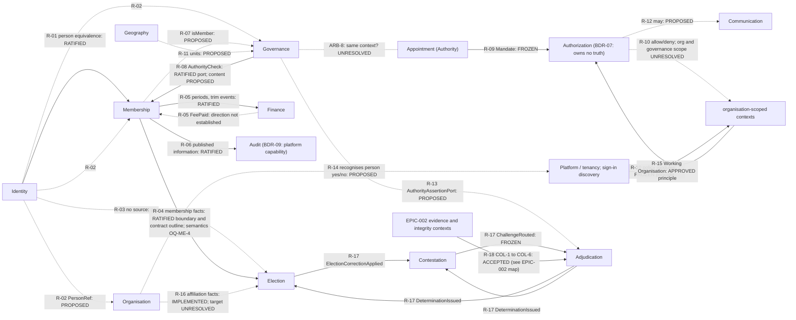

# PublicDigit strategic context map: consolidation draft

**Status:** **PROPOSED.** Its **location and role as the consolidation point were approved by the PO on 2026-11-02**. Not ratified, not authoritative, and it replaces no existing map. It consolidates evidence from existing records and decides nothing.
- The relationships in it carry their own statuses; the approval of the document is not a ratification of any of them.
- It **supersedes governance map §5** as the place where these relationships are maintained (PO, 2026-11-02; §14). This changes the place of maintenance, not any status.
**Date:** 2026-11-02 · **Author:** Claude (DDD architect; authority: generated) · **Drafted at:** branch `election-flow-updated`, HEAD `6b912b6aa`.
**Independent review:** 2026-11-02 at HEAD `0985739fc` (authority: generated; a review, not an approval). Corrections from the review are applied in place and listed in §15. **The status stays PROPOSED.**
**Placement:** `php scripts/doc-placement.php --scope=product-specific --domain=publicdigit` → `docs/publicdigit` (exit 0). It sits next to the resumption record `strategic-design-status.md`.
**Governing principle:** *no context decides for another.*

**Three things are kept apart throughout:**
- the **intended boundary** (target architecture);
- the **implemented dependency** (current code);
- the **authority** to decide a change.

## 1. Purpose and scope

**Purpose:** one traceable view of the strategic contexts of PublicDigit, their ownership and their relationships, for the PO to review. It covers the organisation and governance domain, Membership and Election at their boundaries, and references to the evidence and integrity contexts.

**Not in scope:**
- tactical design;
- implementation changes;
- the resolution of any open question.

## 2. Status and authority disclaimer

- Every relationship below carries a status and a source. **Where the sources do not settle something, this map says "not established in the reviewed authoritative sources", or marks it UNRESOLVED.**
- No existing map is superseded by this draft. Any supersession (§14) needs the stated authority.
- The draft does **not** extend the authority of the EPIC-002 canonical map.
- Questions marked "proposal" in §10 are **not registered**. They are drafts for the PO to route.

## 3. Source hierarchy and reconciliation method

| Source | Status | Scope | Authority |
|---|---|---|---|
| `docs/publicdigit/reviews/2026-10-08-membership-architecture-ratification-act.md` (§10 `:283-307`, §11 `:309-349`, §12 `:353-395`; recorder's notes N-1…N-6 `:8-19`, which "do not amend the act") | **RATIFIED** (2026-10-08) | Membership; its context boundaries with Identity, Governance, Election, Finance, Audit | Principal Reviewer act |
| `docs/publicdigit/reviews/2026-10-08-membership-architecture-ratified.md` (canonical artifact of the act; §8 "Context contracts" `:152-157`) | **RATIFIED** (part of the ratified artifact set named in the act header) | contract outlines for Election, Finance, Governance, Identity | Principal Reviewer act |
| `docs/publicdigit/reviews/2026-10-08-membership-final-ratification-verdict.md:46` | freeze-audit verdict, part of the ratified artifact set | the boundaries line, including "There is no shared persistence" | Principal Reviewer act (by inclusion in the set) |
| `docs/implementation/EPIC-002_Canonical_Context_Map.md` | **ACCEPTED by the ARB (2026-07-25)**; on acceptance its five contexts were "ratified as the project's Bounded Contexts for Tactical DDD"; "the single authoritative Context Map of the ruled decomposition" | five evidence and integrity contexts only | ARB |
| `docs/architecture/design/Round49-06_Boundary_Decision_Register.md` (v1.0 + v1.1 delta) | **IMMUTABLE / FROZEN** ("changes only by a versioned re-issue … via ADR") | software boundaries of the trustworthiness programme (BDR-01…09) | programme decision register |
| `docs/architecture/design/Round50-05_Event_Catalogue.md` | Round 50 event contracts (FROZEN per `.claude/MEMORY.md`, as cited in the ARB pack §3) | programme events, incl. `MandateGranted` / `MandateRevoked` (`:14-15`, `:29`) | programme record |
| `docs/implementation/PushB_Architecture_Blueprint.md` | **FROZEN** v1.0 (2026-07-06) | the Push B correction loop (Contestation → Adjudication → Election → Contestation) | Architecture Review Gate |
| `docs/adr/ADR-T-LOG-Tactical-Implementation.md` (ADR-T2, ADR-T14); `docs/implementation/Implementation_Architecture_Constitution_v1.0.md:58` | Accepted / FROZEN; **scoped to the greenfield Core** | event-based collaboration between aggregates; cross-context Domain→Domain dependencies | ADR-T log; implementation constitution |
| `docs/architecture/design/Round48-01_Context_Mapping.md` | v1.1, **candidate** contexts; "all relationships … provisional until Round 49" | the trustworthiness programme | programme record |
| `docs/architecture/c4/plantuml/ContextMap.puml` (+ `context_map.png`) | documentation. `docs/architecture/c4/README.md:3`: "views derived from the frozen architecture … If a diagram and a frozen artifact ever disagree, the artifact wins and the diagram is corrected"; same rule in `.claude/MEMORY.md:12` | greenfield core plus legacy (mixed; see §11 C-1, C-2) | none of its own |
| `docs/publicdigit/reviews/2026-11-02-governance-domain-discovery-map-roadmap-and-readiness.md` §2, §4–§5 | **RESEARCH / PROPOSAL** (register item P-8). Its §5 table is written **consumer → provider** | organisation and governance candidate contexts and a draft map | ARB pending |
| `docs/publicdigit/reviews/2026-11-02-membership-election-separation-decision-record.md` | **decided by the PO** (2026-11-02): Decision 1 = option A as a **direction**; Decision 2 = plan accepted as PROPOSED; OQ-ME-1…4 open | Membership ↔ Election | PO |
| `docs/publicdigit/backlog/PBDIGIT-30-…md` (B1, B10 APPROVED; K7 → K′, PO 2026-11-02) | **APPROVED** (PO) | Working Organisation | PO |
| `docs/publicdigit/reviews/2026-11-01-organisation-inv-org-scope-1-…-decision-record.md` | principle **APPROVED** (PO, 2026-11-01); ARB ratification pending; OQ-OS-1…3 open | organisation-scoped access | PO; ARB pending |
| `docs/publicdigit/reviews/2026-11-01-organisation-inv-aff-1-…-decision-record.md` | **PROPOSED; referred to the ARB** (2026-11-02); feasibility not established | affiliation ownership and sign-in discovery | ARB pending |
| `docs/publicdigit/business_rules/20261101_1739_person_account_affiliation_business_rules.md` (BR-9 `:31` open; BR-13-S `:38` confirmed by the PO) | PO-confirmed rules; BR-9 **open** | person, account, affiliation | PO |
| `docs/publicdigit/reviews/2026-11-02-governance-dr07-committee-ownership-decision-paper.md` §3, §14–§19 | decision paper; PO-DR07-01 **APPROVED** (§15); DR-07a / DR-07b **UNRESOLVED** | Governance organs; organisational units | PO; Membership owner and ARB pending |
| `docs/publicdigit/reviews/2026-11-02-organisation-governance-arb-decision-pack.md` | decision preparation (not decided) | INV-ORG-SCOPE-1, O-14, DR-07a + ARB-8, XD-4, INV-AFF-1 | ARB pending |
| `docs/publicdigit/reviews/2026-11-02-organisation-governance-strategic-design-status-assessment.md` | register (decides nothing). **Some rows predate the S1b acceptance** (e.g. A-6, V-4 "S1 awaiting acceptance"); PBDIGIT-318 is the later record | statuses R / A / P / O / G / V | — |
| `docs/publicdigit/backlog/PBDIGIT-318-…md`, `PBDIGIT-320`, `PBDIGIT-321` | backlog; S1b **ACCEPTED** (PO, 2026-11-02, with residual risks); S1 closed as superseded; S2–S4 gated; 320 tracked only; 321 not authorised | Membership–Election enforcement | PO |
| Pre-ratification Membership theory: `2026-10-08-membership-architecture-final.md` §17, `2026-10-08-e0b-membership-architecture-finalization.md` §18 | **not authoritative** (inputs to the ratification; "CONDITIONALLY RATIFIABLE" / "for ratification") | integration patterns and directions | cited only to show where the record is silent or divergent |
| Historical maps: `docs/architecture/contexts/Round7_*`, `Round8_*`, `architecture_legacy/strategic/CONTEXT_MAP.md`, `architecture_legacy/backend/discoveries/20260613-governance-context-map.md` | historical (June 2026); not re-read in the review | earlier rounds | — |

**Method:**
- Each relationship is taken from a source and given that source's status.
- Implemented dependencies are taken from code evidence and the PBDIGIT-318 records, and kept in a separate column.
- **Direction convention:** §5 is written **provider → consumer**. The governance map §5 is written consumer → provider; its rows were converted.
- **Statuses:** RATIFIED · ACCEPTED · APPROVED · FROZEN · PROPOSED · UNRESOLVED · CONTRADICTED · IMPLEMENTED (code evidence, not approval) · BASELINED VIOLATION (a tracked deviation, not compliance).

## 4. Context catalogue and ownership

| Context | Owns (as recorded) | Status of the ownership | Source |
|---|---|---|---|
| **Identity** | person identity and identity equivalence | RATIFIED | act §11 `:311-313` |
| | Account, `PersonRef`, claim-binding, provenance | PROPOSED | XD-3a / b / c, XD-PROV; governance map §4 |
| **Membership** | organisational membership truth: periods, facts, lifecycle | RATIFIED | act §10–§11 |
| | affiliation (technical organisation association or role assignment) **is not** Membership | ADOPTED (EM-VOC-002) | register R-4; `2026-10-08-membership-architecture-reconciliation.md:36` |
| **Election** | ElectionMembership, VotingEntitlement, eligibility, exercisability. "Membership does not decide these." Election-only uses an ImportedVoterRegistry without Membership; "the existing PublicDigit Election architecture remains authoritative" | RATIFIED (as boundary text in the Membership act) | act §11 `:323-332`, §12 `:353-395` |
| | Election lifecycle as a supporting subdomain | FROZEN | BDR-08 |
| **Governance** | competence, organs, authority, organisational governance rules | RATIFIED | act §11 `:319-321` |
| | governance committees are organs; organisational units are separate | APPROVED (PO business ruling) | PO-DR07-01 (DR-07 paper §15) |
| | Committee, Position, Appointment, Tenure, Mandate, Delegation, JurisdictionAssignment as Governance concepts | PROPOSED (v1.5 candidate vocabulary, register P-7) | governance map §2, §4 |
| | placement of the existing committee write model (ADR-0001 location clause, `app/Contexts/Membership`) and the ARB's reading of §10 / §11 | UNRESOLVED | DR-07a; ARB-1…7 (paper §17), ARB-8 (ARB pack §3) |
| **Appointment (Authority)** | Mandate truth | FROZEN ("Confirmed BC — Operational") | BDR-03; Round 50-05 `:14-15` |
| | whether this is the same context as Governance | UNRESOLVED | ARB-8 |
| **Authorization** | no business truth; consumes Mandate; "Supporting Subdomain / Domain Service" (not a bounded context; "NOT contexts" in the C4 view) | FROZEN (programme scope) | BDR-07 |
| | structure and content for the organisation and governance domain | UNRESOLVED | XD-4; XD-7 |
| **Finance** | settlement, refunds, credits, accounting | RATIFIED | act §11 `:334-343` |
| | contract outline: "fees reference periods; `PeriodTrimmed` / `TrimRevived` events; settlement is Finance's" | RATIFIED (contract outline) | `…-ratified.md:155` |
| | FeePaid as a Finance fact consumed by Membership | **recorder's note N-5 (`act :18`): a reading "for EP-01 to honour, not a decision"**. Pre-ratification theory (final §17; E0b §18) states the opposite direction (Membership → Finance: FeePaid). **Direction not established in the ratified text** | act N-5 |
| **Audit** | consumes published Membership information; audit projections | RATIFIED as a consumer (Membership act) | act §11 `:345-347` |
| | classification: "Infrastructure / Platform Capability", **not a bounded context** | FROZEN (BDR-09); the act lists Audit among "these bounded contexts" (§11 C-6) | BDR-09; C4 legend |
| **Platform / tenancy** | Working Organisation (B1, B10, K′) | APPROVED (rules). **Owner: "Platform / tenancy" in governance map §2; assignment to a named context not established** | PBDIGIT-30; governance map §2 |
| | organisation-scoped access (`Owning = Working Organisation`; fail closed; §1a platform-level clause) | APPROVED principle, ARB pending | INV-ORG-SCOPE-1 |
| **Organisation** | registry, OrganisationAffiliation, OrganisationalUnit, provenance | PROPOSED (candidate context) | governance map §4 |
| | OrganisationAffiliation storage and ownership | UNRESOLVED | BR-9 (open); OQ-C-5 (ARB); INV-AFF-1 (PROPOSED, referred) |
| | OrganisationalUnit | UNRESOLVED | O-16 / DR-07b |
| | access roles | **not established in the reviewed authoritative sources** | O-14, XD-4 pending |
| **Geography** | GeoUnits, hierarchy, revisions | PROPOSED | governance map §4; XD-5 / O-11 open |
| **Communication** | forum | PROPOSED; product choice open | governance map §4; O-15 |
| **Evidence and integrity contexts** (Collection & Aggregation, Contemporaneous Record-Fixing, Custodial Integrity, Self-Verifying Integrity, Adjudication) | see that map | ACCEPTED map; contexts ratified for its scope | EPIC-002 canonical map §2. **Referenced, not reproduced** |
| **Programme contexts** (Evidence, Voting, Contestation, Adjudication) | see BDR | FROZEN | BDR-01, 02, 04, 05 |

**Naming note (not resolved here):** the EPIC-002 canonical map and the Round 49 BDR use different names for overlapping evidence concepts ("Collection & Aggregation …" vs "Evidence"). EPIC-002's own acceptance defers the **Adjudication-name reconciliation** (the discovered context vs the implemented `app/Contexts/Adjudication`) to the Tactical DDD entry checklist. How these map onto each other belongs to those records' owners.

## 5. Context relationship table (target architecture, with one current-state row marked)

"What crosses" says whether a fact, decision, query, event or unresolved interaction crosses the boundary. Direction is **provider → consumer**.

| # | Provider → consumer | What crosses | Status | Source | Open / owner |
|---|---|---|---|---|---|
| R-01 | Identity → Membership | person identity / equivalence (facts) | RATIFIED (ownership; act §11). Contract outline RATIFIED: "Identity: person equivalence; Membership reconciles through explicit facts"; detail **not established** | act §11 `:311-313`; `…-ratified.md:157` | `PersonRef` form: XD-3a (PROPOSED) |
| R-02 | Identity → Organisation, Membership, Governance | `PersonRef` (per organisation); claim-binding | PROPOSED | governance map §5 row 1; XD-3a | XD-3a / b / c (PO + ARB) |
| R-03 | Identity → Election | person reference for participants | **not established in the reviewed authoritative sources** (no source; a recorded gap) | — | to be specified (T6 covers relationship specifications in general) |
| R-04 | Membership → Election | **membership facts** (Membership supplies facts; Election decides) | RATIFIED boundary ("no shared persistence and no Membership → entitlement shortcut") + RATIFIED contract outline: "`IsMember`, `Suspended`, `CurrentType`, the tenure predicates and the events, with (MembershipId, asOf) references. Election-Only needs none" + APPROVED direction (option A) | verdict `:46`; act §11–§12; `…-ratified.md:154`; separation decision record §1 | contract **semantics**: OQ-ME-4 (ARB + Membership owner); Election's reaction to a membership end: OQ-ME-1 (Election owner + PO) |
| R-05 | Membership → Finance; Finance → Membership | to Finance: periods and `PeriodTrimmed` / `TrimRevived` events; to Membership: Finance evidence (FeePaid per N-5) | RATIFIED (Finance owns settlement; contract outline `…-ratified.md:155`); FeePaid direction **not established** (N-5 is a recorder's reading) | act §11; `…-ratified.md:155`; act N-5 `:18` | fee policy (Finance); FeePaid direction (Membership owner + Finance owner; not registered) |
| R-06 | Membership → Audit | published Membership information | RATIFIED | act §11 `:345-347`; C4 edge `MB -> AU : events` | contract **not established**; Audit's classification (§11 C-6) |
| R-07 | Membership → Governance | `isMember(org, person, asOf) → T/F/U + version` (MembershipQueryPort) | PROPOSED | governance map §5 row 2 | depends on DR-07a; O-9 (BQ-P2 / P3); T6 |
| R-08 | Governance → Membership | **authority evidence** for membership acts | **AuthorityCheck port: RATIFIED as a contract element** ("Governance: the AuthorityCheck port; Membership stores evidence only"); aggregate holds "authority evidence relevant to Membership acts" (act §10). **Content and semantics PROPOSED** (`AuthorityCheckPort`, CQ-3) | `…-ratified.md:156`; act §10; governance map §5 row 3 | CQ-3 (PO, statutes); provider identity DR-07a / ARB-8 |
| R-09 | Appointment (Authority) → Authorization | Mandate (consumed); `MandateGranted` / `MandateRevoked` (allowed consumers: Authorization, Audit) | FROZEN | BDR-03, BDR-07; Round 50-05 `:14-15`, `:29`. Round 48-01 (provisional) draws it as Customer–Supplier [QRY] | relation to Governance: ARB-8 |
| R-10 | each resource context → Authorization (policy modules, facts); Authorization → callers (allow / deny per request) | policy modules owned by resource contexts flow in; decisions flow out | FROZEN principle (owns no truth; consumes Mandate); organisation and governance application UNRESOLVED | BDR-07; governance map §4 (Authorisation "consumes every context's facts and policy modules") and §5 row 5 (consumer → provider: Authorisation consumes all) | XD-4, XD-7 (ARB) |
| R-11 | Geography → Governance | `unit / contains(org, id, revision)` | PROPOSED | governance map §5 row 4 | XD-5, O-11 |
| R-12 | Authorization → Communication | `may(actor, forum.action, forumRef, t)` | PROPOSED | governance map §5 row 6 | O-15 |
| R-13 | Governance → Adjudication | issuing authority (`AuthorityAssertionPort`) | PROPOSED (v1.5 candidate) | register §0 `:47`; ARB pack §2 `:72` | DR-07a / ARB-8 (provider identity); which "Adjudication" (EPIC-002 name reconciliation, deferred) |
| R-14 | Organisation (each organisation's affiliation records) → platform sign-in discovery | "this organisation recognises the person" (yes / no only) | mechanism PROPOSED (INV-AFF-1, referred to the ARB; feasibility not established); the yes / no limit is in BR-13-S (confirmed by the PO 2026-11-02); discovery is a permitted platform-level operation (INV-ORG-SCOPE-1 §1a, APPROVED principle) | INV-AFF-1 §1; BR-13-S `:38`; INV-ORG-SCOPE-1 §1a | INV-AFF-1 (ARB); U-1…U-5; consumer context not named |
| R-15 | Platform / tenancy → all organisation-scoped contexts | Working Organisation as the scope of every organisation-specific operation | APPROVED principle | INV-ORG-SCOPE-1 §1, §1c; PBDIGIT-30 B1 | ARB ratification; OQ-OS-1…3 |
| R-16 | Organisation (affiliation stores) → Election | affiliation facts (enrolment / roles) for voter sources | **IMPLEMENTED (current state), target UNRESOLVED.** Election-only mode reads enrolment (`organisation_users`), full-membership mode reads Membership (`VoterSourceStrategy`) | `app/Domain/Election/Enum/VoterSourceStrategy.php:18-28, 127`; governance map §4 (Election row); §9 V2, X-1…X-8 | BR-9, OQ-C-5 (ownership); OQ-ME-4 (fact vs decision) |
| R-17 | Contestation → Adjudication (`ChallengeRouted`); Adjudication → Election and → Contestation (`DeterminationIssued`); Election → Contestation (`ElectionCorrectionApplied`); all loop events → Audit | events (outbox → relay → inbox); plus ADR-T14's read-only load of Challenge by Adjudication | FROZEN | Blueprint §2, §10, §11; ADR-T14; C4 edges `:18-26` | — |
| R-18 | EPIC-002 collaborations (COL-1…COL-6) | as listed there | ACCEPTED map; RATIFIED contexts for its scope | EPIC-002 canonical map §3 | the open items in its §4; Adjudication-name reconciliation |

**Relationships considered and not drawn** (no authoritative source): Election → Governance ("election outcomes"); Organisation → Membership as a decision flow. A pre-ratification table (E0b §18) lists "Governance → Election (existing): bans, officers"; it is not authoritative and is not drawn.

## 6. Diagram (relationships from §5; status on each edge)

Solid lines: RATIFIED, ACCEPTED, APPROVED or FROZEN. Dotted lines: PROPOSED, UNRESOLVED, or no source. The ARB-8 line is an open question, not a relationship.

**Edge ↔ row check (performed in the review):** every row R-01…R-18 has at least one edge; every edge carries a row ID. Not drawn: R-17's Audit consumption (Blueprint §10 "ALL loop events") and the internal EPIC-002 edges (R-18 is summarised as one edge; the EPIC-002 map is the authority for them). `ALL` and `PLAT` are groupings, not ratified contexts. The `ADJ` node is shared by R-13, R-17 and R-18; whether these are the same context is the EPIC-002 Adjudication-name reconciliation (§4 naming note).

## 7. Contract, consistency, temporal and failure semantics (only where established)

| Relationship | Consistency | Temporal | Failure | Status / source |
|---|---|---|---|---|
| R-17 (Push B loop) | eventual (outbox → relay → inbox); "NO synchronous cross-context call anywhere in the loop"; Adjudication loads Challenge read-only inside its own transaction (ADR-T14) | — | Blueprint §7 failure model (F1–F9) | FROZEN, Blueprint §7, §11; ADR-T14 |
| R-04 | **not established** | the ratified contract outline names "(MembershipId, asOf) references" (`…-ratified.md:154`); OQ-ME-4 nevertheless lists "current vs as-of" as open for V2. Election's reaction to a membership end: OQ-ME-1 | **not established** (OQ-ME-4: "source unavailable") | contract outline RATIFIED; semantics UNRESOLVED |
| R-08 | proposed: "same organisation database" (no consistency model stated) | — | proposed: no evidence → refuse | port RATIFIED (`…-ratified.md:156`); semantics PROPOSED, governance map §5 row 3 |
| R-07 | proposed: "same organisation database → transactional" | `asOf` | proposed: U → not effective | PROPOSED, governance map §5 row 2 |
| R-02 | proposed: eventual (Δ) across databases | — | proposed: UNKNOWN → deny (XD-7 K2 [P]) | PROPOSED, governance map §5 row 1 |
| R-09 | `MandateGranted` / `MandateRevoked`: at-least-once + idempotent; granted before revoked per `mandateId` version | — | — | Round 50-05 `:29` |
| all others | **not established in the reviewed authoritative sources** | | | |

**Integration style (findings of the review, decided nothing):**
- **(a) Push B loop: an event-only rule exists.** Blueprint §11: "there is NO synchronous cross-context call anywhere in the loop" (FROZEN). ADR-T14 (Accepted) still lets Adjudication **read** Challenge synchronously and read-only during `IssueDetermination`. So the frozen rule forbids synchronous *calls* and cross-context *writes*; it does not forbid every read.
- **(b) Greenfield Core:** ADR-T2 ("cross-aggregate collaboration via domain events only", TP-1), the Implementation Architecture Constitution `:58` ("No cross-context Domain→Domain (events only, TP-1)") and the `deptrac.yaml` header (Contestation · Adjudication · Election "collaborate ONLY via events") are each **scoped to the greenfield Core**.
- **(c) Synchronous or query relationships recorded elsewhere:** the ratified AuthorityCheck port (`…-ratified.md:156`); Round 48-01's provisional [QRY] consult relationships (Appointment → Authorization, Authorization → Voting, Lifecycle → Voting); the governance map's proposed query ports (R-07, R-08).
- **(d) No platform-wide rule was found.** The C4 legend ("ALL cross-context integration is event-only … NO synchronous calls (Blueprint §11)") cites a loop-scoped rule as if it were platform-wide. This is recorded as contradiction C-2 and proposed question Q-new-2.

## 8. Persistence and security boundaries

**Persistence: the two texts, in context:**
- **Act §11** (`:349`) closes the six entries Identity, Membership, Governance, Election, Finance, Audit with: "No shared persistence is **required** between these bounded contexts." Read alone, this says the architecture does not *need* shared persistence. It does not by itself say it is forbidden.
- **Verdict `:46`** (part of the ratified set): "Boundaries: Election owns entitlement and eligibility; Finance owns settlement; Governance owns competence; Identity owns person equivalence. **There is no shared persistence** and no Membership → entitlement shortcut." This reads as a statement of the boundary, and every later record cites it as the rule.
- **Authorised interpretation that exists (PO, 2026-11-02, Membership ↔ Election only):** the separation decision record §1 reads the verdict as "the ratified **prohibition** on shared persistence", which "applies **now**", and gives "separate persistence ownership within one application" as option A. "Separate persistence ownership is not the same as separate physical databases." **This is a PO direction for one pair, not an ARB interpretation.**
- **Unresolved:**
  - whether the prohibition reading applies to all six contexts named in §11 (no record extends it beyond Membership ↔ Election);
  - whether a cross-context foreign key is shared persistence: **OQ-ME-3** (ARB);
  - whether a direct cross-context **read** is shared persistence: **not registered**. PBDIGIT-318 `:70` asks it in passing ("is a direct read 'shared persistence'?") and attaches it to OQ-ME-3 / OQ-ME-4, but OQ-ME-3's wording covers foreign keys only and OQ-ME-4 covers contract semantics. Proposal Q-new-1 (§10).
- **Affected relationships:** R-04 (V2, X-1, X-2), R-16 (V2, X-3…X-8), V3′; possibly R-07 / R-08 if both contexts share one organisation database (governance map §5).
- **Relevant precedent, not a ruling:** ADR-T14 allows a read-only cross-context load in the greenfield Core; the pre-ratification Membership theory says "Election must not read tables" (final §17). Neither settles the question for Membership.
- Tenancy direction C (a minimal platform store plus one database per organisation) is APPROVED only as a candidate direction (Decision D §8a; register A-4).

**Security scope:**
- INV-ORG-SCOPE-1 (APPROVED principle): `Owning Organisation = Working Organisation`; fail closed; platform-level operations limited (§1a).
- Anonymity: ADR-T11, no voter ↔ vote linkage (register R-5).

## 9. Target architecture vs current implementation

**Re-checked at HEAD `0985739fc` (2026-11-02):** `vendor/bin/phpunit --no-configuration --do-not-cache-result tests/Architecture/MembershipElectionBoundaryTest.php` → **OK (49 tests, 64 assertions)**, PHP 8.5.11. The test file's sha256 is `d7cb86f4…5c27c5ca1`, the same as the PO-accepted file (PBDIGIT-318 `:119`, `:123`). The code lines in the table were read at that HEAD.

| ID | Implemented dependency (evidence) | Rule at stake | Guard | State | Backlog | Decision needed | Remediation authorised? |
|---|---|---|---|---|---|---|---|
| V1 | `Member::endMembership` writes `election_memberships` (`app/Models/Member.php:184-189`; confirmed) | R-04; verdict `:46` | S1b | **BASELINED VIOLATION** (`model:ElectionMembership` = 1) | PBDIGIT-318 S2 | OQ-ME-1 | no (S2 gated) |
| V1b | `Member::canVoteInElection(Election)` (`:142-149`; confirmed) | no Membership → entitlement shortcut | S1b | BASELINED VIOLATION (`model:Election` = 2) | S2 | — | no |
| V1c | `Member::voters()` → `hasMany(Voter::class, 'member_id')` (`:82-85`; confirmed) | R-04 | S1b | BASELINED VIOLATION (`model:Voter` = 1) | S2 | — | no |
| V1d | `CleanupExpiredInvitations` soft-deletes `VoterInvitation` (`…/Jobs/CleanupExpiredInvitations.php:38-43`; confirmed) | R-04 | S1b | BASELINED VIOLATION (`model:VoterInvitation` = 2) | S2 | — | no |
| V2 | the Election adapter reads `members`, `membership_types`, `organisation_users` (`EloquentVoterEligibilityQueryService.php:8, 91, 108-110, 153, 179, 197`; confirmed) | R-04, R-16 | S1b | BASELINED VIOLATION (`OrganisationUser` 3, `members` 2, `membership_types` 1, `organisation_users` 2) | S3 | OQ-ME-4; BR-9 / OQ-C-5; Q-new-1 | no (S3 gated) |
| V3′ | `voters.member_id` → `members` ON DELETE CASCADE (`2026_03_07_145529_create_voters_table.php:30`; confirmed in source) | verdict `:46` | S1b foreign-key check | BASELINED VIOLATION | S4 | OQ-ME-2 (worded for the original "V3 cascade"; its application to V3′ follows the correction in the decision record §3), OQ-ME-3; **deployed schema unverified** (register V-1) | no (S4 gated) |
| X-1…X-7 | Election-side legacy code reading affiliation / Membership data outside the scan paths (PBDIGIT-318 inventory; each site confirmed at HEAD) | R-04, R-16 | **outside the scan** (paths excluded by the PO) | **not detected by the guard**; recorded in the inventory, NOT baselined, NOT compliant | PBDIGIT-318 inventory | ownership; BR-9 / OQ-C-5; OQ-ME-4; Q-new-1 | no |
| X-8 | `VoterImportService` **writes** `user_organisation_roles`, `organisation_users` (`app/Services/VoterImportService.php:284-299`; confirmed) | R-16 (ownership UNRESOLVED) | outside the scan | not detected by the guard; tracked | **PBDIGIT-320** (tracked only) | BR-9 / OQ-C-5; OQ-ME-3. *PBDIGIT-320 attributes the affiliation-ownership question to OQ-ME-4, whose recorded wording is contract semantics (§11 C-9)* | no |
| X-9 | Membership-folder controllers import `App\Models\Election` (`OrganisationRoleController.php:6`, `OrganisationNewsletterController.php:7`; confirmed). **Membership → Election direction**, not Election-side | R-04 | outside the scan | not detected by the guard; recorded | PBDIGIT-318 inventory | ownership open | no |
| G-7 | two committee write paths: the Membership-context model, and Governance API endpoints (`routes/api_v1.php:52`, `routes/governance-api.php:66, 70`) on an aggregate loaded blank (`app/Contexts/Governance/Infrastructure/Repositories/EloquentCommitteeRepository.php:31-48`; confirmed) | ADR-0001 (R-7); DR-07a | none | register G-7; production use **unverified** | none (follows DR-07) | DR-07a | no |
| G-5 | organisation-scope gaps: silent fallback; filter bypasses (379 sites, 18 potential defects per the Stage 1 investigation) | R-15 | none | **UNVERIFIED in this review** (counts not re-counted; taken from the register) | PBDIGIT-266, PBDIGIT-309 | ARB on INV-ORG-SCOPE-1; OQ-OS-3 | no (Stage 2 not authorised) |

**Accepting S1b means the baselined violations are tracked and cannot grow unnoticed inside the scan paths. It does not mean they are removed, it says nothing about X-1…X-9 (outside the scan), and it resolves no ARB question** (PBDIGIT-318 `:123`; guide 02 "Known limits and false positives").

## 10. Open questions and decision owners (referenced; no parallel register)

The registered questions live in their existing records. This list only maps them to relationships.

| Question | Wording (source) | Owner | Relationships |
|---|---|---|---|
| OQ-ME-1 | "What happens to an active election participant when their membership ends (Election's rule)?" (separation decision record `:77`) | Election owner + PO | R-04 |
| OQ-ME-2 | "Is the V3 cascade intended? Which facts must remain to explain an election after a role or membership record changes?" (`:78`) | PO + Election / Governance owners | V3′ (by the correction in §3 of that record) |
| OQ-ME-3 | "Does a cross-context foreign key count as 'shared persistence' under the ratified rule?" (`:79`) | ARB (interpretation) | V3′; §8 |
| OQ-ME-4 | "Contract semantics for V2: fact vs decision; current vs as-of; unknown vs negative; source unavailable; organisation scope" (`:80`) | ARB + Membership owner | R-04, R-16 |
| BR-9 / OQ-C-5 | storage and ownership of OrganisationAffiliation; which store represents roles (business rules `:31`; Decision C `:124`) | BR-9 open (PO; INV-AFF-1 direction to the ARB) / OQ-C-5 ARB | R-14, R-16, X-8 |
| DR-07a / ARB-1…8 | governance-organ ownership; ADR-0001 location clause; Governance vs Appointment (DR-07 paper §16–§17; ARB pack §3) | Membership owner (M-1…M-5), ARB | R-07, R-08, R-09, R-13, G-7 |
| O-16 / DR-07b | organisational units; `CommitteeAssociation` (paper §18) | PO, Membership owner; ARB for ownership | Organisation |
| XD-4 / XD-7 | authorisation structure and content; unknown-fact semantics (ARB pack §4) | ARB | R-10 |
| O-14 | vocabulary (ARB pack §2) | ARB | all |
| XD-3a / b / c, XD-PROV | `PersonRef`, accounts, provenance (decision records 2026-11-01 / 02) | PO + ARB | R-01, R-02 |
| INV-AFF-1 | affiliation discovery (record; ARB pack §5) | ARB | R-14 |
| XD-5 / O-11 | geography history, jurisdiction | ARB / PO | R-11 |
| O-15 | forum product choice | PO | R-12 |
| O-8…O-10 | position incompatibility; Membership ↔ tenure; committee authority (statutes, not yet requested) | PO | R-07, R-08 |
| **Q-new-1: routed to the ARB by the PO, 2026-11-02** (as a new question, not a re-wording of OQ-ME-3; ARB pack item 6) | *Proposed wording:* "Under the ratified boundary ('There is no shared persistence', verdict `:46`; 'No shared persistence is required between these bounded contexts', act §11) and the PO's milestone-A direction ('separate persistence ownership within one application'), does code of one context that **reads** another context's tables directly (no write, no foreign key, no published contract) count as shared persistence? If yes: is it prohibited now, or tolerated as a baselined condition until a published contract replaces it? Does the answer differ for stores whose owner is unresolved (BR-9 / OQ-C-5)? Does the reading apply to all six contexts named in act §11 or only to Membership ↔ Election?" *Status of the gap:* **insufficiently worded, not absent** (asked in passing in PBDIGIT-318 `:70`, not registered). *Alternative:* re-word OQ-ME-3 to cover reads as well as foreign keys. *Records to update after a decision:* separation decision record §4; PBDIGIT-318 inventory classification; PBDIGIT-320; register O-12 / §5; this map §8–§9; guide 02 if the guard scope changes | ARB (interpretation); PO routes it | §8, R-04, R-16, V2, X-1…X-8 |
| **Q-new-2: routed to the ARB by the PO, 2026-11-02** (ARB pack item 7) | *Proposed wording:* "Blueprint §11's binding rule ('NO synchronous cross-context call anywhere in the loop') is scoped to the Push B loop; ADR-T2 / TP-1 and the implementation constitution are scoped to the greenfield Core; ADR-T14 accepts a read-only load inside the loop. Is event-only integration intended (a) for the greenfield Core only, (b) platform-wide, including Membership, Governance, Organisation and Identity, or (c) per relationship, with synchronous query ports (e.g. the ratified AuthorityCheck port, the proposed MembershipQueryPort) allowed where a relationship specification says so?" *Status of the gap:* **absent** (no register or backlog item found). *Consequences:* under (b), R-07, R-08 and the ratified AuthorityCheck port need re-examination; under (a) or (c), the C4 legend overstates the rule. *Records to clarify afterwards:* C4 `ContextMap.puml` legend (versioned); governance map §5 consistency column; this map §7; T6 relationship specifications | ARB | §7, R-07, R-08, R-02, R-17 |

## 11. Contradictions and discrepancies

| # | Conflict | Records | Who resolves | Proposed action (not taken) |
|---|---|---|---|---|
| C-1 | C4 `ContextMap.puml:14`: "Membership [operational] owns Member, Fee, **Committee**". Target: Finance owns settlement (act §11); Governance owns organs (act §11) and governance committees are organs (PO-DR07-01); DR-07a pending. The legend colours the box "operational (legacy architecture, migration pending)", so the box describes the **as-is** state, while the view's other boxes mix "implemented" (green) and "designed only" (white). **The view as a whole is mixed (as-is + target), and its scope is not stated** | C4 map vs act §11, PO-DR07-01 | C4 is documentation; README `:3` says the frozen artifact wins and "the diagram is corrected"; ARB for DR-07a | see §14, options A–C |
| C-2 | C4 legend `:34-35`: "ALL cross-context integration is event-only … NO synchronous calls (Blueprint §11)" vs the Blueprint's loop-scoped rule vs ADR-T14's read-only load vs the ratified AuthorityCheck port and the proposed ports R-07, R-08 | C4 map, Blueprint §11, ADR-T14, `…-ratified.md:156`, governance map §5 | ARB (Q-new-2) | decide the scope of the integration rule; until then R-07 / R-08 stay PROPOSED |
| C-3 | "There is no shared persistence" (verdict `:46`) vs "No shared persistence is required" (act §11 `:349`) | verdict vs act | PO direction exists for Membership ↔ Election (prohibition, option A); ARB for OQ-ME-3 and Q-new-1 | a ruling on the reading and its scope (§8) |
| C-4 | Overlapping context names: EPIC-002 (Collection & Aggregation, …) vs BDR (Evidence, …) vs C4 (Evidence, Voting, Appointment); Adjudication-name reconciliation deferred by EPIC-002 | EPIC-002, BDR, C4 | owners of those records | out of this draft's scope; referenced only |
| C-5 | The implementation contradicts the ratified boundary | §9 (V1–V3′, X-1…X-9, G-7) | PO per slice (S2–S4) and the ARB questions above | already tracked (PBDIGIT-318, 320) |
| C-6 | Audit and Authorization classification: the act §11 groups Audit among "these bounded contexts"; BDR-09 classifies Audit as "Infrastructure / Platform Capability" and BDR-07 Authorization as "Supporting Subdomain / Domain Service"; the C4 view marks both "not a bounded context per BDR" | act §11, BDR-07, BDR-09, C4 legend | ARB (BDR re-issue via ADR if needed) | none here; the relationship R-06 is unaffected |
| C-7 | C4 shows "Appointment [designed]" (white = designed only); BDR-03 classifies Appointment (Authority) as "Confirmed BC — **Operational**" | C4 map vs BDR-03 | C4 is documentation; the frozen BDR wins | correct the C4 view only in a versioned regeneration (§14 option C) |
| C-8 | R-04 temporal reference: the ratified contract outline names "(MembershipId, asOf) references"; OQ-ME-4 lists "current vs as-of" as open for V2's contract | `…-ratified.md:154` vs separation decision record `:80` | ARB + Membership owner (OQ-ME-4) | consider when OQ-ME-4 is answered; not resolved here |
| C-9 | PBDIGIT-320 `:20` says "OQ-ME-4 (ARB): who owns `organisation_users` and `user_organisation_roles`"; OQ-ME-4's recorded wording is contract semantics. The ownership question is recorded as BR-9 / OQ-C-5 | PBDIGIT-320 vs separation decision record `:80`, Decision C `:124` | PO (backlog wording) | **resolved 2026-11-02 (PO):** PBDIGIT-320 now routes ownership to BR-9 / OQ-C-5, with history kept |

## 12. Enforcement and backlog references

- **Enforcement in place:**
  - `tests/Architecture/MembershipElectionBoundaryTest.php` (S1b, accepted 2026-11-02 with documented residual risks; guide `developer_guide/membership_election_boundary/02_s1b_hardened_boundary_guards.md` "Known limits and false positives"). Scan paths: `app/Contexts/Membership` plus seven legacy Membership models; `app/Contexts/Election`, `app/Contexts/Elections`, `app/Domain/Election`;
  - `deptrac.yaml`: layers for Contestation, Adjudication, `app/Contexts/Election` and Shared only (events-only collaboration among those three). It does **not** cover `app/Contexts/Membership`, `app/Contexts/Elections` or `app/Models`; that is PBDIGIT-321 (not authorised).
- **Backlog:**
  - PBDIGIT-318 (S2–S4 gated);
  - PBDIGIT-320 (X-8);
  - PBDIGIT-321 (deptrac);
  - PBDIGIT-266 / PBDIGIT-309 (organisation scope);
  - PBDIGIT-319 (PHP / Composer).
- **Not enforced:** R-15 (beyond PBDIGIT-266 plans); any R-0x contract (no contract implementation exists yet; R-04, R-05, R-08 have ratified outlines only).

## 13. Completion assessment (against the register's exit criteria)

The register (§7) is the record of these assessments. This table repeats its state and adds this draft's observation separately; it changes no state.

| Criterion (register §7) | Register state | Observation from this consolidation | Evidence |
|---|---|---|---|
| Each context has a responsibility, authority and boundary | **not met** | ratified for Identity (person equivalence), Membership, Election (boundary), Governance (principle), Finance, Audit (as a consumer); unresolved for Organisation (affiliation, units, roles), the owner of the Working Organisation, Governance vs Appointment, Authorization in this domain | §4 |
| Core vocabulary unambiguous | **not met** | unchanged | O-14 |
| Business rules have explicit scope | **partly met** | not assessed here | register |
| Context relationships specified (owner, decider, exchange, failure, scope, deletion) | **not met** | only R-17 / R-18 have established semantics; R-04, R-05, R-08 have ratified contract **outlines** but no specification | §5, §7 |
| No context makes another's decision | **partly met** | rules set; violations baselined inside the scan, X-1…X-9 outside it | §9 |
| Assumptions visible with owners; decisions distinguishable by status | **met** (register) | this draft follows the same status discipline | status columns |
| Implementation implications recorded; reversal conditions documented | met / partly met | not assessed here | register |

**Strategic design is not complete.** This draft makes the remaining gaps traceable; it closes none of them.

## 14. Change control and ratification requirements

- **This draft:** PROPOSED.
  - **PO decisions of 2026-11-02:**
    - location and role as the consolidation point **approved**;
    - Q-new-1 and Q-new-2 **routed to the ARB**;
    - C4 treatment **option A** (below).
  - **Later the same day:** supersession of governance map §5 decided (below); PBDIGIT-320 wording corrected (C-9).
  - **Still with the PO:** routing the FeePaid direction question (R-05).
- **ARB is required** for:
  - any ratification of this map;
  - extending EPIC-002's authority;
  - a versioned re-issue of the BDR (e.g. ARB-8; C-6);
  - the questions in §10 marked ARB.
- **Decided by the PO, 2026-11-02:** this document **supersedes governance map §5** as the place where organisation and governance relationships are maintained. §5 stays as history, with a pointer here.
  - This changes *where* relationships are maintained, not their status. The governance map (P-8) and this map both remain PROPOSED with the ARB.
- **C4 `ContextMap.puml` (C-1, C-2, C-7): option A decided by the PO, 2026-11-02.** The C4 view stays unchanged; this map states its scope. Option C (a versioned regeneration after the ARB rulings) remains the recommended later step and needs its own decision.
  - **A. Leave the C4 view unchanged** and state its scope here: the Membership box is as-is (legacy) and not target; the legend's event-only sentence is loop- / greenfield-scoped (§7). No authority needed beyond approving this draft. **Decided (PO, 2026-11-02).**
  - **B. Documentation-only clarification of the view** (e.g. a note "Membership box = as-is legacy; legend rule scoped to the Push B loop"). Governing rule: C4 views are documentation and "the artifact wins and the diagram is corrected" (`docs/architecture/c4/README.md:3`; `.claude/MEMORY.md:12`); README `:40` says diagrams are updated in the ticket that touches them. Needs PO approval and a versioned edit with history kept; the legend wording would pre-empt Q-new-2, so B should be limited to the Membership box.
  - **C. Versioned regeneration after the ARB decides** DR-07a, ARB-8 and Q-new-2 (and C-7). *Recommended as the later step.*
- **Updates:** each decision recorded in a source record updates the matching row here (status + source), at session close.

## 15. Review record (2026-11-02)

Independent review at HEAD `0985739fc`. Changes made to this draft, each traced to a source:
- §3: added the ratified canonical artifact (§8 context contracts), Round 50-05, the ADR-T log / implementation constitution, the C4 README authority rule, INV-AFF-1, BR-9 / BR-13-S, and the pre-ratification theory as non-authoritative; EPIC-002 status worded as "ACCEPTED; contexts ratified"; register rows that predate S1b acceptance flagged.
- §4: Governance row split (ratified organs vs unresolved placement); Working Organisation owner corrected to "Platform / tenancy" (governance map §2); EM-VOC-002 added; Audit / Authorization classification (BDR-07, BDR-09); Finance contract outline and N-5 line (`:18`) corrected; BDR-03 "Operational".
- §5: R-01 quote attributed to `…-ratified.md:157`; R-02 consumers completed; R-03 marked as a gap; R-04 contract outline (`…-ratified.md:154`); R-05 (`:155`); R-08 AuthorityCheck port RATIFIED (`:156`); R-10 direction (governance map §5 is consumer → provider); R-14 provider / consumer; R-15 provider; R-16 labelled current-state; R-17 completed (Blueprint §10, ADR-T14).
- §6: diagram redrawn so every row has an edge (R-12, R-14, R-15 were missing; R-02 / R-13 endpoints were unclear) and every edge carries a row ID.
- §7: R-08 consistency wording matched to the source ("same organisation database"); integration-style findings (a)–(d).
- §8: persistence texts in full context; the PO's option-A interpretation and its scope.
- §9: re-checked at HEAD; X-9 direction corrected; G-5 marked UNVERIFIED; OQ-ME-2 wording note.
- §10–§11: Q-new-1 / Q-new-2 given exact proposed wording, gap status and follow-up records; C-6…C-9 added.
- §12–§14: deptrac coverage stated; register state kept separate from this draft's observations; C4 options A–C.

No question was resolved, no other file was changed, and nothing was committed.
