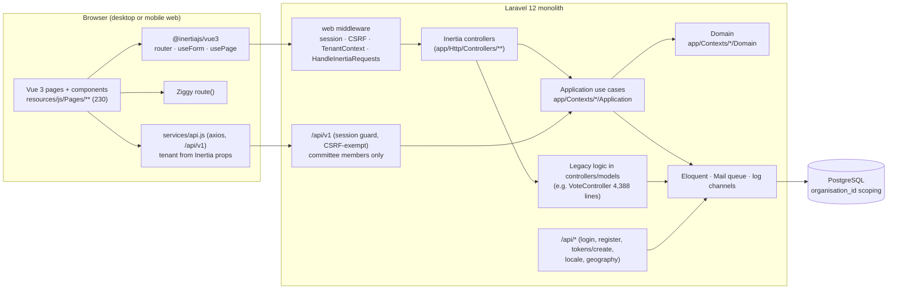

# 01: Existing architecture baseline

> REPORT · generated · 2026-11-09 · snapshot `15217f4a9`. Labels: FACT / INTERPRETATION / ASSUMPTION / RECOMMENDATION / UNKNOWN. This document adds the mobile-relevant view to the 2026-11-03 baseline (`../reviews/2026-11-03-publicdigit-as-is-baseline-architecture-report.md`). It does not replace that report.

## 1. Backend

| Finding | Evidence | Label |
|---|---|---|
| PHP `^8.3`, Laravel **12.70.0**, inertia-laravel **2.0.28**, Sanctum **4.0.8**, Socialite 5.17, Spatie Permission 6.12, Ziggy 2.5 | `composer.json:11-27`; `composer.lock:1281,1489,1769,1890,4741,8186` | FACT |
| The project CLAUDE.md says "Laravel 11 (PHP 8.2)". The code is Laravel 12 (ADR `docs/publicdigit/adr/ADR_20261015_2346_Laravel_12_And_Excel_4_Upgrade.md`) | as cited | FACT (the documentation is out of date) |
| Bounded contexts under `app/Contexts/`: Adjudication, Committee, Contestation, Election, Elections, Finance, Geography, Governance, Membership, Shared, Trust. Each has Domain, Application and Infrastructure layers | `ls app/Contexts`, `app/Contexts/Membership/*` | FACT |
| Legacy layers sit beside the contexts: `app/Http/Controllers` (≈75 top-level controllers), `app/Models`, `app/Services`, `app/Repositories`, `app/Domain`, `app/Application` | `ls app` | FACT |
| Deptrac enforces hexagonal layers for the greenfield contexts (Contestation, Adjudication, Election). Legacy controllers are not covered | `deptrac.yaml:1-35` | FACT |
| Routing: `web.php` (572 lines), `organisations.php` (418), `election/electionRoutes.php` (759), `api.php` (57), `api_v1.php` (56), `governance-api.php`, `api/governance*.php`, `geography/geographyApiRoutes.php` | `wc -l routes/**` | FACT |
| `/api/v1` is mounted with `['web','json.api','tenant.api','auth','verified']`, so authentication is the **session guard**, not tokens | `bootstrap/app.php:19-22` | FACT |
| `/api/v1/*` is exempt from CSRF protection | `bootstrap/app.php:66-68` | FACT |
| `statefulApi()` is on: Sanctum SPA cookie authentication for the stateful domains | `bootstrap/app.php:63`; `config/sanctum.php` `stateful` | FACT |
| Tenancy: `TenantContext` route middleware runs before `SubstituteBindings` (priority list). For `/api/v1`, `IdentifyTenantFromHeader` reads `X-Organisation-ID`, checks membership and **writes `session(['current_organisation_id'])`** | `bootstrap/app.php:117-121`; `app/Http/Middleware/IdentifyTenantFromHeader.php` | FACT |
| Web login: custom `LoginController`, rate-limited (`throttle:10,1`), redirects unverified users. Fortify features are **empty** | `routes/web.php:144-162`; `LoginController.php:43-73`; `config/fortify.php:133-136` | FACT |
| Voting pipeline: a voter-slug route group with an 11-middleware chain (slug verify, window, consistency, voter, step order, eligibility, IP, organisation, `throttle:10,1`) | `routes/election/electionRoutes.php:514-531` | FACT |
| Voting keeps ballot state **in the server session** between steps | `VoteController.php:621,870,1655,1762`; `save_vote` reads `session('current_organisation_id')` `:2919` | FACT |
| Audit: per-voter log files and a `voting_audit` channel | `VoteController.php:1834`; project CLAUDE.md | FACT |
| Notifications: Mail via queue; no push channel | `PublicMembershipApplicationController.php:79-100`; no push package in `composer.json` | FACT |
| Database: PostgreSQL (CI uses `postgres:15`). One database with `organisation_id` scoping | `.github/workflows/greenfield-merge-gate.yml`; 2026-11-03 report | FACT |

## 2. Frontend

| Finding | Evidence | Label |
|---|---|---|
| Vue **3.5.28**, `@inertiajs/vue3` **2.3.17**, Vite **6.4.3**, Pinia **3.0.4**, Tailwind **4.3.0**, axios **0.27.2**, Vitest **4.0.18**, vue-i18n 9 | `package-lock.json` versions | FACT |
| One entry point, `resources/js/app.js`, with `createInertiaApp`, Ziggy, Pinia and i18n. Pages resolve through `import.meta.glob('./Pages/**/*.vue')` | `resources/js/app.js:14-52` | FACT |
| **No Vue Router**, **no tsconfig**. `vue-tsc` is installed, but only 9 `.vue` files use `lang="ts"` | `package.json`; `ls tsconfig*` (none) | FACT |
| 401 `.vue` files (230 pages, 171 components and layouts), 95,446 lines. 63 backup or recovered files (`*.vue.txt`, `*.bak`, `*backup*`), mostly with hash names in `Components/` | `find resources/js` | FACT |
| Frontend layers that already exist: `Components/` (canonical `Button`, `Card`, `Input`, `Modal`, `StatusBadge`, …), `composables/` (12), `services/` (`api.js`, `geographyApi.js`, `geography.ts`), `stores/` (geography ×3 versions), `types/` (3 `.ts`), `Domain/Election/` (TS policy and service), `design-tokens/tokens.json` | `ls resources/js/*` | FACT |
| `services/api.js`: an axios instance on `/api/v1` with `withCredentials`. The tenant comes from Inertia props, falling back to `window.Laravel.inertia` (which is set nowhere) | `resources/js/services/api.js:19-80` | FACT |
| `useElectionCapabilities.ts` is a frontend anti-corruption layer for capabilities **computed by the backend** | `resources/js/composables/useElectionCapabilities.ts:1-40` | FACT |
| Responsive design: 146 of 230 pages use Tailwind breakpoint prefixes. A known mobile defect exists (PBDIGIT-311, mobile menu white on white) | grep; `docs/publicdigit/backlog/PBDIGIT-311-mobile-menu-unreadable.md` | FACT |
| Design system: `.claude/UI_GUIDELINES.md`, `design-system.exceptions.json`, `npm run design-check`, and a lint-staged rule against raw `<button>` | `package.json` scripts and lint-staged | FACT |

## 3. Infrastructure

| Finding | Evidence | Label |
|---|---|---|
| No Dockerfile or docker-compose. `laravel/sail` is in require-dev | `ls` | FACT |
| CI: GitHub Actions. Merge gate (Architecture suite, Deptrac, greenfield PHPStan, GreenfieldCore); quality tier (Infection); knowledge-lint; membership-architecture; regression-detector; role-permission-verification. **No frontend job (Vitest/ESLint) found in CI** | `.github/workflows/*.yml`; `grep npm|vitest` over all workflows finds only a knowledge-graph warning (`knowledge-lint.yml:41`) | FACT |
| Build: `vite build` into `public/build`, with `scripts/fix-build.js` post-processing | `package.json:9-11`; `vite.config.js` | FACT |
| Deployment process, error monitoring and production queue driver | not found in the repository | UNKNOWN |
| Also noted: the CI workflow holds a database password in plain text (`greenfield-merge-gate.yml`, `POSTGRES_PASSWORD`) for a CI-only service container | as cited | FACT (low risk if it is used only in CI) |

## 4. Current architecture diagram

**INTERPRETATION.** This is a server-driven monolith. The browser is a thin view: navigation, authorisation and data shape are decided by the server for every page visit. That makes the responsive web path cheap, and a standalone client expensive.
