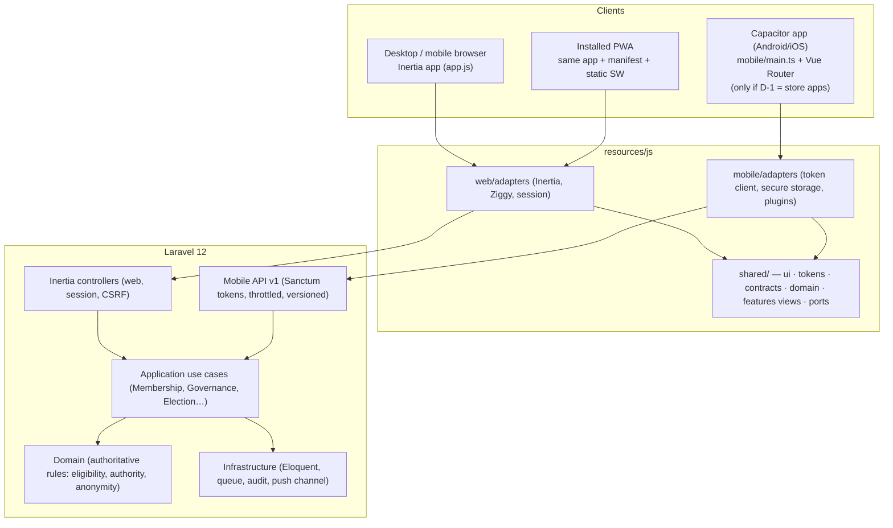

# 04: Target architecture proposal

> REPORT · generated · 2026-11-09. Everything in this document is a **RECOMMENDATION** unless marked FACT. Nothing here is implemented or authorised.
>
> **CONDITIONAL.** This is a candidate *technical* shape only. It must not be frozen until the strategic DDD baseline (roadmap plan `docs/plans/20261108-0303-…-plan.md`; `../strategic-design-status.md`) is accepted, and until D-1 has established which business capabilities mobile must serve. The `shared/features/<workflow>` split must follow accepted context boundaries, not today's folder names.

## 1. Repository structure: compared

| Option | Fit for PublicDigit |
|---|---|
| **1. Laravel monolith with structured frontend folders** | **Recommended.** One developer, one deploy, one CI. Vite supports multiple entries. Aliases already exist (`@`, `~` → `resources/js`, `vite.config.js:50-55`) |
| 2. Laravel plus shared Vue packages in the same repo (npm workspaces) | Only when the mobile app needs its own `package.json` (Capacitor native projects). This is a small step from option 1 |
| 3. Separate backend and frontend repositories | Rejected: breaks the shared CI gates (merge gate, design-check) and doubles release coordination for a solo developer |
| 4. Nx or pnpm monorepo | Rejected for now: no second deployable exists, and no build-graph problem exists. Revisit only at 3 or more frontends |

## 2. Target folder structure (staged)

```
resources/js/
  app.js                    # desktop/web Inertia entry (unchanged)
  Pages/ Layouts/           # Inertia pages = desktop containers (unchanged)
  shared/                   # NEW (Phase 1) — platform-neutral, MUST NOT import @inertiajs/* or call route()
    ui/                     # Button, Card, Input, Modal, StatusBadge… (moved or re-exported from Components/)
    tokens/                 # design-tokens/tokens.json
    contracts/              # TS types mirroring API Resources (generated later)
    domain/                 # pure TS helpers (Domain/Election/*, capability ACL)
    composables/            # pure composables (no I/O), e.g. capability interpretation
    ports/                  # interfaces: HttpPort, StoragePort, NavigationPort, FilePort, PushPort
    features/<workflow>/    # View components (props in / events out) per workflow
  web/adapters/             # NEW — Inertia/Ziggy/session implementations of ports
  mobile/                   # NEW (Phase 5, only if D-1 = store apps)
    main.ts                 # Capacitor entry, Vue Router, Pinia
    router/ screens/        # containers for shared/features/*
    adapters/               # token HTTP client, Secure Storage, Capacitor plugins
capacitor.config.ts, android/, ios/   # Phase 5 only
```

**Why `shared/` and not a package (justification):** a package boundary costs versioning and build tooling. A folder plus a lint rule gives the same dependency direction for free. Promote it to a workspace package only when `mobile/` needs it built separately.

## 3. Dependency rules (enforceable later via ESLint `no-restricted-imports` / `import/no-restricted-paths`)

| From | May import | Must not import |
|---|---|---|
| `shared/**` | vue, vue-i18n, `shared/**` | `@inertiajs/*`, `ziggy-js`, `@capacitor/*`, `web/**`, `mobile/**`, `Pages/**`, `window.location` |
| `web/**`, `Pages/**` | `shared/**`, Inertia, Ziggy | `mobile/**`, `@capacitor/*` |
| `mobile/**` | `shared/**`, vue-router, `@capacitor/*` | `@inertiajs/*`, `ziggy-js`, `Pages/**`, `web/**` |

## 4. Navigation, state and API communication

- **Navigation:** desktop keeps Inertia server-driven navigation. Mobile uses Vue Router. Shared views emit intents (`@submit`, `@select`) and never navigate themselves (a `NavigationPort` is optional).
- **State:** server state belongs to the server. Desktop gets it through props. Mobile uses an API plus a light Pinia cache **for display only**. Pinia is already installed (FACT), so no new state library is needed. **Rule: eligibility, capabilities, membership status and voting state are never decided from cache.** Mobile refetches before any authority-bearing action (`06`).
- **API:** one typed `HttpPort`.
  - Web adapter: today's `services/api.js`, which reads the tenant from props (FACT).
  - Mobile adapter: bearer token plus an explicit `X-Organisation-ID` from the selected organisation.
  - Error shape: reuse the existing `{error, code, details}` contract (`bootstrap/app.php:116-165`).
- **Platform abstraction:** ports for storage (web: none or session; mobile: Keychain/Keystore), files (web: `<input type=file>`; mobile: Camera/Filesystem), push (web: none or Web Push; mobile: FCM/APNs), and deep links.

## 5. Backend target (from `05`)

```
Desktop: Inertia Controller ─┐
                             ├─► Application Use Case ─► Domain ─► Infrastructure
Mobile:  API Controller ─────┘        (one implementation, one set of rules)
```

## 6. Target architecture diagram



## 7. Build and release strategy
- **Web/PWA:** unchanged `vite build` into `public/build`. The service worker is generated at build time with an explicit allow-list of static asset paths.
- **Mobile:**
  - a second Vite config (`vite.mobile.config.ts`) with `outDir: dist-mobile`, then `npx cap sync`
  - Android and iOS builds in CI (iOS needs macOS runners or local builds)
  - a version contract: the app declares a minimum API version, and the API returns `426 Upgrade Required` (or equivalent) for unsupported clients
  - store release trains decoupled from web deploys
  - **API changes must stay backward-compatible for at least one store release** (installed apps cannot be force-updated)
