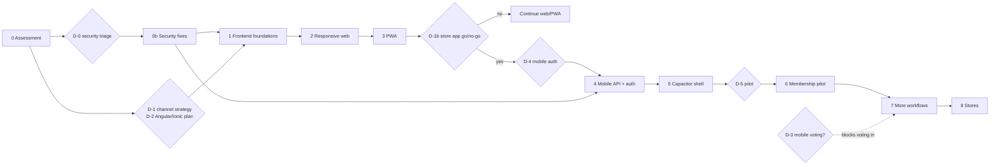

# 08: Migration and implementation roadmap

> REPORT · generated · 2026-11-09. **RECOMMENDATION only. No phase is authorised.** Every phase enters through EP-01 (plan → approval) and gets its own backlog story. Estimates are for one experienced developer, in working days (d), and are judgement.

## 1. Phases

| Phase | Objective | Prerequisites | Required changes | Risks | Deliverables / acceptance | Effort best / realistic / high |
|---|---|---|---|---|---|---|
| **0 Assessment** | this report | — | none | — | 11 documents; Principal review | done |
| **0b Security triage** | close S-1…S-6 before any new API | D-0 | backlog items; harden or remove `/api/login`, `/api/register`, `/api/tokens/create`; remove debug routes; token expiry | breaking an unknown consumer of `/api/login` (UNKNOWN whether one exists) | tests for each fix; no debug route answers in prod | 2 / 4 / 7 |
| **1 Frontend foundations** | make the frontend safe to restructure | 0b; D-1 | frontend CI job; **inventory and classify** the 63 backup or recovered files and the three geography stores (history, usage, canonical version), and remove nothing without a PO decision; add `tsconfig`; create `shared/ui` (re-export canonical components); ESLint boundary rule; characterization tests | moving components breaks pages (mitigated by tests) | CI green; `shared/` exists; no `shared/**` → Inertia import | 4 / 8 / 14 |
| **2 Responsive web** | member flows usable on phones | 1 | fix PBDIGIT-311 class defects; touch targets; mobile navigation in `PublicDigitLayout`; Playwright viewport tests | scope creep into admin screens (stay member-facing) | Lighthouse mobile ≥ 90 accessibility on pilot flows; viewport tests pass | 5 / 10 / 20 |
| **3 PWA** | installable web app | 2 | manifest, icons, static-asset service worker, offline notice page; optional Web Push (needs a backend channel) | caching authenticated or voting content (mitigated by the allow-list and a test) | installable on Android Chrome and iOS Safari; cache test passes | 2 / 4 / 8 (+5 for Web Push) |
| **— Decision gate D-1b** | store app go or no-go, with evidence from 2–3 | usage evidence | — | — | Principal decision | — |
| **4 Mobile API and auth** | token API for the pilot | D-1 = store; D-4; 0b | `/api/mobile/v1` group; hardened token login reusing web policy; device tokens; revoke; API Resources; error schema; idempotency middleware; OpenAPI; CORS for the Capacitor origins | duplicating logic (mitigated by the parity architecture test) | two-TenantId tests; contract tests; OpenAPI published | 8 / 15 / 25 |
| **5 Capacitor shell** | an empty app that logs in | 4 | `mobile/` entry, Vue Router, token adapter, secure storage, Android and iOS projects, CI build | iOS signing and toolchain; Apple developer account (product cost) | the app logs in and out on emulator and simulator; token in secure storage | 4 / 8 / 15 |
| **6 Pilot workflow** | Membership Registration + Member Profile | 5; D-5; **public-apply use case extracted** | extract `SubmitPublicMembershipApplication`; API controllers; shared feature views (form, status, profile); mobile screens; desktop pages switched to the shared views | divergence between the public and authenticated apply paths | identical domain outcome from web and app (parity test); desktop unchanged | 8 / 15 / 25 |
| **7 More workflows** | election information, committee views, notifications (push) | 6 | per workflow: use case check → API → shared view → screen; push channel | voting pulled in prematurely (blocked by D-3) | each workflow has parity and tenant tests | 5–15 per workflow |
| **8 Production and stores** | public release | 7 | MASVS review; privacy labels; store listings; crash reporting; version contract (`426`); release runbook | store rejection; privacy disclosure for election data | approved on both stores; rollback plan | 5 / 10 / 20 |

**Totals (excluding 7):**
- **Web path (0b–3):** about 13 / 26 / 49 days.
- **Store app (4–6, 8):** about 25 / 48 / 85 days more.

## 2. Smallest viable pilot (RECOMMENDATION)
**Phase 2 on one flow: the public Membership application (`Pages/Organisations/Membership/PublicApply.vue`) on phones.** This needs no new API and no new auth, so it delivers the first mobile value soonest.

**If and when store apps are approved, the first app pilot is Membership Registration plus Member Profile.**
- It is mostly member-facing.
- The authenticated path already uses a use case (`MembershipApplicationController.php:116`).
- The public path needs one extraction (`PublicMembershipApplicationController.php:66-76`).
- No voting invariants are touched.

**Voting is explicitly excluded** until D-3 and V-1…V-5 (`06`) are resolved.

## 3. Migration dependency diagram

