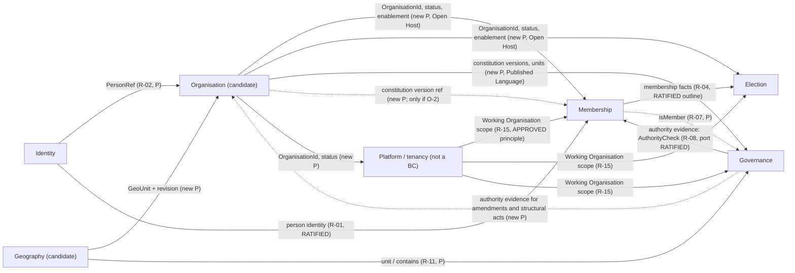

# ODA-01: Organisation domain architecture baseline

> **This document is discovery and conceptual design. It approves, ratifies and authorises nothing.** Every [P] item is a proposal for the Principal / PO or the ARB. No code, schema, test, ADR, BDR, ratified document, context map or Platform Rules Index was changed.

| | |
|---|---|
| **Commission** | ODA-01, "Establishment of the Organisation Domain Architecture Baseline" (Principal / PO, 2026-11-03). Authorised for discovery and conceptual design only |
| **Status** | **CONCEPTUAL BASELINE FOR PRINCIPAL REVIEW.** Not approved |
| **Authority** | generated (Claude, acting as Principal DDD Architect / Domain Discovery Architect). Not an independent review |
| **Date** | 2026-11-03 |
| **Snapshot** | branch `election-flow-updated`, HEAD `821a3bb29` |
| **Placement** | `php scripts/doc-placement.php --scope=product-specific --domain=publicdigit` → `docs/publicdigit` (exit 0); the commission names `architecture/reviews/` |
| **Coordinates with** | `2026-11-03-organisation-membership-constitutional-authority-discovery-preparation.md` (**"the preparation document"**); `2026-11-03-dr07a-membership-technical-discovery-m1-m5.md` (**"DR-07a report"**). ODA-01 neither blocks nor re-scopes DR-07a |

**Labels (commission §7).**
- **[F]** fact, with source;
- **[D]** existing decision, with its authority and status;
- **[P]** new proposal;
- **[I]** inference;
- **[OQ]** open question;
- **[R]** risk.

**Paths.**
- R/ = `docs/publicdigit/reviews/`
- AR/ = `docs/publicdigit/architecture/reviews/`
- RAT = R/`2026-10-08-membership-architecture-ratified.md`
- ACT = R/`2026-10-08-membership-architecture-ratification-act.md`
- DR07 = R/`2026-11-02-governance-dr07-committee-ownership-decision-paper.md`
- GMAP = R/`2026-11-02-governance-domain-discovery-map-roadmap-and-readiness.md`
- CMAP = `docs/publicdigit/architecture/context-map.md`
- PRI = `docs/publicdigit/architecture/platform-rules-index.md`
- BR = `docs/publicdigit/business_rules/20261101_1739_person_account_affiliation_business_rules.md`

**Method.**
- Two read-only evidence sweeps, one over code and one over documents.
- Direct verification by the author of every fact used for a conclusion, a conflict or a risk.
- Static reading only: no command changed anything, and no database was queried.

---

## 0. Executive summary

1. **[F] Nowhere in PublicDigit's ratified record is "Organisation" defined.** The ratified Membership architecture names Organisation only as the owner of OrganisationAffiliation (RAT `:42`) and as the second party of a Membership (RAT `:43`).
   - The common phrase "the recognising body" comes from the **non-ratified** candidate document (R/`2026-10-08-membership-architecture-ratified-candidate.md:27`; status `:3` "Not ratified").
   - Two later documents label it "ratified" (GMAP `:56`; R/`2026-11-02-foundation-boundary-and-ubiquitous-language-audit.md:112`). That label is **not supported** (conflict C-1, §10).
2. **[F] In code, Organisation is a configuration record, not a domain model.** `app/Models/Organisation.php` is a single Eloquent model (SoftDeletes, UUID, slug routing).
   - It mixes identity (name, slug), contact data, platform type (`platform`/`tenant`), capability switches (`uses_full_membership`), structural and geographic choices (`committee_structure`, `geographic_scope`) and a setup state (`governance_status`).
   - It has no legal identity, no constitution and no relationship to other organisations.
3. **[P] Proposed definition (Deliverable A).** An Organisation is a self-governing collective body that PublicDigit recognises as a distinct party.
   - Its identity persists through changes of name, structure, constitution and status.
   - Its own constitution is the source of authority over its internal affairs.
   - Membership, Governance, Elections and other capabilities operate *within* its scope.
   - The tenant is the technical consequence of this, not its definition.
4. **The commission's starting principle survives examination, with three qualifications.**
   - (a) **[F]** ACT §11 does not mention "positions". Governance ownership of positions rests on PO-DR07-01 and on proposed vocabulary, not on the ratified act.
   - (b) **[D]** BR-13a, confirmed by the PO on 2026-11-02, states that relationships between organisations are **not designed in advance**. ODA-01.7 can therefore produce a taxonomy and questions only.
   - (c) **[F]** The ratified Membership architecture allows a section or unit to be modelled as **another organisation** (RAT `:150`, I5). So "unit or separate Organisation" is a real open question, not a settled one.
5. **[P] Strategic position.**
   - **Organisation is a foundational supporting domain, not the core domain.** It is indispensable, but it is not where PublicDigit differentiates.
   - The **Organisation context** stays a *candidate*. Proposed scope: organisation identity and lifecycle, the constitutional record and its versions, organisational structure (units), the operating area, and capability enablement.
   - **Platform / tenancy is kept separate from it.**
6. **The most consequential open question** is where the Organisation Constitution is represented (preparation document OQ-4, ARB).
   - This baseline sets out two options and recommends one [P]: the constitution and its versions belong to the Organisation, and each capability derives its own operational rules, citing article and version.
   - The recommendation does not move Governance ownership of "organisational governance rules" (ACT §11).
7. **Not resolved here:**
   - O-16 / DR-07b (units);
   - DR-07a (organs);
   - CQ-10 (how much may vary per organisation);
   - P11 (AuthorityCheck content);
   - XD-15 (tenancy).
   ODA-01 does not decide any of them, and does not touch P11 or CQ-10 (commission §9 item 14).

---

## 1. Repository and governance state

| Item | State |
|---|---|
| Branch / HEAD | [F] `election-flow-updated` / `821a3bb29` |
| Changes since the preparation document and DR-07a report snapshots (`508283527`, `b95fe8fc4`) | [F] KnowledgeOS commits only; nothing under `app`, `database`, `routes` or `docs/publicdigit` |
| Working tree (unrelated to ODA-01) | [F] other sessions' uncommitted changes: `.claude/CONTEXT-publicdigit.md`, `.claude/sessions/2026-10-*.md`, `.claude/settings.local.json`, `bootstrap/cache/packages.php`, `developer_guide/election/ip_voting/*`, KnowledgeOS scratch. Untracked: AR/ 2026-11-03 documents, `docs/publicdigit/architecture/brainstorming/`, `docs/publicdigit/brainstorming/governence/`, `platform-rules-index.md`, `tests/Isolated/Pbdigit274/...`. **None was touched** |
| PO-ORG-MEM-01 | [D] approved by the Principal / PO on 2026-11-03 (commission §3 item 12): Decision A (business ownership) and Decision B (DR-07a authorised; DR-07a report `:9`). **Stated in session only; not yet entered in a decision record** (DR-07a report §9 item 1) |

---

## 2. What we previously knew (inventory of existing knowledge)

### 2.1 Decisions that bind this baseline

| ID | Content | Status | Source |
|---|---|---|---|
| D-ACT10 | The Membership aggregate must not absorb "Governance competence … committee participation; unrelated organisation structures" | RATIFIED | ACT `:300-305` |
| D-ACT11 | Identity owns person identity; Membership owns "organisational membership truth"; Governance "owns competence, organs, authority and organisational governance rules"; Election owns ElectionMembership, entitlement, eligibility, exercisability. "No shared persistence is required between these bounded contexts" | RATIFIED | ACT `:311-349` |
| D-RAT1 | Organisation owns OrganisationAffiliation; one Membership per (Person, Organisation) | RATIFIED | RAT `:42-43` |
| D-RAT8 | Governance supplies the AuthorityCheck port; Membership stores evidence only | RATIFIED | RAT `:156` |
| D-RAT-I5 | honorary, statutory, ex-officio, classes, **units**, committee roles … "each map to a type, a provenance, another relationship or **another organisation**" | RATIFIED | RAT `:150` |
| PO-DR07-01 | governance committees are organs "with positions, appointments and governance authority"; organisational units are distinct; existing records not classified | PO business decision 2026-11-02 | DR07 `:261-291` |
| PO-ORG-MEM-01 A | the Organisation owns its Membership domain; its constitution establishes competent organs and delegates authority; PublicDigit implements the authorised rules and records facts; it does not become the source of authority | PO, 2026-11-03 (session) | commission §3; preparation document §3.1 |
| PO-ORG-MEM-01 B | DR-07a M-1…M-5 authorised | PO, 2026-11-03 (session) | DR-07a report `:9` |
| BR-4 | one person can be associated with several organisations | PO confirmed | BR `:26` |
| BR-12 (K′) | PublicDigit's real organisational life is held in its own ordinary organisation; the bootstrap organisation stays infrastructure | PO, 2026-11-02 | BR `:35`; R/`2026-11-02-organisation-k7-b1-amendment-decision-brief.md:119-130` |
| BR-13 / BR-13-S | no business rules must hold across organisations; platform yes / no recognition checks are excluded | PO, 2026-11-02 | BR `:36-38` |
| **BR-13a** | "Organisation independence is the default … Should organisations ever need … a federation, that is a **new requirement** … It is **not designed for in advance**" | PO, 2026-11-02 | BR `:39` |
| BR-14 | position incompatibility is scoped per organisation | PO, 2026-11-02 | BR `:40` |
| PBDIGIT-30 B1 | Working Organisation routing (0 / 1 / 2+ real organisations); never guess | APPROVED | `docs/publicdigit/business_rules/20260806_0818_how_many_organisation.md:61-75, 145-153` |
| INV-ORG-SCOPE-1 | owning organisation = Working Organisation; fail closed | APPROVED principle, ARB ratification pending | CMAP `:89`, `:121` |
| BDR-03 | "Appointment (Authority)" owns Mandate truth | FROZEN (programme) | `docs/architecture/design/Round49-06_Boundary_Decision_Register.md:16`; relation to Governance: ARB-8 |
| ADR-004 | "Organisation — Status: Candidate. Insufficient aggregate and context-boundary analysis" | Accepted | `docs/publicdigit/adr/ADR-004-Strategic-Context-Boundaries.md:32` |

### 2.2 Proposals already on record (not decisions)

| Item | Content | Source |
|---|---|---|
| Organisation context candidate | registry, OrganisationAffiliation, OrganisationalUnit, provenance | CMAP `:90-93` (PROPOSED); GMAP §4 `:110-121` |
| Geography context candidate | GeoUnits, hierarchy, revisions | CMAP `:94`; GMAP `:118` |
| Governance vocabulary v1.5 | Committee, Position, Appointment, Tenure, Mandate, Delegation, JurisdictionAssignment | GMAP `:58-67`, `:117`; CMAP `:77` |
| "Two hierarchies, not one" | the committee tree and the geography tree are related only through JurisdictionAssignment | GMAP `:104-108` |
| Tenancy option C (hybrid) | candidate direction: central registry, one database per organisation | R/`2026-11-02-organisation-xd15-tenancy-and-data-ownership-decision-proposal.md:182-218`; PO direction §8a, ARB pending |
| Qualified term "Organisation Constitution (statutes)" | avoids collision with five existing uses of "constitution" | preparation document §7.4 |
| Constitutional questionnaire | §5.1–§5.6 and comparison template §6 | preparation document |
| Brainstorming (not authoritative) | "do not assume a single tree"; "geographical hierarchy ≠ organisational hierarchy"; "distinguish governs, represents, advises, serves"; three organisation types (party, Red Cross-type society, federation) | `docs/publicdigit/membership/architecture/brainstorming/cross_domain_brainstorming/20261010_1230_cross_domain.md:17-24, 282-292` |

### 2.3 What the code does today

| Concern | Fact | Source |
|---|---|---|
| Organisation model | one Eloquent class; SoftDeletes; UUID; slug routing | [F] `app/Models/Organisation.php:10-15` |
| Identity fields | `id`, `name`, unique `slug`, `email`, `address`, `representative` | [F] `database/migrations/2026_03_05_000001_create_uuid_organisations_table.php:14-25` |
| Platform type | `type enum('platform','tenant')`, `is_default` | [F] same, `:17-18` |
| Capability switch | `uses_full_membership` (default true); `isElectionOnly()` | [F] `2026_04_15_120000_add_uses_full_membership…:19`; `Organisation.php:203-214` |
| Structure and geography choices | `committee_structure` (flat / geographical), `geographic_scope` (worldwide / multi_country / single_country / sub_country), `allowed_countries`, `base_country_code`, `base_region_id`, `geographic_levels`; **immutable after creation** (throws `DomainException`) | [F] `2026_05_04_000001_add_geographic_scope…:13-29`; `Organisation.php:58-75` |
| Setup state | `governance_status` ∈ pending_setup, governance_configured, active, suspended; only `active` allows committee creation | [F] `app/Domain/ValueObjects/OrganisationGovernanceStatus.php:9-16` |
| Default geography | Nepal: Province, District, Municipality, Ward; a "worldwide" alternative: Worldwide, Region, Country | [F] `app/Contexts/Geography/Domain/ValueObjects/GeographicStructure.php:15-30` |
| Absent | legal form, registration number, founding date, statutes, constitution versions, parent or federation links, succession | [F] evidence sweep (searched, not found) |
| Units and organs | both modelled by `committees` (type ward / district / province / central / youth / women …; `parent_committee_id`) inside the **Membership** context | [F] `app/Contexts/Membership/Infrastructure/Database/Migrations/Tenant/2026_01_16_000002_create_committees_table.php:41-100`; DR-07a report §4 |
| Geography store | `geo_administrative_units` (admin_level 1–4, `parent_id`, `valid_from` / `valid_to`); `organisation_id` nullable, so official plus organisation-custom units | [F] `app/Contexts/Geography/Infrastructure/Database/Migrations/Landlord/2025_01_01_000002…:23-77`; `database/migrations/2026_05_13_134529…:15-16` |
| Where "the Organisation" is referenced in contexts | by identifier only (`TenantId` in the ratified Membership kernel; `OrganisationGovernanceContext` value object) | [F] `app/Contexts/Membership/Domain/Organisational/Member.php:22`; `app/Contexts/Membership/Domain/Committee/Context/OrganisationGovernanceContext.php:7` |
| Current user named in the business case | NRNA (Non-Resident Nepali Association), "80+ countries" | [F] `docs/publicdigit/business_case/EXECUTIVE_SUMMARY.md:7`; `BUSINESS_CASE.md:129-134` |

[I] The code treats an Organisation as a **tenant plus a setup wizard**. Its most structural choices (flat vs geographical structure, geographic scope) are fixed when the organisation is created. That contradicts the business expectation that structure can change over time (ODA-01.2; risk R-10).

---

## 3. Deliverable A: Organisation domain definition

### 3.1 Proposed definition [P]

> **Organisation.** A self-governing collective body that PublicDigit recognises as a distinct party.
> - It has its own identity, which persists through changes of name, structure, constitution and status.
> - Its own constitution (statutes) is the source of authority over its internal affairs.
> - Membership, Governance, Elections and other capabilities operate within its scope and under its constitution. None of them constitutes it.
> - In PublicDigit, each Organisation is also the unit of data isolation (the tenant). The tenant is the technical consequence of the Organisation, not its definition.

**How the definition relates to the record:**
- It keeps "recognising body" as the role an Organisation plays towards a Person (it admits, recognises and affiliates people). That role remains true, but it is **not ratified** (C-1).
- "Self-governing" restates PO-ORG-MEM-01 A: authority comes from the Organisation's constitution, never from PublicDigit.
- "Distinct party" reflects BR-13 and BR-13a: Organisations are independent by default.
- The tenant sentence takes over the GMAP `:56` reading ("technical isolation and execution context, not a domain concept") as a proposal, not as a ratified fact.

### 3.2 The distinctions the commission requires (§2)

| Statement | Assessment | Basis |
|---|---|---|
| Organisation ≠ Membership | **holds** | [D] ACT §11 (Membership owns membership truth, not the Organisation); RAT `:43` (Membership is a *relationship* with an Organisation) |
| Organisation ≠ Governance | **holds, with nuance**: every real organisation governs itself, but the *Governance context* represents organs and competence; it does not own the Organisation's identity | [D] ACT §11; [P] §6 |
| Organisation ≠ Election | **holds** | [F] election-only organisations exist (`isElectionOnly()`), and so do organisations without elections (no code requires one); [P] identity never depends on an election |
| Access to PublicDigit ≠ organisational membership | **holds** | [D] BR-2 / BR-3, K′ (BR `:24-25, :35`); EM-VOC-002 |
| Geographical jurisdiction ≠ Organisation | **holds** | [P] §8; brainstorming R-10; GMAP "two hierarchies" |
| Organisational unit ≠ governance organ | **holds** | [D] PO-DR07-01 |
| A governance organ is not necessarily an independent Organisation | **holds**: an organ has no identity outside the Organisation that constitutes it | [I] from PO-DR07-01 ("constituted") |
| **Qualification:** a section or unit *may* be modelled as a separate Organisation | **open** | [D] RAT `:150` (I5) permits it; [OQ] OQ-ODA-6 |

### 3.3 Identity (ODA-01.1)

| Concept | Meaning [P] | Domain or external? | Status |
|---|---|---|---|
| **Organisation identity** | a stable platform-issued identifier (`OrganisationId`) that never changes and is never reused | domain | [F] UUID exists; [P] "never reused" (soft delete keeps the row) |
| **Organisation name** | a mutable attribute, possibly multilingual, with a history | domain attribute | [F] `name` exists, without history; [OQ] whether name history is needed |
| **Slug** | a technical routing key | technical, not identity | [F] `Organisation.php:54-57`; [I] it must not serve as identity, because names change |
| **Legal identity** | the legal person, if any (e.g. a registered association), with its registry and number | **external reference**, 0..n per Organisation (one organisation may be registered in several countries) | [F] absent; [P] optional; **not every Organisation is a legal entity** |
| **Registration** | (a) external registration with a public registry, or (b) onboarding onto PublicDigit | (a) external reference; (b) platform fact | [P] keep the two apart |
| **Organisational status** | the organisation's own existence: active, dormant, dissolved, merged / succeeded | domain | [F] absent; [P] |
| **Platform service status** | PublicDigit's relationship with the organisation: onboarding, configured, active, suspended by the platform, offboarded | platform (Organisation context or Platform / tenancy; OQ-ODA-3) | [F] partially present as `governance_status`, which also gates committee creation (`OrganisationGovernanceStatus.php:14-16`) |
| **Organisation type** | a classification (party, association, diaspora organisation, cooperative, union …) | domain classification; **not a driver of rules** unless the PO decides so | [F] code `type` means platform / tenant, which is a technical meaning; [OQ] |

**Lifecycle [P] (two lifecycles, not one):**

```text
Organisational lifecycle (the organisation's own life; its constitution decides how it changes):
  founded / recognised ──► active ──► dormant ──► active
                              │
                              ├──► dissolved            (terminal)
                              └──► merged / succeeded   (terminal; points to successor)

Platform service lifecycle (PublicDigit's service to the organisation):
  onboarding ──► configured ──► in service ──► suspended by platform ──► in service
                                     └──────► offboarded (data retained or exported per policy)
```

[I] Today's `governance_status` mixes a platform setup step ("governance configured") with a capability gate ("committee creation allowed"). It is a **platform service status overloaded with a Governance precondition**. That is an "overloaded existing dimension" in the sense of the Model-integrity rule, not a missing one.

**Answers to the identity questions (ODA-01.1):**

| Question | Answer | Status |
|---|---|---|
| Can an Organisation exist before Membership or Governance is established? | yes. Election-only organisations exist and have no full Membership | [F] `isElectionOnly()`; [P] for Governance |
| Can it exist without elections? | yes | [P]; nothing in code or decisions requires one |
| Inactive, suspended, dissolved, succeeded? | yes, but two kinds: *organisational* (dissolved, merged) and *platform* (suspended by PublicDigit). A platform suspension does not dissolve an organisation | [P] |
| Can name, structure or constitution change without a new identity? | yes. Identity is the `OrganisationId`; each change is a dated fact in the organisation's history | [P]; [F] today the structure and geography choices are frozen at creation (R-10) |
| How is historical identity preserved? | append-only history of name, status, constitution versions and structure, so that an old Membership fact or election can be read against the state at that time | [P]; compatible with RAT's `ruleRef` / `policyVersion` (`:72`) |
| Successor organisation | a merger or succession is a relationship between two identities; the predecessor's history stays with the predecessor | [P]; **BR-13a applies**: designing it is a new requirement (§9) |

---

## 4. Deliverable B: Organisation conceptual model

### 4.1 Model

Ownership in brackets: **ORG** = Organisation (candidate), **GOV** = Governance, **MEM** = Membership, **ELE** = Election, **GEO** = Geography, **ID** = Identity, **PLT** = Platform / tenancy. Status: [E] established, [P] proposed, [U] unresolved.

```text
                         Person [ID, E]
                            │
       ┌────────────────────┼─────────────────────────────┐
       │ 0..1 per Org       │ 0..n per Org                │ holds (via Appointment)
       ▼                    ▼                             ▼
 Membership [MEM, E]   OrganisationAffiliation        Office / Position [GOV, P]
       │               [ORG, E owner; store U BR-9]        │ belongs to 1
       │                                                   ▼
       │ of 1                                       Governance Organ [GOV, E PO-DR07-01]
       ▼                                                   │ scope: the whole Org  OR  one Unit [P]
 ┌──────────────────────── ORGANISATION [ORG, P] ───────────┴───────────┐
 │  OrganisationId (stable)       organisational status (lifecycle)     │
 │  name history                  platform service status [ORG or PLT]  │
 │  external legal references 0..n                                     │
 │  operating area (GEO references)                                    │
 │  capability enablement (Membership, Governance, Elections …)        │
 │                                                                     │
 │  adopts ──► Organisation Constitution (statutes) [ORG P / GOV — U]  │
 │                 └─ Constitutional Version 1..n (effective periods)  │
 │                                                                     │
 │  structured into ──► Organisational Unit 0..n [ORG P; U O-16]       │
 │                          ├─ unit hierarchy (0..1 parent) [P]        │
 │                          └─ responsibility area (GEO refs) 0..1 [P] │
 └─────────────────────────────────────────────────────────────────────┘
       │ scope of                          │ references
       ▼                                   ▼
 Election [ELE, E]                   GeoUnit [GEO, P] (official or organisation-custom)
       │ eligibility from Membership facts or enrolment (ELE decides)
       ▼
 Governance Organ's authority area = JurisdictionAssignment [GOV, P] ──► GeoUnit

 Tenant [PLT]: technical isolation of exactly one Organisation (R-15, XD-15). Not a domain concept.
```

### 4.2 Relationships and cardinalities

| From | Relation | To | Cardinality | Temporal? | Status |
|---|---|---|---|---|---|
| Organisation | has identity | OrganisationId | 1 | immutable | [F] UUID; [P] |
| Organisation | adopts | Organisation Constitution | **0..1 current**, 0..n historical versions | yes: effective periods | [P]; 0 allowed while not yet recorded in PublicDigit (OQ-ODA-4) |
| Constitution | has | Constitutional Version | 1..n | yes: [adopted, effective-from, effective-to) | [P] |
| Organisation | structured into | Organisational Unit | 0..n | yes: units are created, renamed, merged, dissolved | [P]; O-16 |
| Unit | parent | Unit | 0..1 | yes | [P]; **a single parent is a hypothesis**: brainstorming warns against assuming one tree (OQ-ODA-7) |
| Organisation | constitutes | Governance Organ | 0..n | yes: established, dissolved | [D] organs are Governance's (ACT §11; PO-DR07-01) |
| Organ | scope | the whole Organisation, or one Unit | exactly one scope | yes | [P] (e.g. a central committee for the whole organisation, a district committee for the district unit) |
| Organ | has | Office / Position | 0..n | yes | [P] GMAP `:60` |
| Person | holds (Appointment → Tenure) | Office / Position | 0..n | yes, [s, e) | [P] GMAP `:62-64` |
| Organ / Office | has competence over | decision kinds | from the constitution, directly or by delegation | yes: per constitutional version | [P] preparation document §3.2 |
| Person | Membership in | Organisation | 0..1 per (Person, Organisation) | periods | [D] RAT `:43` |
| Person | belongs to (unit affiliation) | Unit | [U] O-16; candidate "UnitAffiliation" (DR-07a report §4.1) | yes | [U] |
| Organisation | operating area | GeoUnit | 0..n | yes | [F] `geographic_scope`, `allowed_countries`; [P] as a domain concept |
| Unit | responsibility area | GeoUnit | 0..n | yes | [P] |
| Organ | authority area (JurisdictionAssignment) | GeoUnit | 0..n | yes | [P] GMAP `:67`; BQ-J1 open |
| Organisation | runs | Election | 0..n | — | [F] |
| Organisation | related to | Organisation | **not modelled** | — | [D] BR-13a; §9 |

### 4.3 What the model deliberately leaves out

- No universal hierarchy. The model has *a* unit hierarchy only if an organisation has one (quality criterion 8).
- No mapping of "type of organisation" to rules (CQ-10 is the PO's).
- No rules engine and no constitution schema (commission §9 items 12–13).
- No storage and no aggregate design. Possible aggregates are named only to locate invariants (§6.2).

---

## 5. Constitutional foundation (ODA-01.3)

### 5.1 Terms [P]

| Term | Meaning [P] | Not to be confused with |
|---|---|---|
| **Organisation Constitution (statutes)** | the founding normative document of one Organisation: it states its purpose, organs, competences, membership rules and amendment procedure | `ElectionConstitution` (platform election rules, `app/Domain/Election/Constitution/ElectionConstitution.php`); per-election constitutional policy (ADR-B); GEO arbitration engine; engineering "constitutions" (PRI §2 `:39-55`) |
| **Statutes** | the usual legal name of the same document for associations; **treated as a synonym** | — |
| **Constitutional Version** | the text in force over an effective period, with an identifier that stays retrievable while any fact cites it | a software release; a configuration revision |
| **Amendment** | a decision by the competent organ, under the amendment procedure, that produces a new version | an edit of configuration |
| **Effective period** | [effective-from, effective-to) of a version; may differ from the adoption date | the date it was recorded in PublicDigit |
| **Rules of procedure / bylaws / regulations** | subordinate normative documents adopted under the constitution (questionnaire D4) | the constitution itself |
| **Organisational policy** | a decision of a competent organ within its competence (e.g. a fee schedule) | a constitutional provision |
| **Governance rule** | the operational form of a constitutional provision about organs and competence, as Governance represents it | the constitution text (ACT §11 "organisational governance rules") |
| **Delegation of authority** | a dated act by which a competent organ or office passes a defined competence to another, where the constitution allows it | assigning an administrative task (preparation document §3.2 (c)–(d)) |

### 5.2 Answers [P unless marked]

| Question | Answer |
|---|---|
| Is the constitution a defining characteristic of an Organisation? | It is the **source of authority**, not the source of **identity**. An Organisation stays the same Organisation across amendments. Having a constitution is a characteristic of self-governance, but the definition does not require PublicDigit to hold the text |
| An owned document or a separate concept? | A **separate domain concept** owned by the Organisation, with its own versions. Not an attribute of the Organisation record |
| Multiple versions? | yes; at most one in force at any instant [P]; transitional provisions are new facts, never recomputation ([D] preparation document §9, RAT §3) |
| When does a new version take effect? | at its effective date as the statutes state (questionnaire C2); the version applicable to a decision is the one in force at `decidedAt` unless the statutes say otherwise (preparation document N-2) |
| Previous versions | retained as long as any fact cites them ([P] preparation document §8.3) |
| Can an Organisation exist before its constitution is adopted? | in law, usually not (statutes are adopted at founding); **in PublicDigit, yes**: an organisation can be onboarded before its statutes are recorded. Until then, no decision may claim constitutional competence (fail closed) [P]. This is consistent with D-4 interim authority being explicitly "interim" ([D] preparation document §7.3) |
| Conflicting provisions | interpretation belongs to the body the constitution names (questionnaire D5); PublicDigit records the ruling as evidence and does not decide [P]; [OQ] how an unresolved conflict blocks a decision |
| From provisions to governance rules | each capability derives its own operational rules from the constitution, **citing article and version** (`ruleRef`, `policyVersion`, RAT `:72`). Governance does this for organs and competence; Membership for admission grounds and ending acts within the platform rules D-1…D-5; Election for election rules where the constitution sets them |

### 5.3 Where the Organisation Constitution is represented (preparation document OQ-4, ARB)

| Option | Content | For | Against |
|---|---|---|---|
| **O-1: Governance owns the constitution and its versions** | reads ACT §11 "organisational governance rules" as covering the whole document | one owner; no new responsibility for a candidate context | a constitution also governs Membership (admission, ending, dues), Elections, finance and purpose; placing all of it in Governance makes Governance the owner of rules it does not apply; risks Governance becoming a "rules engine for everything" |
| **O-2: the Organisation owns the constitution record (identity, versions, effective periods, article references); each capability owns the operational rules it derives, citing (article, version)** | Governance keeps "organisational governance rules" (ACT §11) as derived rules; the document itself is the Organisation's | matches PO-ORG-MEM-01 A ("its Constitution"); one retention point for `policyVersion` (§8.3); no capability owns another's rules | gives the candidate Organisation context a real responsibility, so it needs an ARB act; needs a clear line between "document" and "rule" |
| O-3: no representation; capabilities cite external documents by reference only | minimal | — | retention and versioning of `policyVersion` cannot be guaranteed by PublicDigit (§8.3 fails) |

**Recommendation [P]: O-2**, for ARB validation. It does not amend ACT §11, because Governance keeps ownership of the governance rules. ARB question: is a constitution *document* within "organisational governance rules"? If the ARB reads it that way, O-1 applies, and this baseline adapts.

---

## 6. Organisation structure and governance (ODA-01.2, ODA-01.4)

### 6.1 Structure concepts [P]

| Concept | Meaning | Owner | Example (illustrative, not from any statute) |
|---|---|---|---|
| **Organisation** | §3 | ORG | — |
| **Organisational Unit** | a structural part of the Organisation through which members are organised or work is carried out; geographically defined (a district branch) or functional (a youth wing, a department) | ORG [P]; ownership open (O-16 / DR-07b) | district branch; youth wing |
| **Organisational structure / hierarchy** | the set of units and their dated parent relationships | ORG [P] | branch under a province branch |
| **Governance Organ** | a constituted body with competence to decide, collectively or through its offices | GOV [D] | general assembly; central committee; district committee |
| **Committee** | in PublicDigit's domain language, **a kind of organ** (PO-DR07-01). Legacy code uses it for units as well (C-6) | GOV | executive committee |
| **Office** | a function the constitution defines (president, secretary, treasurer) with its own competences, existing independently of who holds it | GOV [P] | General Secretary |
| **Position** | a seat in an organ, possibly an office, with capacity κ (BR-14 incompatibility per organisation) | GOV [P] GMAP `:60` | "vice-chair (2 seats)" |
| **Working group** | a body set up for a task; **an organ only if the constitution or a competent organ gives it competence**; otherwise an operational team without decision authority | GOV if organ; otherwise [OQ] | election working group |

**Key separations [P]:**
- A unit is *where* members belong; an organ is *who* decides. A district branch (unit) usually has a district committee (organ) whose scope is that unit. They are two concepts linked by "organ scope" (§4.2), even when one legacy `committees` row represents both (DR-07a report M-2 Q1).
- An organ may exist without a unit: a general assembly or central committee has the whole Organisation as its scope.
- A unit may exist without an organ: a unit with members and no constituted body.
- [OQ] Can a unit belong to more than one structural grouping (e.g. a local branch that is also part of a thematic network)? The brainstorming says yes for federations. No PublicDigit evidence exists. OQ-ODA-7.
- Structure changes over time. Every unit and organ has a dated lifecycle, and history is append-only (GMAP G-9 for appointments; [P] the same for structure).

### 6.2 Authority concepts (Governance) [P]

| Term | Meaning | Owner |
|---|---|---|
| **Competence** | what an organ or office may decide, as assigned by the constitution | GOV [D ACT §11] |
| **Authority** | competence in force for a specific actor at a specific time (competence, plus a valid appointment, plus valid delegation) | GOV [D ACT §11] |
| **Delegation** | a dated transfer of a defined competence, where the constitution allows; never of duty | GOV [P] GMAP `:66` |
| **Responsibility (administrative)** | a duty to carry out work (processing applications, keeping records), with no power to decide | the Organisation assigns; GOV records [P]; preparation document §3.2 (c) |
| **Decision** | an act of an organ (collective: quorum, majority, resolution reference) or of an office holder (individual), within competence | GOV supplies; the deciding capability records the result with evidence (RAT §8) |
| **Administrative execution** | carrying out a decision; not itself a decision | — |
| **Office holder** | the Person holding an office over a tenure | GOV [P] |
| **Mandate** | scope (and possibly term) of authority of a position or organ | **[U] ARB-8**: Governance or BDR-03's "Appointment (Authority)" |

**What stays where (ODA-01.4) [P]:**
- **Organisation context:** the constitution record (if O-2), units, operating area, and the platform-facing facts about the Organisation.
- **Governance context:** organs, offices, positions, appointments, tenure, competence, delegation, authority and jurisdiction assignments. It does not own the Organisation's identity or structure. **No Governance responsibility moves into the Organisation context** (commission §4 ODA-01.4).
- **Membership:** membership facts with authority evidence; enforces its own invariants even against a competent decision ([D] RAT §6; preparation document N-1).

Several organs may have Membership competence. For example, a district committee may admit, while only the national committee may exclude. Shared or appealable authority is a matter for the constitution (questionnaire A1–A6). The model needs only to let `capacity` name an organ or an office (preparation document OQ-6, OQ-12).

---

## 7. Organisation capabilities (ODA-01.6)

| Capability | Business responsibility | Owner of business rules | Depends on Organisation identity? | Own lifecycle and facts? | Consumes | Provides | Authority needed | Mandatory? |
|---|---|---|---|---|---|---|---|---|
| **Membership** | the enduring relationship of persons with the Organisation | the Organisation, through its constitution, within platform rules D-1…D-5 and the ratified invariants ([D] PO-ORG-MEM-01 A) | yes (`(Person, Organisation)` key) | yes: periods, append-only facts | Identity; authority evidence from Governance (R-08); constitution reference | membership facts (R-04 → Election; R-07 → Governance) | competent organ or office per statutes | **optional** [F]: election-only organisations (`uses_full_membership = false`) |
| **Governance** | organs, offices, competence, authority | the Organisation's constitution | yes | yes: organs, appointments, tenures | constitution (record), membership facts (eligibility for seats, O-9), Geography (jurisdiction) | authority evidence; mandates (ARB-8); organ structure | the constitution itself | **[OQ]**: every real organisation governs itself, but whether PublicDigit's Governance capability must be active is a PO question. [F] today committee creation requires `governance_status = active` |
| **Elections** | election processes, entitlement, eligibility, voting facts | Election ([D] ACT §11), within the organisation's election rules | yes (tenant-scoped) | yes | membership facts or enrolment (`VoterSourceStrategy`); Governance (election officers, CQ-1) | results; election facts | the organ the constitution names to call or certify elections [OQ] | optional [P] |
| Affiliation (access) | who may use PublicDigit in an organisation and in which role | Organisation (RAT `:42`); store BR-9 open | yes | yes | Identity | access roles to Authorisation | — | **always present** for any organisation that has users [I] |
| Finance (dues, settlement) | settlement, accounting | Finance ([D] ACT §11) | yes | yes | membership periods | evidence of payment (direction N-5 unresolved) | treasurer / organ [OQ] | optional |
| Communication (forum) | discussion | proposed only (CMAP `:95`) | yes | — | Authorisation | — | — | **out of scope** of ODA-01 |

**Capability enablement [P].** The Organisation decides which PublicDigit capabilities it uses, under the platform's commercial and technical terms.
- Today `uses_full_membership` already plays this role for Membership, but it also selects the voter source for elections ([F] `app/Domain/Election/Enum/VoterSourceStrategy.php:18-28`). That is an overloaded existing dimension.
- [P] Treat enablement as an Organisation-level fact that each capability reads. Do **not** add a new "capability" dimension until the PO decides whether Governance and Elections are optional (Model-integrity rule: orthogonal, necessary, sufficient).

---

## 8. Geographical relationship (ODA-01.5)

### 8.1 Terms [P]

| Term | Meaning | Owner |
|---|---|---|
| **Geographical entity (GeoUnit)** | an administrative or statistical area in a hierarchy (country → province → district → municipality → ward in Nepal; other hierarchies elsewhere) | GEO: official units are platform reference data; organisation-custom units belong to the organisation ([F] nullable `organisation_id`) |
| **Operating area** | where an Organisation works or recruits | ORG [P]; [F] today `geographic_scope`, `allowed_countries`, `base_country_code` |
| **Organisational responsibility area** | the GeoUnits a unit covers (e.g. "Bagmati branch covers Bagmati province") | ORG [P] |
| **Governance authority area** | the GeoUnits for which an organ's competence applies, over time (JurisdictionAssignment) | GOV [P] GMAP `:67` |
| **Jurisdiction** | **reserved for the governance authority area** [P]. Avoid it for plain geography | GOV |

### 8.2 Answers

| Question | Answer | Basis |
|---|---|---|
| Is a jurisdiction independent of an Organisation? | a **GeoUnit** is (official reference data exists without any organisation); a **jurisdiction** (authority area) is always the authority area of an organ of one Organisation | [F] official units with NULL `organisation_id`; [P] |
| Multiple jurisdictions per Organisation? | yes | [F] `multi_country`, `worldwide` scopes |
| Several Organisations in one area? | yes; nothing is exclusive across organisations | [D] BR-13 |
| Different structures in different areas? | possible (a country with a full branch hierarchy and another with a single representative unit) | [OQ] evidence needed from reference organisations; [F] today one `geographic_levels` setting per organisation |
| Unit associated with a jurisdiction? | yes, through its responsibility area; its organ through JurisdictionAssignment. These are two links, not one | [P] |
| Authoritative hierarchy or organisation-defined? | **both exist**: official units as shared reference; organisation-custom units where the organisation's structure does not follow official boundaries | [F] code; [OQ] OQ-OS-1 (shared reference data with no owning organisation; PRI `:340`) |
| Historical changes (e.g. districts merged) | GeoUnits carry `valid_from` / `valid_to`; decisions pin a geography revision | [F] columns exist; revisions missing (XD-5, O-7); [P] GMAP G-6 |

**[I] Tension to surface, not to resolve.**
- The commission describes PublicDigit as a "geography-based governance platform" with Province, District, Municipality and Ward.
- [F] That four-level hierarchy is the code's **Nepal default** (`GeographicStructure.php:15-22`), and the committee types ward / district / province / central follow it (DR07 `:328`).
- [F] The current user named in the business case is a **diaspora** organisation working in "80+ countries" (`BUSINESS_CASE.md:129-134`), whose natural geography is worldwide → region → country (`GeographicStructure::forWorldwideOrg`).
- [F] "Geography-based" appears in no decision record, only in brainstorming (`…/cross_domain_brainstorming/20261011_0935_analysis_report.md`).
- [P] The model must therefore treat **the geographic hierarchy as a per-Organisation choice over shared reference data**, never as a platform-wide assumption. OQ-ODA-8 asks the PO which geographies are in scope.

**Province and District are not Organisations [P].** A province is a GeoUnit. A "province branch" is a unit. A "province committee" is an organ whose scope is that unit and whose jurisdiction is that province. Three concepts, one place name.

---

## 9. Relationships between Organisations (ODA-01.7)

**Binding frame:** [D] BR-13a. Organisation independence is the default. A federation or shared rule is a **new requirement** that needs a PO decision and an ARB assessment, and it is **not designed for in advance**. [F] No relationship between organisations exists in code or schema.

Therefore this section is a **discovery taxonomy only**. Nothing here proposes modelling.

| Candidate relationship | Meaning | Transfers authority? | Over time | Evidence in PublicDigit |
|---|---|---|---|---|
| Parent / subordinate organisation | one organisation's constitution makes another subordinate | possibly; only if both constitutions say so | yes | none |
| Federation / member organisation | autonomous organisations join an umbrella that has its own organs | the umbrella has authority only as its statutes and the members' accession provide | yes (join, leave) | none; brainstorming type 3 |
| Affiliation (organisation level) | recognised association without subordination | no | yes | none. **Note:** "affiliation" already means person-level OrganisationAffiliation (EM-VOC-002); an organisation-level relationship needs a different word [P] ("organisational association" or "affiliation agreement") |
| Association / cooperation | contractual cooperation | no | yes | none |
| Merger | two organisations become one (new or surviving identity) | n/a | event | ratified Membership handles merger collisions by renumbering facts (R/`2026-10-08-membership-architecture-ratification-readiness.md:277`) |
| Succession | one organisation succeeds another (renamed legal entity, re-founding) | n/a | event | none |
| Shared governance arrangement | a joint body of several organisations | only as delegated by each | yes | none |

**Answers [I]:**
- An Organisation can be independent while affiliated: affiliation in this sense transfers no authority.
- One Organisation can govern another only if the governed organisation's own constitution accepts it. PublicDigit would record that as evidence and never infer it from geography or politics.
- Multiple parents or federations are possible in the real world, so no single-tree assumption should be made if this is ever designed.

**[OQ] Unit or separate Organisation?**
- The ratified architecture allows a section to be "another organisation" (RAT `:150`), and earlier proofs suggested "sections are organisations" (R/`2026-10-08-e0a4-…stress-test.md:115-127`).
- PO-DR07-01 treats units as part of one Organisation.
- Which applies to a given real structure (e.g. a country-level body of a worldwide diaspora organisation) is an **evidence question per reference organisation** (OQ-ODA-6).
- If the answer is "separate Organisation" for a real case, BR-13a is triggered, because the relationship then crosses organisations.

---

## 10. Conflicts and inconsistencies with existing records

Recorded for Principal / ARB review. **None is resolved here.**

| # | Conflict | Evidence | Who decides |
|---|---|---|---|
| **C-1** | The definition "Organisation = the recognising body" is labelled **ratified**, but it exists only in the **non-ratified** candidate document | candidate `:27` with status `:3` "Not ratified"; labelled ratified at GMAP `:56` and R/`2026-11-02-foundation-boundary-and-ubiquitous-language-audit.md:112`; the ratified RAT §1 has no Organisation row (`:41-48`) | ARB (O-14 vocabulary) |
| **C-2** | The commission's summary "Governance owns organs, competence, authority, **positions** …" goes beyond the ratified wording: ACT §11 says "competence, organs, authority and organisational governance rules" | ACT `:321`; positions appear in PO-DR07-01 (DR07 `:265`) and in proposed vocabulary (GMAP `:60`) | ARB (DR-07a / ARB-2); **no change needed** if the ARB reads positions as part of organs |
| **C-3** | ODA-01.7 investigates federations and parent organisations, but BR-13a says these are "not designed for in advance" | BR `:39` | PO: confirm that ODA-01.7 is discovery only (this baseline assumes so) |
| **C-4** | Units as part of one Organisation (PO-DR07-01) vs sections as "another organisation" (RAT I5) | DR07 `:266`; RAT `:150` | PO per reference organisation (OQ-ODA-6); the two are compatible as alternatives, not as one rule |
| **C-5** | Code fixes structure and geography at creation (immutable fields), while the domain expects structure to change over time | `Organisation.php:58-75` | ARB / PO when the Organisation context is designed; not a defect to fix now |
| **C-6** | One `committees` table and model represent both units and organs, inside the Membership context, contrary to ACT §10 ("unrelated organisation structures") and PO-DR07-01 | DR-07a report §4, F-6; ACT `:305`; recorder's note N-6 (`ACT :19`) | already in DR-07a / O-16; recorded here for completeness |
| **C-7** | `governance_status` overloads a platform setup state with a Governance precondition | `OrganisationGovernanceStatus.php:9-16` | ARB when designing (no action now) |
| **C-8** | "Governance" means *Election* governance in ADR-004 (`:15`) and organs and competence in ACT §11 | ADR-004; ACT §11 | ARB (O-14) |
| **C-9** | "Constitution" has at least five meanings in code and documents | preparation document §7.4; PRI §2 | ARB (OQ-8, O-14); [P] qualified term §5.1 |
| **C-10** | The platform rule "no universal governance model is imposed on every organisation" is assumed by the commission (quality criteria 7–8) but **no authoritative record states it** | PRI `:415` (A87, OQ-IDX-1) | PO: make it a platform rule, or not |

---

## 11. Deliverable C: Strategic DDD analysis

### 11.1 Core, supporting or generic

**No existing record classifies Organisation, Membership or Governance** ([F] evidence sweep; AR/`2026-11-03-publicdigit-architecture-assessment.md:104` notes three inconsistent scoped classifications).

| Domain | Proposed classification [P] | Rationale |
|---|---|---|
| **Organisation** | **foundational supporting domain** | every capability depends on it, so it has high foundational importance. It is not the reason organisations choose PublicDigit; registry, lifecycle and structure are needed by any multi-organisation platform. It is more than generic, because constitution-awareness and unit or geography structure are specific to democratic membership organisations |
| Constitution-faithful **Governance and Membership** | candidates for the **core** | [I] PublicDigit's distinctive promise is that elections and membership decisions follow *each organisation's own* constitution, with verifiable evidence. That is where Governance (competence evidence) and Membership (fact ledger) differentiate |
| **Elections** (anonymous, verifiable voting) | core (existing product core) | [F] mission statement in the project overview; ADR-T11 anonymity invariant |
| **Geography** | **generic supporting** | reference data; buyable or importable; organisation-custom units are a thin extension |
| Platform / tenancy | generic (technical) | isolation and routing; no business rule of its own except INV-ORG-SCOPE-1 |

Foundational importance is not the same as competitive differentiation. Organisation must be modelled *correctly*, but it should be modelled *minimally*.

### 11.2 Bounded-context analysis

New contexts are not created to organise code. Each has a business purpose.

#### Organisation context (candidate; ADR-004 status unchanged)

| Attribute | Content [P] |
|---|---|
| Purpose | keep the authoritative record of what each Organisation is: identity, lifecycle, constitution record and versions (if O-2), structure (units), operating area, capability enablement, and OrganisationAffiliation (RAT `:42`) |
| Ownership | business: each Organisation for its own content; technical: to be designated (like the DR-07 technical owner) |
| Core concepts | Organisation, OrganisationId, organisational status, name history, external legal reference, Organisation Constitution, Constitutional Version, Organisational Unit (O-16), operating area, capability enablement, OrganisationAffiliation |
| Invariants | identity is never reused; at most one constitutional version in force at any instant; versions cited by any fact are retained; unit hierarchy acyclic; history append-only; a dissolved organisation accepts no new decisions |
| Inputs | Identity (`PersonRef`, XD-3a); Geography (GeoUnit references); decisions of competent organs (as evidence, for constitution amendments and structural changes) |
| Outputs | `OrganisationId`; status; constitution version reference (`ruleRef`, `policyVersion` targets); unit structure; enablement; recognition yes / no (R-14) |
| Dependencies | Identity, Geography; Governance supplies authority evidence for amendments and structural decisions |
| Open questions | O-16 (units here or in Governance); BR-9 (affiliation store); OQ-4 (constitution, O-1 vs O-2); whether platform service status is here or in Platform / tenancy (OQ-ODA-3) |

#### Governance context (RATIFIED ownership statement; model PROPOSED)

| Attribute | Content |
|---|---|
| Purpose | represent how authority is exercised: organs, offices and positions, appointments and tenure, competence, delegation, jurisdiction |
| Ownership | [D] ACT §11 |
| Core concepts | Governance Organ, Office, Position, Appointment, Tenure, Competence, Delegation, Authority, JurisdictionAssignment; Mandate [U ARB-8] |
| Invariants | candidate G-1…G-9 (GMAP §7): capacity, effective tenure, history append-only |
| Inputs | constitution and versions (from Organisation, if O-2); membership facts (ε, O-9); GeoUnits |
| Outputs | authority evidence (AuthorityCheck, R-08; content P11, not touched here); organ structure; mandates |
| Dependencies | Organisation, Membership (facts), Geography, Identity |
| Open questions | DR-07a; ARB-8; O-9; CQ-1…CQ-10 |

#### Membership context (RATIFIED)

| Attribute | Content |
|---|---|
| Purpose | organisational membership truth ([D] ACT §11) |
| Ownership | business: the Organisation ([D] PO-ORG-MEM-01 A); technical: Nab ([D] preparation document §4.4) |
| Core concepts | Membership, Period, facts (Admit, End, Annul, Void, Correct) |
| Invariants | ratified INV-M, INV-6/14, G\* |
| Inputs | Identity; authority evidence (Governance); constitution version reference (Organisation, if O-2) |
| Outputs | membership facts (R-04, R-07) |
| Dependencies | Identity, Governance (port) |
| Open questions | none created by ODA-01; unit belonging (UnitAffiliation) is O-16 / M-2, **not** absorbed into Membership ([D] ACT §10) |

#### Election context (RATIFIED as boundary text)

| Attribute | Content |
|---|---|
| Purpose | election processes, ElectionMembership, entitlement, eligibility, exercisability, voting facts ([D] ACT §11) |
| Ownership | Election |
| Core concepts | as ratified and in existing ADRs |
| Invariants | ADR-T11 anonymity; INV-11 |
| Inputs | membership facts or enrolment (voter source per organisation); Governance (election officers, CQ-1); per-election constitutional policy |
| Outputs | results, election facts |
| Dependencies | Organisation (identity, enablement), Membership, Governance |
| Open questions | which organ calls or certifies elections (statutes); CQ-1 |

#### Geography context (candidate)

| Attribute | Content |
|---|---|
| Purpose | administrative areas and their history |
| Ownership | platform (official) / Organisation (custom units) [P]; OQ-OS-1 |
| Core concepts | GeoUnit, level, hierarchy, revision |
| Invariants | acyclic hierarchy; revisions immutable |
| Inputs | official sources |
| Outputs | `unit / contains(org, id, revision)` (R-11) |
| Dependencies | none |
| Open questions | XD-5, O-7, O-11; which countries are in scope (OQ-ODA-8) |

**Justified?** [P] Yes, as a candidate. Code (`app/Contexts/Geography`, 71 files) and two consumers exist. "Jurisdiction" is **not** a context: it is a Governance concept over Geography (§8.1).

#### Platform / tenancy (not a bounded context)

Working Organisation, routing, isolation (INV-ORG-SCOPE-1, XD-15). [P] It consumes `OrganisationId` and status. It is the **technical** owner of the tenant, never of organisational facts. Keeping it out of the Organisation context prevents tenancy design (one database per organisation) from defining what an Organisation is.

### 11.3 Ownership of authoritative facts

| Fact | Authoritative in | Others hold | Status |
|---|---|---|---|
| Organisation exists, its id, name, status | Organisation | reference by `OrganisationId` only | [P] |
| Constitution text and versions | Organisation (O-2) or Governance (O-1) | `ruleRef` + `policyVersion` references only | [P]; ARB OQ-4 |
| Units and their structure | Organisation [P] / O-16 | Governance references (organ scope); Membership never stores it | [U] |
| Organs, offices, appointments, competence | Governance | Membership stores evidence copies ([D] RAT §8) | [D] |
| Membership facts | Membership | Election and Governance consume | [D] |
| GeoUnits | Geography | references with revision | [P] |
| Platform service status, tenant | Platform / tenancy (or Organisation, OQ-ODA-3) | — | [U] |

---

## 12. Deliverable D: Context map proposal

**This proposal is not the approved context map.** CMAP stays PROPOSED and is not edited. Direction: provider → consumer (CMAP convention). New edges are marked **[new P]**; existing ones carry their CMAP number.



| Edge | Pattern [P] | What is referenced rather than duplicated |
|---|---|---|
| Organisation → Membership, Election, Governance | Open Host / Published Language: a small, stable language (id, status, enablement, version reference) | every context keeps `OrganisationId` only; no context copies the name or the constitution text |
| Organisation → Governance (constitution, units) | Customer–Supplier: Governance is the customer | Governance cites (article, version); it does not keep its own copy of the text |
| Governance → Organisation (authority evidence) | the same AuthorityCheck shape as R-08 | an amendment or a structural change is valid only with evidence that the competent organ decided it. **This creates a cycle Organisation ⇄ Governance**, acceptable only as two separate published languages in opposite directions (as GMAP `:153-157` argues for Membership ⇄ Governance). Must be recorded explicitly if adopted |
| Geography → Organisation, Governance | Conformist to reference data, pinned revisions | — |
| Organisation → Platform / tenancy | Platform conforms to the registry | tenant ↔ `OrganisationId` mapping only |

**Shared database:** not assumed. [D] ACT `:349` "No shared persistence is required between these bounded contexts". [P] XD-15 option C keeps all organisation-local contexts in one organisation database, but in **separate tables with separate ownership**.

---

## 13. Deliverable E: Ubiquitous Language baseline

Status:
- **E** established (ratified, PO-decided or adopted);
- **P** proposed here or earlier;
- **U** unresolved.

Owners as in §11.

| Term | Definition | Business meaning | Context | Relationships | Status |
|---|---|---|---|---|---|
| **Organisation** | §3.1 | a self-governing body that people join, work in and vote in | ORG | owns its constitution, units, affiliation; scope of all capabilities | **P** (C-1: "recognising body" is not ratified) |
| **Tenant** | the technical isolation of one Organisation's data and execution | none; a technical term | PLT | 1:1 with Organisation | P (GMAP `:56`) |
| **Working Organisation** | "the organisation within which the authenticated user is currently operating" | the organisation I am working in now | PLT | — | **E** (PBDIGIT-30) |
| **Organisational Unit** | §6.1 | branch, chapter, wing, department | ORG [P] | part of an Organisation; may have a responsibility area; may be the scope of an organ | **E** as a distinct concept (PO-DR07-01); ownership **U** (O-16) |
| **Organisational Structure** | the dated set of units and their relationships in one Organisation | how the organisation is divided | ORG | — | P |
| **Organisation Constitution (statutes)** | §5.1 | the organisation's founding rules | ORG (O-2) / GOV (O-1) | versions; source of competence | P (term); placement **U** (OQ-4) |
| **Constitutional Version** | the text in force over an effective period | "the statutes as amended on …" | as above | cited by `policyVersion` | P |
| **Amendment** | a competent decision producing a new version | changing the statutes | GOV decides; ORG records | — | P |
| **Governance Organ** | a constituted body with competence | general assembly, committee | GOV | scope = Organisation or a unit | **E** (ACT §11 "organs"; PO-DR07-01) |
| **Committee** | an organ (PO-DR07-01); legacy code also uses it for units | executive or district committee | GOV | — | E (domain sense); code sense conflicts (C-6) |
| **Office** | a constitutionally defined function with its own competences | president, secretary | GOV | held by a person through appointment | P |
| **Position** | a seat in an organ, possibly an office, with capacity | "one of two vice-chairs" | GOV | — | P (GMAP `:60`); C-2 |
| **Office holder** | the Person holding an office over a tenure | "the current treasurer" | GOV | — | P |
| **Competence** | what an organ or office may decide under the constitution | "who may admit members" | GOV | — | **E** (ACT §11) |
| **Authority** | competence in force for a given actor at a given time | "may this person decide this now?" | GOV | — | **E** (ACT §11); definition P |
| **Delegation** | a dated transfer of a defined competence | "the committee delegates admissions to the secretary" | GOV | — | P (GMAP `:66`) |
| **Administrative responsibility** | a duty to carry out work without deciding | processing applications | ORG assigns; GOV records | — | P (preparation document §3.2) |
| **Mandate** | scope (and possibly term) of authority | — | **U** (ARB-8) | — | U |
| **Jurisdiction** | the authority area of an organ, over time (JurisdictionAssignment) | "the district committee answers for district X" | GOV | over GeoUnits | P; reserved term (§8.1) |
| **GeoUnit** | an administrative area | province, district, municipality, ward, country | GEO | hierarchy, revisions | P (code exists) |
| **Operating area** | where the Organisation works | — | ORG | GeoUnits | P (new term) |
| **Membership** | the enduring relationship of one Person with one Organisation | being a member | MEM | — | **E** (RAT `:43`) |
| **OrganisationAffiliation** | access or role of a person in an organisation (User, staff, guest …) | being able to use PublicDigit in that organisation | ORG | ≠ Membership | **E** (EM-VOC-002; RAT `:42`); store U (BR-9) |
| **Election** | a process by which an organisation's members or voters choose | — | ELE | — | E |
| **Affiliation** (organisation level) | a relationship between two Organisations | — | — | — | **U**; must not reuse the word "Affiliation" (§9) |
| **Platform access role** | owner / admin / … in PublicDigit | software permission | ORG / Authorisation | **≠ constitutional authority** | E as a distinction (PO-ORG-MEM-01; D-4 interim) |

**Ambiguous terms to resolve (for O-14):**
- Organisation (C-1);
- Governance (C-8);
- Constitution (C-9);
- Committee (C-6);
- Affiliation (person-level vs organisation-level);
- Role (four meanings, GMAP `:61`);
- Member (overloaded, GMAP `:54`);
- `type` on `organisations` (platform / tenant vs kind of organisation).

---

## 14. Deliverable F: Reference organisation discovery plan

### 14.1 Selection criteria (the PO selects and confirms; commission §6)

Choose **at least three** organisations that **differ** on these axes:

| Axis | Why |
|---|---|
| Legal form: registered legal entity vs unregistered | tests "not every Organisation is a legal entity" |
| Geography: national administrative hierarchy (province → ward) vs worldwide diaspora (region → country) | tests §8 (no universal geography) |
| Structure: flat vs multi-level units; functional wings | tests §6.1 and O-16 |
| Governance: collective-organ decisions vs office-holder decisions vs delegation | tests competence vs delegation |
| Membership: full membership vs election-only | tests capability optionality |
| Relationships: independent vs part of a wider body | tests BR-13a and the unit-vs-separate-organisation question (C-4) |
| Availability of authoritative, versioned statutes and an authorised representative | evidence discipline |

**Candidates for the PO's consideration (not selected; no contact made):**
1. **NRNA**: the current user named in the business case (worldwide diaspora; many countries).
2. **A political party with a ward / district / province structure**: the structure the legacy committee types encode (DR07 `:328`).
3. **A small registered association** (e.g. a German *eingetragener Verein*): flat structure, simple organs.
4. **PublicDigit's operator organisation** (BR-12, K′): a minimal case. Its creation is not authorised (PRI `:103`).

[OQ] Which real organisations, and which representatives, is the PO's decision (preparation document OQ-2). No facts about any real organisation's statutes are asserted here.

### 14.2 Questionnaire: Organisation-level additions

The preparation document's questionnaire (§5.1–§5.6) and comparison template (§6) **are reused unchanged**. ODA-01 adds only the organisation-level items below (blocks O and X). Answers cite article and version, or `SILENT` / `AMBIGUOUS`; silence never produces a default.

| # | Question |
|---|---|
| O1 | Official name(s), languages, earlier names and dates |
| O2 | Legal form and registrations (registry, number, country), or "not a legal entity" |
| O3 | Founding date and founding act; is the current organisation a successor of an earlier one? |
| O4 | Organisational status today; provisions for dormancy, dissolution, merger |
| O5 | Purpose clause (what the organisation exists for) |
| O6 | Units: kinds (geographic, functional), levels, how units are created, merged, dissolved; may a member belong to several units? |
| O7 | Is any unit an organisation in its own right (own statutes, own legal personality)? |
| O8 | Geography: which areas; does the structure follow official administrative boundaries or the organisation's own? Same structure in every country? |
| O9 | For each organ: its scope (the whole organisation or one unit), and its territorial authority area |
| O10 | Which organ calls, organises and certifies elections, and at which levels? |
| X1 | Relationships with other organisations: membership in a federation or umbrella, parent body, affiliation agreements, joint bodies |
| X2 | Do any external rules (from a parent or federation) bind this organisation's membership or governance? |
| X3 | Who represents the organisation towards PublicDigit, and on which mandate? |

Blocks S (structure), A (membership authority), G (delegation), C (amendment) and R (responsible person) are in the preparation document §5.2–§5.6.

### 14.3 Sequence [P]

1. PO names the organisations and representatives.
2. Representatives supply statutes and answers.
3. Engineering fills the comparison template.
4. Patterns are read only once at least three organisations are in.
5. PO decides variation (CQ-10).
6. ARB decides representation.

This is the preparation document's SQ-2…SQ-6 with blocks O and X added. It is not a second track.

---

## 15. Deliverable G: Open questions and decision register

### 15.1 Register

| Kind | Items |
|---|---|
| **Existing ratified decisions (kept intact)** | ACT §10, §11; RAT §1, §3, §6, §8, I5 |
| **Existing PO decisions (kept intact)** | PO-DR07-01; PO-ORG-MEM-01 A and B; BR-1…BR-14 incl. BR-13a; K′; PBDIGIT-30 B1; D-1…D-5, E-1…E-5, GOV-END B1, BD-REV-ER |
| **New proposals (this document)** | P-ODA-1 definition (§3.1); P-ODA-2 two lifecycles (§3.3); P-ODA-3 conceptual model (§4); P-ODA-4 constitution as a separate, versioned concept; O-2 placement (§5); P-ODA-5 unit / organ / office / position separations (§6); P-ODA-6 capability enablement as an Organisation fact, no new dimension yet (§7); P-ODA-7 geographic terms, "Jurisdiction" reserved for governance authority areas (§8); P-ODA-8 classification (§11.1); P-ODA-9 Organisation context scope, with Platform / tenancy kept out (§11.2); P-ODA-10 context map edges (§12); P-ODA-11 glossary (§13); P-ODA-12 reference organisation criteria and questionnaire blocks O and X (§14) |

### 15.2 Open questions

| # | Question | Authority | Depends on |
|---|---|---|---|
| OQ-ODA-1 | Adopt, amend or reject the definition P-ODA-1, and with it the correction of C-1 | PO (business meaning), then ARB (O-14) | — |
| OQ-ODA-2 | Is Organisation a foundational supporting domain, and are constitution-faithful Governance and Membership candidates for the core (P-ODA-8)? | PO + ARB | — |
| OQ-ODA-3 | Does the platform service status (onboarding, suspended by platform, offboarded) belong to the Organisation context or to Platform / tenancy? | ARB | XD-15 |
| OQ-ODA-4 | Constitution placement: O-1 or O-2 (= preparation document OQ-4) | ARB | PO-ORG-MEM-01 A |
| OQ-ODA-5 | May an Organisation be in service before its statutes are recorded, with all competence-based decisions failing closed until then? | PO | — |
| OQ-ODA-6 | Per reference organisation: is a given section a unit, or a separate Organisation (C-4)? | PO, on evidence | reference organisations |
| OQ-ODA-7 | May a unit have more than one structural parent? | PO, on evidence | reference organisations |
| OQ-ODA-8 | Which geographies are in scope (national hierarchies such as Nepal's, worldwide diaspora, others)? Is "geography-based governance platform" a platform rule? | PO | — |
| OQ-ODA-9 | Is the Governance capability mandatory for every Organisation in PublicDigit, or optional like Membership? | PO | — |
| OQ-ODA-10 | Is "no universal governance model is imposed" a platform rule (C-10, OQ-IDX-1)? | PO | — |
| OQ-ODA-11 | Organisation-level relationship vocabulary: confirm that "Affiliation" stays person-level and a different word is used between organisations | ARB (O-14) | BR-13a stays in force |
| OQ-ODA-12 | Does ARB-2's reading of ACT §11 include positions (C-2)? | ARB | DR-07a |
| OQ-ODA-13 | Who is the technical owner of the Organisation context (as Nab is for Membership)? | PO | ARB act on the context |

**Unchanged and not touched:**
- O-16 / DR-07b;
- DR-07a, ARB-1…8;
- CQ-10;
- P11;
- XD-15;
- O-14 (OQ-ODA-1, -11 and -12 feed it);
- BR-9;
- INV-ORG-SCOPE-1.

### 15.3 Routing

| Needs | Items |
|---|---|
| **Principal / PO decision** | OQ-ODA-1 (business meaning), -2, -5, -8, -9, -10, -13; confirm C-3 (ODA-01.7 is discovery only); name reference organisations; enter PO-ORG-MEM-01 A / B in a decision record (DR-07a report §9 item 1) |
| **ARB review** | OQ-ODA-1 (vocabulary), -3, -4, -11, -12; C-1, C-2, C-8, C-9; whether the Organisation context moves from candidate to established (ADR-004 `:32`); the Organisation ⇄ Governance cycle (§12) |
| **Dependent on external organisational evidence** | OQ-ODA-6, -7, -8 (partly); questionnaire blocks O and X; C-4 |

---

## 16. Deliverable H: Architecture risks

| ID | Risk | How it shows up | Evidence now | Mitigation [P] |
|---|---|---|---|---|
| R-1 | **Organisation confused with Membership** | registration or access treated as membership; Organisation defined by its members | [F] `user_organisation_roles.role = 'member'` for registrants (GMAP `:54`); K′ addresses it | keep §3.2 distinctions in O-14; DC-R4 wording |
| R-2 | **Units confused with organs** | one record decides and contains members; ownership cannot be assigned | [F] `committees` models both (C-6) | O-16 classification; §6.1 separations |
| R-3 | **Jurisdictions confused with Organisations** | a province treated as an organisation, or an organisation's structure derived from official geography | [F] committee types follow the Nepal hierarchy; Nepal default | §8: three concepts, one place name; geography as a per-Organisation choice |
| R-4 | **Administrative responsibility treated as authority** | a secretary or platform admin "approves" because the UI allows it | [F] D-4 interim (owner / admin) admits; W8 any verified user approves (DR-07a report R-2) | PO-ORG-MEM-01; `competenceVerified` (OQ-13); PBDIGIT-266 |
| R-5 | **Constitution treated as configuration** | JSON settings edited without amendment provenance; old decisions lose their legal basis | [F] `organisations.settings` untyped JSON; structure choices frozen at creation | §5: versioned concept with effective periods and amendment evidence; retention rule |
| R-6 | **Universal structure assumed** | every organisation forced into a four-level ward → province tree | [F] Nepal default; `committee_structure` flat or geographical only | reference organisations differ on purpose (§14.1); no single-tree assumption |
| R-7 | **Organisation made dependent on Elections** | an organisation exists only to run an election; identity tied to an election | [F] the product grew from elections; election-only mode | §3.3: identity independent of elections; capability enablement |
| R-8 | **Authoritative facts duplicated across contexts** | name, status or constitution copied into Membership, Election and Governance and drifting | [F] three member-in-committee stores (DR-07a R-6); two affiliation stores (GMAP `:55`) | §11.3: reference by id and (article, version); one owner per fact |
| R-9 | **Tenancy defines the domain** | "organisation = database" makes units-as-organisations or mergers technically impossible or forced | [I] XD-15 option C | keep Platform / tenancy out of the Organisation context (§11.2) |
| R-10 | **Immutable structure fields** | an organisation that grows from flat to geographical cannot be represented without a new identity | [F] `Organisation.php:58-75` | treat as a design input (C-5), not a defect to fix now |
| R-11 | **Over-modelling** | a rules engine or federation model built before evidence | brainstorming proposes configurable governance models (`docs/publicdigit/brainstorming/governence/goverence_models.md`) | BR-13a; CQ-10 after evidence; the smallest coherent model (commission §13) |
| R-12 | **Single-person decision chain** | the same person proposes, reviews and approves the baseline | [F] the preparation document §4.4 safeguard | independent review before the ARB relies on this baseline |

---

## 17. Final report to the Principal / PO (commission §12)

1. **What we previously knew.**
   - Ratified: Organisation owns OrganisationAffiliation and is the other party of a Membership. Governance owns organs, competence, authority and governance rules.
   - PO-decided: governance committees are organs and units are distinct; organisations are independent, and federation is not designed in advance; K′.
   - Proposed: an Organisation context candidate.
   - Code: Organisation exists as a configuration record. Units and organs are mixed in `committees`, inside Membership.
2. **What discovery established.**
   - No ratified definition of Organisation exists. The "recognising body" label is mis-attributed (C-1).
   - The code has no legal identity, no constitution, no inter-organisation relationships and no structure history.
   - Structure and geography choices are frozen at creation.
   - Geography defaults to Nepal while the named current user is worldwide.
   - Ten conflicts are recorded (§10).
3. **What remains uncertain.**
   - Constitution placement (O-1 / O-2).
   - Units: whether a unit belongs to the Organisation or to Governance, and whether it is a unit or a separate Organisation.
   - Geography scope.
   - Whether Governance is optional.
   - Platform service status placement.
   - All real-organisation facts: no statutes are on file.
4. **Proposed definition.** §3.1.
5. **Proposed conceptual model.** §4 (with §5–§9).
6. **Proposed bounded-context structure.**
   - Organisation (candidate, scope §11.2), Governance, Membership and Election as ratified.
   - Geography (candidate, generic supporting).
   - Platform / tenancy kept outside as technical.
7. **Relationships and ownership.** §11.3 and §12.
   - Organisation is upstream of all capabilities through a small published language.
   - Governance supplies authority evidence to Membership and to the Organisation.
   - No context copies another's facts.
8. **Conflicts with existing architecture.** C-1…C-10 (§10). None amends a ratified decision. C-2 and C-3 qualify the commission's own wording.
9. **Decisions required from the Principal.** §15.3, first row.
10. **Items for ARB review.** §15.3, second row.
11. **Risks and dependencies.**
    - Risks: §16.
    - Dependencies: DR-07a (organs); O-16 (units); reference organisations (evidence); XD-15 (tenancy); O-14 (vocabulary).
12. **Recommended next step.**
    - **(a)** The PO decides OQ-ODA-1, -8 and -10 and names at least three reference organisations with representatives. These are the inputs everything else waits for.
    - **(b)** Independently, the ARB rules on C-1 within the O-14 act already queued.
    - **(c)** Only after evidence from the reference organisations: design the Organisation context (aggregates, invariants, storage) under EP-01 with a separate authorisation.

**Repository state.**
- Branch `election-flow-updated`, HEAD `821a3bb29`.
- Working tree unchanged except for:
  - this new file;
  - an appended entry in `.claude/sessions/2026-11-03.md` (project session-log rule).
- Unrelated uncommitted and untracked changes from other sessions are listed in §1 and were not touched.
- Nothing was committed or pushed.

---

## Traceability

- **Commission:** ODA-01 (Principal / PO, 2026-11-03).
- **Ratified:**
  - ACT §10 `:283-307`, §11 `:309-349`, N-6 `:19`;
  - RAT §1 `:41-52`, I5 `:150`, §8 `:156`.
- **PO decisions:**
  - PO-DR07-01 (DR07 §15 `:261-291`);
  - PO-ORG-MEM-01 A / B (session 2026-11-03; preparation document §3.1, DR-07a report `:9`);
  - BR-1…BR-14 (BR `:23-40`);
  - K′ (K7 brief §7);
  - PBDIGIT-30 B1.
- **Proposals relied on:**
  - CMAP §4–§5;
  - GMAP §2–§7;
  - XD-15 proposal §8;
  - preparation document §3–§10;
  - DR-07a report §4–§5.
- **Code:**
  - `app/Models/Organisation.php`;
  - `app/Domain/ValueObjects/OrganisationGovernanceStatus.php`;
  - `app/Contexts/Geography/Domain/ValueObjects/GeographicStructure.php`;
  - organisations migrations (`2026_03_05_000001`, `2026_04_15_120000`, `2026_05_04_000001`, `2026_05_07_000001`);
  - `committees` Tenant migration;
  - `geo_administrative_units` migrations.
- **Unchanged:**
  - no code, schema, test, ADR, BDR, ratified document, decision record, context map, business rule or Platform Rules Index was changed;
  - DR-07a scope and authorisation unchanged;
  - P11 and CQ-10 untouched.
