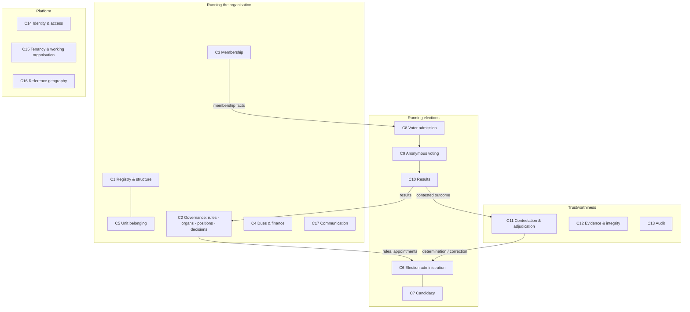
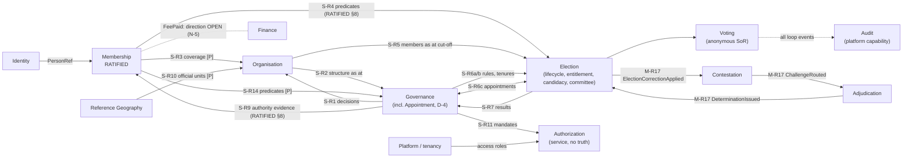

# Business capability and strategic DDD baseline: discovery report (platform-wide)

| | |
|---|---|
| **Status** | **REPORT. PROPOSED discovery evidence.** It records evidence and makes recommendations. It decides, ratifies, accepts and authorises nothing, and changes no status in any other record. |
| **Authority** | generated (Claude, DDD discovery analyst role). Not authoritative without Principal review. **Not independently reviewed** (Claude family only). |
| **Date** | 2026-11-09 |
| **Snapshot** | branch `election-flow-updated`, HEAD `5a26453d5`. Read-only: no code, configuration, schema or existing architecture document was changed. |
| **Placement** | `php scripts/doc-placement.php --scope=product-specific --maturity=research --domain=publicdigit` → `docs/publicdigit` (exit 0); `architecture/reviews/`, next to the 2026-11-03 baseline. |
| **Commission** | "Next Discovery Round: Business Capability and Strategic DDD Baseline" (Principal, 2026-11-09). |
| **Roadmap position** | `docs/plans/20261108-0303-organisational-baseline-to-tactical-design-roadmap-plan.md`: this report delivers a first **Phase 4 step C-2 capability inventory** (Appendix B) and a **preliminary C-4/C-5 responsibility view**, and collects inputs for **Phase 5**. It does **not** accept or close Phase 3, 4 or 5. Under the plan, Phase 4 is accepted only together with Phase 3. |

**Labels:** **FACT** · **INTERPRETATION** · **ASSUMPTION** · **UNKNOWN** · **RECOMMENDATION**. Statuses of cited records are quoted as those records state them (RATIFIED, FROZEN, ACCEPTED, APPROVED, PROPOSED, working decision [D], OPEN). **Confidence:** H / M / L.

## 0. How this report relates to the existing records (read first)

Much of the strategic work this commission asks for **already exists**. Per the Canonical Discovery rule ("consume or extend, never create a second"), this report **consumes** those records and does not restate them:

| Record | Status | Covers |
|---|---|---|
| `docs/architecture/design/Round49-06_Boundary_Decision_Register.md` (BDR-01…13, v1.1 delta) | FROZEN | trustworthiness programme: Evidence, Voting, Appointment, Contestation, Adjudication, Replay, Authorization, Election Lifecycle, Audit, Results, Legitimacy, Anonymity, Trust-Anchor |
| `docs/implementation/EPIC-002_Canonical_Context_Map.md` | ACCEPTED (own scope) | evidence and integrity contexts |
| Ratified Membership act (`docs/publicdigit/reviews/2026-10-08-membership-architecture-ratified.md`) | RATIFIED, frozen | Membership, plus boundary text for Identity, Governance, Election, Finance, Audit (§10–§12) |
| `docs/publicdigit/architecture/context-map.md` (R-01…R-18) | PROPOSED; PO approved its location and role as "the consolidation point" (status record §9) | organisation and governance relationships |
| `docs/publicdigit/reviews/2026-11-08-organisation-strategic-discovery-record-structure-mandates-conventions.md` (V-1…V-59, D-1…D-32) | PROPOSED evidence; working decisions | organisation, governance, conventions |
| `docs/publicdigit/reviews/2026-11-08-strategic-context-map-and-governance-tactical-model.md` (§15 consolidated working map, R-1…R-15) | PROPOSED working baseline | organisation and governance contexts and contracts |
| `docs/publicdigit/architecture/strategic-design-status.md` | resumption record | settled vs open |
| `docs/publicdigit/architecture/reviews/2026-11-03-publicdigit-as-is-baseline-architecture-report.md` | REPORT | as-is implementation |

**What this report adds:**
1. A **platform-wide** capability map. The 2026-11-08 map leaves "Voting, Evidence, Contestation, Adjudication, Audit" outside its scope and leaves Finance unclassified.
2. A **code-directory to context reconciliation**: which `app/Contexts/*` folders are real contexts and which are not.
3. **Conflicts between the existing records** (§8).
4. **New implementation evidence** not found in any record (§7, N-1).

**Correction to my own earlier report:** `../mobile-investigation/01-existing-architecture-baseline.md` §1 says each `app/Contexts/*` folder "has Domain, Application and Infrastructure layers". **That is wrong.** Committee has 4 files (Application, Infrastructure), Finance has 1 (Events) and Trust has 2 (Domain events) (FACT, §3). The mobile report was not edited, because this commission forbids changing existing architecture documents. RECOMMENDATION: correct it in a separate authorised edit.

---

## 1. Business capability map (C-2 inventory)

**What the business is (FACT):** "an Organisation Governance Platform whose first major capability is running elections" (`docs/publicdigit/backlog/README.md:3`). D-1 [D][PO] says PublicDigit supports multiple organisations, each with its own constitution and rules, and that "platform configuration creates no authority" (D-1a); there are no platform-wide default rules (D-1b) (discovery record §1). The primary users named are diaspora and democratic organisations, NRNA first (`docs/publicdigit/business_case/BUSINESS_CASE.md:127-145`).

| # | Capability | Business outcome | Evidence of the need | Label (C-2) |
|---|---|---|---|---|
| C1 | **Organisation registry and structure** | the organisation, its levels, units and wings, over time | EPIC-01; D-3, D-22; V-20…V-25, V-49…V-54 | [F] need; model [P] |
| C2 | **Governance**: rules, organs, positions, decisions, delegation | who may decide what, who holds which office, what was decided and when | act §11 `:319-321` (RATIFIED); D-4, D-5, D-10, D-12 | [F] need; model [P] |
| C3 | **Membership administration** | who is a member, of which type, since when; applications, approval, renewal, suspension, end | EPIC-02; ratified act | [F] RATIFIED |
| C4 | **Dues and finance** | fee obligations, payment, settlement, income and expense | act §11 `:334-343` (Finance owns settlement); `routes/organisations.php:204-207` (fees) | [F] need; boundary partly OPEN (FeePaid direction) |
| C5 | **Unit belonging and territorial assignment** | which unit a member or office holder belongs to, as at a date | V-24, D-3, R-3/R-5 | [P] working |
| C6 | **Election administration** | create, configure, run an election through its lifecycle; election committee and officers | EPIC-03; act §11–§12 (RATIFIED boundary); BDR-08 | [F] |
| C7 | **Candidacy** | who may stand, and candidacy decisions | EPIC-04; §15 working map (Election applies Governance's criteria) | [F] need; ownership split [P] |
| C8 | **Voter admission and verification** | who may vote in this election, with what evidence | `docs/publicdigit/adr/ADR_20261004_1549_Voter_Admission_Policy_And_Voting_Entitlement.md`; `ADR_20261005_0950_Voting_Authorization_Boundary.md` | [F] |
| C9 | **Anonymous voting** | a secret, single, verifiable ballot | BDR-02 (FROZEN); BDR-12 Anonymity "supreme" invariant; EPIC-05 | [F] FROZEN |
| C10 | **Results** | count and publish | BDR-10 (derived read model, not a context); EPIC-06 | [F] FROZEN |
| C11 | **Contestation and adjudication** | challenge an outcome; a binding determination; forward-only correction | BDR-04, BDR-05 v1.1 (FROZEN); Push B Blueprint (FROZEN) | [F] FROZEN; **not implemented on any user path** (§7) |
| C12 | **Evidence and integrity** | collecting, fixing, custody and self-verification of evidence | BDR-01; EPIC-002 (ACCEPTED) | [F] |
| C13 | **Audit** | a trail of actions | BDR-09: platform capability, not a context | [F] FROZEN |
| C14 | **Identity and access** | a person, an account, login; platform permissions | act §11 `:311-313` (identity RATIFIED); BDR-07 Authorization; XD-3a/b/c (PROPOSED) | [F] / [P] |
| C15 | **Platform and tenancy** | many organisations, the Working Organisation, demo mode | PBDIGIT-30 B1/B10/K′ (APPROVED); INV-ORG-SCOPE-1 (APPROVED principle) | [F] |
| C16 | **Reference geography** | official administrative areas and revisions | D-31 (platform level, generic) | [P] working |
| C17 | **Communication** | newsletters, notices, messages, articles, opinions, forum | context-map.md §4 "Communication … PROPOSED; product choice open" (O-15); controllers exist (§7) | [F] code; need [H] |
| C18 | **Social contribution** | an initiative at Phase 0 | `docs/publicdigit/architecture/reviews/2026-11-07-social-contribution-initiative-story-and-development-plan.md` (Phase 0 APPROVED; no strategic design) | [H] |

**Capabilities in the C-2 list of the plan that have no evidence on file:** discipline, policy-making beyond the act of deciding, observers' rights. These are UNKNOWN, and are not invented here.

## 2. Actors and responsibilities

The **authority triple test** (roadmap Appendix B C-5) separates three things: **(A)** real organisational authority, **(B)** the context that owns the fact in software, and **(C)** platform permission. The records treat these as never interchangeable: PO-ORG-MEM-01 Decision A says "administrative responsibility and platform permissions are not organisational authority".

| Actor | Kind | Responsibility (source) | Label |
|---|---|---|---|
| Person / member / applicant | (A) subject | applies; holds membership; belongs to units | [F] act; [P] belonging |
| General Convention | (A) organ | supreme organ; elects; defines committee types | [PK] V-series, W-2 |
| Highest Committee (NRNA: "International Coordination Council") | (A) organ | governs between conventions; issues Governance Rules; structural decisions | [PK] W-2; D-21 |
| Other committees and organs | (A) organ | competence per the rules; at most one active per unit and kind | [P] D-10 Organ |
| Office holder / position holder | (A) | holds powers through a tenure; mandate derived | [P] D-10, R-11 |
| Delegate | (A) | represents a lower unit at a convention | [P] §16 |
| Election committee and officers (incl. chief) | (A) inside Election | run an election; seats filled by Governance appointment decisions | [D] D-23 (R-6c) |
| Candidate | (A) subject | stands under candidacy criteria | [P] §15 |
| Voter | (A) subject | casts one anonymous vote when entitled | [F] RATIFIED/FROZEN |
| Adjudicating body | (A) | issues binding determinations | [F] BDR-05 v1.1; body identity [OQ] |
| Organisation "owner" / "admin" roles (and others such as "commission" in other flows, not traced here) | **(C) platform roles** | approve membership applications in code | [F] code (`MembershipApplicationController.php:175` → `app/Policies/MembershipPolicy.php:33-36`: `hasRole(..., ['owner','admin'])`). **They are not (A)** per PO-ORG-MEM-01 A |
| Platform operator | (A) for its own organisation only | K′: the operator is a separate organisation | [D] K′ |
| Platform admin | (C) | platform administration (`platform_admin` middleware, `bootstrap/app.php`) | [F] |
| Staff | (A)/(C) unclear | staff belonging; who engages staff is [OQ] | [OQ] §9.5 |
| Observers | UNKNOWN | open in §9.5 / §10.5 | UNKNOWN |

## 3. Bounded context catalogue: designed contexts against code folders

**Rule applied:** a folder name proves nothing. Status comes from the records. The code column shows only what exists.

| Context (as designed) | Design status | Code home(s) (FACT: PHP files; files referenced from `app/Http`, providers or routes) | Verdict |
|---|---|---|---|
| **Membership** | RATIFIED, frozen | `app/Contexts/Membership` (554; 16), plus legacy `app/Models/Member*` and controllers. It also hosts `Domain/Committee` (188 files: the legacy committee write model, DR-07a), `Domain/Fee`, `Domain/Voting` (see N-1) | context is **real**; its folder holds **other contexts' concerns** |
| **Governance** (incl. BDR-03 Appointment (Authority), per D-4) | ownership RATIFIED (act §11); model working [D]; **D-4 consolidation needs an ADR and BDR v1.x** (§7 of the 2026-11-08 model) | `app/Contexts/Governance` (89; 4); committee API (`Api/Governance/CommitteeMemberController`); aggregate rebuilt blank (G-7) | real context; implementation **partial and divergent** (§6 of the 2026-11-08 model) |
| **Organisation** | candidate (ADR-004); working [D] D-3, D-22 | **no context folder.** `app/Models/Organisation`, `OrganisationController`, `committees` table rows used as units | designed only; legacy implementation |
| **Election** | boundary RATIFIED (act §11–§12); Election Lifecycle a Supporting Subdomain (BDR-08, FROZEN) | **three homes:** `app/Contexts/Election` (100; **0**: greenfield, providers only, 39 test files), `app/Contexts/Elections` (82; 11: the live module), legacy `app/Domain/Election`, `app/Models`, `VoteController` | one context, **three implementations**; placement ADR `ADR_20260813_1722_*` PROPOSED |
| **Voting** | Confirmed BC, Operational (BDR-02, FROZEN) | `VoteController` (4,388 lines), `app/Domain/Voting`, `app/Contexts/Elections/Domain/Ballot` | real; legacy implementation |
| **Contestation** | Confirmed BC, Greenfield (BDR-04) | `app/Contexts/Contestation` (51; **0**; 15 test files) | **built and tested, not reachable by any user** |
| **Adjudication** | Confirmed BC (BDR-05 v1.1 Greenfield); name reconciliation with EPIC-002 deferred | `app/Contexts/Adjudication` (60; **0**; 28 test files) | as Contestation |
| **Evidence / EPIC-002 contexts** | BDR-01 FROZEN; EPIC-002 ACCEPTED | not traced in this round | UNKNOWN (out of time box) |
| **Finance** | settlement RATIFIED to Finance (act §11) | `app/Contexts/Finance` (**1** file: `Events/FeePaidProjection.php`); `Finance/IncomeController`, `OutcomeController`; `Listeners/Finance/*`; fee aggregate in Membership | designed in one sentence; **thin, mostly legacy** |
| **Reference Geography** | working [D] D-31 (generic, platform level); bounded-context status was [OQ] | `app/Contexts/Geography` (71; 7) | real code; boundary narrowed by D-31; R-10 contract [P] |
| **Identity** | identity equivalence RATIFIED; account and PersonRef PROPOSED | no context folder; `User`, `Auth/*`, Socialite | designed in part; legacy |
| **Authorization** | Supporting Subdomain / Domain Service, owns no truth (BDR-07) | Spatie permission, `app/Policies` | **not a context by design**; today it decides on platform roles (§18 of the 2026-11-08 model) |
| **Audit** | platform capability, not a context (BDR-09) | log channels, `app/Helpers/ElectionAudit.php` | consistent with BDR-09 |
| **Platform / tenancy** | rules APPROVED; owning context not named | `TenantContext`, `BelongsToTenant`, `organisation_id` scopes | real capability; **owner unnamed** |
| **Communication** | PROPOSED; product choice open (O-15) | legacy controllers (newsletter, notice, message, article, opinion, feed) | capability exists; **no design** |
| — `app/Contexts/Committee` | **not a context in any record**; PO-DR07-01: governance committees are organs (→ Governance) | 4 files: a read model used by Membership's committee dashboard | **technical folder, not a context** (INTERPRETATION, H) |
| — `app/Contexts/Trust` | **not a context in any decision record**. Knowledge card `docs/knowledge/domains/trust/README.md`: "status: draft, authority: provisional … stub". BDR-13: "Trust-Anchor / Consent" is external, "device-PKI 'Trust' distinct" | 2 event classes (`IdentityAttestedEvent`, `VerificationRevokedEvent`) used by `Election/VoterVerificationController` | **an event namespace for voter verification, not an established context** (INTERPRETATION, M) |
| — `app/Contexts/Elections` | not a separate design context: the live implementation of Election (above) | | (above) |
| — `app/Contexts/Shared` | a platform layer, not a business context (`deptrac.yaml` header) | 30; 9 | consistent |

**Answer to "are Election and Elections different bounded contexts?"** No record designs two. Both folders implement **one** designed context (Election), at different generations. The 2026-11-03 baseline calls this "three homes" (`…-report.md:159`); the placement decision is PROPOSED. FACT (H).

**Answer to "what is the relationship between Contestation and Adjudication?"** It is FROZEN in the Push B loop:
- Contestation sends `ChallengeRouted` to Adjudication.
- Adjudication sends `DeterminationIssued` to Election and to Contestation.
- Election sends `ElectionCorrectionApplied` to Contestation.
- The loop runs only on events. The one exception is ADR-T14, which lets Adjudication read a Challenge read-only.

Source: context-map.md R-17; Blueprint §2, §10, §11. Still open: whether the implemented `app/Contexts/Adjudication` is the same as EPIC-002's discovered "Adjudication" (deferred name reconciliation). FACT (H).

## 4. Context relationship map

**The authority for relationships is the existing maps**, not this diagram. This is a reading aid that combines them, and each edge carries its source ID.

**Edge prefixes used here:** `S-R` = the 2026-11-08 working map §16; `M-R` = `context-map.md` §5. The prefix is needed because **the two maps use the same R-numbers for different relationships** (§8, G-2).

**Patterns that are in evidence (FACT, from the records):**
- **Customer/Supplier with a Published Language:** Membership → Election predicates (ratified §8).
- **Event-only Partnership:** the Push B loop (FROZEN).
- **Conformist:** Authorization to its sources (BDR-07).
- **Snapshot and query "as at" a date:** Session B §15 patterns [P].

**Patterns not in evidence, so not claimed:** Shared Kernel and Open Host Service. Shared is a platform layer, not a kernel (`deptrac.yaml`).

## 5. Business authority and ownership matrix (preliminary C-4/C-5 view)

| Business fact or decision | (A) Who decides in the organisation | (B) Owning context | (C) Platform permission in today's code | Status / conflict |
|---|---|---|---|---|
| Admit / end membership | a competent organ or authorised office holder (PO-ORG-MEM-01 A) | Membership (RATIFIED) | org roles `owner`/`admin` (`MembershipPolicy.php:33-36`) | (A) ≠ (C): known; XD-4 OPEN; §18 of the 2026-11-08 model |
| Membership authority evidence | Governance | Governance → Membership (AuthorityCheck, RATIFIED §8) | — | RATIFIED |
| Rules, competence, delegation | organs per the constitution | Governance (RATIFIED act §11) | — | model [P] |
| Organs and positions, tenures, appointments | competent organs | Governance (D-4: includes BDR-03 Appointment) | committee CRUD by platform roles | D-4 needs an ADR and BDR v1.x; DR-07 OPEN |
| Structure and unit belonging | Highest Committee decisions (D-21) | Organisation [D] D-3 | — | candidate context |
| Voter eligibility and entitlement | per election rules | **Election** (RATIFIED: "Membership does not decide these") | middleware chain | **N-1 contradicts this in code** (§7) |
| Candidacy criteria / candidacy decisions | rules: Governance; decisions: Election | split [P] (§15) | — | [P] |
| Election committee seats | appointment: Governance; seats: Election | D-23 | officer invitation flows | [D] working |
| Ballot and vote | the voter | Voting (BDR-02) | — | FROZEN; anonymity gaps PBDIGIT-284, G-1 OPEN |
| Results | count rules | derived read model (BDR-10) | — | FROZEN |
| Binding determination | adjudicating body | Adjudication (BDR-05) | none (unrouted) | FROZEN; not implemented on any user path |
| Fee obligation / payment record | organisation's fee rules | **Membership in code** (`Domain/Fee`, `FeePaid` event, `MembershipFeeController::pay` → `MembershipPaymentService::recordPayment`) | `recordFeePayment` policy | the act says Finance owns **settlement**; whether recording a payment is settlement is UNKNOWN; FeePaid direction **OPEN** (N-5; "still with the PO", status record §9) |
| Income / expense | treasurer (ASSUMPTION) | Finance | Finance controllers | thin design |
| Official geography | the state (external) | Reference Geography [D] D-31 | — | [P] |
| Working Organisation / tenancy | — | Platform (rules APPROVED; owner unnamed) | `TenantContext` | owner gap |

## 6. Subdomain classification

The records **disagree**, so the classifications are listed side by side, not merged:

| Capability | BDR v1.0 / v1.1 (FROZEN) | 2026-11-08 working map §3 ([P]) | This report's reading (INTERPRETATION, confidence) |
|---|---|---|---|
| Contestation + Adjudication | **"the genuine greenfield Core"**, "the trustworthiness differentiator" (BDR v1.1 delta) | outside its map | Core *by the programme's thesis* (M). It is not built, so its differentiation is unproven in the market |
| Governance | (Appointment: Confirmed BC) | **Core** | Core candidate (M): per-organisation constitutions and authority is distinctive; evidence is [PK] until statutes arrive |
| Election and Voting | Voting a Confirmed BC; **Election Lifecycle a Supporting Subdomain** (BDR-08) | **Core** ("Election and Voting") | **conflict C-12**: anonymous voting is Core-like (BDR-12 "supreme" invariant); lifecycle is supporting by BDR-08. Both can be true only if "Election" is split into lifecycle (supporting) and voting (core). That split is a decision, not made here |
| Membership | — | Supporting | Supporting (M) |
| Organisation | — | Supporting | Supporting (M) |
| Finance | — | not classified | Supporting or Generic (L) |
| Geography | — | Generic | Generic (H; D-31) |
| Identity, Platform | — | Generic | Generic (H) |
| Authorization | Supporting Subdomain / service | (service) | Supporting service (H) |
| Audit | Infrastructure capability | outside | platform (H) |
| Communication | — | — | Generic (M), if kept |

**Business reasoning (not code size):** Core means what makes an organisation choose PublicDigit over a generic voting tool.
- The business case's stated advantages are "Diaspora-Specific Design", "Multi-Language Native", "Mobile-First", "Security Transparency" and "Customization: Flexible rules for different election types" (`BUSINESS_CASE.md:337-342`, February 2026, a pre-discovery document).
- Read together with D-1 (each organisation's own constitution) and BDR-12 (anonymity supreme), this supports Voting, Governance and the correction loop as Core **candidates** (INTERPRETATION, M).
- It does not support Membership administration, which is common to every association tool.
- Note: "Mobile-First" is a stated advantage, which bears on mobile decision D-1 (`../mobile-investigation/10-…md`).

## 7. Business-to-implementation alignment

| Area | Alignment | Evidence |
|---|---|---|
| Membership aggregate and its correction algebra | **aligned** (ratified design implemented in the greenfield code; COR-2/COR-4 accepted) | status record §3; 2026-11-03 reviews |
| Membership ↔ Election separation | **partially aligned**: known violations V1, V1b, V2, V3′, guarded by S1b; S2–S4 gated | `docs/publicdigit/reviews/2026-11-02-membership-election-separation-decision-record.md:35-55` |
| Membership folder holding committee, fee and voting concerns | **potentially misaligned** (committee: DR-07a OPEN; fee: N-5 OPEN; voting: N-1) | §3 |
| Governance | **partial / divergent**: member→role map, `removeMember` deletes, aggregate rebuilt blank, inverted date rule in `GovernanceDecision` | 2026-11-08 model §6, §18 |
| Organisation | **legacy** (no context; units stored as committees) | §3; DR-07b |
| Election | **three generations**; the live path is `Contexts/Elections` plus legacy; greenfield unrouted | §3 |
| Voting | **legacy** but guarded (compare-and-set against double voting, slug lock); anonymity gaps OPEN | `VoteController.php:1825-1845`; PBDIGIT-284; G-1 `:1950` |
| Contestation, Adjudication | **built, not deployed to users** | §3 (0 HTTP references) |
| Authorization | **misaligned with BDR-07 and PO-ORG-MEM-01 A**: platform-role policies stand in for organisational competence | 2026-11-08 model §18; §5 above |
| Finance | **thin**; payment recording in Membership; FeePaid direction OPEN | §5 |
| Reference Geography | **partially aligned**: official and organisational units in one table; fixed `parentId`; tenant row ids instead of official identity | 2026-11-08 model §18 |
| Communication, Social contribution | **unknown**: no design to compare against | — |
| Frontend | mirrors the backend generations: Inertia pages per legacy controller; capability ACL (`useElectionCapabilities.ts`) aligned with "backend owns the truth" | `../mobile-investigation/02-…md` |

### N-1: new evidence that contradicts a ratified decision (reported separately; the decision is not reopened)
- **FACT:** `app/Contexts/Membership/Domain/Voting/VotingEligibilityPolicy.php` describes itself as "the ONLY place where voting eligibility is determined … Allows Elections context to consume decisions via gateway".
- **FACT:** It was created on 2026-05-14 (`8dc2c9109`), before the Membership ratification (2026-10-08). No production caller was found; only references in docblocks and `tests/Unit/Constitutional/Membership/VotingEligibilityPolicyTest.php`. It is **not** in the V1–V3′ list.
- **Ratified text:** Election owns eligibility; "Membership does not decide these" (act §11 `:323-332`).
- **INTERPRETATION (M):** this is probably dead pre-ratification code. It is still a hazard: a future developer, or an AI session, could wire it in as "the single source of truth".
- **RECOMMENDATION:** Membership-owner triage as a backlog item: remove it, relocate it, or mark it superseded. Consider adding it to the S1b boundary guard scan.

## 8. Architectural gaps and conflicts between records

| ID | Gap or conflict | Evidence | Consequence |
|---|---|---|---|
| G-1 | **The status record contradicts Session B.** `strategic-design-status.md` §9a says "Strategic DDD discovery has not started and must not start before the organisational baseline is accepted". The 2026-11-08 Session B records then produced working decisions D-2…D-32, a consolidated context map and two tactical models, and state "Roadmap phase: Phase 1–2 discovery". The status record was not updated after Session B (its §9a predates `200b37d32`) | as cited; `git log` | a future session following §7 of the status record would act on a stale state. Under its own §7.5 rule this must be reconciled before relying on either |
| G-2 | **Two context maps, colliding relationship IDs.** `context-map.md` (R-01…R-18; for example R-11 = Geography → Governance) is the PO-approved consolidation point. The 2026-11-08 §15 "consolidated context map" (R-1…R-15; R-11 = Governance → Authorization) is not yet merged ("Context Map update under change control" is a pending ARB act) | as cited | "R-11" means two different things; traceability breaks |
| G-3 | **Subdomain classifications conflict** (BDR v1.1 vs BDR-08 vs §3 of the 2026-11-08 model) | §6 | C-12 (Phase 4 deliverable) is unresolved |
| G-4 | **Platform/tenancy has no named owning context** | context-map.md §4 | ownership of INV-ORG-SCOPE-1 enforcement is unclear |
| G-5 | **Finance boundary:** FeePaid direction and fee recording | §5 | Finance facts may sit in Membership code |
| G-6 | **Election code placement** (three homes) | §3; ADR PROPOSED | every Election change risks landing in the wrong generation |
| G-7 | **The correction loop is not deployed** (Contestation and Adjudication unrouted) | §3 | the claimed Core differentiator is not yet available to users |
| G-8 | **The Communication capability is undesigned** | O-15 | legacy feature set with no owner |
| G-9 | **Folders that are not contexts** (`Committee`, `Trust`, `Elections`) | §3 | names mislead readers and tools (`docs/knowledge/schema/bounded-contexts.yaml` lists `trust` as a context) |
| G-10 | **Authorization uses platform roles** in place of competence | §5 | (A)/(C) confusion in live behaviour |
| G-11 | **N-1** | §7 | latent boundary violation |
| — | Already open and **not restated here**: DR-07 / DR-07a / ARB-1…8, XD-4, XD-5, O-8…O-10, O-14, INV-ORG-SCOPE-1 and INV-AFF-1 ARB acts, Gate F, NRNA statutes, B-4, the Membership §8 Change Request | status record §4, §9a; discovery record §8.6, §9.5, §10.5 | — |

## 9. Human decision register (new items only, prioritised)

| # | Decision | Why it matters | Options | Recommendation | Blocks |
|---|---|---|---|---|---|
| **HD-1** | **Reconcile the process state:** were Session B's strategic and tactical outputs (D-2…D-32) produced under a phase authorisation, and what is the current roadmap phase? | the baseline must have one true state (G-1) | (a) record Session B as authorised working discovery and update the status record; (b) treat Session B as provisional input only, pending Phases 1–3; (c) other | **(a) or (b), explicitly**, then update the status record | trusting any "settled" item |
| **HD-2** | **One context map:** fold §15/§16 of the 2026-11-08 model into `context-map.md` under change control, and renumber | G-2 | (a) merge with new IDs; (b) keep both with prefixes; (c) defer | **(a)** as part of the pending Context Map ARB act | Phase 5 traceability |
| **HD-3** | **Subdomain classification (C-12):** is "Election" one subdomain or two (lifecycle vs anonymous voting)? Is Contestation and Adjudication Core? | G-3; investment priority | as in §6 | split lifecycle (supporting) and voting (core); keep BDR v1.1's Core claim, labelled "unbuilt" | Phase 4 acceptance |
| **HD-4** | **Fee and payment ownership:** is recording a fee payment Membership or Finance? FeePaid direction? | G-5 | (a) Membership records the obligation, Finance records settlement and publishes FeePaid; (b) as coded (Membership publishes FeePaid); (c) other | needs the PO's business answer. **Already "still with the PO" (status record §9)**: this sharpens it with the code facts | Finance design |
| **HD-5** | **Triage N-1** (Membership `VotingEligibilityPolicy`) | ratified boundary hazard | remove / relocate / mark superseded | backlog item for the Membership owner | nothing now |
| **HD-6** | **Status of the `Trust` and `Committee` folders** and the `bounded-contexts.yaml` entry for `trust` | G-9 | declare as technical namespaces; or commission discovery | declare technical; no new context without evidence | knowledge-graph accuracy |
| **HD-7** | **Scope of Communication and Social contribution** as capabilities | G-8 | in scope (design later) / out of scope / park | PO product decision; Generic if kept | nothing now |
| **HD-8** | **Owner of Platform/tenancy** | G-4 | Identity, Organisation, or its own platform capability | decide with INV-ORG-SCOPE-1 ratification | ARB session |

The existing open decisions (DR-07, XD-4, XD-5, O-8…O-10, O-14, Gate F, the INV ARB acts) stay as recorded. Their order is in the status record §6.

## 10. Conclusions

**Understood with high confidence (H):**
- PublicDigit is a multi-organisation governance platform whose first capability is elections. Each organisation's own constitution is the source of authority, and platform configuration creates none (D-1, D-1a, D-1b).
- Membership's boundary is ratified and implemented in the greenfield code.
- Election owns eligibility and entitlement (ratified).
- Voting is the anonymous system of record, and anonymity is the supreme invariant (FROZEN).
- Results and Legitimacy are read models. Authorization owns no truth. Audit is a platform capability (FROZEN).
- The correction loop Contestation → Adjudication → Election is designed (FROZEN) and built, but not deployed to users.
- `Election` and `Elections` are one designed context with several implementations.
- `Committee` and `Trust` folders are not established contexts.

**Still uncertain:**
- the Governance/Organisation split and their contracts (working [D], not ratified, [PK] until statutes arrive);
- the Finance boundary and the FeePaid direction;
- the subdomain classification;
- the owner of Platform/tenancy;
- Communication;
- the EPIC-002 / BDR naming reconciliation for Evidence and Adjudication;
- observers, staff, delegates' mandates;
- which roadmap phase is current (G-1).

**Boundaries that appear stable:** Membership (RATIFIED); Election ↔ Membership (ratified §8; violations tracked); Voting and anonymity; the Push B loop; Authorization as a service; Reference Geography at platform level (D-31; contract [P]).

**Boundaries needing further discovery:** Governance ⇄ Organisation (needs statutes; Gate F); committees (DR-07a); Finance ⇄ Membership; Election internals (lifecycle vs voting; three code homes); Platform/tenancy; Communication; Trust as voter-verification evidence (inside Election, or its own concern).

**Only the Principal (PO / ARB) can decide:** HD-1…HD-8 above, plus the items already on record: DR-07, XD-4, XD-5, O-8…O-10, O-14, the INV ARB acts, Gate F, B-4, the Membership §8 Change Request, and acceptance of Phases 3–4.

## Traceability
- **Commission:** Principal, 2026-11-09.
- **Sources read in this round:** the records in §0; `docs/publicdigit/backlog/README.md`; `docs/publicdigit/business_case/BUSINESS_CASE.md`, `FEATURE_MATRIX.md`; roadmap plan §5 and Appendix B; `docs/knowledge/domains/trust/README.md`; `docs/knowledge/schema/bounded-contexts.yaml`.
- **Code inspected:** `app/Contexts/*` (file counts and external references); `app/Contexts/Membership/Domain/Voting/VotingEligibilityPolicy.php`; `app/Http/Controllers/Membership/MembershipApplicationController.php`, `MembershipFeeController.php`; `app/Contexts/Finance`, `app/Contexts/Trust`, `app/Contexts/Committee`.
- **Not done:** no statute read (none on file); no Evidence-context code trace; no independent review.
