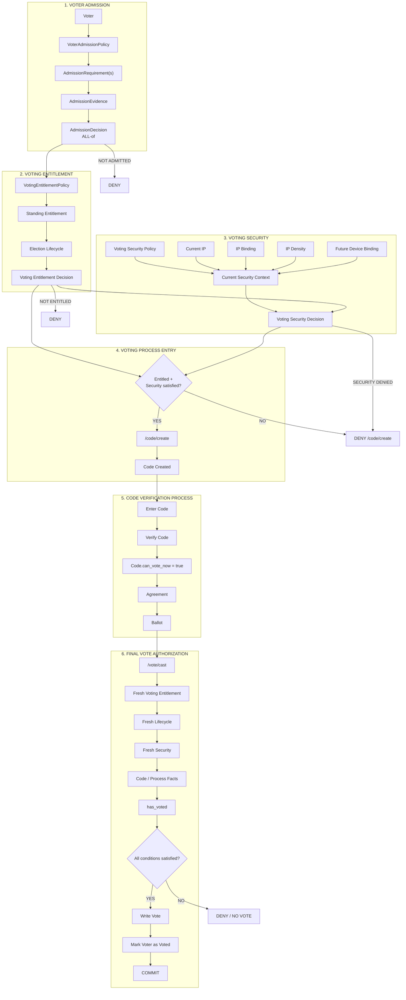

Yes. Based on the architecture we have established and Claude's repository discovery, I would now model the **complete voting lifecycle** as one coherent flow.

The most important architectural principle is:

> **Admission determines whether the voter satisfies participation requirements; Entitlement determines whether the voter may participate; Security determines whether the current voting attempt is acceptable; Code Verification proves control of the voting code; Final authorization re-evaluates the current state immediately before the vote is written.**

Claude's discovery confirms that the existing final `store()` already performs several of these fresh checks, while IP binding and device binding are not yet actually operational. Eingefügter Text

# 1. Complete conceptual flow

```mermaid
flowchart TD

    A["Voter"] --> B["Election Registration"]

    B --> C["Voter Role / Organisation / Status"]

    C --> D["Voter Admission"]

    D --> D1["VoterAdmissionPolicy"]
    D1 --> D2["AdmissionRequirement"]

    D2 --> D3["AdmissionEvidence"]

    D3 --> D4["AdmissionDecision<br/>ALL requirements satisfied?"]

    D4 -->|NO| X1["Not Admitted"]
    D4 -->|YES| E["Voting Entitlement"]

    E --> E1["VotingEntitlementPolicy"]

    E1 --> E2["Standing Entitlement<br/>registered + voter role + organisation + active + admitted"]

    E2 --> E3{"Election currently votable?"}

    E3 -->|NO| X2["Cannot participate"]
    E3 -->|YES| F["Voting Process Entry"]

    F --> G["Security Preconditions"]

    G --> G1["Voting Security Policy"]

    G1 --> G2["Current Security Decision"]

    G2 --> G3{"Security satisfied?"}

    G3 -->|NO| X3["DENY /code/create<br/>No code issued"]

    G3 -->|YES| H["/code/create"]

    H --> I["Voting Code Created"]

    I --> J["Code Verification Process"]

    J --> J1["Enter Code"]

    J1 --> J2["Code Match"]

    J2 --> J3["Code Valid / Not Expired"]

    J3 --> J4["can_vote_now = true"]

    J4 --> K["Agreement / Ballot"]

    K --> L["/vote/cast"]

    L --> M["FINAL AUTHORIZATION<br/>inside transaction"]

    M --> M1["Fresh Voting Entitlement"]

    M1 --> M2["Fresh Election Lifecycle"]

    M2 --> M3["Fresh Voting Security"]

    M3 --> M4["Voting Process Facts"]

    M4 --> M5["has_voted?"]

    M5 --> N{"All final conditions satisfied?"}

    N -->|NO| X4["DENY<br/>No Vote Written"]

    N -->|YES| O["Write Vote"]

    O --> P["Mark Voter as Voted"]

    P --> Q["Commit Transaction"]

    Q --> R["Vote Cast"]
```



---

# 2. The architecture in layers

I would actually separate the diagram into **five architectural layers**.

## Layer 1 — Admission

```text
Voter
  │
  ▼
VoterAdmissionPolicy
  │
  ▼
AdmissionRequirements
  │
  ▼
AdmissionEvidence
  │
  ▼
AdmissionDecision
```

Question:

> **Has this voter fulfilled the requirements to be admitted?**

Current requirement:

```text
OfficerIdentityVerification
```

But the architecture is already ALL-of, so future requirements can be added without creating a generic gate engine.

```text
Identity verification ─────┐
Requirement B ─────────────┤
Requirement C ─────────────┤──→ ALL satisfied?
Requirement N ─────────────┘
```

If not:

```text
AdmissionDecision = NOT_ADMITTED
```

If yes:

```text
AdmissionDecision = ADMITTED
```

---

# 3. Layer 2 — Voting Entitlement

The next question is different:

> **Is this voter entitled to participate in this election?**

```text
AdmissionDecision
       │
       ▼
VotingEntitlementPolicy
       │
       ├── registered?
       ├── voter role?
       ├── organisation?
       ├── active?
       └── admitted?
              │
              ▼
      Standing Entitlement
```

Then the election lifecycle is evaluated.

Claude's discovery confirms that the existing model already distinguishes `standing()` from `decide()`. Eingefügter Text

Conceptually:

```text
VotingEntitlement
       +
ElectionLifecycle
       ↓
Can participate now?
```

---

# 4. Layer 3 — Voting Security

This is where we should put **IP binding and future device/security controls**.

```text
VotingSecurityPolicy
        │
        ▼
VotingSecurityDecision
```

Potential future policy:

```text
VotingSecurityPolicy
│
├── IP Binding: ON/OFF
├── IP Density: configured
├── Device Binding: ON/OFF
└── Future security rules
```

The important distinction is:

```text
IP observed
      ≠
IP authorized
```

And:

```text
Identity verified
      ≠
IP authorized
```

Claude found that the existing `verified_ip` is currently not enforced at vote time, so we should not treat that existing field as an operational security binding. Eingefügter Text

---

# 5. Layer 4 — Voting-process entry

Now we get to the first important enforcement boundary:

```text
VotingEntitlement
        +
VotingSecurityDecision
        +
Lifecycle
        ↓
Voting Process Entry
```

The question is:

> **May this voter start the voting process?**

If security is required but not satisfied:

```text
/code/create
     │
     ▼
DENY
```

**No code should be created.**

This is the point you correctly emphasized.

---

# 6. Layer 5 — Code verification

Once the voter has passed the process-entry conditions:

```text
/code/create
      │
      ▼
Code Created
      │
      ▼
Code Entry
      │
      ▼
Code Verification
      │
      ▼
can_vote_now = true
      │
      ▼
Agreement / Ballot
```

And here we maintain a very strict boundary:

### `Code.can_vote_now`

means only:

> **The voting-code verification process has been completed.**

It does **not** mean:

```text
Admission
Security
IP authorized
Device authorized
Final voting authorization
```

Claude's repository analysis confirms that `can_vote_now` is currently used in several process gates, but is not read by the final `store()` authorization itself. Eingefügter Text

---

# 7. The critical final boundary

Then:

```text
/vote/cast
     │
     ▼
VoteController::store()
```

This is the **last line of defense**.

Inside the transaction:

```text
                 /vote/cast
                     │
                     ▼
             BEGIN TRANSACTION
                     │
                     ▼
          Fresh Entitlement Check
                     │
                     ▼
          Fresh Lifecycle Check
                     │
                     ▼
          Fresh Security Check
                     │
                     ▼
          Code / Process Facts
                     │
                     ▼
              has_voted?
                     │
              ┌──────┴──────┐
              │             │
             NO            YES
              │             │
              ▼             ▼
        WRITE VOTE        DENY
              │
              ▼
       markUserAsVoted
              │
              ▼
        COMMIT
```

Claude's discovery confirms that the current `store()` already has this basic structure: fresh trust/legitimacy, lifecycle, entitlement, code checks, `has_voted`, vote insertion and commit. Eingefügter Text

---

# 8. The most important temporal property

The architecture should deliberately allow this:

```text
10:00
Security = ALLOWED
        │
        ▼
/code/create
        │
        ▼
Code created
        │
        ▼
Code verified
        │
        ▼
11:00
Security changes
        │
        ▼
/vote/cast
        │
        ▼
Fresh Security = DENIED
        │
        ▼
NO VOTE
```

Likewise:

```text
10:00
IP = 192.168.1.10
Security = ALLOWED
        │
        ▼
Code created
        │
        ▼
IP changes
        │
        ▼
/vote/cast
        │
        ▼
Current IP != authorized IP
        │
        ▼
DENY
```

Therefore:

> **Passing the pre-code security check never creates a permanent authorization.**

It only permits the voter to enter the code process.

---

# 9. What can be cached?

This is also important.

### Navigation

Potentially cached:

```text
VotingEntitlement
```

for ordinary page navigation.

### Code process

Persisted:

```text
Code
can_vote_now
```

but this represents process state.

### Final authorization

Never cache:

```text
Final security
Final entitlement
Final lifecycle
```

The final decision must be fresh.

Claude explicitly recommends fresh entitlement, lifecycle, security policy, IP binding and current IP at the final write. Eingefügter Text

---

# 10. What we should NOT build

I would put these constraints directly into the architecture documentation:

```text
❌ GenericGate
❌ GateEngine
❌ GateFactory
❌ GateRegistry
❌ AbstractGate

❌ SecurityPassed boolean
❌ AuthorizationPassed boolean persisted on Code
❌ IP security inside Code model
❌ Device security inside Code model
❌ Admission inside Code model
❌ IP binding as admission evidence
❌ can_vote_now as authorization
❌ cached final authorization
```

Instead:

```text
Admission
    ↓
AdmissionDecision

Entitlement
    ↓
VotingEntitlement

Security
    ↓
VotingSecurityDecision

Voting Process
    ↓
Code

Final Vote
    ↓
fresh composition at store()
```

---

# 11. Complete domain/application picture

Here is the version I would use as our **master architecture diagram**:



---

## 12. The architectural sentence I would freeze

I think this is the strongest formulation of the model we have reached:

> **A voter first satisfies Admission requirements and obtains Voting Entitlement. Only then may the voter enter the voting process when the applicable Security Preconditions are satisfied. The interval between code creation and voting consists solely of the Voting Code Verification process. At the final vote operation, the system freshly evaluates entitlement, lifecycle, security and voting-process facts before the vote is persisted.**

That gives us a clean separation between:

**Admission → Entitlement → Security → Code Process → Final Authorization → Vote**

without turning any of them into a generic gate mechanism.

One additional architectural finding should remain explicitly marked **future/unimplemented**: IP binding itself is not currently operational, and Claude found that the application's proxy trust must be corrected before IP binding can provide reliable security. Eingefügter Text