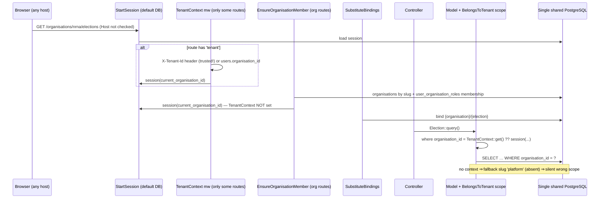

# 02 — Current `nrna1` architecture (reverse-engineered)

Evidence is relative to the `nrna1` repository root. Counts marked "≈" come from the earlier assessment (`MULTI_DATABASE_ARCHITECTURE_ASSESSMENT.md`).

## 1. Application stack (FACT)

| Concern | Today | Evidence |
|---|---|---|
| Framework | Laravel **11.41.3**, PHP 8.2 | `vendor/laravel/framework/src/Illuminate/Foundation/Application.php:48` |
| Database | PostgreSQL (dev/test); `.env.example` still says MySQL | `config/database.php`; `.env.example:15-20` |
| Connections | `pgsql` (default); `pgsql_audit` (same DB, audit outside transactions); `pgsql_geo` (unused); `testing`. **No `central` / `tenant` / `landlord` connection.** | `config/database.php:84-111` |
| Authentication | Session guard `web` + Sanctum + Socialite (Google) | `LoginController.php:46`, `GoogleLoginController.php:19,31` |
| Session | `database` driver, default connection, host-only cookie (`SESSION_DOMAIN` null), `same_site=lax` | `config/session.php:21,75,158,199` |
| Queue | `sync` by default; no `jobs` migration; `failed_jobs` is DB-backed | `config/queue.php:16` |
| Cache | `file` store, global prefix; Redis configured but not default | `config/cache.php:18,108` |
| Filesystem | `local` / `private` / `public` / `s3`; the public disk URL is built from `APP_URL` | `config/filesystems.php:33-51` |
| Broadcasting | not used for tenancy | — |
| Schedule | 13 entries in `routes/console.php:35-63` | — |
| Frontend | Inertia 2 + Vue 3; Ziggy `@routes`; mostly relative URLs | `resources/views/app.blade.php:16`, `resources/js/app.js` |
| Middleware | `bootstrap/app.php` (no `Kernel.php`); priority StartSession → TenantContext → SubstituteBindings; `trustProxies(at:'*')`; `TrustHosts` class exists but is **not registered** | `bootstrap/app.php:30,120-124`; `app/Http/Middleware/TrustHosts.php:14-18` |
| Providers | `config/app.php:198-213` (no `bootstrap/providers.php`) | — |
| Size | ≈1,700 PHP files in `app/`; 95 tables; ≈1,000 test files | `05` |

## 2. Domain map (bounded context → aggregate → persistence)

The DDD contexts live in `app/Contexts/`. Much behaviour still sits in `app/Models`, `app/Http/Controllers` and `app/Services`. **Not every Eloquent model is an aggregate.**

| Bounded context | Aggregate roots (evidence of invariants) | Notable entities / VOs | Repository / persistence | Tenant? |
|---|---|---|---|---|
| **Platform / Identity & Access** *(implicit today)* | `Organisation` (registry), `User` (global identity) | `UserOrganisationRole` (access grant), Spatie `Role` / `Permission` | Eloquent `organisations`, `users`, `user_organisation_roles`, `roles`… | **central** |
| **Elections / Election** | `Election` (lifecycle state machine, settings, admission policy) | `Post`, `Candidacy`, `ElectionOfficer`, `ElectionMembership` (voter registration), VOs `ElectionLifecycleState`, `VoterAdmissionPolicy`, `SecurityVerdict` | `EloquentVoterRepository`, `EloquentIdentityEvidenceStore`, entitlement queries | tenant |
| **Voting** (inside Elections) | `Code` (participation authority, `has_voted`), `Vote` (anonymous, **no `user_id`**) | `VoterSlug`, `Result`, `ReceiptCode` | Eloquent + raw | tenant |
| **Trust / Security** | security verdict authority (stateless) | `TrustEvaluationEnvelope`, `NetworkTrustEvidence` | evaluator classes; `election_security_events` via `pgsql_audit` | tenant |
| **Membership** | `Member`, `MembershipApplication`, `Committee` (ULID) | `OrganisationUser`, `MembershipType`, `MembershipFee`, `TenantId` VO | `EloquentMemberRepository` (uses `TenantId`) | tenant |
| **Finance** | `Income`, `Contribution` | `PointsLedger` | Eloquent | tenant |
| **Governance** | committee structures, governance levels | projections (`committee_member_projection`, `committee_governance_projections`) | Eloquent / projectors | tenant (some tables have no org key, see `05`) |
| **Adjudication / Contestation** | `Determination`, `AdjudicationProcess`, `Challenge` | string(64) organisation ids | Eloquent | tenant |
| **Geography** | global reference (countries, regions, admin units) | org-specific geo units (nullable `organisation_id`) | Eloquent + dormant `landlord` calls | **central** (+ org rows: decision) |
| **Newsletter / Communication** | `OrganisationNewsletter` | recipients, attachments, audit log | Eloquent + jobs | tenant |
| **Shared kernel** | — | `TenantId` VO (`app/Contexts/Shared/Domain/ValueObjects/TenantId.php:10-16`: "`TenantId::value() === organisations.id`"), outbox / inbox | `outbox_events`, `inbox_events` | tenant |

**INFERENCE:** domain code already receives the organisation as a **value** (`TenantId`), not as ambient context. That is why a connection switch below it does not disturb the domain.

## 3. The current organisation boundary — the 12 questions

| # | Question | Answer (FACT unless marked) |
|---|---|---|
| 1 | How is the current organisation selected? | Three mechanisms compete. (a) `ensure.organisation` / `EnsureOrganisationMember` on `/organisations/{organisation:slug}/…` writes the request attribute and `session('current_organisation_id')`. (b) `tenant` / `TenantContext` middleware (only `electionRoutes.php:263,731`) reads the `X-Tenant-Id` header or `users.organisation_id`. (c) `tenant.api` / `IdentifyTenantFromHeader` for `api/v1`. Some controllers also write the session directly (`CodeController.php:74,250`, `VoteController.php:293`, `ElectionManagementController.php:227-228,…`). |
| 2 | Derived from the URL? | Yes for about 143 org-prefixed routes. No for about 20 org-less patterns (`/v/{vslug}`, `/elections/{slug}`, `/invitations/{token}`, `/vote/*`, …). |
| 3 | Stored in the session? | Yes: `current_organisation_id`. |
| 4 | Stored on the user? | Yes: `users.organisation_id` (NOT NULL, FK restrict) acts as a "home/current org" pointer (`User.php:167-170`). |
| 5 | Stored in middleware? | Middleware writes it into the session, the container (`current.organisation_id`) and the static `App\Services\TenantContext` (`TenantContext.php:83-85`). |
| 6 | Is there a TenantContext? | Yes: `App\Services\TenantContext` (static holder). It is not authoritative, because `BelongsToTenant` reads `TenantContext::get() ?? session(...)` (`BelongsToTenant.php:46`). |
| 7 | Is there a tenant resolver? | Only the middleware above; no host resolver; no database resolver. |
| 8 | Is the selection trusted? | **Partly unsafe:** `X-Tenant-Id` sets the tenant with **no membership check** (`TenantContext.php:50-56`). |
| 9 | Can a user switch organisations? | Yes, by navigating to another `/organisations/{slug}` (session updated) or via `/my-organisations`. |
| 10 | One user, several organisations? | Yes: `user_organisation_roles UNIQUE(user_id, organisation_id)`. |
| 11 | Organisation-less routes? | Yes: login, dashboard, `/my-organisations`, sitemap, the org-less voting / election URLs. |
| 12 | Background processes without context? | Yes, all of them: 13 scheduled entries, the outbox/inbox processors, jobs. With no context, the scope falls back to a platform slug `platform` that does not exist (the seed uses `publicdigit`, `BelongsToTenant.php:54`). Many of these jobs process only the fallback organisation or nothing. |

## 4. Current-state sequence (organisation-scoped request)

## 5. Things that assume a single host (FACT)

1. `APP_URL` drives queued and console URL generation, the public disk URL (`config/filesystems.php:47`), SEO / canonical URLs (`config/meta.php`, `routes/web.php:304-322`) and the mail header link (`resources/views/vendor/mail/*/message.blade.php:4`).
2. The session cookie is host-only, with one cookie name (`config/session.php:129-132,158`).
3. Sanctum stateful domains are the `APP_URL` host plus localhost (`config/sanctum.php:16-20`).
4. CORS allows only localhost origins (`config/cors.php:22-28`).
5. The Host header is not validated (`TrustHosts` unregistered; `trustProxies(at:'*')`).
6. Google OAuth has one callback route (`routes/user/googleRoutes.php:32`), and `config/services.php` has **no google entry** (FACT: `services.php:17-35`).
7. Hard-coded hosts: `https://publicdigit.com` (`resources/js/Pages/Public/VotingSecurity.vue:491,497`), `localhost:8000` (`app/Console/Commands/ActivateElectionCommand.php:39`).
8. Signed URLs (officer invitation, email verification) are bound to the host that generated them [I].

## 6. Dormant multi-database remnants (FACT, danger)
Code calls `DB::connection('landlord'|'tenant'|'tenant_test'|'tenant_install')`, in Geography services, Membership tenant provisioning, `RegisterMemberRequest.php:102-130` and `MembershipDatabaseSeeder.php:76`. These paths are dead only because those connection names do not exist.

**INFERENCE:** introducing a connection named `tenant` revives them. They must be quarantined first, and the central connection should be named `central`, not `landlord`.
