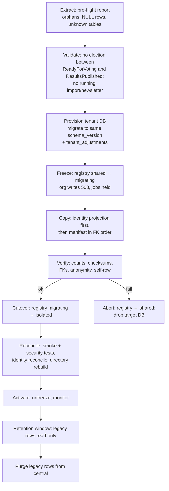

# 10 — Migration and cutover strategy (shared DB → central + per-organisation DBs)

## 1. Principles
- **The current shared database becomes the central database.** Nothing central moves; each organisation's rows are **extracted** into a new database, verified, and later purged from central.
- **Organisation by organisation.** There is no big bang and no global "multi-DB mode" flag. The per-organisation registry status *is* the switch.
- **Hostnames are independent of the database split.**
  - `nrna.publicdigit.com` can go live while NRNA is still `shared` (the resolver points at the legacy database).
  - That lets the hostname rollout and the data move be tested and rolled back separately.

## 2. Answers to the migration questions

| # | Question | Answer |
|---|---|---|
| 1 | What becomes central? | The existing database, cleaned: identity, organisations, grants, roles, sessions, tokens, queue, cache, reference geo, plus the new registries (`05` §A, §F) |
| 2 | Which rows move to each tenant DB? | Every TENANT table filtered by its organisation key (uuid, string(50), string(64), `tenant_id`), or via the parent FK for the 12 parent-scoped tables (`05`). This is declared in an **extraction manifest** (`config/tenancy.php`). |
| 3 | NULL `organisation_id` rows (messages, images, uploads, calendars, events, demo_results, dead_letter_queue, geo units)? | **Decision (Q4).** Default proposal: platform-owned, so they go to the platform organisation's tenant (`publicdigit`), or stay central where they are reference data (global geo units). An architecture test fails while any table remains unclassified. |
| 4 | Orphans? | Pre-flight report: rows whose organisation key matches no organisation, child rows without a parent, the 4 parent-by-column tables without FK. They are fixed or archived **before** extracting that organisation. |
| 5 | Foreign keys? | Copy in FK-topological order inside one target transaction. The identity projection is created **first**, so FKs to `users` / `organisations` resolve. Validate constraints after the copy. |
| 6 | Sequences? | `setval` for every `bigint` identity column after the copy (`06` §6) |
| 7 | UUIDs? | Copied verbatim; no remapping |
| 8 | Attachments? | Copy to `organisations/{id}/…` (if file isolation is decided); rewrite stored paths only where they are absolute; keep the old files until the purge |
| 9 | Historical audit? | Tenant audit tables move with the organisation; the file-based audit logs (`storage/logs/organisation_{id}/…`, `logs/audit/{slug}…`) move with the files step |
| 10 | Jobs / outbox? | Drain the organisation's pending outbox, inbox and queued jobs before the freeze; failed jobs stay central (they carry the tenant) |
| 11 | Completeness? | Per table: row count + checksum (`md5(string_agg(row::text, '' ORDER BY id))`) source vs target; FK validation; organisation-consistency query (no row with a foreign organisation key); anonymity schema assertion; self-identification row |

## 3. Per-organisation procedure

- **Freeze window:** minutes for small organisations. It is scheduled outside election voting windows (a domain-driven precondition).
- **Rollback:** while `migrating`, flip back to `shared` (nothing in the new DB is authoritative yet). After `isolated`, rollback means a reverse copy, so the retention window keeps the legacy rows.
- **Order:** platform demo organisation, then a small real organisation, then the others. Organisations newly created after the cutover era are born `isolated`.

## 4. Phases (merged with the earlier assessment)
| Phase | Content | Data moved? |
|---|---|---|
| 0 | Decisions (`15`), ADRs | no |
| 1 | Security pre-fixes (V1–V5), quarantine the dormant tenant/landlord code, fix the migration hygiene (`false` table, unloaded folders, missing tables) | no |
| 2 | `TenantContext` single authority; strict scope; `TenantRunner`; Context propagation (fixes today's non-HTTP defects) | no |
| 3 | `central` connection + registries + fail-closed `tenant` resolver; all orgs `shared` | no |
| 4 | **Hostname resolution** (`organisation_domains`, trusted hosts, URL root, cookies) + routing directory + `election_directory` | no |
| 5 | Provisioning, `tenants:migrate`, `tenant_adjustments`, identity projector | no (new test orgs only) |
| 6 | Pilot extraction (demo org, then one small org) | yes, 1–2 orgs |
| 7 | Progressive cutover | yes, all orgs |
| 8 | Central purge + privilege hardening | delete legacy rows |

**Physical isolation is complete only after phase 8.** Before that, the central database still contains historical rows of isolated organisations.
