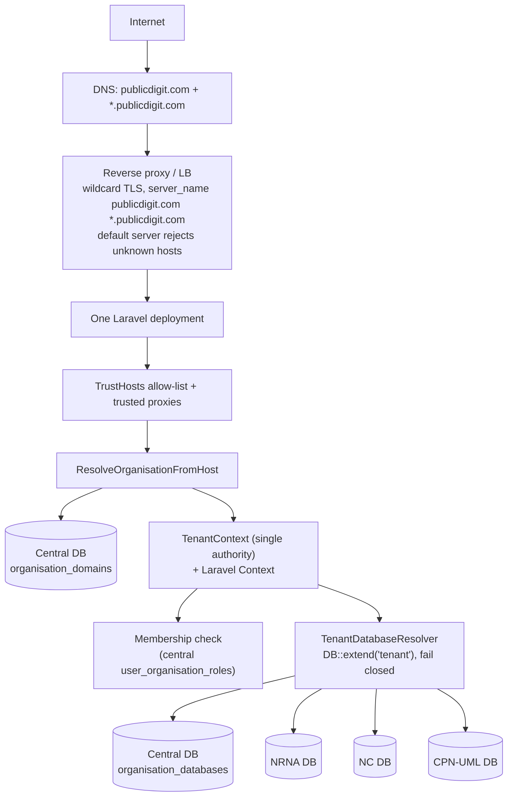
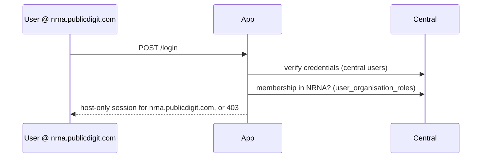
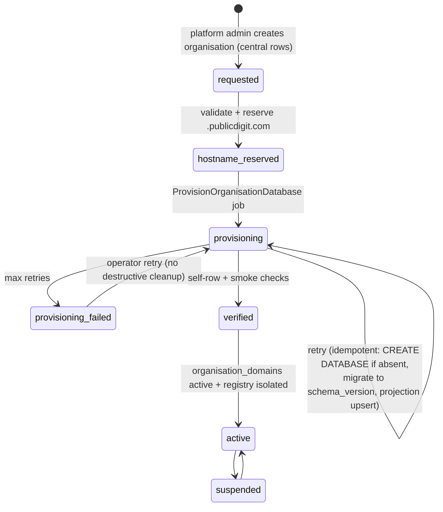

# 11 — Target architecture (diagrams)

All diagrams are RECOMMENDATIONS, not implemented.

## A. Target architecture


## B. Central vs tenant data
```text
CENTRAL DB
 ├── identity:   users, password_reset_tokens, personal_access_tokens
 ├── access:     organisations, user_organisation_roles, roles, permissions, model_has_*
 ├── routing:    organisation_domains, tenant_route_keys
 ├── registry:   organisation_databases
 ├── read models: election_directory
 ├── framework:  sessions, cache, cache_locks, jobs, failed_jobs
 └── reference:  countries, regions, region_country, global geo units

TENANT DB (one per organisation, same schema)
 ├── projection (read-only): users subset, own organisations row, own grants, geo mirror
 ├── elections, posts, candidacies, codes, voter_*, votes, results, receipt_codes, demo_*
 ├── election_officers, election_memberships, verifications, audit/security/state logs
 ├── members, organisation_users, membership_*, contributions, points_ledger, incomes
 ├── committees, governance, adjudication, contestation
 ├── newsletters, messages, images, uploads, calendars, events
 └── outbox_events, inbox_events, processed_events
```

## C. Authentication flow
See `07` §3. Summary:


## D. Normal tenant request
```mermaid
sequenceDiagram
  participant B as Browser (nrna.publicdigit.com)
  participant H as ResolveOrganisationFromHost
  participant S as StartSession (central)
  participant M as EnsureOrganisationMember
  participant R as tenant resolver
  participant C as Controller (unchanged)
  B->>H: Host → NRNA (active) else 404
  H->>S: session (central sessions table)
  S->>M: user is NRNA member? else 403
  M->>R: first tenant query
  R->>R: registry → nrna DB; self-row check
  R->>C: Eloquent / DB::table / DB::transaction on NRNA DB
```

## E. Queue / job flow
See `08` §2. Hidden Context carries the tenant; the worker restores the tenant, purges the connection, sets the URL root, runs, then resets.

## F. Organisation provisioning flow

- **Idempotency:** every step checks the current state (database exists? migrations at version? projection present?) and continues.
- **No destructive cleanup on failure:** never `DROP DATABASE` automatically (`election` drops live databases in its cleanup).
- **Who:** platform admin (or an approved self-service flow, decision).
- **Credentials:** one application role (phase 1); a per-tenant role is optional (`09` §4).

## G. Migration / cutover flow
See `10` §3 (extract → validate → provision → freeze → copy → verify → cutover → reconcile → activate → purge).
