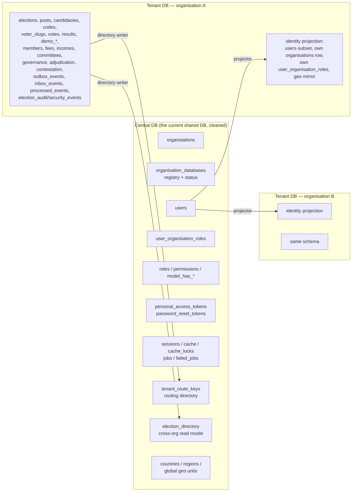
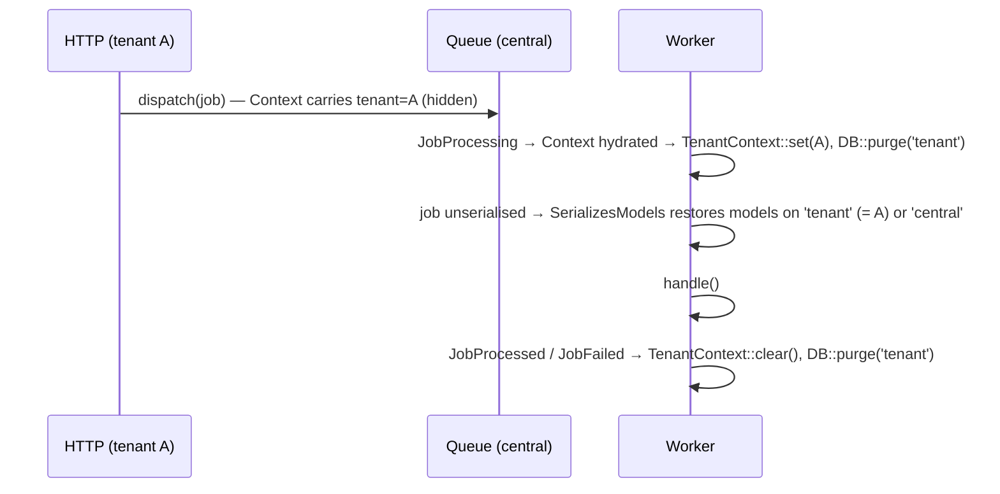
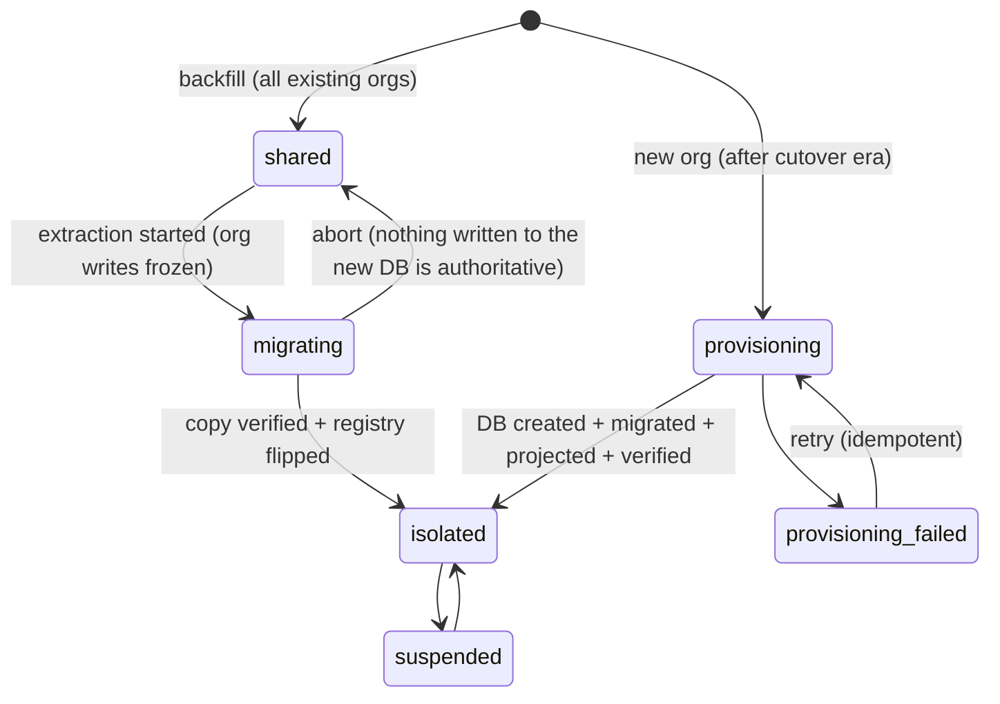

# Multi-Database Architecture Assessment — `nrna1` (PublicDigit)

| | |
|---|---|
| **Status** | BRAINSTORMING — architecture assessment and plan. **Not an approved plan, not an ADR.** Nothing here is authorised for implementation until accepted under EP-01. |
| **Date** | 2026-10-06 |
| **Author** | Claude Code session (principal-architect role, commissioned by `firrst_prompt.md` in this folder) |
| **Repositories inspected (read-only)** | `nrna1` @ branch `knowelegeos-modelling` (Laravel **11.41.3**, PostgreSQL) · `election` (Laravel 12, `spatie/laravel-multitenancy` 4.0.7 pinned, vendor not installed) |
| **Evidence convention** | `path:line` relative to the repository root. **[V]** = verified by reading the code in this session · **[I]** = inferred from code, not executed · **UNVERIFIED** = plausible, not confirmed |
| **Nothing was modified** | No production code, migrations, config or existing documents were changed. No database command was run. |

> **The final rule applied throughout:** the strongest statement never exceeds the evidence. Facts (Evidence), architectural conclusions (Implication), and recommendations (Decision candidate) are kept separate.

---

## 1. Executive Summary

### Current architecture
`nrna1` is a **single shared PostgreSQL database** with **logical row isolation**:
- every organisation-owned table carries `organisation_id` (UUID) — about **60 tables** with the column, about **50 with an FK** to `organisations`;
- isolation is enforced by the `BelongsToTenant` global scope (`app/Traits/BelongsToTenant.php:44-63` [V]) on about 45 models, plus about **331 explicit `where('organisation_id', …)` filters** in 100 files;
- the scope is bypassed **≈400 times** (`withoutGlobalScope(s)`), and **139 raw `DB::table()` calls** do not see it at all;
- the "current organisation" lives in three places at once: `session('current_organisation_id')`, a static holder `App\Services\TenantContext`, and `users.organisation_id`.

Identity is **global**: `users.email` is globally unique, login does not depend on the organisation (`LoginController.php:46`), and a user belongs to many organisations through `user_organisation_roles` (`UNIQUE(user_id, organisation_id)`).

### Target architecture
A **hybrid**, which the code itself requires:
- one **central (platform) database** for identity, access and the organisation registry;
- one **tenant database per organisation** for everything the organisation owns: elections, voting, membership, finance, committees, governance, outbox/inbox, demo data.

### Key architectural finding
`nrna1` already has the three things that make connection switching cheap:
1. **Organisation is already the unit of isolation everywhere.** UUID primary keys on every table mean rows can be moved between databases **without remapping a single ID**.
2. **About 90 % of data access is organisation-scoped already**, so routing that access to a different *connection* changes no query semantics.
3. **Identity and access are already separate from organisation data.** Users and memberships are global (`users`, `user_organisation_roles`). That is exactly the split a central database needs.

The obstacles are **not** in the domain model. They are at the **edges**:
- about 30 tenant tables have FKs to the global `users` table, and 25 raw joins go to `users`, `organisations` or `user_organisation_roles`;
- about 20 URLs carry no organisation (`/v/{vslug}`, `/elections/{slug}`, `/invitations/{token}`, …);
- every non-HTTP path (13 scheduled entries, the outbox/inbox processors, 21 queued jobs) **already runs without tenant context and silently falls back to "no organisation"**;
- several cross-organisation read features exist (login dashboard, platform admin, sitemap).

### Recommended approach
**Option A+ — the default connection becomes the tenant, and central models are pinned to `central`.**
- **Default connection = `tenant`.** It is resolved per request or per job by a single resolver that **throws** when no organisation is current. Only the ~8 central models are pinned to `central`. Every tenant model, raw query and `DB::transaction()` keeps working unchanged.
- **A tenant registry in the central database** (`organisation_databases`). Each organisation is explicitly `shared` (still in the legacy database) or `isolated`, so **migration happens one organisation at a time, with no global flag**.
- **Central authority, tenant read-only projection** for identity:
  - `users` (a reduced subset of columns), the organisation's own `organisations` row, its `user_organisation_roles` rows, and global geography reference data are **projected into each tenant database**;
  - this keeps all ~30 FKs, the 25 joins and the 7 `whereHas` calls working unchanged;
  - the organisation's own row also serves as a **database self-identification check** against misrouting.
- **Tenant authority, central routing directory**:
  - a small central lookup from election slugs, voter slugs and hashed tokens to the organisation;
  - this keeps every organisation-less URL unchanged.
- **Laravel 11 native mechanisms only.** No `spatie/laravel-multitenancy`:
  - `DB::extend()` for the resolver;
  - `Illuminate\Support\Facades\Context` for queue propagation (verified: hydrated on `JobProcessing`, before job unserialisation — `vendor/laravel/framework/src/Illuminate/Log/Context/ContextServiceProvider.php:29,39`; `Queue/Worker.php:429,442`).

### Estimated complexity
**Medium–High.** Rough, unmeasured estimate:
- about **70–110 production files touched** out of about 1,700 PHP files in `app/` (≈5 %);
- about **12–15 new infrastructure classes**;
- **no domain-layer change**, no URL change, no UI change;
- the risk sits in data migration and non-HTTP paths, not in the volume of code.

### Major risks
1. **Critical:** non-HTTP execution paths have no tenant context. This is *already* producing wrong results today (§2.8).
2. **Critical:** cross-database atomicity at organisation creation, registration and invitation acceptance.
3. **High:** the per-organisation data extraction must be complete. About 70 tables use four different organisation-key styles.
4. **High:** dead `landlord`/`tenant` code paths will **come alive** the moment a connection named `tenant` exists (§2.9).
5. **Security, independent of this migration (fix first):**
   - unauthenticated-in-effect platform-admin routes;
   - the `X-Tenant-Id` header is trusted without a membership check (§12.1).

---

## 2. Current `nrna1` Architecture (repository evidence)

### 2.1 Framework & structure
- Laravel **11.41.3** [V] (`vendor/laravel/framework/src/Illuminate/Foundation/Application.php:48`), PHP 8.2, Inertia 2 / Vue 3, Sanctum, Socialite, `spatie/laravel-permission`.
- There is no `bootstrap/providers.php`. Providers are registered in `config/app.php:198-213`. No Octane or Horizon (`composer.json` [V]).
- DDD contexts in `app/Contexts/`: Adjudication, Committee, Contestation, Election, Elections, Finance, Geography, Governance, Membership, Shared, Trust. Most code still lives in `app/Http/Controllers`, `app/Models` and `app/Services`.
- About 1,700 PHP files in `app/` [V]. 196 + 2 + 29 migration files (`database/migrations`, `database/migrations/landlord`, `app/Contexts/**/Migrations`).

### 2.2 Organisation
- **Model:** `app/Models/Organisation.php`.
  - UUID primary key (`HasUuids`, `:12-15`); route key `slug` (`:54-57`); soft deletes.
  - `type` enum `platform|tenant` and `is_default` (`database/migrations/2026_03_05_000001_create_uuid_organisations_table.php:14-18`).
- **Platform organisation:**
  - seeded as `slug='publicdigit', type='platform', is_default=true` (same migration `:44-60` [V]);
  - every new user is attached to it as `member` (`app/Http/Controllers/Auth/RegisterController.php:42-73`);
  - it holds the **public demo** (`app/Services/DemoElectionResolver.php:128-147`).
- **Relationships:**
  - `users()` is a belongsToMany through `user_organisation_roles` (`Organisation.php:84-89`);
  - `elections()` and others are hasMany;
  - `resolveChildRouteBinding()` resolves a nested `{election}` by slug, ignoring scopes (`:107-116`).

### 2.3 Organisation resolution & context propagation
| Mechanism | Where | Writes context to |
|---|---|---|
| `ensure.organisation` → `EnsureOrganisationMember` | main `/organisations/{organisation:slug}` group (`routes/organisations.php:91-418`) | request attribute `organisation` and `session('current_organisation_id')` only. **It does not set `TenantContext`.** |
| `tenant` → `app/Http/Middleware/TenantContext.php` | only `routes/election/electionRoutes.php:263,731` | session, container `current.organisation_id`, static `TenantContext` (`:52-54, :83-85`). The organisation comes from the **`X-Tenant-Id` header (trusted, `:49-56` [V])** or from `users.organisation_id`. |
| `tenant.api` → `IdentifyTenantFromHeader` | `routes/api_v1.php` (`bootstrap/app.php:16-19`) | static `TenantContext`, session |
| Controllers writing the session directly | `CodeController.php:74,250`, `VoteController.php:293`, `ElectionManagementController.php:227-228,685-686,1168-1169,1445-1446`, `OrganisationController.php:117,429`, Demo* controllers | session (and sometimes `TenantContext`) |

**How the scope reads it:**
- The scope reads `TenantContext::get() ?? session('current_organisation_id')` (`BelongsToTenant.php:46` [V]).
- With neither set, it looks up the platform organisation by **`slug='platform'`** (`:54` [V]). That slug does not exist outside test factories; the seed uses `publicdigit` [V].
- The fallback therefore produces `where organisation_id IS NULL` [I], which means "no organisation" silently matches nothing or NULL-organisation rows.

**Existing strict variant:** `app/Models/Traits/ScopedByOrganisation.php:22-58` throws when the context is null. No model uses it.

**Implication:**
- The application already has **one canonical in-process holder** (`App\Services\TenantContext`, used by 27 test files and by the outbox adapters).
- It is not authoritative today because the session competes with it.
- The multi-database design should **make `TenantContext` the single authority** rather than invent a new holder (canonical-discovery rule: consume, do not duplicate).

### 2.4 Users, membership, authentication
**Users table:**
- `users.id` UUID; `users.email` **globally unique**;
- `users.organisation_id` is **NOT NULL with an FK to organisations, `onDelete restrict`** (`2026_03_05_000002_create_uuid_users_table.php:12-26` [V]);
- it acts as a sticky "home/current organisation" pointer (`User.php:167-170`).

**Membership and access:** `user_organisation_roles` (`2026_03_05_000003`) holds `user_id`, `organisation_id`, `role`, `permissions`, with `UNIQUE(user_id, organisation_id)`. It is the authority for:
- `EnsureOrganisationMember`;
- `OrganisationPolicy`, `ElectionPolicy::create`, `MembershipPolicy`;
- the dashboard roles (`User.php:1080-1119`).

**Organisation-level membership records:** `organisation_users` and `members` both carry `organisation_id`. `OrganisationUser` and `Member` use `BelongsToTenant`. The hierarchy is User → OrganisationUser → Member (`User.php:224-243`).

**Login:**
- hand-written `LoginController` with a global email lookup (`:46`), then `Auth::attempt`, then `DashboardResolver::resolve`;
- Google via Socialite (`GoogleLoginController.php:33`);
- guard `web` (session), plus Sanctum.
- **Login does not depend on the organisation.**

**Spatie permission:** **teams mode is off** (`config/permission.php` has no `teams` key [V]). Roles are platform-global (`hasRole('admin')` in `DashboardResolver.php:447` and elsewhere).

**Implication:** the authentication bootstrap problem ("which database do I query to find the user?") **does not exist in `nrna1`** if identity stays central. This is the single most important difference from `election`.

### 2.5 Routing
**Organisation-in-URL:**
- `/organisations/{organisation:slug}/…`: about 143 routes in `routes/organisations.php`, plus `web.php:507-536`, `committee/committeeRoutes.php:26-28`, and `governance-api.php`.

**Organisation-less URLs that touch tenant data:**

| URL | Key in the URL |
|---|---|
| `/elections/{slug}`, `/elections/{slug}/start` | election slug (`electionRoutes.php:31-32`) |
| `/election/{election:slug}/result` | election slug (`:185-186`) |
| `/elections/{election:slug}/…` management group | election slug (`:263-380`) |
| `v/{vslug}/…` | voter slug (`:400-610`); bound in `RouteServiceProvider.php:72-113` |
| `demo/*`, `public-demo/{publicDemoSession}/*` | demo session id (`:556-648`) |
| `/invitations/{token}`, `/invitation/{token}`, `/unsubscribe/{token}` | token (`organisations.php:65`, `web.php:112,163`) |
| `/voters/{id}` | id (`electionRoutes.php:199-204`) |
| `/election`, `/voter/start`, `/vote/*`, `/election/select`, `/election/demo/*` | **none** (session-driven) |
| `/dashboard*`, `/my-organisations`, sitemaps | user-level / cross-organisation |
| `/api/v1/*` | header `X-Organisation-ID` |

**Middleware priority:** `StartSession → TenantContext → SubstituteBindings` (`bootstrap/app.php:128-132`). It only helps routes that carry `tenant`.

### 2.6 Persistence
- Connections (`config/database.php`):
  - `sqlite`, `mysql`, `pgsql`;
  - **`pgsql_audit`**: a second connection to the same database for audit writes outside business transactions (`:84-111`), used by `ElectionSecurityEvent` (`app/Models/ElectionSecurityEvent.php:21`);
  - `pgsql_geo` (unused);
  - `testing` (`nrna_test`).
- **No `central`, `landlord` or `tenant` connection exists.**
- Only one model pins a connection (`ElectionSecurityEvent`). **Everything else uses the default connection.**
- Usage counts: `DB::transaction(` ×44, `DB::beginTransaction` ×7, `DB::table(` ×139, `DB::select` ×4, raw `*Raw()` ×40.

### 2.7 Session, cache, queue
- **Session:** `database` driver, default connection, table `sessions` (`config/session.php:21,75,88`).
- **Cache:** `file` default (`config/cache.php:18`). About 108 call sites.
  - Most keys are keyed by election, user or organisation UUID.
  - Two `Cache::flush()` calls (`GeographyService.php:357`, `GeographyLookupService.php:308`).
  - Legacy global keys `election.results_published` and similar (`app/Services/ElectionService.php:16,97,108`).
- **Queue:** default **`sync`** (`config/queue.php:16`).
  - The `database` queue is defined, but **no migration creates `jobs`**.
  - `failed_jobs` is DB-backed.
  - No hook propagates tenant context.

### 2.8 Non-HTTP execution — already incorrect today
The schedule is in `routes/console.php:35-63`, and **no** job, command or listener sets `TenantContext` [V by subagent grep, I for runtime].

| Scheduled task | Behaviour today [I] |
|---|---|
| `elections:flush-expiring-caches` (hourly) | queries the scoped `ElectionMembership`, so it **sees only the fallback organisation's rows** |
| `membership:process-expiry` | applications are scoped (fallback organisation only); fees are unscoped (all organisations) |
| `GenerateAnnualMembershipFees`, `MarkOverdueMembers` | members are scoped, so **only the fallback organisation is processed** |
| `SendRenewalReminder` | references the non-existent `App\Mail\MembershipRenewalReminder` |
| `outbox:process`, `inbox:redrive` (every minute) | rows from all organisations; listeners run with no context (e.g. the idempotency check in `CreateIncomeFromFeePaidProjection.php:70,75` runs on the scoped `Income`) |
| `ProcessMemberImportJob`, `SendVoterInvitation` | work only because the queue is `sync`. Under an async worker the scoped `find()` returns null and the job **silently does nothing** |

**Implication:**
- Per-tenant iteration (§11) is **not new risk introduced by multi-database**. It is the **fix for an existing defect class**.
- Introducing it while still in the shared database makes these jobs organisation-correct before any data moves.

### 2.9 Dormant multi-database remnants (danger)
An earlier design left code in place that targets connections and classes which do not exist:
- `DB::connection('landlord'|'tenant'|'tenant_test'|'tenant_install')` in:
  - `Geography/Application/Services/{DailyGeographySync, GeographyMirrorService, GeographyLookupService}`;
  - `Membership/…/TenantUserProvisioningService.php:125`;
  - `TenantUserIdentityVerification.php:46`;
  - `RegisterMemberRequest.php:102-130`;
  - `MembershipDatabaseSeeder.php:76`.
- Spatie `NotTenantAware` / `App\Models\Tenant` imports in `InstallGeographyModule` and `InstallMembershipModule`. The package is not installed.
- Migration folders named `Tenant/` and `Landlord/`, all loaded into the one default database.

**Implication:**
- These paths are dead **only because the connection names are undefined**.
- Defining a connection called `tenant` (and certainly one called `landlord`) **revives them with semantics nobody has reviewed**.
- **Name the central connection `central`, not `landlord`.** Quarantine or delete every `DB::connection('tenant'|'landlord')` call *before* the tenant connection is introduced (backlog MD-02).

### 2.10 Tests
- 425 Feature, 562 Unit and 29 Architecture test files.
- `tests/TestCase.php` uses `RefreshDatabase`, but **skips transactions for pgsql** (`:23-36` [V]). Combined with 267 test files calling `Organisation::factory`, this matters for the multi-database test design.
- Isolation is tested extensively *in one database* (`tests/Feature/TenantIsolationTest.php` and about 88 files).
- **Nothing tests jobs or commands across organisations.**

---

## 3. The Multi-Database Architecture in `election`

### 3.1 How it actually works (code, not docs)
**Two tenancy systems run side by side.**
1. **Spatie, half-wired:**
   - `HybridTenantFinder` (`app/Multitenancy/HybridTenantFinder.php:35-215`) tries exact domain, then local-host domain, then the first path segment as slug. It does not check `status`.
   - `SwitchTenantDatabaseTask` sets `database.connections.tenant.database` from `Tenant::getDatabaseName()`, which is `database_name ?? "tenant_{slug}"` (`app/Models/Tenant.php:121-124`).
   - Queues are tenant-aware by default (`config/multitenancy.php:55`).
2. **Hand-rolled, and the one most code actually uses:** about 40 files `Config::set('database.connections.tenant', …)`, `DB::purge('tenant')`, and **`DB::setDefaultConnection('tenant')`**. Example: `TenantAuthenticationController.php:186-206`.

**Identity:**
- Users exist **twice**: landlord `users` (guard `web`) and tenant `tenant_users` (guard `tenant`, never actually logged into).
- Tenant login is a raw `DB::table('tenant_users')` lookup after switching the default connection, and the session keys are written by hand.

**Sessions:** a replaced `SessionManager` routes to a tenant `shared_sessions` table on ad-hoc `tenant_session_{id}` connections. This table was missing in tenant databases, which is why the root repair scripts exist.

**Provisioning:**
- `ProvisionTenantJob` (`NotTenantAware`) creates the database with `CREATE DATABASE` plus per-tenant MySQL users. It migrates `database/migrations/tenant`, **a directory that does not exist**, and swallows errors on admin seeding.
- There are at least 6 competing provisioners and 3 incompatible credential schemes.

**Fail-open:** most models have no `$connection`. A forgotten or failed switch runs against the landlord database, where tenant tables also exist because `TenantAuthServiceProvider` loads tenant migrations into the landlord. A `landlord:cleanup:tenant-tables` command exists to undo that.

**Tests:** in-memory SQLite. Production code has `sqlite` branches that **disable** isolation (`TenantAuthenticationController.php:181`).

**About 26 root-level diagnostic scripts**, hard-coded to tenant `nrna`, show that one tenant is being kept alive by hand.

### 3.2 What is essential vs incidental
| Essential (take the **concept**) | Incidental (do **not** take) |
|---|---|
| A central registry of tenant → database name and status | Two tenancy engines; `setDefaultConnection` toggling at call sites |
| **One** resolution step, early, rejecting inactive tenants | ~15 resolvers; identification running twice |
| **One** `tenant` connection, configured in one place, failing closed | 5 `Tenant` classes, 3 naming conventions |
| Tenant id carried in queued-job payloads and restored on the worker | Tenant-local user tables and a second guard |
| A deterministic, idempotent provisioning job with visible status | Per-tenant DB users shown to customers, JIT credentials, provisioning rate limits |
| `migrate` across all tenants from the registry | Tenant `jobs` tables, tenant session tables, replaced `SessionManager` |
| A test harness that creates real tenant databases | `env()` at runtime, sqlite-only bypasses, repair scripts |

**Conclusion (Option C):** **do not adopt the `election` architecture or its code.** Reuse the six essential concepts. `nrna1`'s global identity removes the hardest problem `election` struggles with (tenant-local authentication), and its UUID keys remove ID remapping.

---

## 4. Architecture Comparison

| Concern | `nrna1` (today) | `election` | Reuse? | Change required in `nrna1` |
|---|---|---|---|---|
| Organisation identification | `{organisation:slug}` route parameter; session elsewhere | domain / subdomain / first path segment → `tenants` row | Concept only | Read the raw `{organisation}` parameter **before** bindings; add the routing directory for org-less URLs |
| Organisation resolution | 3 competing middleware; session is authoritative | Spatie finder + `IdentifyTenantFromRequest` (twice) | No | One `ResolveTenantDatabase` middleware in `web`/`api`; `TenantContext` authoritative |
| Authentication | Global `users`, global email, org-agnostic login | Landlord `users` + tenant `tenant_users`, hand-rolled tenant login | **No** | **None** — identity stays central (largest saving) |
| User model | Central-like; `users.organisation_id` home pointer | Duplicated per tenant | No | Pin `User` to `central`; project a reduced identity row into tenants |
| Database connection | Single default (`pgsql`) + `pgsql_audit` | `tenant` + default landlord, switched ad hoc | Concept | Add `central`; default becomes `tenant` via `DB::extend` resolver; `tenant_audit` replaces `pgsql_audit` |
| Middleware | `ensure.organisation`, `tenant`, `tenant.api` | ~15 classes | No | 1 new middleware; `EnsureOrganisationMember` sets `TenantContext`; `tenant` header trust removed |
| Service provider | `TenantContext` singleton; broken interface binding (`AppServiceProvider.php:96-99`) | Spatie auto-boot + custom | No | One `TenancyServiceProvider` (resolver, Context hooks, job lifecycle) |
| Models | ~45 `BelongsToTenant`; no `$connection` | 2 pinned to `tenant`, rest default | Concept | Pin ~8 central models; tenant models **unchanged**; scope switches to strict mode |
| Migrations | One migration set, one database | Landlord set + tenant folder that does not exist | Concept | **Schema-identical** migrations run per database + small `tenant_adjustments` set + privilege lock-down (§8 Phase 3) |
| Jobs | No tenant in payloads; queue `sync` | Spatie tenant-aware payload | Concept | Laravel `Context` dehydrate/hydrate hook — **zero job classes change** |
| Queues | `sync`; `database` defined, no `jobs` table | Landlord queue + tenant `jobs` tables (conflict) | Concept | Queue and failed_jobs on `central` |
| Notifications | Queued mail/notifications carry models | Same | — | Covered by Context propagation; models restore on their pinned connection |
| Cache | File; mostly UUID-keyed | No per-tenant prefix | — | No prefix needed for correctness; remove the 2 `Cache::flush()`; review legacy global keys |
| Sessions | DB-backed on default connection | Split landlord/tenant tables | **No** | `SESSION_CONNECTION=central`; session stays **one** central table |
| Tests | pgsql, extensive single-DB isolation tests | SQLite, no tenant harness | No | Keep the existing suite in "shared" mode; add a real multi-DB suite |
| CLI commands | Cross-org loops relying on the scope fallback | Ad-hoc tenant loops | Concept | `TenantRunner::each()` + `tenants:run {command}` wrapper |
| Provisioning | None (org creation is a row insert) | Job + state machine (buggy) | Concept | `ProvisionOrganisationDatabase` job + `organisation_databases.status` |

---

## 5. Organisation / Tenant Boundary Analysis (DDD)

### 5.1 Concept classification
| Concept | Classification | Evidence and reasoning |
|---|---|---|
| **Organisation** | **Aggregate root of a Platform / Organisation-Registry capability.** Inside every other bounded context it appears only as a **reference** (`TenantId` / `OrganisationId` value object). | `Contexts/Shared/Domain/ValueObjects/TenantId.php:10-16` states the invariant *"TenantId::value() === organisations.id"*. Domain contexts already reference it by id, not by object. |
| **Tenant** | **The same identity, seen from the platform and infrastructure side.** Not a second domain concept. | No domain rule depends on "tenant" except the isolation boundary. **Do not introduce a `Tenant` entity.** `election`'s 5 `Tenant` classes are the cautionary example. |
| **User** | **Global identity** (platform Identity & Access). | Global unique email; org-agnostic login; many-to-many with organisations. |
| **Access grant** (`user_organisation_roles`) | **Platform access authority**: "who may enter which tenant, with which role". Central. | Checked *before* tenant data is touched (`EnsureOrganisationMember`); needed across organisations (dashboard, login routing). |
| **Membership** (`members`, `organisation_users`, membership types, fees, applications) | **Membership bounded context, tenant-owned.** | All carry `organisation_id`; the Membership context uses `TenantId` VOs (`EloquentMemberRepository.php:23-26`). |
| **Identity projection** (tenant `users`, own `organisations` row, own `user_organisation_roles` rows) | **Published-Language read model** owned by Identity & Access and consumed by tenant contexts. Read-only in the tenant. | Exists only to preserve FKs and joins. It is not a second source of truth. |
| **Organisation context** (`TenantContext`) | **Application / infrastructure concern.** Ambient execution context. | It must never enter `app/Contexts/*/Domain`. Domain code keeps receiving `TenantId` explicitly. |
| **Tenant database** | **Pure infrastructure.** | No domain object knows a database name. Registry metadata goes in a **separate table** (`organisation_databases`), *not* as columns on the `Organisation` aggregate. |
| **Routing directory** (`tenant_route_keys`) | **Infrastructure read model** (Published Language: slug or hashed token → organisation id). | Contains no domain data and no voter linkage. |

### 5.2 Invariants that must hold
1. **Organisation isolation becomes physical.** A request or job whose context is organisation A can only open the database registered for A.
2. **Anonymity (ADR-T11, constitutional — preserved, not owned here).**
   - Per-organisation databases do not change the votes/results schemas: still no `user_id` (`tests/Feature/VoteAnonymityTest.php`, `tests/Feature/Demo/VoteAnonymityTest.php:96-100`).
   - The data-extraction tool must copy `votes`/`results` **as is**, must not log row contents, and must not add ordering or correlation columns.
   - The central routing directory stores **voter slug → organisation only**. It holds no user or vote reference.
3. **Fail closed.** No resolved organisation means no tenant database connection, which means an exception, never a default database.

### 5.3 Strategic DDD questions (Operating Loop, Phase 2) — **governance must answer before implementation**
| Question | Assessment |
|---|---|
| Which bounded context **owns** tenant database resolution? | **None today.** The nearest existing home is `app/Contexts/Shared` (it holds `TenantId` and `TenantAggregateRoot`), but resolution is *infrastructure*. **Recommendation:** an **Infrastructure-layer platform capability** (`app/Infrastructure/Tenancy/`, with `TenantContext` remaining at `App\Services\TenantContext` for compatibility), owned by the Platform. **This is an ownership decision for ARB — PENDING.** |
| Is another context affected? | Yes, but only **operationally**: Membership, Election/Elections, Governance, Adjudication, Contestation and Geography gain a different *connection*, not different behaviour. Geography is affected *structurally* (global vs organisation geo units, §8). |
| Is this a Published-Language interaction? | Yes, twice: the identity projection (central → tenant) and the routing directory (tenant → central). |
| Does ownership of any domain concept change? | **No.** |
| Does the context map change? | It gains one explicit **Platform / Identity & Access** upstream. It already exists implicitly (`users`, `user_organisation_roles`, `organisations`); it becomes visible. |

---

## 6. Target Architecture

### 6.1 Data placement


### 6.2 Request flow (HTTP)
```mermaid
sequenceDiagram
  participant R as Request
  participant SS as StartSession (central)
  participant AU as Authenticate (User on central)
  participant RT as ResolveTenantDatabase
  participant REG as Registry + Route Directory (central)
  participant TC as TenantContext
  participant DB as DB::extend('tenant') resolver
  participant SB as SubstituteBindings
  participant C as Controller (unchanged)
  R->>SS: session on central connection
  SS->>AU: user lookup on central (no tenant needed)
  AU->>RT: route params available, not yet bound
  RT->>REG: {organisation} slug or election slug / vslug / token hash → organisation id
  RT->>RT: membership check (central user_organisation_roles) where the route requires it
  RT->>TC: set(orgId), mirrored into Laravel Context
  SB->>DB: first tenant query → resolver reads TenantContext
  DB->>REG: registry: orgId → database name, status=isolated|shared
  DB->>DB: open PDO; self-identification check (isolated only)
  SB->>C: Election / VoterSlug bound from the tenant DB
  C->>DB: Eloquent, DB::table, DB::transaction — all on tenant
  Note over RT,DB: No orgId → TenantNotResolved exception → 404/403 (fail closed)
```

### 6.3 Queued job flow


### 6.4 Organisation tenancy lifecycle (registry status — infrastructure, not domain)


---

## 7. Minimal Change Strategy

### 7.1 Options evaluated
| Option | Summary | Verdict |
|---|---|---|
| **A — connection switching** | Resolver picks the organisation database; code untouched | **Core of the recommendation.** Needs a decision on *which* connection is the default (see the A1/A2 rows). |
| A1 — default = central; tenant models opt in (`$connection='tenant'`) | Pin ~75 models and rewrite ~113 tenant `DB::table` calls | **Rejected.** All **44 `DB::transaction()` blocks** would open on *central* while their writes go to *tenant*, **silently losing atomicity**. It also touches many more files. |
| **A2 — default = tenant (fail-closed resolver); central models opt in** | Pin ~8 central models, ~26 central raw calls, ~20 validation rules, framework config | **Recommended (A+).** Business transactions, raw SQL and Eloquent all stay correct by default. Anything forgotten **fails loudly** because there is no context. |
| **B — tenancy abstraction** | `TenantContext` + `TenantResolver` + `TenantConnectionManager` | Adopted **inside A2**, but by **extending** the existing `App\Services\TenantContext`, not by adding parallel types. |
| **C — adopt `election`'s implementation or Spatie** | Package + `UsesTenantConnection` traits (an A1 shape) | **Rejected.** A1 transaction hazard; package not needed in Laravel 11 (native `DB::extend` + `Context` cover it); `election`'s code is a negative reference. Spatie remains an *acceptable* alternative only if the team prefers a package and accepts the A1 shape. |
| **D — hybrid central + tenant DBs** | Central identity/access/registry; tenant everything else | **Required, not optional.** Global identity (§2.4) forces it. |
| *(considered)* PostgreSQL schema-per-tenant | One database, `search_path` per organisation; cross-schema FKs possible | **Viable fallback**, weaker boundary: cross-schema queries remain possible, and backup/restore is per database. The mission asks for database-per-organisation, so it is recorded as the ADR-1 alternative. |

### 7.2 KEEP / CHANGE / ADD / REMOVE
**KEEP (unchanged)**
- All URLs and route files' structure; all Inertia pages and the Vue UI.
- All domain code in `app/Contexts/*/Domain` and `app/Domain`; all business rules, policies' logic and workflows.
- All ~45 `BelongsToTenant` models and their relationships. All `organisation_id` columns (defence in depth). All `where('organisation_id', …)` filters (331).
- All `DB::transaction()` blocks, tenant `DB::table()` calls and raw SQL.
- Login, registration UI, Socialite, Sanctum, Spatie roles.
- UUID keys. `TenantId` value objects. The existing single-database isolation test suite (it runs in "shared" mode).

**CHANGE**
| Area | Change | Evidence |
|---|---|---|
| `config/database.php` | add `central`; `tenant` + `tenant_audit` (resolver-managed); `default` → `tenant` | `:18` |
| `config/session.php`, `config/queue.php` (database connection + `failed.database`), `config/cache.php` (database store), `config/auth.php` (passwords `connection`) | point at `central` | `session.php:75`, `queue.php:38-39,88-90` |
| Central models: `Organisation`, `User`, `UserOrganisationRole`, Spatie `Role`/`Permission` (custom subclasses via `config/permission.php:16,27`), Sanctum `PersonalAccessToken` (custom model), `Country`, `Region` (+ global geo) | `protected $connection = 'central'` | — |
| `ElectionSecurityEvent` | `pgsql_audit` → `tenant_audit` | `ElectionSecurityEvent.php:21` |
| `App\Services\TenantContext` | single authority; mirror into Laravel `Context`; `switchTo()` purges `tenant`; refuses to switch with an open tenant transaction | `app/Services/TenantContext.php:17-60` |
| `BelongsToTenant` | read **only** `TenantContext`; remove the session and `slug='platform'` fallbacks; throw when absent (reuse `ScopedByOrganisation` logic) | `BelongsToTenant.php:46-57,66-86` |
| `EnsureOrganisationMember` | also `TenantContext::set()` | `:284-287` |
| `TenantContext` middleware | remove `X-Tenant-Id` trust; resolve the organisation from the directory, not `users.organisation_id` | `:49-56,65-69` |
| `RouteServiceProvider` `vslug` binding | drop `on(config('database.default'))` (it becomes implicit) | `:72-90` |
| ~26 raw `DB::table('users'\|'organisations'\|'user_organisation_roles'\|'sessions'\|…)` sites | reads can stay (projection); **writes → `DB::connection('central')`** (e.g. `ResetElection.php:197-211`, `AssignmentController.php:21`, `RoleController.php:20`) | [V] grep count 26 |
| ~20 validation rules `unique:users`, `exists:users`, `exists:organisations` | `unique:central.users,email` or model-class rules — **registration email uniqueness must hit central** | [V] grep 15 + 5 |
| Cross-organisation reads: `DashboardResolver` (`:751-812`, `:925-942`), `User::getActiveElection`/`countActiveElections` (`User.php:1285-1375`), `PlatformDashboardController`, `AdminElectionController`, `SitemapController`, `ElectionManagementController::listDemoElections` | read the central `election_directory` instead of `Election::withoutGlobalScopes()` across orgs | — |
| Scheduled tasks / commands / jobs that loop across orgs (§2.8; ~13 entries) | wrap with `TenantRunner::each()` | `routes/console.php:35-63` |
| `OutboxEventProcessor`, `RedriveParkedInboxEvents` | run per tenant | `OutboxEventProcessor.php:26-43` |
| Org creation, registration, invitation acceptance, member import creating users | split central and tenant writes; idempotent ordering + reconcile (§9.4) | `OrganisationController.php:347-363`, `RegisterController.php:42-73` |
| `tenant_log()`, `ElectionAudit` helper | read `TenantContext`, not the session | `app/Helpers/tenant.php:23-52`, `app/Helpers/ElectionAudit.php:57-75` |
| `tests/TestCase.php` | `connectionsToTransact`/setup for `central` + `tenant`; a shared-mode registry row for the factory orgs | `:15-87` |

**ADD**

| Class or artefact | Purpose |
|---|---|
| `organisation_databases` (central) | Registry: `organisation_id` PK, `database_name`, `status`, `schema_version`, timestamps |
| `tenant_route_keys` (central) | Routing directory: `kind`, `key` (slug, or **sha256 of the token**), `organisation_id`, `expires_at` |
| `election_directory` (central) | Cross-organisation read model: election id, slug, organisation, type, lifecycle state, window |
| `TenantDatabaseResolver` | `DB::extend('tenant')` and `('tenant_audit')`: reads `TenantContext`, then the registry, then config; checks self-identification |
| `ResolveTenantDatabase` middleware | Single resolution point |
| `TenancyServiceProvider` | Resolver, `Context` dehydrate/hydrate, `JobProcessed`/`JobFailed` reset |
| `TenantRunner` + `tenants:run {cmd}` | Per-tenant iteration with error isolation |
| `tenants:migrate`, `tenants:provision {org}`, `tenants:extract {org}`, `tenants:verify {org}` | Lifecycle commands |
| `ProvisionOrganisationDatabase` job | Idempotent provisioning |
| `TenantIdentityProjector` | Maintains the projections: user upsert on grant and profile change, revoke, GDPR delete fan-out. Hooks the existing `UserOrganisationRole::observe` (`AppServiceProvider.php:388`) |
| `TenantDirectoryWriter` | Writes the election, voter slug and token keys |
| `config/tenancy.php` | Table classification manifest. Also the extraction manifest and an architecture-test oracle |
| `database/migrations/tenant_adjustments/` | Small tenant-only changes, e.g. projection `users`: password nullable, FK `users.organisation_id` dropped |
| Tests | Architecture, multi-DB integration and security tests (§13) |

**REMOVE**
- `X-Tenant-Id` header trust (`TenantContext.php:49-56`) and the `IdentifyTenantFromHeader` pre-auth ordering. Header use, if kept, is only *after* `auth` with a membership check.
- The session as an authority for tenant selection. It stays only as a guarded fallback for the session-driven legacy voting routes (§10.3), with membership checked.
- The dead `landlord`/`tenant` remnants (§2.9).
- The broken `TenantContextInterface` binding (`AppServiceProvider.php:99`), or make the class implement it.
- `Cache::flush()` in Geography (2 sites).
- **Later (Phase 8), optional:** FK constraints from tenant tables to `organisations`. The **columns stay**.

---

## 8. Migration Plan (phases)

The phases are reordered from the prompt based on the evidence:
- **security pre-fixes come first**;
- **non-HTTP context comes before any database split**, because it is already broken and is testable in the shared database;
- **every phase up to 5 is deployable with zero data movement**, because every organisation is registered as `shared`, pointing at the current database.

| Phase | Goal | Exit criterion |
|---|---|---|
| **0 — Discovery & decisions** | This report, then ADR-MD-1…9 accepted, then the ownership decision (§5.3) | ARB acceptance |
| **1 — Security & hygiene pre-requisites** | Fix the admin routes; remove header trust; quarantine the dead tenant/landlord code; fix the platform-slug fallback | Security tests green; no `DB::connection('tenant'\|'landlord')` remains |
| **2 — One tenant context** | `TenantContext` is authoritative; set by `ResolveTenantDatabase` and `EnsureOrganisationMember`; `BelongsToTenant` is strict; `Context` propagation; `TenantRunner` for schedule, outbox and inbox | All requests and jobs carry explicit context; the scheduled-jobs-only-see-fallback defects are fixed |
| **3 — Connections & registry (still one physical DB)** | `central` + resolver-managed `tenant`/`tenant_audit`; default = `tenant`; central models pinned; registry backfilled `status=shared → legacy DB`; framework config to central; validation rules fixed | Full existing suite green; a test with no context proves fail-closed |
| **4 — Directory & cross-org read models** | `tenant_route_keys`, `election_directory` with backfill + writers; dashboard, platform admin and sitemap read from the directory | Org-less URLs resolve through the directory; no cross-org `withoutGlobalScopes()` remains in HTTP code |
| **5 — Provisioning & schema** | `tenants:provision`; schema-identical migrations + `tenant_adjustments`; privilege lock-down (REVOKE on central-only tables inside tenant DBs); identity projector; `tenants:migrate` | A fresh organisation can be provisioned `isolated` end to end in CI |
| **6 — Pilot extraction** | `tenants:extract` + `tenants:verify` on a **test/demo organisation**, then on one low-risk real organisation | Row counts and checksums match; smoke and security suites pass against the isolated organisation |
| **7 — Progressive cutover** | Organisation by organisation, outside election windows (§9.3); new organisations born `isolated` | All organisations `isolated` |
| **8 — Central purge & hardening** | Delete tenant rows from the central DB (after the retention window); REVOKE tenant tables in central; optional per-tenant DB roles; optionally drop the now-redundant FKs | `SELECT count(*)` of any tenant table in central = 0; **isolation is only physically true from here on** |

**Why no global `MULTI_DATABASE_MODE` flag:**
- Once a single organisation has written to its own database, flipping a global switch back to "shared" would **serve stale data and lose writes**.
- The **per-organisation registry status** *is* the feature flag, and it is reversible per organisation only while that organisation is `migrating`.
- A global flag is safe only before Phase 6. By then it adds nothing.

---

## 9. Data Migration Strategy

### 9.1 Principle — the current database becomes the central database
- No central data moves. Each organisation's rows are **extracted** into a new database, then **purged** from the shared one.
- UUID primary keys everywhere mean **no ID remapping** and no FK rewriting.

### 9.2 Extraction manifest (`config/tenancy.php`)
Every table is classified as `central`, `tenant` or `projection`. An architecture test fails if a table in `information_schema` is unclassified.

| Selection rule | Tables (examples, from the dependency map) |
|---|---|
| `organisation_id = :org` (uuid) | elections, posts, candidacies, codes, voter_registrations, voter_slugs, voter_slug_steps, votes, results, election_memberships, election_officers, members, voters, organisation_users, membership_*, incomes, contributions, points_ledger, organisation_newsletters, outbox_events, inbox_events, demo_* … |
| `organisation_id = :org` (string(50)/string(64), no FK) | committees, committee_membership_applications, determinations, adjudication_processes, challenges, election_applied_determinations |
| `tenant_id = :org` | governance_level_definitions, committee_member_projection, committee_role_mappings, role_localizations, projection_rebuild_runs |
| via parent FK | receipt_codes, election_state_transitions, election_audit_logs, election_security_events, public_demo_sessions (→ elections); newsletter_recipients and newsletter_attachments (→ newsletters); committee_structure_levels (→ committee_structures); processed_events, governance projections (→ committee) |
| nullable `organisation_id` | messages, images, uploads, calendars, events, dead_letter_queue, demo_results, geo_administrative_units — **NULL rows: classify before Phase 6 (open question Q4)** |
| **unclassified — governance question** | role_hierarchy, constitutional_committees, governance_decisions, sovereignty_divergence_summaries, divergence_observation_windows (no organisation column) |
| tables referenced but with no migration | election_commission_members, deligate_*, geo_candidate_units, outbox_processing_errors — confirm they are dead before extraction |

### 9.3 Per-organisation procedure (`tenants:extract {org}`)
1. **Precondition (domain-driven):** no election of the organisation is between *ReadyForVoting* and *ResultsPublished* (`ElectionLifecycleState`). No running import or newsletter batch.
2. Registry `shared → migrating`. Middleware returns **503 for that organisation's writes** (reads optional). Jobs for the organisation are held.
3. Provision the database (`tenants:provision`), migrate it to the same schema version, apply `tenant_adjustments`.
4. Copy in **FK-topological order**, inside one transaction on the target, using the manifest. Use `COPY … TO/FROM` per table or chunked `INSERT … SELECT` through the application. **No row content in logs.**
5. Build the projections: users who have a grant in this organisation (reduced columns), the organisation's own row, its grants, and the geography mirror.
6. **Verify:** per-table row counts; per-table checksum (`md5(string_agg(… order by id))`); FK validation; the anonymity schema assertion; the self-identification row.
7. Registry `migrating → isolated` (atomic). Unfreeze. Smoke tests against the organisation.
8. Keep the legacy rows **read-only** for N days (rollback by reverse copy only), then purge in Phase 8.

### 9.4 Cross-database writes (no 2PC)
There is no distributed transaction. Every flow that writes both sides follows **"central first, idempotent; tenant second; reconcile"**:
- **Registration:** central `users` + grant to the platform organisation. The platform-organisation tenant projection follows through the projector. If the projection fails, `tenants:reconcile-identities` repairs it. FK errors in the tenant **fail loudly**, never silently.
- **Organisation creation** (`OrganisationController.php:347-363`): central `organisations` + owner grant + `organisation_databases(status=provisioning)` → `ProvisionOrganisationDatabase` job → `isolated`. The UI shows "being prepared" until it is ready. In shared mode this is synchronous and instant.
- **Platform-admin acting on an election** (approve/reject): resolve the organisation through `election_directory`, `TenantContext::switchTo(org)`, then a single tenant transaction.
- `TenantContext::switchTo()` **refuses while a tenant transaction is open**. This prevents the `election` bug where a transaction stays bound to a discarded PDO (`election` `TenantAuthService.php:33-40`).

---

## 10. Authentication Strategy

### 10.1 Bootstrap
**Users are resolved exclusively on `central`.**
- `User` is pinned to `central`. The `web` guard and Sanctum both look users up there.
- Login, registration, password reset, Google login and email verification **never need a tenant**.
- The question "can the connection be selected before the User model is queried?" is therefore **moot**: the User is never in a tenant database as an authority.

### 10.2 After login
- `DashboardResolver` stays as it is, but reads cross-organisation facts (active elections, roles) from `election_directory` and central `user_organisation_roles` instead of scanning elections across organisations (`DashboardResolver.php:751-812`).
- `users.organisation_id` stays a central "last used organisation" preference. It is **never** used to select a database.

### 10.3 Tenant selection precedence
This lives in `ResolveTenantDatabase`, the only place it happens:
1. Route `{organisation}` / `{organisation:slug}` → central `organisations`.
2. Route keys `{election}`/`{slug}` (election slug), `{vslug}`, `{publicDemoSession}`, `{token}` → central `tenant_route_keys`.
3. **Legacy session-driven voting routes only** (`/election`, `/voter/start`, `/vote/*`, explicit allow-list): `session('current_organisation_id')`, **re-validated** against central membership. This fallback is logged, and each use is a deprecation signal.
4. Otherwise: no tenant. Routes in the tenant-required list return 404/403 before any binding. Others (login, `/my-organisations`) never touch tenant tables.

**Consistency rule:** when the URL carries both an `{organisation}` and an election/vslug key, the directory's organisation **must equal** the URL organisation, otherwise 404.
- This generalises the existing `VerifyVoterSlugConsistency` / `EnsureRealVoteOrganisation` checks.

**Authorisation:**
- `OrganisationPolicy`, `ElectionPolicy` and `MembershipPolicy` keep querying `UserOrganisationRole`, which is now pinned to central. No logic changes.
- `ElectionOfficer` checks run in the tenant database, unchanged.

---

## 11. Queue / Event Strategy

| Concern | Strategy |
|---|---|
| **Propagation** | `TenantContext::set()` also does `Context::addHidden('tenant.organisation_id', $id)`. Laravel serialises Context into every payload (`ContextServiceProvider.php:29`) and hydrates it on `JobProcessing` (`:39`), **before** `$job->fire()` unserialises the command (`Worker.php:429,442`) [V]. A `Context::hydrated` callback calls `TenantContext::set()`. **No job class changes.** *(To prove in the PoC: hidden context round-trip.)* |
| **Model restoration** | `SerializesModels` stores the model's connection name and restores on it (`SerializesAndRestoresModelIdentifiers.php:81,109`) [V]. Tenant models restore on `tenant` (now organisation A), central models on `central`. |
| **Worker hygiene** | On `JobProcessed`/`JobFailed`/`JobExceptionOccurred`: `TenantContext::clear()` + `DB::purge('tenant')`. Otherwise the static holder **leaks into the next job** in a long-running worker. |
| **Jobs without tenant** | Platform jobs such as provisioning or directory rebuild run with no context. Any tenant query inside them throws (fail closed). |
| **Queue storage** | `jobs`/`failed_jobs` on `central` (one queue for all organisations; **no tenant `jobs` tables**, unlike `election`). Note: no migration creates `jobs` today. |
| **Events / listeners** | All listeners are synchronous (§ subagent evidence: no listener implements ShouldQueue), so they inherit the request or job context. |
| **Outbox / inbox** | Must be **tenant tables**: a transactional outbox only works if `outbox_events` sits in the same database as the aggregate write. `outbox:process` and `inbox:redrive` become `TenantRunner::each(fn () => …)`. Scaling note: at hundreds of organisations, switch the per-minute loop to dispatching one job per tenant with pending rows (an `outbox_pending` flag in the registry). |
| **Notifications / mail** | Queued mailables and notifications carry models and are covered by the propagation above. Recipient `User` models restore from central. |
| **Scheduler** | Every organisation-scoped scheduled entry runs as `tenants:run {command}`. Each tenant runs in its own try/catch, and its failure is recorded per tenant. |
| **Sync driver** (today) | Jobs run inline in the request's context. Nothing changes until the queue becomes async, which is the moment the hooks above become essential. |

---

## 12. Security & Isolation

### 12.1 Pre-existing vulnerabilities (fix in Phase 1, independent of multi-database)
1. **Unprotected platform-admin election approval.**
   - `routes/election/electionRoutes.php:678-688` [V] registers `admin/elections/pending`, `…/{election:slug}/approve` and `…/reject` with only `auth:sanctum, verified`. They have no `platform_admin`.
   - `AdminElectionController::pending()` lists **pending elections of all organisations** (`withoutGlobalScopes()`, `:16-26` [V]).
   - `approve()`/`reject()` do `findOrFail($election)` with no authorisation check (`:28-68` [V]).
   - **Consequence [I]:** any verified user can enumerate other organisations' pending elections and approve or reject them, by passing the election UUID in the URL segment.
   - The protected copy lives in `routes/platform.php`.
2. **`X-Tenant-Id` header trusted without a membership check** (`app/Http/Middleware/TenantContext.php:49-56` [V]). It sets the session and the context for any caller.
   - Under multi-database, this header would **select a database**. It must not exist in production code paths.
3. `IdentifyTenantFromHeader` runs **before** `auth` (`bootstrap/app.php:16-19`). `$request->user()` can be null at the membership check [I].
4. The `BelongsToTenant` platform-slug mismatch (`'platform'` vs seeded `'publicdigit'`). "No context" silently matches NULL rows instead of failing.

These are **discovered work outside this assessment's scope**. Recommended as separate backlog stories (§16, MD-01). They are **not** fixed by this document.

### 12.2 Isolation enforcement layers (target)
| Layer | Mechanism | Prevents |
|---|---|---|
| **Resolution** | One middleware + directory; URL org == directory org | Mixing an org-A URL with an org-B key |
| **Connection** | `DB::extend('tenant')` resolver throws `TenantNotResolved` when there is no context or no registry row, or `status ∉ {shared, isolated}` | Default/shared database fallback (**fail closed**) |
| **Self-identification** | On connection open (isolated): tenant `organisations` holds **exactly one row** whose id = the expected organisation, cached per PDO | Registry corruption or a mis-provisioned database serving another organisation |
| **Switch guard** | `switchTo()` refuses inside an open transaction; purge on switch, job end and request end | Stale-PDO cross-writes |
| **Privileges** | Inside tenant DBs, REVOKE on central-only tables (sessions, roles, personal_access_tokens, …); after Phase 8, REVOKE on tenant tables inside central | A model that forgot `$connection` silently reading or writing the wrong side |
| **Scope (retained)** | `BelongsToTenant` strict: `organisation_id = TenantContext` | Defence in depth during and after transition; correctness while `shared` |
| **Optional hardening** | Per-tenant PostgreSQL role with `CONNECT` on its own database only | A wrong database name failing at authentication rather than at self-identification |

**Fail-closed caution [I]:**
- With libpq, an **empty `dbname` connects to a database named after the user**.
- The resolver must therefore **never** build a connection with an empty database name.
- It throws instead. Do *not* rely on "unset database = error", which `election` does (`config/database.php:163-170`).

---

## 13. Testing Strategy

**Two modes, both in CI:**
- **Shared mode (default):** every factory organisation gets a registry row `status=shared → nrna_test`.
  - All ~1,000 existing tests run **unchanged**.
  - Behaviour is the same as today, except the strict scope, which is the point.
- **Multi-DB suite** (`tests/MultiDatabase`, its own PHPUnit suite):
  - a pool of pre-provisioned databases `nrna_test_t1..t3`, migrated once per run;
  - organisations are assigned from the pool;
  - truncation between tests, because transactions cannot span connections.

**Note:** `tests/TestCase.php:23-36` skips transactions on pgsql [V]. Confirm the actual isolation behaviour (open question Q7) before relying on `RefreshDatabase` semantics.

| Category | Tests (each a RED before its GREEN) |
|---|---|
| Resolution | org A slug → DB t1; org B → t2; election slug / vslug / token → correct organisation via the directory; URL org ≠ directory org → 404 |
| Isolation | A user of A cannot read or write B's data through any route group (reuse `TenantIsolationTest` scenarios in multi-DB mode); `Election::withoutGlobalScopes()->count()` in A's context never sees B's rows |
| Authentication | Login with no tenant; Sanctum token on central; password reset on central; `unique:users` registration checks central |
| Jobs | Dispatched in A, executes in A (async `database` queue in the test); two consecutive jobs A then B do not leak; a job with no tenant touching a tenant model throws |
| CLI | `tenants:run x --org=A` touches only A; `TenantRunner` continues after one tenant fails |
| Outbox | An event written in A's transaction is processed in A only |
| **Fail closed** | No context → `TenantNotResolved`; missing registry row → throws; registry pointing at a database whose self-row ≠ org → throws; `switchTo()` inside a transaction → throws |
| Architecture (fitness) | Every table is classified in `config/tenancy.php`; no `DB::connection('tenant'\|'landlord')` literals outside Infrastructure/Tenancy; central models declare `central`; no `TenantContext` usage in `app/Contexts/*/Domain`; anonymity: `votes`/`results` have no `user_id` **in every tenant DB** |
| Data migration | Extraction of a seeded org: counts and checksums equal; anonymity schema intact; legacy rows untouched until purge |
| Security | Phase-1 regressions: non-admin → 403 on `admin/elections/*`; `X-Tenant-Id` ignored |

**Local development:**
- `tenants:provision --org=<slug>` + `tenants:migrate`; `tenants:reset-db --org` (local env only).
- **No `migrate:fresh` against the development database** (CLAUDE.md rule). Tenant reset commands refuse to run unless `APP_ENV=local` and the target is a tenant database.

---

## 14. Risks

| Rank | Risk | Mitigation |
|---|---|---|
| **Critical** | Non-HTTP paths run without context (already wrong today; would hit the wrong DB or throw after the split) | Phase 2 before any split; `TenantRunner`; Context propagation; fail-closed resolver |
| **Critical** | Cross-database writes (registration, organisation creation, invitations, imports) lose atomicity | Central-first idempotent ordering + reconcile command; provisioning job; FK failures loud |
| **Critical** | Pre-existing authorisation holes (§12.1) become cross-database holes | Phase 1 |
| **High** | Incomplete extraction: 4 organisation-key styles, nullable organisation rows, unclassified governance tables | Manifest + unclassified-table architecture test + checksums; pilot on demo org |
| **High** | Dormant `tenant`/`landlord` code revives | Quarantine first (MD-02); name central `central` |
| **High** | Identity projection drift (name/email change, GDPR delete, revoked grants) | Projector on the existing observer hook; nightly `tenants:reconcile-identities`; projection holds no credentials |
| **High** | ~400 `withoutGlobalScopes()` calls hide cross-org assumptions inside HTTP code | Inside one tenant DB they become harmless (only one org's data exists). The ones that *need* other orgs surface as wrong results → directory. Inventory by grep in Phase 4 |
| **Medium** | Org-less legacy voting routes depend on the session | Explicit allow-list + membership re-validation + deprecation logging; prefer migrating them to directory keys |
| **Medium** | Connection count: workers loop many tenants each minute | Purge after each tenant; per-tenant dispatch at scale; PgBouncer |
| **Medium** | Migration time grows with N tenants; partial failures leave tenants on different schema versions | `tenants:migrate` records `schema_version`; resolver can refuse tenants below minimum version |
| **Medium** | Backups: the central DB still holds every organisation until Phase 8 | Purge on schedule; document that physical isolation starts at Phase 8 |
| **Low** | Cache: two `Cache::flush()` calls; legacy global election keys | Remove the flushes; keys are UUID-scoped |
| **Low** | Files: some upload paths are not org-prefixed (`OrganisationController.php:324`, newsletters, `UploadController.php:40`) | Not a DB concern; separate backlog if per-org storage is required |
| **Low** | Logs: `tenant_log` and the audit helper read the session | Read `TenantContext`; Laravel Context also appends visible keys to log records |

---

## 15. Architectural Decisions (proposed ADRs)

| ADR | Decision | Alternatives recorded |
|---|---|---|
| **ADR-MD-1** Organisation as the tenant boundary; database-per-organisation | One PostgreSQL database per organisation; the platform organisation (`publicdigit`, public demo) is a tenant like any other | Schema-per-tenant; per-election databases (rejected — `election`'s third model) |
| **ADR-MD-2** Tenant database resolution & routing directory | Default connection `tenant` via a `DB::extend` resolver over `TenantContext`; central `tenant_route_keys`; resolution precedence §10.3 | Default=central with opt-in models (rejected — transaction hazard); URL change to include org (rejected — URL preservation) |
| **ADR-MD-3** Central vs tenant data; identity projection | Central: identity, access, registry, framework tables. Tenant: everything else. Read-only projection of identity / own org / grants / geo into tenants | Drop FKs and rewrite joins (more code, loses DB integrity) |
| **ADR-MD-4** Tenant context propagation | `TenantContext` is the single authority; Laravel `Context` carries it into jobs; reset at job and request end | Per-job trait or job middleware (rejected — touches every job); Spatie package |
| **ADR-MD-5** Provisioning | `organisation_databases` registry + idempotent job; shared app role; per-tenant roles optional | Per-tenant credentials (deferred) |
| **ADR-MD-6** Schema & migration strategy | Schema-identical migrations per database + `tenant_adjustments` + privilege lock-down; per-organisation registry status as the transition switch (**no global flag**) | Migration-folder split / baseline `schema:dump` per connection (`database/schema/{connection}-schema.sql` is supported, verified `MigrateCommand.php:336-340`) — a later clean-up option |
| **ADR-MD-7** Queue, event and outbox tenancy | Central queue; outbox/inbox per tenant; `TenantRunner` for schedules | Tenant `jobs` tables (rejected) |
| **ADR-MD-8** Tenant isolation security model | Fail-closed resolver, self-identification, switch guard, privilege REVOKE, strict scope retained | — |
| **ADR-MD-9** Cross-organisation read models | `election_directory` for dashboard, platform admin and sitemap | Fan-out queries across tenant DBs (rejected for request paths) |

---

## 16. Implementation Backlog

IDs are **proposal-local (`MD-nn`)**. On approval, each becomes a `PBDIGIT-nn` story (one story, one commit).

| ID | Title | Purpose | Affected area | Depends | Risk | Acceptance criteria |
|---|---|---|---|---|---|---|
| **MD-01** | Close pre-existing tenancy security holes | §12.1 items 1–4 | `electionRoutes.php:678-688`, `AdminElectionController`, `TenantContext` middleware, `IdentifyTenantFromHeader`, `BelongsToTenant` | — | Critical | Non-platform-admin → 403 on all `admin/elections/*`; `X-Tenant-Id` ignored without auth + membership; tests updated away from the header; "no context" no longer matches NULL rows |
| **MD-02** | Quarantine dormant landlord/tenant code | Prevent revival (§2.9) | Geography services, Membership TenantUser*, Install*Module jobs, `RegisterMemberRequest` | — | High | Zero `DB::connection('tenant'\|'landlord'\|'tenant_test'\|'tenant_install')`; fitness test enforces it |
| **MD-03** | Table classification manifest | Single source for placement and extraction | `config/tenancy.php`, `tests/Architecture` | — | Medium | Every table in the schema is classified; unclassified → test fails; governance questions Q3/Q4 answered |
| **MD-04** | `TenantContext` as single authority | §2.3 | `app/Services/TenantContext.php`, `EnsureOrganisationMember`, `BelongsToTenant` (strict), helpers | MD-01 | High | Scope reads only `TenantContext`; no context → exception; existing suite green in shared mode |
| **MD-05** | Context propagation to jobs | §11 | `TenancyServiceProvider` | MD-04 | High | Async-queue test: A dispatch → A execution; A then B no leak; no job class modified |
| **MD-06** | `TenantRunner` + `tenants:run`; schedule, outbox and inbox per tenant | Fix §2.8 defects | `routes/console.php`, outbox/inbox processors, membership jobs | MD-04 | High | Each scheduled task processes every organisation exactly once; one failing tenant does not stop the others |
| **MD-07** | `central` connection + registry + `DB::extend('tenant')` resolver (shared mode) | §6.2 | `config/database.php`, session/queue/cache/auth config, registry migration, resolver | MD-02, MD-04 | High | Default = `tenant`; all orgs `shared`; full suite green; fail-closed tests green |
| **MD-08** | Pin central models; fix central raw writes and validation rules | §7.2 CHANGE | ~8 models, ~26 raw sites, ~20 rules, Spatie/Sanctum custom models | MD-07 | Medium | Architecture test: central models declare `central`; registration uniqueness hits central |
| **MD-09** | `tenant_audit` connection | Keep the audit-outside-transaction ADR | `ElectionSecurityEvent`, resolver | MD-07 | Low | Security events persist when the business transaction rolls back, in the tenant DB |
| **MD-10** | Routing directory + `ResolveTenantDatabase` middleware | §10.3 | middleware, `bootstrap/app.php` priority, `tenant_route_keys`, writers, backfill | MD-07 | High | Every org-less URL in §2.5 resolves; org mismatch → 404; legacy session routes on the allow-list only |
| **MD-11** | `election_directory` + cross-org read rewrite | ADR-MD-9 | `DashboardResolver`, `User::getActiveElection`, platform admin, sitemap, demo list | MD-10 | Medium | No HTTP code queries elections across organisations; dashboard behaviour unchanged (characterisation tests) |
| **MD-12** | Provisioning + `tenants:migrate` + `tenant_adjustments` + privilege lock-down | ADR-MD-5/6 | commands, job, migrations | MD-07, MD-03 | High | CI provisions a fresh org `isolated`, runs the smoke suite, REVOKEs verified |
| **MD-13** | Identity projector + reconcile | ADR-MD-3 | `UserOrganisationRole` observer, User profile updates, GDPR delete | MD-12 | High | Grant → projection appears; revoke → removed; email change propagates; reconcile repairs drift |
| **MD-14** | Cross-DB write flows | §9.4 | registration, org creation, invitations, member import | MD-12, MD-13 | Critical | Fault-injection tests: failure after the central write leaves a reconcilable state; no orphaned tenant DB |
| **MD-15** | Multi-DB test suite | §13 | `tests/MultiDatabase`, phpunit config, pool provisioning | MD-12 | Medium | Resolution, isolation, jobs, CLI and fail-closed categories all green |
| **MD-16** | `tenants:extract` / `tenants:verify` | §9.3 | commands | MD-03, MD-12, MD-13 | High | Pilot on the demo org: counts and checksums equal, anonymity intact, rollback by registry flip while `migrating` |
| **MD-17** | Progressive cutover runbook | Phase 7 | ops docs | MD-16 | High | Every org `isolated`; per-org verification recorded |
| **MD-18** | Central purge + hardening | Phase 8 | data ops, REVOKE, optional per-tenant roles | MD-17 | Medium | No tenant rows in central; REVOKE verified; optional FK removal decided |

---

## 17. Recommended First Implementation Step (smallest safe proof of concept)

**PoC — "Fail-closed tenant connection in shared mode" (MD-04 + MD-07, minimal slice).** Behind a branch, with no data movement:
1. Add `central` (same physical database as today) and a resolver-managed `tenant` connection whose database comes from a registry row (`status=shared → current DB name`).
2. Make `tenant` the default. Pin `User`, `Organisation` and `UserOrganisationRole` to `central`. Point sessions at `central`.
3. Make `BelongsToTenant` read only `TenantContext`. `EnsureOrganisationMember` sets it.
4. Prove with tests:
   - (a) the existing `TenantIsolationTest` suite is green;
   - (b) a tenant query with no context throws;
   - (c) a second registry row pointing org B at a **second test database** routes B's `Election::create()` there and A's elsewhere;
   - (d) a `database`-queue job dispatched in A's context runs in A (validates the hidden-Context round-trip assumption).

**Why this first:**
- It tests the riskiest assumption: that switching the default connection preserves all existing behaviour.
- It validates the fail-closed property and the queue mechanism.
- It requires **zero** data migration, is reversible by reverting one branch, and needs MD-01 (security) as its only strict prerequisite.

---

## 18. Final Architectural Questions

### Can `nrna1` become a true multi-database-per-organisation system primarily by introducing organisation-aware connection resolution, while preserving its organisation-specific domain and routing model?

**YES, WITH CONDITIONS.**

**Why yes:**
- Organisation is already the universal partition key.
- Primary keys are UUIDs.
- Identity is already global and separate.
- About 90 % of persistence is already organisation-scoped.
- With the default connection set to `tenant`, every Eloquent query, raw query and **every `DB::transaction()` lands in the right database without being edited**.
- The domain layer, URLs, UI and business rules stay untouched.

**The conditions** (each is required; none is optional):
1. **Hybrid, not pure tenant.** Identity, access and the registry stay central. A read-only identity projection preserves the ~30 FKs and the 25 joins to `users`, `organisations` and grants.
2. **A routing directory** for the ~20 org-less URL patterns.
3. **Explicit tenant context for every non-HTTP path** (schedule, outbox/inbox, async jobs). This also fixes defects present today.
4. **Cross-organisation read features** move to a central read model.
5. **Cross-database write flows** (registration, organisation creation, invitations, imports) are redesigned as central-first, idempotent and reconciled.
6. **Security pre-fixes** (§12.1) and **dormant-code quarantine** (§2.9) happen first.
7. **Physical isolation is only complete after the central purge (Phase 8).** Until then, the central database still holds every organisation's historical rows.

### Minimum set of production code changes
- **Config:** `database` (central / tenant / tenant_audit / default), `session`, `queue`, `cache` (database store), `auth` (password broker), `permission` (custom models).
- **Tenancy infrastructure (new, about 12–15 classes):**
  - resolver, middleware, service provider, `TenantRunner`;
  - registry, directory and projection models with their writers;
  - provisioning, migrate, extract and verify commands;
  - the provisioning job.
- **Existing tenancy plumbing (changed):** `TenantContext` (service), `BelongsToTenant`, `EnsureOrganisationMember`, `TenantContext` middleware, `IdentifyTenantFromHeader`, `RouteServiceProvider` (`vslug`), `bootstrap/app.php` (priority, aliases).
- **About 8 central models** get `$connection = 'central'`. `ElectionSecurityEvent` moves to `tenant_audit`.
- **About 26 raw central-table sites:** writes go to `central`. **About 20 validation rules:** central uniqueness and existence checks.
- **About 6 cross-organisation readers** move to the directory: `DashboardResolver`, `User` helpers, platform dashboard, admin election controller, sitemap, demo list.
- **About 13 scheduled entries + the outbox/inbox processors:** run per tenant.
- **About 4 cross-database write flows:** registration, organisation creation, invitations, member import.
- **Helpers:** `tenant_log`, `ElectionAudit`. **Test infrastructure:** `TestCase` plus the new suite.

### What can remain completely unchanged
- Every URL and route definition.
- Every Vue / Inertia page.
- All `app/Contexts/*/Domain` and `app/Domain` code.
- All controllers except the ~6 cross-organisation readers and the ~4 cross-database writers.
- All ~45 tenant-scoped models.
- All 331 `organisation_id` filters, the ~400 scope bypasses (now confined to one organisation's database), all 44 `DB::transaction` blocks and the tenant raw SQL.
- Policies' logic, the voting workflow, anonymity design, demo mode and the existing isolation tests.

---

## 19. Final Consistency Check

| # | Question | Answer |
|---|---|---|
| 1 | Preserves existing organisation-specific URLs? | **Yes.** Org URLs resolve from `{organisation}`; org-less URLs resolve through the directory (§10.3). |
| 2 | Preserves domain behaviour? | **Yes.** No domain change. Strict scope only turns silent mis-scoping into errors (intended). |
| 3 | Guarantees database isolation? | **Yes, from Phase 8**, enforced by the resolver, self-identification, switch guard and privileges (§12.2). Before that, isolation is logical plus progressively physical. |
| 4 | Avoids unnecessary framework or package changes? | **Yes.** Laravel 11 native `DB::extend` + `Context`; no package; no upgrade. |
| 5 | Explains authentication bootstrap? | **Yes.** Users are central only; no tenant needed to authenticate (§10.1). |
| 6 | Explains queues, jobs and events? | **Yes** (§11), including worker reset and outbox locality. |
| 7 | Explains migrations and provisioning? | **Yes** (§8 Phase 5, §9, ADR-MD-5/6). |
| 8 | Defines fail-closed behaviour? | **Yes.** Resolver throws; never an empty database name; strict scope (§12.2). |
| 9 | Distinguishes domain from infrastructure? | **Yes** (§5.1). The tenant database and context never enter the domain layer; registry metadata is kept off the `Organisation` aggregate. |
| 10 | Genuinely minimises change vs a rewrite? | **Yes.** About 5 % of PHP files; the A1 alternative would touch ~75 models and ~113 raw sites and break transaction semantics. |

---

## 20. Open Questions (cannot be derived from the repository)

| # | Question | Who |
|---|---|---|
| Q1 | Is there **production data** in the shared database today, and how many organisations? (Decides how much the pilot and cutover phases cost.) | PO / Ops |
| Q2 | Ownership of the tenancy capability: Infrastructure platform capability vs a new Platform context (§5.3) | ARB |
| Q3 | Placement of `role_hierarchy`, `constitutional_committees`, `governance_decisions`, and the divergence tables (no organisation column) | Governance context owner |
| Q4 | NULL-organisation rows (messages, images, uploads, calendars, events, geo units, demo_results): platform-owned or orphaned? | PO |
| Q5 | Are the session-driven legacy routes (`/election`, `/vote/*`, `/voter/start`) still in use, or can they be retired instead of supported by the fallback? | PO |
| Q6 | Is a per-organisation database **user** (credential isolation) a compliance requirement, or is database-name isolation enough for now? | PO / Security |
| Q7 | Actual test isolation semantics on pgsql given `TestCase::beginDatabaseTransaction` returns early (`tests/TestCase.php:23-36`) | Engineering |
| Q8 | Should per-organisation **file storage** be part of the isolation guarantee? | PO / Security |

---

**Traceability:** commissioned by `docs/publicdigit/brainstorming/multi-database-system/firrst_prompt.md` (read-only, unchanged). Evidence was gathered read-only from `nrna1` (branch `knowelegeos-modelling`) and `election`. This document creates no decision. Next step under EP-01: ARB review of ADR-MD-1…9 and §5.3 ownership, then MD-01 as a standalone security story.
