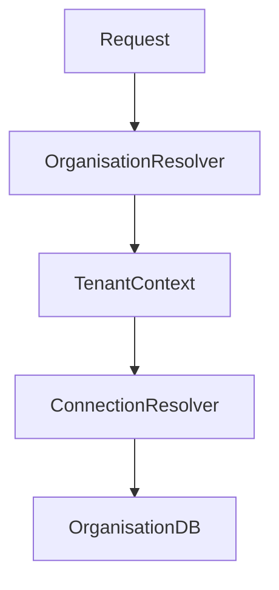

# Mission: Introduce Multi-Database Architecture into `nrna1` with Minimal Change

You are working from the repository:

```text
/home/nab-raj.roshyara@dg-nexolution.de/roshyara/personal/nrna1
```

You are operating as a **Senior DDD Architect, Principal Architect, Domain-Driven Transformer, and Laravel Architecture Expert**.

Your task is **NOT to implement the migration yet**.

Your first responsibility is to perform a deep architectural investigation and produce a rigorous, evidence-based plan for introducing a **multi-database-per-organisation architecture** into the `nrna1` Laravel application with the **minimum necessary architectural and code changes**.

---

# 1. Context

There are two Laravel repositories.

## Repository 1 — Current system

```text
/home/nab-raj.roshyara@dg-nexolution.de/roshyara/personal/nrna1
```

This is the repository you are currently working in.

Characteristics:

- Laravel application.
- Currently uses a **single database**.
- The application is already strongly organisation-oriented.
- Users and most application operations are addressed through an organisation-specific context.

For example, URLs/routes conceptually look like:

```text
/organisations/{organisation}/...
```

The existing application therefore already contains an important architectural concept:

```text
Organisation
    ↓
Organisation-specific application context
    ↓
Users / Membership / Elections / etc.
```

The objective is to evolve this architecture so that:

```text
Organisation A
    ↓
Database A

Organisation B
    ↓
Database B

Organisation C
    ↓
Database C
```

while keeping the existing organisation-specific application model wherever possible.

---

# 2. Reference Architecture — Repository 2

The second repository is:

```text
/home/nab-raj.roshyara@dg-nexolution.de/roshyara/personal/election
```

This repository already implements a **multi-database architecture**, with a separate database for each organisation/tenant.

You must use this repository as an **architectural reference implementation**.

However:

> DO NOT blindly copy the architecture from `election` into `nrna1`.

Your task is to determine which concepts from `election` are actually required in `nrna1`, which can be reused, and which would introduce unnecessary complexity.

The target is:

> **Minimal architectural change + maximum reuse of the existing organisation-specific design.**

---

# 3. Critical Access Restriction

You may inspect the entire repositories as necessary for architectural analysis.

However, there is a specific documentation directory where you are expected to write the architectural report:

```text
/home/nab-raj.roshyara@dg-nexolution.de/roshyara/personal/nrna1/docs/publicdigit/brainstorming/multi-database-system
```

Treat the existing material in this directory as **READ-ONLY**.

### IMPORTANT

You MUST NOT modify, delete, rename, overwrite, or otherwise change any existing files in:

```text
docs/publicdigit/brainstorming/multi-database-system
```

You may:

- read existing documents;
- analyze their contents;
- use them as architectural context;
- create a NEW report file if required.

Do not modify existing brainstorming documents.

If a report needs to be created, create a new clearly named file, for example:

```text
docs/publicdigit/brainstorming/multi-database-system/
    MULTI_DATABASE_ARCHITECTURE_ASSESSMENT.md
```

Do not overwrite an existing file with that name. If it already exists, create a new versioned report such as:

```text
MULTI_DATABASE_ARCHITECTURE_ASSESSMENT_V2.md
```

---

# 4. Architectural Role

Think and work as:

- Senior Domain-Driven Design Architect
- Principal Software Architect
- Domain-Driven Transformation Architect
- Laravel Architecture Expert
- Multi-Tenancy / Multi-Database Architect
- Requirements Engineer
- Architecture Governance reviewer

Do NOT approach this as a simple Laravel coding task.

The fundamental question is:

> **How can the existing organisation-centric domain model of `nrna1` be evolved into organisation-isolated databases without unnecessarily redesigning the application?**

---

# 5. First Principle

Do not start by asking:

> "How do we copy the multi-tenancy implementation from `election`?"

Start with:

> "What architectural assumptions does `nrna1` already make about Organisation, User, Membership, authentication, authorization, routing, persistence and database access?"

Then determine:

> "Which of those assumptions already naturally support tenant/database isolation?"

This distinction is extremely important.

---

# 6. Investigation Phase

Before proposing a solution, inspect `nrna1` systematically.

At minimum investigate:

## 6.1 Laravel structure

Identify:

- Laravel version
- application structure
- service providers
- middleware
- routes
- controllers
- models
- repositories
- services
- actions
- policies
- jobs
- events/listeners
- commands
- migrations
- seeders
- configuration
- authentication
- authorization
- queues
- notifications
- scheduled jobs

Determine where database access is actually performed.

---

# 7. Organisation Context Investigation

Find the complete organisation resolution mechanism.

Answer:

1. How is an organisation identified?
2. How is `{organisation}` resolved from the URL?
3. Is Organisation a model?
4. Is organisation stored in the current database?
5. Does User belong to an Organisation?
6. Can one User belong to multiple Organisations?
7. How is organisation context propagated?
8. Is organisation context stored in:
   - route parameters?
   - session?
   - authenticated user?
   - middleware?
   - service container?
   - request object?
   - model relationships?
9. Which services assume the current organisation?
10. Which models contain `organisation_id`?
11. Which tables contain organisation identifiers?
12. Which queries explicitly filter by organisation?
13. Which queries implicitly rely on relationships?

Create an evidence-based map.

---

# 8. Database Dependency Analysis

Create a complete database dependency analysis.

Identify:

```text
Organisation
    ↓
tables
    ↓
models
    ↓
relationships
    ↓
services
    ↓
controllers
    ↓
routes
```

Determine which data is:

### Organisation-owned

Example:

```text
users
memberships
elections
voters
committees
...
```

### Platform-owned

Potential examples:

```text
organisations
organisation configuration
tenant provisioning metadata
system administration
central authentication metadata
```

Do NOT assume these categories. Derive them from the code.

---

# 9. Search for Organisation ID Patterns

Systematically identify patterns such as:

```php
organisation_id
organization_id
organisation
organization
tenant_id
tenant
currentOrganisation
currentOrganization
```

Also detect indirect organisation scoping such as:

```php
$user->organisation
$organisation->users()
$organisation->members()
$query->where(...)
```

Determine whether organisation isolation is already implemented logically through query constraints.

This is one of the most important parts of the investigation.

---

# 10. Analyse the `election` Repository

Inspect:

```text
/home/nab-raj.roshyara@dg-nexolution.de/roshyara/personal/election
```

Reverse-engineer its multi-database mechanism.

Identify specifically:

- tenant identification
- organisation identification
- tenant database naming
- database creation
- database configuration
- connection switching
- connection resolver
- middleware
- service providers
- tenant lifecycle
- migrations
- tenant provisioning
- central database
- tenant database
- authentication
- queues
- jobs
- console commands
- testing strategy
- transaction handling
- cache implications
- session implications
- configuration caching implications

Document the actual implementation rather than assuming a standard Laravel tenancy pattern.

---

# 11. Compare Both Architectures

Create a comparison matrix:

| Concern | `nrna1` | `election` | Reuse? | Change Required? |
|---|---|---|---|---|
| Organisation identification | | | | |
| Organisation resolution | | | | |
| Authentication | | | | |
| User model | | | | |
| Database connection | | | | |
| Middleware | | | | |
| Service provider | | | | |
| Models | | | | |
| Migrations | | | | |
| Jobs | | | | |
| Queues | | | | |
| Notifications | | | | |
| Cache | | | | |
| Sessions | | | | |
| Tests | | | | |
| CLI commands | | | | |
| Provisioning | | | | |

The comparison must be based on actual repository evidence.

---

# 12. Determine the Target Architecture

Design the smallest reasonable target architecture.

The likely conceptual target is:

```text
                    ┌───────────────────────┐
                    │     Platform DB       │
                    │                       │
                    │ Organisations         │
                    │ Tenant metadata       │
                    │ Provisioning state    │
                    └───────────┬───────────┘
                                │
                       Organisation Context
                                │
               ┌────────────────┼────────────────┐
               │                │                │
               ▼                ▼                ▼
        ┌────────────┐   ┌────────────┐   ┌────────────┐
        │ Org DB A   │   │ Org DB B   │   │ Org DB C   │
        │            │   │            │   │            │
        │ Users      │   │ Users      │   │ Users      │
        │ Members    │   │ Members    │   │ Members    │
        │ Elections  │   │ Elections  │   │ Elections  │
        │ ...        │   │ ...        │   │ ...        │
        └────────────┘   └────────────┘   └────────────┘
```

But do NOT assume this exact architecture is correct.

Validate whether `nrna1` actually requires:

- central database
- tenant databases
- central users
- tenant users
- hybrid data model
- organisation registry
- shared authentication database

The architecture must emerge from the domain model.

---

# 13. Most Important Question: Minimal Change

Explicitly determine:

> What is the smallest change that gives us true database isolation?

Consider at least these alternatives:

### Option A — Database connection switching

Keep almost all existing application code.

Concept:

```text
Organisation Resolver
        ↓
Tenant Context
        ↓
Database Connection Resolver
        ↓
Organisation Database
```

### Option B — Introduce a tenancy abstraction

For example:

```text
TenantContext
TenantResolver
TenantConnectionManager
```

while leaving most existing models unchanged.

### Option C — Adopt/reuse the architecture from `election`

Only if technically justified.

### Option D — Hybrid architecture

Central platform database + organisation databases.

Evaluate whether this is actually required.

---

# 14. Minimize Domain Changes

The preferred architecture should preserve:

- existing URLs
- existing organisation routing
- existing controllers
- existing domain services
- existing business logic
- existing models
- existing authorization rules
- existing UI
- existing workflows

where technically safe.

Do NOT recommend rewriting the application merely because a cleaner architecture could theoretically be created.

We want:

```text
Existing Domain Model
        +
Organisation Context
        +
Tenant Database Resolution
        =
Multi-Database Architecture
```

rather than:

```text
Existing Application
        ↓
Complete Rewrite
        ↓
New Multi-Tenant Architecture
```

---

# 15. Identify Hidden Risks

Perform a serious architectural risk analysis.

Look specifically for:

### Authentication

What happens when the authenticated user is stored in a tenant database?

### Organisation resolution

Can the database connection be selected before the User model is queried?

This is a critical bootstrap question.

### Session

Can the session contain tenant context?

### Jobs

How does a queued job know which organisation database it must use?

### Notifications

How does notification processing know the tenant?

### Events

How does an event retain tenant context?

### Console commands

How do commands execute against one or multiple organisation databases?

### Migrations

How are tenant databases migrated?

### Transactions

Can transactions cross databases?

### Cache

Could tenant-specific cached data leak between organisations?

### Files

Are uploaded files tenant-specific?

### Search

Are search indexes tenant-specific?

### Logs

Can tenant context be included in logs?

### Testing

How can tests reliably isolate databases?

### Local development

How can developers easily create and reset tenant databases?

### Production

How are databases provisioned and upgraded?

---

# 16. Security Requirement

Treat database isolation as a **security boundary**, not merely a technical optimization.

Verify:

```text
Organisation A request
        ↓
Organisation A context
        ↓
Organisation A database
```

and ensure it is impossible for the request to accidentally execute against:

```text
Organisation B database
```

Identify where the architecture should enforce this invariant.

Do not rely solely on developers remembering to add:

```php
where('organisation_id', ...)
```

The purpose of the migration is precisely to move organisation isolation from primarily logical filtering toward infrastructure/database-level isolation.

---

# 17. Domain-Driven Design Analysis

Analyse the architecture using DDD concepts.

Determine:

### Organisation

Is Organisation:

- Entity?
- Aggregate Root?
- Tenant?
- Platform concept?
- Domain concept?

### User

Is User:

- global identity?
- organisation member?
- tenant-owned entity?
- identity projection?

### Membership

Where does Membership belong?

### Organisation Context

Is organisation context:

- domain concept?
- application context?
- infrastructure concern?

### Tenant Database

Is tenant database:

- domain concept?
- infrastructure implementation?

Make this distinction explicit.

Do not leak infrastructure concepts into the domain model unnecessarily.

---

# 18. Domain-Driven Transformation Perspective

Think about the migration as an architectural transformation:

```text
CURRENT

Organisation
     ↓
Logical data isolation
     ↓
Shared database


TARGET

Organisation
     ↓
Tenant Context
     ↓
Physical database isolation
```

Identify which existing domain boundaries already support this transition.

The transformation should preserve domain language while changing infrastructure isolation.

---

# 19. Migration Strategy

Develop a phased migration strategy.

Prefer an incremental strategy such as:

```text
Phase 0
Architecture discovery

Phase 1
Introduce Tenant/Organisation Context abstraction

Phase 2
Introduce database connection resolution

Phase 3
Make tenant database creation/provisioning possible

Phase 4
Migrate schema

Phase 5
Migrate organisation data

Phase 6
Switch organisation requests to tenant DB

Phase 7
Remove obsolete organisation_id constraints where appropriate

Phase 8
Regression/security verification
```

But do not blindly follow this sequence. Modify it based on repository evidence.

---

# 20. Backward Compatibility

Determine whether migration can happen gradually.

For example:

```text
OLD

shared DB
organisation_id = A


TRANSITION

organisation_id = A
+
tenant database A


TARGET

tenant database A
```

Evaluate whether a feature flag or migration mode is necessary.

If possible, design a transition mode such as:

```text
MULTI_DATABASE_MODE=false
```

then:

```text
MULTI_DATABASE_MODE=true
```

But only recommend this if justified.

---

# 21. Testing Strategy

Design tests for:

### Tenant resolution

```text
Organisation A → DB A
Organisation B → DB B
```

### Isolation

```text
User from A cannot read B data.
```

### Authentication

```text
User authentication resolves against correct tenant.
```

### Jobs

```text
Job dispatched in A executes in A.
```

### CLI

```text
Tenant-specific command operates only on selected tenant.
```

### Failure safety

If tenant context is missing:

```text
FAIL CLOSED
```

rather than accidentally using a default/shared tenant database.

This principle is critical.

---

# 22. Architecture Decision Records

Identify the architectural decisions that need ADRs.

At minimum evaluate:

```text
ADR-1: Organisation as Tenant Boundary

ADR-2: Tenant Database Resolution

ADR-3: Central vs Tenant Data

ADR-4: Tenant Context Propagation

ADR-5: Tenant Database Provisioning

ADR-6: Migration Strategy

ADR-7: Queue/Event Tenant Context

ADR-8: Tenant Isolation Security Model
```

Do not create ADRs unnecessarily; recommend only decisions that materially affect architecture.

---

# 23. Deliverables

Create a new report in:

```text
docs/publicdigit/brainstorming/multi-database-system/
```

Do not modify existing documents.

The report must contain:

# Multi-Database Architecture Assessment

## 1. Executive Summary

Clearly explain:

- current architecture
- target architecture
- key architectural finding
- recommended approach
- estimated complexity
- major risks

## 2. Current `nrna1` Architecture

Document actual architecture based on repository evidence.

## 3. Existing Multi-Database Architecture in `election`

Document how it works.

## 4. Architecture Comparison

Provide the comparison matrix.

## 5. Organisation/Tenant Boundary Analysis

Explain the DDD implications.

## 6. Target Architecture

Provide architecture diagrams using Mermaid where useful.

For example:



## 7. Minimal Change Strategy

Explicitly identify:

```text
KEEP
CHANGE
ADD
REMOVE
```

## 8. Migration Plan

Provide concrete phases.

## 9. Data Migration Strategy

Explain how existing shared database data would move into organisation databases.

## 10. Authentication Strategy

Explain exactly how users are resolved.

## 11. Queue/Event Strategy

Explain tenant context propagation.

## 12. Security & Isolation

Explain how accidental cross-tenant access is prevented.

## 13. Testing Strategy

Explain unit, integration, architecture and security tests.

## 14. Risks

Rank:

```text
Critical
High
Medium
Low
```

## 15. Architectural Decisions

List proposed ADRs.

## 16. Implementation Backlog

Create concrete implementation tasks.

Each task should contain:

```text
ID
Title
Purpose
Affected area
Dependencies
Risk
Acceptance criteria
```

## 17. Recommended First Implementation Step

Identify the smallest safe proof-of-concept that should be implemented first.

---

# 24. Evidence Requirement

Do not make generic Laravel recommendations.

Every important architectural conclusion should reference repository evidence.

For example:

```text
Observation:
User is always accessed through organisation-specific routes.

Evidence:
routes/web.php
app/Http/Middleware/...
app/Models/User.php
```

Then:

```text
Architectural implication:
Organisation context already exists before most domain operations,
therefore introducing tenant connection resolution at this boundary
may require significantly fewer changes than introducing a new tenancy model.
```

This is the kind of reasoning required.

---

# 25. Do Not Implement Yet

This is extremely important.

During this task:

### DO

- inspect
- analyse
- compare
- reason
- document
- create architecture diagrams
- create migration plan
- identify risks
- identify files/classes likely to change

### DO NOT

- modify production PHP code
- modify migrations
- modify models
- modify routes
- modify middleware
- modify configuration
- install packages
- run destructive database commands
- migrate databases
- delete data
- refactor existing application code

The output of this task is the **architecture assessment and implementation plan**, not the implementation.

---

# 26. Final Architectural Question

At the end of the analysis answer this question explicitly:

> **Can `nrna1` become a true multi-database-per-organisation system primarily by introducing organisation-aware database connection resolution, while preserving its existing organisation-specific domain and routing model?**

Answer:

```text
YES
YES, WITH CONDITIONS
NO
```

Then explain exactly why.

Also answer:

> **What is the minimum set of production code changes required?**

and:

> **What can remain completely unchanged?**

---

# 27. Quality Standard

Do not produce a generic tenancy tutorial.

Think like an architect reviewing a real production system.

The desired result is:

```text
Repository Evidence
        ↓
Domain Understanding
        ↓
Architecture Comparison
        ↓
Minimal Target Architecture
        ↓
Risk Analysis
        ↓
Migration Strategy
        ↓
Implementation Backlog
```

The final report must be good enough that another senior engineer can implement the migration from the report without having to rediscover the architecture.

Before finishing, perform a final consistency check:

1. Does the proposed architecture preserve existing organisation-specific URLs?
2. Does it preserve existing domain behavior?
3. Does it guarantee database isolation?
4. Does it avoid unnecessary framework/package changes?
5. Does it explain authentication bootstrap?
6. Does it explain queues/jobs/events?
7. Does it explain migrations and provisioning?
8. Does it define failure-closed behavior?
9. Does it clearly distinguish domain concepts from infrastructure concepts?
10. Does it genuinely minimize changes compared with a full rewrite?

If any answer is unclear, investigate the repository further before finalizing the report.
#
# CRITICAL: `election` Is the Reference Implementation

The `election` repository is not merely a repository to inspect for comparison.

It is the **existing reference implementation of the multi-database architecture** that we want to understand and potentially reproduce in `nrna1`.

Therefore, perform a dedicated **Reference Architecture Reverse Engineering** exercise.

## A. Reverse-engineer `election`

Do not only describe that `election` has multiple databases.

Trace the complete runtime lifecycle:

```text
HTTP Request
    ↓
Organisation Identification
    ↓
Organisation/Tenant Resolution
    ↓
Tenant Context
    ↓
Database Connection Resolution
    ↓
Database Connection
    ↓
Authenticated User
    ↓
Domain Operation
    ↓
Response
```

Determine exactly which classes, middleware, providers, configuration and services implement each step.

Create a table:

| Architectural Responsibility | `election` Implementation | Location | Purpose |
|---|---|---|---|
| Organisation resolution | | | |
| Tenant identification | | | |
| Tenant context | | | |
| Database selection | | | |
| Connection creation | | | |
| Connection switching | | | |
| Authentication | | | |
| Middleware | | | |
| Service provider | | | |
| Provisioning | | | |
| Tenant migrations | | | |
| Queue context | | | |
| Events | | | |
| CLI | | | |
| Testing | | | |

---

## B. Trace the `election` Runtime

Follow at least one realistic request end-to-end.

For example:

```text
GET /organisations/{organisation}/...
```

Trace:

```text
Route
 → Middleware
 → Organisation Resolver
 → Tenant Resolver
 → Database Manager
 → Authentication
 → Controller
 → Service
 → Model
 → Database
```

Identify the exact implementation points.

Do not infer them from naming conventions.

---

## C. Identify the Reusable Architectural Kernel

From `election`, identify the smallest set of concepts required for multi-database support.

For example, determine whether the architecture effectively consists of something like:

```text
OrganisationResolver
        +
TenantContext
        +
TenantConnectionResolver
        +
TenantDatabaseProvisioner
        +
TenantMigrationManager
```

Do not assume these class names exist.

Derive the actual architecture from the code.

Then distinguish:

### Core multi-database mechanism

from:

### Election-specific business logic

This distinction is essential.

---

## D. Map `election` Concepts onto `nrna1`

Create an explicit transformation matrix:

| `election` concept | `nrna1` equivalent | Existing? | Reuse directly? | Adapt? | New implementation? |
|---|---|---:|---:|---:|---:|
| Organisation Resolver | | | | | |
| Tenant Context | | | | | |
| Connection Resolver | | | | | |
| Tenant DB config | | | | | |
| Tenant provisioning | | | | | |
| Tenant migration | | | | | |
| Authentication | | | | | |
| Middleware | | | | | |
| Jobs | | | | | |
| Events | | | | | |
| CLI | | | | | |

The goal is to discover:

> **How much of the proven `election` infrastructure can be reused conceptually or technically in `nrna1`?**

---

## E. Find the Architectural Delta

Produce a precise:

# `election` → `nrna1` Architectural Delta

For every difference classify it as:

```text
SAME
MINOR ADAPTATION
NEW COMPONENT REQUIRED
INCOMPATIBLE
NOT REQUIRED
```

For example:

```text
Organisation identification
    SAME

Tenant database connection
    MINOR ADAPTATION

Election-specific tenant provisioning
    NOT REQUIRED

Authentication bootstrap
    NEW / REQUIRES INVESTIGATION
```

Do not assume the result.

---

## F. Determine Whether We Can Extract a Common Pattern

Investigate whether the two applications could conceptually share a common architecture:

```text
                Organisation
                     │
                     ▼
             Organisation Context
                     │
                     ▼
            Tenant Connection
                     │
                     ▼
             Organisation DB
```

Determine whether this should be:

### Option 1

Copy/adapt the implementation from `election`.

### Option 2

Extract a reusable internal package/library.

### Option 3

Implement a lightweight equivalent directly in `nrna1`.

### Option 4

Introduce a common platform-level tenancy component.

Evaluate the cost and architectural consequences of each.

For the immediate migration, prefer the option with the **lowest change and lowest risk**.

---

## G. Compare Architectural Quality

Do not assume the second repository is automatically correct.

Review its implementation critically.

Assess:

- DDD alignment
- separation of concerns
- dependency direction
- infrastructure/domain separation
- security
- failure-closed behavior
- testability
- maintainability
- Laravel coupling
- operational complexity
- migration complexity
- scalability

Identify:

> What should `nrna1` inherit from `election`?

and separately:

> What should `nrna1` deliberately NOT inherit from `election`?

---

## H. Produce the Most Important Result

The report must eventually provide a concrete architecture like:

```text
CURRENT `nrna1`

HTTP Request
    ↓
Organisation Route
    ↓
Organisation Model
    ↓
Shared Database
```

versus:

```text
TARGET `nrna1`

HTTP Request
    ↓
Organisation Route
    ↓
Organisation Resolver
    ↓
Tenant Context
    ↓
Tenant Database Resolver
    ↓
Organisation Database
    ↓
Existing Domain/Application Code
```

Then explicitly identify which layers change.

The ideal outcome is something similar to:

```text
┌──────────────────────────────────────────────┐
│              EXISTING nrna1                 │
│                                              │
│ Routes                                       │
│ Controllers                                  │
│ Application Services                         │
│ Domain Logic                                 │
│ Models                                       │
│ UI                                           │
└──────────────────────┬───────────────────────┘
                       │
                 MINIMAL CHANGE
                       │
                       ▼
              ┌─────────────────┐
              │ Tenant Context  │
              └────────┬────────┘
                       │
              ┌────────▼────────┐
              │ DB Resolver     │
              └────────┬────────┘
                       │
            ┌──────────┴──────────┐
            ▼                     ▼
       Organisation A        Organisation B
          Database              Database
```

If the repository evidence supports this architecture, explicitly state that this is the recommended migration path.

---

## I. Final Recommendation Must Be Comparative

Do NOT finish with:

> "Here is how to implement multi-tenancy."

Finish with:

> **"After reverse-engineering `election` and analysing `nrna1`, this is the smallest and safest architectural delta required to bring the proven multi-database capability from `election` into `nrna1`."**

Then list:

```text
1. Components from election to reuse/adapt
2. Components that nrna1 already has
3. Components that must be introduced
4. Components that should not be copied
5. Files/classes expected to change
6. Files/classes expected to remain unchanged
7. Migration sequence
8. Security invariants
9. Tests required
10. First implementation step
```

The goal is **not to make `nrna1` look like `election`**.

The goal is to make:

```text
nrna1
+
proven multi-database capability from election
+
minimum architectural change
=
safe organisation-isolated architecture
```

That is the primary architectural objective.