# Constitutional Governance Runtime — PBDIGIT Execution Map (Jira-ready)

| | |
|---|---|
| **Date** | 2026-10-01 |
| **Kind** | ⚠ authority: generated. The **working-path documentation package** for implementing `PBDIGIT-76` … `PBDIGIT-152`. **It authorises nothing and changes no ticket scope.** |
| **Jira** | No issue tracker is connected to this repository. **No Jira issue has been created.** This map is laid out so the PO can create one Jira issue per row of §2, using the fields of §10. |
| **Single source** | Every table and diagram below is **generated** from the backlog's ticket data, the same source as [`2026-09-30-constitutional-runtime-pbdigit-backlog.md`](../reviews/2026-09-30-constitutional-runtime-pbdigit-backlog.md) and the [implementation runbook](2026-10-01-constitutional-runtime-implementation-sequence.md). **If anything here disagrees with the backlog, the backlog wins.** |
| **Consistency check** | 77 tickets (63 implementation, 14 decisions) · 15 waves · 0 dependency or track-order violations (no ticket is ordered before a ticket it needs) |
| **Placement** | `php scripts/doc-placement.php --scope=product-specific --domain=publicdigit` → `docs/publicdigit` (exit 0); `implementation/` |

**Contents**

1. Overview
2. Master index: all 77 tickets
3. The three working paths
4. Human decision and authorisation matrix
5. Dependency graph
6. The 15-wave implementation sequence
7. Execution protocol (per ticket)
8. Architecture gates and stop conditions
9. What becomes possible after each ticket
10. Per-ticket execution cards (Definition of Done)

---

## 1. Overview

```
                     CONSTITUTIONAL GOVERNANCE RUNTIME
                                    │
   ┌────────────────────────────────┼─────────────────────────────────┐
   │                                │                                 │
 A1 ADMIN CONSTITUTIONAL      A2 VOTING PARTICIPATION          B GENERAL REPOSITORY
    GOVERNANCE (EPIC-03)         GOVERNANCE (EPIC-05)             / FREEZE
   │                                │                                 │
 139 A  (first A1)               76 → 77 → 78  (first A2)          133 (first B) · 134 · 130 · 122
   │                                │                                 │
 140  characterize 5 authorities 79 · 80  characterize voting      123 CI job
   │                                │                                 │
 109  resolver mechanics ─────────────────────┐                   124–129 CI rules (progressive)
   │                                │         │                       │
 144 [H-13] → 145 → 147          81–84 · 135 · 136  pins          X security fixes 85–89
   │          ├→ 151 [H-13]         │                               (after their pins)
   │          └→ 152 [after 146]  [H-1…H-4] → 101 law                 │
 142 [H-13] · 143 · 148             │                                 │
 146 [H-5, H-14]                  105–108 evidence + evaluators       │
   │                                │         │                       │
 149 governance E2E               110 ◄───────┘ (needs 109)           │
   │                                │                                 │
   │                              111 → 112 → 113 · 114 → 115 → 116   │
   │                                │                                 │
   │                              117 [PBDIGIT-45] → 118 → 119–121 → 137
   │                                │                                 │
   └────────────────────────────────┴──────────► 131 guide ──► 132 v1.0 freeze
```

The tracks meet only in two places:
- the shared resolver mechanics `109` (A1 → A2);
- the v1.0 freeze `132`.

**First implementation per track** (none authorised):

| Track | First implementation |
|---|---|
| **A1** | **`PBDIGIT-139` part A** |
| **A2** | **`PBDIGIT-76`** |
| **B** | **`PBDIGIT-133`** |

There is no single overall "first ticket".

---

## 2. Master index: all 77 tickets

**Order** = position in the track's serial path (§3). **Wave** = computed from the dependency graph (§6). Tickets in the same wave are independent.

| Ticket | Track | Type | Purpose | Depends on | Decision gate | Wave | Order | Arch. gate | Status |
|---|---|---|---|---|---|---|---|---|---|
| `PBDIGIT-76` | A2 Voting Participation Governance | Test infrastructure | Repair voting feature-test fixtures for current schema (retired columns) | — | — | 1 | A2-01 | — | `TODO — NOT AUTHORISED` |
| `PBDIGIT-77` | A2 Voting Participation Governance | Test infrastructure | Repair voting feature-test tenancy, factory, constructor and route fixtures | — | — | 1 | A2-02 | — | `TODO — NOT AUTHORISED` |
| `PBDIGIT-78` | A2 Voting Participation Governance | Test infrastructure | Repair voting-active lifecycle fixtures to current lifecycle rules | — | — | 1 | A2-03 | — | `TODO — NOT AUTHORISED` |
| `PBDIGIT-79` | A2 Voting Participation Governance | Characterization | Characterize the voting entry path at the HTTP boundary | 76 · 77 · 78 | — | 2 | A2-04 | — | `TODO — NOT AUTHORISED` |
| `PBDIGIT-80` | A2 Voting Participation Governance | Characterization | Characterize the ballot, verify and store path at the HTTP boundary | 76 · 77 · 78 | — | 2 | A2-05 | — | `TODO — NOT AUTHORISED` |
| `PBDIGIT-81` | A2 Voting Participation Governance | Characterization | Pin voting-flow control defects X-1, X-2, X-3 | 80 | — | 3 | A2-06 | — | `TODO — NOT AUTHORISED` |
| `PBDIGIT-82` | A2 Voting Participation Governance | Characterization | Pin voting-code secrecy defects X-4, X-5 | 80 | — | 3 | A2-07 | — | `TODO — NOT AUTHORISED` |
| `PBDIGIT-83` | A2 Voting Participation Governance | Characterization | Pin participation-bypass defects X-6, X-7 | 79 | — | 3 | A2-08 | — | `TODO — NOT AUTHORISED` |
| `PBDIGIT-84` | A2 Voting Participation Governance | Characterization | Pin configuration and schema defects X-8…X-12 | 79 · 80 | — | 3 | A2-09 | — | `TODO — NOT AUTHORISED` |
| `PBDIGIT-85` | X Security fix | Security fix | X-3 — Release the vote lock and roll back on the store IP-denial branch | 81 | — | 4 | X-01 | G | `TODO — NOT AUTHORISED` |
| `PBDIGIT-86` | X Security fix | Security fix | X-4 — Stop logging voting codes and compare codes in constant time | 82 | — | 4 | X-02 | F | `TODO — NOT AUTHORISED` |
| `PBDIGIT-87` | X Security fix | Security fix | X-5 — Remove plaintext debug_code exposure outside local environments | 82 | — | 4 | X-03 | F | `TODO — NOT AUTHORISED` |
| `PBDIGIT-88` | X Security fix | Security fix | X-6 — Remove the session demo-flag bypass from real-election gates | 83 | — | 4 | X-04 | A | `TODO — NOT AUTHORISED` |
| `PBDIGIT-89` | X Security fix | Security fix | X-10 — Fix the two voting-path TypeErrors (whitelist decode, UUID user id) | 84 | — | 4 | X-05 | A, C, F | `TODO — NOT AUTHORISED` |
| `PBDIGIT-90` | Human decision | Decision | **H-1:** Which IP is the canonical 'verified IP' (rules 1 and 4)? | — | — | 0 | — | B (decision) | **DECISION REQUIRED** |
| `PBDIGIT-91` | Human decision | Decision | **H-2:** What is the registered device fingerprint (rule 5)? | — | — | 0 | — | B (decision) | **DECISION REQUIRED** |
| `PBDIGIT-92` | Human decision | Decision | **H-3:** Does trust level scale the per-IP vote limit as law, or is the limit exactly N? | — | — | 0 | — | B (decision) | **DECISION REQUIRED** |
| `PBDIGIT-93` | Human decision | Decision | **H-4:** Rule 7 semantics: which record counts prior votes per IP, and is the N-th or the (N+1)-th vote refu… | — | — | 0 | — | B (decision) | **DECISION REQUIRED** |
| `PBDIGIT-94` | Human decision | Decision | **H-5:** Where does the participation action registry live? | — | — | 0 | — | B (decision) | **DECISION REQUIRED** |
| `PBDIGIT-95` | Human decision | Decision | **H-6:** What is the single platform-organisation rule? | — | — | 0 | — | B (decision) | **DECISION REQUIRED** |
| `PBDIGIT-96` | Human decision | Decision | **H-7:** Which record is the canonical 'already voted' fact, and which membership predicate is canonical? | — | — | 0 | — | B (decision) | **DECISION REQUIRED** |
| `PBDIGIT-97` | Human decision | Decision | **H-8:** Do overlays ever influence CAST_VOTE, or remain audit-only observations? | — | — | 0 | — | B (decision) | **DECISION REQUIRED** |
| `PBDIGIT-98` | Human decision | Decision | **H-9:** Is demo voting in scope for CAST_VOTE? | — | — | 0 | — | B (decision) | **DECISION REQUIRED** |
| `PBDIGIT-99` | Human decision | Decision | **H-10:** Is ORM-level constitutional immutability sufficient, or is DB-level protection required? | — | — | 0 | — | B (decision) | **DECISION REQUIRED** |
| `PBDIGIT-100` | Human decision | Decision | **H-11:** How are existing elections (frozen with DB-default law) treated? | — | — | 0 | — | B (decision) | **DECISION REQUIRED** |
| `PBDIGIT-101` | A2 Voting Participation Governance | Constitutional law | One canonical constitution representation, schema version and hash | 79 · 80 | H-1 (90), H-2 (91), H-3 (92), H-4 (93) | 3 | A2-12 | B | `TODO — NOT AUTHORISED` |
| `PBDIGIT-102` | A2 Voting Participation Governance | Constitutional law | Author constitutional law at election creation and freeze it | 101 | — | 4 | A2-17 | B | `TODO — NOT AUTHORISED` |
| `PBDIGIT-103` | A2 Voting Participation Governance | Constitutional law | Enforce constitutional immutability and verify the hash on load | 101 | H-10 (99) | 4 | A2-18 | B, G | `TODO — NOT AUTHORISED` |
| `PBDIGIT-104` | A2 Voting Participation Governance | Constitutional law | Establish constitutional law for existing elections | 101 | H-11 (100) | 4 | A2-19 | B, G | `TODO — NOT AUTHORISED` |
| `PBDIGIT-105` | A2 Voting Participation Governance | Evidence | Typed evidence: membership, lifecycle and already-voted facts | 79 · 80 · 136 | H-7 (96) | 4 | A2-14 | C | `TODO — NOT AUTHORISED` |
| `PBDIGIT-106` | A2 Voting Participation Governance | Evidence | Typed evidence: network, device and officer-verification facts with provenance | 79 · 80 | H-1 (90), H-2 (91), H-4 (93) | 3 | A2-13 | C | `TODO — NOT AUTHORISED` |
| `PBDIGIT-107` | A2 Voting Participation Governance | Evidence | Typed evidence: ballot/code session facts under the constitutional protocol | 79 · 80 · 101 | — | 4 | A2-15 | C | `TODO — NOT AUTHORISED` |
| `PBDIGIT-108` | A2 Voting Participation Governance | Evaluation | Evaluators: network (composable binding + limit), device comparison, verification | 101 · 106 | H-3 (92), H-4 (93) | 4 | A2-16 | D | `TODO — NOT AUTHORISED` |
| `PBDIGIT-109` | A1 Admin Constitutional Governance | Authority | R-1a — resolver mechanics: Resolver evaluates every policy and returns a stateless trace | 140 | — | 3 | A1-03 | E | `TODO — NOT AUTHORISED` |
| `PBDIGIT-110` | A2 Voting Participation Governance | Authority | R-1b — CAST_VOTE integration: Typed CAST_VOTE context and participation action registry | 109 · 105 · 106 · 107 | H-5 (94) | 5 | A2-20 | E | `TODO — NOT AUTHORISED` |
| `PBDIGIT-111` | A2 Voting Participation Governance | Authority | R-1b — CAST_VOTE integration: Register the CAST_VOTE resolver policy set | 110 · 108 | H-8 (97), H-9 (98) | 6 | A2-21 | A, E | `TODO — NOT AUTHORISED` |
| `PBDIGIT-112` | A2 Voting Participation Governance | Persistence/replay | Persist a CAST_VOTE decision record for every evaluation | 111 | — | 7 | A2-22 | G | `TODO — NOT AUTHORISED` |
| `PBDIGIT-113` | A2 Voting Participation Governance | Parity | Shadow-evaluate CAST_VOTE in the live voting path | 112 | H-9 (98) | 8 | A2-24 | G | `TODO — NOT AUTHORISED` |
| `PBDIGIT-114` | A2 Voting Participation Governance | Replay | Replay harness: reproduce stored decisions with DB access disabled | 112 | — | 8 | A2-23 | — | `TODO — NOT AUTHORISED` |
| `PBDIGIT-115` | A2 Voting Participation Governance | Parity | Runtime parity harness at the HTTP boundary with persisted divergences | 113 | — | 9 | A2-25 | — | `TODO — NOT AUTHORISED` |
| `PBDIGIT-116` | A2 Voting Participation Governance | Parity | Execute the 14 critical parity paths and obtain approval of expected divergences | 115 | — | 10 | A2-26 | — | `TODO — NOT AUTHORISED` |
| `PBDIGIT-117` | A2 Voting Participation Governance | Authority | Switch the vote-submission decision to CAST_VOTE | 116 · 85 · 135 | PBDIGIT-45 ADR | 11 | A2-27 | A, E | `TODO — NOT AUTHORISED` |
| `PBDIGIT-118` | A2 Voting Participation Governance | Authority | Drive the entry and ballot pages from the CAST_VOTE decision | 117 | — | 12 | A2-28 | A, E | `TODO — NOT AUTHORISED` |
| `PBDIGIT-119` | A2 Voting Participation Governance | Deletion | Delete the legacy trust-decision pipeline | 118 | — | 13 | A2-29 | A | `TODO — NOT AUTHORISED` |
| `PBDIGIT-120` | A2 Voting Participation Governance | Deletion | Delete legacy participation middleware | 118 | H-6 (95) | 13 | A2-30 | A, F | `TODO — NOT AUTHORISED` |
| `PBDIGIT-121` | A2 Voting Participation Governance | Deletion | Delete duplicate controller participation gates and per-IP authorities | 118 | PBDIGIT-45 ADR | 13 | A2-31 | A | `TODO — NOT AUTHORISED` |
| `PBDIGIT-122` | B General repository/freeze | Deletion | Delete dead legacy code and retire tests of non-existent classes | — | — | 1 | B-04 | — | `TODO — NOT AUTHORISED` |
| `PBDIGIT-123` | B General repository/freeze | CI architecture | Bring election security zones under a blocking CI job | 76 · 77 · 78 · 139 | — | 2 | B-05 | — | `TODO — NOT AUTHORISED` |
| `PBDIGIT-124` | B General repository/freeze | CI architecture | CI rule 1 — Only the resolver and registered policies may create CapabilityDecision | 123 · 111 | — | 7 | B-09 | — | `TODO — NOT AUTHORISED` |
| `PBDIGIT-125` | B General repository/freeze | CI architecture | CI rule 2/4 — Canonical zones cannot import legacy authority; policies cannot consume policy o… | 123 · 108 | — | 5 | B-07 | — | `TODO — NOT AUTHORISED` |
| `PBDIGIT-126` | B General repository/freeze | CI architecture | CI rule 3 — Canonical zones cannot read mutable configuration or live models | 123 · 108 | — | 5 | B-08 | — | `TODO — NOT AUTHORISED` |
| `PBDIGIT-127` | B General repository/freeze | CI architecture | CI rule 5 — Snapshots cannot evaluate; middleware cannot derive participation | 123 · 120 | — | 14 | B-11 | — | `TODO — NOT AUTHORISED` |
| `PBDIGIT-128` | B General repository/freeze | CI architecture | CI rule 7 — Forbidden procedural vocabulary in canonical governance code | 123 | — | 3 | B-06 | — | `TODO — NOT AUTHORISED` |
| `PBDIGIT-129` | B General repository/freeze | CI architecture | CI rule 8 — Constitutional immutability and replay sufficiency run in CI | 123 · 103 · 114 | — | 9 | B-10 | — | `TODO — NOT AUTHORISED` |
| `PBDIGIT-130` | B General repository/freeze | Documentation | Correct false completion claims in historical documents | — | — | 1 | B-03 | — | `TODO — NOT AUTHORISED` |
| `PBDIGIT-131` | B General repository/freeze | Documentation | Consolidated Constitutional Governance Runtime developer guide | 121 · 119 · 120 | — | 14 | B-12 | — | `TODO — NOT AUTHORISED` |
| `PBDIGIT-132` | B General repository/freeze | Freeze | Constitutional Governance Runtime v1.0 freeze | 131 · 124 · 125 · 126 · 127 · 128 · 129 · 104 · 102 · 86 · 87 · 88 · 89 · 122 · 130 · 152 · 151 · 133 · 134 · 137 · 142 · 143 · 146 · 147 · 148 · 149 | H-12 (138) | 15 | B-13 | A, B, E | `TODO — NOT AUTHORISED` |
| `PBDIGIT-133` | B General repository/freeze | Test infrastructure | Temporal-determinism audit scanner flags `validate(` as a `date()` call | — | — | 1 | B-01 | — | `TODO — NOT AUTHORISED` |
| `PBDIGIT-134` | B General repository/freeze | Documentation | Resolve the `PBDIGIT-69` numbering collision | — | — | 1 | B-02 | — | `TODO — NOT AUTHORISED` |
| `PBDIGIT-135` | A2 Voting Participation Governance | Characterization | Characterize the non-slug `POST /votes` route and route-file loading | 80 | — | 3 | A2-10 | — | `TODO — NOT AUTHORISED` |
| `PBDIGIT-136` | A2 Voting Participation Governance | Characterization | Characterize `voter_slugs.vote_completed`, which no code writes | 79 | — | 3 | A2-11 | — | `TODO — NOT AUTHORISED` |
| `PBDIGIT-137` | A2 Voting Participation Governance | Deletion | Dispose of the unwired divergence-observation infrastructure | 116 | — | 11 | A2-32 | — | `TODO — NOT AUTHORISED` |
| `PBDIGIT-138` | Human decision | Decision | **H-12:** Should voting codes be stored hashed at rest (with verification by hash), or remain plaintext? | — | — | 0 | — | B (decision) | **DECISION REQUIRED** |
| `PBDIGIT-139` (A, then B) | A1 Admin Constitutional Governance | Test infrastructure | Repair capability-suite and suspension-suite test drift | — | — | 1 | A1-01 | — | `TODO — NOT AUTHORISED` |
| `PBDIGIT-140` | A1 Admin Constitutional Governance | Characterization | Characterize the admin-action authorities at the HTTP boundary | 139 | — | 2 | A1-02 | — | `TODO — NOT AUTHORISED` |
| `PBDIGIT-141` | Human decision | Decision | **H-13:** Which component owns role authority for admin lifecycle actions — Laravel `ElectionPolicy` gates, `… | — | — | 0 | — | B (decision) | **DECISION REQUIRED** |
| `PBDIGIT-142` | A1 Admin Constitutional Governance | Authority | Suspend and resume bypass ConstitutionalTransitionGuard | 140 | H-13 (141) | 3 | A1-06 | A | `TODO — NOT AUTHORISED` |
| `PBDIGIT-143` | A1 Admin Constitutional Governance | Audit | Resume writes no audit record | 140 | — | 3 | A1-04 | G | `TODO — NOT AUTHORISED` |
| `PBDIGIT-144` | A1 Admin Constitutional Governance | Authority | Resolver role and precondition policies for admin actions | 109 · 140 | H-13 (141) | 4 | A1-07 | A, E | `TODO — NOT AUTHORISED` |
| `PBDIGIT-145` | A1 Admin Constitutional Governance | Authority | Remove the lifecycle engine's second capability matrix | 144 | — | 5 | A1-08 | A, E | `TODO — NOT AUTHORISED` |
| `PBDIGIT-146` | A1 Admin Constitutional Governance | Constitutional law | Declare overlay behaviour in the constitution and fix the placeholder resume target | 140 | H-5 (94), H-14 (150) | 3 | A1-10 | B | `TODO — NOT AUTHORISED` |
| `PBDIGIT-147` | A1 Admin Constitutional Governance | Projection | Frontend renders governance capabilities only | 145 | — | 6 | A1-12 | F | `TODO — NOT AUTHORISED` |
| `PBDIGIT-148` | A1 Admin Constitutional Governance | Evidence | Lifecycle derivation cannot be recomputed for a given instant | 140 | — | 3 | A1-05 | C | `TODO — NOT AUTHORISED` |
| `PBDIGIT-149` | A1 Admin Constitutional Governance | Characterization | Governance lifecycle end-to-end suite through HTTP | 139 · 140 · 142 · 143 · 145 · 146 · 147 · 148 · 152 · 151 | H-13 (141), H-14 (150) | 7 | A1-13 | — | `TODO — NOT AUTHORISED` |
| `PBDIGIT-150` | Human decision | Decision | **H-14:** Who constitutionally owns suspension: the lifecycle (a `Suspended` state) or an operational overlay… | — | — | 0 | — | B (decision) | **DECISION REQUIRED** |
| `PBDIGIT-151` | A1 Admin Constitutional Governance | Authority | Align Laravel ElectionPolicy gates and controller state inference with the resolver | 144 | H-13 (141) | 5 | A1-09 | A, E | `TODO — NOT AUTHORISED` |
| `PBDIGIT-152` | A1 Admin Constitutional Governance | Authority | Route-level operation capability matrix duplicates the resolver | 145 · 146 | H-13 (141) | 6 | A1-11 | A, E | `TODO — NOT AUTHORISED` |

---

## 3. The three working paths

`[x]` marks a decision that must be signed before that ticket starts. Each arrow means "the right-hand ticket needs the left-hand one merged".

### Track A1 — Admin Constitutional Governance (EPIC-03)

Goal: one authoritative capability mechanism for administrative election operations.

```
139 A ──► (139 B after PO/ARB disposition)
  │
  ▼
140  characterize the five admin authorities
  │
  ├──► 109  resolver mechanics (evaluate every policy, stateless trace) ──► shared with A2 (110)
  │      │
  │      ▼
  │    144  role + precondition policies                 [H-13]
  │      │
  │      ├──► 145  remove the engine's capability matrix  (critical)
  │      │      ├──► 147  frontend renders capabilities only
  │      │      └──► 152  route-level operation matrix   [H-13] (also needs 146)
  │      └──► 151  ElectionPolicy gates + controller inference [H-13]
  │
  ├──► 142  suspend/resume through the guard             [H-13]
  ├──► 143  resume audit record
  ├──► 146  declarative registry / overlay declaration   [H-5, H-14]
  └──► 148  recomputable lifecycle
                     │
     all of the above ▼
                   149  governance end-to-end suite      [H-13, H-14]
```

**Serial order (one implementer):** 139 A → 140 → 109 → 143 → 148 → 142 → 144 → 145 → 151 → 146 → 152 → 147 → 149

### Track A2 — Voting Participation Governance (EPIC-05)

Goal: the resolver decides who may vote, from frozen law and recorded evidence, replayably.

```
76 → 77 → 78                          test baseline (C-1)
  ▼
79 · 80                               characterize the voting gates (C-2)
  ▼
81 · 82 · 83 · 84 · 135 · 136        pin defects X-1…X-12, POST /votes, vote_completed (C-3)
  ▼
101  one constitution + hash          [H-1, H-2, H-3, H-4]
  ▼
106 → 105 [H-7] → 107 → 108           evidence (network/device/verification, membership, ballot) + evaluators
102 · 103 [H-10] · 104 [H-11]         law authoring, immutability, existing elections
  ▼
110  typed CAST_VOTE context           [H-5]  (needs 109 from A1)
  ▼
111  CAST_VOTE policy set              [H-8, H-9]
  ▼
112 → 114 · 113 [H-9]                 decision record → replay harness · shadow evaluation
  ▼
115 → 116                             runtime parity (14 paths; divergences signed)
  ▼
117  switch the vote decision          [PBDIGIT-45 ADR accepted] (needs 85, 135)
  ▼
118 → 119 · 120 [H-6] · 121 [PBDIGIT-45] → 137     entry/ballot switch → legacy deletion
```

**Serial order:** 76 → 77 → 78 → 79 → 80 → 81 → 82 → 83 → 84 → 135 → 136 → 101 → 106 → 105 → 107 → 108 → 102 → 103 → 104 → 110 → 111 → 112 → 114 → 113 → 115 → 116 → 117 → 118 → 119 → 120 → 121 → 137

### Track B — General repository/freeze work

```
133 · 134 · 130 · 122                 independent (any time)
123  blocking CI job                   (after 76–78 and 139)
  ▼
128 → 125 · 126 → 124 → 129 → 127      CI rules, each advisory until its target exists, then blocking
  ▼
131  consolidated developer guide      (after 119–121)
  ▼
132  v1.0 freeze                       [H-12]
```

**Serial order:** 133 → 134 → 130 → 122 → 123 → 128 → 125 → 126 → 124 → 129 → 127 → 131 → 132

### Security fixes (X): PO-scheduled, each after its C-3 pin

85 (after 81) · 86, 87 (after 82) · 88 (after 83) · 89 (after 84). `85` must be merged before the authority switch `117`.

---

## 4. Human decision and authorisation matrix

**Five separate events, never collapsed:**

```
Decision signed  ≠  dependencies merged  ≠  ARB architecture approval  ≠  PO authorisation  ≠  implementation
```

- **A signed decision** answers a constitutional question. It authorises nothing.
- **ARB architecture approval** is required, in addition, for every ticket whose gate includes **A** (sovereign authority), **B** (constitutional law) or **E** (resolver authority).
- **PO authorisation** is required for every implementation ticket, one ticket at a time.

| Decision | Ticket | Question | Blocks (directly) | Status |
|---|---|---|---|---|
| **H-1** | `PBDIGIT-90` | Which IP is the canonical 'verified IP' (rules 1 and 4)? | 101 · 106 | **DECISION REQUIRED** |
| **H-2** | `PBDIGIT-91` | What is the registered device fingerprint (rule 5)? | 101 · 106 | **DECISION REQUIRED** |
| **H-3** | `PBDIGIT-92` | Does trust level scale the per-IP vote limit as law, or is the limit exactly N? | 101 · 108 | **DECISION REQUIRED** |
| **H-4** | `PBDIGIT-93` | Rule 7 semantics: which record counts prior votes per IP, and is the N-th or the (N+1)-th vote refused? | 101 · 106 · 108 | **DECISION REQUIRED** |
| **H-5** | `PBDIGIT-94` | Where does the participation action registry live? | 110 · 146 | **DECISION REQUIRED** |
| **H-6** | `PBDIGIT-95` | What is the single platform-organisation rule? | 120 | **DECISION REQUIRED** |
| **H-7** | `PBDIGIT-96` | Which record is the canonical 'already voted' fact, and which membership predicate is canonical? | 105 | **DECISION REQUIRED** |
| **H-8** | `PBDIGIT-97` | Do overlays ever influence CAST_VOTE, or remain audit-only observations? | 111 | **DECISION REQUIRED** |
| **H-9** | `PBDIGIT-98` | Is demo voting in scope for CAST_VOTE? | 111 · 113 | **DECISION REQUIRED** |
| **H-10** | `PBDIGIT-99` | Is ORM-level constitutional immutability sufficient, or is DB-level protection required? | 103 | **DECISION REQUIRED** |
| **H-11** | `PBDIGIT-100` | How are existing elections (frozen with DB-default law) treated? | 104 | **DECISION REQUIRED** |
| **H-12** | `PBDIGIT-138` | Should voting codes be stored hashed at rest (with verification by hash), or remain plaintext? | 132 | **DECISION REQUIRED** |
| **H-13** | `PBDIGIT-141` | Which component owns role authority for admin lifecycle actions — Laravel `ElectionPolicy` gates, `ConstitutionalTransitionGuard`, or a res… | 142 · 144 · 149 · 151 · 152 | **DECISION REQUIRED** |
| **H-14** | `PBDIGIT-150` | Who constitutionally owns suspension: the lifecycle (a `Suspended` state) or an operational overlay on top of the lifecycle stage (VotingAc… | 146 · 149 | **DECISION REQUIRED** |
| **ADR** | `PBDIGIT-45` (existing) | Accept `ADR_20260806_1620` (per-IP rule ownership/retirement, PROPOSED) | 117 · 121 | **DECISION REQUIRED** |
| **139 B** | `PBDIGIT-139` part B | Update or retire the 3 obsolete layer-priority tests | 139 B only (part A not blocked) | **DISPOSITION REQUIRED** |

---

## 5. Dependency graph

Generated: solid arrows are implementation prerequisites; dotted arrows are decision gates (hexagons). It renders on GitHub/GitLab (Mermaid).

```mermaid
flowchart TD
  subgraph H["Human decisions"]
    T90{{"H-1 90"}}
    T91{{"H-2 91"}}
    T92{{"H-3 92"}}
    T93{{"H-4 93"}}
    T94{{"H-5 94"}}
    T95{{"H-6 95"}}
    T96{{"H-7 96"}}
    T97{{"H-8 97"}}
    T98{{"H-9 98"}}
    T99{{"H-10 99"}}
    T100{{"H-11 100"}}
    T138{{"H-12 138"}}
    T141{{"H-13 141"}}
    T150{{"H-14 150"}}
  end
  subgraph A1["A1 Admin Constitutional Governance"]
    T109["109"]
    T139["139"]
    T140["140"]
    T142["142"]
    T143["143"]
    T144["144"]
    T145["145"]
    T146["146"]
    T147["147"]
    T148["148"]
    T149["149"]
    T151["151"]
    T152["152"]
  end
  subgraph A2["A2 Voting Participation Governance"]
    T76["76"]
    T77["77"]
    T78["78"]
    T79["79"]
    T80["80"]
    T81["81"]
    T82["82"]
    T83["83"]
    T84["84"]
    T101["101"]
    T102["102"]
    T103["103"]
    T104["104"]
    T105["105"]
    T106["106"]
    T107["107"]
    T108["108"]
    T110["110"]
    T111["111"]
    T112["112"]
    T113["113"]
    T114["114"]
    T115["115"]
    T116["116"]
    T117["117"]
    T118["118"]
    T119["119"]
    T120["120"]
    T121["121"]
    T135["135"]
    T136["136"]
    T137["137"]
  end
  subgraph X["X Security fixes"]
    T85["85"]
    T86["86"]
    T87["87"]
    T88["88"]
    T89["89"]
  end
  subgraph B["B General repository/freeze"]
    T122["122"]
    T123["123"]
    T124["124"]
    T125["125"]
    T126["126"]
    T127["127"]
    T128["128"]
    T129["129"]
    T130["130"]
    T131["131"]
    T132["132"]
    T133["133"]
    T134["134"]
  end
  ADR45{{"PBDIGIT-45 ADR"}}
  T76 --> T79
  T77 --> T79
  T78 --> T79
  T76 --> T80
  T77 --> T80
  T78 --> T80
  T80 --> T81
  T80 --> T82
  T79 --> T83
  T79 --> T84
  T80 --> T84
  T81 --> T85
  T82 --> T86
  T82 --> T87
  T83 --> T88
  T84 --> T89
  T79 --> T101
  T80 --> T101
  T90 -.-> T101
  T91 -.-> T101
  T92 -.-> T101
  T93 -.-> T101
  T101 --> T102
  T101 --> T103
  T99 -.-> T103
  T101 --> T104
  T100 -.-> T104
  T79 --> T105
  T80 --> T105
  T96 -.-> T105
  T136 --> T105
  T79 --> T106
  T80 --> T106
  T90 -.-> T106
  T91 -.-> T106
  T93 -.-> T106
  T79 --> T107
  T80 --> T107
  T101 --> T107
  T101 --> T108
  T106 --> T108
  T92 -.-> T108
  T93 -.-> T108
  T140 --> T109
  T109 --> T110
  T94 -.-> T110
  T105 --> T110
  T106 --> T110
  T107 --> T110
  T110 --> T111
  T108 --> T111
  T97 -.-> T111
  T98 -.-> T111
  T111 --> T112
  T112 --> T113
  T98 -.-> T113
  T112 --> T114
  T113 --> T115
  T115 --> T116
  T116 --> T117
  T85 --> T117
  ADR45 -.-> T117
  T135 --> T117
  T117 --> T118
  T118 --> T119
  T118 --> T120
  T95 -.-> T120
  T118 --> T121
  ADR45 -.-> T121
  T76 --> T123
  T77 --> T123
  T78 --> T123
  T139 --> T123
  T123 --> T124
  T111 --> T124
  T123 --> T125
  T108 --> T125
  T123 --> T126
  T108 --> T126
  T123 --> T127
  T120 --> T127
  T123 --> T128
  T123 --> T129
  T103 --> T129
  T114 --> T129
  T121 --> T131
  T119 --> T131
  T120 --> T131
  T131 --> T132
  T124 --> T132
  T125 --> T132
  T126 --> T132
  T127 --> T132
  T128 --> T132
  T129 --> T132
  T104 --> T132
  T102 --> T132
  T86 --> T132
  T87 --> T132
  T88 --> T132
  T89 --> T132
  T122 --> T132
  T130 --> T132
  T152 --> T132
  T151 --> T132
  T133 --> T132
  T134 --> T132
  T137 --> T132
  T138 -.-> T132
  T142 --> T132
  T143 --> T132
  T146 --> T132
  T147 --> T132
  T148 --> T132
  T149 --> T132
  T80 --> T135
  T79 --> T136
  T116 --> T137
  T139 --> T140
  T140 --> T142
  T141 -.-> T142
  T140 --> T143
  T109 --> T144
  T141 -.-> T144
  T140 --> T144
  T144 --> T145
  T140 --> T146
  T94 -.-> T146
  T150 -.-> T146
  T145 --> T147
  T140 --> T148
  T139 --> T149
  T140 --> T149
  T141 -.-> T149
  T142 --> T149
  T143 --> T149
  T145 --> T149
  T146 --> T149
  T147 --> T149
  T148 --> T149
  T150 -.-> T149
  T152 --> T149
  T151 --> T149
  T141 -.-> T151
  T144 --> T151
  T145 --> T152
  T141 -.-> T152
  T146 --> T152
```



---

## 6. The 15-wave implementation sequence

Computed: wave = 1 + the highest wave among a ticket's implementation prerequisites, with decisions at wave 0. The detailed table with titles, decisions and gates is in the [runbook §5](2026-10-01-constitutional-runtime-implementation-sequence.md).

| Wave | Tickets (may run in parallel once their own prerequisites are merged) |
|---|---|
| 1 | 76 (A2) · 77 (A2) · 78 (A2) · 122 (B) · 130 (B) · 133 (B) · 134 (B) · 139 (A1) |
| 2 | 79 (A2) · 80 (A2) · 123 (B) · 140 (A1) |
| 3 | 81 (A2) · 82 (A2) · 83 (A2) · 84 (A2) · 101 (A2) · 106 (A2) · 109 (A1) · 128 (B) · 135 (A2) · 136 (A2) · 142 (A1) · 143 (A1) · 146 (A1) · 148 (A1) |
| 4 | 85 (X) · 86 (X) · 87 (X) · 88 (X) · 89 (X) · 102 (A2) · 103 (A2) · 104 (A2) · 105 (A2) · 107 (A2) · 108 (A2) · 144 (A1) |
| 5 | 110 (A2) · 125 (B) · 126 (B) · 145 (A1) · 151 (A1) |
| 6 | 111 (A2) · 147 (A1) · 152 (A1) |
| 7 | 112 (A2) · 124 (B) · 149 (A1) |
| 8 | 113 (A2) · 114 (A2) |
| 9 | 115 (A2) · 129 (B) |
| 10 | 116 (A2) |
| 11 | 117 (A2) · 137 (A2) |
| 12 | 118 (A2) |
| 13 | 119 (A2) · 120 (A2) · 121 (A2) |
| 14 | 127 (B) · 131 (B) |
| 15 | 132 (B) |

---

## 7. Execution protocol (per ticket, every time)

```
TODO
 ↓  1  Check authorisation: PO authorised this ticket (and ARB approved it, if gate A/B/E)
 ↓  2  Check dependencies: every "Depends on" ticket is merged
 ↓  3  Check decision gates: every listed decision is signed
 ↓  4  Read the complete ticket specification in the backlog (Scope, Out of scope, Acceptance, Risk)
 ↓  5  Own git worktree; record git status; preserve unrelated work
 ↓  6  Characterize current reality (characterization tickets: this is the whole ticket)
 ↓  7  RED: failing test for the acceptance criterion (own commit where production code changes)
 ↓  8  GREEN: minimal change inside Scope
 ↓  9  REFACTOR: inside Scope only; no "cleanup while here"
 ↓ 10  Targeted verification: the ticket's own suites, exact totals before/after
 ↓ 11  Full suite: php artisan test --no-coverage (nrna_test; never migrate:fresh / migrate:refresh)
 ↓ 12  Review the diff: every changed file is justified by Scope/Acceptance (the Files field is guidance, not permission)
 ↓ 13  Developer guide under developer_guide/<area>/
 ↓ 14  Commit: git commit -- <paths>, subject "(PBDIGIT-nn)"
 ↓ 15  Update the session log, CONTEXT and the ticket status (evidence only; acceptance is the PO/ARB's)
 ↓
STOP: do not start the next ticket without its own authorisation
```

**The Files field is a guidance boundary, not a permission.** It names where a change is *expected*. It does not authorise modifying every listed file. Each actual modification must be justified by the ticket's Scope and Acceptance criteria and shown in the final diff. A file *not* listed may be touched only if the Scope requires it, and the deviation is reported.

The full rules are in the [implementation runbook §2](2026-10-01-constitutional-runtime-implementation-sequence.md).

---

## 8. Architecture gates and stop conditions

| Gate | Boundary touched | Extra approval |
|---|---|---|
| **A** | sovereign authority (who may vote / act) | **ARB** |
| **B** | constitutional law | **ARB** |
| **C** | evidence | — |
| **D** | evaluator output | — |
| **E** | resolver authority | **ARB** |
| **F** | transport-only behaviour | — |
| **G** | persistence invariants | — |
| **—** | none (tests, docs, CI scaffold) | — |

**Stop immediately, report and wait when any of these happens:**
- the work would leave the ticket's Scope or touch its Out-of-scope list;
- a test passes only by changing an assertion the ticket doesn't allow;
- a choice would decide an open H question;
- a production defect is found (record a new PBDIGIT ticket; never fix it silently);
- a removed production API would have to be restored;
- another session's changes appear in the working tree or index;
- a dependency or decision isn't actually merged or signed.

**Never let implementation silently make an architectural decision.**

---

## 9. What becomes possible after each ticket

**Capability reached at each checkpoint:**

| Checkpoint | After | What the system can then do / prove |
|---|---|---|
| CP-1 | 139 A (+B), 76–78 | the test suites observe today's production contract |
| CP-2 | 79–84, 135, 136, 140 | every current gate, authority and defect is pinned; nothing can change unnoticed |
| CP-3 | 142–148, 151, 152, 149 | **one admin capability authority**, proven end to end |
| CP-4 | 101–108 | frozen, hash-verified, authorable law; typed evidence with provenance; pure evaluators |
| CP-5 | 109–114 | the resolver decides CAST_VOTE (in shadow); every decision is persisted and replayable |
| CP-6 | 115, 116 | the new authority matches the legacy one, or corrects it by signed approval |
| CP-7 | 117, 118 | **the resolver is the voting authority** |
| CP-8 | 119–122, 137, 123–129 | no competing authority remains, and CI prevents its return |
| CP-9 | 130, 131, 132 | v1.0 accepted by the PO/ARB |

**Ticket by ticket:** which tickets become startable once a given ticket is merged, assuming their other prerequisites and decisions are in place.

| After merging | Becomes startable (if its other prerequisites and decisions are in place) |
|---|---|
| `PBDIGIT-76` | 79 · 80 · 123 |
| `PBDIGIT-77` | 79 · 80 · 123 |
| `PBDIGIT-78` | 79 · 80 · 123 |
| `PBDIGIT-79` | 83 · 84 · 101 · 105 · 106 · 107 · 136 |
| `PBDIGIT-80` | 81 · 82 · 84 · 101 · 105 · 106 · 107 · 135 |
| `PBDIGIT-81` | 85 |
| `PBDIGIT-82` | 86 · 87 |
| `PBDIGIT-83` | 88 |
| `PBDIGIT-84` | 89 |
| `PBDIGIT-85` | 117 |
| `PBDIGIT-86` | 132 |
| `PBDIGIT-87` | 132 |
| `PBDIGIT-88` | 132 |
| `PBDIGIT-89` | 132 |
| `PBDIGIT-101` | 102 · 103 · 104 · 107 · 108 |
| `PBDIGIT-102` | 132 |
| `PBDIGIT-103` | 129 |
| `PBDIGIT-104` | 132 |
| `PBDIGIT-105` | 110 |
| `PBDIGIT-106` | 108 · 110 |
| `PBDIGIT-107` | 110 |
| `PBDIGIT-108` | 111 · 125 · 126 |
| `PBDIGIT-109` | 110 · 144 |
| `PBDIGIT-110` | 111 |
| `PBDIGIT-111` | 112 · 124 |
| `PBDIGIT-112` | 113 · 114 |
| `PBDIGIT-113` | 115 |
| `PBDIGIT-114` | 129 |
| `PBDIGIT-115` | 116 |
| `PBDIGIT-116` | 117 · 137 |
| `PBDIGIT-117` | 118 |
| `PBDIGIT-118` | 119 · 120 · 121 |
| `PBDIGIT-119` | 131 |
| `PBDIGIT-120` | 127 · 131 |
| `PBDIGIT-121` | 131 |
| `PBDIGIT-122` | 132 |
| `PBDIGIT-123` | 124 · 125 · 126 · 127 · 128 · 129 |
| `PBDIGIT-124` | 132 |
| `PBDIGIT-125` | 132 |
| `PBDIGIT-126` | 132 |
| `PBDIGIT-127` | 132 |
| `PBDIGIT-128` | 132 |
| `PBDIGIT-129` | 132 |
| `PBDIGIT-130` | 132 |
| `PBDIGIT-131` | 132 |
| `PBDIGIT-133` | 132 |
| `PBDIGIT-134` | 132 |
| `PBDIGIT-135` | 117 |
| `PBDIGIT-136` | 105 |
| `PBDIGIT-137` | 132 |
| `PBDIGIT-139` | 123 · 140 · 149 |
| `PBDIGIT-140` | 109 · 142 · 143 · 144 · 146 · 148 · 149 |
| `PBDIGIT-142` | 132 · 149 |
| `PBDIGIT-143` | 132 · 149 |
| `PBDIGIT-144` | 145 · 151 |
| `PBDIGIT-145` | 147 · 149 · 152 |
| `PBDIGIT-146` | 132 · 149 · 152 |
| `PBDIGIT-147` | 132 · 149 |
| `PBDIGIT-148` | 132 · 149 |
| `PBDIGIT-149` | 132 |
| `PBDIGIT-151` | 132 · 149 |
| `PBDIGIT-152` | 132 · 149 |

---

## 10. Per-ticket execution cards (Definition of Done)

One card per implementation ticket (63). Decision tickets are in §4 and the backlog §7. Every card is derived from the backlog specification.

**The Files field is a guidance boundary, not a permission.** On every card, *Files / components expected to change* says where a change is expected. It does not authorise modifying every listed file. Each actual modification must be justified by the ticket's Scope and Acceptance criteria and shown in the final diff. A file not listed may be touched only if the Scope requires it, and the deviation is reported.

#### `PBDIGIT-76` — Repair voting feature-test fixtures for current schema (retired columns)

| | |
|---|---|
| **Status** | `TODO — NOT AUTHORISED` |
| **Track · order · wave** | A2 Voting Participation Governance · A2-01 · wave 1 |
| **Objective** | Make the real-election voting feature tests execute against the current schema so they can observe current behaviour. |
| **Why it exists / current problem** | 109 of 218 failing tests error before asserting: fixtures write `users.is_voter`/`users.can_vote` (no active migration creates them; they exist only in `database/migrations_backup_*`) and `posts.post_id` (the posts table has only `id`). Voter status is now an `election_memberships` row (role voter, status active). |
| **Scope** | Test code and factories only. Translate each fixture's intent: 'user is a voter' → an active voter `ElectionMembership` for the election (current model); 'not a voter' → no membership. Replace `post_id` fixture keys with the current `posts` columns. |
| **Explicitly out of scope** | No production code (`app/`, `routes/`, `config/`, `database/migrations/`). No assertion weakened, deleted, skipped or marked incomplete. No change to expected behaviour. No real test converted to demo. No session flags added to pass. Production references to `is_voter` (`User.php:111,415,433,463,723-825`) are `PBDIGIT-35`, not this ticket. **C-1 governing rule:** C-1 repairs the test environment's representation of the CURRENT production contract; it must not repair, restore, reinterpret or redesign production voting authority. A removed production API (e.g. `ElectionMembership::assignVoter()`, removed in `ba4cfa9c1`) is never restored. Each broken fixture is classified as (a) translation to the current contract, (b) obsolete test → recorded disposition, or (c) genuine production defect → a NEW PBDIGIT ticket; C-1 never decides (c) by changing code. |
| **Files / components expected to change (guidance, not permission)** | tests/Feature/{VoteSubmissionWorkflowTest, RealElection/EndpointRoutingTest, Phase2VoteValidationTest, Phase5ErrorHandlingTest, Phase6EndToEndIntegrationTest, ExistingVotingControllersIntegrationTest, VoterStepWorkflowTest, VoterWorkflowIntegrationTest, MultipleVotePreventionTest, DoubleVoteDebugTest}.php; possibly database/factories (only if a shared fixture is the source) |
| **Depends on (implementation)** | — |
| **Human decision dependencies** | — |
| **Authorisation needed** | PO authorisation |
| **Tests required** | feature/HTTP (existing tests only) |
| **Expected RED** | the listed failures/errors reproduce on current code (record the exact totals) |
| **Expected GREEN** | 0 infrastructure failures in scope; assertions unchanged (or changed only with the recorded disposition); remaining failures classified BEHAVIOURAL |
| **Architecture invariant** | The test suite observes the production schema as it is; production eligibility semantics are not altered to fit tests. |
| **Commit boundary** | only this ticket's files; `git commit -- <paths>`; subject carries `(PBDIGIT-76)`; RED and GREEN as separate commits where production code changes; developer guide in the same or a paired `-DOC` commit |
| **Next unlocked (once merged)** | 79 · 80 · 123 — each still needs its own authorisation |
| **Stop condition** | stop after this ticket's commit and report; stop immediately if the work needs anything outside Scope, an assertion change not allowed here, or would decide an open H question. Ticket-specific risk: Translating `is_voter` to a membership can silently change a scenario's meaning (e.g. tests of the legacy `POST /votes` path that relies on `User::isEligibleToVote`). Mitigation: per-test note; such tests become BEHAVIO… |

#### `PBDIGIT-77` — Repair voting feature-test tenancy, factory, constructor and route fixtures

| | |
|---|---|
| **Status** | `TODO — NOT AUTHORISED` |
| **Track · order · wave** | A2 Voting Participation Governance · A2-02 · wave 1 |
| **Objective** | Remove the non-schema infrastructure errors so the tests reach their assertions. |
| **Why it exists / current problem** | 84 factory/tenancy errors: duplicate `user_organisation_roles` (UserFactory::configure() already creates the row, tests `attach()` again, 42); demo election with `organisation_id = null` against a NOT NULL column (20); memberships/votes created without organisation or tenant session (12); tenant-scoped `find`/`update` returning nothing (10). Plus `ElectionMembership::assignVoter()` removed in `ba4cfa9c1` (VoteControllerTest), `new VoteController()` with 0 of 2 constructor args (4+ sites), stale route name `voter.code.create` and web-group expectation for `TenantContext` (2). |
| **Scope** | Test code/factories only: set existing pivot roles instead of inserting; give fixtures the organisation and tenant session current tenancy rules require; replace `assignVoter` with an equivalent membership fixture; resolve controllers through the container; use current route names; update the web-group expectation only because `bootstrap/app.php:38-43` documents the intentional move. |
| **Explicitly out of scope** | No production code (`app/`, `routes/`, `config/`, `database/migrations/`). No assertion weakened, deleted, skipped or marked incomplete. No change to expected behaviour. No real test converted to demo. No session flags added to pass. No weakening of `BelongsToTenant`, `BaseVote` organisation checks or the users↔organisation invariant. **C-1 governing rule:** C-1 repairs the test environment's representation of the CURRENT production contract; it must not repair, restore, reinterpret or redesign production voting authority. A removed production API (e.g. `ElectionMembership::assignVoter()`, removed in `ba4cfa9c1`) is never restored. Each broken fixture is classified as (a) translation to the current contract, (b) obsolete test → recorded disposition, or (c) genuine production defect → a NEW PBDIGIT ticket; C-1 never decides (c) by changing code. |
| **Files / components expected to change (guidance, not permission)** | tests/Feature/{VoteControllerTest, VoteVerifyTest, Election/ElectionOnlyEntitlementPinTest, Integration/VotingMembershipIntegrationTest, Audit/VoteControllerAuditTest, RealElection/RoutingTest, IpRestriction/ElectionIpRestrictionTest, VoteVerificationTest, RealVoteVerificationTest, VoteSubmissionRedirectTest, VoterStepWorkflowTest, Bootstrap/BootstrapAppConfigurationTest}.php |
| **Depends on (implementation)** | — |
| **Human decision dependencies** | — |
| **Authorisation needed** | PO authorisation |
| **Tests required** | feature/HTTP (existing tests only) |
| **Expected RED** | the listed failures/errors reproduce on current code (record the exact totals) |
| **Expected GREEN** | 0 infrastructure failures in scope; assertions unchanged (or changed only with the recorded disposition); remaining failures classified BEHAVIOURAL |
| **Architecture invariant** | Tenant isolation rules remain as enforced in production; tests satisfy them rather than bypass them. |
| **Commit boundary** | only this ticket's files; `git commit -- <paths>`; subject carries `(PBDIGIT-77)`; RED and GREEN as separate commits where production code changes; developer guide in the same or a paired `-DOC` commit |
| **Next unlocked (once merged)** | 79 · 80 · 123 — each still needs its own authorisation |
| **Stop condition** | stop after this ticket's commit and report; stop immediately if the work needs anything outside Scope, an assertion change not allowed here, or would decide an open H question. Ticket-specific risk: Demo fixtures: the documented demo model (`organisation_id = NULL`) no longer matches the schema. Choosing a demo organisation for fixtures must not decide H-9 (PBDIGIT-98); fixtures use whatever current production demo… |

#### `PBDIGIT-78` — Repair voting-active lifecycle fixtures to current lifecycle rules

| | |
|---|---|
| **Status** | `TODO — NOT AUTHORISED` |
| **Track · order · wave** | A2 Voting Participation Governance · A2-03 · wave 1 |
| **Objective** | Let tests that need an election in `voting_active` actually get one. |
| **Why it exists / current problem** | 19 tests assume voting is open with only `status`/`start_date`/`end_date` or `state='voting'`; the engine (`ElectionLifecycleEngineImpl.php:111`) requires `voting_locked` + open window + an approved candidacy (rules from `f2c2cc4ee` PBDIGIT-64 and `606c362aa`). Probe: adding both yields `voting_active`. |
| **Scope** | Test fixtures/factory states only: construct elections satisfying the current rules through real data (no mocking the engine). |
| **Explicitly out of scope** | No production code (`app/`, `routes/`, `config/`, `database/migrations/`). No assertion weakened, deleted, skipped or marked incomplete. No change to expected behaviour. No real test converted to demo. No session flags added to pass. No change to the lifecycle engine, `ElectionFactory` semantics used by unrelated tests, or `VotingActive` conditions. **C-1 governing rule:** C-1 repairs the test environment's representation of the CURRENT production contract; it must not repair, restore, reinterpret or redesign production voting authority. A removed production API (e.g. `ElectionMembership::assignVoter()`, removed in `ba4cfa9c1`) is never restored. Each broken fixture is classified as (a) translation to the current contract, (b) obsolete test → recorded disposition, or (c) genuine production defect → a NEW PBDIGIT ticket; C-1 never decides (c) by changing code. |
| **Files / components expected to change (guidance, not permission)** | tests/Feature/{CodeControllerTest, ExpiredCodeAutoRegenerationTest, Election/ElectionShowControllerTest, Election/VotingEntitlementAmbientInvarianceTest, Vote/VoteControllerConstitutionalTest, VoteSubmissionRedirectTest}.php; possibly a new opt-in `ElectionFactory` state |
| **Depends on (implementation)** | — |
| **Human decision dependencies** | — |
| **Authorisation needed** | PO authorisation |
| **Tests required** | feature/HTTP (existing tests only) |
| **Expected RED** | the listed failures/errors reproduce on current code (record the exact totals) |
| **Expected GREEN** | 0 infrastructure failures in scope; assertions unchanged (or changed only with the recorded disposition); remaining failures classified BEHAVIOURAL |
| **Architecture invariant** | `VotingActive` is derived only by the lifecycle engine from recorded facts. |
| **Commit boundary** | only this ticket's files; `git commit -- <paths>`; subject carries `(PBDIGIT-78)`; RED and GREEN as separate commits where production code changes; developer guide in the same or a paired `-DOC` commit |
| **Next unlocked (once merged)** | 79 · 80 · 123 — each still needs its own authorisation |
| **Stop condition** | stop after this ticket's commit and report; stop immediately if the work needs anything outside Scope, an assertion change not allowed here, or would decide an open H question. Ticket-specific risk: A shared factory state could change other suites. Mitigation: opt-in state, run the full Feature suite before/after. |

#### `PBDIGIT-79` — Characterize the voting entry path at the HTTP boundary

| | |
|---|---|
| **Status** | `TODO — NOT AUTHORISED` |
| **Track · order · wave** | A2 Voting Participation Governance · A2-04 · wave 2 |
| **Objective** | Record what the system does today at every gate a voter crosses before the ballot. |
| **Why it exists / current problem** | The entry gates (`elections.start` membership/has-voted/canVote/resolveIpBlock; code create/store: membership skip-with-slug, has_voted, `isUserEligible`, code expiry, IP cap `>= config(app.max_use_clientIP)`; agreement: can_vote_now/has_voted; middleware `voter.slug.*`, `ensure.election.voter`, `vote.eligibility`, `validate.voting.ip`, `vote.organisation`) have no HTTP-level test of current accept/reject behaviour. |
| **Scope** | One `@characterization` HTTP test per gate listed in the readiness review §7/§8 (entry half), asserting today's outcome for its triggering fact. |
| **Explicitly out of scope** | No production fix. Tests pin CURRENT behaviour (label `@characterization`), including defects. No redesign, no CAST_VOTE, no resolver change. |
| **Files / components expected to change (guidance, not permission)** | new tests under tests/Feature/Characterization/Voting/ (placement per test conventions) |
| **Depends on (implementation)** | 76 · 77 · 78 |
| **Human decision dependencies** | — |
| **Authorisation needed** | PO authorisation |
| **Tests required** | feature/HTTP |
| **Expected RED** | n/a: characterization pins **current** behaviour; tests are green on today's code |
| **Expected GREEN** | every pinned gate/defect has a passing `@characterization` test that fails if the current behaviour changes |
| **Architecture invariant** | Knowledge of current participation authority is preserved before any of it moves. |
| **Commit boundary** | only this ticket's files; `git commit -- <paths>`; subject carries `(PBDIGIT-79)`; RED and GREEN as separate commits where production code changes; developer guide in the same or a paired `-DOC` commit |
| **Next unlocked (once merged)** | 83 · 84 · 101 · 105 · 106 · 107 · 136 — each still needs its own authorisation |
| **Stop condition** | stop after this ticket's commit and report; stop immediately if the work needs anything outside Scope, an assertion change not allowed here, or would decide an open H question. Ticket-specific risk: Tests that encode a defect look like endorsement. Mitigation: `@characterization` + a pointer to the X-id or later ticket that will change it. |

#### `PBDIGIT-80` — Characterize the ballot, verify and store path at the HTTP boundary

| | |
|---|---|
| **Status** | `TODO — NOT AUTHORISED` |
| **Track · order · wave** | A2 Voting Participation Governance · A2-05 · wave 2 |
| **Objective** | Record current behaviour of every participation gate from ballot page to persisted vote. |
| **Why it exists / current problem** | `VoteController::create/first_submission/verify/store` gates (canVote ×2, membership cached/fresh, `isUserEligibleToVote` via can_vote_now, agreement, `validateVotingIpWithResponse`, has_voted, trust→`ConstitutionalLegitimacyDecision` gate, lock + in-lock has_voted, credential match) and `voting.active` lack current-behaviour HTTP tests. |
| **Scope** | One `@characterization` HTTP test per gate (readiness review §8, ballot half), including the trust gate's current outcomes for the reachable states. |
| **Explicitly out of scope** | No production fix. Tests pin CURRENT behaviour (label `@characterization`), including defects. No redesign, no CAST_VOTE, no resolver change. |
| **Files / components expected to change (guidance, not permission)** | tests/Feature/Characterization/Voting/ |
| **Depends on (implementation)** | 76 · 77 · 78 |
| **Human decision dependencies** | — |
| **Authorisation needed** | PO authorisation |
| **Tests required** | feature/HTTP |
| **Expected RED** | n/a: characterization pins **current** behaviour; tests are green on today's code |
| **Expected GREEN** | every pinned gate/defect has a passing `@characterization` test that fails if the current behaviour changes |
| **Architecture invariant** | As PBDIGIT-79. |
| **Commit boundary** | only this ticket's files; `git commit -- <paths>`; subject carries `(PBDIGIT-80)`; RED and GREEN as separate commits where production code changes; developer guide in the same or a paired `-DOC` commit |
| **Next unlocked (once merged)** | 81 · 82 · 84 · 101 · 105 · 106 · 107 · 135 — each still needs its own authorisation |
| **Stop condition** | stop after this ticket's commit and report; stop immediately if the work needs anything outside Scope, an assertion change not allowed here, or would decide an open H question. Ticket-specific risk: Trust-gate tests depend on hard-coded evidence (`attested=false`, `ExactMatch`); they must pin that, not work around it. |

#### `PBDIGIT-81` — Pin voting-flow control defects X-1, X-2, X-3

| | |
|---|---|
| **Status** | `TODO — NOT AUTHORISED` |
| **Track · order · wave** | A2 Voting Participation Governance · A2-06 · wave 3 |
| **Objective** | Make the three flow defects explicit and detectable before anyone changes the flow. |
| **Why it exists / current problem** | X-1 `store` ignores `$pre_check = vote_post_check(...)` (`VoteController:1726`); X-2 `first_submission` sets `vote_submitted` before `vote_pre_check`, which then returns early (`:538-545`, `:2944-2947`); X-3 the IP-denial branch in `store` returns without `$lock->release()`/`DB::rollBack()` (`:1640-1673`). |
| **Scope** | One pinning test per defect demonstrating the current behaviour. |
| **Explicitly out of scope** | No production fix. Tests pin CURRENT behaviour (label `@characterization`), including defects. No redesign, no CAST_VOTE, no resolver change. |
| **Files / components expected to change (guidance, not permission)** | tests/Feature/Characterization/Voting/Defects/ |
| **Depends on (implementation)** | 80 |
| **Human decision dependencies** | — |
| **Authorisation needed** | PO authorisation |
| **Tests required** | feature/HTTP (X-3 may need an integration test observing lock/transaction state) |
| **Expected RED** | n/a: characterization pins **current** behaviour; tests are green on today's code |
| **Expected GREEN** | every pinned gate/defect has a passing `@characterization` test that fails if the current behaviour changes |
| **Architecture invariant** | Known defects cannot vanish or change unnoticed during migration. |
| **Commit boundary** | only this ticket's files; `git commit -- <paths>`; subject carries `(PBDIGIT-81)`; RED and GREEN as separate commits where production code changes; developer guide in the same or a paired `-DOC` commit |
| **Next unlocked (once merged)** | 85 — each still needs its own authorisation |
| **Stop condition** | stop after this ticket's commit and report; stop immediately if the work needs anything outside Scope, an assertion change not allowed here, or would decide an open H question. Ticket-specific risk: X-3 is timing/state dependent; the pin must observe lock ownership deterministically (lock key from the code). |

#### `PBDIGIT-82` — Pin voting-code secrecy defects X-4, X-5

| | |
|---|---|
| **Status** | `TODO — NOT AUTHORISED` |
| **Track · order · wave** | A2 Voting Participation Governance · A2-07 · wave 3 |
| **Objective** | Document code-secrecy exposure precisely before it is fixed. |
| **Why it exists / current problem** | X-4 codes compared in plaintext and expected/submitted codes logged (`VoteController::verify_submitted_code:4087-4150`, `CodeController:881-885`); X-5 `debug_code` exposes the plaintext code whenever the user lacks a valid email (`VoteController:2426,2442`). |
| **Scope** | Pinning tests: log capture proves codes are logged; Inertia prop assertion proves `debug_code` exposure for a no-email user outside local. |
| **Explicitly out of scope** | No production fix. Tests pin CURRENT behaviour (label `@characterization`), including defects. No redesign, no CAST_VOTE, no resolver change. Test output must not print real codes beyond the fixture's own. |
| **Files / components expected to change (guidance, not permission)** | tests/Feature/Characterization/Voting/Defects/ |
| **Depends on (implementation)** | 80 |
| **Human decision dependencies** | — |
| **Authorisation needed** | PO authorisation |
| **Tests required** | feature/HTTP |
| **Expected RED** | n/a: characterization pins **current** behaviour; tests are green on today's code |
| **Expected GREEN** | every pinned gate/defect has a passing `@characterization` test that fails if the current behaviour changes |
| **Architecture invariant** | As PBDIGIT-81. |
| **Commit boundary** | only this ticket's files; `git commit -- <paths>`; subject carries `(PBDIGIT-82)`; RED and GREEN as separate commits where production code changes; developer guide in the same or a paired `-DOC` commit |
| **Next unlocked (once merged)** | 86 · 87 — each still needs its own authorisation |
| **Stop condition** | stop after this ticket's commit and report; stop immediately if the work needs anything outside Scope, an assertion change not allowed here, or would decide an open H question. Ticket-specific risk: Low. |

#### `PBDIGIT-83` — Pin participation-bypass defects X-6, X-7

| | |
|---|---|
| **Status** | `TODO — NOT AUTHORISED` |
| **Track · order · wave** | A2 Voting Participation Governance · A2-08 · wave 3 |
| **Objective** | Document the two gates that do not do what their names say. |
| **Why it exists / current problem** | X-6 session `selected_election_type === 'demo'` bypasses `VoteEligibility` (`:36`) and `CodeController::isUserEligible` (`:683-700`) on real routes; X-7 `EnsureRealVoteOrganisation::handleOrganisationMismatch` is never called — the middleware checks no organisation. |
| **Scope** | Pins: a real-election request with the demo session flag passes the lifecycle gate it should fail; a cross-organisation request is not rejected by `vote.organisation` (tenant isolation still enforced by `voter.slug.consistency`). |
| **Explicitly out of scope** | No production fix. Tests pin CURRENT behaviour (label `@characterization`), including defects. No redesign, no CAST_VOTE, no resolver change. |
| **Files / components expected to change (guidance, not permission)** | tests/Feature/Characterization/Voting/Defects/ |
| **Depends on (implementation)** | 79 |
| **Human decision dependencies** | — |
| **Authorisation needed** | PO authorisation |
| **Tests required** | feature/HTTP |
| **Expected RED** | n/a: characterization pins **current** behaviour; tests are green on today's code |
| **Expected GREEN** | every pinned gate/defect has a passing `@characterization` test that fails if the current behaviour changes |
| **Architecture invariant** | As PBDIGIT-81. |
| **Commit boundary** | only this ticket's files; `git commit -- <paths>`; subject carries `(PBDIGIT-83)`; RED and GREEN as separate commits where production code changes; developer guide in the same or a paired `-DOC` commit |
| **Next unlocked (once merged)** | 88 — each still needs its own authorisation |
| **Stop condition** | stop after this ticket's commit and report; stop immediately if the work needs anything outside Scope, an assertion change not allowed here, or would decide an open H question. Ticket-specific risk: Low. |

#### `PBDIGIT-84` — Pin configuration and schema defects X-8…X-12

| | |
|---|---|
| **Status** | `TODO — NOT AUTHORISED` |
| **Track · order · wave** | A2 Voting Participation Governance · A2-09 · wave 3 |
| **Objective** | Document the defects rooted in config types and schema before the law migration. |
| **Why it exists / current problem** | X-8 `config('voting.two_codes_system')` is a string compared `=== 1`/`=== true`; X-9 `User::is_voter/can_vote` read columns no migration creates (`PBDIGIT-35`); X-10 whitelist `json_decode(array)` TypeError (`TrustPolicyEvaluator:140`) and `trackSovereigntyDivergence(?int $userId)` with UUIDs (`VoteController:1370`); X-11 per-election security law cannot be authored (source columns not fillable, never written); X-12 `users.voting_ip` is read (`ValidateVotingIp`, `VoteController::store`) but no migration creates it. |
| **Scope** | One pin each (X-10 two). Pins observe current behaviour (e.g. strict mode never activates with env `"1"`; a whitelisted election errors in `store`). |
| **Explicitly out of scope** | No production fix. Tests pin CURRENT behaviour (label `@characterization`), including defects. No redesign, no CAST_VOTE, no resolver change. |
| **Files / components expected to change (guidance, not permission)** | tests/Feature/Characterization/Voting/Defects/; tests/Unit where a pin is below HTTP |
| **Depends on (implementation)** | 79 · 80 |
| **Human decision dependencies** | — |
| **Authorisation needed** | PO authorisation |
| **Tests required** | feature/HTTP + unit |
| **Expected RED** | n/a: characterization pins **current** behaviour; tests are green on today's code |
| **Expected GREEN** | every pinned gate/defect has a passing `@characterization` test that fails if the current behaviour changes |
| **Architecture invariant** | As PBDIGIT-81. |
| **Commit boundary** | only this ticket's files; `git commit -- <paths>`; subject carries `(PBDIGIT-84)`; RED and GREEN as separate commits where production code changes; developer guide in the same or a paired `-DOC` commit |
| **Next unlocked (once merged)** | 89 — each still needs its own authorisation |
| **Stop condition** | stop after this ticket's commit and report; stop immediately if the work needs anything outside Scope, an assertion change not allowed here, or would decide an open H question. Ticket-specific risk: X-10 pins exercise a crash; ensure the test DB transaction is cleaned up. |

#### `PBDIGIT-85` — X-3 — Release the vote lock and roll back on the store IP-denial branch

| | |
|---|---|
| **Status** | `TODO — NOT AUTHORISED` |
| **Track · order · wave** | X Security fix · X-01 · wave 4 |
| **Objective** | Remove defect X-3, which is a defect under any architecture. |
| **Why it exists / current problem** | Denied `store` requests leave an open transaction and a held 10 s lock (`VoteController:1640-1673`). |
| **Scope** | RED→GREEN: flip the X-3 pin (the pin's expectation is replaced by the corrected expectation in the same commit, labelled), minimal production change. |
| **Explicitly out of scope** | Only the named defect. No sovereignty migration, no resolver change, no refactor of neighbouring code. Other X-defects stay pinned. |
| **Files / components expected to change (guidance, not permission)** | app/Http/Controllers/VoteController.php (store IP-denial branch only) |
| **Depends on (implementation)** | 81 |
| **Human decision dependencies** | — |
| **Authorisation needed** | PO authorisation |
| **Tests required** | feature/HTTP (+unit where the defect is below HTTP) |
| **Expected RED** | a new test asserting the acceptance criterion **fails on current code** (separate RED commit) |
| **Expected GREEN** | the test passes after the minimal change; characterization suites unchanged except where the ticket names a change |
| **Architecture invariant** | Voting-code secrecy / transactional integrity / gate integrity (as applicable). |
| **Commit boundary** | only this ticket's files; `git commit -- <paths>`; subject carries `(PBDIGIT-85)`; RED and GREEN as separate commits where production code changes; developer guide in the same or a paired `-DOC` commit |
| **Next unlocked (once merged)** | 117 — each still needs its own authorisation |
| **Stop condition** | stop after this ticket's commit and report; stop immediately if the work needs anything outside Scope, an assertion change not allowed here, or would decide an open H question. Ticket-specific risk: Low; narrowly scoped. |

#### `PBDIGIT-86` — X-4 — Stop logging voting codes and compare codes in constant time

| | |
|---|---|
| **Status** | `TODO — NOT AUTHORISED` |
| **Track · order · wave** | X Security fix · X-02 · wave 4 |
| **Objective** | Remove defect X-4, which is a defect under any architecture. |
| **Why it exists / current problem** | Expected and submitted voting codes are written to logs in plaintext (`VoteController:4087-4150`, `CodeController:881-885`). |
| **Scope** | RED→GREEN: flip the X-4 pin (the pin's expectation is replaced by the corrected expectation in the same commit, labelled), minimal production change. |
| **Explicitly out of scope** | Only the named defect. No sovereignty migration, no resolver change, no refactor of neighbouring code. Other X-defects stay pinned. |
| **Files / components expected to change (guidance, not permission)** | VoteController::verify_submitted_code, CodeController::verifyCode (log statements, comparison) |
| **Depends on (implementation)** | 82 |
| **Human decision dependencies** | — |
| **Authorisation needed** | PO authorisation |
| **Tests required** | feature/HTTP (+unit where the defect is below HTTP) |
| **Expected RED** | a new test asserting the acceptance criterion **fails on current code** (separate RED commit) |
| **Expected GREEN** | the test passes after the minimal change; characterization suites unchanged except where the ticket names a change |
| **Architecture invariant** | Voting-code secrecy / transactional integrity / gate integrity (as applicable). |
| **Commit boundary** | only this ticket's files; `git commit -- <paths>`; subject carries `(PBDIGIT-86)`; RED and GREEN as separate commits where production code changes; developer guide in the same or a paired `-DOC` commit |
| **Next unlocked (once merged)** | 132 — each still needs its own authorisation |
| **Stop condition** | stop after this ticket's commit and report; stop immediately if the work needs anything outside Scope, an assertion change not allowed here, or would decide an open H question. Ticket-specific risk: Low; narrowly scoped. |

#### `PBDIGIT-87` — X-5 — Remove plaintext debug_code exposure outside local environments

| | |
|---|---|
| **Status** | `TODO — NOT AUTHORISED` |
| **Track · order · wave** | X Security fix · X-03 · wave 4 |
| **Objective** | Remove defect X-5, which is a defect under any architecture. |
| **Why it exists / current problem** | `debug_code` sends the plaintext code to the UI whenever the user has no valid email (`VoteController:2426,2442`). |
| **Scope** | RED→GREEN: flip the X-5 pin (the pin's expectation is replaced by the corrected expectation in the same commit, labelled), minimal production change. |
| **Explicitly out of scope** | Only the named defect. No sovereignty migration, no resolver change, no refactor of neighbouring code. Other X-defects stay pinned. |
| **Files / components expected to change (guidance, not permission)** | VoteController::verify (debug_code prop) |
| **Depends on (implementation)** | 82 |
| **Human decision dependencies** | — |
| **Authorisation needed** | PO authorisation |
| **Tests required** | feature/HTTP (+unit where the defect is below HTTP) |
| **Expected RED** | a new test asserting the acceptance criterion **fails on current code** (separate RED commit) |
| **Expected GREEN** | the test passes after the minimal change; characterization suites unchanged except where the ticket names a change |
| **Architecture invariant** | Voting-code secrecy / transactional integrity / gate integrity (as applicable). |
| **Commit boundary** | only this ticket's files; `git commit -- <paths>`; subject carries `(PBDIGIT-87)`; RED and GREEN as separate commits where production code changes; developer guide in the same or a paired `-DOC` commit |
| **Next unlocked (once merged)** | 132 — each still needs its own authorisation |
| **Stop condition** | stop after this ticket's commit and report; stop immediately if the work needs anything outside Scope, an assertion change not allowed here, or would decide an open H question. Ticket-specific risk: Low; narrowly scoped. |

#### `PBDIGIT-88` — X-6 — Remove the session demo-flag bypass from real-election gates

| | |
|---|---|
| **Status** | `TODO — NOT AUTHORISED` |
| **Track · order · wave** | X Security fix · X-04 · wave 4 |
| **Objective** | Remove defect X-6, which is a defect under any architecture. |
| **Why it exists / current problem** | A stale `selected_election_type=demo` session value skips lifecycle/eligibility gates on real routes (`VoteEligibility:36`, `CodeController:683-700`). |
| **Scope** | RED→GREEN: flip the X-6 pin (the pin's expectation is replaced by the corrected expectation in the same commit, labelled), minimal production change. |
| **Explicitly out of scope** | Only the named defect. No sovereignty migration, no resolver change, no refactor of neighbouring code. Other X-defects stay pinned. |
| **Files / components expected to change (guidance, not permission)** | app/Http/Middleware/VoteEligibility.php; CodeController::isUserEligible |
| **Depends on (implementation)** | 83 |
| **Human decision dependencies** | — |
| **Authorisation needed** | PO authorisation **+ ARB architecture approval** (gate A) |
| **Tests required** | feature/HTTP (+unit where the defect is below HTTP) |
| **Expected RED** | a new test asserting the acceptance criterion **fails on current code** (separate RED commit) |
| **Expected GREEN** | the test passes after the minimal change; characterization suites unchanged except where the ticket names a change |
| **Architecture invariant** | Voting-code secrecy / transactional integrity / gate integrity (as applicable). |
| **Commit boundary** | only this ticket's files; `git commit -- <paths>`; subject carries `(PBDIGIT-88)`; RED and GREEN as separate commits where production code changes; developer guide in the same or a paired `-DOC` commit |
| **Next unlocked (once merged)** | 132 — each still needs its own authorisation |
| **Stop condition** | stop after this ticket's commit and report; stop immediately if the work needs anything outside Scope, an assertion change not allowed here, or would decide an open H question. Ticket-specific risk: X-6: removing the bypass may block demo users who reach real routes; C-2 tells which paths are affected. |

#### `PBDIGIT-89` — X-10 — Fix the two voting-path TypeErrors (whitelist decode, UUID user id)

| | |
|---|---|
| **Status** | `TODO — NOT AUTHORISED` |
| **Track · order · wave** | X Security fix · X-05 · wave 4 |
| **Objective** | Remove defect X-10, which is a defect under any architecture. |
| **Why it exists / current problem** | A non-empty whitelist throws in `TrustPolicyEvaluator:140`; `trackSovereigntyDivergence(?int $userId)` throws on UUID users (`VoteController:1370`). |
| **Scope** | RED→GREEN: flip the X-10 pin (the pin's expectation is replaced by the corrected expectation in the same commit, labelled), minimal production change. |
| **Explicitly out of scope** | Only the named defect. No sovereignty migration, no resolver change, no refactor of neighbouring code. Other X-defects stay pinned. |
| **Files / components expected to change (guidance, not permission)** | TrustPolicyEvaluator::buildNetworkEvidence; VoteController::trackSovereigntyDivergence signature |
| **Depends on (implementation)** | 84 |
| **Human decision dependencies** | — |
| **Authorisation needed** | PO authorisation **+ ARB architecture approval** (gate A, C, F) |
| **Tests required** | feature/HTTP (+unit where the defect is below HTTP) |
| **Expected RED** | a new test asserting the acceptance criterion **fails on current code** (separate RED commit) |
| **Expected GREEN** | the test passes after the minimal change; characterization suites unchanged except where the ticket names a change |
| **Architecture invariant** | Voting-code secrecy / transactional integrity / gate integrity (as applicable). |
| **Commit boundary** | only this ticket's files; `git commit -- <paths>`; subject carries `(PBDIGIT-89)`; RED and GREEN as separate commits where production code changes; developer guide in the same or a paired `-DOC` commit |
| **Next unlocked (once merged)** | 132 — each still needs its own authorisation |
| **Stop condition** | stop after this ticket's commit and report; stop immediately if the work needs anything outside Scope, an assertion change not allowed here, or would decide an open H question. Ticket-specific risk: X-10: fixing the whitelist decode activates whitelist logic that was effectively dead (hash-vs-raw comparison stays a V-1/E-1 matter). |

#### `PBDIGIT-101` — One canonical constitution representation, schema version and hash

| | |
|---|---|
| **Status** | `TODO — NOT AUTHORISED` |
| **Track · order · wave** | A2 Voting Participation Governance · A2-12 · wave 3 |
| **Objective** | Make one representation of election security law and one hash the only ones in the codebase. |
| **Why it exists / current problem** | `ConstitutionalArticlesSnapshot` (persisted, 7 fields, snake_case JSON) and Simplified `ElectionConstitutionSnapshot` (5 fields incl. `verificationRequired`, `ElectionConstitutionHasher` camelCase) produce hashes that can never match; version is the phase label `'D.2.5'`. |
| **Scope** | Consolidate to one value object + one canonical hash function + a `law_version` for the article schema; articles per readiness review §5 (composable network articles; no `trust_overlay_*`), using the H decisions available; adapters for the second representation's callers. |
| **Explicitly out of scope** | No authority switch (legacy path keeps deciding until D-1). No deletion of legacy code. No semantics beyond the recorded human decisions. No authoring UI, no immutability mechanism, no runtime consumption yet. |
| **Files / components expected to change (guidance, not permission)** | app/Domain/Election/Constitution/; app/Domain/Election/Security/Simplified/ElectionConstitution*.php |
| **Depends on (implementation)** | 79 · 80 |
| **Human decision dependencies** | H-1 (`PBDIGIT-90`), H-2 (`PBDIGIT-91`), H-3 (`PBDIGIT-92`), H-4 (`PBDIGIT-93`) |
| **Authorisation needed** | PO authorisation **+ ARB architecture approval** (gate B) |
| **Tests required** | unit + architecture (single-representation check) |
| **Expected RED** | a new test asserting the acceptance criterion **fails on current code** (separate RED commit) |
| **Expected GREEN** | the test passes after the minimal change; characterization suites unchanged except where the ticket names a change |
| **Architecture invariant** | One canonical constitutional representation, one canonical hash. |
| **Commit boundary** | only this ticket's files; `git commit -- <paths>`; subject carries `(PBDIGIT-101)`; RED and GREEN as separate commits where production code changes; developer guide in the same or a paired `-DOC` commit |
| **Next unlocked (once merged)** | 102 · 103 · 104 · 107 · 108 — each still needs its own authorisation |
| **Stop condition** | stop after this ticket's commit and report; stop immediately if the work needs anything outside Scope, an assertion change not allowed here, or would decide an open H question. Ticket-specific risk: Changing hash input changes every stored hash → coupled to PBDIGIT-104 (existing elections). |

#### `PBDIGIT-102` — Author constitutional law at election creation and freeze it

| | |
|---|---|
| **Status** | `TODO — NOT AUTHORISED` |
| **Track · order · wave** | A2 Voting Participation Governance · A2-17 · wave 4 |
| **Objective** | Let each election actually carry its own law. |
| **Why it exists / current problem** | X-11: the source columns are neither fillable nor written anywhere; every election freezes DB defaults. |
| **Scope** | Creation-time authoring of the articles (validated by the canonical schema) and freeze into the snapshot + hash. |
| **Explicitly out of scope** | No authority switch (legacy path keeps deciding until D-1). No deletion of legacy code. No semantics beyond the recorded human decisions. No post-creation amendment mechanism. |
| **Files / components expected to change (guidance, not permission)** | election creation request/handler; app/Models/Election.php created hook |
| **Depends on (implementation)** | 101 |
| **Human decision dependencies** | — |
| **Authorisation needed** | PO authorisation **+ ARB architecture approval** (gate B) |
| **Tests required** | feature/HTTP + unit |
| **Expected RED** | a new test asserting the acceptance criterion **fails on current code** (separate RED commit) |
| **Expected GREEN** | the test passes after the minimal change; characterization suites unchanged except where the ticket names a change |
| **Architecture invariant** | Election-specific law, frozen at creation. |
| **Commit boundary** | only this ticket's files; `git commit -- <paths>`; subject carries `(PBDIGIT-102)`; RED and GREEN as separate commits where production code changes; developer guide in the same or a paired `-DOC` commit |
| **Next unlocked (once merged)** | 132 — each still needs its own authorisation |
| **Stop condition** | stop after this ticket's commit and report; stop immediately if the work needs anything outside Scope, an assertion change not allowed here, or would decide an open H question. Ticket-specific risk: UI/UX scope creep — authoring surface is minimal. |

#### `PBDIGIT-103` — Enforce constitutional immutability and verify the hash on load

| | |
|---|---|
| **Status** | `TODO — NOT AUTHORISED` |
| **Track · order · wave** | A2 Voting Participation Governance · A2-18 · wave 4 |
| **Objective** | Make the law immutable at the level H-10 decides and detect tampering at runtime. |
| **Why it exists / current problem** | The Eloquent guard is bypassable by 5 mechanisms; nothing verifies the hash at runtime; the immutability test's name contradicts its body. |
| **Scope** | The H-10-selected protection; a load-time hash verification that refuses evaluation on mismatch; rename/replace the misleading test. |
| **Explicitly out of scope** | No authority switch (legacy path keeps deciding until D-1). No deletion of legacy code. No semantics beyond the recorded human decisions. |
| **Files / components expected to change (guidance, not permission)** | database/migrations (if DB-level), app/Models/Election.php, constitution loader |
| **Depends on (implementation)** | 101 |
| **Human decision dependencies** | H-10 (`PBDIGIT-99`) |
| **Authorisation needed** | PO authorisation **+ ARB architecture approval** (gate B, G) |
| **Tests required** | integration (DB) + unit |
| **Expected RED** | a new test asserting the acceptance criterion **fails on current code** (separate RED commit) |
| **Expected GREEN** | the test passes after the minimal change; characterization suites unchanged except where the ticket names a change |
| **Architecture invariant** | Constitutional law is immutable after freeze; runtime verifies the hash. |
| **Commit boundary** | only this ticket's files; `git commit -- <paths>`; subject carries `(PBDIGIT-103)`; RED and GREEN as separate commits where production code changes; developer guide in the same or a paired `-DOC` commit |
| **Next unlocked (once merged)** | 129 — each still needs its own authorisation |
| **Stop condition** | stop after this ticket's commit and report; stop immediately if the work needs anything outside Scope, an assertion change not allowed here, or would decide an open H question. Ticket-specific risk: DB-level protection interacts with the created-hook raw update; must allow the single freeze write. |

#### `PBDIGIT-104` — Establish constitutional law for existing elections

| | |
|---|---|
| **Status** | `TODO — NOT AUTHORISED` |
| **Track · order · wave** | A2 Voting Participation Governance · A2-19 · wave 4 |
| **Objective** | Apply the H-11 decision to elections created before authoring existed. |
| **Why it exists / current problem** | All existing elections froze defaults; the canonical hash change (PBDIGIT-101) invalidates stored hashes. |
| **Scope** | A migration/command implementing H-11, with an audit record per election. |
| **Explicitly out of scope** | No authority switch (legacy path keeps deciding until D-1). No deletion of legacy code. No semantics beyond the recorded human decisions. No change to votes. |
| **Files / components expected to change (guidance, not permission)** | database/migrations or app/Console |
| **Depends on (implementation)** | 101 |
| **Human decision dependencies** | H-11 (`PBDIGIT-100`) |
| **Authorisation needed** | PO authorisation **+ ARB architecture approval** (gate B, G) |
| **Tests required** | integration |
| **Expected RED** | a new test asserting the acceptance criterion **fails on current code** (separate RED commit) |
| **Expected GREEN** | the test passes after the minimal change; characterization suites unchanged except where the ticket names a change |
| **Architecture invariant** | No election without verifiable law. |
| **Commit boundary** | only this ticket's files; `git commit -- <paths>`; subject carries `(PBDIGIT-104)`; RED and GREEN as separate commits where production code changes; developer guide in the same or a paired `-DOC` commit |
| **Next unlocked (once merged)** | 132 — each still needs its own authorisation |
| **Stop condition** | stop after this ticket's commit and report; stop immediately if the work needs anything outside Scope, an assertion change not allowed here, or would decide an open H question. Ticket-specific risk: Production data change — requires explicit PO authorization at execution time. |

#### `PBDIGIT-105` — Typed evidence: membership, lifecycle and already-voted facts

| | |
|---|---|
| **Status** | `TODO — NOT AUTHORISED` |
| **Track · order · wave** | A2 Voting Participation Governance · A2-14 · wave 4 |
| **Objective** | One acquisition point for the participation facts that are checked in 10+ places today. |
| **Why it exists / current problem** | Membership: 5 sites, 4 predicates; already-voted: 3 stores; lifecycle consumed as a gate in 4+ places. |
| **Scope** | Evidence builder producing typed facts (`ParticipationEligibilityEvidence`, lifecycle state, already-voted) per H-7, with provenance (source table/column, acquired-at). No interpretation. |
| **Explicitly out of scope** | No authority switch (legacy path keeps deciding until D-1). No deletion of legacy code. No semantics beyond the recorded human decisions. Existing gates untouched. |
| **Files / components expected to change (guidance, not permission)** | app/Application/Election/ (evidence builder), app/Domain/Election/Security/Simplified/ evidence types |
| **Depends on (implementation)** | 79 · 80 · 136 |
| **Human decision dependencies** | H-7 (`PBDIGIT-96`) |
| **Authorisation needed** | PO authorisation |
| **Tests required** | unit + integration |
| **Expected RED** | a new test asserting the acceptance criterion **fails on current code** (separate RED commit) |
| **Expected GREEN** | the test passes after the minimal change; characterization suites unchanged except where the ticket names a change |
| **Architecture invariant** | Evidence acquisition contains no constitutional interpretation. |
| **Commit boundary** | only this ticket's files; `git commit -- <paths>`; subject carries `(PBDIGIT-105)`; RED and GREEN as separate commits where production code changes; developer guide in the same or a paired `-DOC` commit |
| **Next unlocked (once merged)** | 110 — each still needs its own authorisation |
| **Stop condition** | stop after this ticket's commit and report; stop immediately if the work needs anything outside Scope, an assertion change not allowed here, or would decide an open H question. Ticket-specific risk: Tenant-scope interactions (PBDIGIT-65/69). |

#### `PBDIGIT-106` — Typed evidence: network, device and officer-verification facts with provenance

| | |
|---|---|
| **Status** | `TODO — NOT AUTHORISED` |
| **Track · order · wave** | A2 Voting Participation Governance · A2-13 · wave 3 |
| **Objective** | Replace fabricated and missing trust evidence with recorded facts. |
| **Why it exists / current problem** | `TrustPolicyEvaluator` hard-codes `registeredFingerprintHash=null`, `ExactMatch`, `attested=false`, `deviceChanged=false`; no registered-IP source exists (X-12); three prior-vote counters. |
| **Scope** | Adapt `TrustPolicyEvaluator`'s hashing/acquisition into typed `NetworkEvidence` (current + registered IP hash, one prior-vote counter per H-4), `DeviceEvidence` (current + registered hash per H-2), `VerificationEvidence` from `voter_verifications` (attested, officer, revoked), all with provenance. |
| **Explicitly out of scope** | No authority switch (legacy path keeps deciding until D-1). No deletion of legacy code. No semantics beyond the recorded human decisions. No policy execution inside the builder; legacy evaluator still runs for the live gate. |
| **Files / components expected to change (guidance, not permission)** | app/Application/Election/Security/TrustPolicyEvaluator.php (adapt), Simplified evidence types |
| **Depends on (implementation)** | 79 · 80 |
| **Human decision dependencies** | H-1 (`PBDIGIT-90`), H-2 (`PBDIGIT-91`), H-4 (`PBDIGIT-93`) |
| **Authorisation needed** | PO authorisation |
| **Tests required** | unit + integration |
| **Expected RED** | a new test asserting the acceptance criterion **fails on current code** (separate RED commit) |
| **Expected GREEN** | the test passes after the minimal change; characterization suites unchanged except where the ticket names a change |
| **Architecture invariant** | Evidence is recorded fact, never default-fabricated. |
| **Commit boundary** | only this ticket's files; `git commit -- <paths>`; subject carries `(PBDIGIT-106)`; RED and GREEN as separate commits where production code changes; developer guide in the same or a paired `-DOC` commit |
| **Next unlocked (once merged)** | 108 · 110 — each still needs its own authorisation |
| **Stop condition** | stop after this ticket's commit and report; stop immediately if the work needs anything outside Scope, an assertion change not allowed here, or would decide an open H question. Ticket-specific risk: Changes what the live legacy gate sees if shared — keep the legacy call path intact until D-1. |

#### `PBDIGIT-107` — Typed evidence: ballot/code session facts under the constitutional protocol

| | |
|---|---|
| **Status** | `TODO — NOT AUTHORISED` |
| **Track · order · wave** | A2 Voting Participation Governance · A2-15 · wave 4 |
| **Objective** | Feed the existing `BallotAuthorizationPolicy` from recorded code state and frozen law. |
| **Why it exists / current problem** | Code protocol comes from global env with broken comparisons (X-8); `can_vote_now` is used as authority; `BallotAuthorizationPolicy` reads an untyped `actionMetadata['ballot_session']`. |
| **Scope** | Build `BallotSession` from `codes` rows with protocol and session minutes from the constitution; `can_vote_now` becomes the fact 'code 1 verified'. |
| **Explicitly out of scope** | No authority switch (legacy path keeps deciding until D-1). No deletion of legacy code. No semantics beyond the recorded human decisions. |
| **Files / components expected to change (guidance, not permission)** | app/Domain/Election/Security/BallotAuthorization/; code evidence builder |
| **Depends on (implementation)** | 79 · 80 · 101 |
| **Human decision dependencies** | — |
| **Authorisation needed** | PO authorisation |
| **Tests required** | unit + integration |
| **Expected RED** | a new test asserting the acceptance criterion **fails on current code** (separate RED commit) |
| **Expected GREEN** | the test passes after the minimal change; characterization suites unchanged except where the ticket names a change |
| **Architecture invariant** | Ballot protocol is law, not configuration. |
| **Commit boundary** | only this ticket's files; `git commit -- <paths>`; subject carries `(PBDIGIT-107)`; RED and GREEN as separate commits where production code changes; developer guide in the same or a paired `-DOC` commit |
| **Next unlocked (once merged)** | 110 — each still needs its own authorisation |
| **Stop condition** | stop after this ticket's commit and report; stop immediately if the work needs anything outside Scope, an assertion change not allowed here, or would decide an open H question. Ticket-specific risk: Coexistence with the env-driven legacy flow until D-1. |

#### `PBDIGIT-108` — Evaluators: network (composable binding + limit), device comparison, verification

| | |
|---|---|
| **Status** | `TODO — NOT AUTHORISED` |
| **Track · order · wave** | A2 Voting Participation Governance · A2-16 · wave 4 |
| **Objective** | Produce correct findings for rules 4–7 from law and evidence. |
| **Why it exists / current problem** | Simplified `NetworkBindingPolicy` allows the (max+1)th vote (`<=` on prior count), compares strict binding against the session-start IP, cannot combine binding and limit, has no `whitelist_only` case; `DeviceBindingPolicy` trusts a precomputed `matchType`. |
| **Scope** | Adapt the three Simplified evaluators to the canonical law and E-1 evidence per H-1/H-2/H-3/H-4; findings only (`passed`, basis, facts). |
| **Explicitly out of scope** | No authority switch (legacy path keeps deciding until D-1). No deletion of legacy code. No semantics beyond the recorded human decisions. Evaluators never return `CapabilityDecision`. |
| **Files / components expected to change (guidance, not permission)** | app/Application/Election/Security/Simplified/Policies/ |
| **Depends on (implementation)** | 101 · 106 |
| **Human decision dependencies** | H-3 (`PBDIGIT-92`), H-4 (`PBDIGIT-93`) |
| **Authorisation needed** | PO authorisation |
| **Tests required** | unit + architecture (purity) |
| **Expected RED** | a new test asserting the acceptance criterion **fails on current code** (separate RED commit) |
| **Expected GREEN** | the test passes after the minimal change; characterization suites unchanged except where the ticket names a change |
| **Architecture invariant** | Evaluators produce findings, not authority. |
| **Commit boundary** | only this ticket's files; `git commit -- <paths>`; subject carries `(PBDIGIT-108)`; RED and GREEN as separate commits where production code changes; developer guide in the same or a paired `-DOC` commit |
| **Next unlocked (once merged)** | 111 · 125 · 126 — each still needs its own authorisation |
| **Stop condition** | stop after this ticket's commit and report; stop immediately if the work needs anything outside Scope, an assertion change not allowed here, or would decide an open H question. Ticket-specific risk: Semantics must match the recorded decisions exactly. |

#### `PBDIGIT-109` — R-1a — resolver mechanics: Resolver evaluates every policy and returns a stateless trace

| | |
|---|---|
| **Status** | `TODO — NOT AUTHORISED` |
| **Track · order · wave** | A1 Admin Constitutional Governance · A1-03 · wave 3 |
| **Objective** | Remove the two resolver properties that contradict the target, independently of voting. |
| **Why it exists / current problem** | The resolver stops at the first deny (`ElectionCapabilityResolver:45-63`; `isShortCircuit()` true for every HardBlock) and stores `lastTrace` on a container singleton (`:22`, `AppServiceProvider:284`), read by `ElectionManagementController:1384`. |
| **Scope** | Evaluate the complete policy set, derive the decision from all outcomes (deny-monotone), return decision + trace together; adapt the one caller. |
| **Explicitly out of scope** | No new actions, no policy changes, no voting path change. |
| **Files / components expected to change (guidance, not permission)** | app/Application/Election/Services/ElectionCapabilityResolver.php; app/Application/Election/Capabilities/Capability{Decision,Trace}.php; ElectionManagementController::resolveCapabilities |
| **Depends on (implementation)** | 140 |
| **Human decision dependencies** | — |
| **Authorisation needed** | PO authorisation **+ ARB architecture approval** (gate E) |
| **Tests required** | unit + feature (admin capability page) |
| **Expected RED** | a new test asserting the acceptance criterion **fails on current code** (separate RED commit) |
| **Expected GREEN** | the test passes after the minimal change; characterization suites unchanged except where the ticket names a change |
| **Architecture invariant** | The resolver contains no mutable per-request state and evaluates the complete policy set. |
| **Commit boundary** | only this ticket's files; `git commit -- <paths>`; subject carries `(PBDIGIT-109)`; RED and GREEN as separate commits where production code changes; developer guide in the same or a paired `-DOC` commit |
| **Next unlocked (once merged)** | 110 · 144 — each still needs its own authorisation |
| **Stop condition** | stop after this ticket's commit and report; stop immediately if the work needs anything outside Scope, an assertion change not allowed here, or would decide an open H question. Ticket-specific risk: Reported denial reason for admin actions may change (order no longer decides it) — characterize first. |

#### `PBDIGIT-110` — R-1b — CAST_VOTE integration: Typed CAST_VOTE context and participation action registry

| | |
|---|---|
| **Status** | `TODO — NOT AUTHORISED` |
| **Track · order · wave** | A2 Voting Participation Governance · A2-20 · wave 5 |
| **Objective** | Give the resolver a typed, model-free input for voting. |
| **Why it exists / current problem** | `CapabilityContext` carries live `Election`/`User` Eloquent models and an untyped `actionMetadata` used for both rules and evidence; no `cast_vote` action exists; denial reasons are too coarse to replay. |
| **Scope** | Typed context fields per readiness review §10; `cast_vote` in the registry chosen by H-5; denial reasons `NotAMember`, `AlreadyVoted`, `BallotProtocolUnmet`, `NetworkBindingViolated`, `NetworkLimitReached`, `DeviceBindingViolated`, `VerificationMissing`. |
| **Explicitly out of scope** | No authority switch (legacy path keeps deciding until D-1). No deletion of legacy code. No semantics beyond the recorded human decisions. Admin actions keep working (adapter for their context). |
| **Files / components expected to change (guidance, not permission)** | app/Application/Election/Capabilities/ |
| **Depends on (implementation)** | 109 · 105 · 106 · 107 |
| **Human decision dependencies** | H-5 (`PBDIGIT-94`) |
| **Authorisation needed** | PO authorisation **+ ARB architecture approval** (gate E) |
| **Tests required** | unit + architecture |
| **Expected RED** | a new test asserting the acceptance criterion **fails on current code** (separate RED commit) |
| **Expected GREEN** | the test passes after the minimal change; characterization suites unchanged except where the ticket names a change |
| **Architecture invariant** | The canonical context carries facts, not live models or policy outcomes. |
| **Commit boundary** | only this ticket's files; `git commit -- <paths>`; subject carries `(PBDIGIT-110)`; RED and GREEN as separate commits where production code changes; developer guide in the same or a paired `-DOC` commit |
| **Next unlocked (once merged)** | 111 — each still needs its own authorisation |
| **Stop condition** | stop after this ticket's commit and report; stop immediately if the work needs anything outside Scope, an assertion change not allowed here, or would decide an open H question. Ticket-specific risk: Admin path regression — covered by PBDIGIT-109's characterization. |

#### `PBDIGIT-111` — R-1b — CAST_VOTE integration: Register the CAST_VOTE resolver policy set

| | |
|---|---|
| **Status** | `TODO — NOT AUTHORISED` |
| **Track · order · wave** | A2 Voting Participation Governance · A2-21 · wave 6 |
| **Objective** | Make the resolver able to decide CAST_VOTE (not yet authoritative). |
| **Why it exists / current problem** | `BallotAuthorizationPolicy` and `VoterVerificationPolicy` exist but are unregistered; membership and already-voted have no policy; `EvidenceCapabilityPolicy` maps legacy trust states and has a dormant overlay HardBlock. |
| **Scope** | Register Lifecycle, Overlay(suspension), Membership, AlreadyVoted, BallotAuthorization, VoterVerification and the findings-interpreting `EvidenceCapabilityPolicy` (redesigned) for `cast_vote`; overlay handling per H-8; demo per H-9. |
| **Explicitly out of scope** | No authority switch (legacy path keeps deciding until D-1). No deletion of legacy code. No semantics beyond the recorded human decisions. |
| **Files / components expected to change (guidance, not permission)** | app/Application/Election/Capabilities/Policies/, Policy/; AppServiceProvider resolver binding |
| **Depends on (implementation)** | 110 · 108 |
| **Human decision dependencies** | H-8 (`PBDIGIT-97`), H-9 (`PBDIGIT-98`) |
| **Authorisation needed** | PO authorisation **+ ARB architecture approval** (gate A, E) |
| **Tests required** | unit + architecture |
| **Expected RED** | a new test asserting the acceptance criterion **fails on current code** (separate RED commit) |
| **Expected GREEN** | the test passes after the minimal change; characterization suites unchanged except where the ticket names a change |
| **Architecture invariant** | Only the resolver + registered policies produce CAST_VOTE authority. |
| **Commit boundary** | only this ticket's files; `git commit -- <paths>`; subject carries `(PBDIGIT-111)`; RED and GREEN as separate commits where production code changes; developer guide in the same or a paired `-DOC` commit |
| **Next unlocked (once merged)** | 112 · 124 — each still needs its own authorisation |
| **Stop condition** | stop after this ticket's commit and report; stop immediately if the work needs anything outside Scope, an assertion change not allowed here, or would decide an open H question. Ticket-specific risk: Registering for admin actions by accident — policies scoped by action. |

#### `PBDIGIT-112` — Persist a CAST_VOTE decision record for every evaluation

| | |
|---|---|
| **Status** | `TODO — NOT AUTHORISED` |
| **Track · order · wave** | A2 Voting Participation Governance · A2-22 · wave 7 |
| **Objective** | Make every decision reconstructible without live state. |
| **Why it exists / current problem** | Security events are sampled with `rand()` (~90% of allows lost), carry no constitution hash or outcome, and version columns are static defaults. |
| **Scope** | Decision-record table and writer per readiness review §12 (every decision, constitution hash + law_version, evidence + provenance, findings, observations, decision + trace, evaluator version, decided_at, random decision id). Record also the **serializer version** and the **hash-algorithm version** used for every hash in the record. |
| **Explicitly out of scope** | No authority switch (legacy path keeps deciding until D-1). No deletion of legacy code. No semantics beyond the recorded human decisions. Never store vote_id, selections, codes, raw IP or raw fingerprint; never joinable to `votes`. |
| **Files / components expected to change (guidance, not permission)** | database/migrations (new table), app/ persistence adapter |
| **Depends on (implementation)** | 111 |
| **Human decision dependencies** | — |
| **Authorisation needed** | PO authorisation |
| **Tests required** | integration + architecture (anonymity) |
| **Expected RED** | a new test asserting the acceptance criterion **fails on current code** (separate RED commit) |
| **Expected GREEN** | the test passes after the minimal change; characterization suites unchanged except where the ticket names a change |
| **Architecture invariant** | Every CAST_VOTE decision is persisted; voter↔vote unlinkability preserved (ADR-T11). |
| **Commit boundary** | only this ticket's files; `git commit -- <paths>`; subject carries `(PBDIGIT-112)`; RED and GREEN as separate commits where production code changes; developer guide in the same or a paired `-DOC` commit |
| **Next unlocked (once merged)** | 113 · 114 — each still needs its own authorisation |
| **Stop condition** | stop after this ticket's commit and report; stop immediately if the work needs anything outside Scope, an assertion change not allowed here, or would decide an open H question. Ticket-specific risk: Anonymity leakage via timestamps/correlation — review with ADR-T11 owner. |

#### `PBDIGIT-113` — Shadow-evaluate CAST_VOTE in the live voting path

| | |
|---|---|
| **Status** | `TODO — NOT AUTHORISED` |
| **Track · order · wave** | A2 Voting Participation Governance · A2-24 · wave 8 |
| **Objective** | Run the resolver beside the legacy authority on real requests without changing outcomes. |
| **Why it exists / current problem** | There is no way to observe what the resolver would decide on real traffic. |
| **Scope** | At each legacy decision point, build the CAST_VOTE context, evaluate, write the decision record; legacy outcome remains authoritative. |
| **Explicitly out of scope** | No authority change; no user-visible behaviour change (C-2 suite stays green unchanged). |
| **Files / components expected to change (guidance, not permission)** | VoteController, CodeController, ElectionVotingController (call sites only) |
| **Depends on (implementation)** | 112 |
| **Human decision dependencies** | H-9 (`PBDIGIT-98`) |
| **Authorisation needed** | PO authorisation |
| **Tests required** | feature/HTTP |
| **Expected RED** | the harness/path is missing or the divergence is unrecorded |
| **Expected GREEN** | the paths run at the HTTP boundary and every divergence is equal or carries a signed approval |
| **Architecture invariant** | Authority unchanged while evidence of the new path accumulates. |
| **Commit boundary** | only this ticket's files; `git commit -- <paths>`; subject carries `(PBDIGIT-113)`; RED and GREEN as separate commits where production code changes; developer guide in the same or a paired `-DOC` commit |
| **Next unlocked (once merged)** | 115 — each still needs its own authorisation |
| **Stop condition** | stop after this ticket's commit and report; stop immediately if the work needs anything outside Scope, an assertion change not allowed here, or would decide an open H question. Ticket-specific risk: Shadow failure must never break voting — isolated, failures recorded. |

#### `PBDIGIT-114` — Replay harness: reproduce stored decisions with DB access disabled

| | |
|---|---|
| **Status** | `TODO — NOT AUTHORISED` |
| **Track · order · wave** | A2 Voting Participation Governance · A2-23 · wave 8 |
| **Objective** | Prove the replay property. |
| **Why it exists / current problem** | `ReplayDeterminismAuditTest` re-runs evaluators in memory and never reads stored data. |
| **Scope** | Load a decision record, rebuild inputs from it alone, evaluate the resolver with DB access blocked, compare. |
| **Explicitly out of scope** | No change to decision logic. |
| **Files / components expected to change (guidance, not permission)** | tests/Replay/ (GreenfieldCore already includes tests/Replay) |
| **Depends on (implementation)** | 112 |
| **Human decision dependencies** | — |
| **Authorisation needed** | PO authorisation |
| **Tests required** | replay |
| **Expected RED** | a new test asserting the acceptance criterion **fails on current code** (separate RED commit) |
| **Expected GREEN** | the test passes after the minimal change; characterization suites unchanged except where the ticket names a change |
| **Architecture invariant** | Same constitution + same evidence = same constitutional outcome. |
| **Commit boundary** | only this ticket's files; `git commit -- <paths>`; subject carries `(PBDIGIT-114)`; RED and GREEN as separate commits where production code changes; developer guide in the same or a paired `-DOC` commit |
| **Next unlocked (once merged)** | 129 — each still needs its own authorisation |
| **Stop condition** | stop after this ticket's commit and report; stop immediately if the work needs anything outside Scope, an assertion change not allowed here, or would decide an open H question. Ticket-specific risk: Hidden inputs (clock, config) surface here — that is the point. |

#### `PBDIGIT-115` — Runtime parity harness at the HTTP boundary with persisted divergences

| | |
|---|---|
| **Status** | `TODO — NOT AUTHORISED` |
| **Track · order · wave** | A2 Voting Participation Governance · A2-25 · wave 9 |
| **Objective** | Compare real legacy outcomes with shadow resolver outcomes. |
| **Why it exists / current problem** | Existing parity is unit-level with test-local re-implementations (`tests/Support/LegacyVotingBehavior.php`); the ledger is in-memory and empty. |
| **Scope** | HTTP-level fixtures over the readiness-review dimensions; legacy outcome vs decision record; divergence table (path, legacy, resolver, article, approved-by, rationale). |
| **Explicitly out of scope** | No approvals decided by engineering. |
| **Files / components expected to change (guidance, not permission)** | tests/Feature/Parity/, divergence persistence |
| **Depends on (implementation)** | 113 |
| **Human decision dependencies** | — |
| **Authorisation needed** | PO authorisation |
| **Tests required** | parity (HTTP) |
| **Expected RED** | the harness/path is missing or the divergence is unrecorded |
| **Expected GREEN** | the paths run at the HTTP boundary and every divergence is equal or carries a signed approval |
| **Architecture invariant** | Legacy vs resolver compared at the real HTTP boundary. |
| **Commit boundary** | only this ticket's files; `git commit -- <paths>`; subject carries `(PBDIGIT-115)`; RED and GREEN as separate commits where production code changes; developer guide in the same or a paired `-DOC` commit |
| **Next unlocked (once merged)** | 116 — each still needs its own authorisation |
| **Stop condition** | stop after this ticket's commit and report; stop immediately if the work needs anything outside Scope, an assertion change not allowed here, or would decide an open H question. Ticket-specific risk: Fixture realism. |

#### `PBDIGIT-116` — Execute the 14 critical parity paths and obtain approval of expected divergences

| | |
|---|---|
| **Status** | `TODO — NOT AUTHORISED` |
| **Track · order · wave** | A2 Voting Participation Governance · A2-26 · wave 10 |
| **Objective** | Establish that every divergence is either absent or an approved constitutional correction. |
| **Why it exists / current problem** | Expected divergences exist by construction (paths 10–14, X-6 cases). |
| **Scope** | Run paths 1–14 (readiness review §13); present divergences to the PO; record approvals. |
| **Explicitly out of scope** | Engineering does not approve divergences. |
| **Files / components expected to change (guidance, not permission)** | parity results document |
| **Depends on (implementation)** | 115 |
| **Human decision dependencies** | — |
| **Authorisation needed** | PO authorisation |
| **Tests required** | parity (HTTP) |
| **Expected RED** | the harness/path is missing or the divergence is unrecorded |
| **Expected GREEN** | the paths run at the HTTP boundary and every divergence is equal or carries a signed approval |
| **Architecture invariant** | No authority switch without parity. |
| **Commit boundary** | only this ticket's files; `git commit -- <paths>`; subject carries `(PBDIGIT-116)`; RED and GREEN as separate commits where production code changes; developer guide in the same or a paired `-DOC` commit |
| **Next unlocked (once merged)** | 117 · 137 — each still needs its own authorisation |
| **Stop condition** | stop after this ticket's commit and report; stop immediately if the work needs anything outside Scope, an assertion change not allowed here, or would decide an open H question. Ticket-specific risk: Unexpected divergence → back to V-1/R-1. |

#### `PBDIGIT-117` — Switch the vote-submission decision to CAST_VOTE

| | |
|---|---|
| **Status** | `TODO — NOT AUTHORISED` |
| **Track · order · wave** | A2 Voting Participation Governance · A2-27 · wave 11 |
| **Objective** | Make the resolver the voting authority at `store`. |
| **Why it exists / current problem** | `VoteController::store` decides via `ConstitutionalLegitimacyDecision` + `canVote()` + membership. |
| **Scope** | `store` acts on the CAST_VOTE decision only; lock, in-lock has-voted persistence invariant and credential check remain. |
| **Explicitly out of scope** | Legacy code not yet deleted (D-2). |
| **Files / components expected to change (guidance, not permission)** | VoteController::store |
| **Depends on (implementation)** | 116 · 85 · 135 |
| **Human decision dependencies** | `PBDIGIT-45` ADR acceptance |
| **Authorisation needed** | PO authorisation **+ ARB architecture approval** (gate A, E) |
| **Tests required** | feature/HTTP + parity |
| **Expected RED** | a new test asserting the acceptance criterion **fails on current code** (separate RED commit) |
| **Expected GREEN** | the test passes after the minimal change; characterization suites unchanged except where the ticket names a change |
| **Architecture invariant** | Controllers do not independently decide participation. |
| **Commit boundary** | only this ticket's files; `git commit -- <paths>`; subject carries `(PBDIGIT-117)`; RED and GREEN as separate commits where production code changes; developer guide in the same or a paired `-DOC` commit |
| **Next unlocked (once merged)** | 118 — each still needs its own authorisation |
| **Stop condition** | stop after this ticket's commit and report; stop immediately if the work needs anything outside Scope, an assertion change not allowed here, or would decide an open H question. Ticket-specific risk: Live-election behaviour change — release outside an open election window. |

#### `PBDIGIT-118` — Drive the entry and ballot pages from the CAST_VOTE decision

| | |
|---|---|
| **Status** | `TODO — NOT AUTHORISED` |
| **Track · order · wave** | A2 Voting Participation Governance · A2-28 · wave 12 |
| **Objective** | Remove participation decisions from the entry path and page projections. |
| **Why it exists / current problem** | `elections.start`, code create/store, agreement, `create`, `first_submission`, `verify` each decide participation independently. |
| **Scope** | These sites project/act on the CAST_VOTE decision; transport and flow redirects remain. |
| **Explicitly out of scope** | No deletion yet. |
| **Files / components expected to change (guidance, not permission)** | ElectionVotingController, CodeController, VoteController (create, first_submission, verify) |
| **Depends on (implementation)** | 117 |
| **Human decision dependencies** | — |
| **Authorisation needed** | PO authorisation **+ ARB architecture approval** (gate A, E) |
| **Tests required** | feature/HTTP + architecture |
| **Expected RED** | a new test asserting the acceptance criterion **fails on current code** (separate RED commit) |
| **Expected GREEN** | the test passes after the minimal change; characterization suites unchanged except where the ticket names a change |
| **Architecture invariant** | As PBDIGIT-117. |
| **Commit boundary** | only this ticket's files; `git commit -- <paths>`; subject carries `(PBDIGIT-118)`; RED and GREEN as separate commits where production code changes; developer guide in the same or a paired `-DOC` commit |
| **Next unlocked (once merged)** | 119 · 120 · 121 — each still needs its own authorisation |
| **Stop condition** | stop after this ticket's commit and report; stop immediately if the work needs anything outside Scope, an assertion change not allowed here, or would decide an open H question. Ticket-specific risk: As PBDIGIT-117. |

#### `PBDIGIT-119` — Delete the legacy trust-decision pipeline

| | |
|---|---|
| **Status** | `TODO — NOT AUTHORISED` |
| **Track · order · wave** | A2 Voting Participation Governance · A2-29 · wave 13 |
| **Objective** | Remove the second authority. |
| **Why it exists / current problem** | Readiness review §14: `ConstitutionalLegitimacyDecision`, `PolicySequence`, legacy Verification/Network/Device policies, `SimplifiedPolicySequence`, `TrustSnapshotAssembler`, `NetworkTrustEvidence::effectiveLimit` (unless H-3 keeps it as law) are superseded. |
| **Scope** | Delete them and their tests; `TrustPolicyEvaluator` remainder stays only as the E-1 builder. |
| **Explicitly out of scope** | No behaviour change (parity green before and after). |
| **Files / components expected to change (guidance, not permission)** | app/Application/Election/Security/; app/Domain/Election/Security/ |
| **Depends on (implementation)** | 118 |
| **Human decision dependencies** | — |
| **Authorisation needed** | PO authorisation **+ ARB architecture approval** (gate A) |
| **Tests required** | parity + architecture |
| **Expected RED** | the symbols/paths to delete still exist; parity and characterization suites are green |
| **Expected GREEN** | symbols absent; parity, characterization and full suite green with no expectation change |
| **Architecture invariant** | One authority engine. |
| **Commit boundary** | only this ticket's files; `git commit -- <paths>`; subject carries `(PBDIGIT-119)`; RED and GREEN as separate commits where production code changes; developer guide in the same or a paired `-DOC` commit |
| **Next unlocked (once merged)** | 131 — each still needs its own authorisation |
| **Stop condition** | stop after this ticket's commit and report; stop immediately if the work needs anything outside Scope, an assertion change not allowed here, or would decide an open H question. Ticket-specific risk: Hidden callers — grep + static analysis. |

#### `PBDIGIT-120` — Delete legacy participation middleware

| | |
|---|---|
| **Status** | `TODO — NOT AUTHORISED` |
| **Track · order · wave** | A2 Voting Participation Governance · A2-30 · wave 13 |
| **Objective** | Middleware returns to transport and abuse protection only. |
| **Why it exists / current problem** | `EnsureElectionVoter`, `VoteEligibility`, `EnsureVotingActive`, `ValidateVotingIp` decide participation; `EnsureRealVoteOrganisation` is a no-op (X-7); `ValidateVoterSlugWindow` also enforces election end_date. |
| **Scope** | Remove them from routes and code; keep slug, ownership, step order, throttle, CSRF, consistency (one platform-org rule per H-6). |
| **Explicitly out of scope** | Transport middleware unchanged. |
| **Files / components expected to change (guidance, not permission)** | app/Http/Middleware/, bootstrap/app.php aliases, routes/election/electionRoutes.php |
| **Depends on (implementation)** | 118 |
| **Human decision dependencies** | H-6 (`PBDIGIT-95`) |
| **Authorisation needed** | PO authorisation **+ ARB architecture approval** (gate A, F) |
| **Tests required** | feature/HTTP + architecture |
| **Expected RED** | the symbols/paths to delete still exist; parity and characterization suites are green |
| **Expected GREEN** | symbols absent; parity, characterization and full suite green with no expectation change |
| **Architecture invariant** | Middleware cannot derive participation legality. |
| **Commit boundary** | only this ticket's files; `git commit -- <paths>`; subject carries `(PBDIGIT-120)`; RED and GREEN as separate commits where production code changes; developer guide in the same or a paired `-DOC` commit |
| **Next unlocked (once merged)** | 127 · 131 — each still needs its own authorisation |
| **Stop condition** | stop after this ticket's commit and report; stop immediately if the work needs anything outside Scope, an assertion change not allowed here, or would decide an open H question. Ticket-specific risk: Route-group ordering. |

#### `PBDIGIT-121` — Delete duplicate controller participation gates and per-IP authorities

| | |
|---|---|
| **Status** | `TODO — NOT AUTHORISED` |
| **Track · order · wave** | A2 Voting Participation Governance · A2-31 · wave 13 |
| **Objective** | Remove the remaining duplicated authority. |
| **Why it exists / current problem** | `ElectionVotingController::resolveIpBlock/evaluateIpCount`, `CodeController` IP cap, `vote_post_check` IP count, controller `canVote()`/membership gates, unrouted `second_submission`/`validateVotingEligibility`/`verifyVoteSubmit`. |
| **Scope** | Delete them; keep flow redirects, credential check and persistence. |
| **Explicitly out of scope** | No behaviour change beyond approved divergences. |
| **Files / components expected to change (guidance, not permission)** | ElectionVotingController, CodeController, VoteController |
| **Depends on (implementation)** | 118 |
| **Human decision dependencies** | `PBDIGIT-45` ADR acceptance |
| **Authorisation needed** | PO authorisation **+ ARB architecture approval** (gate A) |
| **Tests required** | feature/HTTP + parity |
| **Expected RED** | the symbols/paths to delete still exist; parity and characterization suites are green |
| **Expected GREEN** | symbols absent; parity, characterization and full suite green with no expectation change |
| **Architecture invariant** | Controllers orchestrate; they do not decide. |
| **Commit boundary** | only this ticket's files; `git commit -- <paths>`; subject carries `(PBDIGIT-121)`; RED and GREEN as separate commits where production code changes; developer guide in the same or a paired `-DOC` commit |
| **Next unlocked (once merged)** | 131 — each still needs its own authorisation |
| **Stop condition** | stop after this ticket's commit and report; stop immediately if the work needs anything outside Scope, an assertion change not allowed here, or would decide an open H question. Ticket-specific risk: As PBDIGIT-119. |

#### `PBDIGIT-122` — Delete dead legacy code and retire tests of non-existent classes

| | |
|---|---|
| **Status** | `TODO — NOT AUTHORISED` |
| **Track · order · wave** | B General repository/freeze · B-04 · wave 1 |
| **Objective** | Remove code that cannot run and tests that target classes that do not exist. |
| **Why it exists / current problem** | `SnapshotAssembler` (0 callers, broken refs), `TrustCapabilityPolicy` (unregistered, references non-existent `RecommendedProceduralPath`), unused overlay ordering metadata; live tests reference `OverlayInfluenceContext`, `App\Domain\Election\Security\OverlaySignal`, `VotingTrustResult::allow()`. |
| **Scope** | Delete the dead production classes; for each broken test, a recorded disposition (re-scope to the current class or retire) approved in the ticket. Also the dead `ElectionStateMachine` (a fourth transition matrix; `getStateMachine()` has no caller), the uncalled phase helpers `Election::canEnter{Administration,Nomination,Voting,Counting,Results}Phase()`, `canExtendVoting()`, `canPostpone()`, and the no-op `ElectionSSOTInterceptor` alias (`bootstrap/app.php`, body `return $next($request)`, no route uses it). Also delete `app/Domain/Election/StateMachine/TransitionMatrix.php`: a third transition matrix, self-declared deprecated, with its own role vocabulary (`super_admin`, `admin`, `owner`) and rules contradicting RULES (e.g. `open_voting` chief+deputy); no live caller (only comments and a commented-out `validate()` call at `AppServiceProvider:366`). |
| **Explicitly out of scope** | No live code path changes. |
| **Files / components expected to change (guidance, not permission)** | app/Application/Election/Security/SnapshotAssembler.php, Capabilities/Policies/TrustCapabilityPolicy.php, Overlay* metadata; affected unit tests |
| **Depends on (implementation)** | — |
| **Human decision dependencies** | — |
| **Authorisation needed** | PO authorisation |
| **Tests required** | unit + architecture |
| **Expected RED** | the symbols/paths to delete still exist; parity and characterization suites are green |
| **Expected GREEN** | symbols absent; parity, characterization and full suite green with no expectation change |
| **Architecture invariant** | Code compiles against real types only. |
| **Commit boundary** | only this ticket's files; `git commit -- <paths>`; subject carries `(PBDIGIT-122)`; RED and GREEN as separate commits where production code changes; developer guide in the same or a paired `-DOC` commit |
| **Next unlocked (once merged)** | 132 — each still needs its own authorisation |
| **Stop condition** | stop after this ticket's commit and report; stop immediately if the work needs anything outside Scope, an assertion change not allowed here, or would decide an open H question. Ticket-specific risk: Retiring a test hides an intent — disposition per test, approved. |

#### `PBDIGIT-123` — Bring election security zones under a blocking CI job

| | |
|---|---|
| **Status** | `TODO — NOT AUTHORISED` |
| **Track · order · wave** | B General repository/freeze · B-05 · wave 2 |
| **Objective** | Prerequisite for every enforcement rule: the checks must actually run and block. |
| **Why it exists / current problem** | `greenfield-merge-gate` covers only the Architecture suite (3 failing locally) and `app/Contexts/*` tooling; `tests/Unit/{Application,Domain}/Election`, `tests/Unit/Audit` run nowhere; `ConstitutionalSemanticRegressionTests.php` is never collected. |
| **Scope** | A blocking job running the election security unit/feature/architecture suites; triage of the 3 failing Architecture tests (fix or disposition); collect the misnamed test file. |
| **Explicitly out of scope** | No new rules yet. |
| **Files / components expected to change (guidance, not permission)** | .github/workflows/, composer.json scripts, phpunit.xml |
| **Depends on (implementation)** | 76 · 77 · 78 · 139 |
| **Human decision dependencies** | — |
| **Authorisation needed** | PO authorisation |
| **Tests required** | CI |
| **Expected RED** | a seeded violation is **not** detected (or the job does not run) |
| **Expected GREEN** | the seeded violation fails the job; current code passes; the rule is advisory until its target exists, then blocking |
| **Architecture invariant** | Architectural rules are executable, not documented. |
| **Commit boundary** | only this ticket's files; `git commit -- <paths>`; subject carries `(PBDIGIT-123)`; RED and GREEN as separate commits where production code changes; developer guide in the same or a paired `-DOC` commit |
| **Next unlocked (once merged)** | 124 · 125 · 126 · 127 · 128 · 129 — each still needs its own authorisation |
| **Stop condition** | stop after this ticket's commit and report; stop immediately if the work needs anything outside Scope, an assertion change not allowed here, or would decide an open H question. Ticket-specific risk: Flaky DB-backed suites. |

#### `PBDIGIT-124` — CI rule 1 — Only the resolver and registered policies may create CapabilityDecision

| | |
|---|---|
| **Status** | `TODO — NOT AUTHORISED` |
| **Track · order · wave** | B General repository/freeze · B-09 · wave 7 |
| **Objective** | Prevent the corrected architecture from regressing. |
| **Why it exists / current problem** | No mechanical enforcement exists for this rule today (reality audit §14). |
| **Scope** | PHPStan custom rule on `CapabilityDecision` static factories + registered-set allow-list test (replaces the vacuous `new CapabilityDecision` check) |
| **Explicitly out of scope** | No production refactor beyond what the rule flags as already-fixed. |
| **Files / components expected to change (guidance, not permission)** | phpstan config/rules, deptrac.yaml, tests/Architecture |
| **Depends on (implementation)** | 123 · 111 |
| **Human decision dependencies** | — |
| **Authorisation needed** | PO authorisation |
| **Tests required** | architecture / static analysis |
| **Expected RED** | a seeded violation is **not** detected (or the job does not run) |
| **Expected GREEN** | the seeded violation fails the job; current code passes; the rule is advisory until its target exists, then blocking |
| **Architecture invariant** | As the rule title. |
| **Commit boundary** | only this ticket's files; `git commit -- <paths>`; subject carries `(PBDIGIT-124)`; RED and GREEN as separate commits where production code changes; developer guide in the same or a paired `-DOC` commit |
| **Next unlocked (once merged)** | 132 — each still needs its own authorisation |
| **Stop condition** | stop after this ticket's commit and report; stop immediately if the work needs anything outside Scope, an assertion change not allowed here, or would decide an open H question. Ticket-specific risk: False positives on transport code — explicit allow-lists. |

#### `PBDIGIT-125` — CI rule 2/4 — Canonical zones cannot import legacy authority; policies cannot consume policy outcomes

| | |
|---|---|
| **Status** | `TODO — NOT AUTHORISED` |
| **Track · order · wave** | B General repository/freeze · B-07 · wave 5 |
| **Objective** | Prevent the corrected architecture from regressing. |
| **Why it exists / current problem** | No mechanical enforcement exists for this rule today (reality audit §14). |
| **Scope** | deptrac layers for `app/Domain/Election/Security`, `app/Application/Election/{Security,Capabilities}` (rules 2 and 4) |
| **Explicitly out of scope** | No production refactor beyond what the rule flags as already-fixed. |
| **Files / components expected to change (guidance, not permission)** | phpstan config/rules, deptrac.yaml, tests/Architecture |
| **Depends on (implementation)** | 123 · 108 |
| **Human decision dependencies** | — |
| **Authorisation needed** | PO authorisation |
| **Tests required** | architecture / static analysis |
| **Expected RED** | a seeded violation is **not** detected (or the job does not run) |
| **Expected GREEN** | the seeded violation fails the job; current code passes; the rule is advisory until its target exists, then blocking |
| **Architecture invariant** | As the rule title. |
| **Commit boundary** | only this ticket's files; `git commit -- <paths>`; subject carries `(PBDIGIT-125)`; RED and GREEN as separate commits where production code changes; developer guide in the same or a paired `-DOC` commit |
| **Next unlocked (once merged)** | 132 — each still needs its own authorisation |
| **Stop condition** | stop after this ticket's commit and report; stop immediately if the work needs anything outside Scope, an assertion change not allowed here, or would decide an open H question. Ticket-specific risk: False positives on transport code — explicit allow-lists. |

#### `PBDIGIT-126` — CI rule 3 — Canonical zones cannot read mutable configuration or live models

| | |
|---|---|
| **Status** | `TODO — NOT AUTHORISED` |
| **Track · order · wave** | B General repository/freeze · B-08 · wave 5 |
| **Objective** | Prevent the corrected architecture from regressing. |
| **Why it exists / current problem** | No mechanical enforcement exists for this rule today (reality audit §14). |
| **Scope** | PHPStan rule forbidding `config()`, `env()`, settings services, Eloquent imports in evaluators and resolver policies |
| **Explicitly out of scope** | No production refactor beyond what the rule flags as already-fixed. |
| **Files / components expected to change (guidance, not permission)** | phpstan config/rules, deptrac.yaml, tests/Architecture |
| **Depends on (implementation)** | 123 · 108 |
| **Human decision dependencies** | — |
| **Authorisation needed** | PO authorisation |
| **Tests required** | architecture / static analysis |
| **Expected RED** | a seeded violation is **not** detected (or the job does not run) |
| **Expected GREEN** | the seeded violation fails the job; current code passes; the rule is advisory until its target exists, then blocking |
| **Architecture invariant** | As the rule title. |
| **Commit boundary** | only this ticket's files; `git commit -- <paths>`; subject carries `(PBDIGIT-126)`; RED and GREEN as separate commits where production code changes; developer guide in the same or a paired `-DOC` commit |
| **Next unlocked (once merged)** | 132 — each still needs its own authorisation |
| **Stop condition** | stop after this ticket's commit and report; stop immediately if the work needs anything outside Scope, an assertion change not allowed here, or would decide an open H question. Ticket-specific risk: False positives on transport code — explicit allow-lists. |

#### `PBDIGIT-127` — CI rule 5 — Snapshots cannot evaluate; middleware cannot derive participation

| | |
|---|---|
| **Status** | `TODO — NOT AUTHORISED` |
| **Track · order · wave** | B General repository/freeze · B-11 · wave 14 |
| **Objective** | Prevent the corrected architecture from regressing. |
| **Why it exists / current problem** | No mechanical enforcement exists for this rule today (reality audit §14). |
| **Scope** | architecture tests (reflection + call-graph scan) for rules 5 and 6 |
| **Explicitly out of scope** | No production refactor beyond what the rule flags as already-fixed. |
| **Files / components expected to change (guidance, not permission)** | phpstan config/rules, deptrac.yaml, tests/Architecture |
| **Depends on (implementation)** | 123 · 120 |
| **Human decision dependencies** | — |
| **Authorisation needed** | PO authorisation |
| **Tests required** | architecture / static analysis |
| **Expected RED** | a seeded violation is **not** detected (or the job does not run) |
| **Expected GREEN** | the seeded violation fails the job; current code passes; the rule is advisory until its target exists, then blocking |
| **Architecture invariant** | As the rule title. |
| **Commit boundary** | only this ticket's files; `git commit -- <paths>`; subject carries `(PBDIGIT-127)`; RED and GREEN as separate commits where production code changes; developer guide in the same or a paired `-DOC` commit |
| **Next unlocked (once merged)** | 132 — each still needs its own authorisation |
| **Stop condition** | stop after this ticket's commit and report; stop immediately if the work needs anything outside Scope, an assertion change not allowed here, or would decide an open H question. Ticket-specific risk: False positives on transport code — explicit allow-lists. |

#### `PBDIGIT-128` — CI rule 7 — Forbidden procedural vocabulary in canonical governance code

| | |
|---|---|
| **Status** | `TODO — NOT AUTHORISED` |
| **Track · order · wave** | B General repository/freeze · B-06 · wave 3 |
| **Objective** | Prevent the corrected architecture from regressing. |
| **Why it exists / current problem** | No mechanical enforcement exists for this rule today (reality audit §14). |
| **Scope** | token-based scanner (`PhpToken`) over canonical zones for priority/strongest/recommend/escalat/influence/elevat identifiers |
| **Explicitly out of scope** | No production refactor beyond what the rule flags as already-fixed. |
| **Files / components expected to change (guidance, not permission)** | phpstan config/rules, deptrac.yaml, tests/Architecture |
| **Depends on (implementation)** | 123 |
| **Human decision dependencies** | — |
| **Authorisation needed** | PO authorisation |
| **Tests required** | architecture / static analysis |
| **Expected RED** | a seeded violation is **not** detected (or the job does not run) |
| **Expected GREEN** | the seeded violation fails the job; current code passes; the rule is advisory until its target exists, then blocking |
| **Architecture invariant** | As the rule title. |
| **Commit boundary** | only this ticket's files; `git commit -- <paths>`; subject carries `(PBDIGIT-128)`; RED and GREEN as separate commits where production code changes; developer guide in the same or a paired `-DOC` commit |
| **Next unlocked (once merged)** | 132 — each still needs its own authorisation |
| **Stop condition** | stop after this ticket's commit and report; stop immediately if the work needs anything outside Scope, an assertion change not allowed here, or would decide an open H question. Ticket-specific risk: False positives on transport code — explicit allow-lists. |

#### `PBDIGIT-129` — CI rule 8 — Constitutional immutability and replay sufficiency run in CI

| | |
|---|---|
| **Status** | `TODO — NOT AUTHORISED` |
| **Track · order · wave** | B General repository/freeze · B-10 · wave 9 |
| **Objective** | Prevent the corrected architecture from regressing. |
| **Why it exists / current problem** | No mechanical enforcement exists for this rule today (reality audit §14). |
| **Scope** | DB integration test (all probe write paths) + replay harness in the blocking job (rules 8 and 9) |
| **Explicitly out of scope** | No production refactor beyond what the rule flags as already-fixed. |
| **Files / components expected to change (guidance, not permission)** | phpstan config/rules, deptrac.yaml, tests/Architecture |
| **Depends on (implementation)** | 123 · 103 · 114 |
| **Human decision dependencies** | — |
| **Authorisation needed** | PO authorisation |
| **Tests required** | architecture / static analysis |
| **Expected RED** | a seeded violation is **not** detected (or the job does not run) |
| **Expected GREEN** | the seeded violation fails the job; current code passes; the rule is advisory until its target exists, then blocking |
| **Architecture invariant** | As the rule title. |
| **Commit boundary** | only this ticket's files; `git commit -- <paths>`; subject carries `(PBDIGIT-129)`; RED and GREEN as separate commits where production code changes; developer guide in the same or a paired `-DOC` commit |
| **Next unlocked (once merged)** | 132 — each still needs its own authorisation |
| **Stop condition** | stop after this ticket's commit and report; stop immediately if the work needs anything outside Scope, an assertion change not allowed here, or would decide an open H question. Ticket-specific risk: False positives on transport code — explicit allow-lists. |

#### `PBDIGIT-130` — Correct false completion claims in historical documents

| | |
|---|---|
| **Status** | `TODO — NOT AUTHORISED` |
| **Track · order · wave** | B General repository/freeze · B-03 · wave 1 |
| **Objective** | Stop documentation from asserting protections the runtime does not provide. |
| **Why it exists / current problem** | Reality audit §16: D.5, D.R.3, D.2.5 'LIVE', 'Phase D complete', 'Parity complete', E.1 'verified', D.5.5 Audit 1's false 'ValidateVotingIp not registered'; CLAUDE.md demo model `organisation_id = NULL` vs NOT NULL schema. |
| **Scope** | Additive correction notes (ES-004.3) in `claude/audits/*`, `claude/plans/PHASE_1_COMPLETE.md`, `.claude/memory/*`, `developer_guide/election/real_election/security/*`; a flagged note for the CLAUDE.md demo statement (owner decides the edit). |
| **Explicitly out of scope** | History not rewritten; no code. |
| **Files / components expected to change (guidance, not permission)** | claude/, .claude/memory/, developer_guide/ |
| **Depends on (implementation)** | — |
| **Human decision dependencies** | — |
| **Authorisation needed** | PO authorisation |
| **Tests required** | none (`npm run knowledge-lint` where applicable) |
| **Expected RED** | n/a (documentation) |
| **Expected GREEN** | the corrected/added documentation is committed and consistent with the backlog |
| **Architecture invariant** | The strongest statement never exceeds the evidence. |
| **Commit boundary** | only this ticket's files; `git commit -- <paths>`; subject carries `(PBDIGIT-130)`; RED and GREEN as separate commits where production code changes; developer guide in the same or a paired `-DOC` commit |
| **Next unlocked (once merged)** | 132 — each still needs its own authorisation |
| **Stop condition** | stop after this ticket's commit and report; stop immediately if the work needs anything outside Scope, an assertion change not allowed here, or would decide an open H question. Ticket-specific risk: Low. |

#### `PBDIGIT-131` — Consolidated Constitutional Governance Runtime developer guide

| | |
|---|---|
| **Status** | `TODO — NOT AUTHORISED` |
| **Track · order · wave** | B General repository/freeze · B-12 · wave 14 |
| **Objective** | One accurate how-to for the finished runtime. |
| **Why it exists / current problem** | Per-slice guides will exist; no consolidated description of the final architecture. |
| **Scope** | Guide covering law, evidence, evaluators, resolver, decision record, replay, CI rules. |
| **Explicitly out of scope** | No code. |
| **Files / components expected to change (guidance, not permission)** | developer_guide/election/ |
| **Depends on (implementation)** | 121 · 119 · 120 |
| **Human decision dependencies** | — |
| **Authorisation needed** | PO authorisation |
| **Tests required** | none |
| **Expected RED** | n/a (documentation) |
| **Expected GREEN** | the corrected/added documentation is committed and consistent with the backlog |
| **Architecture invariant** | Documentation reflects runtime. |
| **Commit boundary** | only this ticket's files; `git commit -- <paths>`; subject carries `(PBDIGIT-131)`; RED and GREEN as separate commits where production code changes; developer guide in the same or a paired `-DOC` commit |
| **Next unlocked (once merged)** | 132 — each still needs its own authorisation |
| **Stop condition** | stop after this ticket's commit and report; stop immediately if the work needs anything outside Scope, an assertion change not allowed here, or would decide an open H question. Ticket-specific risk: Low. |

#### `PBDIGIT-132` — Constitutional Governance Runtime v1.0 freeze

| | |
|---|---|
| **Status** | `TODO — NOT AUTHORISED` |
| **Track · order · wave** | B General repository/freeze · B-13 · wave 15 |
| **Objective** | Declare and freeze v1.0 on evidence. |
| **Why it exists / current problem** | — |
| **Scope** | Verify the readiness-review §19 Definition of Done item by item; record the freeze. |
| **Explicitly out of scope** | No new scope. |
| **Files / components expected to change (guidance, not permission)** | docs/publicdigit/reviews/ (freeze record) |
| **Depends on (implementation)** | 131 · 124 · 125 · 126 · 127 · 128 · 129 · 104 · 102 · 86 · 87 · 88 · 89 · 122 · 130 · 152 · 151 · 133 · 134 · 137 · 142 · 143 · 146 · 147 · 148 · 149 |
| **Human decision dependencies** | H-12 (`PBDIGIT-138`) |
| **Authorisation needed** | PO authorisation **+ ARB architecture approval** (gate A, B, E) |
| **Tests required** | full suite + CI |
| **Expected RED** | any Definition-of-Done item lacks CI evidence |
| **Expected GREEN** | every DoD item evidenced by a CI-run test; PO/ARB acceptance recorded |
| **Architecture invariant** | All §7 invariants hold. |
| **Commit boundary** | only this ticket's files; `git commit -- <paths>`; subject carries `(PBDIGIT-132)`; RED and GREEN as separate commits where production code changes; developer guide in the same or a paired `-DOC` commit |
| **Next unlocked (once merged)** | — |
| **Stop condition** | stop after this ticket's commit and report; stop immediately if the work needs anything outside Scope, an assertion change not allowed here, or would decide an open H question. Ticket-specific risk: Declaring on documentation rather than evidence. |

#### `PBDIGIT-133` — Temporal-determinism audit scanner flags `validate(` as a `date()` call

| | |
|---|---|
| **Status** | `TODO — NOT AUTHORISED` |
| **Track · order · wave** | B General repository/freeze · B-01 · wave 1 |
| **Objective** | Remove a false positive that misreports a determinism violation in the canonical zone. |
| **Why it exists / current problem** | `TemporalDeterminismAuditTest` searches source for the substring `date(` (`:137`), which matches `validate(` in `ElectionConstitutionValidator.php:7`. The validator never reads the clock; the reality audit's §8/§13 claim of a `date()` violation is therefore wrong. |
| **Scope** | Make the scanner token-based (`PhpToken`: a `T_STRING` named `date` followed by `(`), so it detects real calls only; keep every forbidden function. |
| **Explicitly out of scope** | No production change. No forbidden function removed from the list. No exemption added for the validator. |
| **Files / components expected to change (guidance, not permission)** | tests/Unit/Audit/TemporalDeterminismAuditTest.php |
| **Depends on (implementation)** | — |
| **Human decision dependencies** | — |
| **Authorisation needed** | PO authorisation |
| **Tests required** | unit (audit) |
| **Expected RED** | the listed failures/errors reproduce on current code (record the exact totals) |
| **Expected GREEN** | 0 infrastructure failures in scope; assertions unchanged (or changed only with the recorded disposition); remaining failures classified BEHAVIOURAL |
| **Architecture invariant** | Determinism audits report real violations only. |
| **Commit boundary** | only this ticket's files; `git commit -- <paths>`; subject carries `(PBDIGIT-133)`; RED and GREEN as separate commits where production code changes; developer guide in the same or a paired `-DOC` commit |
| **Next unlocked (once merged)** | 132 — each still needs its own authorisation |
| **Stop condition** | stop after this ticket's commit and report; stop immediately if the work needs anything outside Scope, an assertion change not allowed here, or would decide an open H question. Ticket-specific risk: Low. |

#### `PBDIGIT-134` — Resolve the `PBDIGIT-69` numbering collision

| | |
|---|---|
| **Status** | `TODO — NOT AUTHORISED` |
| **Track · order · wave** | B General repository/freeze · B-02 · wave 1 |
| **Objective** | Restore the never-reuse rule of the PBDIGIT sequence. |
| **Why it exists / current problem** | Two different tickets carry `PBDIGIT-69`: `PBDIGIT-69-operating-core-post-verification-items.md` and `PBDIGIT-69-voter-eligibility-cache-is-tenant-unaware.md` (both `50d1ff1b1`). References to `PBDIGIT-69` are ambiguous. |
| **Scope** | The PO chooses which keeps `69`; the other gets the next free number; every reference is re-pointed; a note records the old ID. |
| **Explicitly out of scope** | No content change to either ticket beyond the ID and a renumbering note. |
| **Files / components expected to change (guidance, not permission)** | docs/publicdigit/backlog/, references across docs/ |
| **Depends on (implementation)** | — |
| **Human decision dependencies** | — |
| **Authorisation needed** | PO authorisation |
| **Tests required** | none (`npm run knowledge-lint` if applicable) |
| **Expected RED** | n/a (documentation) |
| **Expected GREEN** | the corrected/added documentation is committed and consistent with the backlog |
| **Architecture invariant** | One ID names one thing permanently. |
| **Commit boundary** | only this ticket's files; `git commit -- <paths>`; subject carries `(PBDIGIT-134)`; RED and GREEN as separate commits where production code changes; developer guide in the same or a paired `-DOC` commit |
| **Next unlocked (once merged)** | 132 — each still needs its own authorisation |
| **Stop condition** | stop after this ticket's commit and report; stop immediately if the work needs anything outside Scope, an assertion change not allowed here, or would decide an open H question. Ticket-specific risk: Missed references — grep the whole repository. |

#### `PBDIGIT-135` — Characterize the non-slug `POST /votes` route and route-file loading

| | |
|---|---|
| **Status** | `TODO — NOT AUTHORISED` |
| **Track · order · wave** | A2 Voting Participation Governance · A2-10 · wave 3 |
| **Objective** | Establish whether a second entry point can cast a vote outside the slug voting chain. |
| **Why it exists / current problem** | `POST /votes` (`routes/election/electionRoutes.php:168`) reaches `VoteController::store` with only `auth:sanctum, verified, vote.eligibility` — none of the slug, step-order, IP, organisation or `voting.active` middleware — and `getElection` falls back to the first real election (`VoteController:108-110`). Separately, `routes/web.php` may be loaded twice (`bootstrap/app.php:11` and `RouteServiceProvider` `:63-64`); effect UNKNOWN. |
| **Scope** | HTTP pins of what `POST /votes` does today for a real voter (does it persist a vote? into which election?) and a route-list check of duplicate registration. Findings only. |
| **Explicitly out of scope** | No production fix. Tests pin CURRENT behaviour (label `@characterization`), including defects. No redesign, no CAST_VOTE, no resolver change. Removing or guarding the route is a separate, authorised ticket if the pin shows a defect. |
| **Files / components expected to change (guidance, not permission)** | tests/Feature/Characterization/Voting/Defects/ |
| **Depends on (implementation)** | 80 |
| **Human decision dependencies** | — |
| **Authorisation needed** | PO authorisation |
| **Tests required** | feature/HTTP |
| **Expected RED** | n/a: characterization pins **current** behaviour; tests are green on today's code |
| **Expected GREEN** | every pinned gate/defect has a passing `@characterization` test that fails if the current behaviour changes |
| **Architecture invariant** | Every path to vote persistence is known before authority moves. |
| **Commit boundary** | only this ticket's files; `git commit -- <paths>`; subject carries `(PBDIGIT-135)`; RED and GREEN as separate commits where production code changes; developer guide in the same or a paired `-DOC` commit |
| **Next unlocked (once merged)** | 117 — each still needs its own authorisation |
| **Stop condition** | stop after this ticket's commit and report; stop immediately if the work needs anything outside Scope, an assertion change not allowed here, or would decide an open H question. Ticket-specific risk: If it is a live bypass, it is a security defect under any architecture — escalate immediately, do not fix inside this ticket. |

#### `PBDIGIT-136` — Characterize `voter_slugs.vote_completed`, which no code writes

| | |
|---|---|
| **Status** | `TODO — NOT AUTHORISED` |
| **Track · order · wave** | A2 Voting Participation Governance · A2-11 · wave 3 |
| **Objective** | Find out whether an 'already voted' gate is dead. |
| **Why it exists / current problem** | `VerifyVoterSlugConsistency` redirects when `vote_completed` is set (`:105-115`), but no write of `vote_completed` exists in `app/`; `store` sets `has_voted` and `status='voted'` instead (`VoteController:1794-1797`). Whether the check ever fires is UNKNOWN. |
| **Scope** | Pin current behaviour after a completed vote (which gate actually stops a second attempt); record the finding as input to H-7. |
| **Explicitly out of scope** | No production fix. Tests pin CURRENT behaviour (label `@characterization`), including defects. No redesign, no CAST_VOTE, no resolver change. |
| **Files / components expected to change (guidance, not permission)** | tests/Feature/Characterization/Voting/Defects/ |
| **Depends on (implementation)** | 79 |
| **Human decision dependencies** | — |
| **Authorisation needed** | PO authorisation |
| **Tests required** | feature/HTTP |
| **Expected RED** | n/a: characterization pins **current** behaviour; tests are green on today's code |
| **Expected GREEN** | every pinned gate/defect has a passing `@characterization` test that fails if the current behaviour changes |
| **Architecture invariant** | The canonical already-voted fact is chosen on evidence. |
| **Commit boundary** | only this ticket's files; `git commit -- <paths>`; subject carries `(PBDIGIT-136)`; RED and GREEN as separate commits where production code changes; developer guide in the same or a paired `-DOC` commit |
| **Next unlocked (once merged)** | 105 — each still needs its own authorisation |
| **Stop condition** | stop after this ticket's commit and report; stop immediately if the work needs anything outside Scope, an assertion change not allowed here, or would decide an open H question. Ticket-specific risk: Low. |

#### `PBDIGIT-137` — Dispose of the unwired divergence-observation infrastructure

| | |
|---|---|
| **Status** | `TODO — NOT AUTHORISED` |
| **Track · order · wave** | A2 Voting Participation Governance · A2-32 · wave 11 |
| **Objective** | Remove observation code that cannot run, once real runtime parity replaces it. |
| **Why it exists / current problem** | `LogDivergenceObservations` is wired nowhere; its window is never active (`config/constitutional.php` absent); `DivergenceLogger` inserts a null into a NOT NULL FK and queries a non-existent column; its log channel is undefined. `ConstitutionalDivergenceLedger`/`CapabilityParitySnapshot` are in-memory, test-only; `tests/Support/{Legacy,Resolver}VotingBehavior.php` re-implement behaviour instead of calling it. None of it appears in the readiness review's deletion manifest. |
| **Scope** | After `PBDIGIT-118` proves HTTP-level parity: delete or replace each item, with a recorded disposition; keep the `ValidateVotingIp` JSONL telemetry only until `PBDIGIT-122` removes that middleware. |
| **Explicitly out of scope** | No behaviour change; no deletion before the replacement parity evidence exists. |
| **Files / components expected to change (guidance, not permission)** | app/Http/Middleware/LogDivergenceObservations.php, app/Services/Constitutional/, app/Domain/Election/Security/{ConstitutionalDivergence*,CapabilityParitySnapshot}.php, tests/Support/ |
| **Depends on (implementation)** | 116 |
| **Human decision dependencies** | — |
| **Authorisation needed** | PO authorisation |
| **Tests required** | parity + architecture |
| **Expected RED** | the symbols/paths to delete still exist; parity and characterization suites are green |
| **Expected GREEN** | symbols absent; parity, characterization and full suite green with no expectation change |
| **Architecture invariant** | One parity mechanism, at the real HTTP boundary. |
| **Commit boundary** | only this ticket's files; `git commit -- <paths>`; subject carries `(PBDIGIT-137)`; RED and GREEN as separate commits where production code changes; developer guide in the same or a paired `-DOC` commit |
| **Next unlocked (once merged)** | 132 — each still needs its own authorisation |
| **Stop condition** | stop after this ticket's commit and report; stop immediately if the work needs anything outside Scope, an assertion change not allowed here, or would decide an open H question. Ticket-specific risk: Hidden test dependants. |

#### `PBDIGIT-139` — Repair capability-suite and suspension-suite test drift

| | |
|---|---|
| **Status** | `TODO — NOT AUTHORISED` |
| **Track · order · wave** | A1 Admin Constitutional Governance · A1-01 · wave 1 |
| **Objective** | Make the capability and suspension suites report real behaviour again. |
| **Why it exists / current problem** | **Baseline, re-run 2026-10-01, two suites, 7 failing tests, each listed once.** Suite 1 — capability foundation: `vendor/bin/phpunit --no-coverage tests/Unit/Application/Election/Capabilities tests/Unit/Application/Election/Capability*Test.php tests/Unit/Application/Election/ElectionCapability{Entry,Snapshot,Resolver}Test.php tests/Unit/Application/Election/{LifecycleCapabilityBaseline,OverlayCapability}PolicyTest.php` (14 paths, each once) → **168 tests, 417 assertions, 6 failures, 0 errors, 0 skipped**. Suite 2 — `tests/Feature/Election/ElectionSuspensionTest.php` → **26 tests, 209 assertio… *(full text: backlog)* |
| **Scope** | **A:** fixture repair only, as in C-1 — assertions unchanged. **B:** a recorded disposition for the three priority tests — update the expected values (production change intentional) OR retire them (if evaluate-every-policy makes layer priority non-semantic); the PO/ARB chooses, this ticket does not. A and B are separate commits with separate evidence. |
| **Explicitly out of scope** | No production code (`app/`, `routes/`, `config/`, `database/migrations/`). No assertion weakened, deleted, skipped or marked incomplete. No change to expected behaviour. No real test converted to demo. No session flags added to pass. The C-1 governing rule applies (no production API restored; defects → new tickets). |
| **Files / components expected to change (guidance, not permission)** | tests/Unit/Application/Election/Capabilities/CanEditTimelineCapabilityTest.php, tests/Unit/Application/Election/CapabilityPolicyLayerTest.php, tests/Feature/Election/ElectionSuspensionTest.php |
| **Depends on (implementation)** | — |
| **Human decision dependencies** | — |
| **Authorisation needed** | PO authorisation |
| **Tests required** | unit + feature (existing tests only) |
| **Expected RED** | the listed failures/errors reproduce on current code (record the exact totals) |
| **Expected GREEN** | 0 infrastructure failures in scope; assertions unchanged (or changed only with the recorded disposition); remaining failures classified BEHAVIOURAL |
| **Architecture invariant** | Tests observe the lifecycle engine's current rules. |
| **Commit boundary** | only this ticket's files; `git commit -- <paths>`; subject carries `(PBDIGIT-139)`; RED and GREEN as separate commits where production code changes; developer guide in the same or a paired `-DOC` commit |
| **Next unlocked (once merged)** | 123 · 140 · 149 — each still needs its own authorisation |
| **Stop condition** | stop after this ticket's commit and report; stop immediately if the work needs anything outside Scope, an assertion change not allowed here, or would decide an open H question. Ticket-specific risk: Updating expected values is an assertion change — allowed only with the recorded disposition. |

#### `PBDIGIT-140` — Characterize the admin-action authorities at the HTTP boundary

| | |
|---|---|
| **Status** | `TODO — NOT AUTHORISED` |
| **Track · order · wave** | A1 Admin Constitutional Governance · A1-02 · wave 2 |
| **Objective** | Record, before any consolidation, where the four sources that decide admin lifecycle actions agree and disagree. |
| **Why it exists / current problem** | Five components each decide what an admin may do (the fifth found in the scope-and-sequencing review): (1) `ElectionCapabilityResolver` → the `capabilities` prop (`ElectionManagementController::resolveCapabilities:1288`) — lifecycle state + suspension only; (2) `ConstitutionalTransitionGuard::assertAllowed` — state + roles + preconditions at execution; (3) Laravel `ElectionPolicy` gates (e.g. `suspendElection`, `manageSettings`); (4) `ElectionLifecycleEngineImpl::derivePermissions` + `getAllowedActions` — a hard-coded state matrix. Known divergences: the engine never lists `suspend` (RULES al… *(full text: backlog)* |
| **Scope** | `@characterization` HTTP tests per action × representative state × role (chief, deputy, ordinary user, platform admin) asserting what each source says today and what the executed request does. **Also pin the suspension deviation:** for a suspended election in each underlying stage, `getState()` returns `Suspended` and no API exposes the underlying stage (input to H-14). |
| **Explicitly out of scope** | No production fix. Tests pin CURRENT behaviour (label `@characterization`), including defects. No redesign, no CAST_VOTE, no resolver change. |
| **Files / components expected to change (guidance, not permission)** | tests/Feature/Characterization/Governance/ |
| **Depends on (implementation)** | 139 |
| **Human decision dependencies** | — |
| **Authorisation needed** | PO authorisation |
| **Tests required** | feature/HTTP |
| **Expected RED** | n/a: characterization pins **current** behaviour; tests are green on today's code |
| **Expected GREEN** | every pinned gate/defect has a passing `@characterization` test that fails if the current behaviour changes |
| **Architecture invariant** | Every admin authority disagreement is known before it is removed. |
| **Commit boundary** | only this ticket's files; `git commit -- <paths>`; subject carries `(PBDIGIT-140)`; RED and GREEN as separate commits where production code changes; developer guide in the same or a paired `-DOC` commit |
| **Next unlocked (once merged)** | 109 · 142 · 143 · 144 · 146 · 148 · 149 — each still needs its own authorisation |
| **Stop condition** | stop after this ticket's commit and report; stop immediately if the work needs anything outside Scope, an assertion change not allowed here, or would decide an open H question. Ticket-specific risk: Large matrix — limit to the actions in `ElectionConstitution::RULES` and the four roles. |

#### `PBDIGIT-142` — Suspend and resume bypass ConstitutionalTransitionGuard

| | |
|---|---|
| **Status** | `TODO — NOT AUTHORISED` |
| **Track · order · wave** | A1 Admin Constitutional Governance · A1-06 · wave 3 |
| **Objective** | Make suspension obey the constitution's own action rules. |
| **Why it exists / current problem** | `ElectionStateWriteContext` documents that ONLY `ConstitutionalTransitionGuard` may call `authorize()` (`ElectionStateWriteContext.php:9,21,40`), but `ElectionManagementController::suspend` (`:1022`) and `::resume` (`:1059`) call it directly after a Laravel policy check. Consequences: `RULES['suspend']['allowed_states']` (which excludes `archived`) is never checked — the controller only refuses double suspension — so an archived election can be suspended; and the role rule actually applied is `ElectionPolicy`'s, not RULES'. The other direct callers are console commands (`ActivateElectionComma… *(full text: backlog)* |
| **Scope** | Route suspend/resume through the guard under the H-13 decision; keep the fact-preserving behaviour (no voting-window mutation; resume re-derives). Disposition for the two console commands recorded. |
| **Explicitly out of scope** | No change outside the named site. No new lifecycle state (the story itself forbids Cancelled/Paused/LegalHold/… as states). No dual-axis lifecycle rewrite. Voting-path tickets are not affected. |
| **Files / components expected to change (guidance, not permission)** | app/Http/Controllers/Election/ElectionManagementController.php (suspend, resume) |
| **Depends on (implementation)** | 140 |
| **Human decision dependencies** | H-13 (`PBDIGIT-141`) |
| **Authorisation needed** | PO authorisation **+ ARB architecture approval** (gate A) |
| **Tests required** | feature/HTTP |
| **Expected RED** | a new test asserting the acceptance criterion **fails on current code** (separate RED commit) |
| **Expected GREEN** | the test passes after the minimal change; characterization suites unchanged except where the ticket names a change |
| **Architecture invariant** | Every lifecycle-affecting act passes the constitutional transition guard. |
| **Commit boundary** | only this ticket's files; `git commit -- <paths>`; subject carries `(PBDIGIT-142)`; RED and GREEN as separate commits where production code changes; developer guide in the same or a paired `-DOC` commit |
| **Next unlocked (once merged)** | 132 · 149 — each still needs its own authorisation |
| **Stop condition** | stop after this ticket's commit and report; stop immediately if the work needs anything outside Scope, an assertion change not allowed here, or would decide an open H question. Ticket-specific risk: Changes who can suspend if H-13 differs from today's policy — that is the decision's consequence, recorded in the RED test. |

#### `PBDIGIT-143` — Resume writes no audit record

| | |
|---|---|
| **Status** | `TODO — NOT AUTHORISED` |
| **Track · order · wave** | A1 Admin Constitutional Governance · A1-04 · wave 3 |
| **Objective** | Make the audit trail of a governance hold complete. |
| **Why it exists / current problem** | `suspend` records `ElectionAuditLog::record($election, 'suspend', …)` (`ElectionManagementController:1033-1040`); `resume` (`:1055-1072`) records nothing, so the audit shows a hold that never ended. |
| **Scope** | Record a `resume` audit entry with actor, time and the re-derived lifecycle state. |
| **Explicitly out of scope** | No change outside the named site. No new lifecycle state (the story itself forbids Cancelled/Paused/LegalHold/… as states). No dual-axis lifecycle rewrite. Voting-path tickets are not affected. |
| **Files / components expected to change (guidance, not permission)** | ElectionManagementController::resume |
| **Depends on (implementation)** | 140 |
| **Human decision dependencies** | — |
| **Authorisation needed** | PO authorisation |
| **Tests required** | feature/HTTP |
| **Expected RED** | a new test asserting the acceptance criterion **fails on current code** (separate RED commit) |
| **Expected GREEN** | the test passes after the minimal change; characterization suites unchanged except where the ticket names a change |
| **Architecture invariant** | Every governance act is auditable. |
| **Commit boundary** | only this ticket's files; `git commit -- <paths>`; subject carries `(PBDIGIT-143)`; RED and GREEN as separate commits where production code changes; developer guide in the same or a paired `-DOC` commit |
| **Next unlocked (once merged)** | 132 · 149 — each still needs its own authorisation |
| **Stop condition** | stop after this ticket's commit and report; stop immediately if the work needs anything outside Scope, an assertion change not allowed here, or would decide an open H question. Ticket-specific risk: Low. |

#### `PBDIGIT-144` — Resolver role and precondition policies for admin actions

| | |
|---|---|
| **Status** | `TODO — NOT AUTHORISED` |
| **Track · order · wave** | A1 Admin Constitutional Governance · A1-07 · wave 4 |
| **Objective** | Make the capability snapshot agree with what the guard will enforce. |
| **Why it exists / current problem** | The resolver has policies only for suspension and lifecycle state; the `Preconditions` and `Authorization` layers exist in `CapabilityPolicyLayer` but have no admin-action implementation. `RULES` declares `allowed_roles` and `preconditions` for every action, enforced only at execution by the guard. So the snapshot rendered in the UI can show an action as allowed that is then refused (story question 5: another layer reaches a contradictory decision). |
| **Scope** | Two `CapabilityPolicy` implementations consuming `RULES` roles (per H-13) and preconditions (reusing the guard's predicate set, incl. 'unknown precondition fails visibly'); one shared predicate source for guard and policy. |
| **Explicitly out of scope** | No change outside the named site. No new lifecycle state (the story itself forbids Cancelled/Paused/LegalHold/… as states). No dual-axis lifecycle rewrite. Voting-path tickets are not affected. The guard keeps enforcing at execution. |
| **Files / components expected to change (guidance, not permission)** | app/Application/Election/Capabilities/Policy/; app/Application/Election/Services/ConstitutionalTransitionGuard.php (predicate extraction only) |
| **Depends on (implementation)** | 109 · 140 |
| **Human decision dependencies** | H-13 (`PBDIGIT-141`) |
| **Authorisation needed** | PO authorisation **+ ARB architecture approval** (gate A, E) |
| **Tests required** | unit + feature |
| **Expected RED** | a new test asserting the acceptance criterion **fails on current code** (separate RED commit) |
| **Expected GREEN** | the test passes after the minimal change; characterization suites unchanged except where the ticket names a change |
| **Architecture invariant** | One answer per (action, state, role): the snapshot never contradicts execution. |
| **Commit boundary** | only this ticket's files; `git commit -- <paths>`; subject carries `(PBDIGIT-144)`; RED and GREEN as separate commits where production code changes; developer guide in the same or a paired `-DOC` commit |
| **Next unlocked (once merged)** | 145 · 151 — each still needs its own authorisation |
| **Stop condition** | stop after this ticket's commit and report; stop immediately if the work needs anything outside Scope, an assertion change not allowed here, or would decide an open H question. Ticket-specific risk: Duplicating predicates between guard and policy — must share one implementation. |

#### `PBDIGIT-145` — Remove the lifecycle engine's second capability matrix

| | |
|---|---|
| **Status** | `TODO — NOT AUTHORISED` |
| **Track · order · wave** | A1 Admin Constitutional Governance · A1-08 · wave 5 |
| **Objective** | Leave one source of admin capabilities. |
| **Why it exists / current problem** | `ElectionLifecycleEngineImpl::derivePermissions` (`:205`) and `::getAllowedActions` hard-code what is allowed per state into `ElectionLifecycleSnapshot` (`canEdit`, `canManageVoters`, `canPublishResults`, `canEditTimeline`, `canVote`, `allowedActions`). They duplicate `ElectionConstitution::RULES` and disagree with it (no `suspend` in any state; nothing in `submitted_for_approval`, where RULES allows `approve`/`reject`). Frontend pages consume these props (36 uses). |
| **Scope** | Lifecycle engine derives state only; the snapshot's capability fields become a projection of the resolver (the story's 'LegacyAllowedActionsProjector'), keeping prop names for compatibility until the frontend ticket. |
| **Explicitly out of scope** | No change outside the named site. No new lifecycle state (the story itself forbids Cancelled/Paused/LegalHold/… as states). No dual-axis lifecycle rewrite. Voting-path tickets are not affected. No voting-path change (`canVote` is owned by the CAST_VOTE migration). |
| **Files / components expected to change (guidance, not permission)** | app/Application/Election/Services/ElectionLifecycleEngineImpl.php; app/Domain/Election/ValueObjects/ElectionLifecycleSnapshot.php |
| **Depends on (implementation)** | 144 |
| **Human decision dependencies** | — |
| **Authorisation needed** | PO authorisation **+ ARB architecture approval** (gate A, E) |
| **Tests required** | unit + feature + architecture (engine contains no capability rule) |
| **Expected RED** | a new test asserting the acceptance criterion **fails on current code** (separate RED commit) |
| **Expected GREEN** | the test passes after the minimal change; characterization suites unchanged except where the ticket names a change |
| **Architecture invariant** | Lifecycle derivation and capability resolution have separate, single owners. |
| **Commit boundary** | only this ticket's files; `git commit -- <paths>`; subject carries `(PBDIGIT-145)`; RED and GREEN as separate commits where production code changes; developer guide in the same or a paired `-DOC` commit |
| **Next unlocked (once merged)** | 147 · 149 · 152 — each still needs its own authorisation |
| **Stop condition** | stop after this ticket's commit and report; stop immediately if the work needs anything outside Scope, an assertion change not allowed here, or would decide an open H question. Ticket-specific risk: **Critical architecture migration, not cleanup:** while the engine computes permissions, capability sovereignty does not exist. Pages relying on the old matrix's divergent answers change behaviour — the intended correct… |

#### `PBDIGIT-146` — Declare overlay behaviour in the constitution and fix the placeholder resume target

| | |
|---|---|
| **Status** | `TODO — NOT AUTHORISED` |
| **Track · order · wave** | A1 Admin Constitutional Governance · A1-10 · wave 3 |
| **Objective** | Make the action registry the one place an action's governance is defined. |
| **Why it exists / current problem** | `OverlayCapabilityPolicy` hard-codes that `resume` alone survives suspension (`:84-88` of the policy); `RULES['resume']['target_state']` is a placeholder `'suspended'` (comment: 'placeholder'); `ElectionConstitutionRegistry` is an 18-line pass-through. The story's registry (role, lifecycle applicability, preconditions, overlay behaviour, metadata) is therefore partial. |
| **Scope** | Declare per-action overlay behaviour in `RULES` (consumed by `OverlayCapabilityPolicy`), give `resume` a truthful target semantics, keep the registry the only reader. Coordinated with H-5 (the participation-action registry) so admin and participation actions do not get two registries. |
| **Explicitly out of scope** | No change outside the named site. No new lifecycle state (the story itself forbids Cancelled/Paused/LegalHold/… as states). No dual-axis lifecycle rewrite. Voting-path tickets are not affected. **Declarative and bounded:** the registry declares rules (roles, applicable states, preconditions, overlay behaviour, metadata); policies interpret them. No business logic, callbacks or computed rules in the registry. |
| **Files / components expected to change (guidance, not permission)** | app/Domain/Election/Constitution/ElectionConstitution.php; app/Application/Election/Capabilities/{ElectionConstitutionRegistry.php, Policy/OverlayCapabilityPolicy.php} |
| **Depends on (implementation)** | 140 |
| **Human decision dependencies** | H-5 (`PBDIGIT-94`), H-14 (`PBDIGIT-150`) |
| **Authorisation needed** | PO authorisation **+ ARB architecture approval** (gate B) |
| **Tests required** | unit + architecture |
| **Expected RED** | a new test asserting the acceptance criterion **fails on current code** (separate RED commit) |
| **Expected GREEN** | the test passes after the minimal change; characterization suites unchanged except where the ticket names a change |
| **Architecture invariant** | One concept → one authoritative owner (the constitution registry). |
| **Commit boundary** | only this ticket's files; `git commit -- <paths>`; subject carries `(PBDIGIT-146)`; RED and GREEN as separate commits where production code changes; developer guide in the same or a paired `-DOC` commit |
| **Next unlocked (once merged)** | 132 · 149 · 152 — each still needs its own authorisation |
| **Stop condition** | stop after this ticket's commit and report; stop immediately if the work needs anything outside Scope, an assertion change not allowed here, or would decide an open H question. Ticket-specific risk: Low. |

#### `PBDIGIT-147` — Frontend renders governance capabilities only

| | |
|---|---|
| **Status** | `TODO — NOT AUTHORISED` |
| **Track · order · wave** | A1 Admin Constitutional Governance · A1-12 · wave 6 |
| **Objective** | Stop the UI from deciding authority. |
| **Why it exists / current problem** | `Management.vue:925,939` branch on `election.state === 'results_published'`; `SubmitForApproval.vue:151` on `state === 'draft'`; Election pages use legacy `can*`/`allowedActions` props 36 times. Only `StateMachinePanel.vue` / `useElectionCapabilities.ts` consume the resolver's `capabilities`. |
| **Scope** | Replace those checks with `capabilities.<action>.allowed` / denial reason; display-only state labels may remain. |
| **Explicitly out of scope** | No change outside the named site. No new lifecycle state (the story itself forbids Cancelled/Paused/LegalHold/… as states). No dual-axis lifecycle rewrite. Voting-path tickets are not affected. Follows `.claude/UI_GUIDELINES.md`; `npm run design-check` before/after. |
| **Files / components expected to change (guidance, not permission)** | resources/js/Pages/Election/{Management,SubmitForApproval}.vue and other Election pages using legacy props |
| **Depends on (implementation)** | 145 |
| **Human decision dependencies** | — |
| **Authorisation needed** | PO authorisation |
| **Tests required** | frontend unit + feature/HTTP |
| **Expected RED** | a new test asserting the acceptance criterion **fails on current code** (separate RED commit) |
| **Expected GREEN** | the test passes after the minimal change; characterization suites unchanged except where the ticket names a change |
| **Architecture invariant** | The frontend may explain a decision; it may not replace it. |
| **Commit boundary** | only this ticket's files; `git commit -- <paths>`; subject carries `(PBDIGIT-147)`; RED and GREEN as separate commits where production code changes; developer guide in the same or a paired `-DOC` commit |
| **Next unlocked (once merged)** | 132 · 149 — each still needs its own authorisation |
| **Stop condition** | stop after this ticket's commit and report; stop immediately if the work needs anything outside Scope, an assertion change not allowed here, or would decide an open H question. Ticket-specific risk: Visual regressions. |

#### `PBDIGIT-148` — Lifecycle derivation cannot be recomputed for a given instant

| | |
|---|---|
| **Status** | `TODO — NOT AUTHORISED` |
| **Track · order · wave** | A1 Admin Constitutional Governance · A1-05 · wave 3 |
| **Objective** | Make 'same facts + same time → same lifecycle state' testable and true. |
| **Why it exists / current problem** | `ElectionLifecycleEngineImpl::getState` reads `now()` (`:66`, `:189`) and `ElectionClockService` wraps `now()` (`:27,38,53`); the engine has no clock dependency (`__construct()` takes nothing, `:39`) and also queries candidacies inside derivation (`hasCandidatesApproved`). The story's recomputability invariant therefore cannot be exercised for a past or future instant without global time travel. |
| **Scope** | Inject `ClockInterface` (exists: `app/Domain/Shared/Clock/`) into the clock service/engine; make the approved-candidate fact an input rather than a query inside derivation. |
| **Explicitly out of scope** | No change outside the named site. No new lifecycle state (the story itself forbids Cancelled/Paused/LegalHold/… as states). No dual-axis lifecycle rewrite. Voting-path tickets are not affected. No change to lifecycle rules. |
| **Files / components expected to change (guidance, not permission)** | app/Application/Election/Services/ElectionLifecycleEngineImpl.php; app/Services/ElectionClockService.php |
| **Depends on (implementation)** | 140 |
| **Human decision dependencies** | — |
| **Authorisation needed** | PO authorisation |
| **Tests required** | unit + architecture (no `now()` in lifecycle derivation) |
| **Expected RED** | a new test asserting the acceptance criterion **fails on current code** (separate RED commit) |
| **Expected GREEN** | the test passes after the minimal change; characterization suites unchanged except where the ticket names a change |
| **Architecture invariant** | Lifecycle truth is recomputable from facts and an explicit instant. |
| **Commit boundary** | only this ticket's files; `git commit -- <paths>`; subject carries `(PBDIGIT-148)`; RED and GREEN as separate commits where production code changes; developer guide in the same or a paired `-DOC` commit |
| **Next unlocked (once merged)** | 132 · 149 — each still needs its own authorisation |
| **Stop condition** | stop after this ticket's commit and report; stop immediately if the work needs anything outside Scope, an assertion change not allowed here, or would decide an open H question. Ticket-specific risk: Many callers construct the engine via the facade — keep the facade signature. |

#### `PBDIGIT-149` — Governance lifecycle end-to-end suite through HTTP

| | |
|---|---|
| **Status** | `TODO — NOT AUTHORISED` |
| **Track · order · wave** | A1 Admin Constitutional Governance · A1-13 · wave 7 |
| **Objective** | Prove the consolidated governance journey end to end — the acceptance suite for the GOV tickets, written after the architecture is stable (the characterization ticket is the early safety net). |
| **Why it exists / current problem** | Suspension, role and resume behaviour are tested per unit/model (e.g. the time-passes-during-suspension case is a model-level test, `ElectionSuspensionTest:186-228`); no suite walks Draft → Submitted → Approved → SetupAdministration → SetupNomination → ReadyForVoting → VotingActive → Counting → ResultsPublished → Archived through the real routes, nor suspend-during-voting → window expires → resume → Counting via HTTP, nor the role matrix end to end. `PBDIGIT-36` covers the voting journey only. |
| **Scope** | HTTP E2E tests for the three scenarios in the story (§15), with role expectations from H-13. |
| **Explicitly out of scope** | No production change. Expectations follow the consolidated architecture and the H-13/H-14 decisions. |
| **Files / components expected to change (guidance, not permission)** | tests/Feature/Governance/ |
| **Depends on (implementation)** | 139 · 140 · 142 · 143 · 145 · 146 · 147 · 148 · 152 · 151 |
| **Human decision dependencies** | H-13 (`PBDIGIT-141`), H-14 (`PBDIGIT-150`) |
| **Authorisation needed** | PO authorisation |
| **Tests required** | feature/HTTP (E2E) |
| **Expected RED** | n/a: characterization pins **current** behaviour; tests are green on today's code |
| **Expected GREEN** | every pinned gate/defect has a passing `@characterization` test that fails if the current behaviour changes |
| **Architecture invariant** | The governance journey works end to end. |
| **Commit boundary** | only this ticket's files; `git commit -- <paths>`; subject carries `(PBDIGIT-149)`; RED and GREEN as separate commits where production code changes; developer guide in the same or a paired `-DOC` commit |
| **Next unlocked (once merged)** | 132 — each still needs its own authorisation |
| **Stop condition** | stop after this ticket's commit and report; stop immediately if the work needs anything outside Scope, an assertion change not allowed here, or would decide an open H question. Ticket-specific risk: Long fixtures — reuse factories repaired in the test-drift ticket. |

#### `PBDIGIT-151` — Align Laravel ElectionPolicy gates and controller state inference with the resolver

| | |
|---|---|
| **Status** | `TODO — NOT AUTHORISED` |
| **Track · order · wave** | A1 Admin Constitutional Governance · A1-09 · wave 5 |
| **Objective** | Remove the last independent admin-action authorities that no other ticket retires. |
| **Why it exists / current problem** | `ElectionManagementController` calls `$this->authorize(...)` against Laravel `ElectionPolicy` 24 times (`manageSettings`, `publishResults`, `suspendElection`, …); these gates decide who may act independently of `ConstitutionalTransitionGuard` and the resolver. The suspend gate is handled by the suspend/resume ticket and role policies are added to the resolver, but no ticket retires or aligns the remaining gates, so they would survive consolidation as a parallel authority. Separately, `ElectionManagementController::publish` branches on the `state` compatibility column (`:829`) instead of the d… *(full text: backlog)* |
| **Scope** | Per H-13: each `ElectionPolicy` gate used for a lifecycle action either delegates to the resolver decision or is reduced to identity/membership checks only; controller branches on the `state` column replaced by the derived lifecycle/capability. **Boundary:** characterization is the characterization ticket; the `suspendElection` gate is the suspend/resume ticket; resolver role/precondition policies are the policy ticket; the engine matrix is the matrix-removal ticket; Vue is the frontend ticket; the route-level operation matrix is its own ticket. This ticket covers only the remaining `ElectionPolicy` gates (`manageSettings`, `publishResults`, `manageVoters`, `managePosts`, `manage`, `view`, `viewResults`, `create`) as used for lifecycle actions, the `state`-column branch in `publish()`, and `canUpdatePhaseDates()`. |
| **Explicitly out of scope** | No change outside the named site. No new lifecycle state (the story itself forbids Cancelled/Paused/LegalHold/… as states). No dual-axis lifecycle rewrite. Voting-path tickets are not affected. Non-election policies untouched. |
| **Files / components expected to change (guidance, not permission)** | app/Policies/ElectionPolicy.php; app/Http/Controllers/Election/ElectionManagementController.php |
| **Depends on (implementation)** | 144 |
| **Human decision dependencies** | H-13 (`PBDIGIT-141`) |
| **Authorisation needed** | PO authorisation **+ ARB architecture approval** (gate A, E) |
| **Tests required** | feature/HTTP + architecture |
| **Expected RED** | a new test asserting the acceptance criterion **fails on current code** (separate RED commit) |
| **Expected GREEN** | the test passes after the minimal change; characterization suites unchanged except where the ticket names a change |
| **Architecture invariant** | One runtime capability authority; authorization is the decided role owner, not a parallel matrix. |
| **Commit boundary** | only this ticket's files; `git commit -- <paths>`; subject carries `(PBDIGIT-151)`; RED and GREEN as separate commits where production code changes; developer guide in the same or a paired `-DOC` commit |
| **Next unlocked (once merged)** | 132 · 149 — each still needs its own authorisation |
| **Stop condition** | stop after this ticket's commit and report; stop immediately if the work needs anything outside Scope, an assertion change not allowed here, or would decide an open H question. Ticket-specific risk: Gates are also used by routes/Blade/Inertia props — inventory first (from the characterization). |

#### `PBDIGIT-152` — Route-level operation capability matrix duplicates the resolver

| | |
|---|---|
| **Status** | `TODO — NOT AUTHORISED` |
| **Track · order · wave** | A1 Admin Constitutional Governance · A1-11 · wave 6 |
| **Objective** | Retire the fifth admin-action authority, discovered in the scope-and-sequencing review. |
| **Why it exists / current problem** | `EnsureElectionState` (route middleware `election.state:<operation>`, 9 routes in `routes/organisations.php`) aborts with 403 when `OperationCapabilityMapper::isOperationAllowed($operation, $snapshot)` is false. That method is a hard-coded operation→permission matrix: part of it reads the lifecycle engine's flags (`canEdit`, `canManageVoters`, `canVote`), part adds its own state rules (`apply_candidacy` only in SetupNomination, `view_results`/`download_receipt` only in ResultsPublished/Archived, `preview_ballot` only in the voting phase). It is a capability authority independent of the resolv… *(full text: backlog)* |
| **Scope** | **Retires:** the operation→permission matrix in `OperationCapabilityMapper::isOperationAllowed` (and its parallel `denialReasonForOperation` strings) for the **8 admin operations** routed through `election.state:` in `routes/organisations.php`: `manage_posts` (:254), `import_voters` (:261), `apply_candidacy` (:283), `approve_candidacy` (:288), `view_results` (:305), `preview_ballot` (:312), `edit_candidate_photo` (:333), `configure_election` (:341). **Replaced by:** `EnsureElectionState` enforcing the resolver's decision for each operation; operations not yet in the registry are declared there (registry ticket) rather than kept as code in the mapper. **Boundary:** the characterization ticket only pins today's behaviour; the suspend/resume ticket owns the `suspendElection` path; the policy ticket adds the resolver role/precondition policies this ticket relies on; the matrix-removal ticket removes the engine's flags the mapper reads; the registry ticket owns declarations; the frontend ticket owns Vue; the ElectionPolicy ticket owns the Laravel gates and controller inference. This ticket owns only the route middleware and the mapper. |
| **Explicitly out of scope** | No change outside the named site. No new lifecycle state (the story itself forbids Cancelled/Paused/LegalHold/… as states). No dual-axis lifecycle rewrite. Voting-path tickets are not affected. **The 9th route, `verify_vote` (:299), and the mapper's `cast_vote` case belong to Track A2** (CAST_VOTE migration and its entry/ballot switch), not this ticket. |
| **Files / components expected to change (guidance, not permission)** | app/Http/Middleware/{EnsureElectionState.php, OperationCapabilityMapper.php}; routes/organisations.php (no route change expected) |
| **Depends on (implementation)** | 145 · 146 |
| **Human decision dependencies** | H-13 (`PBDIGIT-141`) |
| **Authorisation needed** | PO authorisation **+ ARB architecture approval** (gate A, E) |
| **Tests required** | feature/HTTP + architecture |
| **Expected RED** | a new test asserting the acceptance criterion **fails on current code** (separate RED commit) |
| **Expected GREEN** | the test passes after the minimal change; characterization suites unchanged except where the ticket names a change |
| **Architecture invariant** | Middleware enforces the resolver decision; it does not compute one. |
| **Commit boundary** | only this ticket's files; `git commit -- <paths>`; subject carries `(PBDIGIT-152)`; RED and GREEN as separate commits where production code changes; developer guide in the same or a paired `-DOC` commit |
| **Next unlocked (once merged)** | 132 · 149 — each still needs its own authorisation |
| **Stop condition** | stop after this ticket's commit and report; stop immediately if the work needs anything outside Scope, an assertion change not allowed here, or would decide an open H question. Ticket-specific risk: `apply_candidacy`/`view_results` rules must reach the registry first, or behaviour is lost. |


---

**Traceability.**
- **Generated from:** the backlog ticket data (`2026-09-30-constitutional-runtime-pbdigit-backlog.md`, 77 tickets).
- **Companion:** `2026-10-01-constitutional-runtime-implementation-sequence.md` (runbook).
- **Index:** `docs/publicdigit/backlog/README.md`.
- **Process:** CLAUDE.md (EP-01, Definition of Done developer guides, editing policy, database rules).
