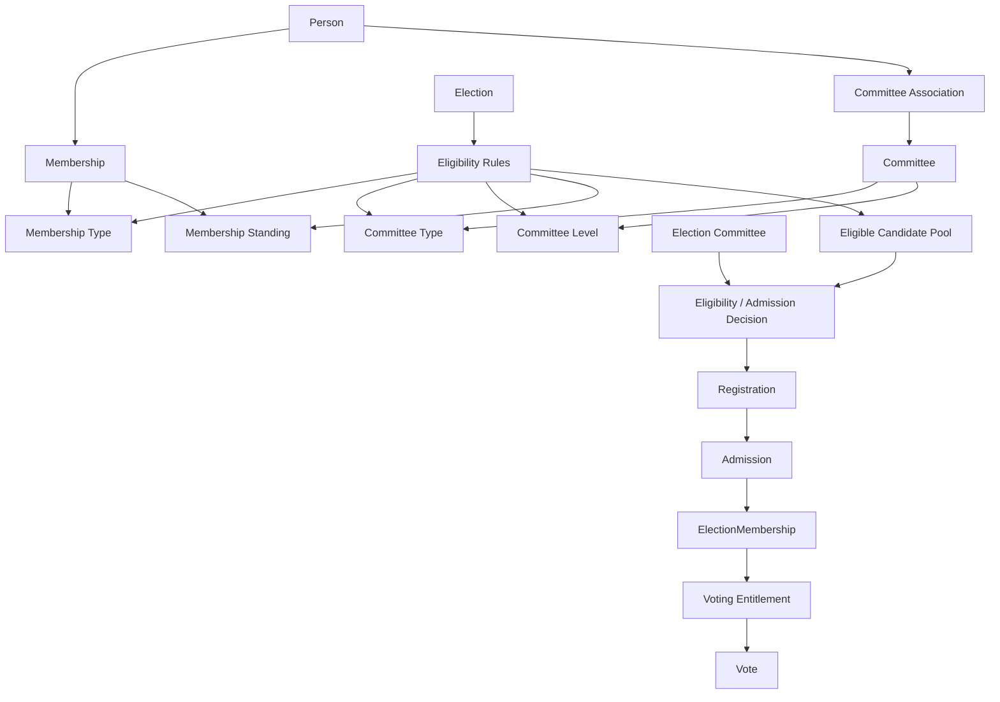
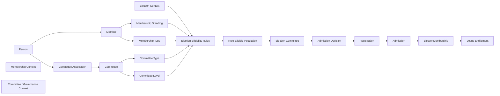

Yes — this clarification changes the target architecture in an important way. It actually resolves much of the uncertainty around **MQ-5 (voting rights)** and strengthens the separation between **Membership** and **Election**.

The key is that there are **three different dimensions**:

1. **What kind of member is the person?** → Membership Type
2. **Where in the organisation's committee structure does the person belong?** → Committee Level / Committee Type
3. **For this particular election, who is actually admitted?** → Election Committee decision

The discovery already identified the need to distinguish organisational Membership from Committee Membership, but left that relationship open. Eingefügter Text

## 1. The architecture should therefore become this



This is much better than putting voting rights into `MembershipType`.

---

# 2. The crucial distinction

Suppose an organisation has:

```text
Membership Types

- Full Member
- Associate Member
- Honorary Member
```

and committees:

```text
Committee Levels

- National
- Regional
- District
- Local
```

and:

```text
Committee Types

- Executive Committee
- Audit Committee
- Youth Committee
- Election Committee
```

Now imagine Election E1 is:

> Election of the Regional Executive Committee.

The election rules might say:

```text
Membership Type:
    Full Member

Committee Level:
    Regional

Committee Type:
    Executive Committee
```

But that still does **not** mean:

```text
Every matching member automatically becomes a voter.
```

Instead:

```text
Membership + Committee Association
              │
              ▼
      Eligibility Pool
              │
              ▼
      Election Committee
              │
              ▼
       Actual Selection
              │
              ▼
      ElectionMembership
```

That is a much stronger model.

---

# 3. This resolves the voting-right question

Earlier we had:

> Where do voting rights come from?

Options included MembershipType, Member, Constitution or Election.

With your clarification, I would **change our architecture**:

### Membership does not grant election voting rights.

Membership provides **facts** that an election may use.

For example:

```text
Member
├── membershipType = FULL
├── standing = GOOD
└── ...
    
CommitteeAssociation
├── committee = District 5 Executive Committee
├── committeeType = EXECUTIVE
└── committeeLevel = DISTRICT
```

The Election defines:

```text
Election Eligibility Rule
-------------------------
requiredMembershipType = FULL
requiredCommitteeType = EXECUTIVE
requiredCommitteeLevel = DISTRICT
```

Then the Election Committee decides which concrete people are admitted.

Therefore:

```text
Membership Type
        ≠
Voting Right
```

and:

```text
Committee Membership
        ≠
Voting Right
```

Instead:

```text
Membership Facts
+
Committee Facts
+
Election Rules
+
Election Committee Decision
        ↓
Election Admission
        ↓
Voting Entitlement
```

This is a much cleaner DDD model.

---

# 4. There are now two different meanings of "eligible"

We should be very careful with the word **Eligibility**.

There is:

### A. Structural / rule-based eligibility

> Does this person satisfy the conditions defined for this election?

For example:

```text
EligibleByRule(person, election) =
    ActiveMember(person)
    AND
    MembershipType(person) = FULL
    AND
    CommitteeType(person) = EXECUTIVE
    AND
    CommitteeLevel(person) = DISTRICT
```

### B. Election Committee selection

> Of the people who satisfy the election's conditions, whom does the Election Committee actually admit?

So:

```text
RuleEligible
      ↓
Candidate Pool
      ↓
Election Committee Decision
      ↓
Admitted
```

This distinction is extremely important.

---

# 5. I would therefore rename our conceptual chain

Previously we had:

```text
Membership Standing
      ↓
Election Eligibility
      ↓
Registration
      ↓
Admission
      ↓
ElectionMembership
```

I would now make it:

```text
Membership
     │
     ├── Membership Type
     │
     └── Membership Standing
     
Committee Association
     │
     ├── Committee Type
     └── Committee Level
     
          ↓
          
Election Rules
          ↓
          
Rule Eligibility
          ↓
          
Eligible Population
          ↓
          
Election Committee Decision
          ↓
          
Registration / Admission
          ↓
          
ElectionMembership
          ↓
          
Voting Entitlement
```

This is a significantly better architecture.

---

# 6. Committee Association should become a first-class domain concept

This is where I would revise the previous discovery.

The document currently lists:

> Committee Membership as a potentially different concept that shares the word membership. Eingefügter Text

Based on your clarification, I would **not put Committee Membership inside the generic Membership aggregate**.

Instead:

```text
Membership Context
        │
        └── Member

Governance / Organisation Structure Context
        │
        └── Committee Association
                │
                └── Committee
                      ├── Type
                      └── Level
```

Because these represent different facts.

A person can be:

```text
Member
```

without belonging to a committee.

And a member can move:

```text
District Committee
       ↓
Regional Committee
       ↓
National Committee
```

without necessarily changing their Membership Type.

That is strong evidence that they should not be one aggregate concept.

---

# 7. This also gives us a very clean formal model

Let:

```text
M(p)
```

mean:

> Person `p` has valid Membership.

Let:

```text
S(p)
```

mean:

> Person `p` has the required Membership Standing.

Let:

```text
T(p)
```

mean:

> Person `p` has the required Membership Type.

Let:

```text
C(p)
```

mean:

> Person `p` has the required Committee Association.

Let:

```text
L(p)
```

mean:

> Person `p` belongs to the required Committee Level.

Let:

```text
K(p)
```

mean:

> Person `p` belongs to the required Committee Type.

Then an election's rule could be:

```text
R(p,E) =
    S(p)
    ∧ T(p,E)
    ∧ L(p,E)
    ∧ K(p,E)
```

This means:

> Person p satisfies the objective eligibility criteria of Election E.

But that still does **not** mean they are a voter.

Now define:

```text
D(p,E)
```

as:

> Election Committee has decided to admit person p.

Then:

```text
Admitted(p,E) =
    R(p,E) ∧ D(p,E)
```

And finally:

```text
VotingEntitled(p,E)
```

comes from the ElectionMembership created as a consequence of admission.

---

# 8. This gives us a very important DDD invariant

I would propose:

> **Election eligibility determines the admissible population; the Election Committee determines the actual participants within that population.**

This is a much better rule than:

> "Membership determines who can vote."

Membership does **not** determine who votes.

Committee membership does **not** determine who votes.

The election does.

More precisely:

```text
Membership
    provides organisational facts

Committee Structure
    provides organisational-position facts

Election
    defines applicable criteria

Election Committee
    makes the election-specific selection

ElectionMembership
    records the resulting election relationship
```

---

# 9. Example

Suppose we have 1,000 organisation members.

### Membership

```text
700 Full Members
200 Associate Members
100 Honorary Members
```

Committee structure:

```text
National:
    50 members

Regional:
    200 members

District:
    500 members

Local:
    250 members
```

Election:

> District Executive Committee Election

Rules:

```text
Membership Type = Full
Committee Level = District
Committee Type = Executive
```

Suppose 150 people satisfy these rules.

Therefore:

```text
1000 members
   ↓
150 rule-eligible people
```

The Election Committee then decides:

```text
120 people admitted
```

So:

```text
1000 Members
       ↓
150 Eligible by Rules
       ↓
120 Selected by Election Committee
       ↓
120 ElectionMembership records
       ↓
120 Voting Entitlements
```

That is a very clean domain model.

---

# 10. And this solves an important problem in the current code

The current implementation appears to be asking questions such as:

```text
Is this member active?
Are fees paid?
Does membership type grant voting rights?
```

But it needs to evolve toward:

```text
Does this person satisfy the eligibility criteria
for THIS election?
```

That means the election context must evaluate:

```text
Election
├── election type
├── committee type
├── committee level
├── membership prerequisites
└── other election-specific rules
```

Then:

```text
Election Committee
```

can make the final decision.

This is exactly why the previous direct SQL approach into Membership tables is architecturally inadequate.

---

# 11. Important: do not create a giant `ElectionEligibilityPolicy`

We should avoid putting everything into one giant class:

```text
ElectionEligibilityPolicy
    ├── membership
    ├── fees
    ├── committees
    ├── geography
    ├── age
    ├── nationality
    ├── roles
    ├── ...
```

Instead, Election should compose criteria.

Conceptually:

```text
ElectionEligibilitySpecification
       │
       ├── MembershipStandingRule
       ├── MembershipTypeRule
       ├── CommitteeLevelRule
       ├── CommitteeTypeRule
       └── ElectionSpecificRule
```

Then:

```text
Eligible =
    StandingRule
    AND MembershipTypeRule
    AND CommitteeLevelRule
    AND CommitteeTypeRule
    AND ...
```

This fits your DDD approach much better.

---

# 12. Election Committee is therefore an Authority, not an eligibility rule

This distinction is critical.

```text
Election Rule
```

answers:

> Who **may** participate?

while:

```text
Election Committee Decision
```

answers:

> Who **will** participate?

These are different.

Formally:

```text
RuleEligible(p,E) = TRUE
```

does not imply:

```text
Admitted(p,E) = TRUE
```

Instead:

```text
Admitted(p,E)
    ⇒
RuleEligible(p,E)
```

assuming the election committee cannot override mandatory election eligibility rules.

That implication is a powerful domain invariant.

---

# 13. One question we must still clarify

There is one subtle point in your statement:

> "only certain committee level and certain committee type can take part in a particular election."

We need to distinguish:

### Model A

The Election Committee **chooses the eligibility criteria**:

```text
Election Committee
      ↓
defines
Committee Level + Committee Type + Membership Type
      ↓
Eligible Pool
```

### Model B

The election constitution already defines the criteria, and the Election Committee only selects people:

```text
Election Constitution
      ↓
Committee Level + Committee Type + Membership Type
      ↓
Eligible Pool
      ↓
Election Committee
      ↓
Selects people
```

These are materially different governance models.

From your wording:

> "who exactly can take part is decided by election committee"

I currently understand your intended model as **B**:

> The election has governing eligibility criteria, and the Election Committee decides the concrete participants from the eligible population.

If that is correct, then **Election Committee must not be modelled as the owner of the eligibility rule itself**. It is the **decision authority for admission/selection**.

---

# 14. Revised target architecture

I would now recommend this as our working architecture:



---

# 15. This also changes our Membership Constitution

I would now **remove voting rights from the core Membership Constitution question** in the way we previously framed it.

Instead, the Constitution should define:

```text
Membership:
    Who is a member?
    What types exist?
    What is membership standing?
    What rights/obligations belong to membership?
    What is the lifecycle?
```

Committee/Governance defines:

```text
Committee:
    What committees exist?
    What types exist?
    What hierarchy/levels exist?
    How is a person associated with a committee?
```

Election defines:

```text
Election:
    Which membership types qualify?
    Which committee levels qualify?
    Which committee types qualify?
    What additional criteria apply?
```

Election Committee decides:

```text
Which concrete persons are admitted?
```

And Elections owns:

```text
ElectionMembership
VotingEntitlement
```

That is a much cleaner bounded-context architecture.

---

## The most important new principle

I would write this into the architecture as a candidate invariant:

> **Membership provides organisational identity and standing; Committee Association provides organisational position; Election Rules determine the admissible population; the Election Committee decides the concrete participants; ElectionMembership records the resulting election-specific relationship.**

That single sentence resolves a large part of the confusion we previously had around **Membership Type, Committee Membership, Voting Rights and Election Eligibility**.

### Project progress after your clarification

- 🟢 Membership ≠ ElectionMembership
- 🟢 Membership Type ≠ Voting Entitlement
- 🟢 Committee Association should be a separate concept
- 🟢 Committee Level + Committee Type become election eligibility inputs
- 🟢 Election owns eligibility rules
- 🟢 Election Committee owns concrete participant/admission decisions
- 🟢 ElectionMembership records the resulting election relationship
- 🟡 Need to define exactly **who configures the election's criteria**
- 🟡 Need to define whether Election Committee can only select from rule-eligible people or can override rules
- 🟡 Need to model Committee hierarchy/type/association formally
- 🔴 Existing Membership discovery should be updated to reflect this architecture before Phase E–G is finalized.