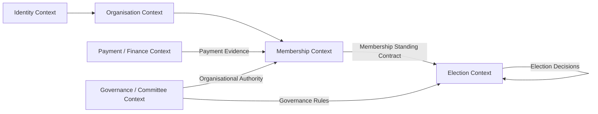

Ja. Ich habe die vorliegende **Membership Domain Discovery & Constitution v1** als DDD-Architekt und Requirements Engineer geprüft. Mein Gesamturteil ist:

> **Die Discovery ist fachlich sehr wertvoll und wesentlich reifer als die bisherige Membership-Implementierung. Sie hat aber noch nicht den Zustand erreicht, in dem wir daraus direkt ein stabiles Domain Model und Implementierungsstories ableiten sollten.**

Die wichtigste Erkenntnis ist: **Das Problem ist momentan nicht primär fehlender Code, sondern fehlende bzw. widersprüchliche Domänenentscheidungen auf der Organisation-/Membership-Seite.**

Die Discovery selbst bestätigt genau das: Die Election-Seite ist weitgehend governance-seitig festgelegt, während die Organisation-Seite von Membership noch nicht kanonisch definiert ist. Eingefügter Text

---

# 1. Mein Architektururteil

Ich würde den aktuellen Zustand ungefähr so bewerten:

| Bereich | Bewertung |
|---|---:|
| Election Domain | 🟢 85–90 % konzeptionell stabil |
| Trennung Election ↔ Membership | 🟢 80 % |
| Ubiquitous Language | 🟡 65 % |
| Membership Domain | 🔴 35–40 % |
| Membership Lifecycle | 🔴 30 % |
| Authority/Decision Model | 🔴 25–30 % |
| Membership ↔ Election Contract | 🟡 50 % |
| Requirements Traceability | 🟡 65 % |
| Legacy-Code-Conformance | 🔴 30 % |
| Target Architecture | 🟡 60 % |

Das sind **Architektur-Einschätzungen**, keine gemessenen Projektkennzahlen.

Der entscheidende Punkt:

**Wir sollten jetzt nicht sofort programmieren.**

Wir sollten zunächst die fehlenden Membership-Entscheidungen schließen und daraus anschließend das Domain Model ableiten.

---

# 2. Was an der Discovery sehr gut ist

## 2.1 Die wichtigste DDD-Trennung ist richtig

Die Discovery hat bereits einen sehr wichtigen Schritt gemacht:

```text
Person
   │
   ├── Organisation Affiliation ──► Organisation
   │
   ├── Membership ────────────────► Member
   │                                  │
   │                                  ▼
   │                           Membership Standing
   │
   └── ElectionMembership ──────► Election
```

Diese Trennung ist architektonisch richtig. Eingefügter Text

Damit verhindern wir einen der größten Fehler des bisherigen Systems:

```text
OrganisationUser == Member == Voter
```

Das ist falsch.

Wir haben mindestens:

```text
Person
OrganisationAffiliation
Member
Membership
ElectionMembership
Registration
Admission
VotingEntitlement
```

Diese Begriffe müssen unterschiedliche fachliche Bedeutungen haben.

---

# 3. Eine wichtige Korrektur: „Two products“ würde ich nicht endgültig so festschreiben

Die Discovery sagt:

> P1 Election Digitalisation  
> P2 Membership Digitalisation

und bezeichnet sie als zwei Produkte. Eingefügter Text

**Als Business Capability ist das sehr gut. Als endgültige Product-Boundary würde ich es noch nicht festschreiben.**

Ich würde zunächst sagen:

```text
PublicDigit
│
├── Election Digitalisation Capability
│
└── Membership Digitalisation Capability
```

Warum?

Weil wir noch nicht wissen, ob der Markt daraus wirklich

```text
Product A
Product B
```

macht oder:

```text
PublicDigit Platform
    ├── Membership
    └── Elections
```

Das ist ein **Product-Management-Entscheid**, kein DDD-Entscheid.

DDD sollte deshalb zunächst nur sagen:

> Es existieren zwei unterschiedliche Business Capabilities mit unterschiedlichen fachlichen Beziehungen.

Das ist sicher.

---

# 4. Die stärkste Architekturentscheidung: ElectionMembership

Die Discovery bestätigt:

```text
ElectionMembership
```

ist die election-spezifische Entitlement-Struktur. Eingefügter Text

Das ist sehr wichtig.

Wir sollten deshalb **nicht** so modellieren:

```text
Member
   ↓
Voter
```

sondern:

```text
Member
   ↓
Election Eligibility
   ↓
Registration
   ↓
Admission
   ↓
ElectionMembership
   ↓
Voting Entitlement
```

und für Election-Only:

```text
OrganisationUser
   ↓
Election Eligibility
   ↓
Registration
   ↓
Admission
   ↓
ElectionMembership
   ↓
Voting Entitlement
```

Das ist wesentlich sauberer.

---

# 5. Ein besonders wichtiger Punkt: Entitlement ≠ Exercisability

Hier ist die Korrektur bezüglich D-ENT-2 sehr wichtig.

Die Discovery stellt jetzt klar:

```text
ElectionMembership exists
        ≠
ElectionMembership is exercisable
```

In Full Membership:

```text
Membership removed
        ↓
ElectionMembership remains
        ↓
ElectionMembership becomes suspended
```

und **nicht**:

```text
Membership removed
        ↓
ElectionMembership deleted
```

Die Quelle beschreibt explizit:

- Membership removal suspends ElectionMembership
- diese Suspension ist anders als Chief Suspension
- Membership bleibt für die Ausübbarkeit relevant. Eingefügter Text

Das ist eine **sehr gute Domainentscheidung**.

---

# 6. Daraus folgt eine wichtige State-Machine

Ich würde deshalb künftig zwei Zustandsräume modellieren.

## Membership

```text
Application
    │
    ▼
Approved
    │
    ▼
Active
    │
 ┌──┴─────┐
 ▼        ▼
Suspended Expired
 │          │
 ▼          ▼
Active     Renewed?
             │
             ▼
           Active

Active
  │
  ▼
Ended / Terminated
```

Aber:

**Diese State Machine ist noch nicht beschlossen.**

Denn MQ-1, MQ-6 und MQ-7 sind noch offen. Genau diese Fragen werden in der Discovery als Blocker identifiziert. Eingefügter Text

---

# 7. Das größte fachliche Problem: „Member“ ist noch nicht definiert

Die Discovery findet neun zentrale Widersprüche X-1 bis X-9. Eingefügter Text

Das ist aus Requirements-Sicht der wichtigste Befund.

Zum Beispiel:

### Definition A

```text
Member = formal paid relationship
```

### Definition B

```text
Member = constitutional relationship with committee
```

### Definition C

```text
Member = something implied by organisation_user role
```

Das darf nicht bestehen bleiben.

Denn wenn wir nicht wissen, was ein Member ist, können wir nicht sauber definieren:

```text
MemberCreated
MemberApproved
MemberActive
MemberSuspended
MemberExpired
MemberTerminated
```

und damit auch nicht:

```text
EligibleForElection
```

---

# 8. Deshalb ist „Membership Standing“ ein sehr guter Vorschlag – aber noch keine fertige Wahrheit

Die Discovery schlägt vor:

> Membership Standing = published point-in-time fact consumed by other contexts. Eingefügter Text

Ich halte das architektonisch für **sehr stark**.

Aber wir müssen eine wichtige Unterscheidung machen.

## Domain Fact

```text
Member is Active
```

ist Domain State.

## Derived Fact

```text
Member has Good Standing
```

kann eine **abgeleitete fachliche Aussage** sein.

Zum Beispiel:

```text
Standing(x) =
    ActiveMembership(x)
    ∧ FeeCompliant(x)
    ∧ NotExpired(x)
    ∧ RightsSatisfied(x)
```

Das ist eine **Predicate**.

Ein Predicate ist eine Aussage, die entweder `true` oder `false` ist.

Beispiel:

```text
Eligible(member123) = true
```

oder:

```text
Eligible(member123) = false
```

Der Vorteil:

Wir können später mathematisch prüfen, ob zwei Eligibility-Regeln tatsächlich identisch sind.

---

# 9. Genau hier liegt momentan ein großer Fehler im bestehenden System

Die Discovery hat einen hervorragenden technischen Beleg gefunden:

> Ein offiziell genehmigtes Mitglied kann derzeit niemals als eligible voter durchgehen. Eingefügter Text

Warum?

Vereinfacht:

```text
Approved Member
      │
      ├── fees_status = unpaid
      │
      └── grants_voting_rights = false
```

Eligibility verlangt aber sinngemäß:

```text
Active
AND
Fee compliant
AND
Voting rights
```

Also:

```text
Approved
∧ ¬Paid
∧ ¬VotingRight
=
NotEligible
```

Das ist kein kleiner Bug.

Es zeigt:

> **Das Domain-Modell und die Implementierung haben momentan keine konsistente Semantik.**

---

# 10. Noch schlimmer: `grants_voting_rights` ist architektonisch ungeklärt

Die Discovery stellt völlig zu Recht MQ-5:

> Woher kommen Voting Rights?

Optionen:

```text
A. MembershipType
B. Member
C. Membership Constitution
D. Election
```

Eingefügter Text

Das ist eine **zentrale Domainentscheidung**.

Ich würde sie auf keinen Fall einfach durch Code beantworten.

Denn:

```php
$membershipType->grants_voting_rights
```

ist **kein Beweis**, dass Voting Rights fachlich zum MembershipType gehören.

Das ist nur:

```text
legacy implementation
```

Die Discovery klassifiziert das korrekt. Eingefügter Text

---

# 11. Meine Empfehlung für Voting Rights

Ich würde hier noch **keine Entscheidung** treffen.

Aber ich würde das Problem konzeptionell so modellieren:

```text
Membership Standing
        │
        │
        ▼
Election Eligibility
        │
        │
        ▼
Election Admission Rules
        │
        ▼
Voting Entitlement
```

Damit vermeiden wir:

```text
MembershipType.grants_voting_rights
             ↓
             Election
```

als direkte Kopplung.

Warum?

Weil ein Membership Type möglicherweise sagt:

> „Diese Art von Mitgliedschaft beinhaltet bestimmte organisationale Rechte.“

Eine Election kann aber sagen:

> „Für diese konkrete Wahl gelten diese Eligibility Rules.“

Das sind zwei unterschiedliche fachliche Fragen.

---

# 12. Die zweite große Schwäche: Organisation Affiliation

Die Discovery führt sehr sinnvoll den Begriff:

```text
Organisation Affiliation
```

ein. Eingefügter Text

Ich halte das für notwendig.

Denn momentan scheint das System ungefähr:

```text
organisation_users
user_organisation_roles
members
```

zu haben.

Aber:

```text
OrganisationUser
```

ist technisch.

Wir brauchen fachlich:

```text
Person
    │
    ▼
Organisation Affiliation
```

und daraus können verschiedene Rollen entstehen:

```text
Organisation Affiliation
       │
       ├── Administrator
       ├── Treasurer
       ├── Election Chief
       ├── Participant
       └── Member
```

Aber Achtung:

**Member ist keine Rolle.**

Das muss unbedingt festgeschrieben werden.

---

# 13. „member“ als Authorization Role ist ein Architekturfehler

Die Discovery entdeckt:

```text
user_organisation_roles.role = 'member'
```

während gleichzeitig

```text
Member
```

das Domain Concept ist. Eingefügter Text

Das ist eine klassische **Semantic Collision**.

Beispiel:

```text
role = member
```

bedeutet:

> Benutzer besitzt eine Authorization Role.

Aber:

```text
Member
```

bedeutet:

> Organisation erkennt eine Person als Mitglied an.

Das sind zwei völlig unterschiedliche Aussagen.

Ich würde langfristig eher etwas wie

```text
organisation_user
```

plus

```text
organisation_access
```

oder eine andere explizite Access-Semantik verwenden.

Aber auch hier:

**Noch keine Implementierungsänderung, bevor die Ubiquitous Language beschlossen ist.**

---

# 14. Die Context Boundaries werden langsam sichtbar

Ich sehe momentan folgende Zielstruktur:

```text
                    ┌──────────────────────┐
                    │       Identity       │
                    │ Person / User        │
                    └──────────┬───────────┘
                               │
                               ▼
                    ┌──────────────────────┐
                    │    Organisation      │
                    │ Affiliation / Access │
                    └──────────┬───────────┘
                               │
                     ┌─────────┴──────────┐
                     │                    │
                     ▼                    ▼
              ┌──────────────┐    ┌──────────────┐
              │  Membership  │    │   Elections  │
              │              │    │              │
              │ Member       │    │ Registration │
              │ Application  │    │ Admission    │
              │ Standing     │    │ Entitlement  │
              │ Fees         │    │ Election     │
              └──────┬───────┘    └──────┬───────┘
                     │                   │
                     │ Standing          │
                     └──────────────────►│
                                         ▼
                                      Voting
```

Das ist meines Erachtens die **richtige Richtung**.

---

# 15. Aber: Membership sollte nicht direkt „Election Eligibility“ besitzen

Das ist ein sehr wichtiger DDD-Punkt.

Nicht:

```text
Membership
    └── determines election eligibility
```

sondern:

```text
Membership
    └── publishes Membership Standing

Election
    └── applies Election Eligibility Rules
```

Warum?

Weil:

```text
Membership Standing
```

und

```text
Election Eligibility
```

nicht dasselbe sind.

Beispiel:

Ein Mitglied kann in Good Standing sein:

```text
Membership Standing = GOOD
```

aber für eine bestimmte Wahl:

```text
Election Eligibility = FALSE
```

weil z. B. die Wahl nur eine bestimmte Mitgliedsart betrifft.

Deshalb:

```text
Membership → Standing
Election → Eligibility
```

Das ist eine sehr wichtige Bounded-Context-Grenze.

---

# 16. Requirements Engineering: Die Struktur ist bereits sehr gut

Die gewählte Struktur:

```text
Actor
→ Goal
→ Business Rule
→ Authority
→ State
→ Decision
→ Evidence
→ Outcome
```

ist hervorragend.

Ich würde sie sogar zum **Standardformat für PublicDigit Domain Requirements** machen.

Warum?

Weil ein Requirement dann nicht mehr nur heißt:

> „Admin kann Mitglied suspendieren.“

sondern:

```text
Actor:
Membership Authority

Goal:
Membership temporarily suspendieren

Business Rule:
...

Authority:
...

State:
Active → Suspended

Decision:
...

Evidence:
Actor + reason + timestamp

Outcome:
Membership Standing changes
```

Das ist wesentlich näher an echter Domain Engineering Arbeit.

---

# 17. Allerdings fehlt noch ein wichtiges Element: Scope

Ich würde die Requirement Card erweitern:

```text
Context
Actor
Goal
Trigger
Preconditions
Business Rule
Authority
State
Decision
Evidence
Outcome
Postconditions
```

Warum?

Nehmen wir:

```text
R-M5 Expire
```

Der Trigger muss klar sein:

```text
membership expiry date reached
```

Precondition:

```text
Membership is Active
```

Postcondition:

```text
Membership = Expired
Standing = NotInGoodStanding
```

Ohne diese Struktur entstehen später wieder Interpretationsfehler.

---

# 18. Authority ist momentan einer der größten offenen Punkte

MQ-3 ist meiner Meinung nach sogar noch wichtiger als viele technische Fragen:

> Wer darf Membership Approval, Suspension und Termination entscheiden? Eingefügter Text

Das ist nicht einfach RBAC.

Wir müssen unterscheiden:

```text
Permission
```

und

```text
Business Authority
```

### Permission

```text
Can the user call this endpoint?
```

### Authority

```text
Does this actor have legitimate organisational authority
to make this domain decision?
```

Das ist nicht dasselbe.

Beispiel:

```text
Admin
```

kann technisch eine API aufrufen.

Das bedeutet nicht automatisch:

```text
Admin has constitutional authority
to terminate membership.
```

Das muss die Organisation festlegen.

---

# 19. Deshalb brauchen wir ein Authority Model

Ich würde später modellieren:

```text
Membership Decision
        │
        ├── Decision Type
        │      ├── Approve
        │      ├── Suspend
        │      ├── Restore
        │      ├── Terminate
        │      └── Renew
        │
        ├── Authority
        │
        ├── Actor
        │
        ├── Reason
        │
        ├── Evidence
        │
        └── Timestamp
```

Damit bekommen wir eine **decision-centric Membership Domain**.

Das passt auch sehr gut zu eurem bisherigen Constitutional-Governance-Ansatz.

---

# 20. Ein weiterer wichtiger Architekturpunkt: „Membership Standing“ sollte kein simples Feld sein

Ich würde **nicht** implementieren:

```text
members.standing = active
```

als einzige Wahrheit.

Denn Standing ist wahrscheinlich:

```text
Standing =
    Membership State
    +
    Fee State
    +
    Effective Period
    +
    Membership Type
    +
    possibly Rights
```

Damit ist Standing eine **derived domain fact**.

Zum Beispiel:

```text
Membership State = ACTIVE
Fee State        = PAID
Expiry           = 2027-03-01

→ Standing = GOOD
```

aber:

```text
Membership State = ACTIVE
Fee State        = UNPAID
Expiry           = 2027-03-01

→ Standing = NOT_IN_GOOD_STANDING
```

Das macht die Semantik viel klarer.

---

# 21. Noch besser: Standing sollte einen Grund enthalten

Nicht nur:

```json
{
  "standing": "not_good"
}
```

sondern konzeptionell:

```json
{
  "status": "NOT_IN_GOOD_STANDING",
  "reasons": [
    "FEE_OVERDUE"
  ],
  "as_of": "...",
  "membership_id": "..."
}
```

Warum?

Weil ein anderes Context sonst nur weiß:

```text
false
```

aber nicht:

```text
Warum?
```

Für Auditability und Requirements Traceability ist das wichtig.

---

# 22. Sehr wichtig: Snapshot vs Live Evaluation

Hier müssen wir besonders sauber sein.

Es gibt drei unterschiedliche Dinge:

### 1. Membership State

```text
current organisational truth
```

### 2. Membership Standing

```text
current/point-in-time derived fact
```

### 3. Election Admission

```text
decision for this election
```

Und anschließend:

### 4. ElectionMembership

```text
election-specific entitlement record
```

### 5. Exercisability

```text
can this entitlement currently be exercised?
```

Damit entsteht:

```text
Membership
     │
     ▼
Standing
     │
     ▼
Eligibility
     │
     ▼
Admission
     │
     ▼
ElectionMembership
     │
     ▼
Exercisability
```

Das ist meines Erachtens momentan die wichtigste Zielarchitektur.

---

# 23. Die bestehende direkte SQL-Kopplung muss verschwinden

Die Discovery sagt explizit:

> Elections liest heute die Membership-Tabellen direkt. Eingefügter Text

Das ist aus DDD-Sicht falsch.

Nicht:

```text
Election
    ↓ SQL
members
membership_types
membership_fees
```

sondern:

```text
Election
    ↓
MembershipStandingQuery / Port
    ↓
Membership Context
```

Zum Beispiel konzeptionell:

```java
interface MembershipStandingPort {

    MembershipStanding getStanding(
        OrganisationId organisationId,
        PersonId personId
    );
}
```

Aber das ist zunächst nur **Port Design**, noch keine konkrete Implementierung.

---

# 24. Ich würde sogar einen Schritt weitergehen

Der Election Context sollte möglichst nicht fragen:

```text
"Give me the Member"
```

sondern:

```text
"Is this person eligible according to Membership prerequisites?"
```

Das ist ein Unterschied.

Membership sollte ihre eigene interne Struktur verstecken.

Also:

### schlecht

```text
Election
    ↓
Member
    ↓
MembershipType
    ↓
Fee
    ↓
Expiry
```

### besser

```text
Election
    ↓
Membership Eligibility Contract
    ↓
Membership
```

Das ist echte **Information Hiding**.

---

# 25. Die Discovery hat aber noch eine offene Gefahr

Die Formulierung:

```text
Membership Standing
```

könnte dazu führen, dass wir ein neues God Concept bauen.

Also:

```text
Membership Standing
    ├── status
    ├── fee
    ├── expiry
    ├── type
    ├── voting rights
    ├── election eligibility
    ├── committee eligibility
    └── ...
```

Das wäre falsch.

Standing sollte **nur das veröffentlichte Membership-Faktum** enthalten.

Nicht die gesamte Membership Domain.

---

# 26. Ich würde das Published Contract deshalb minimal halten

Zum Beispiel konzeptionell:

```text
MembershipStanding

OrganisationId
PersonId
MembershipId

standing
effectiveFrom
effectiveUntil

reasonCodes
membershipTypeReference
evaluatedAt
```

Und **nicht**:

```text
ElectionEligibility
VotingEntitlement
ElectionId
Vote
Candidate
```

Diese Dinge gehören nicht in Membership.

---

# 27. Context Map

Meine optimierte Version wäre:



Wichtig ist:

```text
Payment
```

ist nicht automatisch Bestandteil von Membership.

Membership **interpretiert** Payment Evidence für ihre eigene Domain-Semantik.

---

# 28. Die neun Widersprüche X-1 bis X-9 sind keine „Dokumentationsprobleme“

Das möchte ich besonders hervorheben.

Die Discovery nennt sie:

> Contradictions that block a single meaning of Membership. Eingefügter Text

Das ist richtig.

Sie sind **Requirements Conflicts**.

Beispiel:

```text
Rule A:
Approved → Active

Rule B:
Approved + Paid → Active
```

Diese beiden Regeln können nicht gleichzeitig ohne zusätzliche Zustände gelten.

Formal:

```text
A: Approved(x) → Active(x)

B: Approved(x) ∧ Paid(x) → Active(x)
```

B ist schwächer als A.

Wenn aber B die fachliche Wahrheit sein soll, darf A nicht gleichzeitig als Domain Rule gelten.

Das ist genau der Punkt, an dem Requirements Engineering und Logik zusammenkommen.

---

# 29. Deshalb sollte die nächste Phase nicht „E–J einfach weiterschreiben“ sein

Die Discovery sagt:

> MQ-1 bis MQ-8 müssen beantwortet werden, bevor E–G fertiggestellt werden können. Eingefügter Text

Das ist richtig.

Ich würde aber die Priorität noch schärfer setzen.

## Priorität 1

```text
MQ-1
Wann wird jemand Member?
```

## Priorität 2

```text
MQ-3
Wer hat Membership Authority?
```

## Priorität 3

```text
MQ-5
Woher kommen Voting Rights?
```

Diese drei bestimmen einen großen Teil des Modells.

Danach:

```text
MQ-4 Fees
MQ-6 Expiry
MQ-7 Termination
MQ-8 Committee Membership
MQ-2 Approval
MQ-9 terminology
MQ-10 Auto-enrolment
```

---

# 30. Ich würde MQ-0 anders behandeln

MQ-0 fragt, ob der Business Case weiterhin die Produktvision beschreibt. Eingefügter Text

Das ist wichtig, aber:

**MQ-0 ist kein Domain-Modelling-Problem.**

Es ist ein **Product Strategy Decision**.

Deshalb sollte es nicht die komplette Domainmodellierung blockieren.

Wir können:

```text
Product Promise
```

separat behandeln von:

```text
Domain Constitution
```

---

# 31. MQ-10 ebenfalls nicht zu früh entscheiden

Auto-enrolment:

```text
Member becomes automatically ElectionMembership
```

würde ich ausdrücklich **nicht** in Membership hineinmodellieren.

Wenn überhaupt:

```text
Membership Standing
        ↓
Election Eligibility
        ↓
Election Registration Policy
```

Ob Registration automatisch erfolgt, ist eine Election-Policy.

Das gehört nicht in den Membership Aggregate.

---

# 32. Mein vorgeschlagenes Aggregate-Modell

Noch vorläufig:

```text
MembershipAggregate
│
├── MembershipId
├── PersonId
├── OrganisationId
├── MembershipType
├── MembershipState
├── EffectivePeriod
├── FeeState
│
└── Decisions
      ├── Approved
      ├── Suspended
      ├── Restored
      ├── Renewed
      └── Terminated
```

Dann:

```text
MembershipStanding
```

als veröffentlichte fachliche Sicht.

Nicht unbedingt als eigenes Aggregate.

Das ist wichtig.

---

# 33. MembershipType würde ich als eigenes Konzept behandeln

Wahrscheinlich:

```text
MembershipType
```

als eigenständige Entity/Configuration.

Zum Beispiel:

```text
MembershipType
----------------
TypeId
Name
FeePolicy
DurationPolicy
ApprovalPolicy
...
```

Aber:

```text
grants_voting_rights
```

würde ich dort **noch nicht** einbauen.

Das ist genau die offene MQ-5-Frage.

---

# 34. Fee ebenfalls nicht einfach als Member-Feld

Die Discovery findet bereits:

```text
fees_status
fee_state
```

also zwei konkurrierende Repräsentationen. Eingefügter Text

Das ist ein Warnsignal.

Ziel:

```text
Membership
     │
     └── Fee Obligation
             │
             ▼
       Payment Evidence
             │
             ▼
         Fee State
```

Nicht:

```text
Member.fees_status
Member.fee_state
```

als zwei Wahrheiten.

---

# 35. Die wichtigste technische Architekturregel

Ich würde für PublicDigit jetzt eine klare Regel festschreiben:

> **A Context may consume another Context's published domain contract, but it must not infer the other Context's business meaning from its persistence model.**

Deutsch:

> **Ein Bounded Context darf fachliche Aussagen eines anderen Contexts konsumieren, aber nicht dessen fachliche Bedeutung aus dessen Datenbanktabellen rekonstruieren.**

Das ist wahrscheinlich die wichtigste Architekturregel, die aus dieser Discovery entstehen sollte.

---

# 36. Requirement → Architecture → Code Traceability

Danach sollte jede wichtige Regel diesen Weg haben:

```text
Business Decision
       ↓
Domain Rule
       ↓
Requirement
       ↓
Bounded Context
       ↓
Aggregate / Policy
       ↓
Domain Event / Contract
       ↓
Application Service
       ↓
Persistence
       ↓
Test
```

Zum Beispiel:

```text
PO Decision
   ↓
"Membership removal suspends ElectionMembership"
   ↓
EM-FM-003
   ↓
Membership → Election contract
   ↓
MembershipRemoved
   ↓
ElectionMembershipSuspensionPolicy
   ↓
ElectionMembership.suspend()
   ↓
test
```

Damit können wir später exakt beweisen:

> Warum existiert dieser Code?

---

# 37. Meine Bewertung der aktuellen Discovery

### Was ich akzeptieren würde

🟢 Die Trennung

```text
Affiliation
Membership
ElectionMembership
```

🟢 ElectionMembership als election-specific entitlement.

🟢 Registration ≠ Admission ≠ Entitlement.

🟢 Membership Standing als möglicher Published Contract.

🟢 Election-Only ≠ Full Membership.

🟢 Legacy implementation ≠ Domain Truth.

🟢 Actor → Goal → Rule → Authority → State → Decision → Evidence → Outcome.

🟢 MQ-1…MQ-10 als explizite offene Fragen.

---

### Was ich noch nicht akzeptieren würde

🔴 Membership Constitution ist noch nicht fertig.

🔴 Membership State Machine ist noch nicht entschieden.

🔴 Authority Model fehlt.

🔴 Voting Rights Ownership fehlt.

🔴 Fee semantics fehlen.

🔴 Standing semantics sind nur Candidate.

🔴 Membership ↔ Election Contract ist noch Candidate.

🔴 `Organisation Affiliation` ist noch nicht ratifiziert.

🔴 `member` Role ist noch semantisch kollidierend.

🔴 Committee Membership vs Organisation Membership ist ungeklärt.

🔴 Direct SQL Coupling existiert noch.

🔴 Legacy Code widerspricht der gewünschten Domain-Semantik.

---

# 38. Meine optimierte Zielarchitektur

Ich würde momentan diesen Satz als **Architectural North Star** verwenden:

```text
Person
  │
  ▼
Organisation Affiliation
  │
  ├─────────────────────────────┐
  │                             │
  ▼                             ▼
Membership                    Election
  │                             │
  ▼                             ▼
Membership Standing        Eligibility Rules
  │                             │
  └──────────────┐              ▼
                 │         Registration
                 │              │
                 │              ▼
                 │          Admission
                 │              │
                 └──────────────►
                                │
                                ▼
                        ElectionMembership
                                │
                                ▼
                       Voting Entitlement
                                │
                                ▼
                               Vote
```

Mit dem zusätzlichen Full-Membership-Effekt:

```text
Membership Removed
       │
       ▼
Membership Standing changes
       │
       ▼
ElectionMembership remains
       │
       ▼
Exercisability = suspended
```

und Election-Only:

```text
Organisation Membership changes
       │
       X
       │
       ▼
ElectionMembership unaffected
```

Das entspricht der in der Discovery dokumentierten Unterscheidung zwischen Election-Only und Full Membership. Eingefügter Text

---

# 39. Was ich jetzt konkret tun würde

**Nicht programmieren.**

Die nächste Architekturarbeit sollte sein:

### Phase E — Membership Lifecycle

Definitiv modellieren:

```text
Application
Approved
Active
Suspended
Restored
Expired
Renewed
Terminated
```

aber nur nach MQ-Entscheidungen.

### Phase F — Membership Standing

Formal definieren:

```text
Standing = f(
    membership state,
    fee state,
    effective period,
    membership type,
    ...
)
```

### Phase G — Membership/Election Contract

Definieren:

```text
MembershipStandingPort
```

und exakt:

```text
was Election fragen darf
```

und:

```text
was Election niemals fragen darf
```

### Phase H — Context Map

Dann erst endgültig:

```text
Organisation
Membership
Election
Governance
Payment
Identity
```

### Phase I — Decisions

Dann die offenen MQs in echte:

```text
ADR / Business Decision / Constitution Rule
```

überführen.

### Phase J — Requirements Traceability

Erst danach:

```text
Requirement
→ Story
→ Code
→ Test
```

---

# 40. Wichtigster Gesamtbefund

Die Arbeit hat einen sehr guten Wendepunkt erreicht.

Vorher haben wir versucht, das Problem als:

> „Wie reparieren wir Full Membership / Voter Assignment?“

zu betrachten.

Jetzt sehen wir:

> **Das eigentliche Problem ist: PublicDigit besitzt noch keine vollständig definierte Membership-Domain-Semantik.**

Das erklärt die technischen Symptome:

```text
two fee fields
undefined permissions
multiple status vocabularies
unused configuration
direct SQL coupling
missing events
unused voting-right flag
inconsistent eligibility predicates
broken suspend/archive
```

Die Discovery dokumentiert diese Implementierungswidersprüche bereits sehr klar. Eingefügter Text

Das sind **Symptome eines unvollständigen Domain-Modells**, nicht acht voneinander unabhängige Bugs.

---

## Projektstand

- 🟢 **Election Domain:** weitgehend stabil und governance-seitig gut definiert.
- 🟢 **ElectionMembership / Registration / Admission / Entitlement:** gute konzeptionelle Basis.
- 🟢 **Election-Only vs Full Membership:** sauber getrennt.
- 🟡 **Membership Context:** Struktur vorhanden, aber fachlich noch nicht konstitutionell definiert.
- 🟡 **Membership Standing:** sehr guter Architektur-Kandidat, noch nicht entschieden.
- 🔴 **Membership Lifecycle:** offen.
- 🔴 **Membership Authority:** offen.
- 🔴 **Voting Rights:** offen.
- 🔴 **Fee Semantics:** offen.
- 🔴 **Membership ↔ Election Contract:** noch nicht final.
- 🔴 **Legacy Code:** mehrere klare Conformance-Probleme.
- 🟡 **Requirements:** gute Methode vorhanden, aber zentrale Business Decisions fehlen.

**Der nächste richtige Schritt ist daher nicht „Tickets schreiben“, sondern die MQ-Entscheidungen in eine konsistente Membership Constitution zu überführen.** Danach können wir aus der Constitution ein präzises Domain Model, Context Map, State Machines, Contracts und erst anschließend technische Stories ableiten.
