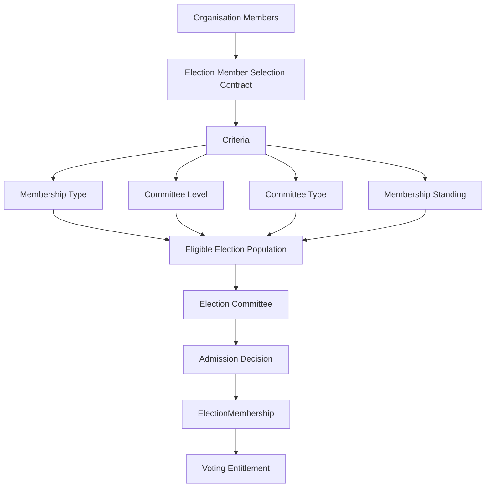

Yes. **I think this is an even cleaner abstraction.** I would shift the model from “Membership grants voting rights” to:

> **An Election adopts an eligibility contract that defines how ElectionMembers are selected from an organisational population.**

Then the criteria are **composable**.

For example:

```text
Election
   │
   └── ElectionMember Selection Contract
            │
            ├── Membership Type = FULL
            ├── Committee Level = DISTRICT
            └── Committee Type = EXECUTIVE
```

The important point is that **the contract belongs to the Election**, not to Membership.

---

# 1. Think of it as a contract

I would introduce a concept like:

```text
ElectionMemberSelectionCriteria
```

or, even better at the domain level:

```text
Election Membership Eligibility Contract
```

It says:

> "For this election, an ElectionMember must satisfy these criteria."

The criteria could be:

```text
Membership Type
Committee Level
Committee Type
Membership Standing
Geographical Jurisdiction
Role
...
```

And they can be combined.

### Example 1 — Membership Type only

```text
Election E1

Criteria:
    MembershipType = FULL
```

Therefore:

```text
All Full Members
    ↓
eligible population
```

---

### Example 2 — Committee Level only

```text
Election E2

Criteria:
    CommitteeLevel = DISTRICT
```

Therefore:

```text
Members associated with District committees
    ↓
eligible population
```

---

### Example 3 — both

```text
Election E3

Criteria:
    MembershipType = FULL
    AND
    CommitteeLevel = DISTRICT
```

Therefore:

```text
Full Members
    ∩
District Committee Members
```

---

### Example 4 — three criteria

```text
MembershipType = FULL
AND
CommitteeLevel = DISTRICT
AND
CommitteeType = EXECUTIVE
```

Now we have:

```text
Members
   │
   ├── Full?
   │
   ├── District?
   │
   └── Executive Committee?
        │
        ▼
   ElectionMember Candidate
```

This is extremely clean.

---

# 2. The mathematical model becomes beautiful

This is where your idea is particularly strong.

Let:

```text
M = set of Members
```

Let:

```text
T = members satisfying Membership Type criterion
```

Let:

```text
L = members satisfying Committee Level criterion
```

Let:

```text
C = members satisfying Committee Type criterion
```

Then the election contract defines a set:

```text
E = M ∩ T ∩ L ∩ C
```

If the election only specifies Membership Type:

```text
E = M ∩ T
```

If it only specifies Committee Level:

```text
E = M ∩ L
```

If it specifies both:

```text
E = M ∩ T ∩ L
```

This gives us a **composable eligibility model**.

A criterion is essentially a **predicate**.

For example:

```text
P_type(person)  = person has required membership type
P_level(person) = person belongs to required committee level
P_committee(person) = person belongs to required committee type
```

Then:

```text
Eligible(person, election)
    =
    P_type(person)
    ∧
    P_level(person)
    ∧
    P_committee(person)
```

This is much cleaner than hardcoding:

```text
if ($member->membershipType->grants_voting_rights)
```

---

# 3. But I would make one important distinction

Your phrase:

> "define electionmember from members"

needs one small refinement.

The contract should probably define:

> **who qualifies as a candidate for ElectionMembership**

rather than directly creating ElectionMembership.

Because:

```text
Criterion
    ↓
Eligible Population
    ↓
Election Committee Decision
    ↓
ElectionMembership
```

So:

```text
Membership
      │
      ▼
Selection Contract
      │
      ▼
Candidate / Eligible Population
      │
      ▼
Election Committee
      │
      ▼
ElectionMembership
```

This preserves your earlier statement:

> who exactly can take part is decided by the election committee.

---

# 4. Therefore there are actually two contracts

This is where I would make the architecture even more precise.

### Contract 1 — Eligibility Contract

```text
Election Eligibility Contract
```

defines:

> Who qualifies according to the election's adopted criteria?

Example:

```text
MembershipType = FULL
AND
CommitteeLevel = DISTRICT
```

### Contract 2 — Admission Decision

```text
Election Committee Decision
```

defines:

> Which of those eligible people are actually admitted?

Therefore:

```text
Members
   ↓
Eligibility Contract
   ↓
Eligible Population
   ↓
Election Committee Decision
   ↓
ElectionMembership
```

---

# 5. This solves our previous MQ-5

Previously we asked:

> Where do voting rights come from?

I would now reformulate the question completely.

Don't ask:

> Does MembershipType grant voting rights?

Ask:

> **What criteria does an Election adopt to determine its ElectionMember population?**

That is a much better requirements question.

Then:

```text
MembershipType
```

is just one possible criterion.

It does not intrinsically mean:

```text
MembershipType → VotingRight
```

Instead:

```text
Election
   adopts
MembershipType criterion
```

---

# 6. This is much more DDD-friendly

The bounded contexts become:

```text
Membership Context
------------------
Member
MembershipType
MembershipStanding


Governance Context
------------------
Committee
CommitteeType
CommitteeLevel
CommitteeAssociation


Election Context
----------------
Election
ElectionEligibilityContract
ElectionMembership
ElectionCommitteeDecision
VotingEntitlement
```

The Election Context does **not own** MembershipType.

It merely says:

```text
I require MembershipType = FULL
```

Similarly it doesn't own CommitteeLevel.

It says:

```text
I require CommitteeLevel = DISTRICT
```

This is a classic **reference to an external domain concept without owning that concept**.

---

# 7. The contract should probably contain criteria, not fields

I would avoid designing:

```text
Election
    membership_type_id
    committee_level_id
    committee_type_id
```

because that immediately limits the model.

Instead conceptually:

```text
ElectionMemberSelectionContract
    ├── Criterion 1
    ├── Criterion 2
    ├── Criterion 3
    └── ...
```

For example:

```text
ElectionMemberSelectionContract
--------------------------------
Criterion:
    MembershipType = FULL

Criterion:
    CommitteeLevel = DISTRICT

Criterion:
    CommitteeType = EXECUTIVE
```

Then the contract can evolve.

---

# 8. We can model criteria as Value Objects

For example:

```text
SelectionCriterion
```

with types:

```text
MembershipTypeCriterion
CommitteeLevelCriterion
CommitteeTypeCriterion
MembershipStandingCriterion
GeographicCriterion
RoleCriterion
```

Conceptually:

```text
SelectionContract
       │
       ├── MembershipTypeCriterion
       │
       ├── CommitteeLevelCriterion
       │
       └── CommitteeTypeCriterion
```

Each criterion represents a **value-based rule**, not an entity that owns the domain concept.

---

# 9. AND / OR becomes important

This is where the model gets powerful.

Maybe an election says:

```text
FULL MEMBER
AND
(
    DISTRICT LEVEL
    OR
    REGIONAL LEVEL
)
```

Then:

```text
Eligible =
    FullMember
    ∧
    (District ∨ Regional)
```

Or:

```text
MembershipType = FULL
OR
MembershipType = HONORARY
```

Therefore, eventually we may need a small rule algebra:

```text
Criterion
   │
   ├── AllOf
   │     ├── Criterion
   │     └── Criterion
   │
   └── AnyOf
         ├── Criterion
         └── Criterion
```

For example:

```text
ALL OF
 ├── MembershipType = FULL
 └── ANY OF
       ├── CommitteeLevel = DISTRICT
       └── CommitteeLevel = REGIONAL
```

This is much more future-proof.

---

# 10. But don't over-engineer it yet

I would **not** immediately build a generic rule engine.

First establish the business language.

Start with:

```text
Election Member Selection Contract

Criteria:
- Membership Type
- Committee Level
- Committee Type
```

Then determine whether you really need:

```text
AND
OR
NOT
```

Don't build a Drools-like rules engine just because the model can theoretically support one.

DDD principle:

> **Model the complexity that the business actually has, not complexity that the software could theoretically have.**

---

# 11. One more important question: snapshot

The contract should be **frozen/snapshotted for an election**.

This fits your existing architecture very well.

For example:

```text
Election E-2027
----------------
Selection Contract v1

MembershipType = FULL
CommitteeLevel = DISTRICT
CommitteeType = EXECUTIVE
```

Suppose six months later the organisation changes:

```text
MembershipType FULL
```

or changes committee structures.

The old election should not silently change its population.

Therefore:

```text
Election
   └── Selection Contract Snapshot
```

This is especially important for auditability.

---

# 12. Then the whole architecture becomes very simple

I would now describe PublicDigit's election population model as:



---

# 13. And I would change our terminology slightly

I would avoid:

```text
Election Eligibility Contract
```

if it could be confused with a contractual/legal agreement.

My preferred domain term is:

> **Election Member Selection Criteria**

or:

> **Election Member Selection Policy**

And then:

```text
ElectionMemberSelectionPolicy
```

contains:

```text
SelectionCriteria
```

This says exactly what it does.

However, if **“contract” is an intentional business concept** in your organisation—meaning the election explicitly adopts and freezes an agreement about its member population—then:

> **Election Member Selection Contract**

is actually a very strong name.

---

# 14. My preferred final model

I would currently use:

```text
Election
 │
 ├── ElectionMemberSelectionContract
 │       │
 │       ├── MembershipTypeCriterion
 │       ├── CommitteeLevelCriterion
 │       ├── CommitteeTypeCriterion
 │       └── MembershipStandingCriterion
 │
 └── ElectionCommittee
          │
          ▼
    Admission Decision
          │
          ▼
    ElectionMembership
          │
          ▼
    VotingEntitlement
```

with the fundamental invariant:

> **An ElectionMember Selection Contract defines the population from which ElectionMembers may be selected. The Election Committee decides which eligible persons are actually admitted.**

And mathematically:

```text
Eligible(E)
    =
    { p ∈ Population |
      Contract.Evaluate(p) = TRUE
    }
```

Then:

```text
ElectionMembers(E)
    ⊆
Eligible(E)
```

That last relationship is extremely important.

It gives us a formal invariant:

> **Every ElectionMember must satisfy the adopted Selection Contract, but not every person satisfying the contract must become an ElectionMember.**

That is, in my view, **a significantly better foundation for the PublicDigit election architecture** than the earlier “Membership → Voting Rights” model.