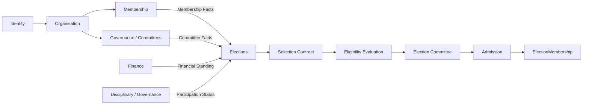

Exactly. **This is the more general and, in my view, correct domain abstraction.**

What you are describing is not really:

> Membership → Voting Right

and not even:

> Membership Type + Committee Level → Election Member

It is:

> **An Election adopts a set of business rules that defines who may become an ElectionMember.**

Membership type, committee level, unpaid fees, disciplinary suspension, organisational role, geographic jurisdiction, age, tenure, etc. are simply **different possible rule dimensions**.

That changes the architecture significantly.

---

# 1. The core concept should be a Selection Contract

I would now make this the central concept:

```text
Election Member Selection Contract
```

It answers one question:

> **Under which rules can a person become an ElectionMember for this particular election?**

Conceptually:

```text
Person
  │
  ▼
Election Member Selection Contract
  │
  ├── Membership rules
  ├── Committee rules
  ├── Financial rules
  ├── Disciplinary rules
  ├── Organisational rules
  ├── Constitutional rules
  └── Election-specific rules
          │
          ▼
    Eligible Candidate
          │
          ▼
 Election Committee Decision
          │
          ▼
   ElectionMembership
```

This is much more powerful than putting individual eligibility concepts into Membership.

---

# 2. Membership becomes one source of facts

For example, Membership can provide:

```text
Membership:
    type = FULL
    status = ACTIVE
    standing = GOOD
```

Finance can provide:

```text
Financial Standing:
    dues = 250 €
    overdue = true
```

Governance can provide:

```text
Committee Association:
    level = DISTRICT
    type = EXECUTIVE
```

Disciplinary/Governance can provide:

```text
Election Participation Status:
    suspended = true
```

Then the Election Selection Contract can say:

```text
FULL MEMBER
AND
DISTRICT LEVEL
AND
EXECUTIVE COMMITTEE
AND
NO OUTSTANDING DUES
AND
NOT DISCIPLINARILY SUSPENDED
```

That is the important architectural separation.

---

# 3. The Election does not own those facts

This is critical.

The Election should **not** become:

```text
Election
 ├── member
 ├── fee
 ├── disciplinaryStatus
 ├── committee
 ├── membershipType
 └── ...
```

Instead:

```text
Membership Context
       │
       │ provides facts
       ▼
Finance Context
       │
       │ provides facts
       ▼
Governance / Committee Context
       │
       │ provides facts
       ▼
Disciplinary / Governance Context
       │
       │ provides facts
       ▼
Election Selection Contract
```

The Election **consumes authoritative facts**.

This is very consistent with the architecture principle we have already been developing:

> A bounded context should consume another context's published domain facts, not reconstruct that context's meaning from its database tables.

---

# 4. Now we can define eligibility mathematically

Suppose the candidate population is `P`.

For every person `p`, define predicates.

### Membership

```text
M(p)
```

> Person is a valid member.

### Membership type

```text
T(p)
```

> Person has an allowed membership type.

### Committee

```text
C(p)
```

> Person belongs to the required committee.

### Financial standing

```text
F(p)
```

> Person satisfies the election's financial requirement.

### Disciplinary standing

```text
D(p)
```

> Person is not suspended from election participation.

Then:

```text
Eligible(p, E)
=
M(p)
∧ T(p)
∧ C(p)
∧ F(p)
∧ D(p)
```

But the beauty is that **not every election needs every predicate**.

Election A:

```text
EligibleA(p)
=
M(p)
∧ T(p)
```

Election B:

```text
EligibleB(p)
=
M(p)
∧ C(p)
∧ F(p)
```

Election C:

```text
EligibleC(p)
=
M(p)
∧ T(p)
∧ C(p)
∧ F(p)
∧ D(p)
```

So the contract is essentially a **predicate composition**.

---

# 5. This is why I would not call these "voting rights"

This distinction is very important.

A person may have:

```text
Membership Standing = GOOD
```

but:

```text
Eligible for Election E = FALSE
```

because:

```text
Outstanding dues
```

or:

```text
Disciplinary suspension
```

Therefore:

```text
Membership Standing
        ≠
Election Eligibility
        ≠
Voting Entitlement
```

These are three different concepts.

---

# 6. The domain chain becomes

I would now make this the central PublicDigit model:

```text
Person
   │
   ▼
Organisation Relationship
   │
   ├──────────────► Membership
   │                    │
   │                    ▼
   │             Membership Facts
   │
   ├──────────────► Committee Association
   │
   ├──────────────► Financial Standing
   │
   └──────────────► Disciplinary / Governance Status
                            │
                            ▼
              Election Member Selection Contract
                            │
                            ▼
                    Eligibility Evaluation
                            │
                            ▼
                    Eligible Population
                            │
                            ▼
                   Election Committee
                            │
                            ▼
                     Admission Decision
                            │
                            ▼
                   ElectionMembership
                            │
                            ▼
                   Voting Entitlement
```

That is, in my opinion, a much stronger target architecture.

---

# 7. But there is an important requirement question

You said:

> "a person who is suspended from election via a kind disciplinary committee may also not be able to take part"

We need to distinguish:

### Rule

```text
ElectionParticipationSuspended = true
```

means:

> The person is forbidden from participating.

versus:

### Election-specific selection rule

```text
Suspended persons are excluded from this election.
```

The first is an **organisational/domain fact**.

The second is an **Election Selection Contract rule**.

They should not be confused.

For example, if an organisation has a disciplinary decision:

```text
Person X
ElectionParticipation = SUSPENDED
```

then an election contract might contain:

```text
NOT ElectionParticipationSuspended
```

This is very clean.

---

# 8. The contract should support mandatory exclusions

So the contract isn't just:

```text
Who qualifies?
```

It should support:

```text
INCLUDE criteria
+
EXCLUDE criteria
```

For example:

```text
Election Member Selection Contract
-----------------------------------

INCLUDE:
    MembershipType = FULL
    CommitteeLevel = DISTRICT
    CommitteeType = EXECUTIVE

EXCLUDE:
    FinancialStanding = OVERDUE
    ElectionParticipationStatus = SUSPENDED
```

This is much closer to real organisational governance.

---

# 9. Then the contract can be represented logically

For example:

```text
Eligible(p,E) =
    INCLUDE(p,E)
    ∧
    ¬EXCLUDED(p,E)
```

More specifically:

```text
Eligible(p,E) =
    FullMember(p)
    ∧ DistrictCommittee(p)
    ∧ ExecutiveCommittee(p)
    ∧ FeesCompliant(p)
    ∧ ¬ElectionSuspended(p)
```

That gives us a very powerful property:

> **An ElectionMembership may only exist if its holder satisfies the Election Member Selection Contract.**

Formally:

```text
ElectionMember(p,E)
    ⇒
SelectionContractE(p) = TRUE
```

But:

```text
SelectionContractE(p) = TRUE
```

does **not** imply:

```text
ElectionMember(p,E)
```

because the Election Committee still has to make the admission decision.

So:

```text
ElectionMember ⊆ EligiblePopulation
```

---

# 10. This gives us three distinct stages

This is now very clear:

### Stage 1 — Eligibility

```text
Does the person satisfy the contract?
```

### Stage 2 — Selection / Decision

```text
Does the Election Committee choose this person?
```

### Stage 3 — Entitlement

```text
Create ElectionMembership.
```

Therefore:

```text
Contract Evaluation
        ↓
Eligibility
        ↓
Election Committee Decision
        ↓
Admission
        ↓
ElectionMembership
        ↓
Voting Entitlement
```

This is exactly the distinction we need to preserve.

---

# 11. The contract itself should be immutable for an election

This is another important consequence.

Suppose Election 2027 was created with:

```text
Contract v1
-------------------
Full Member
District
Executive Committee
No outstanding dues
Not election-suspended
```

Later the organisation changes its membership rules.

The historical election must **not silently change**.

Therefore:

```text
Election
  │
  └── Selection Contract Snapshot
          │
          ├── Criteria
          ├── Version
          ├── AdoptedAt
          └── AdoptedBy
```

This gives us auditability.

We can later answer:

> "Why was person X eligible for this election?"

Answer:

> "Because Election E adopted Selection Contract version 3, which contained these five criteria."

That is excellent constitutional governance.

---

# 12. This also fits your existing ElectionMembership architecture

We don't need to invent a new `VoterEntitlement` concept.

The existing architecture already has:

```text
ElectionMembership
Registration
Admission
VotingEntitlement
```

and the discovery explicitly says these should remain distinct. Eingefügter Text

So I would **not introduce another competing vocabulary**.

Instead:

```text
Selection Contract
       ↓
Eligibility
       ↓
Registration
       ↓
Admission
       ↓
ElectionMembership
       ↓
VotingEntitlement
```

---

# 13. This changes our understanding of Membership Standing

This is subtle but important.

Previously we considered:

```text
Membership Standing
```

as potentially being the main input to election eligibility.

I would now make it only **one possible input**.

For example:

```text
Membership Standing
Committee Position
Financial Standing
Disciplinary Standing
Organisational Status
Geographical Position
Election-specific facts
```

can all be inputs.

So:

```text
Election Eligibility
```

is **not a Membership concept**.

It is an **Election concept**.

This is a major architectural improvement.

---

# 14. The Context Map becomes even cleaner



Notice what is missing:

```text
Membership → Voting Right
```

That dependency disappears.

---

# 15. This is also much better for future organisational rules

You said:

> "an organisation can have many rules."

Exactly.

That means we should **not design the architecture around today's three criteria**.

Today:

```text
Membership Type
Committee Level
Committee Type
```

Tomorrow:

```text
Membership duration >= 12 months
```

or:

```text
Age >= 18
```

or:

```text
Resident in jurisdiction X
```

or:

```text
No outstanding financial obligation
```

or:

```text
Not under disciplinary suspension
```

or:

```text
Member before cutoff date
```

or:

```text
Must hold a particular organisational office
```

The architecture should accommodate new **domain criteria** without changing the fundamental ElectionMembership model.

---

# 16. But I would NOT build a generic rule engine yet

This is where I would protect the architecture from over-engineering.

We should first model:

```text
ElectionMemberSelectionContract
```

as a domain concept.

Then identify the **known criterion families**:

```text
MembershipCriterion
CommitteeCriterion
FinancialCriterion
DisciplinaryCriterion
OrganisationCriterion
ElectionSpecificCriterion
```

Only if the actual business requires arbitrary combinations should we introduce a generic:

```text
AND / OR / NOT
```

rule tree.

Otherwise we risk building a technical rules engine before the organisation has defined its constitutional rules.

---

# 17. The requirements model becomes very powerful

Instead of writing:

> "Members can vote."

we write:

### Requirement

```text
Actor:
Election Committee

Goal:
Define the population eligible for an election.

Business Rule:
An ElectionMember must satisfy the Selection Contract adopted
for the election.

Criteria may include:
- Membership Type
- Committee Level
- Committee Type
- Financial Standing
- Disciplinary Status
- Other organisation-approved criteria.

Authority:
Election Committee / constitutional authority

Decision:
Selection Contract is adopted.

Evidence:
Contract version, criteria, actor, timestamp.

Outcome:
A deterministic eligible population can be evaluated.
```

Then:

### Second requirement

```text
Actor:
Election Committee

Goal:
Admit a person to the election.

Business Rule:
The person must satisfy the adopted Selection Contract.

Decision:
Admit / reject.

Outcome:
ElectionMembership is created only after valid admission.
```

This is much more precise than "assign voter."

---

# 18. One very important governance question remains

We now need to distinguish:

### Who defines the contract?

and

### Who applies the contract?

and

### Who makes the final admission decision?

For example:

```text
Constitution / Organisation
        ↓
Allowed rule vocabulary
        ↓
Election Committee
        ↓
Election Selection Contract
        ↓
System evaluates criteria
        ↓
Eligible population
        ↓
Election Committee
        ↓
Admission decisions
```

This is where your existing constitutional governance work becomes relevant.

The system should **not allow an Election Committee to invent arbitrary rules that violate the organisation's constitution**.

So we may eventually have:

```text
Organisation Constitution
        ↓
Allowed Election Rules
        ↓
Election Selection Contract
        ↓
Election-specific decision
```

That is a very strong governance architecture.

---

# 19. My revised architectural principle

I would now replace the earlier principle with this:

> **ElectionMembership is not a property granted by Membership. It is an election-specific relationship established through an Election Member Selection Contract and an authorised admission decision.**

And:

> **The Selection Contract may evaluate facts originating from multiple bounded contexts, including Membership, Committee/Governance, Finance and Disciplinary Governance.**

And finally:

> **The Election Committee decides the concrete participants, but it cannot admit a person who violates mandatory criteria of the adopted Selection Contract.**

These three principles give us a much stronger foundation.

---

## Where this leaves the architecture

We now have:

```text
                    ORGANISATION
                         │
          ┌──────────────┼───────────────┐
          ▼              ▼               ▼
      MEMBERSHIP     COMMITTEES       FINANCE
          │              │               │
          │              │               │
          └──────────────┼───────────────┘
                         │
                         ▼
                ELECTION SELECTION
                    CONTRACT
                         │
                         ▼
                   ELIGIBILITY
                         │
                         ▼
                 ELECTION COMMITTEE
                         │
                         ▼
                     ADMISSION
                         │
                         ▼
                ELECTIONMEMBERSHIP
                         │
                         ▼
                VOTING ENTITLEMENT
```

**This is the model I would now continue developing.**

The biggest remaining design question is no longer *“Where do voting rights belong?”* It is:

> **What is the formal contract model, which criterion types are allowed, who has authority to adopt the contract, and how is the contract frozen and evidenced for an election?**

That is the next architectural step I would work out before touching the Membership implementation.