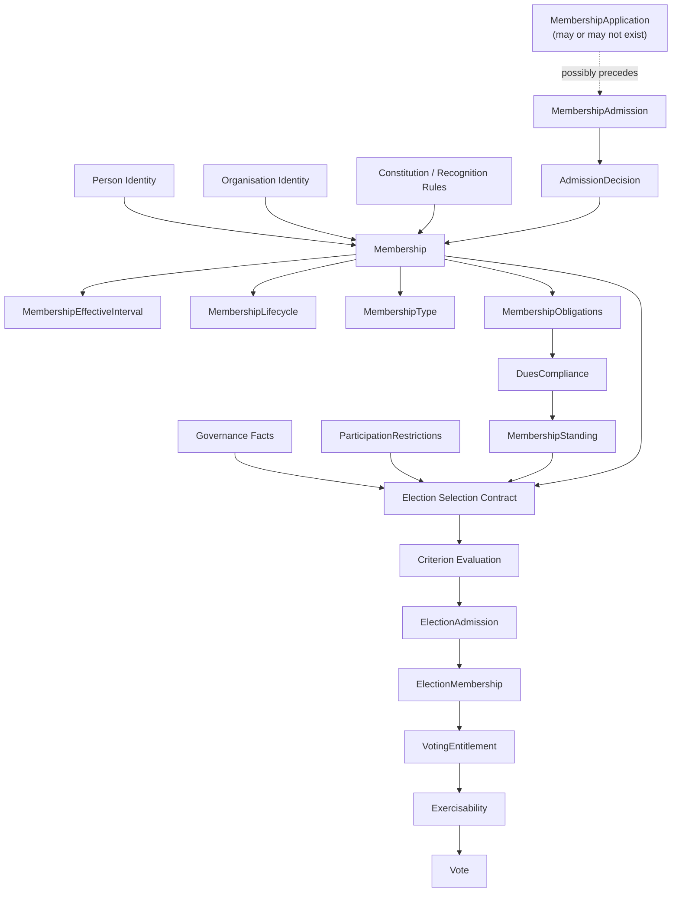

# Membership Domain Architecture

**Version:** 4.0 — E0a-1 Final Discovery Baseline
**Status:** Ratified as E0a-1 baseline — ready for E0a-2 discovery
**Scope:** Person, Organisation, Membership, MembershipEffectiveInterval, MembershipLifecycle
**Method:** Synthesis of Version 3.0, the Second Review Verdict, and the Convergence Review

---

## 0. Purpose and status of this document

This is the **final E0a-1 artefact**. It converges three documents:

1. **Version 3.0** — the working domain hypothesis
2. **Second Review Verdict** — technical corrections
3. **Convergence Review** — the decision to stop reviewing and start discovering

It is not Version 4 of an endless ontology. It is the **ratified baseline** for E0a-2 discovery.

Three epistemic levels are used throughout:

| Level | Meaning | Who decides |
|---|---|---|
| **Domain truth** | Must come from constitution/organisation | The organisation |
| **Architectural convention** | We decide; not constitutional | The architecture team |
| **Implementation choice** | Decided later; not architectural | Engineering |

Every statement in this document is tagged accordingly.

---

## 1. The ratified conceptual structure

### 1.1 Frozen concepts

The following are **frozen** as architectural conventions. They are not constitutional claims.

```text
FC-1  Person ≠ Membership
FC-2  Membership ≠ Member
FC-3  Membership is an Entity representing an organisational relationship
FC-4  Membership is identified by MembershipId
FC-5  MembershipId is independent of PersonId and OrganisationId
FC-6  Member is a role or projection, not a core domain entity
FC-7  No Member entity in the core Membership context
FC-8  Other bounded contexts may define local Member-named concepts
FC-9  All effective intervals use [from, until)
FC-10 State, decision, and record histories are separate concerns
FC-11 No inference between lifecycle state and period effectiveness
FC-12 Cross-context integration uses versioned contracts, not shared tables
```

### 1.2 Provisional concepts

The following are **provisional** — plausible but requiring discovery.

```text
PC-1  Membership is an aggregate root (pending invariant analysis)
PC-2  Membership has one current lifecycle state
PC-3  Membership has one or more effective intervals
PC-4  Membership has state history
PC-5  Organisation is referenced by ID, not owned
PC-6  Organisation/Governance is one context (may split later)
PC-7  Lifecycle states are a small controlled set
PC-8  MembershipEffectiveInterval is the temporal representation
```

### 1.3 Open concepts

The following are **open** — not modelled in E0a-1.

```text
OC-1   Membership existence criterion
OC-2   Membership recognition criterion
OC-3   Membership admission process
OC-4   Membership termination process
OC-5   Rejoin semantics
OC-6   Overlap enforcement model
OC-7   Lifecycle state enumeration
OC-8   Whether SUSPENDED is a state or a restriction
OC-9   Whether MembershipApplication precedes Membership
OC-10  Person identity resolution process
```

---

## 2. Person

### 2.1 Definition

> A **Person** is a human identity known to the organisation, represented by an organisation-controlled identity reference.

**Level:** Architectural convention (frozen).

### 2.2 Nature

- Entity
- Owned by the **Identity context**
- Exists independently of any Membership
- Identity persists across all organisational relationships
- May participate in zero or more Membership relationships

### 2.3 Identity — split into three concepts

The Second Review correctly identified that Version 3 mixed identity with identity evidence. This is corrected:

```text
PersonId
    Organisation-controlled stable identity reference
    Owned by Identity context
    Never reused, never reassigned

IdentityEvidence
    Documents, verified attributes, biometrics
    Owned by Identity context
    Governance-sensitive

IdentityResolution
    Merge / split / matching decisions
    Owned by Identity context
```

**Membership knows only `PersonId`.** It does not know whether the identity was established by passport, national ID, biometric, or composite evidence.

### 2.4 What Person is not

- Not a Member
- Not a Membership
- Not an account, user, voter, or committee member
- Not identified by a membership number (that identifies a Membership, not a Person)

### 2.5 Invariants

| ID | Rule | Level |
|---|---|---|
| **P-1** | A Person exists independently of any Membership | Convention |
| **P-2** | A Person's identity does not change when Memberships change | Convention |
| **P-3** | A Person may be referenced by multiple bounded contexts | Convention |
| **P-4** | Identity evidence is owned by Identity context, not Membership | Convention |
| **P-5** | Identity resolution (merge/split) is a governed process | Domain truth |

### 2.6 Open questions

- **Q-P1** 🔴: What evidence establishes Person identity?
- **Q-P2** 🔴: Who may merge or split Person records?
- **Q-P3** 🔴: Which contexts may access identity evidence?

---

## 3. Organisation

### 3.1 Definition

> An **Organisation** is the body in whose institutional context a Membership is recognised.

**Level:** Provisional — ownership context unresolved.

### 3.2 Nature

- Entity
- Exists independently of any Membership
- Has a **constitution** defining the meaning of its Memberships
- The **source and delegation of authority** is deferred to E0a-2
- **Ownership context unresolved** — likely Organisation/Governance context

### 3.3 Critical correction — authority is not inherent

Version 3 and the reviews correctly established:

> An Organisation is the **recognised body**, but **authority** may be exercised by a board, registrar, committee, officeholder, delegated authority, constitutional process, or external body.

**Do not encode authority into Organisation's definition.**

### 3.4 What Organisation is not

- Not a committee
- Not a jurisdiction
- Not a Membership Type
- Not the same as a branch, wing, or office
- **Not the holder of authority by definition**

### 3.5 Invariants

| ID | Rule | Level |
|---|---|---|
| **O-1** | Every Membership belongs to exactly one Organisation | Convention |
| **O-2** | An Organisation defines the constitutional meaning of its Memberships | Domain truth |
| **O-3** | Organisational structure is a separate domain concern | Convention |
| **O-4** | Authority is not inherent to Organisation | Convention |

### 3.6 Open questions

- **Q-O1** 🔴: Does Organisation belong in Membership context or a separate context?
- **Q-O2** 🔴: How is constitutional versioning modelled?
- **Q-O3** 🔴: Can a Person hold Memberships in multiple Organisations?

---

## 4. Membership

### 4.1 Definition — ratified

> A **Membership** is an Entity representing an organisational relationship between one Person and one Organisation, identified independently from both, whose recognition and lifecycle may be represented through effective temporal intervals and governed lifecycle states.

**Level:** Frozen as concept; lifecycle semantics provisional.

### 4.2 The status distinction — corrected

The Second Review correctly identified that Version 3's status summary contradicted itself. The Convergence Review resolved this by splitting the concept:

```text
Membership as distinct relationship concept    🟢 Frozen
Membership as lifecycle-bearing entity         🟡 Provisional
Membership aggregate boundary                  🟡 Provisional
```

This is more useful than the Second Review's suggestion to weaken Membership entirely. The concept is frozen. The lifecycle is not.

### 4.3 Nature

- Entity
- Belongs to exactly one Person (by `PersonId`)
- Belongs to exactly one Organisation (by `OrganisationId`)
- Identity persists across state changes, period changes, and type changes
- Has an **effective-interval representation** and a **lifecycle representation**
- Is the **unit of organisational recognition**

### 4.4 The critical distinction — ratified

```text
Person        ≠  Membership
Membership    ≠  Member
Member        =  a Person who currently holds a qualifying Membership
```

### 4.5 Member — locally contextual

The Convergence Review correctly refined the global prohibition. The rule is now:

> **There is no `Member` entity in the core Membership context representing the organisational relationship.** Other bounded contexts may define their own `Member`-named concepts provided they do not confuse them with core Membership identity.

Binding vocabulary:

```text
Core Membership Context
    Membership        domain relationship / entity
    Member            role or projection

Other Contexts
    Member            permitted locally if explicitly defined
    MemberView        read model
    EligibleMember    election-context projection (E4)
    MembershipRecord  historical or integration representation
```

This is essential for PublicDigit: the Election context may eventually define `ElectionMember` without implying it is the same as `Membership`.

### 4.6 Aggregate hypothesis — provisional

The Membership aggregate is **plausible, not proven**. The decisive question:

> Which invariants must be atomically true whenever a Membership changes?

**Candidate invariants inside the aggregate:**

| ID | Rule | Inside? |
|---|---|---|
| M-1 | Membership has one Person identity | ✅ Yes |
| M-2 | Membership has one Organisation identity | ✅ Yes |
| M-3 | Membership has one current effective interval representation | ✅ Yes |
| M-4 | Membership has one current lifecycle state | ✅ Yes |
| M-5 | Membership identity is immutable | ✅ Yes |
| MS-2 | State transitions are legal | ✅ Yes |
| M-6 | Person may participate in multiple Memberships | ❌ Cross-aggregate |
| M-7 | Memberships must not overlap | ❌ Cross-aggregate |
| MS-3 | State change is authorised | ❌ Governance |
| MS-4 | Period expiry auto-changes state | ❌ Constitutional |

**The aggregate boundary cannot be finalised until M-7 / MP-3 enforcement is decided.**

### 4.7 The M-7 / MP-3 problem — final position

Non-overlap cannot be enforced by a single-Membership aggregate. Five mechanisms, each with different architectural nature:

| Mechanism | Protects | Nature |
|---|---|---|
| Aggregate | Domain invariant in one consistency boundary | Domain model |
| DB exclusion constraint | Storage-level non-overlap | Persistence |
| Serialised command processor | Concurrency ordering | Application |
| Domain service check | Decision calculation | Domain operation |
| Reconciliation process | Detection/correction | Governance |

**Decision required (G3):**

> Must non-overlap be true **synchronously** at Membership creation, or may violations be **detected and reconciled**?

The invariant matrix must record:

```text
Required consistency latency
Permitted violation window
Conflict resolution rule
Authority for override
Reconciliation owner
```

### 4.8 Invariants

| ID | Rule | Owner | Enforcement | Status |
|---|---|---|---|---|
| **M-1** | Membership has one Person | Membership | Aggregate | 🟢 |
| **M-2** | Membership has one Organisation | Membership | Aggregate | 🟢 |
| **M-3** | Membership has one current effective interval | Membership | Aggregate | 🟡 |
| **M-4** | Membership has one current lifecycle state | Membership | Aggregate | 🟡 |
| **M-5** | Membership identity is immutable | Membership | Aggregate | 🟢 |
| **M-6** | Person may participate in zero or more Memberships, subject to multiplicity and rejoin rules | Domain policy | Query/policy | 🟢 |
| **M-7** | Memberships must not overlap | **Unresolved** | Ledger/constraint/process | 🔴 |

**M-6 correction (from Second Review + Convergence Review):** Version 3 said "Person may hold multiple Memberships over time." This prematurely decides rejoin semantics. Corrected.

### 4.9 Open questions — the four MQs

- **MQ-1** 🔴: When does a Membership come into existence?
- **MQ-2** 🔴: What is the relationship between existence, recognition, and effectiveness?
- **MQ-3** 🔴: Can a Person have multiple or overlapping Memberships in the same Organisation?
- **MQ-4** 🔴: What is the actual Membership lifecycle, and is suspension a state or a restriction?

---

## 5. MembershipEffectiveInterval

### 5.1 Renamed from MembershipPeriod

The Second Review and Convergence Review both recommended this rename. Rationale:

- "Period" implies one contiguous duration
- "Interval" permits multiple instances and gaps
- "Effective" distinguishes it from state and recorded time

**Provisional terminology:**

```text
MembershipEffectiveInterval
    validFrom
    validUntil
```

The organisation may prefer "period" in its ubiquitous language later. This is the architectural name.

### 5.2 Temporal convention — frozen

**TC-01 — Half-open intervals (frozen):**

```text
[validFrom, validUntil)
```

with:

```text
validFrom ≤ t < validUntil
validUntil = null  ⇒  unbounded
```

**Rationale:** Adjacent intervals compose without overlap or gap:

```text
[2025-01-01, 2026-01-01)
[2026-01-01, 2027-01-01)
```

This is an **architectural convention**, not a constitutional business decision. It should be frozen unless the organisation's rules explicitly require another representation.

### 5.3 Date vs Instant — per fact, not global

**Do not decide globally.** Decide per fact semantics:

| Fact | Type | Why |
|---|---|---|
| `validFrom` | `LocalDate` | Membership effective on a civil day |
| `validUntil` | `LocalDate?` | Membership ends on a civil day |
| `recordedAt` | `Instant` | System recording moment |

The rule:

> Use `LocalDate` when the constitution speaks in days. Use `Instant` when recognition occurs at a precise moment and same-day ordering matters. Use both when both meanings exist.

### 5.4 Singularity — provisional

Version 3 said "exactly one MembershipPeriod." This is too strong. Three models:

| Model | Structure | Consequence |
|---|---|---|
| Single mutable interval | `Membership → Interval` | Simple; weak history |
| Interval revisions | `Membership → IntervalHistory*` | Supports audit |
| Multiple effective intervals | `Membership → EffectiveInterval*` | Supports gaps and reactivation |

**Current position (provisional):**

> A Membership has one **current** effective-interval representation; whether it may have multiple effective intervals across time is **unresolved**.

### 5.5 Mutability — governed, with history

A period change must produce a **new fact or transition**, not silently overwrite:

```text
MembershipEffectiveIntervalChanged
    membershipId
    previousInterval
    newInterval
    validAt
    recordedAt
    decisionReference?
```

**Distinguish:**

- **valid time** — when the Membership was effective in the domain
- **recorded time** — when the system learned or recorded it

### 5.6 Invariants

| ID | Rule | Status |
|---|---|---|
| **MP-1** | `validFrom` always defined | 🟢 |
| **MP-2** | `validUntil > validFrom` if defined | 🟢 |
| **MP-3** | Non-overlap for same Person + Organisation | 🔴 (see M-7) |
| **MP-4** | Interval changes governed + historical | 🟡 |
| **MP-5** | Half-open intervals `[from, until)` | 🟢 (TC-01) |

---

## 6. MembershipLifecycle

### 6.1 Definition

> The **MembershipLifecycle** represents the condition of a Membership over time.

**Level:** 🔴 Open — requires discovery.

### 6.2 Why the enum was withdrawn

Version 2 presented a candidate enum. Version 3 correctly withdrew it. The Second Review confirmed:

| Candidate | Semantic category | Discovery question |
|---|---|---|
| `APPLIED` | Application lifecycle | Is there a Membership yet? |
| `PENDING` | Pre-effective | Does Membership already exist? |
| `ACTIVE` | Recognised condition | What rights follow? |
| `SUSPENDED` | Imposed condition **or restriction** | State or restriction? |
| `DORMANT` | Policy classification | What causes dormancy? |
| `LAPSED` | Temporal/renewal outcome | Automatic or decided? |
| `TERMINATED` | Terminal result | What decision ends it? |

### 6.3 APPLIED / PENDING — likely NOT lifecycle states

If `APPLIED` means "person submitted a request," there may be **no Membership yet**. The correct concept may be:

```text
MembershipApplication
```

If `PENDING` means "Membership exists but awaiting decision," it may belong in the lifecycle.

**Test:**

> Can an organisation recognise a Membership before an admission decision exists?

If no → `APPLIED` belongs to `MembershipApplication` (E0a-2).
If yes → it may belong to the lifecycle.

This is **MQ-1**.

### 6.4 SUSPENDED — state or restriction?

The Convergence Review correctly identified two possibilities:

**Model A — State:**

```text
MembershipState = SUSPENDED
```

**Model B — Restriction:**

```text
MembershipState = ACTIVE
MembershipRestriction
    type = SUSPENSION
    validFrom
    validUntil
    decisionReference
```

**Model B is more powerful** because it composes with the principle:

> Do not collapse independent constraints into one status flag.

This is **MQ-4**.

### 6.5 State vs period — no inference

**FC-11 (frozen):**

> No inference may be made between lifecycle state and period effectiveness until the constitutionally valid combinations are defined.

The previous rule "A Membership can be active and outside its period by rule" is withdrawn. It normalised a potentially invalid state.

### 6.6 Validity matrix — to be completed in E0a-2

| Period condition | State | Valid? | Meaning |
|---|---:|---:|---|
| Current | Active | ? | Ordinary active |
| Current | Suspended | ? | Exists; rights restricted |
| Expired | Active | ? | Delayed update or invalid |
| Current | Terminated | ? | Historical; effectiveness ends |
| Future | Pending | ? | Pre-effective recognition |
| Future | Active | ? | Pre-effective; possibly invalid |

### 6.7 Three histories — separated

**FC-10 (frozen):**

```text
1. State history      — What state was the Membership in?
2. Decision history   — What authorised decision caused a transition?
3. Record history     — When did the system record or correct the fact?
```

These answer different questions and must not be treated as interchangeable.

**Provisional structure:**

```text
MembershipStateInterval
    state
    validFrom
    validUntil

MembershipStateTransition
    fromState
    toState
    validAt
    recordedAt
    decisionReference?

MembershipRecordChange
    changedAt
    previousValue
    newValue
    correctionReason?
```

**Do not force all of this into the Membership aggregate** until atomicity and audit requirements are known.

### 6.8 Invariants

| ID | Rule | Status |
|---|---|---|
| **MS-1** | Exactly one current lifecycle state | 🟡 |
| **MS-2** | State transitions are legal | 🟡 |
| **MS-3** | State change is authorised | 🔴 (E0a-2) |
| **MS-4** | No inference between state and period | 🟢 (FC-11) |
| **MS-5** | State, decision, record histories are separate | 🟢 (FC-10) |

---

## 7. Bounded context placement

### 7.1 Corrected context map

```text
┌───────────────────────────────────────────────┐
│              IDENTITY CONTEXT                 │
│                                               │
│  Person                                       │
│  PersonId                                     │
│  IdentityEvidence                             │
│  IdentityResolution                           │
└───────────────────────────────────────────────┘
                    │
                    │ PersonId (reference)
                    ▼
┌───────────────────────────────────────────────┐
│            MEMBERSHIP CONTEXT                 │
│                                               │
│  Membership (aggregate hypothesis)            │
│    ├── MembershipId                           │
│    ├── PersonId                               │
│    ├── OrganisationId                         │
│    ├── MembershipEffectiveInterval*           │
│    └── MembershipLifecycle                    │
│                                               │
│  (does NOT own Person or Organisation)        │
└───────────────────────────────────────────────┘
                    ▲
                    │ published contract
                    │
┌───────────────────────────────────────────────┐
│       ORGANISATION / GOVERNANCE CONTEXT       │
│                   (provisional)               │
│                                               │
│  Organisation                                 │
│  Constitution (versioned)                     │
│  RecognitionPolicy                            │
│  Authority (deferred to E0a-2)                │
└───────────────────────────────────────────────┘
```

**Critical correction:** `Organisation` is **not** placed as a class inside the Membership context. Only `OrganisationId` is referenced.

### 7.2 Organisation/Governance — one provisional context

The Second Review suggested it might split into three. The Convergence Review correctly resisted:

> Do not create three bounded contexts just because we can name three nouns.

The DDD test is:

> Do they have different models, language, ownership, and consistency boundaries?

**Current position:** `Organisation / Governance Context` is a **provisional single context**.

### 7.3 Cross-context contract — proper governance

The contract:

```text
OrganisationReference
    organisationId
    constitutionVersion
```

is **not automatically** a published contract. It must have:

```text
Contract owner
Semantic version
Source context
Publication mechanism
Staleness semantics
Backward compatibility
Consumer obligations
```

**Rule (FC-12):**

> A cross-context contract must have an explicit owner, semantic meaning, and versioning policy before it may be called a Published Language.

**Field warning:** `recognitionStatus` is dangerously overloaded. It could mean:

- Organisation's existence
- Organisation's eligibility to issue Memberships
- Constitutional standing
- Contract status

**Do not use this field until its meaning is disambiguated.**

### 7.4 Live reference or snapshot?

If Membership interpretation depends on `constitutionVersion`, decide whether Membership stores:

```text
organisationId
constitutionVersion
```

or only:

```text
organisationId
```

with later lookup.

**For historical interpretation, a version reference is usually necessary.** Otherwise an old Membership may be evaluated under a constitution that did not exist at creation.

---

## 8. Semantic dimensions — the six-way distinction

The Second Review correctly identified that Version 3 conflated several dimensions. The following table is now binding:

| Dimension | Question | Owner | Example |
|---|---|---|---|
| **Existence** | Does a Membership record exist? | Membership | Membership M-123 exists |
| **Recognition** | Has the organisation accepted it? | Governance | Recognised by decision |
| **Effectiveness** | Is it valid at time t? | Membership | Effective from 2026-01-01 |
| **Lifecycle** | What condition is it in? | Membership | Suspended |
| **Standing** | Does it satisfy obligations? | Membership (E0b) | Not in good standing |
| **Eligibility** | May it participate in a process? | Election (E4) | Eligible for election |

**Without this table, later contexts may treat `ACTIVE` or period validity as a universal substitute for recognition, standing, or eligibility.**

---

## 9. Consolidated invariant matrix

| ID | Rule | Owner | Consistency | Enforcement | Evidence | Status |
|---|---|---|---|---|---|---|
| P-1 | Person exists independently | Identity | Immediate | Identity aggregate | PersonCreated | 🟢 |
| P-2 | Person identity is stable | Identity | Immediate | Identity aggregate | — | 🟢 |
| P-3 | Person may be referenced by multiple contexts | Identity | — | Contract | — | 🟢 |
| P-4 | Identity evidence owned by Identity | Identity | Immediate | Identity aggregate | Evidence record | 🟢 |
| O-1 | Membership belongs to one Organisation | Membership | Immediate | Aggregate | MembershipCreated | 🟢 |
| O-2 | Organisation defines constitutional meaning | Organisation | — | Constitution version | Constitution | 🟡 |
| O-3 | Organisational structure is separate | Organisation | — | Context boundary | — | 🟢 |
| O-4 | Authority not inherent to Organisation | Governance | — | Authority model | — | 🟢 |
| M-1 | Membership has one Person | Membership | Immediate | Aggregate | MembershipCreated | 🟢 |
| M-2 | Membership has one Organisation | Membership | Immediate | Aggregate | MembershipCreated | 🟢 |
| M-3 | One current effective interval | Membership | Immediate | Aggregate | Interval event | 🟡 |
| M-4 | One current lifecycle state | Membership | Immediate | Aggregate | State transition | 🟡 |
| M-5 | Membership identity immutable | Membership | Immediate | Aggregate | — | 🟢 |
| M-6 | Person may participate in 0..* Memberships | Domain policy | — | Query/policy | — | 🟢 |
| M-7 | No overlapping Memberships | **Unresolved** | **?** | **?** | Conflict check | 🔴 |
| MP-1 | `validFrom` always defined | Membership | Immediate | Aggregate | — | 🟢 |
| MP-2 | `validUntil > validFrom` | Membership | Immediate | Aggregate | — | 🟢 |
| MP-3 | Non-overlap of intervals | **Unresolved** | **?** | **?** | — | 🔴 |
| MP-4 | Interval changes governed + historical | Governance | Immediate decision, eventual projection | Decision record | Authorisation | 🟡 |
| MS-1 | One current state | Membership | Immediate | Aggregate | — | 🟡 |
| MS-2 | State transitions legal | Membership | Immediate | Lifecycle model | Transition event | 🟡 |
| MS-3 | State change authorised | Governance | — | Decision record | Authorisation | 🔴 |
| MS-4 | No inference state/period | Membership | — | FC-11 | — | 🟢 |
| MS-5 | Histories separated | Membership/Governance | — | FC-10 | — | 🟢 |

---

## 10. Decision gates

**Implementation is prohibited until G1–G4 are resolved.**

### G1 — Membership existence

```text
When does a Membership come into existence?
Does Application exist before Membership?
Does Admission create Membership?
Can Membership exist before its effective date?
Can Membership exist without recognition?
```

### G2 — Temporal semantics

```text
Date vs Instant per fact
Half-open interval [from, until)
One interval or many
Valid time and recorded time
Retroactive correction
Future dating
```

### G3 — Multiplicity and overlap

```text
Can a Person have multiple Memberships?
Can they overlap?
If not, what consistency is required?
Can the organisation override?
What is the reconciliation owner?
```

### G4 — Lifecycle semantics

```text
What is a lifecycle state?
Which states actually exist?
Is SUSPENDED a state or a restriction?
What is automatic?
What requires authority?
What is historical?
```

### G5 — Context ownership

```text
Who owns Person?
Who owns Organisation?
Who owns Constitution?
Who owns Authority?
What contract crosses each boundary?
Who is the contract owner?
```

**G5 may remain provisional** if the integration contract is explicit.

---

## 11. The four MQs — E0a-2 entry points

E0a-2 begins with exactly these four questions:

### MQ-1 — Membership existence

> **When does a Membership come into existence?**

Possible answers:

- application submission
- admission decision
- first effective date
- registration in the membership ledger
- constitutional recognition
- payment or other qualifying event

### MQ-2 — Existence, recognition, effectiveness

> **What is the relationship between Membership existence, recognition, and effectiveness?**

### MQ-3 — Multiplicity

> **Can a Person have multiple or overlapping Memberships in the same Organisation?**

### MQ-4 — Lifecycle

> **What is the actual Membership lifecycle, and is suspension a state or a restriction?**

---

## 12. Naming rules — final

1. **Do not create a `Member` entity in the core Membership context as a substitute for `Membership`.**
   Other bounded contexts may use `Member` locally if explicitly defined.

2. **Do not use `member` as the name of a `Membership` object.**
   Use `member` only when the model explicitly represents the `Member` role, view, or projection.

3. **Do not let the UI dictate the domain vocabulary.**
   The UI may say "members." The domain says `Membership`.

4. **Do not put MembershipType, obligations, dues, or standing into the Membership aggregate.**
   They are separate concepts, owned separately, published as facts.

5. **Do not couple to another context's persistence model.**
   Election may consume a published fact, versioned read model, query contract, snapshot, or selection-specific materialised view. The essential rule is: **no coupling to internal tables.**

6. **Do not infer lifecycle state from period, or period effectiveness from lifecycle state.**
   The valid combinations remain unresolved (FC-11).

7. **Do not conflate state with standing.**
   State is a condition. Standing is an evaluation over obligations (E0b).

8. **Do not use a shared table as an integration mechanism.**
   Bounded contexts integrate via versioned contracts.

9. **Do not use "Admission" as if it has one universal meaning.**
   Organisational, Membership, Election, Candidate, and Committee admissions are distinct concepts in distinct contexts.

---

## 13. Deferred concepts — corrected classification

| Concept | Likely status | Confidence | Phase |
|---|---|---|---|
| MembershipType | Classification policy | Medium | E0b |
| MembershipObligation | Obligation model | Medium | E0b |
| DuesCompliance | Derived assessment | Medium | E0b |
| MembershipStanding | Derived assessment | Medium | E0b |
| MembershipAuthority | Authority/power model | Low | E0a-2 |
| MembershipApplication | Process concept (may or may not exist) | Low | E0a-2 |
| MembershipAdmission | Process and decision model | Medium | E0a-2 |
| AdmissionDecision | **Admission/Governance decision** | High | **E0a-2** |
| MembershipTermination | Process and decision model | Medium | E0a-2 |
| Rejoin semantics | Constitutional policy | High | E0a-2 |
| Committee / Jurisdiction | Governance model | Medium | E0c |
| ParticipationRestriction | Restriction/decision model | Medium | E0d |
| SelectionContract | Election policy | High | E2 |
| ElectionAdmission | Election-specific admission | High | E3 |
| ElectionAdmissionDecision | Election decision record | High | E3 |
| ElectionMembership | Election-context relationship | High | E4 |
| VotingEntitlement | Election-derived entitlement | High | E4 |
| Exercisability | Election decision/evaluation | Medium | E4 |

**Critical correction (from both reviews):** `AdmissionDecision` was incorrectly placed in Election E3 in Version 3. It belongs to **Admission/Governance E0a-2**. Election may later define its own `ElectionAdmissionDecision`.

**Boundary language:**

| Context | Admission means |
|---|---|
| Membership | admission into organisational membership |
| Election | admission into election participation |
| Governance | authority/appointment admission |
| Identity | identity verification/recognition |

---

## 14. Dependency graph



**The dashed edge is intentional:** whether `MembershipApplication` precedes `Membership` is unresolved (**MQ-1**).

### Dependency classification

| Dependency | Required for existence? | Status |
|---|---:|---|
| Person identity | Yes | 🟢 |
| Organisation identity | Yes | 🟡 (contract) |
| Recognition criterion | Definitionally | 🔴 (MQ-2) |
| Admission decision | Possibly | 🔴 (MQ-1) |
| Effective interval | Possibly | 🟡 |
| Lifecycle state | Possibly | 🔴 (MQ-4) |
| Obligations | No | Deferred |
| Standing | No | Deferred |
| Election eligibility | No | Deferred |

**Key finding:** Version 3 called `MembershipEffectiveInterval` and `MembershipLifecycle` "core concepts," but it has not been proven that **every** Membership must have either. E0a-1 investigates whether these are **intrinsic** properties or **associated** concepts.

---

## 15. Semantic dimensions table (binding)

| Dimension | Question | Example |
|---|---|---|
| Existence | Does a Membership record exist? | M-123 exists |
| Recognition | Has the organisation accepted it? | Recognised by decision |
| Effectiveness | Is it valid at time t? | Effective from 2026-01-01 |
| Lifecycle | What condition is it in? | Suspended |
| Standing | Does it satisfy obligations? | Not in good standing |
| Eligibility | May it participate in a process? | Eligible for election |

---

## 16. Final status summary

| Aspect | Status | Notes |
|---|---|---|
| Person as concept | 🟢 Frozen | — |
| Person identity evidence | 🟢 Frozen | Separated from PersonId |
| Organisation as concept | 🟡 Provisional | Ownership context unresolved |
| Membership as relationship concept | 🟢 Frozen | — |
| Membership as lifecycle-bearing entity | 🟡 Provisional | Lifecycle open |
| Membership aggregate boundary | 🟡 Provisional | Pending invariant analysis |
| Member as role | 🟢 Frozen | Locally contextual |
| No Member in core context | 🟢 Frozen | — |
| MembershipEffectiveInterval | 🟡 Provisional | Singularity open |
| Half-open intervals | 🟢 Frozen | TC-01 |
| Date vs Instant per fact | 🟢 Frozen | — |
| Three histories separated | 🟢 Frozen | FC-10 |
| MembershipLifecycle | 🔴 Open | MQ-4 |
| Non-overlap enforcement | 🔴 Open | MQ-3 |
| Membership existence criterion | 🔴 Open | MQ-1 |
| Admission / termination | 🔴 Deferred | E0a-2 |
| Classification / obligations / standing | 🔴 Deferred | E0b |
| Committee / jurisdiction | 🔴 Deferred | E0c |
| Restrictions | 🔴 Deferred | E0d |
| Selection Contract | 🔴 Deferred | E2 |
| ElectionMembership | 🔴 Deferred | E4 |

---

## 17. Readiness assessment

| Dimension | Assessment |
|---|---|
| Conceptual clarity | **Strong** |
| DDD discipline | **Strong** |
| Aggregate reasoning | **Strong, provisional** |
| Temporal modelling | **Good foundation** |
| Context mapping | **Correct direction** |
| Constitutional neutrality | **Strong** |
| State modelling | **Appropriately deferred** |
| Provenance / audit readiness | **Identified** |
| Internal consistency | **Resolved** |
| Readiness for implementation | **Not ready** |
| Readiness for E0a-2 discovery | **Ready — with boundary-first sequencing** |

---

## 18. Recommended next step

**Do not produce Version 5 of this ontology.**

The correct next step is:

> **E0a-2 — Membership Existence, Admission, Authority and Lifecycle Discovery**

It begins with **MQ-1 through MQ-4**.

### E0a-2 sequencing1. **Boundary and dependency review** — confirm the existence criterion before modelling authority
2. **MQ-1: Membership existence** — when does it come into existence?
3. **MQ-2: Existence / recognition / effectiveness** — how do they relate?
4. **MQ-3: Multiplicity** — overlap and enforcement
5. **MQ-4: Lifecycle** — state vs restriction

Only after MQ-1 through MQ-4 are answered can we construct the **actual Membership aggregate**: its commands, invariants, state machine, events, persistence model, and published contracts.

Then:

```text
E0b   MembershipType
        ↓
      Obligations
        ↓
      DuesCompliance
        ↓
      MembershipStanding
```

Then:

```text
E2    Selection Contract
        ↓
      Evaluation
        ↓
      ElectionAdmission
        ↓
      ElectionMembership
        ↓
      VotingEntitlement
```

That is the point at which the architecture becomes **implementation-ready** rather than merely conceptually elegant.

---

## 19. The one-sentence summary

> **A Membership is an Entity representing an organisational relationship between one Person and one Organisation, identified independently from both, whose recognition and lifecycle may be represented through effective temporal intervals `[from, until)` and governed lifecycle states; `Member` is only a role in the core context; the aggregate boundary and lifecycle semantics remain provisional until MQ-1 through MQ-4 are answered in E0a-2.**