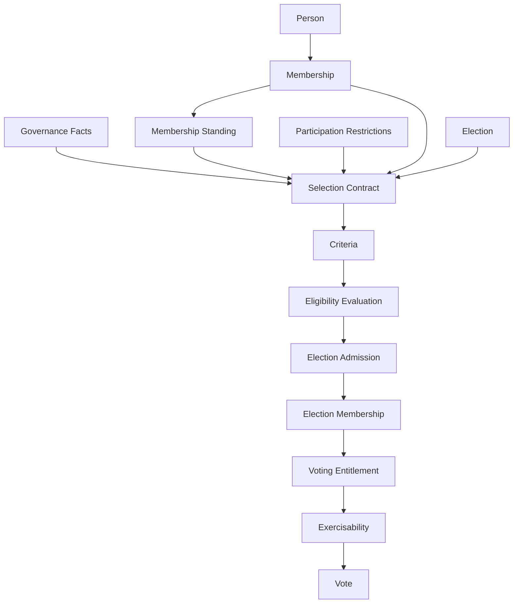
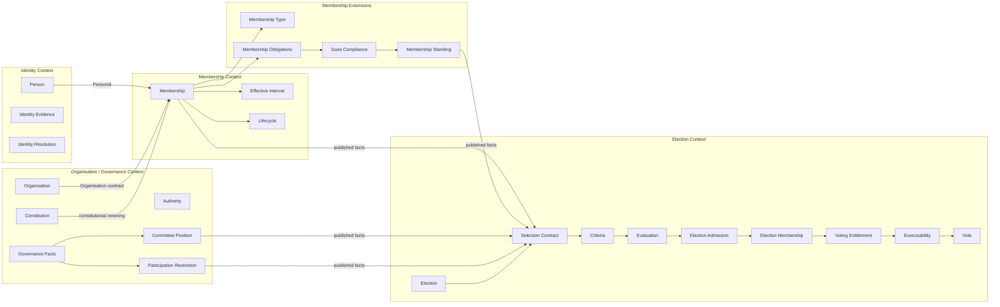
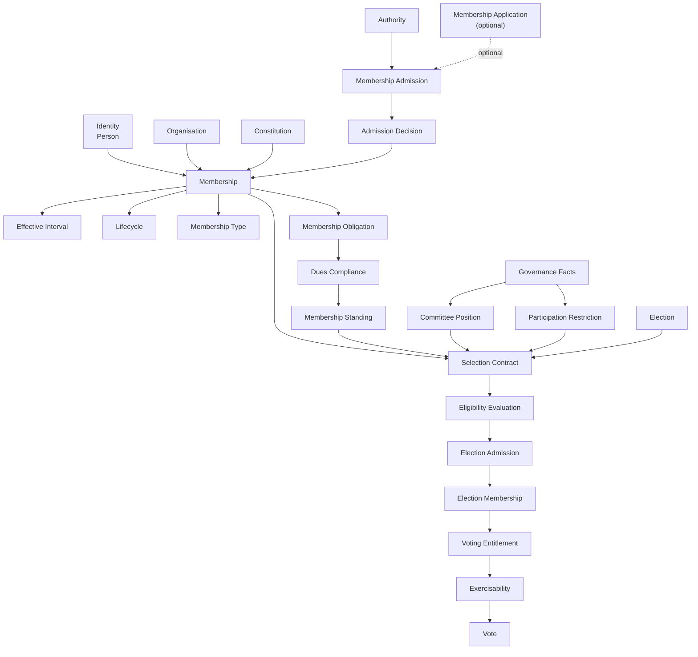

Yes. The V4.0 document is now strong enough to serve as the **E0a-1 architectural baseline**. The important point is that “final architecture” should **not mean pretending that the unresolved constitutional questions are already decided**. Instead, we should define the **final architectural shape**, while explicitly marking the few domain decisions that must still be discovered in E0a-2.

The V4.0 document itself establishes the core distinction: `Person ≠ Membership ≠ Member`, Membership is the organisational relationship, half-open intervals are the temporal convention, and cross-context integration is through contracts rather than shared tables. Eingefügter Text

# PublicDigit Membership & Election Architecture

## Final Architecture Blueprint — E0a-1 → E0a-4

**Status:** Architecture baseline  
**Architecture style:** DDD + bounded contexts + hexagonal architecture + explicit policy/decision boundaries  
**Primary principle:**

> **Membership establishes an organisational relationship. It does not establish election participation or voting rights.**

The resulting architecture is:

```text
                         ┌──────────────────────┐
                         │       IDENTITY       │
                         │                      │
                         │ Person               │
                         │ PersonId             │
                         │ IdentityEvidence     │
                         │ IdentityResolution   │
                         └──────────┬───────────┘
                                    │
                              PersonId contract
                                    │
                                    ▼
┌─────────────────────────────────────────────────────────────────────┐
│                         ORGANISATION / GOVERNANCE                    │
│                                                                     │
│ Organisation                                                        │
│ Constitution                                                        │
│ Authority                                                           │
│ Recognition / Governance decisions                                  │
│ Committee / Jurisdiction / Restrictions                             │
└───────────────┬───────────────────────────────┬─────────────────────┘
                │                               │
       Organisation contract             Governance facts
                │                               │
                ▼                               ▼
┌──────────────────────────┐       ┌──────────────────────────────────┐
│      MEMBERSHIP          │       │       MEMBERSHIP EXTENSIONS      │
│                          │       │                                  │
│ Membership               │       │ MembershipType                   │
│ MembershipId             │       │ MembershipObligation             │
│ PersonId                 │       │ DuesCompliance                   │
│ OrganisationId           │       │ MembershipStanding               │
│ EffectiveInterval        │       │                                  │
│ Lifecycle                │       │ CommitteePosition                │
│                          │       │ ParticipationRestriction          │
└────────────┬─────────────┘       └───────────────┬──────────────────┘
             │                                     │
             │ published membership facts          │ published facts
             └─────────────────┬───────────────────┘
                               │
                               ▼
                  ┌──────────────────────────┐
                  │         ELECTION         │
                  │                          │
                  │ Election                 │
                  │ SelectionContract        │
                  │ Criterion                │
                  │ Evaluation               │
                  │ ElectionAdmission        │
                  │ ElectionMembership       │
                  │ VotingEntitlement        │
                  │ Exercisability           │
                  │ Vote                     │
                  └──────────────────────────┘
```

---

# 1. The fundamental domain model

The most important correction is that we should **not model “member” as the central noun**.

The central relationship is:

```text
Person
   │
   │ participates in
   ▼
Membership
   │
   │ belongs to
   ▼
Organisation
```

A person can therefore exist without membership:

```text
Person
  │
  ├── Membership A ── Organisation X
  │
  ├── Membership B ── Organisation Y
  │
  └── no Membership
```

This follows the V4.0 decision that Membership is an independent entity with its own identity and that a `Member` is a role/projection rather than the core organisational relationship. Eingefügter Text

## Core equation

We can express the architecture mathematically:

\[
Membership(m,p,o)
\]

where:

- \(m\) = MembershipId
- \(p\) = PersonId
- \(o\) = OrganisationId

Therefore:

\[
Person(p) \not\Rightarrow Membership(m,p,o)
\]

and:

\[
Membership(m,p,o) \not\Rightarrow ElectionMembership(p,E)
\]

and:

\[
Membership(m,p,o) \not\Rightarrow VotingEntitlement(p,E)
\]

This is one of the most important PublicDigit architectural invariants.

---

# 2. The six semantic dimensions

We should make this a **core architectural law**.

Never use one status field to represent all six concepts.

| Dimension | Question | Example |
|---|---|---|
| **Existence** | Does the relationship exist? | Membership M-123 exists |
| **Recognition** | Has the organisation recognised it? | Admission decision approved |
| **Effectiveness** | Is it effective at time `t`? | Effective from 01.01.2026 |
| **Lifecycle** | What condition is it in? | Active / terminated |
| **Standing** | Does it satisfy obligations? | Dues compliant |
| **Eligibility** | May it participate in a process? | Eligible for election |

The V4.0 baseline explicitly establishes these dimensions because otherwise `ACTIVE`, temporal validity, standing and election eligibility become dangerously conflated. Eingefügter Text

Conceptually:

```text
                  ┌───────────────┐
                  │   EXISTENCE   │
                  └───────┬───────┘
                          │
                          ▼
                  ┌───────────────┐
                  │ RECOGNITION   │
                  └───────┬───────┘
                          │
                          ▼
                  ┌───────────────┐
                  │ EFFECTIVENESS │
                  └───────┬───────┘
                          │
                          ▼
                  ┌───────────────┐
                  │   LIFECYCLE   │
                  └───────────────┘

       ┌──────────────────────┐
       │      STANDING        │
       │ obligations/dues/etc │
       └──────────┬───────────┘
                  │
                  ▼
       ┌──────────────────────┐
       │     ELIGIBILITY      │
       │ process-specific     │
       └──────────────────────┘
```

**Critical rule:**

> `ACTIVE` must never become a universal synonym for “recognised”, “in good standing”, or “eligible”.

---

# 3. Identity Context

## Responsibility

The Identity Context owns the human identity.

```text
Identity Context
────────────────────────────

Person
 ├── PersonId
 ├── IdentityEvidence
 └── IdentityResolution
```

### Person

```text
Person
-------------------------
PersonId
```

The Membership context sees only:

```text
PersonId
```

It does **not** care whether the person was identified through:

- passport
- national ID
- biometric evidence
- document combination
- another identity process

The separation is explicitly established in V4.0. Eingefügter Text

### Why?

Because otherwise Membership becomes responsible for identity governance.

That would create:

```text
Membership
   ↓
passport
   ↓
biometric
   ↓
identity matching
   ↓
merge/split
```

which is the wrong bounded-context boundary.

Instead:

```text
Identity
   │
   │ PersonId
   ▼
Membership
```

---

# 4. Organisation / Governance Context

This is currently one **provisional bounded context**, not three artificially separated contexts.

```text
Organisation / Governance
─────────────────────────────

Organisation
Constitution
Authority
RecognitionPolicy
GovernanceDecision
Committee
Jurisdiction
ParticipationRestriction
```

The V4.0 document deliberately keeps Organisation/Governance together until different models, ownership and consistency boundaries justify splitting it. Eingefügter Text

## Important distinction

An Organisation is **not automatically the authority**.

For example:

```text
Organisation
     │
     ├── Constitution
     │
     ├── Board
     │
     ├── Registrar
     │
     ├── Election Committee
     │
     └── Delegated Authority
```

Authority is therefore a separate concept.

This becomes particularly important later when we model:

- Membership admission
- Membership termination
- Committee decisions
- Election admission
- Constitutional legitimacy

---

# 5. Membership Context

This is the heart of E0a.

```text
Membership Context
────────────────────────────────

Membership
 ├── MembershipId
 ├── PersonId
 ├── OrganisationId
 ├── EffectiveInterval*
 └── Lifecycle
```

## Membership definition

> A Membership is an Entity representing an organisational relationship between one Person and one Organisation, independently identified from both.

That is the correct frozen conceptual foundation. Eingefügter Text

---

# 6. Membership is not Member

This distinction should be enforced throughout the implementation.

### Wrong

```php
$member = Member::find($id);
$member->vote();
```

### Correct conceptual model

```php
$membership = Membership::get($membershipId);

$memberRole = MemberRole::from($membership);
```

Or, in an Election context:

```text
Membership
      │
      │ published fact
      ▼
Election
      │
      ▼
EligibleMember
      │
      ▼
ElectionMembership
```

Thus:

```text
Member
```

is contextual.

For example:

```text
Membership Context
    Member = role/projection

Election Context
    ElectionMember = election-specific concept

Committee Context
    CommitteeMember = committee-specific concept
```

They do not have to mean the same thing.

---

# 7. Membership Aggregate

Here we must be disciplined.

The V4.0 architecture does **not yet claim** that Membership is definitely an aggregate root. It correctly says the aggregate boundary must be derived from invariants. Eingefügter Text

The likely target model is:

```text
                 ┌─────────────────────────────┐
                 │       Membership            │
                 │       Aggregate Root        │
                 │                             │
                 │ MembershipId                │
                 │ PersonId                    │
                 │ OrganisationId              │
                 │                             │
                 │ EffectiveInterval           │
                 │ Lifecycle                   │
                 └─────────────────────────────┘
```

Potential commands:

```text
CreateMembership
ChangeEffectiveInterval
ChangeLifecycle
TerminateMembership
```

But **these commands cannot be finalised until E0a-2** answers the existence, admission and lifecycle questions.

---

# 8. Membership Effective Interval

The architectural temporal convention should be frozen now:

\[
[validFrom, validUntil)
\]

Meaning:

```text
validFrom ≤ t < validUntil
```

Example:

```text
Membership A

2025-01-01 ├──────────────────┤ 2026-01-01
           valid               excluded
```

Then:

```text
Membership A
[2025-01-01, 2026-01-01)

Membership B
[2026-01-01, 2027-01-01)
```

These are adjacent without overlapping.

The V4.0 document explicitly ratifies this as the architectural convention TC-01. Eingefügter Text

---

# 9. Valid time versus recorded time

This is particularly important for a governance system.

We need at least:

```text
validAt
recordedAt
```

Example:

```text
Decision made:
01.10.2026

Entered into system:
05.10.2026
```

Therefore:

```text
validAt    = 2026-10-01
recordedAt = 2026-10-05
```

Never overwrite these concepts.

This gives us temporal auditability:

```text
                 TIME
                  │
        ┌─────────┴──────────┐
        │                    │
     Valid Time          Recorded Time
        │                    │
 when fact is true       when system
 in domain               learned it
```

---

# 10. Membership Lifecycle

This remains the largest unresolved part.

We should **not simply create**:

```text
ACTIVE
SUSPENDED
TERMINATED
```

and assume the architecture is finished.

The V4.0 baseline correctly identifies that `APPLIED`, `PENDING`, `SUSPENDED`, `DORMANT`, `LAPSED`, etc. may actually represent different semantic categories. Eingefügter Text

## My architectural recommendation

Use this principle:

> **Lifecycle describes the lifecycle of the Membership relationship. Restrictions describe constraints imposed on an otherwise existing relationship.**

Therefore, I would prefer:

```text
Membership
    │
    ├── Lifecycle
    │     ├── ...
    │     └── TERMINATED
    │
    └── Restrictions
          ├── ParticipationRestriction
          ├── ...
          └── Suspension
```

rather than putting every restriction into a giant state enum.

For example:

```text
Membership
State = ACTIVE

Restriction
Type = PARTICIPATION_SUSPENSION
ValidFrom = 2026-10-01
ValidUntil = 2026-12-31
Decision = D-4711
```

This is architecturally more composable.

---

# 11. Three different histories

This should become a PublicDigit-wide audit principle.

### 1. State history

```text
ACTIVE
   ↓
SUSPENDED
   ↓
ACTIVE
   ↓
TERMINATED
```

### 2. Decision history

```text
Decision D1
   ↓
State transition

Decision D2
   ↓
Restriction

Decision D3
   ↓
Termination
```

### 3. Record history

```text
01.10.2026
System received fact

05.10.2026
Fact corrected

07.10.2026
Correction approved
```

These are different questions.

The V4.0 baseline explicitly freezes this separation. Eingefügter Text

---

# 12. Membership Type is not Voting Right

This is extremely important for the later PublicDigit architecture.

Do **not** model:

```text
MembershipType
       ↓
canVote = true
```

Instead:

```text
Membership
       │
       ├──── MembershipType
       │
       ├──── Standing
       │
       ├──── Governance facts
       │
       └──── Restrictions
                    │
                    ▼
              Election Criteria
                    │
                    ▼
              Eligibility
```

Membership Type is only one possible **fact used by an election selection contract**.

---

# 13. E0b — Membership classification and standing

After E0a-2, the next layer should be:

```text
Membership
    │
    ├── MembershipType
    │
    ├── MembershipObligation
    │
    └── DuesCompliance
              │
              ▼
       MembershipStanding
```

Conceptually:

\[
Standing(m,t)
=
f(
MembershipType,
Obligations,
Dues,
OtherMembershipFacts
)
\]

But:

\[
Standing(m,t) \neq Eligibility(m,E,t)
\]

This is a critical distinction.

---

# 14. Committee and Governance facts

Later, Governance becomes responsible for facts such as:

```text
Committee
CommitteeType
CommitteeLevel
Jurisdiction
CommitteePosition
ParticipationRestriction
```

The Election context does **not** read committee tables.

Instead:

```text
Governance
    │
    │ published contract
    ▼
Election
```

Example published fact:

```text
CommitteePositionFact

personId
committeeId
committeeType
committeeLevel
jurisdiction
validFrom
validUntil
sourceVersion
```

The precise model still belongs to E0c, but the boundary is already clear.

---

# 15. Election Context

This is where the architecture becomes particularly powerful.

Election owns:

```text
Election
SelectionContract
Criterion
CriterionEvaluation
ElectionAdmission
ElectionMembership
VotingEntitlement
Exercisability
Vote
```

The Election context therefore answers:

> **Given this election's adopted rules, which organisationally known persons are allowed to participate?**

Not:

> “Who is a member?”

---

# 16. Election Member Selection Contract

This is the key concept from our earlier architectural work.

Each election adopts a **Selection Contract**.

```text
                    Election
                       │
                       ▼
             ┌─────────────────────┐
             │ Selection Contract   │
             │                     │
             │ Version             │
             │ EffectiveFrom       │
             │ Criteria             │
             │ Source/Authority     │
             └──────────┬──────────┘
                        │
                        ▼
                 Criterion Set
```

Examples:

```text
Criterion:
MembershipType ∈ {FULL, ORDINARY}

Criterion:
CommitteeLevel = DISTRICT

Criterion:
CommitteeType = EXECUTIVE

Criterion:
Standing = COMPLIANT

Criterion:
ParticipationRestriction != ELECTION_BANNED
```

The election therefore does **not** invent membership facts.

It consumes authoritative facts.

---

# 17. Formal eligibility model

Let:

- \(P\) = Person
- \(E\) = Election
- \(C_E\) = Selection Contract of election \(E\)
- \(F(p,t)\) = authoritative facts about person \(p\) at time \(t\)

Then:

\[
Eligible(p,E,t)
=
C_E(F(p,t))
\]

For example:

\[
Eligible(p,E,t)
=
Member(p)
\land
Type(p)=FULL
\land
CommitteeLevel(p)=DISTRICT
\land
Standing(p)=COMPLIANT
\land
\neg Restricted(p,E,t)
\]

This is a **predicate**, not a database query.

---

# 18. Criteria are composable

Architecturally:

```text
SelectionContract
       │
       ├── MembershipCriterion
       │
       ├── CommitteeCriterion
       │
       ├── StandingCriterion
       │
       └── RestrictionCriterion
```

Evaluation:

```text
                    SelectionContract
                           │
                           ▼
                  ┌─────────────────┐
                  │ Criterion 1     │
                  └───────┬─────────┘
                          AND
                  ┌───────▼─────────┐
                  │ Criterion 2     │
                  └───────┬─────────┘
                          AND
                  ┌───────▼─────────┐
                  │ Criterion 3     │
                  └───────┬─────────┘
                          AND
                  ┌───────▼─────────┐
                  │ Criterion 4     │
                  └───────┬─────────┘
                          │
                          ▼
                    ELIGIBLE / NOT
```

However, I would **not build a generic rule engine yet**.

For current PublicDigit requirements, explicit criterion types and composable predicates are safer and more understandable.

---

# 19. Eligibility ≠ Admission

This is another fundamental distinction.

```text
Selection Contract
        │
        ▼
Eligibility Evaluation
        │
        ├── eligible
        │
        └── not eligible
```

Then:

```text
eligible
   │
   ▼
Election Admission
   │
   ▼
ElectionMembership
```

The architecture therefore becomes:

\[
Selection
\rightarrow
Evaluation
\rightarrow
Admission
\rightarrow
ElectionMembership
\]

rather than:

\[
Selection \rightarrow ElectionMembership
\]

---

# 20. Election Membership

`ElectionMembership` is **not Membership**.

It is an election-specific relationship.

```text
                 Membership
                      │
                      │ facts
                      ▼
              Selection Contract
                      │
                      ▼
                  Evaluation
                      │
                      ▼
              Election Admission
                      │
                      ▼
             ┌──────────────────┐
             │ ElectionMembership│
             └──────────────────┘
```

Therefore:

\[
Membership(p,O)
\not\Rightarrow
ElectionMembership(p,E)
\]

But:

\[
ElectionMembership(p,E)
\Rightarrow
EligibleAtAdmission(p,E)
\]

subject to the final admission policy.

---

# 21. Bound admission

Based on the earlier architecture discussion, I recommend **bound admission** rather than arbitrary committee discretion.

Meaning:

> If the person satisfies the frozen Selection Contract, admission should normally follow unless a formally defined, recorded and contestable exception applies.

So:

```text
Eligible
   │
   ├── normal case ───────────► Admit
   │
   └── named exception ───────► Reject / Hold
                                  │
                                  ▼
                            Decision Record
```

This prevents:

```text
Election Committee
       │
       └── "we simply choose these people"
```

because that would make the Selection Contract meaningless.

If the organisation genuinely wants discretionary selection, that should be modelled as a **different election participation policy**, not hidden inside ordinary admission.

---

# 22. Voting Entitlement

Voting entitlement is downstream.

```text
ElectionMembership
        │
        ▼
VotingEntitlement
```

Therefore:

\[
VotingEntitlement(p,E)
\Rightarrow
ElectionMembership(p,E)
\]

but:

\[
ElectionMembership(p,E)
\not\Rightarrow
Vote
\]

because the person may have an entitlement that is currently not exercisable.

---

# 23. Exercisability

This gives us another important distinction:

```text
ElectionMembership
        │
        ▼
VotingEntitlement
        │
        ▼
Exercisability
        │
        ▼
Vote
```

Example:

```text
ElectionMembership = YES
VotingEntitlement = YES
ExercisableNow = NO
```

Possible reasons:

- voting window closed
- verification incomplete
- entitlement suspended
- election state does not permit voting
- vote already cast

This keeps the model clean.

---

# 24. Complete Election architecture



The crucial architectural rule is:

> **Election consumes facts; it does not own the meaning of those facts.**

---

# 25. Complete PublicDigit domain architecture

This is the architecture I would now use as the master model.



---

# 26. Hexagonal architecture inside each context

Each bounded context should follow the same structural principle.

```text
                  ┌──────────────────────────┐
                  │       External World     │
                  │                          │
                  │ REST / UI / CSV / Events │
                  └────────────┬─────────────┘
                               │
                               ▼
                  ┌──────────────────────────┐
                  │      Application         │
                  │                          │
                  │ Commands                 │
                  │ Queries                  │
                  │ Use Cases                │
                  └────────────┬─────────────┘
                               │
                               ▼
                  ┌──────────────────────────┐
                  │         Domain           │
                  │                          │
                  │ Entities                 │
                  │ Value Objects             │
                  │ Policies                 │
                  │ Domain Services           │
                  │ Invariants                │
                  └────────────┬─────────────┘
                               │
                               ▼
                  ┌──────────────────────────┐
                  │    Ports / Contracts     │
                  └────────────┬─────────────┘
                               │
             ┌─────────────────┼─────────────────┐
             ▼                 ▼                 ▼
          Database          Events             APIs
```

The database is therefore an implementation detail.

---

# 27. Cross-context integration

This becomes a hard PublicDigit architecture rule:

```text
                 WRONG

Election
   │
   ▼
membership_members table
```

Instead:

```text
                 CORRECT

Membership
   │
   │ Published Contract
   ▼
Election
```

Possible mechanisms:

```text
Published Domain Event
Versioned Query Contract
Read Model
Snapshot
Materialised Selection View
ACL
```

The exact mechanism is an implementation choice.

The architectural requirement is:

> **No persistence coupling.**

That principle is explicitly established in V4.0. Eingefügter Text

---

# 28. Anti-corruption layer

For Election, I recommend an ACL between external facts and Election criteria.

```text
Membership Context
       │
       ▼
Published Membership Contract
       │
       ▼
┌─────────────────────────┐
│ Election ACL             │
│                         │
│ MembershipFactMapper    │
│ StandingFactMapper      │
│ CommitteeFactMapper     │
└────────────┬────────────┘
             │
             ▼
Election-specific facts
             │
             ▼
Selection Evaluation
```

Why?

Because Election should not learn the entire internal Membership model.

---

# 29. Evidence and provenance

Every important eligibility decision should be explainable.

Instead of:

```text
eligible = true
```

we should produce:

```text
EligibilityEvaluation

electionId
personId
contractVersion
evaluatedAt
result

criteria:
  membershipType:
      result = PASS
      sourceVersion = ...

  committeeLevel:
      result = PASS
      sourceVersion = ...

  standing:
      result = PASS
      sourceVersion = ...

  participationRestriction:
      result = PASS
      sourceVersion = ...
```

Conceptually:

\[
Decision = f(Facts, ContractVersion, EvaluationTime)
\]

This gives us deterministic replay.

---

# 30. Selection Contract versioning

This is particularly important.

An Election should not continuously reinterpret history using today's rules.

Therefore:

```text
Election
   │
   └── SelectionContractSnapshot
          │
          ├── contractId
          ├── version
          ├── criteria
          ├── adoptedAt
          ├── adoptedBy
          └── effectiveFrom
```

Then:

```text
Election E-2026
      │
      └── SelectionContract V1
```

Even if the organisation later defines:

```text
SelectionContract V2
```

the existing election continues to use V1 unless its lifecycle explicitly allows a governed change.

This is consistent with the broader PublicDigit principle of immutable/frozen election decisions.

---

# 31. Temporal architecture

The complete temporal model should eventually look like:

```text
                    DOMAIN TIME
                         │
          ┌──────────────┼───────────────┐
          │              │               │
          ▼              ▼               ▼
     Membership      Committee       Restriction
      interval        position         interval
          │              │               │
          └──────────────┼───────────────┘
                         │
                         ▼
                 Election Evaluation
```

Every temporal fact owns its own validity.

Do **not** create one universal:

```text
GlobalValidFrom
GlobalValidUntil
```

for the whole platform.

---

# 32. Aggregate boundaries

The final aggregate model should be determined by invariants.

Likely:

```text
Identity
 └── Person Aggregate

Membership
 └── Membership Aggregate

Organisation/Governance
 ├── Organisation Aggregate
 ├── Constitution Aggregate
 ├── Authority Aggregate
 └── Committee Aggregate

Election
 ├── Election Aggregate
 ├── SelectionContract Aggregate
 ├── ElectionMembership Aggregate
 └── VotingEntitlement Aggregate/value model
```

But this is **not a prescription to create every box as an aggregate**.

DDD rule:

> **Aggregate boundaries are consistency boundaries, not class diagrams.**

---

# 33. Commands and events

Once E0a-2 is completed, Membership will probably expose commands such as:

```text
CreateMembership
ChangeMembershipInterval
ChangeMembershipLifecycle
TerminateMembership
```

and events such as:

```text
MembershipCreated
MembershipRecognised
MembershipEffectiveIntervalChanged
MembershipLifecycleChanged
MembershipTerminated
```

But these event names must follow the actual domain decisions from E0a-2.

For example, if Recognition and Membership creation are the same business act, then:

```text
MembershipCreated
```

may be sufficient.

If they are different:

```text
MembershipCreated
        ↓
MembershipRecognised
```

may be required.

This is exactly why G1/G2 must be solved before implementation.

---

# 34. Membership Application

The architecture should allow two possibilities:

### Model A

```text
MembershipApplication
        │
        ▼
AdmissionDecision
        │
        ▼
Membership
```

### Model B

```text
Membership
        │
        ▼
Lifecycle = PENDING
        │
        ▼
AdmissionDecision
```

We should **not choose between them merely because one is technically convenient**.

The answer depends on:

> When does the organisation say that the Membership relationship actually exists?

This is MQ-1.

---

# 35. The final dependency architecture



---

# 36. What is now frozen

I would freeze the following as **PublicDigit architectural principles**.

### Identity

```text
Person ≠ Membership
Person ≠ Member
PersonId is stable
IdentityEvidence belongs to Identity
```

### Membership

```text
Membership is an organisational relationship
Membership has its own identity
Membership references PersonId
Membership references OrganisationId
Membership is not a voting right
```

### Vocabulary

```text
Member = contextual role/projection
Membership = canonical organisational relationship
ElectionMember = election-specific concept
```

### Time

```text
[validFrom, validUntil)
```

### History

```text
State history
Decision history
Record history
```

### Integration

```text
Contracts, not tables
```

### Election

```text
Election owns selection criteria
Election owns election admission
Election owns ElectionMembership
Election owns VotingEntitlement
```

### Separation

```text
Membership
    ≠ Standing
    ≠ Eligibility
    ≠ ElectionMembership
    ≠ VotingEntitlement
    ≠ Exercisability
```

---

# 37. What must NOT yet be frozen

These are genuine business/domain decisions.

### G1 — Existence

```text
When exactly does Membership exist?
```

### G2 — Recognition

```text
Is recognition identical to creation?
Can Membership exist before recognition?
```

### G3 — Multiplicity

```text
Can the same Person have:

Membership A
Membership B

in the same Organisation?

Can they overlap?
```

### G4 — Lifecycle

```text
Which states actually exist?

Is suspension:
    Lifecycle state
or
    Restriction?
```

### G5 — Authority

```text
Who is legally authorised to:

create?
recognise?
change?
suspend?
terminate?
```

The V4.0 baseline explicitly identifies G1–G4 as prerequisites for implementation, while G5 can remain provisional if the integration contracts are explicit. Eingefügter Text

---

# 38. Implementation roadmap

I would now stop the endless ontology review.

The architecture should proceed as follows:

```text
                    E0a-1
                      │
                      ▼
        ┌─────────────────────────────┐
        │ Membership conceptual core  │
        └──────────────┬──────────────┘
                       │
                       ▼
                    E0a-2
        ┌─────────────────────────────┐
        │ Existence                   │
        │ Recognition                 │
        │ Admission                   │
        │ Authority                   │
        │ Multiplicity                │
        │ Lifecycle                   │
        └──────────────┬──────────────┘
                       │
                       ▼
                    E0b
        ┌─────────────────────────────┐
        │ Membership Type              │
        │ Obligations                 │
        │ Dues                        │
        │ Standing                    │
        └──────────────┬──────────────┘
                       │
                       ▼
                    E0c
        ┌─────────────────────────────┐
        │ Committee                   │
        │ Jurisdiction                │
        │ Governance Position         │
        └──────────────┬──────────────┘
                       │
                       ▼
                    E0d
        ┌─────────────────────────────┐
        │ Restrictions                │
        │ Participation bans          │
        └──────────────┬──────────────┘
                       │
                       ▼
                     E2
        ┌─────────────────────────────┐
        │ Election Selection Contract │
        │ Criteria                    │
        │ Evaluation                  │
        └──────────────┬──────────────┘
                       │
                       ▼
                     E3
        ┌─────────────────────────────┐
        │ Election Admission          │
        │ Admission Decision          │
        └──────────────┬──────────────┘
                       │
                       ▼
                     E4
        ┌─────────────────────────────┐
        │ ElectionMembership          │
        │ VotingEntitlement           │
        │ Exercisability              │
        │ Vote                        │
        └─────────────────────────────┘
```

This sequencing is also the one proposed by the V4.0 baseline: E0a-2 first, then E0b, E0c/E0d, and only later Selection Contract → Evaluation → Election Admission → ElectionMembership → VotingEntitlement. Eingefügter Text

---

# 39. The final PublicDigit domain principle

I would put this sentence at the top of the architecture documentation:

> **PublicDigit separates organisational relationship, organisational standing, governance facts and process eligibility. Membership establishes the relationship between a Person and an Organisation; Membership Standing evaluates obligations; Governance provides authoritative organisational facts; and Election independently adopts a versioned Selection Contract that determines who may be admitted to a particular election. ElectionMembership, VotingEntitlement and Vote are election-owned concepts and never become properties of Membership.**

And the whole architecture can be reduced to:

```text
                 PERSON
                   │
                   ▼
              MEMBERSHIP
                   │
        ┌──────────┴───────────┐
        ▼                      ▼
   MEMBERSHIP              GOVERNANCE
     FACTS                    FACTS
        │                      │
        ▼                      ▼
      STANDING ────────────────┤
                               │
                               ▼
                     ELECTION SELECTION
                          CONTRACT
                               │
                               ▼
                         ELIGIBILITY
                               │
                               ▼
                     ELECTION ADMISSION
                               │
                               ▼
                     ELECTION MEMBERSHIP
                               │
                               ▼
                     VOTING ENTITLEMENT
                               │
                               ▼
                         EXERCISABILITY
                               │
                               ▼
                              VOTE
```

## Architectural invariants

The most important ones are:

\[
Person \neq Membership
\]

\[
Membership \neq Member
\]

\[
Member \neq ElectionMember
\]

\[
Membership \not\Rightarrow Eligibility
\]

\[
Membership \not\Rightarrow ElectionMembership
\]

\[
ElectionMembership \Rightarrow VotingEntitlement
\]

\[
VotingEntitlement \Rightarrow Eligibility
\]

and ultimately:

\[
CanVote(p,E,t)
\Rightarrow
ElectionMembership(p,E)
\land
VotingEntitlement(p,E)
\land
Exercisable(p,E,t)
\]

while the reverse implication is deliberately **not** assumed.

---

## Final assessment

**This is now the architecture I would use as the PublicDigit master architecture.** The V4.0 document is already ratified as the E0a-1 baseline and explicitly says it is ready for E0a-2 rather than another ontology revision. Eingefügter Text

The key architectural achievement is that we have moved from the simplistic model:

```text
Organisation
    ↓
Member
    ↓
Voter
```

to the much more rigorous:

```text
Person
  ↓
Membership
  ↓
Membership Facts
  ↓
Standing / Governance Facts
  ↓
Election Selection Contract
  ↓
Eligibility Evaluation
  ↓
Election Admission
  ↓
ElectionMembership
  ↓
VotingEntitlement
  ↓
Exercisability
  ↓
Vote
```

That is the architecture that gives PublicDigit the ability to support **different organisations, different constitutions, different membership models and different election rules without corrupting the core domain model**.

### Progress / remaining TODOs

- ✅ **E0a-1 Membership ontology:** ratified.
- ✅ `Person`, `Membership`, `Member` distinction: architecturally established.
- ✅ Temporal convention `[from, until)`: established.
- ✅ State/decision/record history separation: established.
- ✅ Bounded-context direction: established.
- ✅ Membership ≠ voting rights: established.
- ✅ Election Selection Contract architecture: established at target level.
- 🔴 **E0a-2:** determine Membership existence.
- 🔴 **E0a-2:** resolve existence vs recognition vs effectiveness.
- 🔴 **E0a-2:** resolve multiplicity/overlap.
- 🔴 **E0a-2:** resolve lifecycle and suspension semantics.
- 🔴 Then define the actual Membership aggregate, commands, invariants and events.
- ⏭️ **E0b:** MembershipType → Obligations → Dues → Standing.
- ⏭️ **E0c/E0d:** Governance/Committee → Restrictions.
- ⏭️ **E2–E4:** Selection Contract → Evaluation → Election Admission → ElectionMembership → VotingEntitlement → Vote.