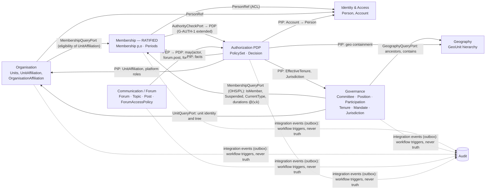

# Cross-Domain Organisational Architecture: Final Consolidated Architecture (v1.0-candidate)

**Date:** 2026-10-10 23:14 · **Author:** Claude (developer and researcher role; `MEMBERSHIP_DEVELOPMENT_STRATEGY.md` §1)
**Status:** **CANDIDATE ARCHITECTURE. Authority: generated. Not ratified.** This document decides no business rule, approves nothing and authorises no implementation. Every row marked *Recommended* or *Open* needs a Human PO / ARB act before it binds. Rows marked *Ratified* only point to acts that already exist.
**Scope:** Person, Account, Member, Membership, Organisation, Organisational Unit, Committee (including geographical committees), Position / "role", Appointment, Tenure, Mandate, Permission, Authorization, Geography / Jurisdiction, Discussion Forum, and how they relate. **Election is out of scope.** Where an election artefact constrains a boundary, it is named and left alone.

**Inputs:**
- All 19 files in this folder (`20261010_1150` … `20261010_1750`, plus `# Principal DDD review — Cross-Domain Re.md`). Two files are byte-identical (`…_v0.4.4_Formal.md` = `…_v0.4.4_Formal1.md`), and several files repeat earlier rounds verbatim.
- The repository canon that the corpus never consulted:
  - `docs/publicdigit/reviews/2026-10-08-membership-architecture-ratified.md` (**RATIFIED, frozen**);
  - `docs/publicdigit/reviews/2026-10-09-organisational-participation-domain-research.md`;
  - `docs/publicdigit/reviews/2026-10-09-committee-responsibility-authority-and-membership-boundary-discovery.md`;
  - the code under `app/Contexts/{Membership,Governance,Geography,Committee,Shared}`;
  - the bounded-model oracles in `docs/publicdigit/membership/architecture/models/`.

**Labels:** **[R]** ratified (an act exists) · **[D]** demonstrated (code, test or model run) · **[C]** converged in the corpus with no open counter-finding · **[REC]** my recommendation · **[OPEN]** a decision is required · **[BIZ]** a business rule needs organisational evidence.

---

## 0. Executive summary

1. **The corpus has converged on its strategic model.** Since v0.4 (14:28) no review has changed an ownership, a relationship or a boundary. Every later round (v0.4.1 to v0.4.5, about 330 KB) re-corrects the pseudocode for bitemporal correction, freshness and fallback, and each round finds new defects in the previous round's algorithms. That is a diminishing-returns loop, not progress toward the architecture.
2. **The corpus is disconnected from the repository, and that changes the next step.** The temporal semantics it keeps re-deriving already exist:
   - ratified on 2026-10-08: append-only facts; `effectiveAt` / `decidedAt` / `recordedAt` + `seq`; the Correct / Annul / Void algebra; KnownAt;
   - verified against bounded oracles (millions of histories);
   - implemented in `app/Contexts/Membership/Domain/Organisational`.

   The corpus's P0 "Reference Model v0.1, built from scratch" would be a **second, competing temporal model**. That violates canonical discovery (ES-005.4: consume or extend, never create a second). **[REC] Adopt the ratified Membership fact pattern as the platform's temporal pattern, and retire the v0.4.x temporal pseudocode as research history.**
3. **Several items the corpus keeps "open" were already resolved by repository research (2026-10-09):**
   - the participant is a **Person**, not a new entity;
   - "role" splits into **PositionKind / Position / Tenure**;
   - "mandate" splits into **Term** (a time period) and **Mandate** (scope of authority);
   - authority is **derived, never stored**;
   - membership affects committee office only through a **derived intersection** `EffectiveTenure = Tenure ∧ ε(Membership predicates at t)`. A cascade write was computed to break the ratified annulment semantics in 140 / 476 bounded cases.
4. **The final shape is a modular monolith of 7 bounded contexts plus 1 cross-cutting capability**, inside the existing `app/Contexts` structure:
   - **Identity & Access**;
   - **Organisation** (structure, units, unit affiliation);
   - **Membership** (ratified);
   - **Governance** (committees, positions, participation, tenure, mandate, delegation, jurisdiction assignment);
   - **Geography** (reference territory);
   - **Authorization** (a policy decision point that owns no facts);
   - **Communication / Forum** (new);
   - **Audit**, which is cross-cutting.
5. **The real remaining work is decisions, consolidation and greenfield code, not more formalism.** In order:
   - the PO / ARB decisions RD-1 … RD-5 and XD-1 … XD-8 (§13);
   - a Governance participation contract;
   - collapsing the **four inconsistent committee models** in code;
   - a minimal Authorization PDP, which also closes the unguarded routes of `PBDIGIT-266`;
   - Organisation structure;
   - jurisdiction-scoped grants;
   - the Forum, which has **zero** code today.
6. **Progress is measured by gates (§15).** 9 of 30 gates have passed: **30 %**, computed over an explicit denominator. The corpus's "45–50 %" measures research effort, not implementation readiness.

---

## 1. Principal review of the corpus (what we keep, what we reject)

### 1.1 Durable contributions (keep)

| # | Contribution | First appears | Status |
|---|---|---|---|
| K-1 | Facts ≠ Policies ≠ Derived decisions: three categories with different owners | 1235 | [C] |
| K-2 | Authorization is a **decision function** `Decision = E(actor, action, resource, facts, policy, t)`, not a relationship | 1217 (R-13) | [C] |
| K-3 | Person ≠ Account ≠ Member ≠ Membership; Role ≠ Permission; Appointment ≠ Mandate; organisational hierarchy ≠ geographical hierarchy | 1150, 1217 | [C], partly [R] |
| K-4 | The four person-to-structure relationships are distinct: unit affiliation, volunteer participation, employment, committee appointment. "Share structural concepts, not columns" | 1222, 1230 | [C] |
| K-5 | Mandatory **prohibitions and conditions** are constraints, never grants. A mandatory "permit" must not authorise | 1415 (v0.3.1) | [C] (security-critical) |
| K-6 | Abstentions are removed from the decisive set; default deny; deny wins at equal priority | 1235 | [C] |
| K-7 | Fact observation has independent dimensions: value, provenance, availability, observation time, freshness, absence semantics | 1714, 1725 | [C] |
| K-8 | Three clocks: valid `v`, knowledge `k`, evaluation `t`; historical reconstruction must not use knowledge that arrived later | 1726 | [C] |
| K-9 | Every projection is non-authoritative and must declare freshness, invalidation and behaviour when stale | 1714 | [C] |
| K-10 | Evidence status ⟂ decision status (two dimensions); a passing test never proves a business rule | 1750 | [C] |
| K-11 | Bounded contexts emerge from fact ownership, lifecycle and invariants; deployment units ≠ contexts; modular monolith | 1428, 1726 | [C] |

### 1.2 Findings against the corpus (principal-review, new)

| # | Finding | Consequence |
|---|---|---|
| F-1 | **No canonical discovery was done.** The corpus states that "no evidence documents were provided". But the repository holds: (1) a ratified Membership architecture; (2) participation and committee-authority research with bounded models (`g3_g4_access_vacancy.py`, `g5_committee_authority.py`); (3) the adopted business rules in `docs/publicdigit/business_rules/ELECTION_MANIFESTO.md` (EM-GOV-*, EM-VOC-*); (4) four live committee models in code. | The corpus's P0 list partly duplicates done work. Re-plan from the repository's state (§14). |
| F-2 | **Competing temporal model.** v0.4.4 / v0.4.5 chose "complete replacement snapshots + transition events + InitialStateRecord". The ratified kernel uses value-bearing facts (Admit, End, …) with Correct (value replacement), Annul (ex tunc set-aside), Void (never reflected reality), CFC+ and KnownAt. Both are bitemporal and append-only, but they are **not the same algebra**. Two algebras in one platform would give two meanings of "correction". | **[REC] XD-1:** one temporal pattern platform-wide, the ratified one. Mapping in §7.2. |
| F-3 | **Terminology collision on "Affiliation".** Ratified `OrganisationAffiliation` (EM-VOC-002) means *platform access / roles*. The corpus's `MemberUnitAffiliation` means *belonging to a unit*. | **[REC] XD-2:** name the corpus concept **UnitAffiliation**. "Affiliation" alone becomes a forbidden term (§2.3). |
| F-4 | **"Geographical committee" is not a type.** The corpus treats it correctly as committee + jurisdiction, but the code's `CommitteeType` mixes level, wing and geography (SQ-3). | Model it as Committee + JurisdictionAssignment (§5.4). A level is a property of the jurisdiction or unit, not of the committee type. |
| F-5 | **v0.4.5 still contains two logic defects:** (a) `NotApplicable → KnownFalse` is a category error. In three-valued logic, "not applicable" is *undefined*, not *false*: ¬P(x) and "P undefined at x" have different consequences under negation (a rule `¬IsMember ⇒ deny` would wrongly fire). (b) `NoRecord (non-sensitive) → KnownFalse` again manufactures a negative fact from absence. | **[REC]** Use Kleene strong three-valued logic {T, F, U}. Absence maps to U unless a **closed-world declaration** for that fact type says otherwise. A guard over U is *not satisfied*, so a grant needs T, never ¬F (§6.4). |
| F-6 | **Freshness controlled by flags** (`denyOnStale`, `requireFreshAuthority`, `allowedFallbackActions`) admits illegal combinations. Each review found a new early-return bug of this kind. | **[REC]** Make illegal states unrepresentable. Freshness is a property of an **action class** (§6.5), fixed by type, not a per-fact flag set. |
| F-7 | **Cache invalidation by TTL is guesswork.** | **[REC]** Each decision records `factsUsed` with fact versions (`seq`). A cached decision is valid iff every version in its version vector is unchanged. That is exact and needs no TTL (§6.6). |
| F-8 | **The evidence plan is statistically under-powered.** The corpus asks for "one party constitution + one association bylaws" to establish rules. A rule claimed to hold for *all* organisations cannot be established by sampling. With *n* independent organisations and no counterexample, the 95 % upper bound on counterexample prevalence is ≈ 3/*n* (rule of three). For *n* = 2 the bound is above 1, so the sample is uninformative. | **[REC]** Only structural and temporal invariants are platform-universal. They are justified by definition, not by sampling. **Every business rule is a typed, versioned org policy parameter by default** (§9). Documents then set *defaults*, not universals. |
| F-9 | **Committee code sits inside Membership** (`app/Contexts/Membership/Application/Committee/*`, `CommitteeAssociation`), and four inconsistent "member in committee" models exist (A–D; participation research §1). | This boundary violation is the single biggest implementation risk. Resolution: §14 slice G-0. |

### 1.3 What we deliberately drop

- The v0.4.x "Reference Model v0.1" built from scratch. **Replaced by** extending the existing oracle suite (`models/`) to Governance and Authorization.
- `supersededBy`-contiguity, "monotonic in transaction time", Boolean `mandatory`, and the single `FactStatus` enum. These were already rejected inside the corpus; they are listed so they do not come back.
- Election concepts: voter roll, `FrozenEligibilityRecord`, E-01 … E-06. **Parked.** They are owned by Election (ADR_20261004_1549, ADR-T11) and stay out of this architecture.

---

## 2. Ubiquitous language (final glossary)

### 2.1 Concepts

| Term | Definition | Kind | Owner | Status |
|---|---|---|---|---|
| **Person** | A natural human being | Entity (`PersonId`) | Identity & Access | [R] owner. Global vs organisation-scoped identity: [OPEN] XD-3 |
| **Account** | A credential-bearing login identity. Not necessarily 1:1 with a Person | Entity | Identity & Access | [C] |
| **Actor** | The Account / Person making *this* request | Role per request (no identity) | — | [C] |
| **OrganisationAffiliation** | A Person's platform access and roles in an organisation (owner / admin / commission …) | Relationship | Organisation | [R] (EM-VOC-002). **Not** belonging, **not** authority |
| **Organisation** | A tenant; the root of structure and policy | Aggregate root | Organisation | [C] |
| **OrganisationalUnit** | A branch, district, chapter, wing or department; a structural node | Entity in `OrganisationStructure` | Organisation | [C] |
| **UnitAffiliation** | A Person's belonging to a unit over a period (e.g. "member of local branch X") | Temporal relationship (fact log) | Organisation | [REC] XD-2. Replaces `MemberUnitAffiliation` |
| **Membership** (EM-VOC-001 `Member`) | The enduring relationship of one Person with one Organisation; one per (Person, Organisation) | Aggregate D1 | Membership | **[R]** |
| **Membership Period** | One episode from Admit to End | Entity inside Membership | Membership | **[R]** |
| **MembershipType** | A classification segment of a period (ordinary, honorary, …) | Value segment + policy reference | Membership | [R] (ChangeType subject to BD-TYPE) |
| **Committee** | An **organ**: a constituted body with a lifecycle, a term, positions and a mandate | Aggregate root | Governance | [C] / research recommendation G-A |
| **Position** | An office or seat of a committee with identity and capacity κ. It outlives its holders | Entity in Committee | Governance | research [REC] |
| **PositionKind** | A classification: chair, treasurer, secretary, coordinator, moderator … (**this is what "role" means organisationally**) | Value object | Governance | research [REC] |
| **Participation** | A Person being part of a committee over a period (ordinary seat without office) | Temporal relationship in Committee | Governance | research [REC] (RD-1: subject = Person) |
| **Appointment** | The act (elected / appointed / co-opted) that opens a Tenure, with provenance and authority evidence | Fact | Governance | research [REC] |
| **Tenure** | A Person holding a Position over `[s, e)`; the derived episode of Appointment … Vacate | Derived interval | Governance | research [REC] |
| **Term** | The time period of a committee's or a tenure's office | Value object (interval) | Governance | [REC] (was "mandate period") |
| **Mandate** | The **scope of authority**: a versioned rule object listing the decision kinds an organ or position may exercise, and over what scope | Versioned rule object | Governance | [REC] |
| **Delegation** | A time-bounded transfer of authority (not of duty) from an organ or tenure to a person or organ; scope ⊆ Mandate at **use** time | Fact | Governance | research [HYP] |
| **EffectiveTenure** | `Tenure ∧ ε(position)(Membership predicates at t) ∧ CommitteeActive(t)` | Derived predicate | Governance | research, computed |
| **GeoUnit** | A geographic area in a country's administrative hierarchy | Reference entity | Geography | [D] (`GeoAdministrativeUnit`) |
| **Jurisdiction** | The set of GeoUnits over which a **committee** holds authority, over time | Temporal relationship in Committee | Governance (assignment); Geography (the units) | [C] |
| **Permission** | An application capability `(action, resourceType)`, e.g. `forum.post`, `membership.admit` | Value object | Authorization | [C] |
| **Grant** | A policy rule: *if* the subject condition holds over facts, *then* the Permission is granted on a resource scope | Versioned rule | Authorization (mechanism); owning context (content, e.g. ForumAccessPolicy) | [C] |
| **Prohibition / Condition** | A mandatory constraint that blocks an action, or must hold before a Grant can take effect. It never grants | Versioned rule | Authorization | [C] (K-5) |
| **AuthorizationDecision** | The output of the PDP: result, classification, reason, policy version, facts used (with versions), `t` | Computed value; audited | Authorization | [C] |
| **Forum** | A communication space with a scope (organisation, unit, committee, jurisdiction or invitation) | Aggregate root | Communication | [REC] |
| **Topic / Post** | A discussion thread / a contribution; authored by a Person | Aggregates | Communication | [REC] |
| **ForumAccessPolicy** | The Forum's set of Grants and Prohibitions for read, post, moderate and administer | Versioned policy (content) | Communication | [C] |
| **Subscription / Invitation** | An explicit, persistent opt-in or invite. **Not** an access grant by itself | Entity | Communication | [C] |
| **AuditRecord** | Evidence that something was recorded or decided. Never the authority for current state | Record | Audit | [C] |

### 2.2 The relation chain (one line)

`Person ≠ Account ≠ OrganisationAffiliation ≠ Membership ≠ MembershipPeriod ≠ UnitAffiliation ≠ Participation ≠ Tenure ≠ Mandate ≠ Grant ≠ Permission ≠ AuthorizationDecision ≠ ForumAccess`

### 2.3 Forbidden and deprecated terms (prevent vocabulary drift)

| Do not say | Say instead |
|---|---|
| "Role" (unqualified) | PositionKind (organisational) · Tenure (holding it) · platform role (OrganisationAffiliation) · Permission (application) |
| "Affiliation" (unqualified) | OrganisationAffiliation (access) or UnitAffiliation (belonging to a unit) |
| "Participant" as an entity | Person in the capacity *Participation / Tenure / author* |
| "Mandate" meaning a time period | Term |
| "Geographical committee" as a type | Committee with a Jurisdiction |
| "Election Committee" (unqualified) | operating body (Chief / Deputy) or acceptance committee (EM-GOV-029); election scope only |
| "Member of committee X" | Participation in X, or Tenure in Position P of X |

---

## 3. Strategic design: bounded contexts

### 3.1 Context responsibilities

| Context | Owns (authoritative) | Must not own / do | Code today |
|---|---|---|---|
| **Identity & Access** | Person (identity, equivalence), Account, authentication | membership status, authority, permissions | Laravel auth, Sanctum, Socialite |
| **Organisation** | Organisation, OrganisationalUnit tree (temporal), **UnitAffiliation**, OrganisationAffiliation (platform roles) | membership lifecycle, committee composition | partial: tenant + platform roles; **units are mis-modelled as committee types** |
| **Membership** **[R]** | Membership (p,o), periods, types, standing; predicates `IsMember`, `Suspended`, `CurrentType`, tenure / duration | person identity, committee participation, entitlement, permissions | **implemented kernel** (Slices 0, 1a, 1b; C-1 pending acceptance) |
| **Governance** | Committee, Position, Participation, Appointment / Tenure, Term, Mandate, Delegation, Decision (collective) / Act (individual), **JurisdictionAssignment** | membership facts, GeoUnit definitions, generic permission evaluation | partial: authority chain, committee hierarchy projections; **4 inconsistent committee models** |
| **Geography** | GeoUnit hierarchy (per country), names, codes, sync | committee responsibility, organisational hierarchy | **implemented** |
| **Authorization** (capability) | PolicySet versions (grants, prohibitions, conditions), the decision function, decision records | **any fact it evaluates** | absent as a unit: Spatie roles + ad-hoc policies; `AuthorityCheckPort` in Membership |
| **Communication / Forum** | Forum, Topic, Post, ModerationAction, Subscription, Invitation, **ForumAccessPolicy content** | membership, tenure or authority facts | **none** |
| **Audit** (cross-cutting) | append-only evidence of commands, decisions and integration events | current state of anything | per-voter logs; outbox / inbox in Shared |

### 3.2 Context map



**Integration rules ([C], consistent with ratified §8 and committee discovery §4):**
1. A command is accepted only by the context that owns the facts it changes.
2. Another context's state is read through its **query port**, which is published language, with `(id, asOf v, knownAt k)`.
3. Integration events (existing outbox / inbox) are **workflow triggers and invalidation signals, never truth**.
4. An organ's decision is a Governance fact. The executing context cites it as **evidence** in its own fact's provenance and never copies it as state.
5. Projections are allowed only with declared freshness, an invalidation key (§6.6) and behaviour when stale.

**Patterns:**
- Membership → others: Open Host Service + Published Language.
- Geography: upstream reference data (conformist consumers).
- Identity: ACL (`PersonRef` only).
- Authorization: Shared Kernel **only** for the `Decision` / `Permission` value types. Everything else goes through ports.

---

## 4. Cross-domain relationship catalogue (final)

Legend for "Nature": **F** = authoritative fact (recorded by a command) · **D** = derived (computed from facts, never stored as truth) · **E** = evaluated decision.

| ID | Relationship | Nature | Owner | Cardinality | Temporal | Status |
|---|---|---|---|---|---|---|
| R-01 | Person ↔ Membership | F | Membership | Person 1 : N Memberships (one per organisation) | bitemporal facts | **[R]** INV-M |
| R-02 | Membership ↔ Period | F | Membership | 1 : N, disjoint within (p,o) | bitemporal | **[R]** INV-EP, INV-9 |
| R-03 | Period ↔ MembershipType | F (segment) | Membership | 1 : N segments | bitemporal | [R] (BD-TYPE) |
| R-04 | Person ↔ OrganisationalUnit (**UnitAffiliation**) | F | Organisation | M : N | bitemporal | [REC] XD-2. Eligibility via the derived intersection with Membership |
| R-05 | Unit ↔ parent Unit | F | Organisation | tree by default; multi-parent only as a typed non-structural link | bitemporal | [C] acyclic structural parentage |
| R-06 | Committee ↔ Unit (`governs`, `represents`, `advises`, `serves`) | F | Governance | M : N, kind explicit; several kinds may coexist for one pair | bitemporal | [C] |
| R-07 | Person ↔ Committee (**Participation**) | F | Governance | M : N; ≤ 1 episode per (p,c) at t | bitemporal | research [REC] (RD-1 = Person) |
| R-08 | Person ↔ Position (**Tenure**, opened by an Appointment) | F → D interval | Governance | per Position ≤ κ holders at t | bitemporal | research [REC] (RD-2 = M2) |
| R-09 | Position / Committee ↔ **Mandate** | F (rule version) | Governance | N : 1 versioned | versioned, effective-dated | [REC] |
| R-10 | Committee ↔ GeoUnit (**Jurisdiction**) | F | Governance (assignment) | M : N, overlap allowed by policy | bitemporal | [C] |
| R-11 | Person ↔ Forum (**access**) | **E** | Authorization evaluates the Forum's policy | — | per request at t | [C] |
| R-11b | Person ↔ Forum (**Subscription / Invitation**) | F | Communication | M : N | valid-time | [C] |
| R-12 | Forum ↔ ForumAccessPolicy | F (versioned) | Communication | 1 : N versions | versioned | [C] |
| R-13 | (actor, action, resource, facts, policy, t) → Decision | **E** | Authorization | function | records `t`, `k`, versions | [C] |
| R-14 | **EffectiveTenure** = Tenure ∧ ε ∧ CommitteeActive | **D** | Governance | — | evaluated at (v,k) | research, computed |
| R-15 | Forum ↔ scope anchor (organisation / unit / committee / jurisdiction) | F | Communication | N : 1 | valid-time | [REC] |
| R-16 | Delegation (organ / tenure → person / organ) | F | Governance | — | bitemporal | [HYP] |

**What this catalogue makes explicit:**
- **No relationship is owned twice.** Every arrow that crosses a context is either a query port (read) or the PDP (evaluate).
- **Membership never writes Governance, Organisation or Forum state, and none of them writes Membership.** Ending a membership never *deletes* a tenure, affiliation or post. It changes the result of a **derived** predicate.

---

## 5. Tactical design per context

### 5.1 Membership: ratified, no change

D1 aggregate per (Person, Organisation); facts Admit / Renew / ChangeType / Suspend / Restore / End / Annul / Void / Correct; resolution `Res`; G\* enforcement with expected-version commit. **This architecture consumes it and changes nothing.** Two port additions are needed: `MembershipQueryPort` (EP-01 design) and the `AuthorityCheckPort` gap G-AUTH-1 (§6.7).

### 5.2 Organisation

| Aggregate | Contents | Invariants | Rationale |
|---|---|---|---|
| **OrganisationStructure** (one per organisation) | units, structural parent edges (temporal), unit kinds (branch, wing, chapter, department) | O-1: structural parentage is acyclic at every (v,k), i.e. `∀u: u ∉ Ancestors(u)`. O-2: ≤ 1 structural parent per unit at t (a typed **non-structural link**, such as "participates in region R", is a separate relation and so a federation does not break O-2). O-3: a dissolved unit takes no new children | acyclicity is a **whole-graph** invariant. Units are few (10²–10³), so one aggregate is small and avoids a set-based cycle check |
| **UnitAffiliationLog** (one per (Person, Organisation)) | affiliation facts Join / Leave / Transfer (+ Annul / Void / Correct by the ratified pattern) | UA-1: ≤ 1 *primary* affiliation at t, if policy declares "primary" [BIZ]. UA-2: an affiliation to a unit that is dissolved at t is **not effective** (derived; never rewritten) | mirrors D1 exactly: same concurrency recipe |

**Eligibility:** `EffectiveUnitAffiliation(p,u,t) = UnitAffiliation ∧ ε_u(Membership predicates at t)`. Whether non-members may be affiliated is the policy parameter ε_u. "Volunteer" is **not** a UnitAffiliation. It is a separate Participation type, to be added only if a requirement appears (K-4).

### 5.3 Governance

**Committee aggregate (research G-A, recommended RD-4):**
- **Root:** Committee (identity, kind, level, lifecycle: proposed → constituted → active → dissolved), Term.
- **Entities:** Position (kind, capacity κ, eligibility ε, `requiresParticipation`), Participation log, Tenure log (Appoint / Vacate facts), **JurisdictionAssignment** log, Committee ↔ Unit relation log (R-06).
- **Invariants:**
  - INV-P2: ≤ 1 participation episode per (p,c) at t;
  - INV-P3: `|holders(s,t)| ≤ κ(s)`;
  - INV-P4: `Tenure ∧ requiresParticipation(s) ⇒ Participates`;
  - INV-P6: incompatible positions never overlap for one person (rule table);
  - G-J1: jurisdiction GeoUnits exist in the organisation's country profile at the assignment's valid time.
- **Same temporal pattern** as Membership: facts with effective / decided / recorded + `seq`; Annul / Void / Correct; G\* acceptance; expected-version commit.

**Mandate** is a separate, **versioned rule object** (`MandateVersion{organ|positionKind, decisionKinds, scope, effectiveFrom}`). It is not stored per person. Changing a mandate never rewrites tenures.

**Authority derivation (D; never stored, INV-P7):**

```text
HasAuthority(p, kind, subject, t) ⇔
    ∃ s: EffectiveTenure(p,s,t) ∧ kind ∈ Mandate@t(kind(s)) ∧ InScope(subject, scope(s,t))
  ∨ ∃ decision d of organ o valid at t: kind ∈ Mandate@t(o) ∧ p executes d within its tenure
  ∨ ∃ delegation δ to p valid at t: kind ∈ scope(δ) ∩ Mandate@t(source(δ))   — checked at USE time
InScope(subject, scope) ⇔ geo(subject) ∈ Descendants*(Jurisdiction(c,t)) ∨ unit(subject) ∈ Subtree(Unit(c,t))
```

### 5.4 Geographical committees, made precise

A geographical committee = Committee + JurisdictionAssignment. Geography owns the GeoUnit tree; Governance owns *which committee answers for which units, when*. Consequences:
- one committee may cover many GeoUnits;
- many committees may cover one GeoUnit with different mandates (finance vs organisational);
- a boundary change in Geography never rewrites assignment history; it changes the result of `Descendants*` **at the queried valid time**, provided Geography versions its hierarchy. **Gap: today it is synced reference data. Bitemporal versioning of `GeoAdministrativeUnit` is [OPEN] XD-5.**

**Level** (national / province / district / ward) is a property of the **GeoUnit** or **OrganisationalUnit**, not of `CommitteeType` (this resolves SQ-3 / BQ-P6).

### 5.5 Authorization

- **PolicySet** aggregate per organisation, versioned. It holds Grants, Prohibitions and Conditions, each with scope, effect and effective interval.
- **Activation guard:** a new version is activated only if the conflict check (§8) finds no mandatory conflict.
- **PDP:** a pure function, defined in §6.
- **DecisionRecord:** written for every *consequential* action class (§6.5) and sent to Audit.

### 5.6 Communication / Forum (greenfield)

| Aggregate | Contents | Invariants |
|---|---|---|
| **Forum** | scope anchor (R-15), status (open, read-only, archived), current ForumAccessPolicy version, moderator positions (by PositionKind or explicit assignment) | FO-1: exactly one scope anchor, in the same organisation. FO-2: a policy version is immutable once active. FO-3: an archived forum accepts no posts |
| **Topic** | title, status (open, locked, hidden), author PersonRef | TO-1: a locked topic accepts no posts |
| **Post** (separate aggregate, so writes do not contend) | body revisions, author PersonRef, moderation state | PO-1: authorship never changes. PO-2: edits are revisions, never overwrites. PO-3: moderation hides; deletion is a separate retention act |
| **ModerationAction** | actor, target, reason, `DecisionRecord` ref | MO-1: every moderation action cites a Permit decision |
| **Subscription / Invitation** | person, forum, valid-time | SU-1: a subscription grants **no** access (R-11 ≠ R-11b) |

**Access is never stored as membership in the forum.** `may(actor, forum.read|post|moderate|administer, forum, t)` is asked of the PDP. ForumAccessPolicy expresses grants over facts. Examples:
- organisation forum: `forum.read, forum.post ⇐ IsMember(p, org(forum), t) ∧ ¬Suspended`;
- committee forum: `⇐ Participates(p, c, t) ∨ EffectiveTenure(p, s∈c, t)`;
- jurisdiction forum: `⇐ IsMember ∧ ∃ u: EffectiveUnitAffiliation(p,u,t) ∧ geo(u) ∈ Descendants*(J)`;
- moderation: `forum.moderate ⇐ EffectiveTenure(p, s, t) ∧ kind(s) = moderator ∧ committee(s) = owner(forum)`.

**Content outlives access:** when membership or tenure ends, the person's posts remain, attributed. Only future actions are denied. Whether attribution is shown after membership ends is a privacy policy (GDPR) **[BIZ]**.

---

## 6. Authorization architecture (the cross-functional core)

### 6.1 Pattern

XACML-style separation, implemented in-process:
- **PEP** (policy enforcement point): HTTP middleware and application handlers;
- **PDP** (policy decision point): the Authorization capability;
- **PIPs** (policy information points): the query ports of the owning contexts;
- **PAP** (policy administration point): PolicySet versions with the conflict check.

Mathematically, authority is **reachability in a time-indexed labelled graph** (a ReBAC / Zanzibar-style formulation):

```text
actor ─is→ Person ─holds@t→ Tenure ─in→ Position ─of→ Committee ─hasJurisdiction@t→ GeoUnit ─ancestorOf*→ geo(resource)
                     └─member@t→ Membership(o)          └─governs@t→ Unit ─ancestorOf*→ unit(resource)
```

A Grant is a **regular path expression** over these labelled edges, evaluated at a snapshot (v,k). This gives:
- a precise semantics (path existence);
- an efficient evaluation (bounded-depth traversal; the hierarchies are shallow trees);
- a natural explanation (the witnessing path *is* the reason).

### 6.2 Decision function (consolidated; fixes K-5, K-6, F-5, F-6)

```text
decide(actor, action, resource, t):
  P   ← activePolicyVersion(org(resource), t)
  cls ← actionClass(action)                                  # §6.5
  F   ← gatherFacts(P.requiredFacts(action, resource), t, cls) # PIPs; each fact ∈ {T, F, U} with version
  if F contains OperationalFailure for a required fact: return Deny(OPERATIONAL, escalate)
  if P has mandatory conflict:                  return Deny(CONFIGURATION_ERROR, escalate)  # unreachable if activation guard holds
  if ∃ prohibition π ∈ P applicable with guard(π, F) = T:   return Deny(MANDATORY_PROHIBITION, π)
  if ∃ condition  γ ∈ P applicable with guard(γ, F) ≠ T:    return Deny(MANDATORY_CONDITION, γ)
  G ← { g ∈ P.ordinary | applicable(g, action, resource) ∧ guard(g, F) = T ∧ effect(g) ≠ abstain }
  if G = ∅:                                                 return Deny(NO_GRANT)
  top ← argmax_priority(G)
  if ∃ g ∈ top: effect(g) = deny:                           return Deny(ORDINARY_DENY, g)
  return Permit(GRANT, witness = top ∩ permits, factsUsed = versions(F), policy = P.version, t)
```

**Safety invariant (to be property-tested):**
`Permit ⇒ ∃ grant g: guard(g,F) = T ∧ ∀ prohibition π: guard(π,F) ≠ T ∧ ∀ condition γ: guard(γ,F) = T ∧ freshness(F) ⊨ cls`.

**Note on prohibitions over U (unknown facts):** a prohibition whose guard is U does **not** fire. That is safe only because **grants and conditions require T**, so an unknown fact can never *create* a Permit. If a prohibition must fire on unknown (e.g. "deny unless sanctions check is known clean"), write it as a **condition** (`guard = T` required), not as a prohibition. This removes the whole class of "absence becomes false" bugs (F-5).

### 6.3 Clocks

`t` = evaluation time (now for live requests). For a reconstruction, `t` = the original decision's `t` and `k` = the knowledge cutoff to use (the original `k` for "what did we know", a later `k` for "what should we have decided").

### 6.4 Three-valued facts and closed-world declarations

Each fact type declares **open-world** (absence ⇒ U, the default) or **closed-world within a source** (absence in an *available*, authoritative source ⇒ F).
- Closed-world example: `IsMember(p,o,t)`. The Membership log is complete for the organisation (after migration with attested provenance), so absence = F.
- Open-world example: "has completed safeguarding training", where absence = U.

The declaration is part of the published language of the owning context. It is not decided per call site.

### 6.5 Action classes replace freshness flags (F-6)

| Class | Examples | Required fact source | Fallback to projection |
|---|---|---|---|
| **READ** | read forum, view directory | projection allowed | yes, within `maxStaleness(READ)` |
| **CONTRIBUTE** | post, reply, subscribe | projection allowed | yes, within `maxStaleness(CONTRIBUTE)` (shorter than READ) |
| **MODERATE** | hide post, lock topic | **authoritative, fresh** | **no** (deny + escalate on outage) |
| **ADMINISTER** | change forum policy, manage units | authoritative, fresh | no |
| **GOVERN** | admit or end a member, appoint, approve finance | authoritative, fresh, **plus a DecisionRecord** | no |

The numeric `maxStaleness` values are **[BIZ / OPS]** (XD-6). The *type* rule is the architecture: an action class's freshness contract cannot be loosened by a per-policy flag.

### 6.6 Exact cache invalidation (F-7)

```text
cacheKey   = (actor, action, resource, P.version)
cacheValue = (decision, factsUsed = {(factType, subjectId, seq)})
valid ⇔ ∀ (τ, s, n) ∈ factsUsed: currentSeq(τ, s) = n      — checked against the integration-event stream
```

- Membership, Governance and Organisation already emit `seq`-ordered facts. An outbox event carrying `(subject, seq)` is a sufficient invalidation signal.
- Only READ and CONTRIBUTE decisions are cached.
- **Active sessions:** every MODERATE / ADMINISTER / GOVERN request is re-decided (no session-scoped authority), which resolves G2-S9 by construction.

### 6.7 Port changes required (existing code)

- `AuthorityCheckPort::check(tenant, actor, act)` → `check(tenant, actor, act, subject, decisionRef?, asOf t)`. This is **G-AUTH-1**.
- `AuthorityEvidence` gains `{organ, decision | tenure | delegation id, mandateVersion, procedureResult, subject, asOf}`.
- The implementation of the port delegates to the PDP, with Governance as a PIP.

---

## 7. Temporal architecture (one pattern platform-wide)

### 7.1 Rule

Every context that owns time-dependent facts (Membership, Organisation, Governance, Forum policy, PolicySet) uses the **ratified Membership fact pattern**:
- append-only facts;
- `effectiveAt` (valid time), `decidedAt`, `recordedAt` (knowledge), `seq`;
- provenance (decision + authority evidence | rule | attested);
- Annul / Void / Correct;
- pure resolution `Res`;
- G\* acceptance;
- expected-version commit.

**Reuse the pattern, not the code** (each context keeps its own kernel types). A shared, framework-free temporal library in `Shared/Domain` is a later refactoring candidate, only after a second context proves the pattern (ES-006.1: no promotion from a single occurrence).

### 7.2 Mapping corpus v0.4.5 → ratified pattern (so nothing is lost)

| Corpus concept | Ratified equivalent |
|---|---|
| `TransitionRecord` (immutable) | value-bearing fact (Admit, End, Suspend, …) |
| `CorrectionRecord` with complete replacement snapshot | **Correct** (replaces values; chain → latest live Correct) |
| `RetractionRecord` | **Void** (never reflected reality) or **Annul** (validly decided, set aside ex tunc), which are distinct and richer |
| `InitialStateRecord`, `NotCreated` vs `Unknown` | the period is opened by its Admit. Before the first live Admit known at k the subject is "not a member"; incomplete history comes only from an attested migration provenance |
| `StateAt(s, v, k)` with prefix isolation | `Res` over `{f : recordedAt(f) ≤ k}` evaluated at `v` (KnownAt, INV-14) |
| lineage validation (roots, cycles, terminals) | `target(f) < f` by `seq`, so chains are finite and acyclic **by construction** (FP §16.3) |
| three clocks `v, k, t` | `effectiveAt`, `recordedAt`, plus the PDP's evaluation time `t` (§6.3) |

### 7.3 What is genuinely new and must be added

1. **Evaluation time `t`** in `AuthorizationDecision` and in `AuthorityEvidence` (as-of). It is required by G-AUTH-1 and K-8.
2. **Cross-context as-of reads:** query ports take `(asOf v, knownAt k)` so that a reconstructed decision uses only the knowledge available at that time.

---

## 8. Formal methods, statistics and machine learning: where each one earns its place

| Technique | Concrete use | Artefact | Authority |
|---|---|---|---|
| **Bounded exhaustive model checking** (existing Python oracles) | extend `g3_g4_access_vacancy.py` and `g5_committee_authority.py` to: Committee aggregate G-A, EffectiveTenure, jurisdiction scope, and the PDP safety invariant | `models/g7_governance_*.py`, `models/g8_pdp_*.py` | evidence: "verified within bounds", never "proved" |
| **Property-based testing** | generators over fact logs × (v,k,t) × policy sets; properties: safety (§6.2), determinism, reproducibility, no-Permit-from-U, invalidation exactness (§6.6) | PHPUnit data providers + seeded generators | regression gate |
| **SMT / constraint solving** (e.g. Z3) | PolicySet activation guard: is there a fact valuation where a mandatory prohibition and a mandatory condition both bind with opposite effect? Is any grant dead (unsatisfiable)? Is any prohibition shadowed? | `policy-lint` at PAP time | blocks activation |
| **Graph algorithms** | acyclicity O-1 (DFS at commit, O(V+E)); jurisdiction containment as ancestor intervals (Euler-tour / nested-set) for O(1) `contains` | Organisation and Geography domain services | invariant enforcement |
| **Three-valued (Kleene) logic** | guard evaluation over {T, F, U} (§6.4) | PDP core | semantics |
| **Statistics (rule of three, §1.2 F-8)** | decide when an observed regularity may become a *default*: report the 95 % upper bound of counterexample prevalence ≈ 3/n per rule | rule matrix column `upperBoundCX` | supports defaults, never universals |
| **NLP / LLM rule extraction** | extract candidate rules from statutes and bylaws **with passage citations**; output = candidate rows (evidence status *Hypothesis*) | rule matrix | **human-verified only** |
| **Embedding clustering** | detect polysemy across organisations ("member", "committee", "chapter") to populate §2.3 | glossary review | human-verified |
| **Anomaly detection** | flag unusual authority use (e.g. GOVERN actions by a tenure near expiry; overlapping incompatible positions) | ops dashboard | **signal only**: never denies, revokes or decides |

ML never decides membership, appointment, mandate validity, policy precedence, forum access or any authorization outcome. **[C]**, and consistent across all 19 files.

---

## 9. Configurability model (integrity boundary)

| Tier | Examples | Who decides | Change rule |
|---|---|---|---|
| **Platform invariants** (non-configurable; justified by definition) | append-only facts; one owner per fact; INV-M, INV-EP, INV-1; acyclic structure; default deny; prohibitions never grant; GOVERN needs fresh authority; content authorship immutable; tenant isolation | platform architecture authority (ARB) | ADR only |
| **Organisation policy parameters** (typed, versioned, effective-dated) | ε per position (membership required, minimum years, suspension effect); κ per position; incompatibility table; co-chairs; non-member UnitAffiliation; forum grant sets; `maxStaleness`; BD-I5 / BD-REV branches | organisation (its competent organ), recorded as a policy-version fact | new version; never retroactive unless explicitly back-dated *and* authorised |
| **Organisation extensions** | a new position kind, a forum scope kind, a committee kind | organisation + platform review | additive only |

**Guard against an untestable product:** each policy parameter must have a finite domain, a default, and a property test over its whole domain. A parameter that cannot be enumerated is not allowed.

---

## 10. Invariant catalogue (consolidated)

| ID | Statement (formal) | Tier | Status |
|---|---|---|---|
| INV-M / INV-EP / INV-9 / INV-COV | ratified Membership invariants | platform | **[R]** |
| O-1 | `∀u,v,k: u ∉ Ancestors_{v,k}(u)` | platform | [REC] |
| O-2 | `∀u,t: |structParent(u,t)| ≤ 1` | platform (federation links typed separately) | [REC] |
| INV-P2 | `∀p,c,t: |Participation(p,c,t)| ≤ 1` | platform | research |
| INV-P3 | `∀s,t: |holders(s,t)| ≤ κ(s)` (κ is a policy) | platform rule over a policy value | research |
| INV-P4 | `Tenure(p,s,t) ∧ requiresParticipation(s) ⇒ Participates(p,c(s),t)` | policy-scoped | research |
| INV-P5 | `EffectiveTenure = Tenure ∧ ε(s)(p,t) ∧ CommitteeActive(c(s),t)`, derived, never written | platform | research, computed |
| INV-P7 | authority is derived only; no stored per-person authority | platform | research |
| X-1 | no context writes a fact owned by another context | platform | [C] |
| X-2 | ending a membership never deletes or rewrites a tenure, affiliation or post | platform | [C], computed (cascade breaks annulment: 140 / 476) |
| A-1 | `Permit ⇒ ∃` grant with guard T ∧ no binding prohibition ∧ all conditions T ∧ freshness(class) | platform | [REC] |
| A-2 | an unknown (U) fact never contributes to a Permit | platform | [REC] |
| A-3 | `decide` is deterministic in (actor, action, resource, P.version, fact versions, t) | platform | [C] |
| A-4 | MODERATE / ADMINISTER / GOVERN never use a projection | platform | [REC] |
| A-5 | a cached decision is valid iff its fact-version vector is unchanged | platform | [REC] |
| FO-1…3, PO-1…3, SU-1 | forum invariants (§5.6) | platform | [REC] |
| G-J1 | jurisdiction GeoUnits are valid in the organisation's geography at the assignment's valid time | platform | [REC] |

---

## 11. Key scenarios, answered by the final model

| Scenario (corpus ID) | Answer | Mechanism |
|---|---|---|
| G1-S1: a person in two organisations | two Membership aggregates; one `PersonId` (if XD-3 = global) or two linked `PersonRef`s | INV-M |
| G1-S2: suspended in A, active in B | B unaffected. An organisation-wide restriction is an **explicit separate fact**, never inferred | separate aggregates |
| G1-S5 / S6: member-at-large / several units | Membership with zero or more UnitAffiliations | R-04 |
| G1-S7: unit dissolved | affiliations become non-effective (derived); history intact | UA-2 |
| G1-S8 / S9: retroactive or late correction | Correct / Annul / Void; KnownAt(k) | ratified |
| G2-S2 / S4: appointment or term expires, membership stays | independent logs; EffectiveTenure false after the term | R-08, INV-P5 |
| G2-S3: "role revoked, appointment remains" | **reframed:** a Vacate ends the tenure in that position; participation in the committee may continue | M2 model |
| G2-S5: external adviser | Participation or Tenure of a Person with ε(s) = "no membership required" | RD-1 |
| G2-S6 / S7: co-chairs, acting officer | κ(chair) = 2 (policy); acting = Tenure with basis "acting" + Delegation | INV-P3, R-16 |
| G2-S9 / S10: mandate expired with an active session or an unavailable source | GOVERN / MODERATE is re-decided per request and never uses a projection, so: Deny (+ escalate on outage) | A-4, §6.5 |
| G2-S11 / S12: role without grant; prohibition over grant | Deny(NO_GRANT); Deny(MANDATORY_PROHIBITION) | §6.2 |
| Forum: former chair keeps the general forum and loses the committee forum | org-forum grant = IsMember (still T); committee-forum grant = EffectiveTenure (now F) | §5.6 |
| District secretary moderates the district forum | witness path: Person → Tenure(secretary) → Committee(district) → Jurisdiction ∋ geo(forum) | §6.1 |

---

## 12. Mapping to the existing code (consolidation, not rewrite)

| Today | Target | Action |
|---|---|---|
| `Membership/Application/Committee/*`, `CommitteeStructure/*`, `Membership/Domain/Membership/CommitteeAssociation*` (model A/B) | Governance Committee aggregate | **move ownership to Governance** (RD-5); Membership keeps none |
| `Governance/Domain/Authority/AuthorityAssignment`, `GovernanceRole`, committee projections (model C) | Governance Delegation + PositionKind + read models | re-model behind the participation contract; keep projections as projections |
| `app/Contexts/Committee/Application/ReadModel/*` | a Governance read model | fold into Governance (Infrastructure/ReadModel) |
| Election `ElectionCommittee` seats, `organisation_participants` (model D) | stays in Election (seat model) | no change (election out of scope); Governance answers `OrganisationalAppointmentAuthority` later |
| `CommitteeType` mixing level and wing | level → Unit / GeoUnit; wing → OrganisationalUnit kind | Organisation slice O-1 |
| Spatie roles (owner / admin / commission) | OrganisationAffiliation (platform roles) → PIP for the PDP | keep; wrap behind a PIP |
| `AuthorityCheckPort` | G-AUTH-1 signature; implementation delegates to the PDP | slice A-1 |
| `Geography/*` | unchanged + GeographyQueryPort (`contains`, `ancestors`) | slice J-1; bitemporal versioning per XD-5 |
| Forum | new `app/Contexts/Communication` | slices F-1, F-2 |
| `Shared/Infrastructure/Outbox`, `Inbox` | integration events + invalidation signals (§6.6) | reuse |

---

## 13. Decisions required (PO / Human ARB)

Already registered elsewhere, and still the critical path:
- **RD-1** participation subject = Person;
- **RD-2** role representation = M2 (tenures inside the committee);
- **RD-3** membership dependency = derived intersection;
- **RD-4** aggregate = G-A;
- **RD-5** legacy committee models → re-model in Governance;
- **BQ-P1 … BQ-P7**.

New from this consolidation:

| ID | Decision | Recommendation | Consequence if not decided |
|---|---|---|---|
| XD-1 | One temporal pattern platform-wide: the ratified Membership fact algebra; retire the v0.4.x temporal pseudocode as research history | adopt | two incompatible meanings of "correction" |
| XD-2 | Name: **UnitAffiliation** (Person ↔ Unit, owned by Organisation); "Affiliation" alone is forbidden | adopt | collision with ratified EM-VOC-002 |
| XD-3 | Person identity scope: global `PersonId` with per-organisation consent to link, or organisation-scoped `PersonRef` only | global ID, consent-gated linking, no cross-tenant reads | blocks multi-organisation scenarios (G1-S1) |
| XD-4 | Authorization is a capability (PDP + PolicySet) that owns no facts; it lives in a new `app/Contexts/Authorization` (not `Shared`) | adopt | permissions stay scattered; `PBDIGIT-266` recurs |
| XD-5 | Geography versioning: bitemporal GeoUnit hierarchy, or snapshot-per-sync with a version id | snapshot version id first (cheaper); full bitemporal only if boundary disputes are a requirement | jurisdiction history ambiguous after boundary changes |
| XD-6 | `maxStaleness` per action class (READ, CONTRIBUTE) | e.g. 5 min / 60 s as an **ops proposal**, to be justified | no projection may be used |
| XD-7 | Kleene three-valued guards + closed-world declarations per fact type (§6.4) | adopt | absence-as-false defects return (F-5) |
| XD-8 | Forum post attribution and retention after membership ends (privacy) | keep attribution, allow person-requested pseudonymisation | GDPR exposure |

---

## 14. Implementation roadmap (smallest safe slices, dependency-ordered)

Each slice follows EP-01 (plan → approval) → RED → GREEN → EP-02, with a developer guide (Definition of Done). **No slice is authorised by this document.**

| # | Slice | Depends on | Exit evidence |
|---|---|---|---|
| M-* | **Membership track as already planned:** C-1 acceptance → `PBDIGIT-264` → Slice 2 → cutover (C-1…C-10, ARB-MEM-01) | — | ratified gates |
| G-0 | **Governance Participation Semantic Contract** (document): RD-1…RD-5, BQ-P1…P3, XD-1 | decisions | PO / ARB act |
| A-0 | **Security first:** `PBDIGIT-266` unguarded routes, guarded by existing role checks as an interim measure | isolated test DB (ARB-SEC-01) | 22-test plan green |
| G-1 | Committee aggregate (Position, Participation, Tenure, Appoint / Vacate) + `MembershipQueryPort` + EffectiveTenure; bounded-model extension | G-0, MembershipQueryPort | oracle differential + property tests |
| A-1 | Authorization PDP minimal (grants / prohibitions / conditions, default deny, Kleene guards, action classes) + G-AUTH-1 port change | XD-4, XD-7, G-1 | safety invariant A-1…A-5 property tests; SMT policy lint |
| G-2 | Legacy consolidation: committee code out of Membership; models A / B / C migrated (normalise representation, never invent truth) | G-1 | migration mapping + parity tests |
| O-1 | OrganisationStructure + UnitAffiliation; split `CommitteeType` (level → unit / geo, wing → unit kind) | XD-2 | acyclicity + affiliation property tests |
| J-1 | JurisdictionAssignment + GeographyQueryPort (`contains` via nested intervals) + geo-scoped grants | O-1, XD-5 | scope tests (in / out / boundary change) |
| F-1 | Forum MVP: organisation and committee forums; read / post via the PDP; projection cache with version-vector invalidation | A-1, G-1 | revocation tests (membership end, tenure end, active session) |
| F-2 | Moderation (MODERATE class, DecisionRecord) + jurisdiction forums + subscriptions / invitations | F-1, J-1 | moderation audit tests |
| AU-1 | Audit consolidation: DecisionRecords and integration events into one integrity-protected store | A-1 | reconstruction test (`v, k, t`) |

---

## 15. How far are we from the implementation goal?

Measured as gates with an explicit denominator. A gate counts as passed only with an act, code or test evidence in the repository.

| # | Gate | Passed? | Evidence |
|---|---|---|---|
| 1 | Cross-domain concepts and distinctions identified | ✅ | corpus K-1…K-11 |
| 2 | Relationship catalogue with owners | ✅ | §4 (corpus + research) |
| 3 | Membership architecture ratified | ✅ | 2026-10-08 act |
| 4 | Membership kernel implemented (Slices 0, 1a, 1b) | ✅ | `PBDIGIT-258/259/260` |
| 5 | Membership correction slice C-1 accepted | ❌ | formal acceptance pending |
| 6 | Membership cutover (live writes) | ❌ | blocked (ARB-MEM-01) |
| 7 | Participation and committee research with bounded models | ✅ | 2026-10-09 research, `g3`–`g5` |
| 8 | Temporal pattern understood and verified (Membership) | ✅ | FP §13–§16 |
| 9 | Authorization semantics converged (decision function, constraints ≠ grants) | ✅ | corpus v0.3.1 → v0.4.5 + §6 |
| 10 | Geography reference model implemented | ✅ | `app/Contexts/Geography` |
| 11 | Glossary with forbidden terms | ✅ | §2 (candidate) |
| 12 | XD-1 … XD-8 decided | ❌ | §13 |
| 13 | RD-1 … RD-5 decided | ❌ | research §25 |
| 14 | Governance participation contract approved | ❌ | — |
| 15 | Organisational evidence: rule matrix populated for G1 / G2 | ❌ | the corpus states it was never executed |
| 16 | Context map approved (ARB-2) | ❌ | §3 is a candidate |
| 17 | `PBDIGIT-266` security gap closed | ❌ | needs test DB |
| 18 | MembershipQueryPort implemented | ❌ | designed (EP-01) |
| 19 | Committee aggregate (G-1) | ❌ | — |
| 20 | Legacy committee models consolidated (G-2) | ❌ | four models live |
| 21 | Authorization PDP (A-1) | ❌ | — |
| 22 | G-AUTH-1 port extension | ❌ | — |
| 23 | Organisation structure + UnitAffiliation (O-1) | ❌ | — |
| 24 | Jurisdiction assignment + geo-scoped grants (J-1) | ❌ | — |
| 25 | Geography versioning decision (XD-5) | ❌ | — |
| 26 | Forum MVP (F-1) | ❌ | no code |
| 27 | Moderation (F-2) | ❌ | — |
| 28 | Exact cache invalidation + session re-decision tests | ❌ | — |
| 29 | Audit consolidation (AU-1) | ❌ | — |
| 30 | End-to-end cross-domain acceptance (former chair, district moderator, suspended-in-A scenarios) | ❌ | — |

**Result: 9 / 30 gates = 30 %.** By dimension:
- **Research and semantics:** 7 of 8 gates (1–3, 7–9, 11 passed; 15, the organisational evidence matrix, is open).
- **Decisions:** 0 of 5 gates (12–14, 16, 25).
- **Implementation of the cross-domain scope:** 2 of 17 gates (4 and 10 passed; 5, 6, 17–24, 26–30 open).

The corpus's "45–50 %" is consistent with the research dimension. It overstates readiness for the cross-domain goal, because Governance consolidation, Authorization, Organisation structure and the Forum are still unbuilt.

**The bottleneck has moved from analysis to decisions.** Eight XD and five RD decisions unlock all remaining implementation slices. No further formal specification round is needed before them.

---

## 16. Remaining TODOs

### P0 — Decisions (unblock everything)
- Decide XD-1: adopt the ratified Membership fact algebra as the single platform temporal pattern; retire the v0.4.x temporal pseudocode.
- Decide XD-2: rename the corpus `MemberUnitAffiliation` to **UnitAffiliation**, owned by Organisation.
- Decide RD-1 … RD-5 (Person as participation subject; M2 tenures; derived intersection; Committee aggregate G-A; re-model legacy committees in Governance).
- Answer BQ-P1 … BQ-P3 (several positions per person; membership required per position kind; tenure lapse vs vacancy decision on membership end).
- Decide XD-3 (Person identity scope across organisations, with consent-gated linking).
- Decide XD-4 (Authorization as its own capability context owning no facts).
- Decide XD-7 (Kleene three-valued guards and closed-world declarations per fact type).

### P0 — Security and in-flight work
- Provision the isolated test database and run the `PBDIGIT-266` test plan (ARB-SEC-01).
- Complete Membership C-1 formal acceptance and continue the authorised Membership track (`PBDIGIT-264` → Slice 2 → cutover gates).

### P1 — Contracts and evidence
- Write the Governance Participation Semantic Contract (committee, position, participation, tenure, term, mandate, delegation, jurisdiction).
- Specify `MembershipQueryPort` (`IsMember`, `Suspended`, `CurrentType`, admission dates, durations; `asOf v`, `knownAt k`; closed-world declaration).
- Specify the G-AUTH-1 extension of `AuthorityCheckPort` (subject, decision reference, as-of `t`) and the extended `AuthorityEvidence`.
- Populate the rule matrix for Groups 1 and 2 from the adopted repository sources first (`ELECTION_MANIFESTO.md` EM-GOV / EM-VOC rules, legacy committee limits), then from external bylaws. Record evidence status and decision status separately.
- Add a `upperBoundCX ≈ 3/n` column to the rule matrix; treat every business rule as a policy parameter with a default.
- Extend the bounded-model oracles to Governance (G-A, EffectiveTenure, jurisdiction scope) and to the PDP safety invariant.

### P1 — Implementation (after approval)
- Implement the Committee aggregate with Position, Participation and Tenure logs, using the ratified fact pattern (slice G-1).
- Implement the minimal Authorization PDP: grants, prohibitions, conditions, default deny, action classes, Kleene guards, DecisionRecord (slice A-1).
- Add an SMT-based policy lint at PolicySet activation (mandatory conflicts, dead grants, shadowed prohibitions).
- Move committee code out of the Membership context and consolidate committee models A / B / C into Governance (slice G-2).

### P2 — Structure, geography, forum
- Implement OrganisationStructure (acyclic, temporal) and the UnitAffiliation log; split `CommitteeType` into unit level and unit kind (slice O-1).
- Decide XD-5 (Geography versioning) and implement JurisdictionAssignment with `contains` via nested intervals (slice J-1).
- Implement Forum MVP: organisation and committee forums, read / post through the PDP, projection cache with version-vector invalidation (slice F-1).
- Implement moderation, jurisdiction forums, subscriptions and invitations (slice F-2).
- Decide XD-6 (`maxStaleness` per action class) and XD-8 (post attribution and retention after membership ends).

### P3 — Assurance and operations
- Consolidate audit: DecisionRecords and integration events into one integrity-protected store; test reconstruction with `(v, k, t)`.
- Run end-to-end acceptance scenarios: former chair keeps the general forum and loses the committee forum; district secretary moderates the district forum; suspended in A, active in B.
- Add anomaly detection on authority usage as a **signal only** dashboard.
- Use NLP / LLM rule extraction (with passage citations) and embedding clustering of terms as research aids under mandatory human verification.
- Submit the context map (§3) and this candidate for independent review, then ARB-2 architecture approval.

---

## 17. Traceability

| Section | Primary sources |
|---|---|
| §1 K-1…K-11 | corpus 1150, 1217, 1222, 1230, 1235, 1415, 1428, 1714, 1725, 1726, 1750 |
| §1 F-1, F-2, F-9 | `2026-10-08-membership-architecture-ratified.md`; `app/Contexts/*` inventory; `models/` |
| §2, §5.3, §10 INV-P* | `2026-10-09-organisational-participation-domain-research.md` §6–§25 |
| §3.2 integration rules | ratified act §8; `2026-10-09-committee-responsibility-…-discovery.md` §4 |
| §6.7 G-AUTH-1 | committee discovery §1.5 |
| §15 gates 4–6, 17 | `.claude/CONTEXT-publicdigit.md` (status rows of 2026-10-10) |
| Election exclusion | ADR_20261004_1549, ADR-T11; user scope statement |
