# Membership Architecture Diagrams (C4 and Mermaid)

**Author:** Session 1. **Status:** PROPOSED documentation. **Baseline:** HEAD `f54037f96` (2026-10-16).
**Companion:** `20261016_2257_membership_architecture_verification_rev1.md` (requirement IDs BR-*, SEC-R*, open questions OQ-*, stories MEM-*).
**Placement note:** stored in the established Membership review location. The governed placement (`php scripts/doc-placement.php`) was **not run** (no execution authorised); a move into a governed diagrams location is a PO decision.
**Validation:** the Mermaid sources below were **not machine-validated** (no authorised renderer was run). They use only `flowchart`, `classDiagram`, `sequenceDiagram` and `stateDiagram-v2` constructs. C4 views are drawn as flowcharts in C4 notation, to avoid the experimental Mermaid C4 syntax.

**Legend used in every diagram:**
- solid box / solid line = **EXISTS** (VERIFIED in code at `f54037f96`);
- dashed box (`proposed` class) = **PROPOSED** (not built; needs the decisions listed);
- box marked `?` (`open` class) = **UNRESOLVED** (decision or evidence missing);
- `legacy` class = live legacy code that the ledger is meant to replace at cutover.

---

## 1. C4 Level 1: System context

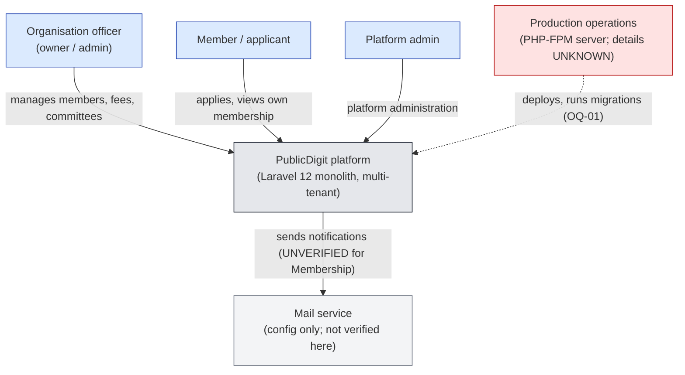

Requirements: BR-1, BR-15, BR-16. Unknowns: hosting topology, mail provider, cache driver (§4).

---

## 2. C4 Level 2: Containers (as verified)

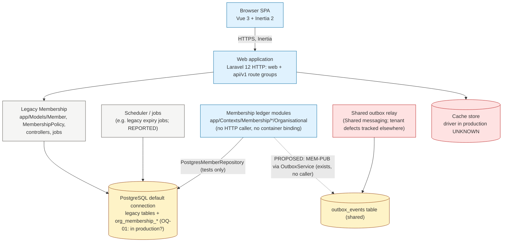

Facts: `PostgresMemberRepository.php`; `OutboxService.php` writes `outbox_events` and has no caller; legacy writers per CUT-3 (REPORTED counts).

---

## 3. C4 Level 3: Membership ledger components (verified scope)

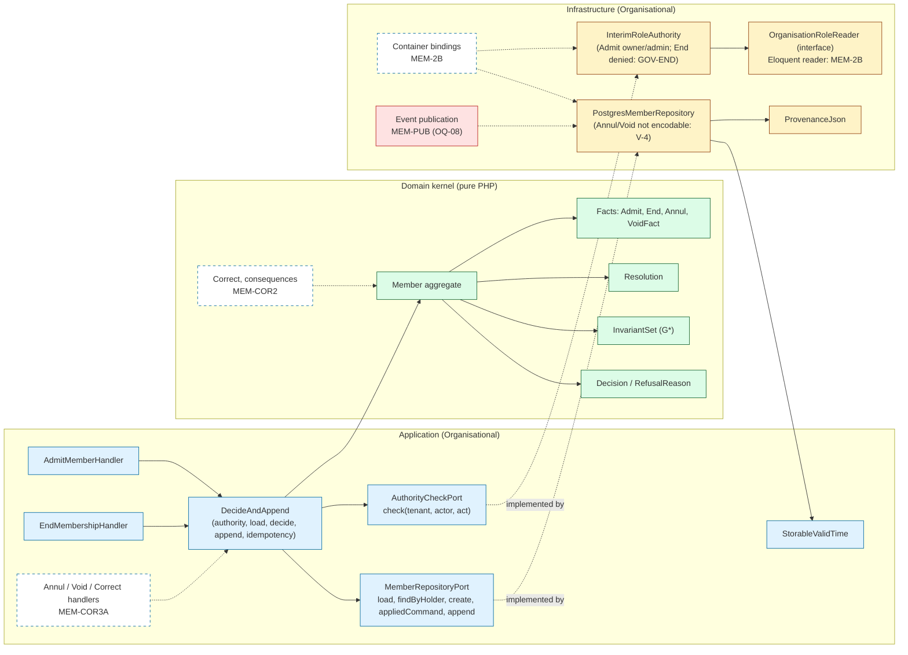

Requirements: BR-1…BR-9a, BR-12, BR-13. Findings shown: V-4 (adapter), GOV-END (interim adapter).

---

## 4. C4 deployment view (only what is recorded)

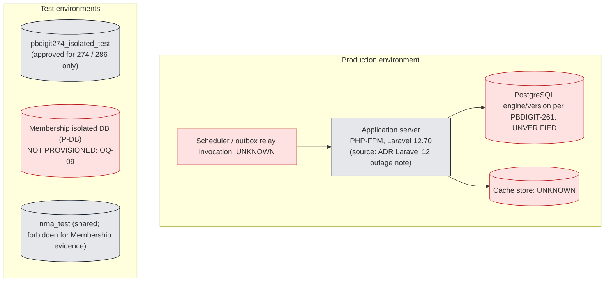

Recorded facts only: PHP-FPM reload and Laravel 12 on the production server (ADR note); the isolated test database name (CONTEXT-publicdigit). Everything else is labelled UNKNOWN.

---

## 5. Bounded contexts and relationships

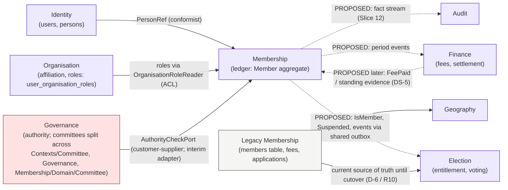

Relationships marked PROPOSED have no implementation (VERIFIED: no event classes, no query port). Requirements: BR-15, BR-16, BR-17; strategic gaps SG-1…SG-4.

---

## 6. Domain model (Membership ledger, as implemented)

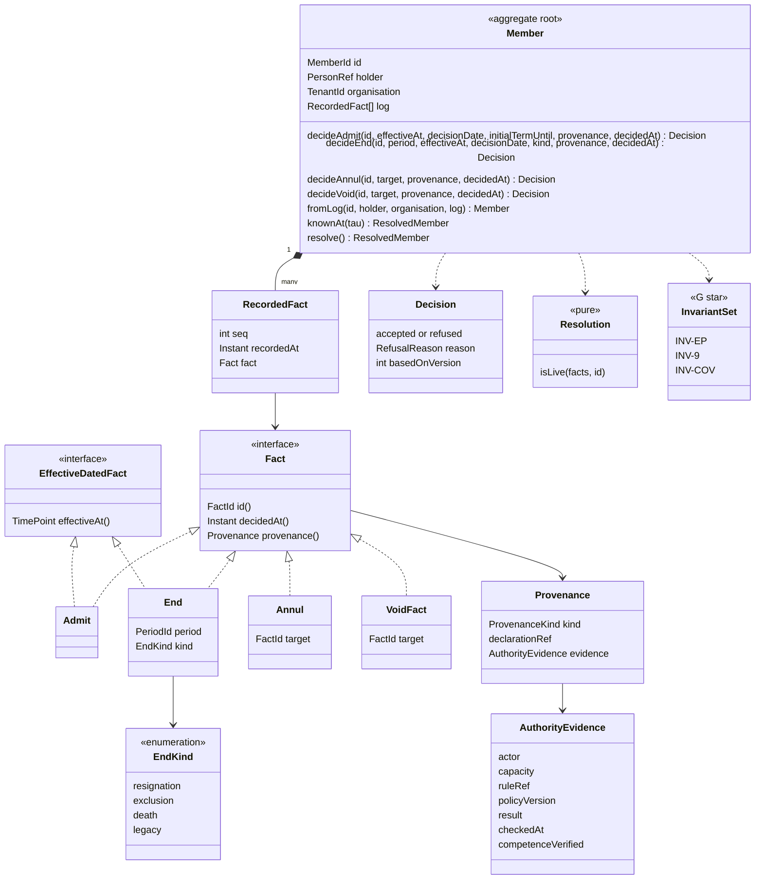

Invariants (where enforced): D-1 basis, closed EndKind, legacy ⇔ attested, `effectiveAt ≤ decisionDate`, finite dates, reversal-target rules, INV-9 / INV-EP / INV-COV → **at decide time** (`Member.php:90-192`). On load (`Member.php:25-40`): seq order and non-decreasing `recordedAt` only (V-1). Not shown because absent: Renew, ChangeType, Suspend, Restore, Correct.

---

## 7. Command → decision → append flow (Admit / End, as implemented)

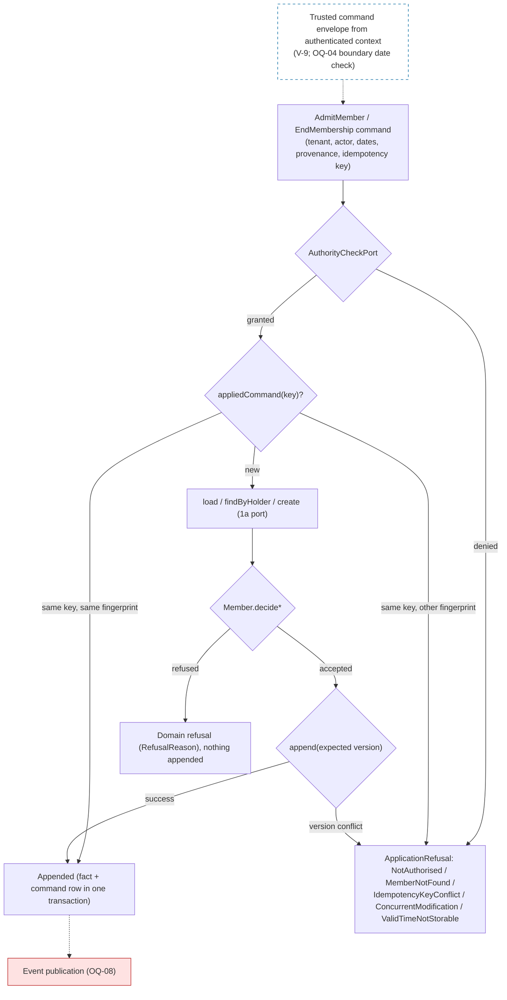

Note: the order (authority before load) is `DecideAndAppend`'s; the exact idempotency and refusal order are pinned by the 1a contract and its tests (A1). End is always denied by the interim adapter until GOV-END.

---

## 8. Correction flow: command handling separated from event publication (P-01)

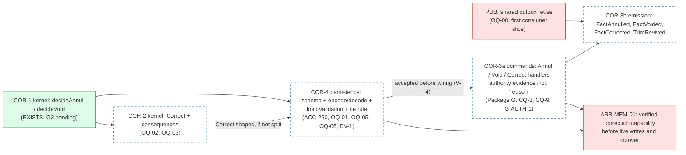

No edge runs from publication back into COR-3a: commands are complete and testable without emission, which removes the 2219 plan's cycle.

---

## 9. Corrected implementation dependency graph with decision gates

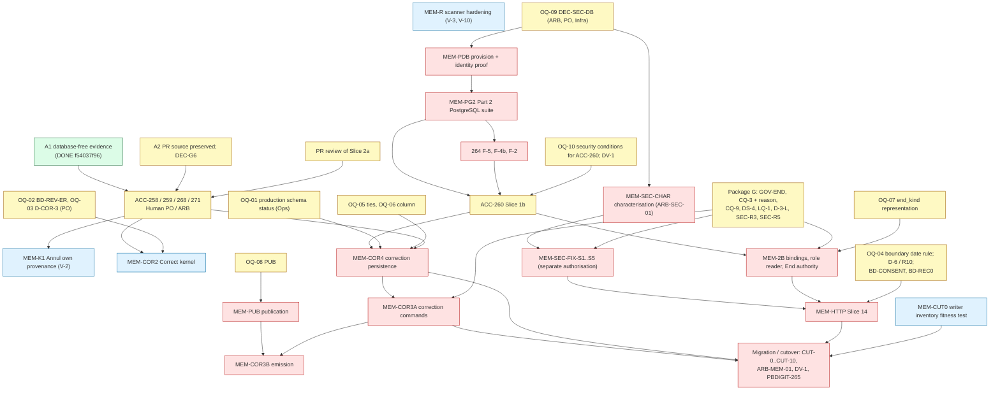

Independent of every open decision (authorisation only): A2, PR review, MEM-R, MEM-CUT0, A1b. Sources per edge: verification rev 1, §7.

---

## 10. Sequence diagrams

### 10.1 Admit: success (as implemented, application level)

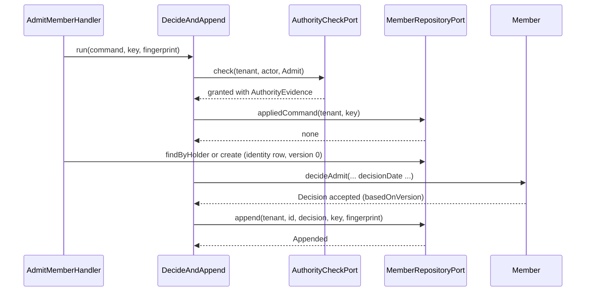

### 10.2 Admit: domain refusal

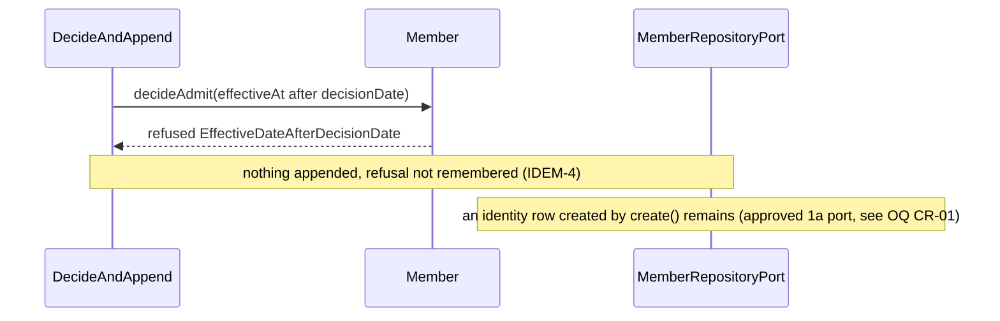

### 10.3 Append: concurrency conflict

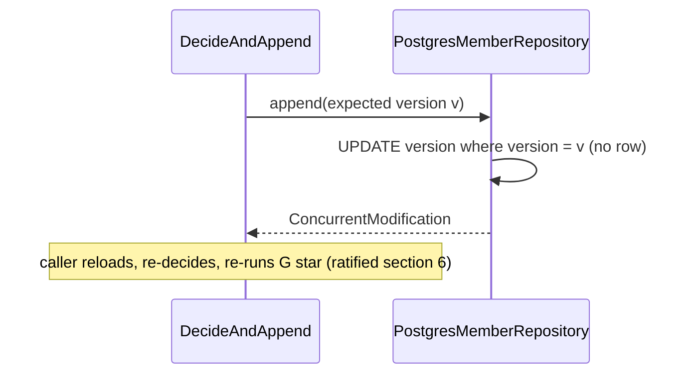

### 10.4 Failure path today: an Annul reaching the adapter (latent, V-4)

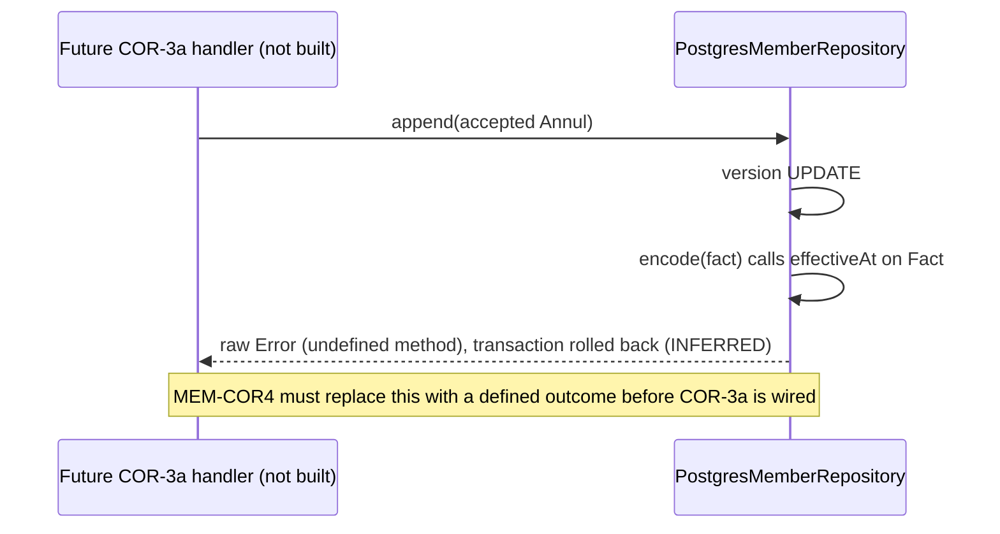

---

## 11. TDD implementation flow with verification gates

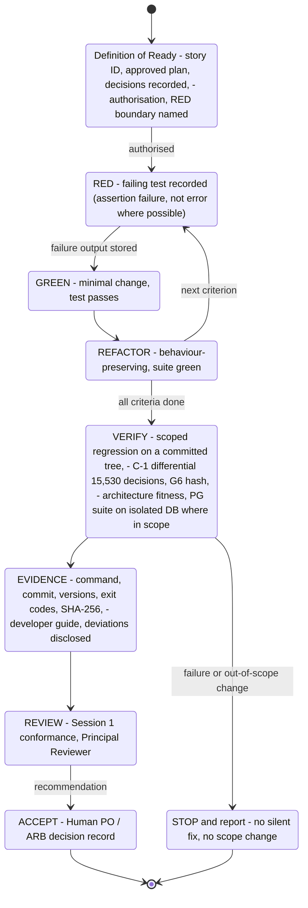
