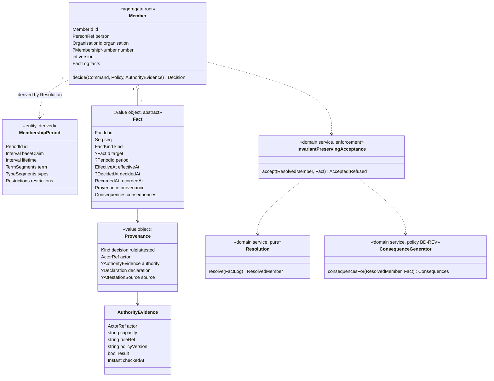

# EP-01: Membership Implementation Readiness and Design

**Date:** 2026-10-08 · **Raised by:** `claude-code-session:42e0287e…` (self-declared, not attestable)
**Status:** DESIGN, **for PO / Principal Reviewer approval**. It implements nothing and authorises nothing. No production code, migration, model, ADR or ratified decision is changed by it.
**Baseline:** the ratification act `2026-10-08-membership-architecture-ratification-act.md` (with recorder's notes N-1…N-6) and the ratified set: **MA** = `…-membership-architecture-ratified.md`, **FP** = `…-membership-final-proof.md`, **FDR** = `…-membership-final-decision-register.md`, **FIB** = `…-membership-final-implementation-blueprint.md`, **FV** = `…-membership-final-ratification-verdict.md`.
**Evidence method:** read-only repository inventory on 2026-10-08, covering the legacy Membership context, the integrations, and the tests and backlog. Every claim in §3 carries a `path:line` reference. Nothing was run.

---

## 1. Executive summary

- **The ratified model has no implementation yet.**
  - `app/Contexts/Membership` holds about 496 files. They implement a **status-based** legacy model and a large **committee** subsystem.
  - Nothing implements facts, periods, resolution, the invariants or G\*.
  - Measured against the ratified architecture, target implementation is **0%**. The legacy code is migration input, not progress.
- **The legacy state is fragmented:**
  - three Eloquent `Member` models plus a pure aggregate;
  - **nine** member-related status vocabularies, which disagree with each other and with the database;
  - **seven** code paths that create or reactivate member rows;
  - **three** membership-number formats;
  - **two** fee-truth columns;
  - **two** payment paths;
  - a hard-delete `CASCADE` from affiliation to member.
- **Election reads Membership tables directly**: no published contract, and an architecture test locks it in.
- **The design** introduces the ratified aggregate **alongside** the legacy model (a strangler approach). It migrates organisation by organisation and replaces Election's direct reads with a published query port **before** legacy retirement.
- **No contradiction with the ratified architecture was found.** Six collisions and ownership questions were found; they are recorded in §3.9 and §22, not as architecture conflicts.
- **Readiness verdict (§23):**
  - **READY for implementation of Slices 0–3** (foundation, aggregate core, Admit / End, resolution and predicates) once this design is approved, a story ID exists and the sequencing act is issued.
  - **Later slices are gated** by named business, downstream and tenancy decisions (§17, §19).

## 2. Ratified baseline (what EP-01 must preserve)

| Ratified element | Source | EP-01 consequence |
|---|---|---|
| One Member aggregate per (Person, Organisation) (EM-VOC-001 `Member`); Periods = episodes; re-entry = a new Period | act §2, §6; MA §1, §7 | aggregate root `Member`; `MembershipPeriod` entity |
| Fact algebra: Admit, Renew, ChangeType, Suspend, Restore, End, Annul, Correct, Void; seq-ordered; append-only | act §3; FP §16.2 | §6 |
| Resolution order: facts → liveness → activeness → values → BaseClaim → LiveCut → lifetime → predicates | act §2; MA §3 | §7 |
| Correction algebra: Annul only on decision provenance; Annul(Annul) is an appeal; Correct(Annul) / Correct(Void) / Annul(Void) refused; Correct of an annulled fact inert; of a voided fact refused | act §4; FP §16.3–16.4; note N-3 | command guards |
| Temporal: effectiveAt / decidedAt / recordedAt / seq; DB time never domain | act §5; FP §16.9 | §6, §10 |
| BD-I5 = no overlap per (p,o); BD-REV = trim; BD-SYNC = transactional | act §14 | §8 (G\* I-set) |
| G\* = enforcement, not truth | act §9 | §8 |
| Concurrency: expected version; on conflict, re-evaluate and recompute consequences | act §13 | §9 |
| Boundaries: Identity, Governance, Election, Finance, Audit; no shared persistence; no entitlement in Membership | act §10–§12 | §12 |
| Proven vs verified distinction must remain | act §15 | §14 (the property harness is kept) |

## 3. Repository evidence (current state)

### 3.1 Models (four representations of "Member")

| # | Class | Table / connection | Notes |
|---|---|---|---|
| M-A | `app/Models/Member.php` | `members` (default) | SoftDeletes, `BelongsToTenant` (:17). `voting_rights` accessor (:112-133) uses `grants_voting_rights` + `fees_status`. `endMembership()` (:172-191) writes `election_memberships.status='removed'`; its only caller is a test |
| M-B | `app/Contexts/Membership/Domain/Models/Member.php` | `members` on connection **`tenant`** (:62) | Eloquent "domain" model; **no SoftDeletes, no tenant trait**; a different column set (:66-80); 8-value `MemberStatus`. A `.legacy.php.backup` copy exists |
| M-C | `app/Contexts/Membership/Infrastructure/Models/MemberContextModel.php` | `members` | persistence model for the repository; includes `fee_state` (:17-30) |
| M-D | `app/Contexts/Membership/Domain/Member/Member.php` | (pure) | status aggregate: `register()` always active (:49); activate / suspend / reactivate / archive; `updateFeeStateSnapshot` (:175) |

**Repository mismatch:** `EloquentMemberRepository.php:38-71` cannot rehydrate `expired` / `ended`, and writes the aggregate status raw (:62). `inactive` / `archived` can therefore be written, though they are not in the `members.status` CHECK.

### 3.2 Schema facts

- **`members`** (`2026_03_07_145529_create_members_table.php`):
  - `organisation_user_id` **UNIQUE** (:17) with an **FK ON DELETE CASCADE** to `organisation_users` (:29), later made nullable (`2026_05_16_000000_make_organisation_user_id_nullable_in_members.php:12`). The unique constraint and the cascade remain;
  - `membership_number` nullable **globally UNIQUE** (:18);
  - `status` ∈ {active, expired, suspended, ended} (`2026_04_03_155711…:16` + pgsql CHECK :22);
  - `ended_at`, `end_reason`.
- **Fee columns:**
  - `fees_status` ∈ {paid, unpaid, partial, exempt} (`2026_04_05_000001…:12`). The PostgreSQL conversion list says {exempt, pending, paid, overdue} (`2026_04_19_000001…:43`), which **conflicts**. A one-way backfill unpaid → exempt exists (`2026_04_15_140049…:25-28`);
  - `fee_state` string (`2026_05_16_000000_add_fee_state…:12`).
- **`membership_types`:** `grants_voting_rights` default false (`2026_04_05_000002…:12-13`). Never written by the application. `requires_approval` unused.
- **Fees and payments:**
  - `membership_fees`: `member_id` CASCADE, `period_label` string, status {pending, paid, waived, overdue}, `idempotency_key` UNIQUE;
  - `membership_renewals`: old / new expiry;
  - `membership_payments` (tenant migration): `MembershipPayment` fillable lists `currency`, `payment_reference`, `income_id`, which do not exist (PBDIGIT-209).
- **`organisation_users`** (affiliation): role {owner, admin, staff, member}, status {active, inactive, suspended}, UNIQUE(org, user), cascades.
- **`user_organisation_roles`:** UNIQUE(user, org), role default `member`.
- **`membership_applications`:** status {draft, submitted, under_review, approved, rejected}, **`lock_version`** (a precedent for optimistic locking).

### 3.3 Lifecycle code paths

| Operation | Where | Defect |
|---|---|---|
| admission (application approval) | `MembershipApplicationController.php:169` → `ApproveMembershipApplication.php:50-73` → `Member::register` | always a new id; does not set number / joined_at / fees_status; no lookup of an existing row, so re-approval hits the UNIQUE |
| admin add | `MemberController.php:93` → `RegisterMember.php:29-35` | no organisation_user link |
| role add | `OrganisationRoleController.php:74,102` | refuses if any row exists, including soft-deleted ones |
| invitation | `OrganisationMemberInvitationController.php:110,207` | `firstOrCreate` returns an ended row unchanged |
| organisation-user import | `OrganisationUserImportService.php:347-351` | `updateOrCreate`; forces active; **regenerates the number** |
| CSV import | `ProcessMemberImportJob` → `MemberImportService.php:68-79` | new aggregate each time |
| registration services | `MemberRegistrationService.php:69,165-190` (tenant connection) | number = max+1 without a lock |
| renewal | `MembershipRenewalController.php:20-97` | does not reset `expired`; extends from max(old, now) |
| expiry | `ExpireMemberships.php:15-19`, scheduled daily (`routes/console.php:46`) | stores the derived `expired` |
| suspend / archive | `MemberController.php:303,333` → Member use cases | in-process events only |
| termination | `Member::endMembership()` (no caller) and `MembershipLineage::terminate` (:374), which is the **committee** lineage | — |

Membership-number formats: `M`+8 random characters · `M`+`uniqid()` · `{SLUG}-{YEAR}-{000001}`.

### 3.4 Status vocabularies (nine)

`members.status` (DB) · the PostgreSQL conversion list · `Domain/ValueObjects/MemberStatus` (8 values) · `Domain/Member/MemberStatus` (4 values; any transition allowed except out of archived) · `MembershipStatus` (committee lineage) · fee states ×3 (DB `fees_status`, `FeeState`, `membership_fees.status`) · application ×2 · `organisation_users.status` · hard-coded `'ended'` / `'expired'`.

### 3.5 Election integration

- **The mode** is a per-election snapshot (`VoterSourceStrategy::fromElection`, `app/Domain/Election/Enum/VoterSourceStrategy.php:92`), copied from `organisations.uses_full_membership`.
- **Direct reads of Membership tables:**
  - `EloquentVoterEligibilityQueryService.php:108-121` (bulk: `members` ⋈ `organisation_users` ⟕ `membership_types`; status active, fees paid / exempt, `grants_voting_rights` or null type, not expired);
  - the same file's single-user path (:174-214), which does **not** check type or expiry, so the predicates diverge (I-1);
  - `VoterEligibilityService.php:76-87`;
  - `User::isPaidMember` / `isEligibleVoter` (`User.php:197-221`);
  - `ElectionMembership::scopeEligible` (:126-145, no caller).
- **The port** `Elections/Domain/Policies/VoterEligibilityPolicy` exists but is Election-owned, and its implementation reads the tables.
- **An architecture test locks the direct read in:** `tests/Architecture/GovernanceRuntime/VoterStrategyConvergenceTest.php:142-156` asserts that the eligible-voter SQL contains `members`.
- **Open Election defects on this path:** PBDIGIT-202 (`bulkAssignVoters` missing), 203, 221, 229, 257 (the mode switch crashes), 49 / 65 / 69 (eligibility homes).

### 3.6 Finance

- `app/Contexts/Finance` holds **one file** (`Events/FeePaidProjection.php`, unreferenced).
- **The Fee aggregate and the `FeePaid` event live in Membership** (`Contexts/Membership/Domain/Fee/*`).
- **Two payment paths:**
  - legacy `MembershipPaymentService.php:35-87` → `members.fees_status`;
  - DDD `RecordFeePayment.php:23-65` → outbox → `FeePaidHydrator` → Finance Income.
- **Income listeners** are registered twice (`EventServiceProvider.php:50-54,84`).

### 3.7 Governance, Identity, Audit

- **Governance:**
  - `app/Contexts/Governance` has Authority classes (`AuthorityResolver`, `AuthorityAssignment`) with **no container binding**;
  - it imports Membership value objects and reads the same `committees` table as Membership's `CommitteeModel`;
  - **membership approval uses no Governance port and no Spatie**: `MembershipPolicy` is instantiated by hand (`MembershipApplicationController.php:175,373-379`), checks `user_organisation_roles.role ∈ {owner, admin}` (`MembershipPolicy.php:104-110`), and is not registered (`AuthServiceProvider.php:15-19`).
- **Identity / organisation:** the chain User → OrganisationUser → Member (`User.php:224-240`). Tenant scoping is via `BelongsToTenant` (session or TenantContext); many readers bypass it with `withoutGlobalScopes()`. Scheduled jobs see no tenant (PBDIGIT-211).
- **Audit:**
  - no member-lifecycle audit table; only `Log::info`;
  - `outbox_events` (`Shared/Infrastructure/Outbox/OutboxWriter.php`) is the only persisted event trail, and only fee payment writes to it;
  - the Membership `OutboxService` and `DomainEventToOutboxMapper` are unreferenced.

### 3.8 Tests

About 150 membership-related test files:
- application / approval: 13;
- import: 9;
- renewal / expiry: 4;
- fees / payment: ~24;
- **committee: ~60** (inside the Membership context);
- member model / UI: ~25;
- election link: ~12.

There are 29 architecture tests, all plain PHPUnit file-scanning tests (no Pest `arch()`). **No test forbids Election from reading Membership tables.** The test DB is `pgsql` / `nrna_test` (`phpunit.xml:67,70`).

### 3.9 Collisions with the ratified model (not contradictions)

| # | Collision | Evidence | Resolution in this design |
|---|---|---|---|
| C-1 | **"Membership" in legacy code means committee membership**: `MembershipLineage` is "a member's relationship with a committee"; `MembershipSuspended` / `Terminated` / `Restored` are committee events | `Domain/Membership/MembershipLineage.php:36` | the target namespace avoids the bare word `Membership*` for organisation-membership classes that legacy already uses; committee code moves to Governance / Committee (separate track, §13) |
| C-2 | **The canonical aggregate name `Member` is already taken** by M-D (a status aggregate) | `Domain/Member/Member.php:19` | the new aggregate lives in a new namespace and keeps the canonical name (§4). M-D is deprecated after cutover |
| C-3 | **The Fee aggregate and `FeePaid` are inside Membership**; the ratified act and FIB make fees Finance's | `Domain/Fee/*`; note N-5 | **Move to Finance** (DS-1 / DS-5); Membership consumes the evidence for Standing |
| C-4 | **Two physical `members` tables** (default vs `tenant` connection) | M-B :62 | a persistence / tenancy decision (EP-Q1) before Slice 1 persistence |
| C-5 | Election reads Membership tables, and a test asserts it | §3.5 | published query port + an Election-side adapter + parity tests; changing the test needs the Election owner's approval (DS-2) |
| C-6 | `ADR-004` lists Membership as a "Candidate" context | `docs/publicdigit/adr/ADR-004-Strategic-Context-Boundaries.md` | governance housekeeping (the ADR is not changed here) |

## 4. Current-state architecture vs target (readiness table)

| Area | Existing | Target | Gap | Decision needed |
|---|---|---|---|---|
| Aggregate | 4 Member representations, status-based | one `Member` aggregate per (p,o), fact log, version | all | naming / namespace (C-2): implementation |
| Membership Period | none (`joined_at` / `ended_at` columns) | `MembershipPeriod` entity, id = Admit fact id | all | — |
| Facts | none | 9 fact kinds, append-only | all | — |
| Resolution | stored status + daily `expired` job | pure `Resolution` service | all | — |
| Invariants | DB UNIQUE / CASCADE only | INV set in G\* | all | BD-REV-ER (for ER) |
| Commands | 7 creation paths, use cases on M-D | 9 commands (§15) | all | BD-CONSENT / LQ-1 (Admit), BD-3 / LQ-3 (End kinds) |
| Authorization | `MembershipPolicy` (role owner / admin), unregistered | AuthorityCheck port + recorded evidence | port + interim adapter | **DS-4** |
| Persistence | `members` (+ tenant copy) | `members_v2`-style new tables (§10) | all | **EP-Q1 tenancy / connection** |
| Concurrency | none (`lock_version` only on applications) | expected version + re-evaluate | all | — |
| APIs | controllers per legacy path | command / query handlers | all | — |
| Read models | stored columns | projections from facts | all | — |
| Election | direct table reads (§3.5) | published `MembershipQueryPort` + Election adapter | all | **DS-2**, BD-GVR |
| Finance | Fee inside Membership; 2 payment paths | Fee in Finance; Membership consumes standing evidence | relocation | **DS-1, DS-5** |
| Audit | `Log::info`; partial outbox | fact stream via outbox; Audit projection | most | — |
| Migration | — | dry-run, then attested facts, per-organisation cutover | all | BD-NORM, BD-2, BD-NU |
| UI | status pages, renew modal | periods, timeline, history | most | — |
| Tests | ~150 legacy tests; harness in research only | 4 levels + property harness (§14) | most | — |

## 5. Target domain model

**Namespace:** `App\Contexts\Membership\Domain\Organisational\` (proposed; avoids C-1 / C-2 collisions until legacy retirement). Domain layer: pure PHP, final classes (CLAUDE.md Rule 10).



**Value objects:**
- identifiers: `MemberId` (UUID), `PeriodId` (= the Admit's `FactId`), `FactId` (UUID), `Seq` (int ≥ 1), `PersonRef` (= `users.id` today; Identity owns equivalence), `OrganisationId` (the shared `TenantId` per `TenantIdEnforcementTest`), `MembershipNumber`, `MembershipTypeRef`;
- time and intervals: `Interval` ([from, until), until may be ∞), `EffectiveAt`, `DecidedAt`, `RecordedAt`, `DatePrecision` (metadata);
- `EndKind`;
- `Declaration`.

**Canonical discovery for `Interval`:** check `Contexts/Shared` first (ES-005.4). Do **not** reuse the committee `EffectivePeriod` / `TermPeriod`.

**Derived predicates:** a `MemberPredicates` read API over `ResolvedMember`: InLifetime, Ended, TermCovered, InForce, Lapsed, Suspended, IsMember, CurrentPeriod, CurrentType, FirstAdmissionDate, CurrentAdmissionDate, Continuous / CumulativeMembershipDuration. **None is stored as truth.**

## 6. Fact model

**Common to every fact:**
- `id`, `memberId`, `seq` (assigned at commit), `kind`;
- `effectiveAt` (required), `decidedAt` (required when provenance = decision, if known), `recordedAt` (assigned at commit, non-decreasing in seq);
- `provenance` {kind, actor, authority evidence (decision), declaration (where required), attestation (import)};
- `idempotencyKey`;
- `consequences` (empty unless stated).

`target` = the referenced fact id; `period` = the PeriodId the fact applies to.

| Fact | Purpose | Required | Optional | Target / period | Business preconditions (domain guards) | Invariant impact |
|---|---|---|---|---|---|---|
| **Admit** | opens an episode | effectiveAt; provenance (decision + authority + declaration per BD-CONSENT, or rule, or attested) | membershipType; first term segment (until); number assignment | period = own id | the resolved state has no lifetime overlapping [effectiveAt, ∞) unless BD-REV trim applies via Correct (a backdated Admit into a live lifetime is **refused**) | INV-9, INV-EP |
| **Renew** | grants a term segment | period; term [from, until) | fee reference (Finance's id, as evidence only) | period = target period | the period is not Ended at `from` | INV-12 (gaps preserved) |
| **ChangeType** | a type segment | period; membershipType; effectiveAt | — | period | BD-TYPE allows mid-period changes; within the lifetime | none on the lifetime |
| **Suspend** | starts a restriction | period; effectiveAt; reason; authority | planned until | period | within the lifetime; no open restriction | IsMember unchanged (BD-SUSP) |
| **Restore** | ends a restriction | period; effectiveAt; authority | — | period | an open restriction exists | — |
| **End** | ends the episode | period; effectiveAt; `EndKind` (BD-3 / LQ-3); provenance (decision or the member's resignation) | reason text | period (open) | the period is open; End only shrinks | INV-2 |
| **Annul** | sets a decision aside, ex tunc | target; decidedAt; authority (a competent organ) | grounds | target fact with **decision** provenance (incl. an Annul) | target live; G\* accepts the revival | counterfactual theorem |
| **Void** | the record never reflected reality | target; reason; actor (registrar) | — | any live fact | target live; Annul(Void) not allowed (use Void(Void)) | as Annul |
| **Correct** | replaces a wrongly recorded value | target; the corrected value (same shape as the target's value) | decidedAt (if decided) | value-bearing fact or Correct; **never** Annul / Void; annulled target: inert; voided target: refused | — | CFC+, INV-COV; **may carry consequences** |

No other fact kind is introduced. Ex nunc annulment (if LQ-2 requires it) is `End(kind=annulled_ex_nunc)`.

## 7. Resolution design (pure, deterministic)

Input: the fact log sorted by `seq`. Output: `ResolvedMember` = periods with BaseClaim, LiveCuts, lifetime, segments, restrictions.

```text
1. live:      for i = n..1: live[i] = ¬∃ j>i: kind_j ∈ {Annul,Void} ∧ target_j = i ∧ live[j]
2. active:    for i = 1..n: active[i] = live[i] ∧ (kind_i ≠ Correct ∨ active[target_i])
3. value:     for each value-bearing fact i: value[i] = value[latest live Correct targeting i] (recursively), else own
              superseded[i] = ∃ live Correct targeting i
4. BaseClaim: per period q (live Admit a): [value[a].effectiveAt, max(start, value[last live End of q])) else ∞; ∅ if Admit not live
5. LiveCut:   for each fact c with consequences, active[c] ∧ ¬superseded[c]:
                for each (q, x) in cons(c): cut_q += x ∩ BaseClaim(target period of c)
6. lifetime:  lifetime(q) = BaseClaim(q) − ⋃ cut_q          (one interval by INV-EP on committed states)
7. segments:  term = live Renew values (and Admit's first segment) on q, clipped to lifetime
              types = live ChangeType values ordered by effectiveAt, ties by seq
              restrictions = pairs (live Suspend, next live Restore) on q by effectiveAt, ties by seq
8. predicates over 6–7
```

- **Complexity:** O(n²) naive; n is a few facts per member per year, so it is trivially cheap. Pass 1 runs in reverse seq, passes 2–3 forward.
- **Correction chains** are finite because `target < self` (checked at decision time).
- **Annul / Void** act only through `live`.
- **Correct** acts through `value` and `superseded`.
- **Causal closure:**
  - D(c) is the target-chain closure (note N-1);
  - **no replay** is performed: recorded consequences are never recomputed after commit;
  - the "replay = recorded where a replay exists" property is a **test**, not runtime behaviour (§14).
- **KnownAt(τ):** run the same algorithm on the seq-prefix with `recordedAt ≤ τ`.
- **Refusals:** Resolution never refuses; it is total. Refusals are G\*'s job (§8) and the command guards' job (§6).

## 8. G\* implementation design

```text
DOMAIN TRUTH   Resolution(facts)                      — no knowledge of G*
INVARIANTS     InvariantSet: INV-EP, INV-9(scope = BD-I5 policy), INV-COV, INV-1, ER (if BD-REV-ER = refuse)
ENFORCEMENT    InvariantPreservingAcceptance.accept(pre: ResolvedMember, f):
                 guards(f)                                    → Refused(GuardViolation)
                 f⁺ = f + ConsequenceGenerator(pre, f)        (trim policy; Δ = NewBase − PrevBase − own LiveCuts; + inherited, clipped)
                 post = Resolution(facts · f⁺)
                 violations = InvariantSet.check(post)
                 return violations ? Refused(violations) : Accepted(f⁺)
COMMIT         repository.append(f⁺, expectedVersion)         (§9)
```

- **Guards and invariants are kept separate.** Guards are per-fact domain rules (§6); invariants are properties of the resolved state.
- **Refusals carry the invariant id** (e.g. `INV-9`), so a reason can be shown to the user (Rule 8: `DomainException`).
- **Replaceability:** `InvariantPreservingAcceptance` is an interface-free domain service, but nothing else depends on it. A DB exclusion constraint on the projection may be added as a **safety net** only.

## 9. Concurrency design

| Item | Design |
|---|---|
| aggregate version | `members_v2.version` (int), incremented once per committed command |
| expected version | the version read at load; carried through `decide` |
| transaction boundary | one command = one DB transaction: version check + fact rows + consequence rows + outbox rows |
| optimistic lock | `UPDATE … SET version = v+1 WHERE id = ? AND version = v`; 0 rows → `ConcurrencyConflict` |
| conflict handling | the application handler **reloads, re-runs authority-independent `decide` (guards + g2 + G\*)** and re-commits. Bounded (3 attempts); then `Refused(ConcurrentModification)` |
| consequence recomputation | mandatory: f⁺ is recomputed from the reloaded state. A stored f⁺ is never reused |
| creation race | `UNIQUE(organisation_id, person_ref)` on the aggregate table. The loser reloads the existing Member and re-decides |
| idempotency | `UNIQUE(member_id, idempotency_key)`. A retry with the same key returns the original outcome without a new fact |
| seq / recordedAt | assigned inside the transaction after the version check; recordedAt = commit-time clock, monotone per member |

**Why a uniqueness constraint alone is insufficient (FP §16.10):**
1. P1 is admitted and ended at 0. Command A = Admit P2 @0. Command B = Correct(End P1 → 1). Both read version v.
2. Against state v, B needs **no** consequence, because P2 does not exist yet.
3. If both commit, P1 [0,1) overlaps P2 [0,∞).
4. No row-level uniqueness sees this: the overlap is a property of the **resolution**, and B's correct f⁺ (a cut on P2) depends on A's fact.
5. Only re-evaluating B against v+1 produces the right f⁺, or a refusal.
6. Bounded demonstration: 683 of 23,522 blind pairs violate the invariants.

## 10. Persistence design (target)

New tables. The legacy `members` is **not** renamed or altered by the new model; it is retired after cutover.

| Table | Columns (key ones) | Keys / constraints | Class |
|---|---|---|---|
| `org_memberships` (aggregate) | `id` uuid PK · `organisation_id` · `person_ref` (users.id) · `membership_number` nullable · `version` int · `created_at` | UNIQUE(organisation_id, person_ref); UNIQUE(organisation_id, membership_number) WHERE NOT NULL (BD-NU = per organisation); FK organisation **RESTRICT**; **no cascade** from affiliation | authoritative (identity + number) |
| `org_membership_facts` | `id` uuid PK · `membership_id` · `organisation_id` · `seq` · `kind` · `period_id` · `target_fact_id` · `effective_at` · `effective_precision` · `decided_at` · `recorded_at` · `payload` jsonb (value) · `provenance` jsonb · `idempotency_key` | UNIQUE(membership_id, seq); UNIQUE(membership_id, idempotency_key); FK membership RESTRICT; FK target → facts; index (organisation_id, kind) | **authoritative**; append-only (no UPDATE / DELETE in code; optional DB rule as a safety net) |
| `org_membership_fact_consequences` | `fact_id` · `period_id` · `from` · `until` | PK(fact_id, period_id, from) | **authoritative** (part of f⁺) |
| `org_membership_periods_view` | `period_id` · `membership_id` · `organisation_id` · `lifetime_from` / `until` · `in_force_today` · `current_type` · … | rebuildable | **derived** (projection) |
| `org_membership_timeline_view` | per-fact display rows | rebuildable | **derived** |
| `membership_types` | KEEP (catalogue) | — | reference data |
| `outbox_events` | REUSE (Shared) | — | integration |

**Field classification:**
- **authoritative:** the aggregate row's identity, `membership_number` and `version`, plus every fact column and the consequence rows;
- **derived:** everything under `*_view`, and any cached predicate.

**Type history** = ChangeType facts. **Audit / provenance** = the `provenance` jsonb, validated by a domain schema. Tenant scoping: `organisation_id` on every row, plus the shared `TenantId`.

**Implementation decisions recorded here (not business):**
- **EP-I1, effective time representation:** date vs instant. Recommendation: date (membership acts are dated), plus a tenant time zone for instant-valued inputs.
- **EP-I2, table names:** the names above are placeholders.
- **EP-I3, consequences as a child table vs jsonb:** recommendation: child table, which Finance events can query.

**Blocking question EP-Q1 (C-4):** which connection / database holds the new tables? The legacy model has a landlord `members` and a `tenant`-connection copy. This needs the tenancy owner's answer, linked to PBDIGIT-211.

## 11. Authorization design

- **HTTP access** (who may open the page): Laravel policies. **Register** `MembershipPolicy`, which is currently unregistered. This is infrastructure.
- **Domain authority** (who is competent to admit, end, annul, …):
  - `AuthorityCheck` port, owned by Governance (DS-4), called by the application handler **before** `decide`;
  - the result becomes `AuthorityEvidence` on the fact;
  - a refusal stops the command;
  - Membership stores the evidence and never decides competence.
- **Interim adapter (until DS-4):** `OrganisationRoleAuthorityCheck` reproduces today's rule (`user_organisation_roles.role ∈ {owner, admin}`), with `ruleRef = 'interim:org-role'`. This keeps the evidence honest: it records which rule was applied, not a claim of statutory competence.
- **Declarations** (BD-CONSENT / LQ-1): required on decision-Admit unless the provenance is rule or attested.

## 12. Integration contracts

| Context | Contract | Direction | Notes |
|---|---|---|---|
| **Identity** | `PersonRef` (users.id today) | Identity → Membership | equivalence and merge are owned by Identity (DS-3); Membership applies an explicit merge act later; never infers |
| **Governance** | `AuthorityCheck::check(actor, act, organisation, asOf) → AuthorityEvidence` | Membership → Governance (port) | interim adapter §11 |
| **Election** | **`MembershipQueryPort`** (published language): `isMember(person, org, asOf)`, `isSuspended(…)`, `currentType(…)`, `membersInForce(org, asOf) → [person, type]` | Election → Membership (query) | **no entitlement, no fee logic.** Election keeps its own eligibility predicate. The fee condition comes from Finance / Standing (DS-5); `grants_voting_rights` is read as a type classification (BD-GVR). Election-Only does not call the port |
| **Finance** | Finance owns `FeePaid` / settlement. **Membership consumes** Finance's published fee evidence for Standing (E0b-S). Membership publishes `PeriodOpened`, `PeriodEnded`, `PeriodTrimmed`, `TrimRevived`, `FactAnnulled` / `Voided` / `Corrected` | both ways via outbox | requires relocating the legacy Membership Fee aggregate (C-3; DS-1) |
| **Audit** | Membership publishes `MembershipFactRecorded` (fact id, kind, period, times, provenance summary, refs only) via the outbox; Audit projects | Membership → Audit | no shared tables; ADR-T11 is not touched (no vote data) |

**Election migration path:**
1. Add an Election-side adapter that implements Election's existing `VoterEligibilityPolicy` using `MembershipQueryPort` + Finance standing.
2. Add a parity test against the legacy SQL on migrated organisations.
3. Switch per organisation.
4. Then replace `VoterStrategyConvergenceTest:142-156` with a fitness test that **forbids** Election from reading Membership tables.

Steps 1 and 4 change Election infrastructure (not semantics), so they **need the Election owner's approval (DS-2).**

## 13. Legacy mapping

| Legacy construct | Classification | Target / treatment | Evidence / impact |
|---|---|---|---|
| `app/Models/Member` (M-A) | DEPRECATE → DELETE AFTER MIGRATION | read-only during transition; source for migration | ~25 tests; `voting_rights` used by UI |
| `Domain/Models/Member` (M-B, tenant connection) | DEPRECATE → DELETE AFTER MIGRATION (after EP-Q1) | registration services re-pointed to AdmitMember | an 8-value status; geo fields go to the person / affiliation (check owner) |
| `MemberContextModel` (M-C) + `EloquentMemberRepository` | REPLACE | new repository on the new tables | cannot rehydrate expired / ended |
| `Domain/Member/Member` (M-D) | REPLACE | the new `Member` aggregate (C-2) | status transitions are unrestricted |
| `organisation_users` | KEEP (Organisation context: affiliation, EM-VOC-002) | **not** membership; the cascade to members is removed only after cutover | creating an affiliation on approval stays an Organisation act |
| `user_organisation_roles` | KEEP (roles); role `member` ≠ membership | interim authority adapter reads it | — |
| `members.status` / `expired` job | REPLACE | facts + derived predicates; `ExpireMemberships` deleted after cutover | the stored `expired` is not an End |
| `membership_expires_at`, `last_renewed_at` | MIGRATE | first term segment + Renew facts | precision noted |
| `joined_at` | MIGRATE | Admit.effectiveAt (attested) | missing → **no period**; evidence kept (BD-NORM) |
| `ended_at`, `end_reason` | MIGRATE | End(kind = mapped or `legacy_unknown`) | — |
| `fees_status`, `fee_state` | MOVE TO ANOTHER CONTEXT (Finance) | Finance fee truth; reconciliation report on disagreement | two vocabularies; a one-way backfill |
| `membership_fees`, `membership_payments`, Fee aggregate, `FeePaid` | MOVE TO ANOTHER CONTEXT (Finance) | DS-1; PBDIGIT-209 is fixed in Finance's slice | income listeners registered twice |
| `membership_renewals` | MIGRATE | Renew facts (attested) | — |
| `membership_types` | KEEP | catalogue; `grants_voting_rights` reinterpreted per BD-GVR (classification read by Election) | never written today |
| `membership_number` (3 formats, global UNIQUE) | MIGRATE | `org_memberships.membership_number`; per-org uniqueness (BD-NU); retained across periods (BD-2) | collisions / regenerations reported, never rewritten |
| suspension (M-D, M-B) | MIGRATE | Suspend facts (attested) | rare |
| `Member::endMembership()` | DELETE (no caller) | — | wrote election status; conflicts with adopted rules |
| `MembershipLineage`, committee classes (`Domain/Committee`, `Application/Committee*`, `CommitteeStructure`, lineage events) | MOVE TO ANOTHER CONTEXT (Governance / Committee) | **separate track**, not part of the Membership slices | ~60 tests; Governance already imports these value objects |
| `MembershipApplication` + approval controller | KEEP (application process) | approval invokes `AdmitMember` (decision provenance + declaration from the application) | re-approval no longer hits a UNIQUE |
| the 7 creation paths | REPLACE | all → `AdmitMember` (or a migration import) | §3.3 |
| `Domain/Membership/Voting/VotingEligibilityPolicy` | DELETE AFTER MIGRATION | Election owns eligibility | unreferenced |
| Election direct reads (§3.5) | REPLACE (Election-side) | `MembershipQueryPort` adapter; DS-2 | parity tests first |
| `ElectionMembership` (Election) | KEEP (Election context) | untouched | — |
| `OutboxWriter` (Shared) | KEEP / REUSE | integration events | — |
| Membership `OutboxService` / mapper (unreferenced) | DELETE AFTER MIGRATION | — | — |

**Migration procedure (per organisation):**
1. Dry-run report covering duplicates, collisions, missing dates, fee disagreements and overlaps.
2. A PO / registrar decision on the report (BD-NORM).
3. Import attested facts through the same G\*. Overlaps are reported and never auto-trimmed.
4. Parity check of predicates against legacy.
5. Cutover flag: the new model becomes authoritative and legacy turns read-only.
6. Later, legacy retirement.

Migration never invents dates, authority or consent.

## 14. Testing strategy

| Level | Scope | Examples |
|---|---|---|
| **Domain** | aggregate `decide` per command; guards | Admit refused when overlapping; End only on an open period; Correct(Annul) refused; Correct of a voided fact refused; Annul only on decision provenance |
| **Invariant** | INV-M, INV-1, INV-2, INV-3, INV-9, INV-EP, INV-COV, INV-12, INV-6 / 14 | one test class per invariant; refusal names the invariant |
| **Temporal** | backdating, decidedAt ≠ effectiveAt, KnownAt, lapse vs End, re-entry, late renewal (history M) | KnownAt reproduces a pre-correction report |
| **Property-based** | a generated history harness (port of the research generator) | after every step: INV-COV / EP / 9; recorded counterfactual; replay = recorded when a replay exists |
| **Regression families** | CX-14a, CX-14b, CX-14c, **CX-15**, **Annul(Annul)**, **Void(Annul)**, **Annul(Void) refused**, histories A–R | fixed seeds as named tests |
| **Concurrency** | two commands on one version | the lost-update pair (§9): exactly one commits as computed; the other is re-evaluated or refused |
| **Persistence** | append-only, unique seq / idempotency, consequences round-trip | rehydrate → identical resolution |
| **Architecture** (PHPUnit file-scan, house style) | Domain has no `Illuminate\`; Election does not read new Membership tables; Membership has no entitlement terms | added with the respective slices |
| **Integration** | MembershipQueryPort parity vs the legacy SQL; outbox events | per organisation before cutover |
| **Migration** | dry-run determinism; no invented values | fixtures from legacy shapes |

**Property-test library:** none is installed; adding one is an implementation decision, otherwise a seeded generator. The test DB is `nrna_test`; tests use `RefreshDatabase` only.

## 15. API / application design

**Commands** (DTOs, `final readonly`; handlers `final`; no Facades or Eloquent in Application):
- `AdmitMember`, `RenewMembership`, `ChangeMembershipType`, `SuspendMembership`, `RestoreMembership`, `EndMembership`;
- `AnnulMembershipFact`, `CorrectMembershipFact`, `VoidMembershipFact`.

**Handler sequence:**

```text
FormRequest → DTO (+ idempotencyKey)
→ IdempotencyStore.seen? → return prior outcome
→ repository.load(memberId | (org, person))       (version v)
→ AuthorityCheck (decision facts)                 → AuthorityEvidence | Refused
→ member.decide(command, policies, evidence)      (guards → g2 → G*)  → Accepted(f⁺) | Refused(reason)
→ repository.append(f⁺, expectedVersion = v)      (tx: version, facts, consequences, outbox)
   conflict → reload → re-decide (max 3) → Refused(ConcurrentModification)
→ result DTO (fact id, period id, new version)
```

**Queries** (read models; Eloquent allowed per Rule 5):
- `GetMember(asOf)`, `GetMemberTimeline`, `GetMembershipHistory(knownAt)`;
- `ListMembers(org, asOf, filters)`;
- `GetPeriods`.

**Controllers:** Inertia `router.post` on pages (CLAUDE.md Inertia 2.0 rule); redirect with flash; errors via `back()->withErrors`.

## 16. UI implications

Capabilities (no visual design yet; the design system rules apply):
- Member overview (person, organisation, number, current period, current type, IsMember / InForce / Lapsed / Suspended);
- periods list;
- historical timeline (facts by effective date, with "recorded later" markers);
- history with provenance (actor, authority evidence, decided / effective / recorded);
- admission (from application approval or registrar);
- renewal (replaces the renew modal semantics);
- suspend / restore; terminate (EndKind);
- correct / annul / void (registrar and organ tools, showing **why** a refusal happened: the invariant id);
- type history;
- membership number.

**Dropped:** "Status: ACTIVE / Expires" as the stored truth.

## 17. Remaining business and other decisions

| ID | Question | Recommendation | Why it matters | Affected | Blocks | Owner |
|---|---|---|---|---|---|---|
| **BD-REV-ER** | may a correction absorb a whole other period? | refuse until that period's Admit is annulled / voided | an empty period with a live Admit has no meaning without a decision | G\* I-set (ER) | **YES, Slice 7** | PO |
| BD-3 / LQ-3 | termination grounds (End kinds) and procedures | resignation, exclusion, organisation dissolution, death, `legacy_unknown` | the EndKind enum and authority per kind | End command | **YES, Slice 2 (End)**; an interim minimal list is possible with PO consent | PO + legal |
| DS-4 | authority model / competence (Governance port) | interim role-based adapter, then the Governance port | the evidence recorded on decisions | §11 | NO for Slices 0–3 (interim); **YES, Slice 9** | Governance |
| BD-CONSENT / LQ-1 | declaration required for admission? statutory / ex-officio bases | declaration required except rule-based | the Admit guard | Admit | **YES, Slice 2** | PO + legal |
| BD-REC0 | "member but not yet confirmed"? | no (the application covers it) | an optional Recognise fact | Admit | YES, Slice 2 (confirmation) | PO |
| BD-TYPE | type changes within a period? | yes | type segments vs a period attribute | ChangeType | YES, Slice 4 | PO |
| BD-GVR | `grants_voting_rights`: drop or classification? | a classification read by Election | the Election adapter | Slice 10 | YES, Slice 10 | PO + Election |
| BD-2 | number kept on re-entry? | yes | the number slot | Slice 6 | YES, Slice 6 | PO |
| BD-NU | number unique per organisation? | yes | constraint scope (legacy is global) | Slice 6 | YES, Slice 6 | PO |
| BD-NORM | who normalises incomplete or imprecise legacy data? | a registrar role, with a recorded decision | migration | Slice 13 | YES, Slice 13 | PO |
| BD-SUSP | does the term run during suspension? | yes (IsMember unchanged) | term segments | Slice 5 | YES, Slice 5 | PO |
| BD-TEN | "member since" display | current admission; named predicates | UI | Slice 14 | NO | PO |
| DS-1 / DS-5 | Fee relocation to Finance; standing source; fees for trimmed periods | Finance owns Fee; Membership consumes evidence | C-3 | Slices 11, 10 | YES, Slices 10–11 | Finance + PO |
| DS-2 | Election adapter + replacing the convergence test | §12 path | C-5 | Slice 10 | YES, Slice 10 | Election owner |
| DS-3 | person equivalence / merge | explicit merge act later | — | — | NO | Identity |
| **EP-Q1** | which connection / database holds the new tables (landlord vs tenant)? | the connection on which `organisation_id` tenancy is enforced today for `members` (landlord), unless the tenancy ADR says otherwise | C-4; scheduled jobs (PBDIGIT-211) | Slice 1 persistence | **YES, Slice 1 persistence** (the pure domain in Slice 0 is not blocked) | Tenancy owner / ARB |
| EP-Q2 | committee code relocation (C-1) | separate Governance / Committee track | naming collision, ~60 tests | not Membership slices | NO | Governance + PO |
| EP-Q3 | coexistence: may legacy writes continue for organisations not yet cut over? | yes; per-organisation cutover flag; **no dual-write** | transition safety | Slice 13 | YES, Slice 13 | PO |

## 18. Implementation slices (re-ordered from the commission's proposal on evidence)

| # | Slice | Content | Why this position |
|---|---|---|---|
| 0 | Domain foundation | value objects, `Interval`, Fact types, `Resolution` (pure), predicates, G\* + InvariantSet, ConsequenceGenerator; property harness. **No DB** | everything depends on it; pure PHP, no open decisions |
| 1 | Persistence + concurrency | new tables, repository, version / seq / idempotency / outbox, append-only. **Concurrency is here, not in slice 8** (ratified requirement) | the fact store is unsafe without it; needs EP-Q1 |
| 2 | Admit + End | AdmitMember, EndMembership, interim AuthorityCheck, EndKinds | the lifecycle core; needs BD-CONSENT, BD-REC0, BD-3 |
| 3 | Queries | GetMember / Timeline / History / KnownAt; projections | makes slices 1–2 observable |
| 4 | Renew + ChangeType | term and type segments | needs BD-TYPE |
| 5 | Suspend / Restore | restrictions | needs BD-SUSP |
| 6 | Membership number | allocation, per-org uniqueness, retention | needs BD-2, BD-NU |
| 7 | Correct / Annul / Void | reversal commands, consequences, CX regression families | needs BD-REV-ER |
| 8 | Application-process wiring | approval → AdmitMember (the application stays) | removes creation path 1 |
| 9 | Governance authority | replace the interim adapter with the Governance port | needs DS-4 |
| 10 | Election integration | MembershipQueryPort + Election adapter + parity; new fitness test | needs DS-2, BD-GVR, DS-5 |
| 11 | Finance integration | Fee relocation, standing evidence, period events | needs DS-1 / DS-5 |
| 12 | Audit | fact stream projection | — |
| 13 | Migration | dry-run, import, per-org cutover, legacy read-only | needs BD-NORM, EP-Q3 |
| 14 | API / UI | pages per §16 | after the queries and commands it shows |
| 15 | Full regression + retirement | legacy model / jobs / paths deleted; tests re-pointed | last |

**Separate track (not Membership slices):** committee relocation (EP-Q2).

## 19. Definition of Ready (per slice)

**For every slice:**
- this design is approved;
- a story ID exists (`PBDIGIT-nn`), with one story per slice;
- the PO sequencing act (EM-SEQ-001) covers it;
- the EP-01 slice plan is approved;
- the RED boundary is named.

| Slice | Additionally ready when |
|---|---|
| 0 | — |
| 1 | EP-Q1 answered; EP-I1 / I2 / I3 accepted |
| 2 | BD-CONSENT / LQ-1, BD-REC0, BD-3 (or an interim End-kind list accepted by the PO); the interim authority adapter accepted |
| 3 | slices 1–2 done |
| 4 | BD-TYPE |
| 5 | BD-SUSP |
| 6 | BD-2, BD-NU |
| 7 | **BD-REV-ER** |
| 8 | slice 2; application owner informed |
| 9 | DS-4 port contract |
| 10 | DS-2 (Election owner), BD-GVR, DS-5 |
| 11 | DS-1 / DS-5 |
| 12 | — |
| 13 | BD-NORM, EP-Q3, dry-run reports reviewed |
| 14 | the relevant command / query slices; design-system check |
| 15 | every organisation cut over |

## 20. Definition of Done

**Per slice (technical):**
- RED → GREEN with the named tests;
- the domain layer is free of the framework (architecture test);
- `npm run design-check` for UI slices;
- the developer guide `developer_guide/membership/NN_…` is written (standing rule);
- session log, plan and CONTEXT are updated;
- one story = one commit.

**Per slice (domain):**
- the slice's invariants have tests;
- the property harness passes with fixed seeds;
- refusals name the invariant;
- KnownAt is unchanged for earlier prefixes.

**Membership complete** requires, in addition:
- all 9 commands;
- concurrency tests;
- the authority port;
- migration of every organisation, with parity evidence;
- Election reading only the published port, plus the fitness test;
- Fee in Finance;
- the Audit projection;
- legacy paths and jobs retired;
- the full regression unchanged or better.

**CRUD working is not completion.**

## 21. Risks

| Risk | Mitigation |
|---|---|
| legacy and target diverge during the transition | per-organisation cutover; no dual-write; parity tests |
| Election behaviour change through the adapter | parity tests on real (migrated) organisations; owner approval |
| tenancy outside HTTP (PBDIGIT-211) breaks jobs / projections | EP-Q1 + explicit TenantId in commands and projections |
| ~60 committee tests entangled with Membership | a separate relocation track; do not touch in Membership slices |
| migration finds overlaps / duplicates at scale | report-first; registrar decisions; never auto-trim |
| resolution performance | n is small; projections for lists |
| the property harness gives a false sense of proof | keep the PROVEN / VERIFIED labels (act §15) |
| scope creep into Finance / Election | slices 10–11 gated by their owners |

## 22. Open questions

EP-Q1 (tenancy / connection) · EP-Q2 (committee relocation) · EP-Q3 (coexistence) · C-6 (the ADR-004 "candidate" status; governance housekeeping) · whether a property-testing library may be added (implementation) · whether the Membership developer-guide area is `developer_guide/membership/` (to confirm with doc placement).

## 23. Final readiness verdict

**READY FOR EP-01 APPROVAL.** On approval, **Slices 0–3 can start** (Slice 0 immediately; Slice 1 after EP-Q1; Slice 2 after BD-CONSENT / LQ-1, BD-REC0 and BD-3 or an interim End-kind list), once a story ID and the sequencing act exist.

**Gated:**
- Slice 7 by **BD-REV-ER**;
- Slices 4–6 by BD-TYPE / BD-SUSP / BD-2 / BD-NU;
- Slices 9–11 by DS-4 / DS-2 / BD-GVR / DS-1 / DS-5;
- Slice 13 by BD-NORM / EP-Q3.

**Architecture protection:** no conflict with a ratified decision was found. The six collisions (§3.9) are naming, ownership and infrastructure facts handled inside the ratified model.

**STOP.** No code, migration or story has been created by this document.
