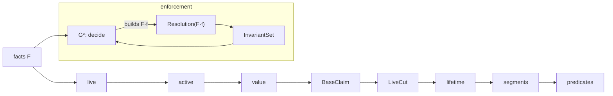

# Membership Slice 0: Semantic Design Contract

**Date:** 2026-10-08 · **Raised by:** `claude-code-session:42e0287e…` (self-declared, not attestable)
**Status:** CONTRACT, **for Principal Reviewer approval**. It implements nothing, creates no story and decides no business question.
**Baseline:**
- the ratification act (`2026-10-08-membership-architecture-ratification-act.md`), **MA** (`…-membership-architecture-ratified.md`), **FP** (`…-membership-final-proof.md`);
- **EP-01 Rev 1** (`…-membership-ep01-implementation-readiness-and-design.md`);
- the review **PDR** (`…-membership-ep01-principal-design-review.md`).

**Evidence for this contract:**
- formal definitions (below);
- a bounded exhaustive check of this exact contract against an **independently written pointwise oracle** (scratchpad `slice0/slice0.py`; research model, not product code; results in §20).

---

## 1. Executive summary

- **Slice 0 is the smallest semantic kernel.** It covers Admit and End, the full-shape Resolution pipeline (later stages are trivially identity), lifetime and initial-term predicates, the ratified invariant set, and G\* as an acceptance function. It is pure PHP: no persistence, no framework, no application layer.
- **It introduces no new domain semantics**, with one exception put to the reviewer as a condition rather than decided silently: **C-S0-1**, an End effective at or before its period's start is refused (§18).
- **It depends on no open business decision.** End kinds are carried but opaque (BD-3). Provenance is carried but no policy says when which kind is required (BD-CONSENT, DS-4). The initial term is supplied, not derived (term policy). The time granularity is abstract (EP-Q6).
- **Contract check:** within the bounds T ≤ 5 time points and ≤ 5 commands (3,418 reachable states), the interval semantics agree with the pointwise oracle at every sampled point. INV-2, INV-3 and INV-9 are never violated, and Admit acceptance matches its closed-form characterisation (Theorem 3).
- **Verdict: B (READY WITH CONDITIONS)** (§27). The conditions:
  - **C-S0-1** (End ≤ start);
  - **C-S0-2** (accept that an Admit without an initial term is immediately *Lapsed*, as the ratified predicates say);
  - the administrative gate (EP-01 Rev 1 approval, a story ID, the sequencing act).

## 2. Approval-gate result

| Check | Result | Basis |
|---|---|---|
| **A. No new domain semantics** | **pass**, except C-S0-1, which is put to the reviewer (§18) | every rule in §7–§18 cites MA / FP |
| **B. Every behaviour traces to a ratified requirement or invariant** | **pass** | §23 |
| **C. No Laravel / Eloquent / DB / HTTP / Election / Finance / Governance implementation / migration / UI / authorization** | **pass** by construction | §4, §5. An architecture test enforces the domain purity (§20) |
| **D. No silent business decision** | **pass.** Consent, authority, termination grounds, number reassignment, suspension, type policy, standing, entitlement and intra-day semantics are all **outside** Slice 0 (§24) | — |

## 3. Frozen architecture assumptions (not re-examined)

D1 + B′ (one Member per (p,o); periods = episodes) · the fact algebra and correction algebra (MA §2, §9) · the Resolution order (act §2) · G\* = enforcement (act §9) · the temporal model (act §5) · BD-I5 = no overlap per (p,o) · BD-REV = trim · BD-SYNC = transactional · PDR R1–R14.

## 4. Slice 0 scope

| In | Why |
|---|---|
| the `Interval` algebra over an abstract totally ordered time domain | BaseClaim, lifetime, terms |
| the facts **Admit**, **End** | the minimal lifecycle; the only facts with no consequence machinery |
| `Provenance` (typed, structurally validated, semantically inert) | RA-7: every fact carries it; adding it later would reshape every fact |
| Resolution with all ratified stages (live, active, value, BaseClaim, LiveCut, lifetime, segments) | the ratified order (act §2); later slices add cases, not stages |
| predicates InLifetime, Ended, TermCovered, InForce, Lapsed, IsMember, CurrentPeriod, FirstAdmission, CurrentAdmission, continuous / cumulative membership **intervals** | MA §4 (the subset expressible with Admit / End + an initial term) |
| InvariantSet {INV-1, INV-2, INV-3, INV-EP, INV-9, INV-COV} and G\* | act §8, §9 |
| `decide(state, command) → Accepted(f, basedOnVersion) \| Refused(reason)` | the semantic boundary consumed by Slice 1a |
| KnownAt as Resolution over a seq-prefix | INV-14 |

## 5. Explicit non-scope

- **Facts:** Correct, Annul, Void (Slice 7) · Renew, ChangeType (Slice 4) · Suspend, Restore (Slice 5). Their **kinds are not declared** in Slice 0 (no neutral placeholders). The pipeline stages that will evaluate them exist and are total over the Slice 0 kinds.
- **Consequence machinery:** ConsequenceGenerator / g2 (Slice 7). In Slice 0 no fact carries consequences, so LiveCut = ∅ by construction.
- **Membership attributes and types:** MembershipNumber (Slice 6), MembershipTypeRef / CurrentType (Slice 4), Suspended (Slice 5), Standing (DS-5).
- **Infrastructure and orchestration:** repository, persistence, transactions, outbox, idempotency storage, IDs from a generator, clocks (Slice 1a / 1b); authority checks, the consent guard, EndKind validation (Slice 2); election, finance, migration, UI.
- **Duration as a number:** it needs a calendar (EP-Q6). Slice 0 returns intervals.

## 6. Domain ontology (minimality-tested)

| Type | Truth / identity / value / derived / metadata | Needed in Slice 0? | If removed |
|---|---|---|---|
| `PersonRef` | identity (external reference) | yes (aggregate holder) | INV-1, INV-M lose their subject |
| `OrganisationId` (the shared `TenantId`) | identity (external reference) | yes | INV-1, INV-M; tenancy (PDR R14) |
| `MemberId` | identity | yes | re-entry identity (B′) |
| `FactId` | identity | yes | End cannot reference its period; chains are impossible later |
| `PeriodId` | **derived identity** = an Admit's `FactId` (Theorem 1) | as an alias type, yes | nothing fails, but the readability of period references suffers. **Implemented as a named wrapper of FactId, never generated** |
| `Interval` | value | yes | BaseClaim, lifetime and terms are inexpressible |
| `EffectiveAt` | domain truth (valid time) | yes | everything temporal |
| `DecidedAt` | domain truth (evidence) | yes (optional field) | decision evidence (RA-6) cannot be carried |
| `RecordedAt` | record truth | yes | KnownAt (INV-14) |
| `Seq` | record order | yes | ordering, ties, the version (§22) |
| `Provenance` | evidence | yes (inert) | RA-7; facts would need reshaping later |
| `EndKind` | value (**opaque in Slice 0**) | carried | BD-3 is open; Resolution ignores it |
| `Fact` (Admit, End) | domain truth | yes | — |
| `Resolution` | pure function (derived state) | yes | there is no truth from facts |
| `ResolvedMember` (periods, lifetimes, segments) | derived | yes | the predicates have no input |
| predicates | derived | yes | — |
| `InvariantSet`, `G*` | enforcement | yes | ratified acceptance |
| `MembershipNumber`, `MembershipTypeRef` | — | **no** | nothing in Slice 0 fails |

## 7. Mathematical model

- **Time:** a totally ordered set (𝕋, ≤) extended with **∞** (greater than every t ∈ 𝕋). Slice 0 is **granularity-agnostic**: 𝕋 may be calendar dates or instants (EP-Q6 decides later).
- **Facts:** a Member's log is the finite sequence F = ⟨f₁,…,fₙ⟩ in seq order, with seq(fᵢ) = i. A fact is
  - `Admit(id, s, ι, π)`, with s ∈ 𝕋, an optional initial term ι ∈ 𝕋∪{∞} (the term's end), and provenance π; or
  - `End(id, q, e, κ, π)`, with q the PeriodId, e ∈ 𝕋 and κ an opaque EndKind.

  Every fact also carries `decidedAt` (optional) and `recordedAt`.
- **Aggregate:** Member = (MemberId m, holder p, organisation o, F). The holder and organisation are aggregate attributes; **facts carry no holder** (INV-1 is structural).

## 8. Fact model (Slice 0)

| Fact | Fields | Target | Semantic effect | Consequences |
|---|---|---|---|---|
| **Admit** | id, effectiveAt s, initialTermUntil ι?, provenance π, decidedAt?, recordedAt, seq | none (opens a period; PeriodId = id) | BaseClaim start | never (FP §16.2) |
| **End** | id, period q, effectiveAt e, kind κ (opaque), provenance π, decidedAt?, recordedAt, seq | period q (= an Admit id) | BaseClaim end; only shrinks | never (FP §16.2) |

**Why consequences are Slice 7:**
- Under the ratified algebra, only Correct carries consequences (FP §16.2, PDR §5).
- An Admit into a live lifetime is refused, and End only shrinks.
- Therefore no Slice 0 history can ever require a cut. LiveCut = ∅ is a **theorem** of the Slice 0 algebra, not an omission.

## 9. Temporal model

| Time | Meaning | Assigned by | Resolution reads it? |
|---|---|---|---|
| effectiveAt | when the fact holds in the world | the command (the deciding authority) | **yes** |
| decidedAt | when the decision was taken | the command (decision provenance) | **no** (evidence only) |
| recordedAt | when the system of record learned it | commit (Slice 1a / 1b) | only to select KnownAt prefixes |
| seq | the total recording order per Member | commit: seq = \|F\|+1 | yes (order, ties) |
| DB transaction time | — | infrastructure | **never** |

**Why each exists:**
- **effectiveAt ≠ recordedAt:** a backdated admission is decided today and effective last month; KnownAt(yesterday) must not show it.
- **decidedAt ≠ effectiveAt:** an End decided on 10 March with effect from 31 March (prospective), or an appeal decided after the effective date.

All three are independent coordinates; collapsing any two loses one of these cases.

**Slice 0 does not fix the granularity of 𝕋** and does not interpret "member until 31.12." (a UI translation, PDR §11).

## 10. Interval algebra

[a, b) with a ∈ 𝕋, b ∈ 𝕋∪{∞}:
- **empty** ⇔ b ≤ a;
- **open-ended** ⇔ b = ∞;
- **finite** ⇔ b < ∞;
- t ∈ [a,b) ⇔ a ≤ t < b;
- **overlap**([a,b),[c,d)) ⇔ both non-empty ∧ a < d ∧ c < b;
- **adjacent** ⇔ b = c or d = a (disjoint, no gap);
- **disjoint** ⇔ ¬overlap;
- **truncate**([a,b), e) = [a, max(a, min(b,e)));
- **difference** I − J = at most two intervals;
- **coverage** of a set S of intervals = ⋃ S.

**Lemma 1:** truncation never enlarges: truncate(I,e) ⊆ I. Disjointness is preserved under truncation of either operand. *Proof:* subset, and overlap is monotone in each argument. ∎

**Lemma 2:** adjacency is not overlap. [a,b) and [b,c) are disjoint. *Proof:* overlap needs b < b. ∎ Consequence: re-entry effective at the instant (or day) the previous period ends is allowed by INV-9.

**Mathematical validity ≠ business validity:** an empty interval is mathematically valid. Whether an empty episode is admissible is a domain question (§18, C-S0-1).

## 11. Resolution pipeline (pure; total; deterministic)

Input: F (Slice 0 kinds). Output: `ResolvedMember`.

```text
1 live(i)      = true                    (no Annul / Void kind exists in Slice 0; stage present, case set extended in Slice 7)
2 active(i)    = live(i)                 (no Correct kind exists in Slice 0)
3 value(i)     = own value               (no Correct)
4 BaseClaim(q) = [s_q, e_q)  where s_q = value(Admit q); e_q = max(s_q, value(End on q)) if an End on q exists, else ∞
5 LiveCut(q)   = ∅                       (no fact carries consequences: §8)
6 lifetime(q)  = BaseClaim(q) − LiveCut(q) = BaseClaim(q)
7 term(q)      = [s_q, ι_q) ∩ lifetime(q) if Admit q has ι, else ∅
8 predicates   (§13)
KnownAt(τ)     = stages 1–8 over the seq-prefix { f : recordedAt(f) ≤ τ }   (a prefix because recordedAt is monotone in seq)
```

Stages 1–3 and 5 are **trivial but present**, because the order is ratified (act §2). Later slices add cases to existing stages and never insert a stage (PDR R8). This is the only "forward" structure in Slice 0, and its justification is the ratified dependency order, not anticipation.

## 12. Non-circularity



**Theorem 0.** Resolution does not depend on G\*. G\* depends on Resolution of a candidate only.

*Proof:*
1. Resolution is a function of F alone. Each stage reads only F and earlier stages (the arrows above form a chain). It never receives the acceptance result as input.
2. G\*(F, f) computes Res(F·f) and evaluates the invariants on it.
3. The candidate F·f is a value constructed **before** Resolution runs. Resolution of it does not consult G\*.

So Res → G\* exists, and G\* → Res is only "G\* calls Res on a constructed input", not a semantic dependency of Res. **No cycle Res → G\* → Res exists.** ∎

## 13. Predicates (Slice 0)

For period q and t ∈ 𝕋:

| Predicate | Definition | Source |
|---|---|---|
| InLifetime(q,t) | t ∈ lifetime(q) | MA §4 |
| Ended(q,t) | e_q < ∞ ∧ t ≥ e_q | MA §4 |
| TermCovered(q,t) | t ∈ term(q) | MA §4 |
| InForce(q,t) | InLifetime ∧ TermCovered | MA §4 |
| Lapsed(q,t) | InLifetime ∧ ¬TermCovered | MA §4 |
| IsMember(t) | ∃q InForce(q,t) | MA §4 |
| CurrentPeriod(t) | the unique q with InLifetime(q,t), else none (uniqueness by INV-9) | MA §4 |
| FirstAdmission | min{ s_q : lifetime(q) ≠ ∅ } | MA §4 |
| CurrentAdmission(t) | s of CurrentPeriod(t) | MA §4 |
| ContinuousMembership(t) | the maximal interval J ∋ t with IsMember on all of J (may span adjacent periods) | MA §4 (as an interval; the numeric duration is deferred, EP-Q6) |
| CumulativeMembership(t) | the set {u ≤ t : IsMember(u)} as a finite union of intervals | as above |

**Theorem 2 (INV-2, Ended ⇒ ¬InForce).** Ended(q,t) ⇒ t ≥ e_q ⇒ t ∉ [s_q, e_q) ⊇ lifetime(q) ⇒ ¬InLifetime ⇒ ¬InForce. ∎

**Corollary (INV-3, lapse ≠ termination).** Lapsed(q,t) ⇒ InLifetime(q,t) ⇒ ¬Ended(q,t). Conversely, Ended ⇒ ¬InLifetime ⇒ ¬Lapsed. A lapse never implies, and is never implied by, an ending. ∎

**Note (C-S0-2):** an Admit without an initial term has term(q) = ∅. The period is therefore **Lapsed from its start**: in its lifetime, not in force, IsMember false. This follows from the ratified definitions (IsMember requires InForce). Which term an admission grants (e.g. ∞ for a membership type without dues) is the **term policy** of Slice 2 / 4, not a Slice 0 decision.

## 14. Invariants

| Invariant | Formal statement | Purpose | Checked by | Kind | Slice |
|---|---|---|---|---|---|
| INV-M | at most one Member per (p,o) | identity | a set-based constraint (Slice 1b) + the creation race (Slice 1a) | **architecture rule** (identity criterion) | 1a / 1b (not checkable inside one aggregate) |
| INV-1 | holder and organisation of every period = the aggregate's (p,o), constant | identity | **structural** (facts carry no holder) | **definition** | 0 |
| INV-2 | Ended(q,t) ⇒ ¬InForce(q,t) | meaning of termination | Theorem 2 + a property test | **logical consequence** | 0 |
| INV-3 | Lapsed(q,t) ⇒ ¬Ended(q,t) | lapse ≠ end | corollary + a property test | **logical consequence** | 0 |
| INV-EP | lifetime(q) is a single interval | episode contiguity (FP §14.7) | G\* (vacuous in Slice 0: Lemma 3) | **definition** (domain invariant from the ontology) | 0 (check kept: ratified I) |
| INV-9 | ∀q≠q′: lifetime(q) ∩ lifetime(q′) = ∅ | BD-I5 | **G\*** | **business rule** (BD-I5, frozen) | 0 |
| INV-COV | ⋃ lifetime = ⋃ BaseClaim | consequences are coverage-neutral | G\* (vacuous in Slice 0: LiveCut = ∅) | **logical consequence** of CFC+ / an architecture rule | 0 (check kept) |
| INV-6 / INV-14 | append-only; KnownAt(τ) depends only on facts recorded ≤ τ | historical truth | the domain has no mutation API + a property test | **architecture rule** | 0 (semantics) / 1b (storage) |
| INV-12 | renewal preserves gaps | lapse semantics | — | definition | 4 |
| INV-11 | no entitlement from Membership | boundary | the absence of any entitlement concept + an architecture test | **architecture rule** (ADOPTED) | 0 (by absence) |
| End guards (open period, e > s: C-S0-1) | — | well-formed facts | `decide` | **implementation guard** of a definition | 0 |

**Lemma 3:** in Slice 0, INV-EP and INV-COV hold for every history. *Proof:* LiveCut = ∅ (§8), so lifetime = BaseClaim, which is one interval, and the unions are equal. ∎

The checks stay in G\* because I is ratified, and because they become non-vacuous in Slice 7 without any change to G\*.

## 15. G\*

```text
decide(Member m at version v, command c) :
   f      = construct fact from c (the id is supplied by the caller; no randomness or clock in the domain)
   guards(m, f)               → Refused(GuardViolation(name))        — per-fact well-formedness (§17, §18)
   cand   = F(m) · f          — f is placed at position |F|+1
   R      = Resolution(cand)  — pure semantic truth of the candidate
   viol   = InvariantSet(R)   — {INV-1, INV-EP, INV-9, INV-COV} (INV-2 / INV-3 are theorems, not runtime checks)
   viol ≠ ∅ → Refused(InvariantViolation(viol))
   else      → Accepted(f, basedOnVersion = v)
commit                         — NOT in the domain (Slice 1a)
```

Three layers, kept apart:
- **semantic truth** = Resolution;
- **acceptance policy** = guards + InvariantSet;
- **persistence transaction** = Slice 1a / 1b.

`Accepted` carries `basedOnVersion`, which makes reusing a stale candidate **mechanically impossible** (§22). Refusals name the violated rule (Rule 8: `DomainException`, visible to the user).

**Theorem 3 (Admit acceptance, Slice 0).** decide(m, Admit(s)) is accepted ⇔ every existing period q has e_q < ∞ and e_q ≤ s.

*Proof (⇐):* lifetime(new) = [s,∞) and every existing lifetime ⊆ [s_q, e_q) with e_q ≤ s, so they are disjoint (Lemma 2 for e_q = s).

*Proof (⇒):* if some q has e_q = ∞, then [s_q,∞) and [s,∞) overlap. If some e_q > s with s_q < e_q, they overlap on [max(s,s_q), e_q). If s_q ≥ e_q, that period is empty, which is impossible under C-S0-1. ∎

**Meaning:** in Slice 0, re-entry is possible only after every earlier period has ended at or before the new admission. Backdated admission into a lived period is refused. This is the ratified "a backdated Admit into a live lifetime is refused" (FP §16.2). **Verified within bounds:** 0 mismatches (§20).

## 16. Identity model

- **Member:** MemberId, fixed for (p,o) (B′; INV-M).
- **Period:** PeriodId = FactId of its Admit.

**Theorem 1 (PeriodId is not a second identity system).** The map Admit ↦ period is a bijection between the Admit facts of F and the periods of Res(F):
- every period is opened by exactly one Admit (stage 4);
- every Admit opens exactly one period.

So PeriodId adds no identity: it is the FactId seen through that bijection. It is never generated separately and never stored separately (PDR R5). ∎

**Re-entry:** for a Member with F such that every period has ended by s, Admit(s) is appended to **the same F of the same Member**.
- So MemberId(after) = MemberId(before);
- the new PeriodId is the new fact's id, ≠ every earlier one;
- re-entry = a new period, **not** a new Member (B′). ∎

## 17. Admit semantics

| Element | Contract |
|---|---|
| holder, organisation | aggregate attributes (p,o); not on the fact (INV-1) |
| effective date | s ∈ 𝕋; Resolution reads it |
| initial term | optional end ι ∈ 𝕋∪{∞}, with ι > s (guard: a non-empty term). **Supplied by the caller**; Slice 0 does not derive it (the term policy is later) |
| provenance | `Provenance` = one of {decision(actor, authority evidence?, declaration?), rule(ref, version), attested(source, importer, note)}. Slice 0 validates **structure only** (required fields per kind). Whether a declaration or authority evidence **must** be present is BD-CONSENT / LQ-1 / DS-4 (Slice 2) |
| authority evidence shape | {actor, capacity, ruleRef, policyVersion, result, checkedAt, competenceVerified} (PDR R12). Carried, never interpreted |
| fact identity | FactId supplied to `decide` |
| period identity | PeriodId = FactId (Theorem 1) |
| guards | ι (if present) > s |
| acceptance | Theorem 3 |

## 18. End semantics

| Element | Contract |
|---|---|
| target | a period q of this Member |
| guards | (1) q exists; (2) q is **open**: no End on q yet. A second End would be a correction, which is Correct(End), Slice 7; (3) **C-S0-1:** e > s_q |
| kind | κ opaque (BD-3 open); Resolution ignores it; no `annulled_ex_nunc` or any other value is defined here (PDR R2) |
| effect | BaseClaim(q) = [s_q, e); only shrinks (Lemma 1) |
| distinction | **End** (the episode stops: ¬InLifetime from e) ≠ **lapse** (in the lifetime, no term) ≠ **suspension / restriction** (Slice 5; in the lifetime, the term may run). Ended ⇒ ¬InForce (Theorem 2); lapse ⇏ end (corollary) |

**C-S0-1 (put to the reviewer, not decided silently):**
- e < s_q (an ending before the beginning) is ill-formed by the definition "End ends the episode".
- e = s_q yields an **empty** episode, i.e. an admission that never took effect. The ratified algebra expresses that as Annul / Void of the Admit (Slice 7).
- **Proposed contract: refuse e ≤ s_q in Slice 0.** This forbids no ratified state the business has defined, and keeps empty lifetimes out of Slice 0 (it is also what makes Theorem 3 exact).
- If the reviewer prefers to allow e = s_q, Theorem 3 gains the clause "or s_q ≥ e_q". Both variants are consistent.

## 19. Test-oracle strategy

**Circularity risk:** if the expected values are computed by the production interval algorithm, the tests prove nothing.

**Independent oracle:** a **pointwise** semantics written from the definitions, not from the pipeline. It answers each predicate at a time point t directly from the facts:

```text
InLifetime(q,t) ⇔ start(q) ≤ t ∧ ¬(∃ End on q with e ≤ t)
```

and so on, with no intervals, no difference operations and no stages.

**Lemma 4 (completeness of finite sampling).** All Slice 0 predicates are piecewise constant in t, with breakpoints in the finite set B of fact values. Two such functions that agree on B ∪ {midpoints between consecutive elements of B} ∪ {a point below min B and above max B} agree everywhere. *Proof:* on each open cell between breakpoints both functions are constant. ∎

So the interval implementation is compared with the pointwise oracle on that finite set, and agreement there is agreement everywhere (for the given history).

**Further oracles:**
- **closed-form characterisations:** Theorem 3 for Admit acceptance;
- **metamorphic relations:**
  - time shift: adding k to every value shifts every predicate by k;
  - id renaming: the predicates are invariant;
  - prefix stability: KnownAt(τ) is unchanged by appending facts recorded after τ;
  - monotonicity: an End never enlarges any lifetime;
- **differential tests:** the PHP implementation against the research model's recorded outputs for fixed seeds (the model is an independent implementation in another language).

## 20. Computational verification strategy (and results so far)

**Contract-level check (done; research model, not product):** `slice0.py` enumerates every command sequence over T time points and ≤ L commands (Admit with every start / term combination; End on every period / value). It checks at every reachable state:
- interval semantics = pointwise oracle at every sample point (Lemma 4 grid);
- INV-2, INV-3, INV-9;
- the Admit acceptance closed form (Theorem 3).

| Bounds | Reachable states | Admit attempts | Mismatches / violations | Status |
|---|---:|---:|---:|---|
| T=4, L=4 | 373 | 4,410 | 0 | VERIFIED WITHIN BOUNDS |
| T=5, L=5 | 3,418 | 25,950 | 0 | VERIFIED WITHIN BOUNDS |

**Required for the Slice 0 implementation (test plan, not executed):**

| Kind | What | Status label once passed |
|---|---|---|
| unit / domain | each guard; each theorem's example cases | SCRIPT VERIFIED |
| exhaustive | the same enumeration in PHPUnit (small T, L) against the pointwise oracle | VERIFIED WITHIN BOUNDS |
| property (seeded) | random histories up to length 30; invariants + metamorphic relations | VERIFIED WITHIN BOUNDS |
| counterexample minimisation | delta-debugging of any failing history (the research `minimize.py` pattern) | — |
| differential | PHP vs the research model on fixed seeds | VERIFIED WITHIN BOUNDS |
| architecture | the new namespace imports no `Illuminate\`, `DB`, Eloquent, `App\Models`, Election / Finance / Governance classes; there is no entitlement vocabulary | REPOSITORY EVIDENCE |

**Adversarial scenarios:**

| Scenario | Slice 0 handling |
|---|---|
| Admit, End, Admit, End (re-entry) | supported |
| same-instant re-entry (End e, Admit at e) | supported (Lemma 2) |
| overlapping periods | refused (INV-9) |
| backdated Admit into a lived period | refused (Theorem 3) |
| backdated End (e < recordedAt) | supported; KnownAt shows the difference |
| lapse (no initial term, or term ending before End) | supported (C-S0-2) |
| empty interval (End = start) | refused (C-S0-1) |
| repeated command / idempotency | **Slice 1a** (the domain is deterministic, so the same input gives the same decision) |
| concurrency | **Slice 1a** |
| correction, annulment, void, chains, annulled corrections, competing consequences | **unsupported in Slice 0**, by design (Slice 7) |
| missing dates / legacy precision | **unsupported** (Slice 13; an Admit requires a date) |
| boundary dates / ∞ | supported (∞ is a value of the time domain) |

**Statistical discipline:** the counts above are counts of enumerated states and attempts. They are not frequencies of real memberships and support no population claim.

## 21. ML boundary

**ML is unnecessary for Slice 0:** the semantics are fully specified and decidable by enumeration within bounds. No ML technique is proposed. (Migration anomaly support stays a Slice 13 option per PDR §20.) ML never determines membership truth, admission, authority, legal validity, termination, consent or entitlement.

## 22. Slice 1a boundary (contract only)

```text
RepositoryPort (domain-facing; no SQL, no framework types):
  load(TenantId, MemberId)                      → (Member, version v)      v = |F| (Rev 1: the version equals the last seq)
  findByHolder(TenantId, PersonRef)             → (Member, v) | none
  append(TenantId, MemberId, Accepted(f, basedOnVersion), idempotencyKey)
        → Appended(newVersion = v+1, seq(f) = v+1, recordedAt)
        | ConcurrencyConflict(currentVersion)                  if basedOnVersion ≠ current version
        | AlreadyApplied(original outcome)                     if the idempotencyKey was seen
  create(TenantId, PersonRef, MemberId)          → Created | HolderExists(MemberId)       (INV-M, the creation race)
```

**Semantic obligations:**
- **R-1a-1:** `seq(f) = basedOnVersion + 1`. A candidate is only ever appended at the version it was decided on.
- **R-1a-2 (never reuse):** on `ConcurrencyConflict`, the stale `Accepted` is **discarded**. The application performs:

  ```text
  reload → re-authorise → re-run guards → (Slice 7: recompute consequences) → G* → append
  ```

  It is bounded, then `Refused(ConcurrentModification)`. Because `append` rejects any `basedOnVersion ≠ current`, reuse is not merely forbidden but **impossible**. This is the evidence-backed requirement (PDR §17: 10,005 / 206,590 stale re-checks would have committed wrongly).
- **R-1a-3:** `recordedAt` is assigned at append and is non-decreasing in seq (KnownAt prefix property).
- **R-1a-4:** append-only. The port has no update or delete.
- **R-1a-5:** every operation takes an explicit `TenantId` (PDR R14).

## 23. Requirements traceability (Slice 0)

| Requirement | Domain concept | Mathematical rule | Invariant | Operation | Test property | Evidence | Class |
|---|---|---|---|---|---|---|---|
| a person is a member of an organisation over time | Member, Period | lifetime, IsMember | INV-1, INV-9 | Resolution | oracle equality | §20 | architecture |
| admission opens an episode | Admit | BaseClaim start | INV-9 | decide(Admit) | Theorem 3 | §20 | architecture |
| re-entry keeps the identity | Member, PeriodId | Theorem 1 | INV-M | decide(Admit) | the same MemberId, a new PeriodId | unit | architecture |
| termination ends the episode | End | truncation | INV-2 | decide(End) | Ended ⇒ ¬InForce | §20 | architecture |
| lapse ≠ termination | term segment | Lapsed | INV-3 | Resolution | Lapsed ⇒ ¬Ended | §20 | architecture |
| no overlapping periods | lifetimes | disjointness | INV-9 | G\* | no MULTI current period | §20 | business (BD-I5, frozen) |
| history is reconstructable | recordedAt, seq | prefix | INV-14 | KnownAt | prefix stability | test plan | architecture |
| decisions keep their evidence | Provenance | — | RA-7 | carried | round-trip of provenance | unit | architecture |
| deterministic decisions | decide | pure function | — | decide | same input → same output | property | technical |
| ids from outside the domain | FactId supplied | — | — | decide | deterministic tests | — | implementation choice |
| granularity-agnostic time | 𝕋 abstract | — | — | all | tests with ints and dates | — | implementation choice (EP-Q6 open) |

**No Slice 0 behaviour is unexplained.** The only behaviour not in a ratified text is C-S0-1, which is put to the reviewer.

## 24. Open decisions (future gates; none decided here)

| Gate | Why open | Slice that depends on it | Slice 0 independent? |
|---|---|---|---|
| BD-CONSENT / LQ-1 | consent rule; statutory bases | 2 | **yes** (Provenance is carried, not required) |
| BD-REC0 | an unconfirmed-member state | 2 | yes |
| BD-3 / LQ-3 | termination grounds and procedures | 2 | yes (EndKind opaque) |
| BD-TYPE | type change within a period | 4 | yes (no type in Slice 0) |
| BD-SUSP | term during suspension | 5 | yes |
| BD-2 / BD-NU | number retention / scope | 6 | yes (no number) |
| BD-REV-ER | absorbing correction | 7 | yes (no consequences) |
| DS-4 | authority model | 2 (interim), 9 | yes (evidence shape only) |
| DS-2 / BD-GVR / DS-5 | Election adapter, voting classification, standing | 10 | yes |
| DS-1 | Fee relocation | 11 | yes |
| BD-NORM | legacy normalisation | 13 | yes |
| EP-Q3 / EP-Q4 | coexistence; orphan legacy columns | 13 | yes |
| EP-Q5 | number reassignment | 6 | yes |
| EP-Q6 | intra-day semantics / granularity | 1b, 2 | **yes** (𝕋 abstract) |
| term policy (part of the MembershipType policy) | which initial term an admission grants | 2 / 4 | yes (ι supplied) |

## 25. Minimality audit and abstraction challenge

| Component | If removed | Decision |
|---|---|---|
| Interval | BaseClaim / term inexpressible | keep |
| Admit, End | no lifecycle | keep |
| Provenance (inert) | RA-7; reshaping all facts later | keep (validated structure only) |
| EndKind (opaque) | End loses its ratified kind slot | keep, as an opaque value |
| trivial stages 1–3, 5 | none in Slice 0 | **keep**: the ratified order (act §2); zero semantics, no restructuring later |
| INV-EP / INV-COV checks | none in Slice 0 (vacuous) | **keep**: ratified I; non-vacuous in Slice 7 without a change to G\* |
| KnownAt | INV-14 | keep |
| durations as numbers | — | **removed** (EP-Q6) |
| MembershipNumber, MembershipTypeRef, Suspended, CurrentType | nothing in Slice 0 | **removed** |
| ConsequenceGenerator | nothing in Slice 0 | **removed** (Slice 7) |
| generic `AggregateRoot` base class | no invariant needs it | **not introduced** |
| generic fact / event framework, `RecordsEvents` trait | facts are two final classes; the domain returns a `Decision`, not recorded events | **not introduced** |
| state machine | the lifecycle is resolution-derived, not a state machine | **not introduced** |
| rule engine / specification framework | the InvariantSet is a fixed list of four pure functions | **not introduced** |
| CQRS infrastructure | there are no queries outside Resolution in Slice 0 | **not introduced** |

## 26. Proof-status matrix

| Claim | Status | Evidence |
|---|---|---|
| Resolution does not depend on G\* (Theorem 0) | PROVEN | §12 |
| PeriodId is not a second identity (Theorem 1) | PROVEN | §16 |
| INV-2 (Theorem 2) and INV-3 (corollary) | PROVEN + VERIFIED WITHIN BOUNDS | §13, §20 |
| INV-EP / INV-COV hold in Slice 0 (Lemma 3) | PROVEN | §14 |
| Admit acceptance characterisation (Theorem 3) | PROVEN + VERIFIED WITHIN BOUNDS | §15, §20 |
| finite-sampling oracle completeness (Lemma 4) | PROVEN | §19 |
| interval semantics = pointwise oracle | VERIFIED WITHIN BOUNDS (3,418 states) | §20 |
| re-entry keeps MemberId | PROVEN (construction) | §16 |
| KnownAt prefix stability | DERIVED (pure function of the prefix; R-1a-3) | §11, §22 |
| no reuse of a stale candidate | IMPLEMENTATION CHOICE making it impossible (`basedOnVersion`) + REPOSITORY / computational evidence (PDR §17) | §22 |
| C-S0-1 (End ≤ start refused) | HYPOTHESIS → **reviewer decision** | §18 |
| C-S0-2 (no initial term ⇒ Lapsed) | DERIVED (ratified definitions) → **reviewer acknowledgement** | §13 |
| granularity independence | IMPLEMENTATION CHOICE | §7 |

## 27. Final Slice 0 readiness verdict

**B: READY WITH CONDITIONS.** Re-evaluated independently: Slice 0 is semantically closed except for one rule that needs the reviewer's word, and one ratified consequence that should be acknowledged explicitly.

| # | Condition | Type |
|---|---|---|
| **C-S0-1** | confirm: an End effective at or before its period's start is refused in Slice 0 (an admission that never took effect is a Slice 7 Annul / Void) | reviewer decision (semantic) |
| **C-S0-2** | acknowledge: an Admit without an initial term is Lapsed from its start (IsMember false) until a term exists. Which term an admission grants is the later term policy | reviewer acknowledgement (ratified consequence) |
| C-S0-3 | administrative: EP-01 Rev 1 approved; a story ID for Slice 0; the sequencing act (EM-SEQ-001) | administrative |

**No architecture conflict and no business decision are required for Slice 0.**

**STOP.** Slice 0 is not implemented and Slice 1a is not started; this awaits the Principal Reviewer's approval.

## Amendment (2026-10-11): Slice 2a command rules (PBDIGIT-271)

**Authority:** Human PO / ARB decisions D-1 … D-5 (decision record in `2026-10-09-membership-slice1b-acceptance-review-and-slice2-decision-closure.md`) and S2-A … S2-G (plan `docs/plans/20261011-0010-membership-slice2-command-rules-plan.md`, revision 4; Slice 2a authorised 2026-10-11). Additive; §6 – §18 above are unchanged except where this amendment says so.

- **`EndKind` (supersedes "opaque in Slice 0", §6 / §7 / §24 / §25):** a closed set `resignation`, `exclusion`, `death`, `legacy` (D-3 = E1). Any other value cannot be constructed; `EndKind::tryFromString` returns null so the command boundary can refuse. Resolution still never reads it.
- **Admit (§17), new guards after `InvalidInitialTerm`:** `AdmissionBasisMissing` (D-1 = C1: decision provenance without a declaration reference; `rule` and `attested` are recognised bases), then `EffectiveDateAfterDecisionDate` (D-5(b)), then G\*.
- **End (§18), new guards after `EndNotAfterPeriodStart`:** `LegacyEndRequiresAttestedHistory`, then `EffectiveDateAfterDecisionDate`.
- **Decision date (D-5(a) Z1):** `decideAdmit` and `decideEnd` take a required, caller-supplied `TimePoint $decisionDate`; the kernel reads no clock and no time zone. It is validated, not stored (Q-E1 = A; the audit requirement is follow-up AUD-1, not met by this).
- **Refusal reasons added:** `admission_basis_missing`, `end_kind_not_recognised` (produced at the command boundary), `legacy_end_requires_attested_history`, `effective_date_after_decision_date`.
- **Source-architecture guards (not runtime security boundaries):** accepted decisions and new facts only from `Member` (R7); `rule` / `attested` provenance constructed in `app/` only by the rehydration decoder (R8).
- **Finite-date precondition (added 2026-10-11, review hardening H1 / H1-b; Human PO / ARB):** before any refusal, `decideAdmit` and `decideEnd` reject an infinite `effectiveAt` or `decisionDate` with `InvalidArgumentException`. It is invalid input, not a refusal: an Admit / End takes effect at a point of 𝕋, as already required by the `Admit` / `End` constructors, and a decision date is a calendar date. `TimePoint` keeps ∞ for open-ended terms only. Through the commands this can't be reached, because they map `int` with `TimePoint::of`.
