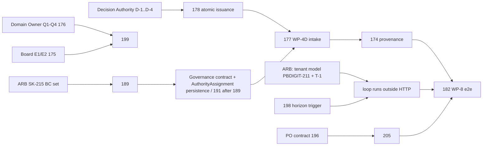

# Adjudication programme — status recovery (read-only)

**Date:** 2026-10-09 · **HEAD:** `f1a483b47` · **Commission:** "Mission 1: Recover the Current State of Adjudication DDD Discovery" (PO, 2026-10-09)

**Nature:** read-only recovery.
- No code, schema, ADR, story or status changed. No test run.
- Prior reports are kept, including `2026-10-01-next-phase-status-and-todo.md`, `2026-10-09-election-review-committee-discovery.md` and `2026-10-09-election-adjudication-blueprint.md`.

**Method:**
- Three parallel read-only corpus investigations (discovery history; strategic map; implementation vs architecture).
- Every material claim used below was then **spot-verified directly** by this session (marked ✔).

**Labels:**
- **F** = fact (source / approved artefact);
- **I** = inference;
- **R** = recommendation;
- **D** = decision required (owner named).
- "Verified" for code means static reading plus the existence of a test exercising real wiring. **No test result is claimed.**

---

## 1. Executive summary

1. **Discovery is complete and frozen for the correction loop (F).**
   - The adjudication domain went from research (Rounds 37-38, 2026-06) through certification (Rounds 47-50) and strategic ratification (EPIC-002, 2026-07-25) to a frozen tactical design (EPIC-004 A-K, Q-1, Q-2, 2026-07-26).
   - The implementation roadmap is WP-1…WP-8.
   - **Accepted shape:**
     - `Determination` aggregate (Draft → Issued → Final);
     - an **Adjudication Process Manager** (not an aggregate; EPIC-004C);
     - authority **owned by Governance** (Q-1);
     - a forward-only correction loop without a saga (ADR-T8).
   - **No discovery restart is warranted.**
2. **Implementation is accepted work-package by work-package, but the loop is not reachable in production (F ✔):**
   - no product entry point (PBDIGIT-196);
   - no caller can deliver an authority decision (WP-4D / PBDIGIT-177, which must follow PBDIGIT-178);
   - determinations never become final (PBDIGIT-197);
   - no horizon or lapse trigger (198 / 206).

   The 2026-10-01 review already called the "verified end to end" claim overstated. **This report confirms that.**
3. **Three defects not tracked in any story were found (F ✔, static; not runtime-reproduced):** *[Update 2026-10-09: T-1 RUNTIME-CONFIRMED; new findings T-4 (cross-tenant write, runtime-confirmed) and T-5 (missing table); see `2026-10-09-adjudication-remediation-gate.md` §10.6.]*
   - **T-1 Relay tenant gap.** The cron-driven outbox / inbox relay (`routes/console.php:55,58`) carries `organisation_id` on every message (`IntegrationEventDispatcher.php:69`, "tenant propagation (ADR-T16)"). **Nothing on that path sets `TenantContext`.** `TenantContext::set` is called only in HTTP middleware and `ElectionManagementController`. Every loop consumer calls `TenantContext::require()` (e.g. `EloquentAdjudicationProcessStore.php:58,150`; `ChallengeOutboxAdapter.php:55,77,101`; `OutboxEventAdapter.php:70,93,114`).
     - **I:** in production every loop consumer would fail and be retried until marked failed.
     - Feature tests set the tenant in `setUp`, which masks this.
     - Same root cause as **PBDIGIT-211** (tenant model for non-request execution), whose scope lists only Membership jobs and the cache flush.
   - **T-2 Raise-time data dropped.** `ChallengeMapper::toRow` (`Contestation/Infrastructure/Persistence/ChallengeMapper.php:28-35`) persists only `id`, `state` and `determination_id`. The raiser-standing, contested-target and content columns (`create_challenges_table.php:29-33`) stay null.
   - **T-3 Election rejections retried as transient.** `CannotApplyDeterminationToUnknownElection` and `DeterminationLacksElectionScope` extend plain `DomainException` (`Election/Domain/Exception/*.php:19`) and do not implement `PermanentInboxFailure`; no translator exists for Election.
     - **I:** they are retried, not dead-lettered, contrary to the handler docblock. Contestation does classify correctly (`ChallengeReactionOutcomeTranslator`).
4. **The strategic baseline itself has an unreconciled contradiction (F).**
   - Two ratified "five bounded context" sets exist and overlap only in Adjudication:
     - EPIC-002 Canonical Context Map (ARB 2026-07-25): Collection & Aggregation, Contemporaneous Record-Fixing, Custodial Integrity, Self-Verifying Integrity, Adjudication;
     - Boundary Decision Register v1.1 (Round 49-06, 2026-06-26): Evidence, Voting, Appointment, Contestation, Adjudication.
   - **The code implements the BDR set.** This is already an open ARB item: SK-215 / PBDIGIT-189.
   - **§3a:** EPIC-002 was scoped as the discovery *of Evidence*. It most likely decomposes Evidence rather than replacing the baseline (inference; needs ARB confirmation). Either way it **does not block the correction loop**.
5. **Single best next step (R, §10):** add T-1 to **PBDIGIT-211** as an additive scope correction, and obtain the **ARB tenant-model ruling** for non-request execution. **Then** resume the programme's binding chain **178 → 177 → 174 → 182**.
   - **Rationale:** without it, every downstream slice, including the already-accepted WP-3A / WP-4A head, cannot run in production. 178 / 177 would only add more code to a path that fails at the first consumer.

## 2. Chronological discovery history (condensed)

| Date | Artefact | Status | Conclusion |
|---|---|---|---|
| 2026-06-16 | Round37-05 ADR-5 Challenge Architecture | APPROVED (research) | Standing classes S-1…S-3. Independent ChallengeReceptionFunction and **ChallengeAdjudicationBody (CAB)**; form B (internal) or C (external) **deferred**. Terminal Authority Principle: rulings final within a cycle. Remedies R-1…R-8 |
| 2026-06-16 | Round37-07 ADR-7 D.5 | APPROVED w/ obs. | CAB independence required; form deferred to Round 38A |
| 2026-06-17+ | Round38B-04 Authority Appointment | APPROVED | CAB is appointed by the Membership Assembly. Recorded tension: the MA appoints the body that adjudicates MA decisions |
| 2026-06-24/25 | Round38C GCD-02 / 05 | Discovery pass 1 | Capabilities only; OQ-38A05-02 (invalidation) **PROTECTED** |
| late June | Rounds 47-02, 48-01, 49-04…06 | CERTIFIED / FROZEN | "Arbitration" renamed Adjudication. The existing code "Adjudication" was committee arbitration, so the certified BC was **unrealised**. BDR v1.1: **greenfield**, paired with Contestation |
| 2026-06-26 | Round 50-01…09, ADR-T-LOG | FROZEN v1.2 | Determination aggregate; request / react terminus (Adjudication issues, Election corrects); ADR-T1…T19 |
| 2026-07-08 | ADR-UL-01, ADR-PL-01 | Accepted | `ContestedOutcomeRef`; TargetType {ElectionResult, Determination}; `DeterminationIssued` schema v2 |
| 2026-07-25 | EPIC-002 Canonical Context Map | ACCEPTED | Adjudication ratified (D1; K1 "never fully automatic") |
| 2026-07-25 | EPIC-003 §1.5 | ACCEPTED | The implemented context is a **subset** of the strategic one: **extend, do not rename** |
| 2026-07-25 | EPIC-004, 004A, 004B, 004C | FROZEN / DECIDED | Q-1 and Q-2 raised. Determination accepted as an aggregate. "AdjudicationProceeding" deferred until Q-1 |
| 2026-07-26 | **EPIC-004 Q-1** | DECIDED / FROZEN | Only a valid constitutional delegation may issue. **Governance owns authority.** Adjudication consumes it through a published contract (name undecided) |
| 2026-07-26 | EPIC-004C (resolution) | RESOLVED | Candidate-2 is a **Process Manager**. Reversal condition: "proceeding / case" enters the business language |
| 2026-07-26 | EPIC-004D…K | FROZEN / APPROVED | Responsibilities; INV-1…7 + INV-B1; one event (`DeterminationIssued`); one command; revoke / amend forbidden (supersession only); APM architecture; ADR-T21…T23 |
| 2026-07-26 | **EPIC-004 Q-2** | RATIFIED (bootstrap values) | Window values CW 30 d / MAD 60 d / LSM 30 d / EPW 120 d. **Constitutional values still need stakeholder review** |
| 2026-07-26 | Implementation roadmap | APPROVED | WP-1…WP-8 |
| 07-27 → 08-04 | WP-1, WP-2, WP-6, WP-7, WP-3A, WP-4A, WP-4B, WP-4C-1 (D1 / D2) | ACCEPTED (R-43, R-66, R-67, R-69, R-87, R-93) | See §9 |
| 2026-08-04 | WP-4 commission | CLOSED (R-98) | New-commission rule adopted (R-100): tactical work only under a new commission after the Domain Owner answers |
| 2026-10-01 | Next-phase review; Track 2 traceability audit | Review | Two BC sets unreconciled (SK-215). R-73 already implemented (correction to 177 proposed). "End to end" overstated |
| 2026-10-09 | Review-committee discovery; adjudication blueprint | Readiness | No new context. Deciding body undecided (D-1…D-9); terminology of the three election bodies corrected |

**How the meaning evolved:**
1. An independent organ (CAB), in research.
2. A greenfield core BC with Contestation (BDR).
3. A narrow recording nucleus. Ruling content lives in the event (ADR-T19); legitimacy is an input (ADR-T17, superseded by ADR-T23).
4. Extended to the judgment half by EPIC-003 / 004.
5. **Final:** the Determination aggregate plus a judgment-free Process Manager that *receives* the authority's decision (K1, ADR-T23).

## 3. Strategic domain and bounded-context map

| Candidate | Status | Purpose / owns | Classification | Code |
|---|---|---|---|---|
| **Adjudication** | Ratified BC in **both** sets | Determination; D1 (automatic vs discretionary; never fully automatic); receives rulings | Strategic Core (Round 48-01) | `app/Contexts/Adjudication` |
| **Contestation** | Confirmed BC in the BDR; **not in EPIC-002** | Challenge lifecycle, standing, admissibility, routing, resolution | Strategic Core | `app/Contexts/Contestation` |
| **Election** ("Election Lifecycle Governance") | BDR: Supporting **subdomain** (candidate merge); Blueprint treats it as a loop context | Operation; applies the consequence (`CorrectionType`) | Supporting | `app/Contexts/Election` + legacy `app/Models/Election.php` |
| Elections (plural) | In no map; older thin slice (EPIC-003:126) | Voter assignment / admission | — | `app/Contexts/Elections` (duplicates Election) |
| **Voting** | Confirmed BC (BDR) | Anonymous vote system of record | Supporting | No context folder (`app/Domain/Voting`, controllers) |
| **Evidence** (+ Replay) | Evidence: Confirmed BC (BDR); Replay: application capability. EPIC-002 decomposes evidence into four contexts instead | `EvidenceEnvelope` | Strategic Core | No context folder; **the evidence-envelope producer is unbuilt** (R-74) |
| **Appointment / Mandate** | Confirmed BC (BDR) | Mandate truth (`DelegationStatus`) | Supporting | **Hosted in `app/Contexts/Governance/Domain/Authority`** |
| **Governance** | **In neither five-set**; EPIC-003:124 "fully built, load-bearing" | Approvals, `GovernanceDecision`, AuthorityAssignment | — | `app/Contexts/Governance` (89 files) |
| Results / Legitimacy | Read models, not BCs (BDR-10 / 11) | `LegitimacyOutcome` projection | Projection | — |
| Audit | Infrastructure capability (BDR-09) | Consumes events, publishes none | Generic | 4 fragmented stores (2026-10-01 §4) |
| Membership (committee identity only) | Operational | `CommitteeId` used by Governance delegation | — | `app/Contexts/Membership` |
| Committee | "Not a context": a read-model seam (EPIC-003:125) | — | — | `app/Contexts/Committee` (2 adapters) |

**Relationship patterns** (Map B / Blueprint §10):
- Contestation → Adjudication: Customer–Supplier.
- Evidence → Adjudication: Published Language (`EvidenceEnvelope`).
- Adjudication → Election: Customer–Supplier, via `DeterminationIssued`.
- Appointment → Authorization: Customer–Supplier plus PL (`Mandate`).

**Map A** (EPIC-002 pattern selection) is frozen for its own five-set and assigns no Governance pattern (Q-1 scope note).

**Correction of the 2026-10-09 blueprint (F):**
- There are **three** `CommitteeId` types, not two:
  - `Governance/Domain/Committee/CommitteeId.php`;
  - `Membership/Domain/Committee/ValueObjects/CommitteeId.php`, which delegation uses;
  - legacy `Membership/Domain/ValueObjects/CommitteeId.php`, with a temporary `CommitteeIdBridge`.
- Governance importing a Membership domain VO breaks ADR-T16 (EPIC-003:124).

### 3a. Baseline lineage (added after reading `docs/architecture/design/`, 230 files, Rounds 14–50)

| Date | Artefact | Bounded-context list | Status |
|---|---|---|---|
| 2026-06-26 | `docs/architecture/design/Architecture_Release_1.0.md` | **Evidence · Voting · Appointment** (operational); **Contestation · Adjudication** (greenfield). Replay = capability, Authorization = service, Lifecycle = supporting, Audit = infrastructure, Results / Legitimacy = read models | **Immutable official baseline** (closes Phase II); "changes only by a versioned re-issue (Release 1.x / 2.0) via ADR" (:4) ✔ |
| 2026-06-27 | `docs/implementation/Architecture_Baseline_1.1.md` | Same (validated by Push A). Challenge lifecycle frozen as Raised → Admitted → Routed → Resolved / Dismissed / Lapsed (Investigating / Adjudicated added later, ADR-T20) | FROZEN reference implementation ✔ |
| 2026-07-09 | `docs/architecture/Architecture_Handover_Release_2.0.md` | **Contestation · Adjudication · Election · Voting · Evidence · Membership · Geography · Governance** (+ Shared Messaging) | "Authoritative starting document" (:3). A **third list**: it **includes Governance and Election**, but is a handover, not a BDR re-issue ✔ |
| 2026-07-25 | `docs/implementation/EPIC-002_Canonical_Context_Map.md` | Collection & Aggregation · Record-Fixing · Custodial Integrity · Self-Verifying Integrity · Adjudication | ARB ACCEPTED, "ratified as the project's Bounded Contexts" |

**I (refines contradiction 11 and SK-215):**
- EPIC-002 was commissioned as the strategic discovery **of the Evidence context**. Its problem statement (`docs/architecture/design/EPIC-002_Problem_Statement_Draft.md:5,24` ✔) says *"Subject: the Evidence operational bounded context"*, and its Q0 explicitly asks whether Evidence should be renamed, merged or split.
- The most coherent reading is that **the four EPIC-002 integrity / collection contexts decompose Release 1.0's "Evidence"**, with Adjudication as their consumer. They do not replace Contestation, Voting or Appointment.
- **But** the ratification sentence is unscoped ("the project's Bounded Contexts"), and **no versioned re-issue of Release 1.0 / BDR exists** (Release 1.0 :4 requires one).
- So the reading is an inference only. **D (ARB, SK-215):** confirm "EPIC-002 = decomposition of BDR-01 Evidence", and issue BDR v1.2 / Release 1.x accordingly.

**Consequence for this programme:**
- The **correction loop sits entirely within Release 1.0 / BDR v1.1** (Contestation, Adjudication, Election-as-Lifecycle), so SK-215 **does not block** 211 / 178 / 177.
- It **does** bear on where the Governance / Appointment authority contract lives (191 / 189). Release 1.0 has "Appointment"; the Handover and the code have "Governance".

## 4. Adjudication responsibilities, lifecycle and integrations

**Responsibilities** (EPIC-004D):
- receive a routed challenge;
- assemble the considered evidence;
- put it before the authority;
- **record** the authority's decision (never compute it);
- issue exactly one Determination per challenge;
- declare failure or expiry.

**Lifecycles (specified):**
- **Challenge:** Raised → Admitted → [Investigating] → Routed → Adjudicated → Resolved. Also Raised → Dismissed; Raised / Admitted → Lapsed. Adjudicated ≠ Resolved (ADR-T20).
- **Determination:** Draft → Issued → Final.
  - INV-1…7: only issue emits; content is fixed at issue; attribution; anonymity.
  - INV-B1: one per challenge.
  - Revoke / amend forbidden; change happens only by a new challenge and supersession (004H §3).
- **APM:** Opened → Assembling ⇄ AwaitingDecision → {Concluded-RulingRequested | Concluded-FailureDeclared | Expired}. Exactly one conclusion.
- **Finality:** issued-at + CW (30 d) with no open challenge, by a scheduled evaluator. No command, no event (`DeterminationFinalized` armed).
- **Horizon:** MAD 60 d without conclusion → Expired. A late decision is dead-lettered.
- **Appeal:** a challenge against a prior Determination; final within the cycle (ADR-5).

**Integrations (published language):**

| Event | Producer → consumer | Catalog v1.0 |
|---|---|---|
| `ChallengeRouted` | Contestation → Adjudication | listed as **internal** (but it crosses: ADR-T21 / R-67) |
| `DeterminationIssued` | Adjudication → Election and Contestation | schema **1** in the catalog vs **2** in ADR-PL-01 |
| `ElectionCorrectionApplied` | Election → Contestation | listed |
| `ChallengeAdjudicated`, `ChallengeResolved` | Contestation → Audit | listed |
| `AdjudicationExpired`, `AdjudicationFailureDeclared` | Adjudication → **no consumer** | **absent** (D3 held, R-97) |

## 5. Decision and ADR register

| Status | Items |
|---|---|
| **Accepted / frozen** | ADR-T1 (one aggregate per transaction), T3 (outbox at-least-once), T8 (no saga; ContainedOnly), T11 (anonymity), T12, T14 (not superseded, R-77), T16 (opaque cross-context refs), T19 (Model B), T20, T21, T22, T23 · ADR-UL-01 · ADR-PL-01 · ADR-001…003 · EPIC-002 map + pattern selection · EPIC-003 · EPIC-004 A-K · **Q-1** · Q-2 (bootstrap values) · Roadmap · R-67, R-69, R-73, R-74, R-75, R-76, R-78, R-79, R-81…R-89, R-92, R-93, R-98, R-100 (`engineering/architecture/adr/ADR-AIP-LOG-Platform-Rulings.md:53-86`) |
| **Superseded** | ADR-T17 → ADR-T23 |
| **Withdrawn** | **R-90**, withdrawn before adoption (log :76 ✔). **`PROGRAM_STATUS.md` still cites it** for WP-4C-2 (:45 ✔): a stale reference |
| **Held** | R-91 (issuance transaction boundary → PBDIGIT-178); D3 / D4 (R-97 → PBDIGIT-175); `DeterminationFinalized` (armed) |
| **Plan-only** | R-95 (`enforceHorizon` isolation, signal classification) |
| **Open / deferred** | ADR-5 / 7 body form (B / C) · Q-1 contract name · Q-2 constitutional values · WP-4C-2 Q1–Q4 (PBDIGIT-176) · COL-5a home (R-96) · OQ-38A05-02 (protected) · EM-OPEN-071 / 066 / 049 / 094 · D-1…D-9 (blueprint) · SK-215 (BC set) · SK-078 (evidence-side contexts) |

## 6. Implementation-versus-architecture matrix

| Capability | Classification | Evidence |
|---|---|---|
| Challenge aggregate and invariants | IMPLEMENTED AND VERIFIED (domain) | `Challenge.php:60-129`; `tests/Unit/Contexts/Contestation/ChallengeTest.php` |
| Contestation service raise / admit / route | IMPLEMENTED AND VERIFIED | `CoordinatesContestation.php:69,86,95`; `ChallengeRaisePathTest.php:238` (raise → APM over the relay) |
| Product entry point (HTTP / UI) | SPECIFIED BUT NOT IMPLEMENTED | no caller in `routes`, `app/Http`, `app/Console` ✔ · PBDIGIT-196 |
| dismiss / investigate / lapse callers | SPECIFIED BUT NOT IMPLEMENTED | PBDIGIT-205 / 206 ✔ |
| Raise-time data persistence | **PARTIALLY IMPLEMENTED: untracked defect T-2** | `ChallengeMapper.php:28-35` ✔ |
| Outbox write (atomic with the aggregate) | IMPLEMENTED AND VERIFIED | adapters + `outbox_events` migration |
| Relay dispatch (cron) | IMPLEMENTED; **ARCHITECTURAL DEVIATION T-1** (tenant not established) | `routes/console.php:55,58` ✔; `OutboxEventProcessor.php` |
| Inbox dedupe / park / dead / redrive | IMPLEMENTED AND VERIFIED | `Inbox.php`, `InboxExecutionEngine.php`; `tests/Feature/Contexts/Shared/Inbox/*` |
| Replay of dead / failed rows | SPECIFIED BUT NOT IMPLEMENTED | no command (untracked) |
| `outbox_processing_errors` table | EVIDENCE INSUFFICIENT | written at `OutboxEventProcessor.php:84` inside a silent try/catch; no migration found (untracked) |
| APM `openFor` | IMPLEMENTED AND VERIFIED | `ChallengeRoutedReactionHandler.php:70` ✔ |
| `receiveRulingDecision` / insufficiency | IMPLEMENTED BUT NOT E2E VERIFIED; DECISION BLOCKED | no caller ✔ · PBDIGIT-177 after 178 |
| `admitIssuanceContext` / `admitEvidence` / `submitToAuthority` | IMPLEMENTED, NO PRODUCER | R-74 / R-75 producers unbuilt; PBDIGIT-181 partial |
| `redriveIssuance` | IMPLEMENTED, NO TRIGGER | unit-tested only (untracked trigger) |
| `enforceHorizon` | IMPLEMENTED, NO TRIGGER | PBDIGIT-198; isolation 180; tenant loop needs the 211 model |
| Issuance via `AdjudicationService` | IMPLEMENTED AND VERIFIED | `TransactionalAdjudicationService`; `AdjudicationServiceIntegrationTest` |
| Issuance via the APM seam | **ARCHITECTURAL DEVIATION (R-91)** | `CoordinatorIssuanceRequest.php:31-39` gets the undecorated coordinator · PBDIGIT-178 |
| Provenance at issuance | ARCHITECTURAL DEVIATION | `EventProvenance::start()` at `CoordinatesAdjudication.php:146-149`; allowlisted · PBDIGIT-174 |
| DB uniqueness (one determination / active process / applied determination) | IMPLEMENTED | migrations `:28`, partial index, ledger unique |
| Issuance marker timestamp | DEFECT | PBDIGIT-158 (2 h shift) |
| Election reaction | IMPLEMENTED AND VERIFIED (seeded tenant); **T-3** misclassification | `DeterminationIssuedReactionHandler.php`; ledger record only (ContainedOnly) |
| Contestation reactions | IMPLEMENTED AND VERIFIED | `ContestationReactionMessagingTest` |
| Reactions to Expired / FailureDeclared | DECISION BLOCKED | PBDIGIT-175 / 176 / 199 |
| Governance `AuthorityAssignment` | SPECIFIED (domain + unit tests) BUT NOT IMPLEMENTED in infrastructure / the loop | no repository implementation, binding or table ✔ · epic PBDIGIT-191 not opened |
| Authority validation at issuance | SPECIFIED BUT NOT IMPLEMENTED | `IssuedByAuthority`: non-empty check only (Q-1 "seed") |
| Finality evaluator | SPECIFIED BUT NOT IMPLEMENTED | PBDIGIT-197 (roadmap WP-6 scope; WP-6 accepted without it) |
| Tenant isolation | PARTIAL / DEVIATION | `organisation_id` on all rows ✔; not established on the consumer path (T-1) |
| End-to-end loop | NOT IMPLEMENTED | `CorrectionLoopIntegrationTest` seeds a Routed challenge and issues directly; PBDIGIT-182 deferred |

## 7. Verified backlog status and dependency graph

Index: `docs/publicdigit/backlog/README.md:248-292`. Specifications for 159–208 are in `2026-10-01-pbdigit-completeness-audit.md`. **Binding order there (:641): 178 → 177 → 174 → 182.**

| ID | Status (README ✔) | Code check | Blocker |
|---|---|---|---|
| 158 | OPEN | confirmed | root cause unknown |
| 174 | BLOCKED (ownership) | confirmed | ARB |
| 175 | HELD | confirmed | Board E1 / E2 |
| 176 | BLOCKED | confirmed | Contestation Domain Owner Q1–Q4 |
| 177 | NOT AUTHORISED (after 178) | confirmed. **Correction proposed (2026-10-01): R-73 part already done** | 178 |
| 178 | UNAUTHORISED | confirmed | Decision Authority D-1…D-4. **PROGRAM_STATUS: "wire no production caller ahead of it"** ✔ |
| 179 | OPEN, unallocated | — | allocation |
| 180 | plan authorised only | confirmed | Gate C |
| 181 | BLOCKED (contradictory record: ChallengeRaised internal vs R-75) | confirmed | ARB |
| 182 | DEFERRED (R-79) | confirmed | 174–178, 160 |
| 189 | DECISION REQUIRED | — | ARB (epic numbering; touches SK-215) |
| 191 | NOT OPENED | confirmed | 189; ARB order |
| 196 | OPEN (PO contract) | confirmed | PO; 177 / 178 |
| 197 | BLOCKED | spec | integration contract |
| 198 | OPEN (ARB vs R-91) | confirmed | ARB; tenant loop (211) |
| 199 | DEFERRED | confirmed | Decision C |
| 205 / 206 | OPEN, unallocated | confirmed | 196 / — |
| 211 | OPEN, ARB decision | **scope misses T-1** | ARB tenant model |

**Overlaps:**
- 180 / 198 (same timer);
- 175 / 176 / 199 (failure and expiry dispositions);
- 158 / 178 (same path);
- 211 ⊇ T-1 (same root cause).

**Not tracked anywhere:**
- T-1, T-2, T-3;
- the `redriveIssuance` trigger;
- the evidence-envelope / `admitEvidence` producer;
- a dead / failed replay tool;
- the `outbox_processing_errors` migration;
- the stale R-90 citation.

## 8. Outstanding invariants, risks, defects, evidence gaps

| Item | Kind | State |
|---|---|---|
| P1: only a valid in-scope delegation issues | invariant | **unenforced** (non-empty check; Governance contract unbuilt) |
| INV-B1 / P3: one determination per challenge | invariant | enforced (DB + PM) |
| TargetType closed | invariant | enforced (enum) |
| Tenant consistency c / d / election | invariant | rows yes; **consumer path no (T-1)** |
| Truthful transition evidence | invariant | election `from_state` defect (PBDIGIT-58) |
| Anonymity (ADR-T11) | invariant | schema-safe; free-text unscreened (blueprint D-7) |
| Duplicate / replay / out-of-order | risk | handled (inbox, PM no-op, DB unique) |
| Atomicity at the APM issuance seam | defect | R-91 / 178 |
| Provenance break | defect | 174 |
| Late-decision honoured? | risk | refused after expiry (`LateDecisionOnExpiredAdjudication`) ✔ |
| Clock: delegation closed `[start, end]` vs voting window half-open | risk | to pin in tests |

**Document contradictions** (preserved, not resolved):

| # | Side A | Side B |
|---|---|---|
| 1 | Round50-07: finality is an authority act | Q-2: temporal policy |
| 2 | Round50-07 and the knowledge pilot: "override via amendment" | 004H: amendment forbidden |
| 3 | Round50-07: "Draft = authority verified" | non-empty check only |
| 4 | Knowledge pilot: owns legitimacy | ADR-T19 |
| 5 | ADR-5: terminal authority ElectionConstitution | Round38A-06: MA appeal terminal |
| 6 | Catalog v1.0 (`ChallengeRouted` internal; `DeterminationIssued` v1; "11 events" with 12 rows; no Expired / FailureDeclared) | ADR-T21 / PL-01 / code |
| 7 | ADR-T1 / T14 | R-91 two transactions |
| 8 | Roadmap WP-6 includes finality | 197 unbuilt |
| 9 | PROGRAM_STATUS cites R-90 | withdrawn |
| 10 | APM partial index permits re-adjudication | Challenge can't re-route |
| 11 | Release 1.0 / BDR v1.1 five-set (immutable baseline) | EPIC-002 five-set (ratified unscoped); Handover 2.0 eight-list. Likely scoped decomposition, §3a |
| 12 | Q-1 "an actor" | code: delegate is a committee |
| 13 | R-75 publish `ChallengeRaised` | ADR-UL / PL: internal |

The knowledge pilot `docs/knowledge/domains/adjudication/` is stale (no APM; old roadmap).

**Evidence gaps:**
- T-1 / T-3 are static readings; **runtime reproduction is pending** (needs an isolated, serialised test DB: PBDIGIT-263). *[Update: T-1 runtime-confirmed on `nrna_test_adjudication`; T-3 remains static, being masked by T-1.]*
- No test was run in this mission.

## 9. Completed versus incomplete phases

| Phase | Status |
|---|---|
| Research (R37-38), certification (R47-50), strategic (EPIC-002), tactical (EPIC-003 / 004 A-K, Q-1, Q-2) | **Complete / frozen** |
| EPIC-001 PB-001…007 | Accepted (on `main`) |
| WP-1 EvidenceSet v3 | Accepted |
| WP-2 APM core | Accepted |
| WP-3A ChallengeRouted PL | Accepted (R-67) · **WP-3B blocked (174)** |
| WP-4A inbox wiring | Accepted (R-69) |
| WP-4B conclude → issue seam | Accepted (R-87); R-91 deviation on one path |
| WP-4C-1 | D1 / D2 accepted (R-93); D3 / D4 held |
| WP-4C-2 | Awaiting the Domain Owner (Q1–Q4) |
| WP-4D | Not authorised (177) |
| WP-5 raise path | Done (raise / admit / route only) |
| WP-6 temporal machinery | Accepted (R-43); finality evaluator missing (197); no trigger (198) |
| WP-7 retention | Closed (R-66) |
| WP-8 end to end | Deferred (R-79) |
| Product layer (filing, admissibility, deciding body) | Not started; decisions D-1…D-9 |

## 10. Recommended next action

**R: add T-1 to PBDIGIT-211 as an additive factual correction (PO), then obtain the ARB ruling on the tenant model for non-request execution.**

- **Rationale:**
  - T-1 sits **upstream of every hop** of the loop, including the accepted WP-3A / WP-4A head.
  - Until it is ruled, 178 / 177 / 198 / 182 would each add code to a path that fails at its first consumer outside HTTP.
  - The story already exists (no new ID needed), already waits on exactly this ARB decision, and has the same root cause.
  - The ruling also unblocks 198 (the horizon trigger needs a tenant loop) and the Membership jobs.
- **Prerequisites:**
  1. PO accepts the T-1 / T-2 / T-3 findings and routes them: T-1 → 211; T-2 / T-3 → new or existing items at PO discretion. **This mission opens nothing.**
  2. An authorised RED characterisation test reproduces T-1 (relay without ambient tenant). It runs only on an isolated or serialised test DB.
- **Then:** the binding chain 178 → 177 (with the Governance contract / 191 per Q-1) → 174 → 182. In parallel, the decision track (§11).

## 11. Prioritised TODO

| # | Item | Owner |
|---|---|---|
| 1 | Route T-1 → PBDIGIT-211 (additive); decide where T-2 / T-3 live | **PO** |
| 2 | Tenant model for non-request execution (211 + T-1) | **ARB** |
| 3 | R-91 repair authorisation (D-1…D-4) → PBDIGIT-178 | **Decision Authority** |
| 4 | Which BC set governs (SK-215): confirm EPIC-002 as a decomposition of Evidence (§3a) and re-issue BDR / Release 1.x. Appointment vs Governance naming → PBDIGIT-189 → open 191 | **ARB** |
| 5 | Q-1 contract name and delegation-scope vocabulary; delegate = committee vs person | **ARB / Governance owner** |
| 6 | WP-4C-2 Q1–Q4 (PBDIGIT-176) | **Contestation Domain Owner** |
| 7 | D3 / D4 (175); catalog v1.1 incl. Expired / FailureDeclared, ChallengeRouted PL, schema v2 | **Board E1 / E2** |
| 8 | Deciding body, appointment, procedure, jurisdiction, standing, finality (blueprint D-1…D-9) | **PO / ARB / Domain Owner** |
| 9 | Additive corrections: 177 (R-73 done), PROGRAM_STATUS R-90 reference, stale knowledge pilot | **PO** (records) |
| 10 | S0 two-person hardening (G3, identity by id): independent of the loop | **PO** authorisation |
| 11 | Serialised / isolated test DB (PBDIGIT-263), a precondition for any evidence run | **PO / engineering** |

## 12. Sources and confidence

**High (direct read ✔):**
- `CoordinatesContestation.php`, `ChallengeMapper.php:28-35`, `ChallengeState.php`, `TargetType.php`;
- `AdjudicationProcessManager.php:28-245`, the determinations / challenges migrations;
- `Governance/Domain/Authority/*`, `AuthorityEffectivePeriod.php:30-40`;
- `routes/console.php:55,58`, `TenantContext` callers, `IntegrationEventDispatcher.php:69`, the Election exception classes;
- `ElectionMembership.php:202-246`, `routes/organisations.php:274-281`;
- the backlog README :248-292;
- `ADR-AIP-LOG-Platform-Rulings.md` R-90 row :76, `PROGRAM_STATUS.md:40-48`;
- `EPIC-004_Q1_Authority_Resolution.md`, `2026-10-01-next-phase-status-and-todo.md`.

**Medium (investigation reports, cited paths, not individually re-read):**
- chronology rows for Rounds 37-50 and EPIC-004 A-K;
- the contradiction table;
- the test inventory;
- the T-3 retry behaviour inside `InboxExecutionEngine`;
- the `outbox_processing_errors` missing migration;
- the catalog row details.

**Inference only:**
- the production failure mode of T-1 and T-3, which were not run.
