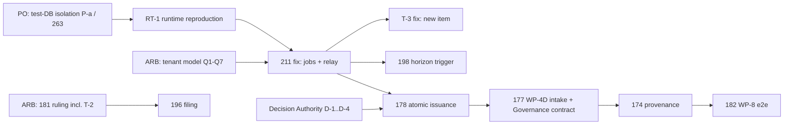

# Adjudication remediation gate — T-1 tenant context, T-2, T-3 (decision package)

**Date:** 2026-10-09 · **Commission:** "Mission 2 — Adjudication Remediation Gate and Decision Preparation" (`docs/publicdigit/election_management/brainstorming/20261009_2230_implementation.md`) · **Predecessor:** `2026-10-09-adjudication-programme-status-recovery.md` (kept)

**Nature:** decision package.
- No production code, schema, ADR, story text or status changed.
- **No test executed** (§4 explains why). *[Superseded 2026-10-09: executed after PO approval on `nrna_test_adjudication`; see §10.6.]*
- **Labels:**
  - **F** = fact (✔ read directly this session at HEAD `177caf687`);
  - **I** = inference;
  - **R** = recommendation;
  - **ARB** = rule requiring ARB approval;
  - **D** = other decision required.

## 1. Repository and story status

| Item | State |
|---|---|
| HEAD | `177caf687` (governance committee / authority discovery, PBDIGIT-266; **documentation only**) |
| Loop code changes since the status report (`f1a483b47`) | **None** in `app/Contexts`, `TenantContext`, `app/Console` or `routes/console.php` ✔. **T-1 / T-2 / T-3 are unaddressed.** |
| PBDIGIT-211 | 🔴 OPEN; **ARB decision first**: "authoritative tenant-context model for non-request execution", explicitly naming "scheduled jobs, queues, **event consumers**, commands, projections…". Evidence and acceptance criteria cover **only four jobs** (fees, overdue, reminders, voter-cache flush) ✔ |
| PBDIGIT-263 | OPEN, technical debt, not authorised. `Tests\TestCase` skips per-test transactions on pgsql; `RefreshDatabase` runs `migrate:fresh` **once per process** against the configured DB ✔ |
| Uncommitted work in the tree | Another session's Membership / governance documents; this session's PBDIGIT-256 test changes and review documents. Untouched by this mission. |

## 2. Verified evidence

### T-1: the relay does not establish organisation context (F ✔, static; **not runtime-reproduced**) *[Superseded: RUNTIME-CONFIRMED, §10.6]*

| Link | Evidence |
|---|---|
| The relay runs outside HTTP | `routes/console.php:55` `outbox:process` everyMinute; `:58` `inbox:redrive` everyMinute |
| The relay reads all tenants (correct) | `OutboxEventProcessor::handle()` queries `OutboxEvent::query()->pending()…limit(100)` (`:24-33`). `OutboxEvent` / `InboxEvent` have **no** tenant global scope, only an explicit `scopeForTenant` (`OutboxEvent.php:81`, `InboxEvent.php:99`) |
| The organisation is carried, not applied | outbox row → `IntegrationEvent.organisationId` → `InboxMessage` (`IntegrationEventDispatcher.php:69`, "tenant propagation (ADR-T16)") → inbox row `organisation_id` (`Inbox.php:63`) |
| Nobody applies it | `TenantContext::set` callers: `Http/Middleware/TenantContext.php:54,85`, `IdentifyTenantFromHeader.php:48`, `ElectionManagementController` (4×). **None** on the console / relay / inbox path |
| Consumers require it | `TenantContext::require()` throws `RuntimeException('Tenant context not set')` (`app/Services/TenantContext.php:48-52`). Required by `EloquentAdjudicationProcessStore.php:58,150`; `OutboxEventAdapter.php:70,93,114`; `ChallengeOutboxAdapter.php:55,77,101`; `ReactionOutboxAdapter` |
| How the failure is handled | `InboxExecutionEngine.php:46-77` classifies only `CausalPreconditionMissing` (park), `IdempotentReplay`, `PermanentInboxFailure` (dead). **Anything else rolls back and propagates** → `OutboxEventProcessor` `handleFailure` → retry every 5 min, `failed` after 5 attempts (`:12, 100-104`) |
| Why tests did not see it | Every loop integration test calls `TenantContext::set($orgId)` in `setUp`: `CorrectionLoopIntegrationTest.php:57`, `ChallengeRaisePathTest.php:62`, `ElectionReactionMessagingIntegrationTest.php:47` ✔ |
| Accepted rule it violates | **ADR-MP** (Accepted 2026-07-07). The dispatcher invariants include "**tenant propagation / isolation**" (`ADR-MP-Messaging-Platform.md:68`); ADR-MP-04: Messaging "must never cross tenants" (`:41`). PB-006 design row 7: "consumption is org-scoped" (`PB-006_Integration_Validation_Implementation_Design.md:38`), verified only under an ambient test tenant |

**I (predicted production behaviour):**
- Every routed challenge's `ChallengeRouted` fails in the Adjudication consumer.
- It is retried 5 times over ~25 minutes, then the outbox row becomes `failed`.
- No adjudication process opens and nothing alerts.
- The same applies to `DeterminationIssued` and `ElectionCorrectionApplied` once those paths have producers.
- **The loop is therefore inert even at its already-accepted head (WP-3A / WP-4A).**

### T-2: raise-time data not persisted (F ✔); **reclassified** from "mapper bug" to "documented deferral without an owner"
- `Challenge` holds only `id`, `state` and `determinationId` (`Challenge.php:34-40`). The raise facts (`RaiserStandingRef`, `ContestedOutcomeRef`, `SubmittedContent`) exist **only in the `ChallengeRaised` event** (`:60-71`).
- `ChallengeMapper::toRow` (`:28-35`) therefore cannot persist them. The nullable columns exist (`create_challenges_table.php:29-33`).
- **This was deliberate:** `developer_guide/contestation/03_persistence.md:17,39`: *"a later backlog item populates them additively"*; *"Don't add raise-time columns to the mapper in this slice."* **No backlog item was ever named** ✔ (grep).
- `ChallengeRaised` is not published (`CoordinatesContestation`: "raise() and admit() publish NOTHING"). The facts are therefore **lost after the raise transaction**.
- They are the very facts R-75 requires downstream (`ContestedOutcomeRef` → `admitIssuanceContext`).
- **Severity: latent.** There is no product filing path (196), but it is a hard prerequisite of 196 and of the R-75 producer.

### T-3: Election rejections retried as transient (F ✔, static)
- `CannotApplyDeterminationToUnknownElection` and `DeterminationLacksElectionScope` extend `DomainException` and do not implement `PermanentInboxFailure` (`Election/Domain/Exception/*.php:19`) ✔.
- Election has no outcome translator. Contestation does (`ChallengeReactionOutcomeTranslator`).
- **I:** a determination for an unknown or out-of-organisation election is retried 5 times and ends as an outbox `failed` row, **not** an inbox `dead` row with a reason. That contradicts the handler's own docblock (`DeterminationIssuedReactionHandler.php:27-28`).
- **Interaction with T-1:** with T-1 unfixed, `LegacyElectionExistenceAdapter` filters on `TenantContext::get()` = null. **Every** election would look "unknown", so T-1 must be fixed before T-3 can be observed correctly.

## 3. Proposed PBDIGIT-211 scope clarification (additive; for PO approval; not applied)

> **Proposed addendum: "Event consumers on the relay path" (2026-10-09).**
>
> - **Evidence:** T-1 above. The outbox / inbox relay (`outbox:process`, `inbox:redrive`, both scheduled every minute) dispatches every organisation's events with no tenant context. The correction-loop consumers require one and fail transiently, so every `ChallengeRouted` (and, later, `DeterminationIssued` / `ElectionCorrectionApplied`) ends as a `failed` outbox row. Same root cause as the four jobs; **failure mode differs: they fail loudly-but-silently (retry → failed), whereas the jobs return empty sets.**
> - **Scope added:** the ARB model must also cover (a) the relay and inbox redrive; (b) every inbox handler; (c) outbox writes performed *inside* a consumer (Election writes `ElectionCorrectionApplied`).
> - **Acceptance added:**
>   - **AC-R1:** with two organisations and no ambient tenant, the relay delivers each organisation's event and each consumer's writes carry that event's `organisation_id` only.
>   - **AC-R2:** after each message, success or failure, the ambient tenant equals its value before the message.
>   - **AC-R3:** a message whose `organisation_id` names no existing organisation is not processed under any tenant and is not silently dropped. Its classification is **ARB** (§5, Q4).
>   - **AC-R4:** a message is never processed under a tenant different from its `organisation_id`.
> - **Out of scope (unchanged):** queue-driver behaviour; the request-time scope (65 / 69).

**Status, epic and title are not changed.** Title suggestion (D, PO): "…scheduled jobs **and event consumers** see no tenant data".

## 4. Runtime reproduction plan (designed, **not executed**) *[Superseded: executed 2026-10-09; results in §10.6]*

**Why it was not executed (F ✔):**
- `RefreshDatabase` runs `migrate:fresh` once per PHP process on the configured testing DB (`nrna_test`; PBDIGIT-263).
- Another session commits work in this repository today and has previously run suites on the same DB. A run from here could wipe its data mid-run, and vice versa: two prior runs on 2026-10-07 / 09 were invalidated this way.
- No dedicated database exists, and creating one is an environment change this session will not make without authorisation.

**Prerequisite (D, PO), choose one:**

| Option | What | Notes |
|---|---|---|
| **P-a (R)** | A dedicated test database, e.g. `nrna_test_adjudication`, created by the PO. The run uses `DB_DATABASE=nrna_test_adjudication php artisan test --filter=…` as a process env override. **No `.env` change.** | Fully isolated; repeatable |
| P-b | Serialise with the other session: an explicit agreed window, `ps` check before and after, abort on overlap | Cheap; evidence fragile |
| P-c | First authorise the PBDIGIT-263 guard (refuse to run unless the DB name is the testing DB) | Safety, not isolation; complements P-a |

**Test design** (one new feature test class; **authorisation required to create it**). It exercises the real relay; nothing on the tenant path is mocked.

| ID | Arrange | Act | Assert | Phase |
|---|---|---|---|---|
| RT-1 | Org A; `TenantContext::set(A)`; raise + admit + route a challenge through the bound `ContestationService` (writes the real `ChallengeRouted` outbox row); then `TenantContext::clear()` | `Artisan::call('outbox:process')` | No `adjudication_processes` row for the challenge; outbox row `attempts = 1`, still pending; no `processed` inbox row for consumer Adjudication; `OutboxEventProcessor::$lastException` message = `Tenant context not set` | **RED: reproduces T-1** |
| RT-2 | As RT-1 | relay | Exactly one active process for the challenge with `organisation_id = A`; outbox processed; ambient tenant null afterwards | GREEN after the fix |
| RT-3 | Orgs A and B, one routed challenge each; ambient cleared | relay once | Each process row carries its own organisation; zero rows under the wrong organisation | Isolation |
| RT-4 | Ambient set to B (simulated leak); an A event pending | relay | The A event is processed under A **or** refused per the ARB rule; **never** writes under B; ambient = B afterwards | Mismatch |
| RT-5 | Consumer forced to fail permanently (an A event for an unknown election via `DeterminationIssued`) | relay | Ambient restored after failure; with the T-3 fix, inbox `dead` with a reason | Cleanup / T-3 |
| RT-6 | Event with a non-existent `organisation_id` | relay | Classified per ARB Q4; never processed under any tenant | Unknown organisation |

**Hygiene:**
- Each test creates its own organisations (no reliance on rollback; PBDIGIT-263).
- `TenantContext::clear()` in `tearDown`.
- **Do not** call `TenantContext::set` in `setUp` (that is the masking pattern).

## 5. ARB decision request: tenant context for non-request execution

**Constraints the ruling must respect (F):**
- **ADR-T16:** cross-context identities cross as opaque strings; the Election domain stays tenant-free (handler docblock :33-34).
- **ADR-MP-04:** Messaging *preserves* tenant isolation and never owns it; guards are hosted by the constitutional suite.
- **ADR-MP dispatcher invariants:** tenant propagation / isolation; consumer isolation; replay safety.
- **The inbox `organisation_id` is `NOT NULL` FK** (PB-003 D-06). The message is therefore the authoritative carrier of the organisation for consumed work.
- The `BelongsToTenant` fallback (slug `platform` ≠ `publicdigit`) is already in 211's decision space.

**Questions:**

| # | Question | Options (none chosen) |
|---|---|---|
| Q1 | Where is the organisation established for consumed messages? | (a) at the **inbox boundary** from `InboxMessage::organisationId()`, for exactly one handler invocation; (b) **explicit parameter**: ports / adapters take the organisation from the message, no ambient state; (c) a **scoped-execution primitive** (`run-as-organisation(org, fn)`), used uniformly by relay, inbox redrive and scheduled per-tenant iteration |
| Q2 | Ambient state allowed at all outside HTTP? | Static `TenantContext` is process-global. Under long-running workers it leaks unless restored. (a) / (c) need guaranteed restore; (b) avoids it but touches every adapter |
| Q3 | Behaviour if an ambient tenant is already set and differs from the message's | refuse (permanent) · override for the call and restore · ignore ambient |
| Q4 | Unknown / soft-deleted organisation on a message | permanent failure (dead, with reason) · park · transient |
| Q5 | Missing context in a tenant-scoped query outside HTTP | **fail loudly** (remove the `platform` fallback) vs a fixed fallback slug; shared with the four jobs |
| Q6 | Does the mechanism live in Shared Messaging (platform) or in a tenancy capability that Messaging calls? | ADR-MP-04 suggests Messaging *preserves*, so a tenancy capability Messaging invokes |
| Q7 | One model for scheduled jobs and consumers, or two? | 211 asks for "the authoritative" model, so one is presumed |

**R (non-binding):**
- Options Q1-(a) and Q1-(c) are compatible: (c) is the primitive, and (a) is its use at the inbox boundary.
- They change one boundary instead of every adapter, and keep the domain tenant-free (ADR-T16).
- For any option, the ruling should fix AC-R2 (restore) and Q3 / Q4 explicitly. **This is a recommendation, not a choice.**

## 6. Proposed ownership for the other defects (no ID created; no record changed)

| Finding | Existing candidate | Recommendation (D, PO) |
|---|---|---|
| T-1 | **PBDIGIT-211** | Additive addendum (§3). No new story |
| T-2 | **PBDIGIT-181** ("ChallengeRaised publication": blocked, contradictory record R-75 vs ADR-UL / PL "internal") owns *where raise facts go*; **196** consumes them | Annotate **181** with T-2: raise facts are currently lost; the developer-guide deferral names no owner. The ARB ruling on 181 decides between persisting them on the aggregate / row and publishing `ChallengeRaised`. **No new story** |
| T-3 | **None owns it.** PB-004 (Election reaction) is closed and accepted; **182** (WP-8) would *detect* it but is a deferred validation epic, and folding a defect into it would hide it | **New backlog item** (needs PO approval under the frozen-baseline rule: "new IDs only for an obligation shown not covered"; it is not covered). Title suggestion: "Election rejects a determination for an unknown election by retrying it instead of dead-lettering it". Depends on 211 (T-1 masks it) |
| Stale R-90 citation in `PROGRAM_STATUS.md:45`; 177 R-73 correction | — | PO record corrections (status report §11 #9) |

## 7. Dependencies and preserved sequence



**Preserved (F):**
- binding order **178 → 177 → 174 → 182**;
- "wire no production caller ahead of" 178 (`PROGRAM_STATUS.md`);
- authority stays Governance-owned (Q-1); the APM records and never computes (K1, ADR-T23);
- Challenge / Determination unchanged.

**Not started:** committee, filing UI, finality, horizon.

**I:** 211 is placed **before** 178. 178's own acceptance needs a container test, and every container test of a consumer path is masked today by `setUp` tenants.

## 8. Acceptance criteria, risks, rollback

**Acceptance for the eventual 211 fix (relay part):**
- AC-R1 … AC-R4 (§3);
- RT-1 turns from RED to GREEN; RT-3 / RT-4 / RT-6 pass;
- the existing loop suites pass **after removing `TenantContext::set` from their `setUp`**, or a test-level guard proves it is unset at relay time;
- no new writer of tenant state outside the ruled mechanism (a fitness test);
- the 97-suite regression has no pass → fail.

**Risks:**

| Risk | Detail |
|---|---|
| Ambient-state leakage in long-running workers | AC-R2 |
| Silent cross-tenant processing if Q3 is wrong | — |
| Masking tests: fixing code but keeping `setUp` tenants would prove nothing | — |
| Burst of `failed` outbox rows in any environment where the relay already ran | Recovery needs a replay path, which **does not exist** for `failed` rows (status report §6). **I:** check before deploying a fix |

**Rollback:**
- The fix is confined to one boundary under Q1-(a) / (c), so revert is a code revert.
- No schema change is expected.
- `failed` rows are untouched by a revert.

## 9. One recommended next action

**R:** the PO approves (1) the §3 PBDIGIT-211 addendum and (2) test-isolation option **P-a** (a dedicated test database, run via a process env override). That authorises **only** writing and running RT-1 to obtain runtime confirmation of T-1. In parallel, the ARB receives §5.

**Rationale:**
- Runtime confirmation converts the highest-impact finding from static to evidenced, in one small, reversible, test-only step.
- The ARB then rules on an evidenced defect.
- Every later slice (178, 177, 198) depends on the outcome.

**Requires from you:**
- (a) approval of the addendum text;
- (b) creation of, or approval to create, the dedicated test DB;
- (c) authorisation to create the RT-1 test file. RED only; no production change.

---

## 10. Execution record (2026-10-09, after PO approval of the three bounded steps)

### 10.1 Repository reconciliation (the Stop-hook "database changes" warning)
- `git diff --stat -- app/ routes/ config/ database/` shows **one file: `database/factories/OrganisationFactory.php`** (`faker->unique()->company()`).
- This is a **test-data factory**, part of the uncommitted PBDIGIT-256 work (2026-10-07), not production code.
- No file under `app/`, `routes/`, `config/` or `database/migrations` is changed.
- The hook classifies `database/` as a code area, which explains its "database implementation changes / missing guide" message. **Verdict: no production code changed by this programme work.** *[Correction 2026-10-09, §11.3: the warning was NOT triggered by the factory. The hook maps only `database/migrations/**`; the trigger was the concurrent session's PBDIGIT-260 migration.]*

### 10.2 Step 1: PBDIGIT-211 clarification (approved: additive)
- `docs/publicdigit/backlog/PBDIGIT-211-scheduled-jobs-see-no-tenant-data.md`: new section **"Addendum (2026-10-09, PO-approved scope clarification): event consumers on the relay path"**.
- Original text, status, epic and acceptance criteria are unchanged. The ARB decision is marked **PENDING**. AC-R1 … AC-R4 were added.
- The backlog README row is unchanged.

### 10.3 Step 2: dedicated test database
**Isolation evidence:**
- **The originally proposed env override is UNSAFE and was not used.**
  - PHPUnit 11.5.6 writes every `<server>` entry of `phpunit.xml` into `$_SERVER` unconditionally (`vendor/phpunit/phpunit/src/TextUI/Configuration/PhpHandler.php:94`).
  - `tests/bootstrap-test-database.php` additionally pins `DB_DATABASE=nrna_test` in `$_SERVER`, `$_ENV` and `putenv`.
  - A shell `DB_DATABASE=…` override would therefore **still have run against `nrna_test`**.
- **Safe route prepared (scratchpad only, not in the repository):**
  - `scratchpad/bootstrap-adjudication.php`: a copy of the repository bootstrap pinning `nrna_test_adjudication`; it **aborts** if the pin is not effective.
  - `scratchpad/phpunit-adjudication.xml`: a copy of `phpunit.xml` with that bootstrap, `DB_DATABASE=nrna_test_adjudication` and absolute paths.
  - Neither repository safety file was modified. No config cache exists (`bootstrap/cache` holds only packages / services).
- **Concurrency check:** `ps` showed no running phpunit / artisan test / migrate process.

**Creation attempt (non-destructive):**
- A scratch script booted Laravel exactly as the harness does (credentials resolved by Laravel from `.env.testing`; the file was **not** read).
- It connected to the **`postgres` maintenance database**. Effective connection: `host=127.0.0.1 port=5432 user=publicdigit_user database=postgres`.
- `nrna_test_adjudication` existed before: **no**.
- **`pg_roles.rolcreatedb` for `publicdigit_user` = false.**
- `CREATE DATABASE nrna_test_adjudication` → `SQLSTATE[42501] permission denied to create database`.

**BLOCKER (per the approval's condition):**
- Safe isolation cannot be established by this session.
- **Nothing was created, and no fallback to `nrna_test` was attempted.**
- **Required:** a PostgreSQL superuser creates the database owned by the test role. For example, from the PO's shell:
  - `sudo -u postgres createdb -O publicdigit_user nrna_test_adjudication`;
  - plus any extensions the migrations need (the run will report them if missing).

### 10.4 Step 3: RT test
**Created:** `tests/Feature/Contexts/Shared/Messaging/RelayTenantContextTest.php` (test-only; `php -l` clean).
- Produces real `ChallengeRouted` outbox rows through the production `ContestationService`. The tenant is set only while producing, then **cleared**.
- Drives the relay via `Artisan::call('outbox:process')`. No tenant is set in `setUp` (the base `TestCase::setUp` clears it); nothing on the tenant path is mocked.

| Test | Criterion | Expected now (if T-1 holds) |
|---|---|---|
| `test_the_scheduled_relay_opens_the_adjudication_without_an_ambient_tenant` (RT-1) | AC-R1 | **FAIL**; diagnosis message carries `RuntimeException: Tenant context not set` |
| `test_one_relay_pass_delivers_each_organisations_event_under_its_own_organisation` (RT-3) | AC-R1 / R4 | **FAIL** |
| `test_the_relay_leaves_no_tenant_behind` (RT-2) | AC-R2 | likely **PASS** today (nothing sets the tenant). Guards the future fix |
| `test_a_foreign_ambient_tenant_never_captures_another_organisations_event` (RT-4) | AC-R4 / R2 | **unknown**: with B ambient, A's event may be written under B (a cross-tenant write) or fail. **This is the most important observation of the run** |
| `test_an_event_of_a_soft_deleted_organisation_is_classified_per_the_arb_ruling` (RT-6) | AC-R3 | **incomplete** by design. A non-existent organisation is impossible (FKs, cascadeOnDelete); a soft-deleted one is the reachable case; classification is ARB Q4 |

**Executed:** **none.** **Results observed:** **none.**
- **T-1 remains statically evidenced, not runtime-confirmed.**
- **Run command, once the DB exists** (from the repository root):

  ```
  php vendor/bin/phpunit -c <scratchpad>/phpunit-adjudication.xml \
      --filter RelayTenantContextTest
  ```

  First run a preflight that prints the effective connection (database must be `nrna_test_adjudication`); abort otherwise.

### 10.5 Remaining decisions and TODOs
1. **PO / DBA:** create `nrna_test_adjudication` (superuser); then this session runs the preflight and RT; results are recorded here.
2. **ARB:** Q1–Q7 (§5), as a separate decision package. Answers are not assumed.
3. **PO:** T-2 → annotate 181; T-3 → new backlog item (§6).
4. **PO:** commit authorisation for the 211 addendum, the RT test and the review documents. **Nothing is committed.**
5. **Binding sequence preserved:** 178 → 177 → 174 → 182. No issuance-path caller; no production code.

### 10.6 Runtime execution (2026-10-09, after the PO created `nrna_test_adjudication`)

**Isolation evidence (preflight before every run):**
- `scratchpad/preflight.php`, booted through the scratch bootstrap, printed `default=pgsql host=127.0.0.1 user=publicdigit_user database=nrna_test_adjudication` and `current_database()=nrna_test_adjudication`.
- 0 tables before the first run.
- No other connections to `nrna_test` or `nrna_test_adjudication`; no concurrent phpunit / artisan test process.
- **`nrna_test` was never connected to.**

**Command** (repository root; 5 runs in total):

```
RELAY_TEST_DIAGNOSE=1 php vendor/bin/phpunit -c <scratchpad>/phpunit-adjudication.xml \
    --filter RelayTenantContextTest --display-incomplete
```

**Run history:**
- **Runs 1–4:** 2 errors (`SQLSTATE 25P02 current transaction is aborted`) and 1 failure.
  - **Diagnosed as a test-harness artefact.** The class redeclared `use RefreshDatabase`, which re-enables the per-test transaction that `Tests\TestCase` skips on pgsql. The diagnostic showed `transactionLevel before=1 after=1`.
  - Inside that outer transaction, the processor's failure handler inserted into **`outbox_processing_errors`, a table that does not exist** (verified: `to_regclass` → null after all migrations). The failed statement aborted the outer transaction.
  - **Test-only fix:** removed the redeclaration (comment in the class). The relay now runs in autocommit, as in production (`transactionLevel before=0 after=0`).
- **Run 5 (authoritative):** `Tests: 5, Assertions: 5, Failures: 3, Incomplete: 1`. The 78 runner warnings are pre-existing duplicate-suite warnings in `phpunit.xml` (`GreenfieldCore` vs `Unit` / `Feature`), unrelated.

| Test | Result | Observed |
|---|---|---|
| RT-1 relay opens the adjudication without an ambient tenant | **FAIL** | 0 processes; `RuntimeException: Tenant context not set` (`app/Services/TenantContext.php:51`); outbox row `pending`, `attempts=1` (retry path) |
| RT-3 two organisations in one pass | **FAIL** | 0 processes for A (and B); same exception |
| RT-2 no tenant left behind | PASS | ambient empty after the relay |
| RT-4 a foreign ambient tenant never captures another organisation's event | **FAIL** | **A's `ChallengeRouted` opened a process with `organisation_id = B`**; the outbox row was marked `completed`. **A cross-tenant write** |
| RT-6 soft-deleted organisation | INCOMPLETE | by design (ARB Q4) |

**Conclusions (labelled):**
- **F: T-1 is RUNTIME-CONFIRMED.** The scheduled relay cannot deliver correction-loop events without an ambient tenant. The events enter the 5-attempt retry path and end `failed`.
- **F: a cross-tenant write is RUNTIME-CONFIRMED under an ambient tenant (new finding T-4).** The consumer path trusts the ambient tenant over the message's own `organisation_id`. This violates ADR-MP-04 ("must never cross tenants").
  - **Production reachability today: not established.** The only production invocation is `Schedule::command('outbox:process')` (`routes/console.php:55`), which Laravel runs as a separate process with no ambient tenant. No other caller of the processor exists (grep).
  - **I:** T-4 becomes reachable as soon as the relay runs in-process with a tenant set: a worker, an `Artisan::call` from code, or **a 211 fix that sets the tenant without restoring it**. T-4 is therefore direct evidence for ARB **Q3**, and it makes AC-R2 / AC-R4 mandatory parts of any ruling.
- **F (new finding T-5): `outbox_processing_errors` has no migration.** `OutboxEventProcessor` writes failure records there inside a swallowing try/catch, so every relay failure's error record is silently lost in production. Inside a transaction, the same insert aborts it.
- **Not affected:** no production code, schema or migration was changed. All writes went to `nrna_test_adjudication` only.

**Test-file changes after creation** (test-only):
- removed the `RefreshDatabase` redeclaration and its import;
- added an env-gated diagnostic (`RELAY_TEST_DIAGNOSE=1`) that prints the transaction level and the relay exception.

### 10.7 Ownership proposals for the new findings (no record changed)
- **T-4 (cross-tenant capture):** inside **PBDIGIT-211**. It is the same mechanism, and AC-R4 already states the required behaviour. **RT-4 is its executable evidence.** It also goes to the ARB as Q3 evidence. No new story.
- **T-5 (missing `outbox_processing_errors` table):** no owner found. Candidate: a **new backlog item** (PO decision), or an annotation on the messaging platform's owning record. Its fix is a schema change and needs separate authorisation.

### 10.8 Backlog actions after the PO / principal review (2026-10-09)

**Applied:**
- **T-2:** additive annotation on **PBDIGIT-181** in its specification (`2026-10-01-pbdigit-completeness-audit.md`, PBDIGIT-181 table, new row). It records the explicit requirement that filing facts are durably persisted at raise time.
- **ARB package §7:** the PO's proposed direction, plus fact-based engineering notes, marked **not a ruling**.

**Drafted only. No ID assigned; nothing written to the backlog. Awaiting PO approval:**

> **Draft A (T-3): "Election retries a determination for an unknown or unscoped election instead of dead-lettering it"**
> - **Type:** defect (messaging classification).
> - **Evidence:** `CannotApplyDeterminationToUnknownElection` and `DeterminationLacksElectionScope` extend plain `DomainException` and do not implement `PermanentInboxFailure`; Election has no outcome translator (Contestation has `ChallengeReactionOutcomeTranslator`). They therefore follow the transient path (5 attempts, then outbox `failed`), contrary to the handler docblock (`DeterminationIssuedReactionHandler.php:27-28`).
> - **Acceptance:** each domain rejection that can never succeed on retry ends as inbox `dead` with a reason, and is not retried. Truly transient failures keep retrying. Tested through the real relay on an isolated DB.
> - **Depends on:** PBDIGIT-211. While T-1 is unfixed, every election appears unknown, so T-3 cannot be observed correctly.
> - **Out of scope:** what Election should *do* about an unknown election (Domain Owner).

> **Draft B (T-5): "Relay failure records are silently lost: `outbox_processing_errors` has no migration"**
> - **Type:** defect (operational evidence / persistence).
> - **Evidence:**
>   - `OutboxEventProcessor` (`:74-90`) inserts failure records into `outbox_processing_errors` inside a swallowing `try/catch`.
>   - No migration creates the table (verified on a fully migrated `nrna_test_adjudication`: `to_regclass` → null).
>   - In autocommit the record is silently lost. Inside an outer transaction the failed insert aborts it (observed: SQLSTATE 25P02).
> - **Scope to decide (PO / ARB):**
>   - the durable failure-recording contract: fields, correlation / causation, tenant;
>   - retention, under the EPW / audit retention rules;
>   - operational visibility (who sees failures, how);
>   - whether the swallowing `try/catch` stays.
> - **Acceptance:** each relay failure produces one durable record linked to its outbox event and organisation. Recording a failure never aborts or alters the outcome of the delivery attempt.
> - **Note:** the fix is a **schema change** and needs its own authorisation. It is independent of PBDIGIT-211.

**PO priority recorded:** T-5 gets backlog ownership with priority, alongside PBDIGIT-211.

**Evidence preservation:**
- The RT test and its observed outcomes are kept.
- **The authoritative run is 5 tests: 3 failures, 1 pass, 1 incomplete. It is a characterisation (RED) result, not a passing regression suite.**
- `nrna_test_adjudication` is kept for future isolated runs.

---

## 11. Decision gate (Mission 3, 2026-10-09): ready for human review

**Evidence states (kept distinct):**

| Item | Created | Executed | Result observed | Production defect fixed |
|---|---|---|---|---|
| RT test (5 tests) | ✅ | ✅ on `nrna_test_adjudication` only | 3 failures, 1 pass, 1 incomplete (Q4) | ❌ none |
| T-1 relay without tenant | — | ✅ (RT-1 / RT-3) | `Tenant context not set`; event on the retry path | ❌ |
| T-4 cross-tenant capture | — | ✅ (RT-4) | A's event processed under B, marked completed. **Scope:** only with a pre-existing ambient tenant; not reachable in today's cron invocation (separate process) | ❌ |
| T-5 missing `outbox_processing_errors` | — | ✅ (`to_regclass` null on a fully migrated DB; 25P02 inside an outer transaction) | error records lost | ❌ (schema; separate authorisation) |
| T-2 filing facts lost | — | static | — | ❌ (requirement on 181) |
| T-3 Election rejections retried | — | static; **masked by T-1** | — | ❌ |

### 11.1 ARB decisions (the ARB rules; nothing below is a ruling)

| Q | Proposed direction (PO / principal review) | Supporting evidence | Consequences / unresolved trade-offs | Exact decision required |
|---|---|---|---|---|
| Q1 | Scoped execution `runAsOrganisation(org, fn)`. At the inbox boundary the organisation comes from the message | RT-1 / RT-3; `InboxMessage::organisationId()`; inbox `organisation_id` NOT NULL FK; relay and redrive both pass through `InboxExecutionEngine` | One boundary vs explicit parameters everywhere (Q1-b avoids global state but touches every adapter) | Select (a) / (b) / (c) and name the boundary(ies) where it applies |
| Q2 | Ambient state allowed only per invocation, restored in `finally`, no shared mutable state under concurrency | RT-2 (restoration) and RT-4 (leak consequence); today: separate cron processes, `QUEUE_CONNECTION` default `sync` | Long-running workers / Octane reuse static state | Accept or reject ambient state outside HTTP; if accepted, the mandatory safety conditions |
| Q3 | Fail closed: never process under a foreign tenant; detect before business writes; restore regardless | **RT-4:** processed under B and completed | With an override-and-restore scope, a "mismatch" exists only for **nested** foreign scopes | Classification of a mismatch (permanent / retryable / held) **and** whether nested foreign scopes are refused |
| Q4 | Park for explicit classification; dead-letter defensible; decide replay first | FK makes non-existent organisations impossible; `Organisation` uses SoftDeletes. **Park today = retry every 5 min, `dead` after 60 min** (`config/inbox.php`); parking is used only for `CausalPreconditionMissing`; **no replay tool for `dead` / `failed`** | "Park" is not preservation here | Terminal state for soft-deleted organisations; the park deadline that applies (or a new held state); retention; whether replay must exist first |
| Q5 | Fail loudly: remove the `platform` fallback for tenant-scoped operations; verify platform reads separately | 211 probe (`organisation_id IS NULL`); `BelongsToTenant.php:41-63` also used at **request time** (session fallback) | Removing the fallback changes request paths whenever a tenant is absent | Scope (non-request only vs everywhere); require an inventory of intentional platform-level reads |
| Q6 | A tenancy capability invoked by Shared Messaging | ADR-MP-04 (Messaging preserves, not owns) | No tenancy context exists today; placement touches the BC-set question (SK-215, not blocking) | Owner and location of the capability |
| Q7 | One contract, adapters per entry point | Jobs need per-tenant iteration; consumers get the organisation from the message | One contract, two adapters | One model or two; confirm the adapter split |

### 11.2 PO decisions (each row is independent; approving one approves no other)

| # | Item | Already applied | Draft only | Still requires authorisation |
|---|---|---|---|---|
| 1 | PBDIGIT-211 scope clarification + remediation gate | Addendum (AC-R1…R4), runtime-evidence line, pointer correction. **Status unchanged; ARB pending** | — | Commit of the addendum; **implementation of 211** (after the ARB ruling) |
| 2 | T-3 backlog ownership | — | Draft A (§10.8) with acceptance criteria; depends on 211 | Create the item (ID) + priority |
| 3 | T-5 backlog ownership | — | Draft B (§10.8): failure-record contract, retention, visibility | Create the item (ID); priority (PO indicated high); **separate schema-change authorisation** |
| 4 | Isolated RT test + review documents | RT test created and executed; review documents written; 181 annotation; ARB package | — | Commit authorisation (test file, 211 story, completeness-audit annotation, 4 review documents, CONTEXT block) |
| 5 | PBDIGIT-256 (election test-module fixtures) | Changes in the tree since 2026-10-07 (11 test files, `ElectionScenarioFactory`, `OrganisationFactory`, story, plan, README row) | — | **Separate review and commit**; its last clean evidence (2026-10-07) is not re-verified on the current tree |

### 11.3 Definition-of-Done warning disposition (fact-based)

- **"Database implementation changes / no `developer_guide/database/`":**
  - The hook maps only `database/migrations/**` to the database area (`.claude/scripts/dev-guide-reminder.sh:52`). **`database/factories/**` does not trigger it.**
  - Today's shared change log (`.claude/runtime/2026-10-09-files.log`) contains `database/migrations/2026_10_09_100000_create_org_membership_tables.php`, **committed by the concurrent session for PBDIGIT-260** (`c562c6a38`) and documented in `developer_guide/membership/03_slice1b_postgres_adapter.md`.
  - **Disposition:** not caused by this mission. The PBDIGIT-256 factory change (`faker->unique()`, test-data only, no production behaviour) does not trigger it and needs no database guide. No `developer_guide/database/` exists, and none is created to silence the hook.
  - *(This corrects §10.1, which attributed the warning to the factory change.)*
- **"CONTEXT.md not updated today":**
  - `session-log-reminder.sh:29-31` checks only `.claude/CONTEXT.md`.
  - The routing rule (`.claude/CLAUDE.md`, "CONTEXT routing") sends PublicDigit work to `.claude/CONTEXT-publicdigit.md`, which **was** updated (new top block).
  - **Disposition:** a hook limitation. Editing `CONTEXT.md` to silence it would violate the routing rule. Adjusting the hook is a tooling change outside this mission.

### 11.4 Binding constraints (unchanged)
- Discovery is frozen.
- Challenge belongs to Contestation; Determination to Adjudication; the APM records and does not compute.
- Governance owns authority; Messaging never crosses tenants; ADR-T16 opaque identities.
- Order **178 → 177 → 174 → 182**; no issuance-path caller before 178.
- No production or schema change is authorised by this gate.
- **The relay tests are not re-run; `nrna_test_adjudication` and its results are preserved.**
