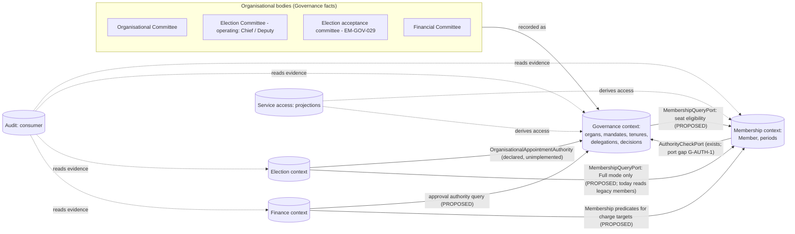

# Committee Responsibility, Governance Authority and the Membership Boundary: Discovery

**Date:** 2026-10-09 · **Raised by:** `claude-code-session:42e0287e…` (self-declared, not attestable)
**Commission:** `docs/publicdigit/membership/architecture/brainstorming/20261009_2155_implementation.md`
**Status:** RESEARCH. Read-only investigation. **It ratifies nothing, implements nothing and authorises nothing** (`PBDIGIT-264` included).
**Builds on (not repeated):**
- `2026-10-09-organisational-participation-domain-research.md` (Person ≠ Member; Position ≠ Tenure ≠ Appointment; RD-1 … RD-5; BQ-P1 … P11);
- `2026-10-09-participation-semantic-contract-draft.md` (G-1 … G-5; IP-1 … IP-7);
- the ratified Membership architecture (2026-10-08 act §10–§11).

**Evidence base:** two read-only inventories (code; documents), with key items re-verified by me; the bounded model `docs/publicdigit/membership/architecture/models/g5_committee_authority.py`.

**Classification labels used:**
- **[ADOPTED]** adopted or ratified rule;
- **[DEMO]** demonstrated by test, probe or code reading;
- **[MODEL]** bounded-model result;
- **[CX]** counterexample;
- **[HYP]** hypothesis or recommendation;
- **[BIZ]** business decision required;
- **[NV]** not verified.

## 0. Disagreements and contradictions (stated first)

| # | Point | Position |
|---|---|---|
| X-1 | The principle "the **Election Committee** is responsible for operating elections" | **The name collides with an adopted rule.** The repository holds **three** things called "Election Committee" (`ADR_20261004_1549…:113-119`). The adopted Manifesto Election Committee (`EM-GOV-029/033`) is an **independent acceptance body** (≥ 3 seats, two-thirds, no Chief) that does **not** operate elections. Operation belongs to the **appointed election authorities, Chief and Deputy** (`EM-GOV-027`; `ElectionConstitution`: "Only committees (chief, deputy) may administer elections"). The PO's principle matches the PO's own ADR decision ("Election → Election Committee → Chief, Deputy Chief"), **not** EM-GOV-029. I therefore read "Election Committee" in the principle as the **operating body** (Chief, Deputy, commissioners), and the EM-GOV-029 body as a separate **acceptance committee**. **That reading is my interpretation [HYP]; the vocabulary needs ratification (CQ-1).** No adopted rule is renamed or changed here. |
| X-2 | "An Organisational Committee is responsible for organisational and governance matters" | Accepted as discovery input. **It does not by itself answer** `EM-OPEN-066` (which body constitutes the Election Committee) or `EM-OPEN-049` (who appoints the Chief). Both are registered as *external dependencies on organisational governance*, with "NO DEFAULT AUTHORITY MAY BE INVENTED". Reading the Organisational Committee as that body would close them **by inference**. It is offered as candidate CQ-2, not assumed. |
| X-3 | §10: "create or update a single coherent research document in the existing Governance/Participation research area" | **A new document, linked both ways.** Committee responsibility is broader than the participation contract (it covers organs, mandates, decision procedures and cross-context flows). Merging it into a *contract draft* would blur research and contract. The participation draft points here (§8 of that draft). |
| X-4 | Read-only scope | The inventories surfaced **four live routes whose authorisation guard could not be found**: election approval, committee application review, governance member add / remove, legacy finance. They are recorded as **`PBDIGIT-266`** (a security investigation; static evidence only) and are **not** fixed here. |

## 1. Executive assessment

1. **Organs are not bounded contexts.**
   - A committee is an **organ**: it holds a mandate, its members hold tenures, and it makes decisions under a procedure.
   - A bounded context owns **facts**.
   - Every committee acts **through** the context that owns the affected facts: the Election Committee through Election, the Financial Committee through Finance, and whichever organ is competent through Membership.
   - **Governance answers the authority question.** The owning context records the evidence and executes. No organ writes another context's facts. [HYP, consistent with the ratified act §10–§11 [ADOPTED]]
2. **Today's live authority ignores committees entirely** [DEMO]:
   - Membership, fees and committee administration are authorised by **organisation roles** (owner / admin / commission).
   - Elections are authorised by **election officers** (chief / deputy / commissioner).
   - Committee roles (chairperson, treasurer, …) **grant nothing**.
   - **No Financial or Organisational committee type exists** in code. Committee types are geographic or wings.
3. **Only the election organs are specified** [ADOPTED]: the EM-GOV rules for the acceptance committee; Chief and Deputy powers.
   - The Financial and Organisational committees have **no documented mandate, composition or procedure anywhere**.
   - Who decides Membership acts is open (DS-4, LQ-1 … LQ-4, MQ-3).
4. **The bounded models show that four authority-implementation choices change outcomes** (§7).
   - Mandate checks must happen **at the time of use**.
   - Tenure ends recorded late create a **bitemporal validity question**.
   - Quorum must count **effective** seats.
   - Recusal and separation of duties are real decisions.
5. **One gap in the existing Membership port** [DEMO]:
   - `AuthorityCheckPort::check(tenant, actor, act)` answers "may this actor do this *kind* of act?". It carries **no subject, no decision reference and no as-of date**.
   - `AuthorityEvidence` has no committee, decision or tenure fields.
   - A *collective* committee decision ("the competent organ resolved to admit person P on date D") cannot be verified or evidenced through it.
   - This affects the Slice 2 contract (D-4). It is **not** a change made now.

## 2. Adopted input versus interpretation

| Item | Source | Class |
|---|---|---|
| Election Committee operates elections; Financial Committee operates finance; Organisational Committee operates organisational and governance matters; each is responsible for its roles and responsibilities | PO principle (commission `…2155…` §1) | **[ADOPTED as discovery input]**; the detailed powers are not adopted |
| Election operated only by the appointed election authorities (Chief, Deputy) | `EM-GOV-027` (`ELECTION_MANIFESTO.md:181`), `ElectionConstitution` (:373) | [ADOPTED] |
| Acceptance committee: independent, ≥ 3 members, one vote each, two-thirds rounded up, no unanimity, no candidate representatives; seats survive occupants; vacancies filled by "the authorised organisational governance body" | `EM-GOV-029/033/034/036/056/057/064-066` | [ADOPTED] |
| The Deputy and the Committee are appointed by "the organisational governance body, or an authority expressly authorised…"; Committee independent of the Chief | `EM-GOV-028` | [ADOPTED]; **the body is unnamed** |
| Who appoints the Chief; who constitutes the Committee | `EM-OPEN-049`, `EM-OPEN-066` | **OPEN** (external dependency) |
| `manageVoters` = Chief and Deputy only; suspension actor ≠ removal actor | 2026-09-16 PO/ARB decision | [ADOPTED] |
| Governance owns competence, organs, authority; Finance owns settlement, refunds, credits, accounting; Membership holds authority **evidence**, not competence | ratification act 2026-10-08 §10–§11 | [ADOPTED] |
| Who decides Membership acts | DS-4, LQ-1 … LQ-4, MQ-3 | **OPEN** |
| Delegation transfers authority, not duty | participation draft IP-2 | [HYP] |
| "Organisation Chief" governs Membership | `EM-FM-005` (ADOPTED · DEFERRED), term undefined (`EM-OPEN-014`) | [ADOPTED but unresolvable]; conflicts with §11 |

## 3. Committee responsibility matrix

Cells are labelled. Anything not labelled [ADOPTED] or [DEMO] is a candidate.

| Aspect | **Organisational Committee (OC)** | **Election Committee: operating body** (Chief, Deputy, commissioners) | **Election acceptance committee** (EM-GOV-029) | **Financial Committee (FC)** |
|---|---|---|---|---|
| Purpose / mandate | organisational and governance matters [ADOPTED input]; detail [BIZ] | operate elections [ADOPTED input + EM-GOV-027] | independent acceptance check [ADOPTED] | financial matters [ADOPTED input]; detail [BIZ] |
| Decides (candidates) | appointments to other organs (CQ-2); Membership acts (CQ-3); committee structure | election schedule, settings, voters (Chief / Deputy), results publication (Chief) [DEMO: `ElectionPolicy`] | acceptance gates only [ADOPTED] | budget execution, payment approval, fee waivers, write-offs, refunds (BQ-P10) [BIZ] |
| Operates through | Governance (appointments); Membership (member acts) | Election | Election (acceptance) | Finance |
| Prohibited (candidates) | writing Election or Finance facts; overriding EM-GOV independence | changing organisational Membership; acting outside its own election (EM-GOV-027 scope) [HYP] | casting Representation Votes [ADOPTED EM-GOV-053]; filling its own seats [ADOPTED EM-GOV-056] | writing Membership facts or status (e.g. `members.fees_status` would be Finance-owned projection data, not a Membership fact) [HYP] |
| Composition and appointment | [BIZ] (statute) | Chief: **OPEN** (EM-OPEN-049); Deputy: org governance body [ADOPTED EM-GOV-028]. Live: owner / admin / commission appoint officers [DEMO] | org governance body [ADOPTED]; body unnamed (EM-OPEN-066) | [BIZ] |
| Individual vs collective | [BIZ] | individual: Chief or Deputy acts alone (EM-GOV-008) [ADOPTED] | collective; one vote per member [ADOPTED] | candidate: collective approval, individual execution (treasurer) [HYP] |
| Procedure | [BIZ] (quorum, majority, tie-break) | n/a (individual) | ⌈2n/3⌉ over the **constituted** membership; no unanimity [ADOPTED] | [BIZ]; separation of duties (M5) |
| Delegation / substitution | [BIZ]; checked at use (M1) [HYP] | Deputy substitutes [ADOPTED] | none; vacancy → replacement in the seat [ADOPTED] | [BIZ] |
| Conflict of interest | [BIZ] (M4) | — | no candidate representatives [ADOPTED] | [BIZ] (M4, M5) |
| Tenure, removal | [BIZ] | election-scoped officers; `term_ends_at` [DEMO] | vacancy events only [ADOPTED EM-GOV-064] | [BIZ] |
| Seat requires organisational Membership? | [BIZ] (CQ-5, BQ-P2) | live: any organisation role suffices [DEMO] | "eligible" undefined (EM-GOV-033) [OPEN] | [BIZ] |
| Evidence of a valid act | decision record (procedure result, mandate version, subject) [HYP] | officer tenure + role at the time [DEMO partially] | seat roster + votes + threshold [ADOPTED] | approval record + executor ≠ approver [HYP] |

**Common concepts:** Organ, Mandate (versioned), Seat / Position, Appointment, Tenure, Decision (collective) or Act (individual), Delegation, Duty, Evidence.

**Genuine variations:** individual vs collective authority; procedure; whether a seat needs membership; independence rules; the vacancy mechanism.

## 4. Context map (organs ≠ contexts)



**The rule that prevents cross-context writes [HYP, consistent with ratified §11]:**
- A command is accepted **only** by the context that owns the facts it changes.
- Another context's state is read through its **query port**.
- Events between contexts are **workflow triggers**, never truth.
- An organ's decision is a **Governance fact**. The owning context cites it as evidence; it is never copied as state.

## 5. Conceptual model (research)

```text
Organ(committee) ── has ── Mandate[version, valid-time]: set of DecisionKinds × scope
Organ ── has ── Seat/Position(kind, capacity, eligibility ε)      (ε may read Membership predicates)
Appointment(act, by organ X, provenance) ──opens──> Tenure(person, seat, [s, e))
Delegation(from organ|tenure, to person|organ, scope, [s, e))    (scope ⊆ Mandate at USE time: M1)
Decision(organ, kind, subject, procedure result, mandate version, date)   (collective)
Act(tenure holder, kind, subject, date)                                 (individual)
HasAuthority(actor, kind, subject, t) :=
      ∃ Decision d valid at t for kind ∈ Mandate@t(organ) and the actor executes d within its tenure
   ∨  ∃ Tenure τ effective at t whose seat grants kind ∈ Mandate@t
   ∨  ∃ Delegation δ valid at t with kind ∈ scope(δ) ∩ Mandate@t(source)
Effective(τ, t) := τ held at t ∧ ε(seat)(Membership predicates of person at t)   (derived intersection)
Duty(organ|tenure, d) — discharged only by an act (IP-3), never by delegation (IP-2)
AuthorityEvidence := {organ, decision | tenure | delegation id, mandate version, procedure result, subject, as-of}
```

**Boundary statements:**
- A Member is not a seat holder.
- An Appointment creates no Membership.
- A seat may *require* Membership only through ε, evaluated by query, never written.
- Membership does not grant voting entitlement.
- Access is a projection.

`Person ≠ OrganisationAffiliation ≠ Member ≠ MembershipPeriod ≠ CommitteeAppointment ≠ Tenure ≠ Mandate ≠ Authority ≠ Duty ≠ ElectionRegistration ≠ VotingEntitlement ≠ Exercisability`.

## 6. Command, decision and evidence flows

| Flow | Initiator (candidate) | Command (owning context) | Authority check | Evidence produced | Result | Failure / retry | Status |
|---|---|---|---|---|---|---|---|
| Admit a member | competent organ (CQ-3); live: owner / admin | `AdmitMember` (Membership) | `AuthorityCheckPort`. **Needs subject + decision reference + as-of (G-AUTH-1)** | authority evidence in the fact's provenance | Admit fact; Member resolved | `NotAuthorised`; re-checked on every attempt (R-1a-2) | port exists; G-AUTH-1 [HYP] |
| End a member (resignation / exclusion / death) | resignation: the member's own act. Exclusion: competent organ (CQ-3; LQ-3). Death: registrar (attested) | `EndMembership` (Membership) | as above; resignation needs a declaration, not an organ | End + kind + evidence | End fact | as above | [BIZ] |
| Appeal against exclusion | appeal body (CQ-9) | Annul (Membership; **not implemented**) | decision of the appeal body | Annul + evidence | the End becomes inert | — | ratified algebra; not built |
| Appoint the Chief, Deputy, acceptance committee | OC? (CQ-2) | an appointment request in Election, answered by Governance | `OrganisationalAppointmentAuthority` (unimplemented) | appointment evidence | officer / seat filled | refused if no authority | EM-OPEN-049 / 066 |
| Open / close voting; publish results | Chief / Deputy (publish: Chief) | Election | officer tenure + role [DEMO] | transition audit | lifecycle state | 403 | [ADOPTED] / [DEMO] |
| Approve payment / waive fee / refund | FC (collective?) → treasurer executes | Finance | the FC decision via Governance; approver ≠ executor (M5) | approval record | ledger posting (design H) | refused; idempotent by version key (IP-5a) | [BIZ]; live: owner / admin alone; legacy routes unguarded (`PBDIGIT-266`) |
| Committee member add / remove | OC or parent organ (`ApprovalRequirementPolicy`: PARENT_COMMITTEE, dormant) | Governance | **none found today** (`PBDIGIT-266` item 3) | — | — | — | [DEMO] gap |

## 7. Candidate invariants and counterexamples

Model `g5_committee_authority.py`; counts are of enumerated cases, **not probabilities**. Membership enters only as given intervals (Admit / End), so the kernel filter is not needed.

| ID | Candidate invariant | Model / evidence | Result |
|---|---|---|---|
| CI-1 | No act requiring organ authority succeeds without valid authority evidence | §6; G-AUTH-1 | the port cannot carry decision evidence today [DEMO] |
| CI-2 | A delegate cannot exceed the delegator's **current** mandate | **M1:** mandate amended at ta; delegation [dc, de); use at u (375 cases) | **[CX]** checking the mandate only at **delegation creation** permits 35 / 375 uses outside the current mandate. Minimal: amended at 1, delegated [0, 2), used at 1. A use-time check agrees with the spec (0 / 375), but it is a near-restatement of the spec, so that agreement is **weak evidence**. ⇒ **Check at use.** |
| CI-3 | An expired appointment cannot authorise | **M2:** tenure end recorded late (250 cases) | **[BIZ]** 35 / 250 acts are valid *as known when taken* but invalid *as now known*. A stored role flag can answer only the first (35 / 35). Which validity counts (de-facto acts) is **CQ-6**. A derived, bitemporal tenure answers both. |
| CI-4 | Quorum and majority count only **effective** seats (where a seat requires membership) | **M3:** 3 seats, membership ends, all presence / vote sets (3,645 cases) | **[CX]** counting appointed seats accepts **522** decisions that fail when only effective seats count. Minimal: seat 3's holder no longer a member at t = 1; seats 1 and 3 present, both yes. Under "no membership requirement" the two counts agree. ⇒ **BQ-P2 / CQ-5 decides outcomes** |
| CI-5 | A member with an interest is excluded from the decision | **M4:** 108 cases | **[BIZ]** 12 / 108 decisions pass only without recusal (none the other way). Recusal rule = **CQ-7** |
| CI-6 | Approver ≠ executor for payments | **M5:** 16 role assignments over 2 persons | **[BIZ]** 7 / 16 let one person complete a payment alone. Live finance: owner / admin alone [DEMO] |
| CI-7 | Delegation does not discharge duty | participation draft G-1 (S-D1 … S-D3) | [HYP]; legal confirmation needed |
| CI-8 | Committee members cannot act outside the committee's mandate | M1 (mandate at use) + §6 | [HYP]; today committee roles grant nothing, so the invariant holds vacuously in live code |
| CI-9 | An organ's decision never writes another context's facts | context map §4 | [HYP]. Live counterexample shape: legacy `endMembership` waived fees (Membership → Finance), dormant, disposition DELETE [DEMO] |

## 8. Open requirements and questions

These are numbered for this topic only; each is a genuine decision.

| ID | Question |
|---|---|
| CQ-1 | **Vocabulary:** is "Election Committee" the operating body (Chief, Deputy, commissioners) and the EM-GOV-029 body an "Election Acceptance Committee", or the reverse? It must not silently rename adopted rules |
| CQ-2 | Is the **Organisational Committee** the "organisational governance body" of EM-GOV-028 / 056? Would that answer EM-OPEN-066 and EM-OPEN-049? |
| CQ-3 | Which organ decides each Membership act: review, admit, exclude, suspend / restore (if ratified), correct / annul, attest migrated records? Is it per-organisation (statute)? |
| CQ-4 | The FC mandate: budget, expenditure thresholds, fee rules, waivers, write-offs, refunds (BQ-P10); collective vs treasurer powers; separation of duties (CI-6) |
| CQ-5 | Per organ: does a seat require current organisational Membership? Exceptions (staff, guests, scrutineers), and who authorises them (BQ-P2, RD-1)? |
| CQ-6 | Are acts by a holder whose tenure is later ended retroactively valid (as known) or void (as now known)? (CI-3) |
| CQ-7 | Conflict-of-interest and recusal rules per organ (CI-5) |
| CQ-8 | Delegation: re-validated at use (recommended); person-to-person delegation; sub-delegation chains; maximum duration |
| CQ-9 | General assembly powers: exclusion appeal, budget approval, discharge (BQ-P8) |
| CQ-10 | How far organisation statutes may vary mandates and procedures, and therefore what is configuration and what is fixed platform rule |

## 9. Decision owners and gates

| Question | Owner | Gate it unblocks |
|---|---|---|
| CQ-1 | PO (+ Election owner, because EM-GOV vocabulary is adopted) | any Governance contract; Election appointment integration |
| CQ-2, EM-OPEN-049 / 066 | PO / ARB (organisational governance) | `OrganisationalAppointmentAuthority` |
| CQ-3, DS-4, LQ-1 … 4 | PO + Legal + Governance owner | Slice 2 (D-1, D-3, D-4) |
| CQ-4 | PO + Finance owner | any Finance approval contract |
| CQ-5, RD-1, BQ-P2 | PO + Governance owner | participation contract; quorum semantics |
| CQ-6, CQ-7, CQ-8, CQ-9 | Legal + Governance owner | participation contract; authority evaluation |
| CQ-10 | PO / ARB | configuration model for Governance |
| `PBDIGIT-266` | Engineering (tests first) + Security | release safety |

## 10. Impact on the Membership roadmap

- **`PBDIGIT-264`:** unaffected (persistence only). It still needs PO authorisation.
- **Slice 2 / D-4:**
  - The interim adapter (owner / admin, labelled interim) stays a conditional option.
  - **New contract point G-AUTH-1:** the long-term authority answer for an organ's decision needs `subject` (PersonRef or MemberId), a `decisionRef` and an `asOf` date in the request, and organ, decision, tenure and mandate-version fields in the evidence.
  - Extending `AuthorityCheckPort` / `AuthorityEvidence` is a **port change**, so it must be decided in the Slice 2 contract, not done now. Recommendation [HYP]: add it in Slice 2 as optional context, so the interim adapter and the later Governance adapter share one port.
- **Election:**
  - `OrganisationalAppointmentAuthority` stays blocked on CQ-2 / EM-OPEN-066.
  - `PBDIGIT-265` is unchanged and remains a cutover blocker.
- **Finance:**
  - No approval model exists. Design H (IP-5a / 5b) is compatible with an FC approval step.
  - Legacy finance routes need `PBDIGIT-266` triage first.
- **Participation contract:**
  - This discovery adds organ, mandate, decision and procedure concepts and CI-1 … CI-9.
  - It stays **conditional** (RD-1 … RD-4, CQ-1 … CQ-10).
- **Legacy committee models** (three, plus the `users.is_committee_member` flag): RD-5 disposition is unchanged. None carries an election, finance or organisational type.

## 11. Model results (reproducible)

```bash
python3 -I docs/publicdigit/membership/architecture/models/g5_committee_authority.py
```

| Sub-model | Finite domain | Result |
|---|---|---|
| M1 | T = 5; one act; amendment ∈ {none, 1 … 4}; delegations [dc, de); uses u | creation-time check wrong in 35 / 375; use-time 0 / 375 (weak) |
| M2 | T = 5; tenure [s, e); end recorded r ≥ e or never; act at u | as-known ≠ as-now in 35 / 250; a stored flag equals as-known in 250 / 250 |
| M3 | 3 seats; membership ends ∈ {never, 1, 3}³; t ∈ 0 … 4; all presence / yes sets | appointed vs effective differ in 522 / 3,645 (always appointed-passes) |
| M4 | 3 seats; subject ∈ {outsider, seat 1 … 3}; all presence / yes sets | 12 / 108 pass only without recusal |
| M5 | 2 persons × 4 role sets | 7 / 16 allow a single-person payment |

**Not modelled:** sub-delegation chains, weighted votes, tie-break rules, multi-organ approvals (e.g. PARENT_COMMITTEE), statute amendments with retroactive effect, annulled appointments (Annul is not in any kernel).

## 12. Smallest next implementation slice

**Unchanged: `PBDIGIT-264`** (persistence remediation), once the PO authorises it. Nothing in this discovery is ready for Governance implementation.

The first Governance-adjacent code change worth contracting is **G-AUTH-1 in the Slice 2 port**, after CQ-3 and D-4 are decided.

**Security first:** `PBDIGIT-266` (feature tests that confirm or refute each missing guard) is the most urgent separately authorisable work found today.
