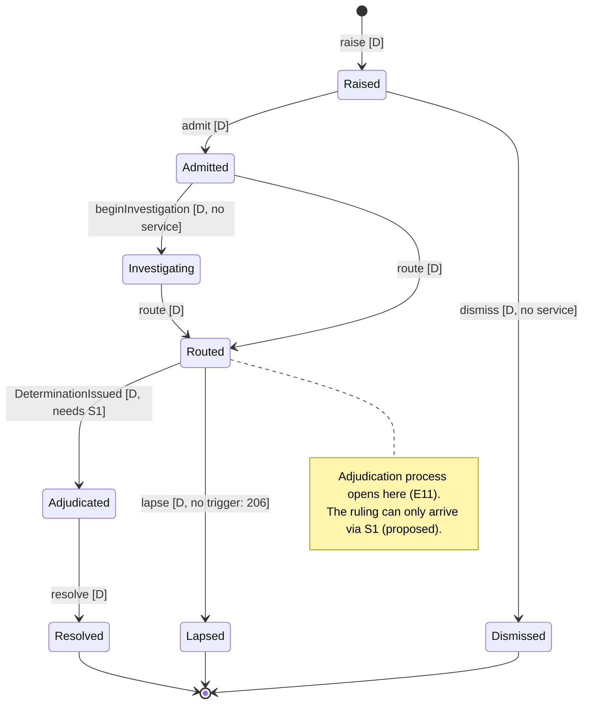
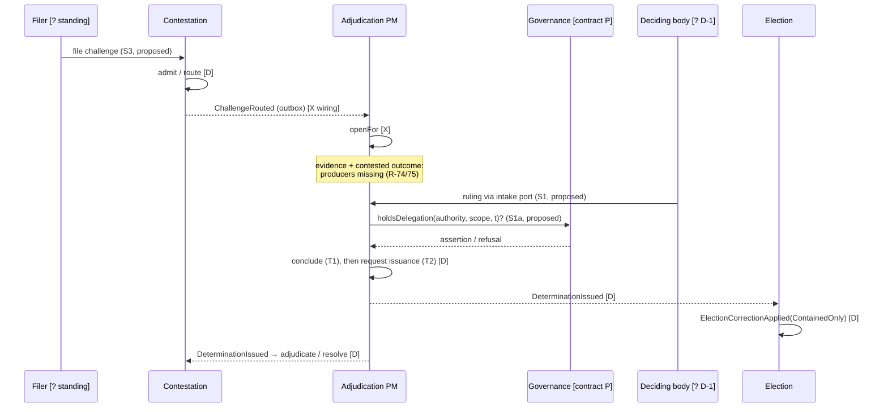
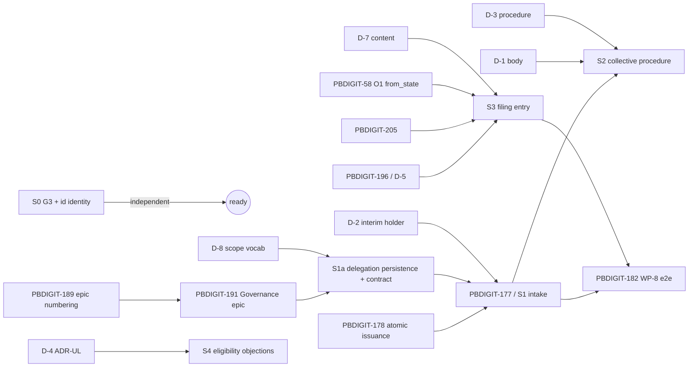

# Election adjudication — decision-ready blueprint and implementation readiness

**Date:** 2026-10-09 · **Commission:** `docs/publicdigit/election_management/brainstorming/20261009_2150_election_commitee_implementation.md` · **Predecessor (not overwritten):** `2026-10-09-election-review-committee-discovery.md` · **Companion:** `2026-10-09-election-lifecycle-and-audit-from-state-investigation.md`

**Nature:** architecture and readiness only.
- No production code, schema, ADR, story status or Membership artefact changed.
- No test run; the shared test DB was not touched.
- The evidence was re-verified by direct reading of HEAD `f1a483b47` on 2026-10-09, not inherited from the earlier agents.

**Labels:**
- **F** = FACT (source / approved artefact);
- **I** = INFERENCE;
- **R** = RECOMMENDATION;
- **D** = DECISION REQUIRED (named owner).

---

## 1. Executive findings

1. **F** The case model is complete in the domain:
   - `Challenge`: 8 states;
   - `Determination`: Draft / Issued / Final;
   - `AdjudicationProcessManager`: idempotent, with redrive.

   **The product path is not.** Nothing outside the Contestation context calls `ContestationService`. Nothing in production calls `receiveRulingDecision()`, `admitIssuanceContext()` or `redriveIssuance()`. No challenge can be filed, and no ruling can enter.
2. **F (new; the discovery report missed it)** Governance **already has a domain delegation model**: `AuthorityAssignment` with `AuthorityResolver`, `AuthorityGraphValidator`, `DelegationLifecyclePolicy`, and the `AuthorityDelegated` / `AuthorityRevoked` events.
   - EPIC-004 Q-1 §3 names this model explicitly as the authority Adjudication must consume.
   - It has **no persistence adapter, no table and no published contract**: `AuthorityAssignmentRepository` is an interface with no implementation. Its only users are unit tests.
   - Delegation runs **from a committee to a committee** (`CommitteeId` from the Membership context), with a **free-text** `DelegationScope`.
3. **I** Consequence of (2): under the current model, **a delegated adjudication authority is a committee**, not a natural person.
   - This narrows option C to "a committee holding an in-scope `AuthorityAssignment`". A single-official model would need Governance to extend its model (**D**, ARB).
   - It also creates a **proven dependency on the committee identity in Membership** (`App\Contexts\Membership\Domain\Committee\ValueObjects\CommitteeId`). It is not a dependency on general membership facts.
4. **F** Separation of duties, two confirmed defects:
   - **G3:** `POST …/voters/{membership}/suspend` and `/approve` act with one person (`routes/organisations.php:274-275`; `ElectionVoterController.php:357-376, 331-347`), alongside the two-person route (`:279-281`).
   - **Identity by name:** the two-person rule stores and compares the proposer **by name** (`ElectionMembership.php:206, 246`; `ElectionVoterController.php:531`). Two officers with the same name defeat it.
5. **F** The audit `from_state` defect is real (companion report). It affects adjudication **evidence** but not adjudication **logic** (§8).
6. **Stop condition met:** the deciding body, its appointment, procedure, standing, window, admissibility, finality and jurisdiction are undecided.
   - **Ready without a new constitutional decision:** S0 (G3 + identity by id).
   - **Ready once already-named decisions are taken:** S1, S1a.
   - **Blocked:** everything else.

## 1a. Terminology: the three election bodies (correction, 2026-10-09)

A proposed conceptual model named three bodies:
- "Election Committee: operates the election";
- "Election Observation Committee";
- "Election Dispute Adjudication Committee".

Checked against the adopted Manifesto and the code, the **three-body separation is sound**, but two of the descriptions conflict with adopted rules.

| Proposed name | Canonical concept | Mandate (evidence) | Correction |
|---|---|---|---|
| "Election Committee: organises and operates the election" | **Election officers** (Election Chief, Deputy) | **F:** operate the election; "operational authority, not sovereignty" (EM-GOV-008, EM-GOV-027; `ELECTION_MANIFESTO.md:119,181`) | **Wrong name.** The canonical **Election Committee** is a different, *independent acceptance* body (below). Using its name for the operators gives the checked party the checker's name. |
| — | **Election Committee** | **F:** "independent and impartial election body appointed by the organisation's governance body"; takes part in acceptance; independent check (EM-GOV-029). At least 3 independent members, one Committee Vote each (EM-GOV-033); `TWO_THIRDS_OF_COMMITTEE_VOTES` rounded up (EM-GOV-036). Adjudicative power **open** (EM-OPEN-071) | It does **not** operate the election |
| "Election Observation Committee" (one observer per candidate) | **Representative Committee** (candidate representatives) | **F:** each entitled candidate *may* select **at most one** representative (optional); a representative may represent 1..n candidates; the committee is only persons confirmed by at least one entitled candidate; Chief-proposed but unconfirmed persons are not members (EM-GOV-021, `:132`). Representatives hold **Representation Votes**, weighted by the number of selecting candidates, evaluated **together with** Committee Votes for acceptance (EM-GOV-030 / 031). No Election Committee member may be a representative (EM-GOV-033) | **Wrong mandate and name.** <ul><li>Representatives already have an *acceptance vote*, more than observing.</li><li>"Observer" is a separate, **unused** role: `ElectionRole::Observer` (`app/Domain/Election/Enum/ElectionRole.php:14`) has no reader.</li><li>"Candidate group" is **not modelled**; the rules bind individual candidates.</li><li>**Implementation:** designed only.</li></ul> |
| "Election Dispute Adjudication Committee" | **Issuing authority** for Determinations: the holder of a Governance delegation (Q-1); constitutional design **ChallengeAdjudicationBody** (ADR-5, form deferred) | **F:** decides challenges and issues Determinations (§2 E8, E13) | **Mandate partly over-stated:** <ul><li>**Admissibility** is a Contestation step whose decider is undecided (PBDIGIT-205, D-5b), not automatically this body.</li><li>**Appeals** are challenges against a prior Determination (`TargetType::Determination`). The same body hearing appeals against its own rulings contradicts independence (ADR-7 D.5). Whether appeals exist is D-6.</li><li>**Name not canonical:** whether it is a separate body or the Election Committee with added powers is D-1. No display name before that ruling (EM-GOV-030 naming discipline).</li></ul> |

**R (glossary discipline):**
- Use "Election officers", "Election Committee", "Representative Committee" and "issuing authority" as above.
- Do not introduce "observer" or "observation committee" for representatives.
- Do not use "Election Committee" for the operators.
- The display name of the adjudicating body waits for D-1.

## 2. Evidence register

| # | Claim | Class | Source | Confidence |
|---|---|---|---|---|
| E1 | Challenge states: Raised, Admitted, Investigating, Routed, Adjudicated, Resolved, Dismissed, Lapsed | F | `Contestation/Domain/Challenge/ChallengeState.php:15-22` | high |
| E2 | Challenge operations: raise, admit, dismiss, beginInvestigation, route, adjudicate, resolve, lapse | F | `Challenge.php:60-129` | high |
| E3 | The application service exposes only raise / admit / route | F | `CoordinatesContestation.php:69,86,95` | high |
| E4 | No caller of the Contestation service outside its context (no HTTP / UI) | F | grep `app routes`: none | high |
| E5 | `TargetType` is closed: {ElectionResult, Determination}; extension needs an ADR-UL | F | `Contestation/.../TargetType.php:10-18`; Adjudication twin `:10-17` | high |
| E6 | Determination states: Draft / Issued / Final | F | `DeterminationState.php:13-15` | high |
| E7 | One determination per challenge per tenant, enforced by the DB | F | `create_determinations_table.php:28` `uniq_determination_per_challenge` | high |
| E8 | The process manager receives rulings and never validates a delegation; it is idempotent; a late decision on an expired process is refused | F | `AdjudicationProcessManager.php` docblock :28-50; `:135-155` | high |
| E9 | Conclusion and issuance request are separate transactions (ADR-T1); redrive closes the gap; issuance fails closed when a fact is missing | F | `:157-176, 178-245` | high |
| E10 | No production caller of `receiveRulingDecision` / `admitIssuanceContext` / `redriveIssuance` | F | grep `app routes` | high |
| E11 | `openFor` is called by `ChallengeRoutedReactionHandler` | F | `ChallengeRoutedReactionHandler.php:70` | high |
| E12 | `IssuedByAuthority` is an opaque non-empty string, persisted `string(128)` | F | `IssuedByAuthority.php`; `create_determinations_table.php:21` | high |
| E13 | Q-1 DECIDED: only a valid constitutional delegation may issue; Governance owns authority; Adjudication consumes it via a published contract (name undecided) | F | `EPIC-004_Q1_Authority_Resolution.md` §1-5 | high |
| E14 | Governance `AuthorityAssignment`: committee → committee; free-text scope; validity period; revocation; no-self-delegation; OVERRIDE needs active authority; cycle check under SERIALIZABLE | F | `Governance/Domain/Authority/AuthorityAssignment.php:39-67`; `AuthorityGraphValidator.php:12-17` | high |
| E15 | No implementation of `AuthorityAssignmentRepository`; no `authority_assignments` table | F | grep `app database`: none | high |
| E16 | Challenge and determination rows carry `organisation_id`; Tenant migrations | F | `create_challenges_table.php:21`; `create_determinations_table.php:17` | high |
| E17 | The Election reaction refuses unknown / out-of-organisation elections | F | `DeterminationIssuedReactionHandler.php:29-34` | high |
| E18 | G3: the one-actor approve / suspend routes still exist | F | `routes/organisations.php:274-275`; ADR_20261004_1549 `:172,182` | high |
| E19 | The two-person suspension compares by name | F | `ElectionMembership.php:206,246` | high |
| E20 | Story statuses (174 BLOCKED, 175 HELD, 176 BLOCKED, 177 NOT AUTHORISED after 178, 178 UNAUTHORISED, 182 DEFERRED, 184 BLOCKED Q-UC5, 189 DECISION REQUIRED, 191 NOT OPENED, 196 OPEN PO contract, 197 BLOCKED, 198 OPEN ARB, 199 DEFERRED, 205 / 206 OPEN unallocated) | F | `docs/publicdigit/backlog/README.md:260-292` | high |
| E21 | The Manifesto Election Committee is acceptance-only; adjudicative power is open | F (from the discovery report; not re-read) | `ELECTION_MANIFESTO.md:136-145,521` (EM-OPEN-071) | medium |
| E22 | ChallengeAdjudicationBody form deferred (internal B / external C) | F (from the discovery report; not re-read) | Round37-05 ADR-5 `:312-330`; Round37-07 ADR-7 `:240-252` | medium |

**No material contradiction of the discovery report.** One **material refinement** (E14 / E15, finding 2), which changes the option analysis in §9.

## 3. Current-versus-target capability matrix

| Capability | Existing | Incomplete | Proposed | Undecided |
|---|---|---|---|---|
| File a challenge (product) | domain `raise` | no HTTP / UI (E4) | S3 | standing, window, channel (PBDIGIT-196) |
| Admissibility | `admit` (service) | `dismiss` / `beginInvestigation` only in the domain (E3) | S3b | who decides (PBDIGIT-205) |
| Routing → open process | E11 | — | — | — |
| Evidence / issuance context | PM methods | no producers (E10; R-74 / R-75) | S1 | evidence producer |
| Authority ruling intake | PM `receiveRulingDecision` | no port caller (PBDIGIT-177) | S1 | contract name (Q-1) |
| Delegation validity | Governance domain model (E14) | no persistence or contract (E15) | S1a | scope vocabulary; holder = committee? |
| Atomic issuance + outbox | — | two transactions (PBDIGIT-178, R-91) | S1-pre | authorisation |
| Collective ruling procedure | OperatingCore acceptance engine (no persistence) | — | S2 | body, quorum, majority, recusal |
| Election consequence | `ContainedOnly`, forward-only (E17) | — | — | annulment / recount (ADR) |
| Finality | `Final` state | evaluator never built (PBDIGIT-197) | later | integration contract |
| Horizon / lapse | `lapse()`, `enforceHorizon()` | no trigger (198, 206, 199) | later | ARB vs R-91 |
| Appeal | `TargetType::Determination` | — | — | finality ruling (176) |
| Eligibility objections | — | — | S4 | ADR-UL + jurisdiction |
| Two-person voter governance | propose / confirm | G3, identity by name (E18 / E19) | **S0** | none (ADR decided) |

## 4. End-to-end process

Legend:
- **[X]** existing and reachable in production;
- **[D]** domain-only (implemented, unreachable);
- **[P]** proposed;
- **[?]** undecided.

| Step | What happens | Status |
|---|---|---|
| 1 | An actor identifies a challengeable decision (an election result, or a prior determination) | [?] who: standing |
| 2 | The challenge is submitted with target, standing ref, content and time | [D] raise · [P] S3 entry · [?] window / channel |
| 3 | Basic validation: target ∈ TargetType; same organisation | [D] |
| 4 | Admissibility | [D] admit · [?] decider (205) |
| 5 | Dismiss / admit / investigate / route | [D] (dismiss / investigate not in the service) |
| 6 | The delegated authority considers the case | [?] body · [P] S1 intake / S2 procedure |
| 7 | Determination issued, then finalised | [D] issue · [?] finality (197) |
| 8 | Election applies the consequence (record-only, ContainedOnly) | [D] handler wired; reached only if 7 occurs |
| 9 | Challenge → Adjudicated → Resolved / Lapsed | [D] |
| 10 | Audit: outbox / inbox provenance | [D] with gaps 174 / 175 / 178 |

## 5. Actor, authority and responsibility matrix

| Act | Actor | Authority source | Status |
|---|---|---|---|
| Delegate adjudication authority | A committee holding authority (`AuthorityAssignment.delegate`, `delegatedBy: MemberId`) | Governance | F model / no persistence |
| Revoke delegation | The delegating side | Governance | F model |
| File a challenge | Standing-holder (candidate? representative? voter? see D-5 options) | **D-5** (PO) | — |
| Accept gates (Committee Votes) | Election Committee members | EM-GOV-029 / 033 / 036 | F rules; OperatingCore engine unpersisted |
| Accept gates (Representation Votes) | Candidate representatives (Representative Committee) | EM-GOV-021 / 030 / 031 | F rules; designed only |
| Admit / dismiss / investigate | **D-5b** (Domain Owner, PBDIGIT-205) | — | — |
| Rule | The holder of an in-scope delegation | Q-1 F; **body D-1** | — |
| Express a position (collective) | A committee seat | **D-3** | — |
| Apply the consequence | Election (system) | ADR-T8 | F |
| Operate the election (Chief / Deputy / officers) | Officers | `ElectionPolicy` | F; **must not rule on their own decisions (D-3c)** |

## 6. Domain model and context ownership (verified)

| Context | Owns | Verified by |
|---|---|---|
| Governance | delegation, scope, validity, revocation | E13, E14 |
| Membership (committee identity only) | `CommitteeId`, committee establishment | E14 (delegation endpoints) |
| Contestation | Challenge lifecycle | E1-E5 |
| Adjudication | process, Determination | E6-E12 |
| Election | operation, consequence | E17 |

**R:**
- **No new aggregate** and **no new bounded context**.
- The missing pieces are:
  - (a) a Governance **published query contract** answering `holdsDelegation`;
  - (b) a Governance **persistence adapter** for `AuthorityAssignment`;
  - (c) an Adjudication **inbound port** for rulings;
  - (d) optionally, a collective-procedure adapter behind (c).

**Cross-context atomicity is not claimed.** Each step is one aggregate per transaction (ADR-T1), joined by outbox / inbox with replay safety.

## 7. Formal invariants and decision tables

Notation: `c` challenge, `d` determination, `a` authority (committee), `t` issuance instant, `o(x)` organisation of `x`.

| # | Predicate | Enforced today | Where it should live |
|---|---|---|---|
| P1 | `issue(d) ⇒ ∃ asg: asg.to = d.authority ∧ asg.isActiveAt(t) ∧ inScope(asg.scope, adjudication, d.jurisdiction) ∧ asg.tenant = o(d)` | **No** (non-empty only, E12) | Governance answers; Adjudication refuses on ¬assertion (Q-1) |
| P2 | `rules(a, c) ⇒ ¬conflicted(a, c)` | No | Rule **D-3c**; checked at intake |
| P3 | `|{d : d.challenge = c ∧ d.state ∈ {Issued, Final}}| ≤ 1` | **Yes** (E7 DB unique; E8 PM no-op) | — |
| P4 | `target(c) ∈ {ElectionResult, Determination}` | **Yes** (enum, E5) | ADR-UL to extend |
| P5 | `o(c) = o(d) = o(election(c))` | Partly: rows scoped (E16); Election refuses a foreign election (E17); **no end-to-end test** (PBDIGIT-182) | WP-8 test |
| P6 | `apply(d)` idempotent ∧ forward-only (`ContainedOnly`) | Yes by design (ADR-T8, inbox) | — |
| P7 | audit `from_state` = the state authorised against | **No** for the election lifecycle (companion report) | PBDIGIT-58 O1 |
| P8 | `¬∃` field in c / d / audit linking voter → ballot | Yes by schema (no such columns); free-text `submitted_content` / `Reason` are **unscreened** | Content rule **D-7** |

**Late / duplicate decision (F, E8):**

| Process state | Ruling arrives | Result |
|---|---|---|
| active | first | conclude T1, then request issuance T2 |
| concluded | again | no-op (idempotent) |
| expired | any | refused: `LateDecisionOnExpiredAdjudication` |
| none (never routed) | any | no-op (**I:** silently; consider surfacing it in S1) |

**Collective threshold (candidate rule only, D-3):** accept-gate rule `upheld ⇔ accepts ≥ ⌈2n/3⌉, n ≥ 3`. Boundary values:

| n | ⌈2n/3⌉ |
|---|---|
| 3 | 2 |
| 4 | 3 |
| 5 | 4 |
| 6 | 4 |
| 7 | 5 |

Open issues:
- **Recusal reduces the effective n.** Does the threshold count the seated n or the eligible n? Abstention: count as not-accept, or reduce n? The two readings diverge at n=4 with 1 recusal: 3 of 4 vs ⌈2·3/3⌉ = 2. **D-3.**
- **Not assumed to apply to adjudication.**

**Clock boundaries:**
- **F:** delegation validity is **closed** `[start, end]` (`AuthorityEffectivePeriod.php:30-40`: `now <= end`; a null end is open-ended). The election voting window is **half-open** `[start, end)` (`ElectionClockService.php:47-55`).
  - **I:** a ruling at exactly `t = end` is in time for the delegation; the same instant is outside a voting window. The two conventions are internally consistent, but S1a RED must pin `t = end` explicitly.
- Filing window boundary: **D-5**.

## 8. Security, audit, privacy, tenant

| Item | Kind | State |
|---|---|---|
| G3 one-actor approve / suspend | **existing defect** | E18 → S0 |
| Identity by name in the two-person rule | **existing defect** | E19 → S0 |
| Authority validation at issuance | gap (by Q-1 design: pending contract) | S1a |
| Issuance + outbox atomicity | existing defect R-91 | PBDIGIT-178 |
| Provenance chain broken at issuance | existing defect | PBDIGIT-174 (ownership unruled) |
| Failure event never published | existing defect | PBDIGIT-175 (held) |
| Election `from_state` | existing defect | PBDIGIT-58 |
| Cross-tenant end-to-end | untested | PBDIGIT-182 |
| Free-text evidence / reasons | **future-design risk** (voter data leakage) | D-7 |
| Duplicate / replayed / out-of-order messages | handled (inbox, PM no-op, DB unique) | regression-test in S1 |
| Delegation race (A→B, B→A) | handled by design, **only under SERIALIZABLE** (E14) | S1a must honour it |

**The audit defect and adjudication (§8 of the commission):**
- **I:** a ruling never reads the persisted `state`.
- But a challenge **about** an election result is argued from the election's audit trail. That trail currently shows `voting_active → results_published` and omits Counting.
- Evidence presented to the deciding body would therefore be **misleading, but not decisive**: the window timestamps remain truthful.
- The correction stays in PBDIGIT-58 (O1). **It is not a prerequisite for S0 / S1; it is a prerequisite for S3** (product filing against results), so that filers and adjudicators see a truthful trail.

## 9. Option analysis — the deciding body

| Dimension | A: Manifesto Election Committee gets adjudication powers | B: separate ChallengeAdjudicationBody (B-int committee / B-ext organisation) | C: any holder of an in-scope Governance delegation |
|---|---|---|---|
| Constitutional | Changes the Manifesto (EM-OPEN-071; Manifesto unratified EM-OPEN-017) | New constitutional organ (ADR-7 D.5 deferred) | Fits Q-1 directly; **the delegate is a committee (E14)** |
| Independence | **Weak:** the same body accepts gates it may later have to judge; needs strict recusal | **Strong** (by construction) | Depends on who is delegated; independence is a **delegation-time rule** |
| Appointment | Existing (open: EM-OPEN-066) | New appointment rule (EM-OPEN-049 / 094) | Delegation act (`delegatedBy`) |
| Accountability / audit | OperatingCore protocol (unpersisted) | New | `AuthorityDelegated` / `Revoked` events (not persisted) |
| Procedure | Reuse ⌈2n/3⌉ (candidate) | To define | Committee-internal; procedure is the body's own |
| Technical change | S1 + S2 + seat persistence | S1 + S1a + S2 + establish the committee (Membership `ConstitutionalCommittee`) | S1 + S1a; S2 only if collective |
| Complexity | Low new code, high governance risk | Highest | Lowest; most reuse |
| Risks | Conflict of interest | Cost; B-ext adds a cross-organisation tenant question | A free-text scope string becomes jurisdiction (needs a vocabulary) |

**I:**
- C is a **mechanism**, not a body: A and B-int can both be realised **through** C (delegate to that committee).
- So the technical path S1 + S1a is common to all three; the choice only changes S2 and the appointment rules.
- **This lets S1 / S1a proceed before D-1 is answered**, provided the interim holder is itself a decided delegation (D-2).
- B-ext conflicts with the current model: committees are tenant-internal (E14 `TenantId`). **D**.

No option is selected and no display name is introduced.

## 10. Outstanding decisions

| ID | Decision | Owner | Consequence if unanswered |
|---|---|---|---|
| D-1 | Deciding body: A / B-int / B-ext / C-only; display name | PO + ARB (constitutional) | S2 blocked |
| D-2 | Who appoints or delegates, and the interim holder for S1 | PO / Governance owner (EM-OPEN-066 / 049 / 094) | S1 can be built but not switched on |
| D-3 | Procedure: quorum, threshold, abstention, (a) recusal counting, (c) conflict rules | ARB / Domain Owner (EM-OPEN-069) | S2 blocked; P2 unenforceable |
| D-4 | Jurisdiction: results only, or also eligibility / suspension | ARB (ADR-UL) | S4 blocked |
| D-5 | Standing, window, channel; (b) who admits / dismisses | PO (196), Domain Owner (205) | S3 blocked |
| D-6 | Finality and appeal (176 Q1-Q4; 197); if appeals exist, they go to a body other than the one that ruled | Domain Owner | Determinations never Final |
| D-7 | Content rule for free text (no voter data) | PO + DPO | S3 privacy risk |
| D-8 | Delegation scope vocabulary (e.g. `adjudication:election_result`) | Governance owner / ARB | S1a unverifiable |
| D-9 | Authorisations: S0; PBDIGIT-178 then 177; open PBDIGIT-191 (needs 189) for S1a | PO / Decision Authority | nothing starts |

### D-5 options: standing to file (decision brief; nothing selected)

The question raised: *may candidate representatives formally file challenges for the candidates they represent?* `RaiserStandingRef` is opaque (E2), so every option fits the domain model. The choice is a business rule.

| Option | Who may file | For | Against / open sub-questions |
|---|---|---|---|
| S-a | Candidates only | Simplest; standing follows the interest directly | Candidates must act personally |
| S-b | Representatives only | One channel per candidate side | **Excludes candidates without a representative** (selection is optional, EM-GOV-021) |
| S-c | Candidates **and** their representatives (on their behalf) | Covers optional selection; matches the representative's role | <ul><li>A representative of n candidates: files for one named candidate, or for all?</li><li>Must the candidate consent?</li><li>Duplicate filings by candidate and representative: merge or refuse?</li></ul> |
| S-d | S-c plus voters / members | Widest legitimacy check | Volume; abuse; needs admissibility rules (PBDIGIT-205) and a window (Q-2) |

**Cross-cutting questions (all options):**
1. **Acceptance estoppel:** a representative cast a Representation Vote accepting a gate (EM-GOV-031). May they later challenge an outcome covered by that acceptance? This needs an explicit rule; none exists.
2. **Independence:** neither an Election Committee member nor an election officer may rule on a challenge concerning their own act (P2, D-3c). Representatives are parties, never adjudicators.
3. **Evidence and confidentiality:** content filed by representatives falls under D-7 (no voter data; cf. EM-OPEN-091).

**R:** S-c is the option most consistent with adopted rules (optional selection, 1..n representation). The sub-questions must be answered before S3. **Decision owner: PO** (PBDIGIT-196); estoppel: Domain Owner / ARB.

## 11. Dependency graph

## 12. Implementation order with gates

| Order | Slice | Gate | Reuse | RED (acceptance) | Scope | Regression / security | Docs | Rollback |
|---|---|---|---|---|---|---|---|---|
| 1 | **S0** two-person hardening (story: G3 under ADR_20261004_1549; **D:** which PBDIGIT-id: a new backlog item or an existing G3 owner, to be checked against the backlog before opening) | PO authorisation only | propose / confirm routes | (a) one-actor `/suspend` and `/approve` refused, or routed to the proposal; (b) the same officer cannot confirm, even with a renamed account; (c) two officers with the same name **can** confirm each other (id-based); (d) no voter ↔ ballot data touched | add `suspension_proposed_by_id` (migration, PO-applied) or re-route; compare ids | the Voter Management suites; PBDIGIT-251 tests | `developer_guide/election_voters/` step | down migration; routes restorable |
| 2 | **S1-pre** PBDIGIT-178 atomic issuance | Decision Authority | outbox adapter | determination row ⇔ outbox row (a fault injected between them leaves neither) | one transaction | adjudication suites | adjudication guide | code revert |
| 3 | **S1a** Governance delegation persistence + `holdsDelegation` contract | 191 opened (needs 189), D-8 | `AuthorityAssignment`, `AuthorityResolver`, `AuthorityGraphValidator` | active / revoked / expired / out-of-scope / other-tenant / boundary instant; cycle refused under SERIALIZABLE | repository + table + query contract | Governance unit suites | governance guide | drop table |
| 4 | **S1** PBDIGIT-177 intake port + interim adapter | 178, S1a, D-2 | PM `receiveRulingDecision` | no assertion → refused, no conclusion; valid → one Determination; redelivery → no-op; expired → refused; foreign tenant → refused | port + adapter + wiring of `redriveIssuance` | PM / outbox / inbox suites; P3 | adjudication guide | disable the adapter binding |
| 5 | **S2** collective procedure | D-1, D-3 | OperatingCore voting semantics | threshold boundary table §7; recusal; vacancy → unachievable | procedure behind the S1 port | — | — | — |
| 6 | **S3** filing entry | D-5, D-7, PBDIGIT-58 O1 | `ContestationService` | standing / window / tenant; content screening | HTTP + Inertia (router.post) | design-check | — | — |
| 7 | **S4** eligibility objections | D-4 (ADR-UL) | — | — | — | — | — | — |

## 13. Acceptance criteria and test strategy
- **Unit (domain):** P1 truth table over (status × validity × scope × tenant); P3 / P4 already covered; threshold boundaries n = 3…7 with recusal variants (S2).
- **Integration:**
  - the PM with a real store: duplicate, late, expired, crash between T1 and T2 → redrive (S1);
  - Governance SERIALIZABLE cycle race (S1a).
- **Feature:** S0 route-level tests. Run only on a serialised test DB (PBDIGIT-263; no concurrent sessions).
- **End to end:** PBDIGIT-182 (WP-8), two tenants, after S1 + S3.
- **Fitness:**
  - no Adjudication class depends on Governance internals, only the contract (Q-1 constraint);
  - no c / d / audit column references `votes` / `users`.
- **ML:** may be used only to cluster corpus terms for human review (e.g. "committee" homonyms). Never in rule evaluation.

## 14. Risks, contradictions, next actions

**Risks:**
- **Inventing the authority:** mitigated by the gates.
- **The free-text `DelegationScope` silently becoming jurisdiction:** needs D-8.
- **Shared test DB contention:** evidence is unreliable.
- **Three different "Election Committee"s** (ADR_20261004_1549): homonym risk in the UI and the stories. Corrected glossary in §1a. Proposals that call the operators "Election Committee" or representatives "observers" must be rejected at review.

**Contradictions:**
- **"Committee → committee" delegation vs individual officers:** the Q-1 wording ("an actor holding a delegation") is ambiguous about natural persons. **D**, ARB.
- **Two `CommitteeId` types:** Governance `Domain/Committee/CommitteeId` vs Membership `…/ValueObjects/CommitteeId` (used by the delegation). Identity of the delegate is unresolved. **D**, ARB.
- **B-ext vs tenant-internal committees.**

**Next action (R):**
1. PO authorises **S0** (no constitutional decision needed) and names its story.
2. In parallel, the PO / ARB answer D-1, D-2, D-8 and PBDIGIT-189, which unlocks S1a → S1-pre → S1.
3. Everything else waits.

**Ready vs blocked:**
- **Ready:** S0.
- **Ready once already-named decisions are taken:** S1-pre (178), S1a, S1.
- **Blocked:** S2, S3, S4, finality / horizon / lapse.

**Traceability:** EPIC-004 Q-1 · ADR-UL-01 · ADR-T1 / T8 / T16 · ADR_20261004_1549 (G3) · ADR_20260807_1500 · PBDIGIT-58 / 174 / 175 / 176 / 177 / 178 / 182 / 184 / 189 / 191 / 196 / 197 / 198 / 199 / 205 / 206 / 251 / 263.
