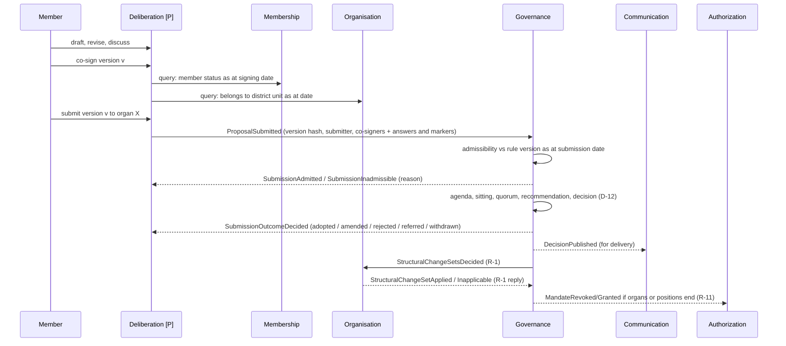

# Strategic DDD discovery: from a member's proposal to an official governance decision (scenario test)

| | |
|---|---|
| **Status** | **PROPOSED discovery evidence.** It decides, ratifies and authorises nothing. It changes no existing decision. Not independently reviewed (Claude family). |
| **Commission** | Principal, 2026-11-09: "Strategic DDD Discovery: End-to-End Proposal and Governance Decision" (accepted by the Principal together with the review recommendations). |
| **Process position** | Scenario test of the working model (`2026-11-08-strategic-context-map-and-governance-tactical-model.md`, PROPOSED). It counts as **input to roadmap Phase 5, not Phase 5 output**: the status record (§9a) says strategic discovery waits for the organisational baseline, and Gate F is open. That tension is HD-1 of `../architecture/reviews/2026-11-09-business-capability-and-strategic-ddd-baseline-discovery-report.md`, still open. |
| **Placement** | `php scripts/doc-placement.php --scope=product-specific --maturity=research --domain=publicdigit` → `docs/publicdigit` (exit 0); `reviews/`, next to the Session B discovery records. |
| **Snapshot** | branch `election-flow-updated`, HEAD `5a26453d5` |

**Labels:** **FACT** · **INTERPRETATION** · **ASSUMPTION** · **UNKNOWN** · **RECOMMENDATION** · **[PK]** = the Principal's recorded practical knowledge (discovery record) · **[PRAC]** = general practice in party digitalisation known to the analyst (motion procedures in party statutes, decision books in Nepali party committees). **[PRAC] is never evidence about a particular organisation**; it shows what statutes typically regulate, to be confirmed against NRNA and party statutes (roadmap Phase 2).

## 0. Baseline and the current position

| | |
|---|---|
| **Settled constraints** | Membership RATIFIED and frozen. Governance owns competence, organs, authority and organisational governance rules (act §11 RATIFIED). Push B correction loop FROZEN, with Contestation challenging and Adjudication determining, **scoped to elections**. ADR-T23 / K1: "The authority DECIDES; this manager RECEIVES" (`app/Contexts/Adjudication/Application/Process/AdjudicationProcessManager.php:16-19`). Forward-only correction. Anonymity. |
| **Working decisions used** (PROPOSED) | D-1/D-1a/D-1b (each organisation's own constitution; the platform creates no authority); D-3/D-22 (Organisation owns structure and belonging); D-4/D-5/D-10 (Governance: RuleSet, Decision, Organ, Position, AuthorityAssignment); D-12 (competence checked on the decision date, applicability on the effective date); D-21/D-29/D-30 (structural decisions become change sets, applied by Organisation; C-4 "inapplicable"). |
| **Candidate "Communication & Deliberation" design** | `docs/architecture/members-forum-context/` (2026-06-05/06, commit `c001c87b3`): "Collective Intelligence Platform" with aggregates Problem, Idea, AlternativeProposal, **Decision**, Initiative and ReconsiderationRequest. Its decisions are marked "✅ APPROVED", but **no ARB or PO record of that approval was found**. Its index lists 11 documents, of which 7 exist (FACT). Context-map.md §4: "Communication … PROPOSED; product choice open" (O-15). |
| **Next unresolved substantive question before this round** | The relationship-specification task T6 and the Governance tactical details (RuleSet ⇄ Decision integration; meaning of `Legitimacy` and `DecisionTrace`; discovery record §8.6). **No record covers how a matter reaches an organ** (submission, agenda, sitting). This scenario tests exactly that gap. |

## 1. The scenario in plain business language

A member of the district unit thinks the district committee should change. For example, it should be split into two, or a new wing should be added. The member writes the idea down. Other members read it, argue about it and help improve the text. At some point the text is ready, and it is formally put to the body that is allowed to decide. That body considers it, perhaps after a committee has given a recommendation, and makes a decision at a properly convened meeting. The decision is recorded and announced. If it changes the organisation's structure, the structure is updated from the date the decision takes effect. Someone may later say the decision was improper.

**The key business insight (INTERPRETATION, H):** the word "proposal" covers **two different things with different owners**:
1. **A member's idea under discussion.** It is open and revisable, has many voices, and carries no authority.
2. **A matter formally before an organ**: a motion or submission. It is subject to the rules on who may submit, to whom, by when and in what form, and it must end in a recorded outcome.

The line between them is the **act of submission by someone entitled to submit**. [PRAC] Party statutes regulate exactly this: who has the right to submit motions (often units, organs or a quorum of co-signing members, and only sometimes individual members), the deadlines before a convention, form requirements, and motion committees that **recommend but do not decide**.

## 2. End-to-end process and decision points

| # | Stage | What happens | Decision point (who) | Owner (INTERPRETATION) |
|---|---|---|---|---|
| 1 | Idea | member drafts text about "the district committee" | **What is the target?** The organ (composition, competence), the unit (split, merge, boundary) or the official area (not the organisation's to change) | Deliberation [P] |
| 2 | Discussion and refinement | comments, alternatives, revised versions; support signals | moderation (who may remove content: a platform or organisation rule, not organisational authority) | Deliberation [P] |
| 3 | Co-signing (if the rules require it) | members co-sign a specific version | **Is the co-signer entitled on the signing date?** (member status, belonging to the district) | Deliberation records; Membership (R-14 pattern) and Organisation (R-2) answer "as at" |
| 4 | Formal submission | an entitled submitter submits a fixed version to a named organ | **Who may submit, to which organ, by when** (rule version as at the submission date) | **Governance** [P] (rules and competence are Governance's, act §11) |
| 5 | Admissibility and agenda | the organ or its secretariat checks admissibility; puts it on an agenda; may refer it to a committee for a recommendation | admissible / inadmissible; referral | Governance |
| 6 | Deliberation in the organ and decision | at a convened sitting with quorum; outcome adopted / adopted with amendments / rejected / referred / deferred / withdrawn | **the competent organ, on the decision date** (D-12) | Governance (Decision, D-10) |
| 7 | Recording and publication | the decision is entered (minutes or decision book); announced | whether **publication is a condition of effect** (rule) or only information | Governance (record); Communication (delivery) |
| 8 | Organisational consequence | structural content becomes change sets; Organisation applies them from the effective date, or records them as inapplicable | none (C-4: Organisation never refuses a valid decision) | Organisation (R-1, D-21/D-29) |
| 9 | Downstream effects | belongings resolve "as at" (D-13…D-19); organs or positions may end, so mandates are revoked (R-11); an election in progress is protected by its cut-off snapshot | as designed | Organisation, Governance, Authorization, Election |
| 10 | Challenge or correction | a member says the organ was incompetent or the procedure was violated (legitimacy); or asks for reconsideration with new evidence (merits) | **who hears a challenge to a governance decision?** UNKNOWN | **gap** (§9) |

## 3. Responsibility and authority (triple test: A real authority · B owning context · C platform permission)

| Fact or decision | Created by | Owned by (B) | May change | Authority to decide (A) | Consumers | Label |
|---|---|---|---|---|---|---|
| Draft and its versions | the author(s) | Deliberation | author(s) only; each version is kept | none (no authority) | members of the audience | [P] |
| Discussion contribution | any participant entitled to the audience | Deliberation | its author; moderation hides but does not rewrite | none | — | [P] |
| Support or co-signature on a version | a member | Deliberation (records the act) | withdrawable before submission [PRAC] | none, **but legally relevant** if the rules give submission rights to a quorum of co-signers | Governance at admissibility | [P]; rule [OQ] |
| Submission (the matter before an organ) | the entitled submitter | **Governance** | only by withdrawal or amendment under the rules | admissibility: the organ (or whoever the rules name) | Deliberation (status), Communication | [P] |
| Recommendation of a committee | the referred committee | Governance (as evidence in the matter) | — | **none**: a recommendation is not a decision | the deciding organ | [PRAC]; [P] |
| Official decision | the competent organ | Governance (`Decision`, D-10) | **never**; only a later decision corrects or supersedes it (forward-only) | the competent organ on the decision date (D-12) | Organisation, Deliberation, Communication, Authorization, Election | [D] working |
| Structural change | Governance decision → change set | Organisation applies and owns the resulting structure (D-3) | — | Governance decision (basis) | Election (R-5), Governance (R-2) | [D] working |
| Membership status of participants | Membership | Membership (RATIFIED) | Membership only | Membership's competent organ (PO-ORG-MEM-01 A) | Deliberation, Governance (as-at queries) | RATIFIED |
| Who may see and take part in a discussion | organisation rules or product setting | [OQ] | — | **not organisational authority** unless the rules make it so | — | [OQ] HD-P5 |
| Platform roles (admin, owner, `setupGovernance`) | Platform | Platform | — | **never** organisational authority (PO-ORG-MEM-01 A) | Authorization | APPROVED principle |

## 4. Bounded-context boundary assessment

| Boundary | Does the scenario support it? | Evidence and reasoning |
|---|---|---|
| Organisation (structure, belonging) ⇄ Governance (authority, decisions) | **Supported, H.** The proposal only *asks for* a change; Governance decides; Organisation applies from the effective date; "inapplicable" is a reply, not a refusal | D-3, D-21, C-1…C-5; nothing in the scenario needs Organisation to judge competence |
| Membership ⇄ the rest | **Supported, H.** The scenario only *queries* membership status as at a date (signing, submission); it creates no Membership fact | ratified §8 predicates; R-14 pattern. No new Membership ownership |
| Committee identity ⇄ committee responsibilities | **Needs refinement, M.** "The district committee" is ambiguous in the code: the `committees` table stands for organs **and** units (DR-07b; 2026-11-08 model §6). The proposal's *target type* must be explicit (organ, unit or official area) | PO-DR07-01 (organs ≠ units); DR-07a/b OPEN |
| **Deliberation ⇄ Governance** | **A distinct responsibility is supported, M** (§10). **The boundary line is the submission** (§1) | different invariants (§6), actors and lifecycle; [PRAC] statutes separate debate from motion procedure |
| Deliberation ⇄ Communication (delivery) | **Needs refinement, M.** Announcing a decision is *delivery* (newsletter, notice); discussion is *deliberation*. These may be one context or two | O-15 open; existing code mixes them |
| Contestation / Adjudication ⇄ governance decisions | **Gap.** The FROZEN loop covers election outcomes; the forum design forbids appeal; **no designed home** for a challenge to a governance decision's legitimacy | BDR-04/05 v1.1 (scope: contested election outcome); forum Decision 4 "AppealAvailable: false" |
| Governance internal: organ proceedings | **Missing capability, M–H.** Validity of an organ's decision normally depends on a duly convened sitting, agenda and quorum, and is evidenced by minutes or a decision book [PRAC]. The working model has Organ and Decision, but **no sitting, agenda, quorum or minutes concept**. The record form is [OQ] (discovery record §2.3, line 106). Quorum code exists only for voting (`app/Domain/Voting/QuorumRule/*`) | grep of the three strategic records and of `app/Contexts/Governance` (FACT: no hits) |

**Overlaps found:**
- **O-A:** The forum design's `Decision` aggregate ("the choice made by leadership"; `DecisionMaker: person or committee`; statuses ACCEPTED/REJECTED/RECONSIDERED; `docs/architecture/members-forum-context/20260605-0920-CORE-DOMAIN-MODEL.md:205-247`) **duplicates** Governance's official decision. INTERPRETATION (H): in Deliberation it can only be a *projection* of a Governance outcome, never its own decision.
- **O-B:** The forum's "Decision immutable" (`:484`) conflicts with its own status `RECONSIDERED` on the same aggregate (internal contradiction, FACT).
- **O-C:** The forum's "Reconsideration, NOT Appeal" (`20260605-1000-DESIGN-DECISIONS.md:278-330`) mixes two kinds of challenge. A *merits* review (new evidence → the same organ decides again, which fits Governance: a new decision) differs from a *legitimacy* challenge (incompetent organ, violated procedure), which by its nature cannot be left to the organ challenged. Forbidding the second by product design is a governance decision for each organisation's rules, not a software choice.

## 5. Context interaction map for this scenario

| Interaction | Initiator → authoritative provider | Kind | Immediate answer needed? | If delayed | May the receiver interpret the sender's rules? |
|---|---|---|---|---|---|
| status of a co-signer / submitter | Deliberation → Membership | **query "as at"** (R-14 pattern, INDETERMINATE allowed) | yes, at signing and submission | the signature is recorded as unverified; admissibility decides later | **no**: Deliberation stores the answer and its `seq` |
| belonging to the district | Deliberation → Organisation | query "as at" (R-2) | yes | as above | no |
| submission | Deliberation → Governance | **command-like integration event** (a request, not a decision) | no; an acknowledgement follows | the matter is "submitted, pending admission"; deadlines count from the submission time recorded by Governance [OQ] | — |
| admissibility and outcome | Governance → Deliberation | **decision outcome** (authoritative) | no | Deliberation shows "pending"; it never infers an outcome | **no**: Deliberation must not evaluate competence or rules (ACL) |
| decision publication | Governance → Communication | **notification**, *unless* the rules make publication a condition of effect, in which case publication is a Governance fact [OQ] | no | delivery late; effect unaffected (if not a condition) | no |
| structural consequence | Governance → Organisation | decision → change sets (R-1) | no | applied from the **effective date**, not processing time (C-2) | no; basis check only (D-12) |
| mandates | Governance → Authorization | events (R-11) | no | stale permissions: fail closed (INV-ORG-SCOPE-1) | no |

## 6. Business rules and invariants discovered (all [P]; rule content per organisation [OQ])

| ID | Rule / invariant | Why (business) | Source |
|---|---|---|---|
| PR-1 | Discussion and support signals **never** constitute an official decision or confer authority | D-1a: platform features create no authority; legitimacy belongs to organs | D-1a; act §11 |
| PR-2 | A submission refers to **one immutable version** of the text; later edits create a new version, which needs a new submission or a formal amendment | the organ must decide on a fixed text; co-signatures attach to a version | [PRAC] |
| PR-3 | Admissibility (who may submit, to which organ, deadline, form) is judged by the **rule version in force on the submission date** | the same "as at" logic as D-12 | D-12 analogy |
| PR-4 | A co-signature counts only if the co-signer was entitled **on the signing date**; the answer and its marker are stored, never re-derived | reproducibility | R-14 / ratified INV-14 pattern |
| PR-5 | Every admitted submission ends in **exactly one recorded outcome** (adopted, adopted amended, rejected, referred, deferred, withdrawn, inadmissible) | accountability; no matter "disappears" | [PRAC]; forum Decision 7 "transparency" (intent kept) |
| PR-6 | A recommendation is never an outcome | separation of advice from decision | [PRAC] |
| PR-7 | An official decision is valid only if the organ was competent on the decision date (D-12), **and, where the rules require, taken at a duly convened sitting with quorum** | legitimacy | D-12; [PRAC]; quorum rule [OQ] |
| PR-8 | Decisions are never changed; reconsideration produces a **new** decision referring to the earlier one | forward-only | D-10; forward-only principle |
| PR-9 | A structural decision takes effect from its effective date; failure to apply is "inapplicable", never "invalid" | C-2, C-4 | D-12, D-21 |
| PR-10 | The target of a proposal is typed: organ, unit or official area; an official area cannot be changed by the organisation | prevents the legacy conflation | PO-DR07-01; D-31 |

## 7. Tactical DDD implications (each justified by an invariant; all [P], nothing implemented)

| Candidate | Context | Justifying invariant | Why not merged elsewhere |
|---|---|---|---|
| **Proposal** (draft with versions and authorship) | Deliberation | PR-2 (versions immutable; only authors revise) | a separate lifecycle from the matter before the organ; may never be submitted |
| **Discussion** (contributions about a proposal version) | Deliberation | contributions reference a version; high write concurrency | keeping it apart from Proposal avoids contention between many comments and author edits (consistency boundary, not taste) |
| **Support / co-signature record** | Deliberation (entity of the proposal version, or its own aggregate if counts must be enforced) | PR-4 | its evidence (status answer + marker) must be stored at signing time |
| **Submission** (matter before an organ) | **Governance** | PR-3, PR-5, PR-6 (one outcome; admissibility as at a date; recommendations as evidence) | it exists **before** any Decision and may end without one (withdrawn, inadmissible), so it cannot be part of `Decision` |
| **Sitting / proceedings** (convening, agenda, quorum, minutes) | Governance | PR-7 | **missing** from D-10. Needed only if PR-7 is confirmed by statutes; **do not model before evidence** |
| `Decision` (exists in the working model, D-10) | Governance | PR-8 | unchanged; gains a reference to the Submission it disposes of |
| **Submission process manager** | Governance (application layer) | PR-5 plus R-1 reply handling | **precedents:** `GovernanceApprovalProcessManager` (idempotent, terminal guard) and ADR-T23 "the authority decides; the manager receives". It coordinates and never decides |
| **ACL in Deliberation** | Deliberation | PR-1 | translates Governance outcomes into display states; never evaluates rules or competence |
| Published language | Deliberation → Governance: `ProposalSubmitted`; Governance → Deliberation and Communication: `SubmissionAdmitted`/`SubmissionInadmissible`, `SubmissionOutcomeDecided`, `DecisionPublished` | names are placeholders | keyed by submission ID plus version hash; idempotent |
| Audit | platform (BDR-09) | decision history immutable | no new context |

**Explicitly not proposed:** a Problem/Initiative model (the forum design's) until the product scope (HD-P2) is decided; a rules engine (D-1c); any Membership change.

## 8. Implementation alignment

| Area | Classification | Evidence (FACT) | Business consequence |
|---|---|---|---|
| Member discussion / proposal | **LEGACY / MISSING** | `OpenionController` (`app/Http/Controllers/OpenionController.php:75-105`): user-level posts (title, hashtag, body), **no organisation or unit scope**, public `GET /openions` (`routes/openion/openionRoutes.php`); `openions` table only in backup migration folders (`database/migrations_backup_*`); no proposal, version or submission concept | no tenant-scoped deliberation exists; reuse would leak posts across organisations |
| Governance decision | **PARTIALLY ALIGNED** | `app/Contexts/Governance/Domain/GovernanceDecision.php`: immutable record with committee, legitimacy, basis, trace. But `effectiveFrom > decidedAt` is **forbidden** (`record()`), the inverse of D-12/C-2 (already noted in the 2026-11-08 model §18). No production caller of `GovernanceDecision::record` was found | decisions with a future effective date (the normal case for a structural change) cannot be recorded |
| Approval process | **PARTIALLY ALIGNED** | `GovernanceApprovalProcessManager`: idempotent; "required approvals list is empty (resolver would populate this in real usage)" | the coordination pattern exists; competence resolution does not |
| Submission, agenda, sitting, quorum | **MISSING** | no hits in `app/Contexts/Governance` | PR-3…PR-7 unsupported |
| Structural change | **POTENTIALLY MISALIGNED** | `GovernanceSetupController` → Membership `DefineCommitteeStructure` / `ActivateCommitteeStructureUseCase` under platform permission `setupGovernance` (`GovernanceSetupController.php:8-9,23,45,70`); `execute(array $command)` (`ActivateCommitteeStructureUseCase.php:11`); **no decision reference** | structure changes without a Governance decision basis (contrary to D-21, C-1…C-5), by platform permission (contrary to PO-ORG-MEM-01 A's principle); placement in Membership (DR-07a) |
| Organisation applying change sets | **MISSING** | no Organisation context (§3 of the platform report) | — |
| Decision delivery | **LEGACY** | newsletters in Membership controllers; known defects PBDIGIT-74/75 | — |
| Challenge to a governance decision | **MISSING** | Contestation/Adjudication scoped to elections and unrouted | — |

**Out-of-scope security observation (reported, not investigated further):**
- **S-7:** `OpenionController::store` keeps the body unescaped (`htmlspecialchars` commented out, `:94`; same in `update`, `:203`), and `Components/Discussion/Openions.vue:46` renders it with `v-html` after decoding entities (`decodeHtml`, `:272`).
- INTERPRETATION (M): this is a likely stored XSS on a public page, if the feature is live. Whether the table exists in production is UNKNOWN.
- Belongs with the S-1…S-6 triage (D-0 of the mobile report).

## 9. Contradictions, uncertainties, missing evidence

| ID | Item | Label |
|---|---|---|
| K-1 | Forum `Decision` aggregate vs Governance ownership of official decisions (act §11 RATIFIED; D-10) | contradiction between a candidate design and a ratified boundary; **the ratified boundary stands**; the forum design needs reframing |
| K-2 | Forum "APPROVED" markers (2026-06-05) without any approval record | UNKNOWN authority; treat as historical input |
| K-3 | Challenge to governance decisions: no home. Push B is FROZEN to election outcomes; the forum forbids appeal | gap; extending Contestation/Adjudication would need an ARB act (re-issue via ADR) |
| K-4 | Structural changes in code without a decision basis (§8) | implementation vs working decision |
| K-5 | Status record vs Session B (HD-1 of the platform report) | process |
| U-1 | Who may submit (individual member, unit, organ, a quorum of co-signers); deadlines; motion committee; outcomes; publication as a condition of effect; quorum and sitting rules | **needs statutes** (Phase 2 NRNA request: RECOMMENDATION to add "motion/proposal procedure, standing orders, minutes rules" to Appendix A) |
| U-2 | Whether members of other units may join a district's discussion | rules or product |
| U-3 | Whether the Nepali committee practice of a signed decision book (निर्णय पुस्तिका / minutes) is the legal record of decisions | [PRAC]; confirm with statutes |

## 10. Genuine human decisions (cannot be resolved by more investigation)

| # | Decision | Options | Recommendation |
|---|---|---|---|
| **HD-P1** | **Product scope:** is member deliberation (drafting, discussing, co-signing proposals) part of PublicDigit now? | (a) yes, as a candidate context; (b) later; (c) no, formal submissions only | (a) or (b). It is distinctive for party digitalisation, but it is not needed for the formal path |
| **HD-P2** | **Ownership of the formal submission:** Governance (from the moment of submission) or Deliberation | (a) Governance; (b) Deliberation, with Governance only deciding | **(a)**: admissibility and competence are Governance rules (act §11) |
| **HD-P3** | **Challenges to governance decisions:** out of scope; reconsideration only (new decision by the same organ); or a legitimacy-challenge path (would extend the FROZEN Contestation/Adjudication scope via ARB/ADR) | (a)/(b)/(c) | (b) now; (c) only by an explicit ARB act. Do not let the forum's "no appeal" rule decide this by default |
| **HD-P4** | **Status of the June 2026 forum design** (`docs/architecture/members-forum-context/`) | (a) historical input only; (b) candidate design to revise; (c) adopted | (a) or (b). Its Decision aggregate must not be adopted (K-1) |
| **HD-P5** | **Audience of a discussion:** unit members only, organisation-wide, or set by each organisation's rules | — | per organisation's rules, with a product default the PO chooses (a default is configuration, not authority, D-1b) |

The supported range of submission rules (U-1) is **not** a PO decision about any organisation's content. Under D-1/D-1b each organisation's statutes decide. The PO decides only which rule shapes the product supports, and that waits for the statutes.

## 11. Answers to the final questions

- **Does the existing strategic context map represent this scenario correctly?** **Mostly, for the back half** (decision → Organisation → downstream: R-1, R-2, R-11, C-1…C-5 work as designed). **Not the front half:** it has no Deliberation, no Submission and no organ proceedings, and Communication is a single unspecified row.
- **Boundaries supported by evidence:** Organisation ⇄ Governance (applies vs decides); Membership as an "as at" provider only; Governance as the sole owner of official decisions; Authorization owns no truth.
- **Boundaries needing refinement:** Deliberation ⇄ Governance (the submission line); Deliberation ⇄ Communication; committee as organ vs unit vs official area (DR-07); challenge paths for governance decisions.
- **Is Member Communication & Deliberation a distinct business responsibility?** **Yes, as a responsibility (M).**
  - Different actors (any member vs competent organs).
  - Different invariants (open, versioned, revisable, authority-free vs immutable and competence-bound).
  - Different lifecycle (may never reach an organ).
  - [PRAC] statutes separate debate from motion procedure.
  - **Whether it is its own bounded context or part of Governance is HD-P1/HD-P2.** The evidence is design-level and [PRAC], not yet statutory.
- **Does the scenario reveal a missing capability?** **Yes, two:** (1) **organ proceedings** (submission and agenda, sitting, quorum, minutes), which official decisions depend on; (2) a **challenge path for governance decisions**.
- **Next tactical question:** *What makes a Governance decision procedurally valid, and how is that evidenced?* That is: the relationship between Submission, sitting/quorum/minutes, and `Decision`, including outcomes without a decision (withdrawn, inadmissible). Fix the `GovernanceDecision` effective-date rule as part of that slice once authorised. **Prerequisite:** at least one statute or standing orders with motion and meeting rules (Phase 2).

## Traceability
- **Records read:** roadmap plan §5 and Appendix B; strategic-design-status §3–§9a; context-map.md §4; discovery record §1, §2.3, §3–§4, §8.6, §9.5, §10.5; 2026-11-08 model §1–§19; Round 49-06 BDR (incl. v1.1); members-forum-context INDEX, CORE-DOMAIN-MODEL, DESIGN-DECISIONS, CRITICAL-DISCOVERY-GAPS; platform discovery report 2026-11-09; cross-project discovery 2026-11-07; `public-digit/CLAUDE.md:545-632`.
- **Code read:** `GovernanceDecision.php`, `GovernanceApprovalProcessManager.php`, `AdjudicationProcessManager.php:1-52`, `GovernanceSetupController.php`, `ActivateCommitteeStructureUseCase.php`, `OpenionController.php`, `Openion.php`, `routes/openion/openionRoutes.php`, `Components/Discussion/Openions.vue`, `app/Domain/Voting/QuorumRule/*` (listing).
- **Side effect of this round:** corrections to `../architecture/mobile-investigation/00` and `10` (Angular/public-digit history; D-2 not to be decided on that report alone).
